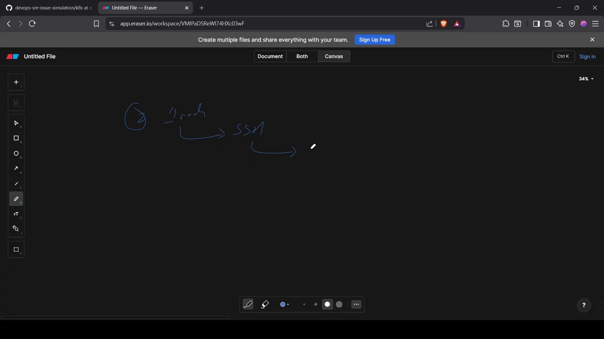
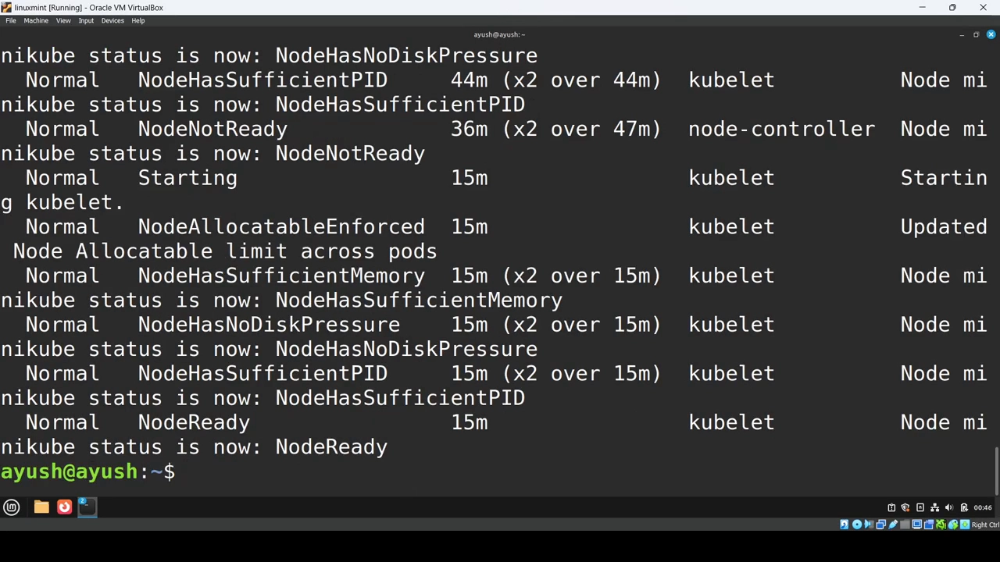
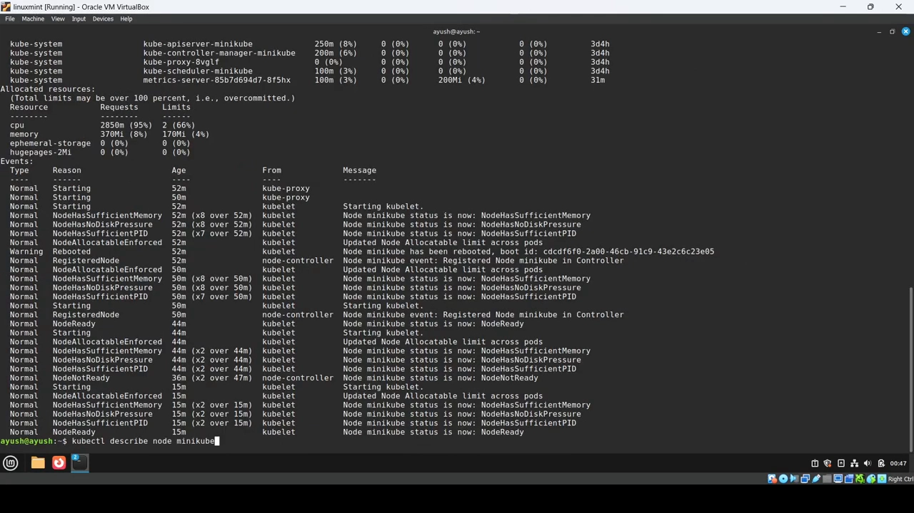
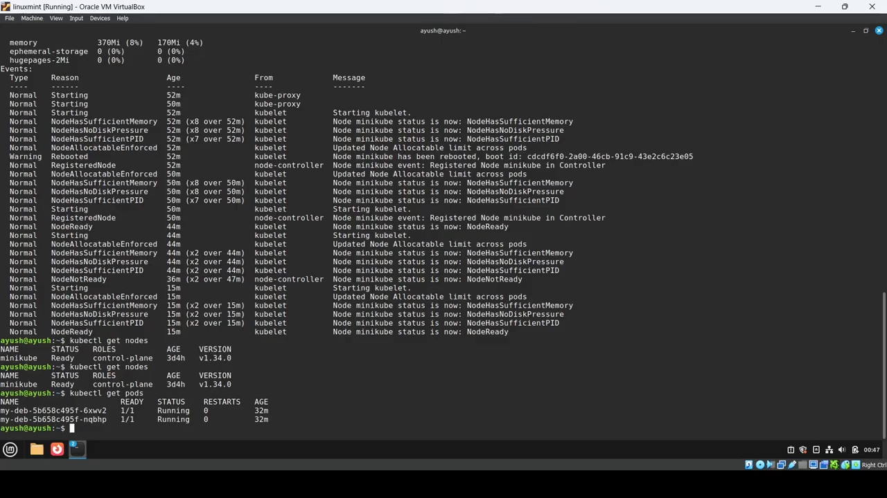
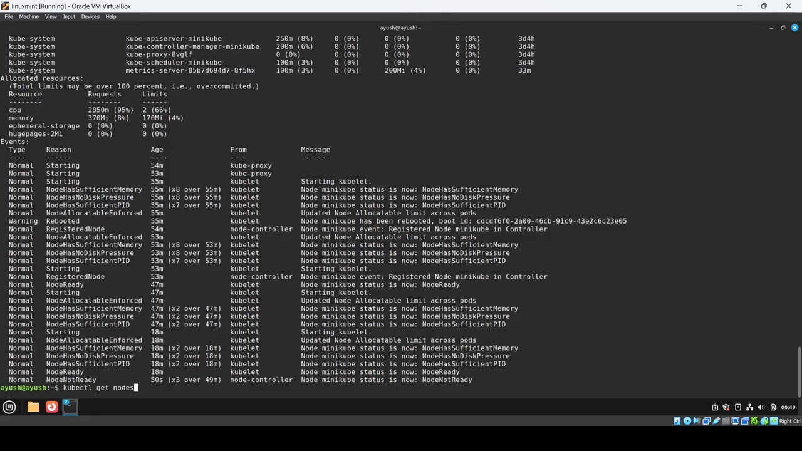
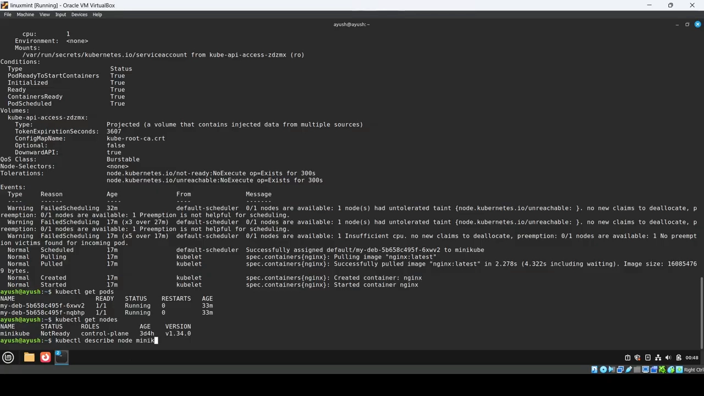
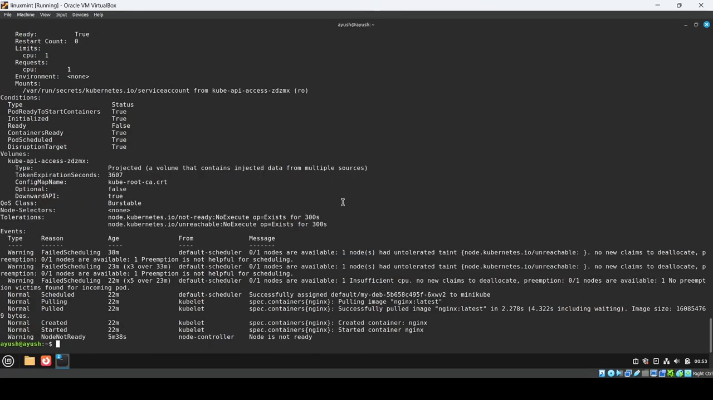
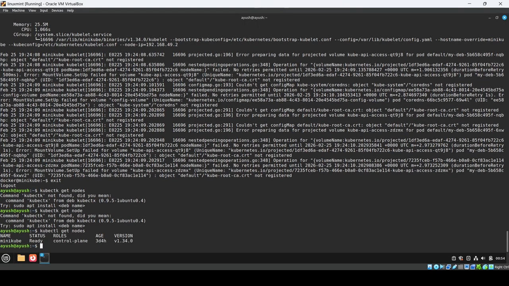

# 实测：把 kubelet 停掉之后，节点多久变 NotReady、Pod 多久被驱逐

## 本讲要解决的核心问题（SCQA）

**背景**：`kubectl get nodes` 里节点状态是 `Ready` 还是 `NotReady`，是日常排障最先看的一格。一个节点上的 Pod 要能跑起来，靠的是节点上的 **kubelet**（管理 Pod 与容器）、**kube-proxy** 以及 **CNI 插件**等组件。

**冲突**：如果节点上的某个关键组件挂了——尤其是 kubelet——控制面会怎样、多久才会发现？发现之后，节点上原本跑得好好的 Pod 会立刻被赶走吗？很多人对这两件事的「时间感」是错的，事故里往往因此耽误判断。

**疑问**：节点到底是怎么被判成 `NotReady` 的？从组件停摆到节点变 `NotReady`、再到 Pod 被驱逐，中间各自要等多久？我们又该用什么命令去把这个过程看出来？

**回答（中心思想）**：**kubelet 是那个定期给控制面发「我还活着」信号的进程**：它大约**每 10 秒**发一次；一旦**连续约 40 秒**收不到信号，节点就会被判为 **`NotReady`**。但节点变 `NotReady` **并不等于 Pod 立刻被驱逐**——Pod 上会被自动加上一个针对 `NotReady` 的**容忍（toleration，默认 300 秒）**，所以**默认还要再等 5 分钟**，Pod 才会真正进入驱逐/重新调度。下面用 minikube 单节点把整套流程实测一遍。

> 本讲基于视频《Node NotReady Explained — Kubernetes Node Failure Simulation & Troubleshooting (Hands-On Demo)》整理，视频是实操演示，本文保留了其中的关键命令与截图。

---

## 一、节点为什么会 NotReady：kubelet 就是那个「发心跳」的进程

先讲「为什么」（[【跳转到 00:00】](https://www.youtube.com/watch?v=PKXssuwRL3A&t=0)）。一个节点上会跑：

- **kubelet**——管理 Pod、让容器在 Pod 里跑起来的核心进程；
- **kube-proxy** 以及 **CNI 插件** 等负责网络的东西。



而发生 `NotReady` 的关键在于（[【跳转到 00:50】](https://www.youtube.com/watch?v=PKXssuwRL3A&t=50)）：

- **kubelet 是那个向控制面发送心跳（信号）的进程**，相当于不停地说「我准备好了」；
- **kubelet 大约每 10 秒**发一次信号；
- 如果 kubelet 挂了（比如崩溃），就**发不出信号**；当控制面**连续约 40 秒**都没有收到信号时，**节点就被判定为 `NotReady`**；
- 此时节点上正在运行的资源 / Pod 会被**驱逐**，它们会重新变成 **Pending** 或进入 **terminating** 状态（[【跳转到 01:15】](https://www.youtube.com/watch?v=PKXssuwRL3A&t=75)）。

kubelet 是这样，**容器运行时**（如 containerd、docker）出问题也是类似的情况——用 `kubectl get nodes -o wide` 就能看到节点的容器运行时是什么。

## 二、实测准备：用 minikube 制造一次 NotReady

接下来动手复现（[【跳转到 02:05】](https://www.youtube.com/watch?v=PKXssuwRL3A&t=125)）。环境是一个单节点的 minikube 集群：

1. 先 `kubectl get nodes`，确认当前节点是 **Ready**；
2. 用一个 **Deployment** 跑 **2 个副本**（每个请求 2 个 CPU），确认 **2 个 Pod 正常运行**；
3. 用 **`minikube ssh`** 登录进这个节点；
4. 在节点上查看 kubelet 进程，确认它是 **active and running** 的（[【跳转到 03:58】](https://www.youtube.com/watch?v=PKXssuwRL3A&t=238)）。

在动手之前，先看一下**正常状态**长什么样（[【跳转到 04:34】](https://www.youtube.com/watch?v=PKXssuwRL3A&t=274)）：

```bash
kubectl describe node minikube
```

往上翻到 **Conditions** 一节，可以看到各 condition **状态正常**，并且能看到 **kubelet 正在上报 Ready 状态**——也就是它在把状态**发往控制面**（[【跳转到 04:41】](https://www.youtube.com/watch?v=PKXssuwRL3A&t=301)）：



## 三、停掉 kubelet：约 40 秒后节点变 NotReady

现在从另一个终端**把 kubelet 服务停掉**（[【跳转到 05:06】](https://www.youtube.com/watch?v=PKXssuwRL3A&t=306)）。停掉之后，**大约要等 40 秒**，节点才会显示为 `NotReady`。



这段时间里有一个**容易被忽略的现象**：在节点变 `NotReady` 之前，`kubectl get pods` 里的 Pod **一直是 Running**；甚至**在节点已经 `NotReady` 之后，Pod 仍然在 Running**（[【跳转到 05:31】](https://www.youtube.com/watch?v=PKXssuwRL3A&t=331)）。

## 四、为什么 Pod 没被立刻赶走：一个 300 秒的容忍

为什么节点都 `NotReady` 了 Pod 还照样跑？去看 Pod 就明白了（[【跳转到 05:56】](https://www.youtube.com/watch?v=PKXssuwRL3A&t=356)）：

```bash
kubectl describe pod <pod-name>
```



会发现 **Pod 上已经被（kubelet）自动加了一条 toleration**：**针对「节点不可达（unreachable）」和「NotReady」两种情况**，这个容忍**会生效 5 分钟，也就是 300 秒**。所以在两种情况下（不可达 / NotReady），**都需要再等 5 分钟**，驱逐才会发生。

等待约 5 分钟后，Pod 才真正进入 **Pending / terminating**（[【跳转到 07:53】](https://www.youtube.com/watch?v=PKXssuwRL3A&t=473)）：



## 五、排障：用 describe node 的 Events 找到根因

如果在生产环境遇到这个问题，排查办法是（[【跳转到 06:43】](https://www.youtube.com/watch?v=PKXssuwRL3A&t=403)）：

```bash
kubectl describe node <node-name>
```

看下面的 **Events**，会看到类似 **`kubelet stopped posting node status`** 的事件——**意思是 kubelet 不再把状态上报（update）给控制面**，因此控制面收不到任何来自该节点的信息，只好把它标记为 `NotReady`（[【跳转到 07:08】](https://www.youtube.com/watch?v=PKXssuwRL3A&t=428)）：



## 六、恢复：启动 kubelet，节点自动回到 Ready

最后把服务恢复（[【跳转到 08:29】](https://www.youtube.com/watch?v=PKXssuwRL3A&t=509)）：

```bash
sudo systemctl start kubelet
systemctl status kubelet   # 确认 running
```



稍等之后 `kubectl get nodes` 会重新变成 **Ready**，`kubectl get pods` 里两个 Pod 也**自动回到 Running**——一切**自动恢复**（[【跳转到 09:14】](https://www.youtube.com/watch?v=PKXssuwRL3A&t=554)）：



## 小结

- **kubelet 是节点上的「心跳发送方」**：约每 **10 秒**给控制面发一次信号。
- **连续约 40 秒**收不到信号 → 节点被判 **`NotReady`**；kubelet 或容器运行时（containerd/docker）出问题都可能触发。
- **节点 `NotReady` ≠ Pod 立刻被驱逐**：Pod 上有一条约 **300 秒（5 分钟）** 的默认容忍（针对 NotReady / unreachable），之后才会进入驱逐 / 重新调度。
- **排障命令**：`kubectl describe node <name>` 看 **Events**，典型事件是 **`kubelet stopped posting node status`**。
- **恢复**：`sudo systemctl start kubelet`，节点回到 Ready 后 Pod 自动恢复。
- 一句话回答「节点 down 了会发生什么」：**默认 5 分钟内 Pod 仍会在 NotReady 节点上跑，之后才被驱逐。**

## 关键术语速查

| 术语 | 一句话解释 |
| --- | --- |
| NotReady | 节点状态之一：控制面在约 40 秒内没收到 kubelet 心跳就判节点不可用 |
| kubelet 心跳 | kubelet 约每 10 秒向控制面发送一次的存活信号 |
| NotReady / unreachable 容忍 | 节点失联后自动加在 Pod 上的 toleration，默认 300 秒内不驱逐 Pod |
| 驱逐（eviction） | 容忍到期后，Pod 被赶出节点并重新调度（进入 Pending / terminating） |
| `kubelet stopped posting node status` | describe node 的 Events 里最常见的原因事件：kubelet 不再上报状态 |
| `minikube ssh` | 进入 minikube 节点内部，便于停/起 kubelet 做演示 |
