# Kubernetes 三种探针实战：启动、就绪与存活的联动验证

## 本讲要解决的核心问题（SCQA）

**背景**：Pod 处于 `Running` 状态、进程在、端口也开着——看起来服务一切正常。

**冲突**：但"容器在跑"和"服务健康"根本不是一回事。进程可能已经死锁、卡住、连接池耗尽；也可能是刚启动、还没准备好接收请求。Kubernetes 若不分青红皂白地发流量、或在启动阶段就把它当"死"处理，反而会把健康的应用折腾坏。

**疑问**：Kubernetes 到底靠什么判断"这个容器该不该收流量""是不是还活着"？

**回答（中心思想）**：靠 **三种探针**——启动探针（startup）、就绪探针（readiness）、存活探针（liveness）。它们各自回答一个不同的问题，并把答案接到不同的"执行器"上：**启动探针是闸门，存活探针决定要不要重启，就绪探针决定要不要发流量**。本讲用一个 Go 项目把三者的联动关系逐一实测验证一遍。

> 一句话记忆：**startup 管"起没起"，liveness 管"活不活"，readiness 管"能不能接活"**。

---

## 一、三种探针，都想提升稳定性，但分工不同

三种探针的核心目标一致——**提升业务稳定性**，只是切入点不同，主要分两个方面：

- **启动阶段**：靠**就绪探针**提升稳定性。服务在启动中本来也处理不了请求，就绪探针就干脆把流量"拒之门外"，直到服务真正就绪。
- **滚动更新（升级）**：同样依赖**就绪探针**。只有新服务的探针就绪、被判定可以收流量之后，才会停掉老服务，从而实现流量的无缝衔接——对用户完全无感。

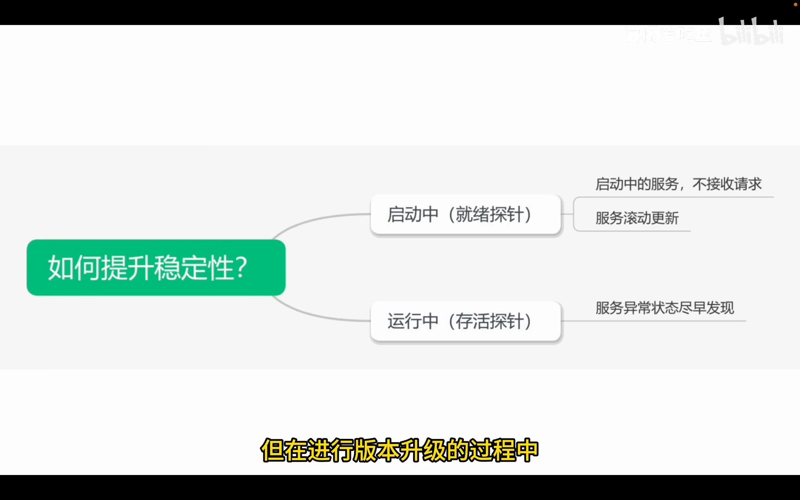

- **运行阶段**：靠**存活探针**尽早发现异常。Pod 是 `Running` 不代表服务可用——内部可能死锁、卡住、连接池耗尽，表现为 Pod 还是 Running、服务却已不可用。存活探针探测到失败并达到阈值后，就会**触发重启**，同时这个重启事件还能被监听，用于发告警。

这里其实只有两种探针在"干活"，第三种是**启动探针**——它用来**辅助**就绪探针与存活探针：**只有启动探针执行成功后，另外两种探针才开始介入工作**。

[【跳转到 02:14】](https://www.bilibili.com/video/BV1hUzjBwECr/?t=134)

---

## 二、探针有四种探测方式，同一条探针只能用一种

三种探针共用同一批**探测方式**（probe handler），一共三种常见方式：

1. **HTTP GET**：向容器内发起 HTTP GET 请求，当响应状态码在 **200–399** 之间视为探活成功。写法上指定探活路径与端口即可。

   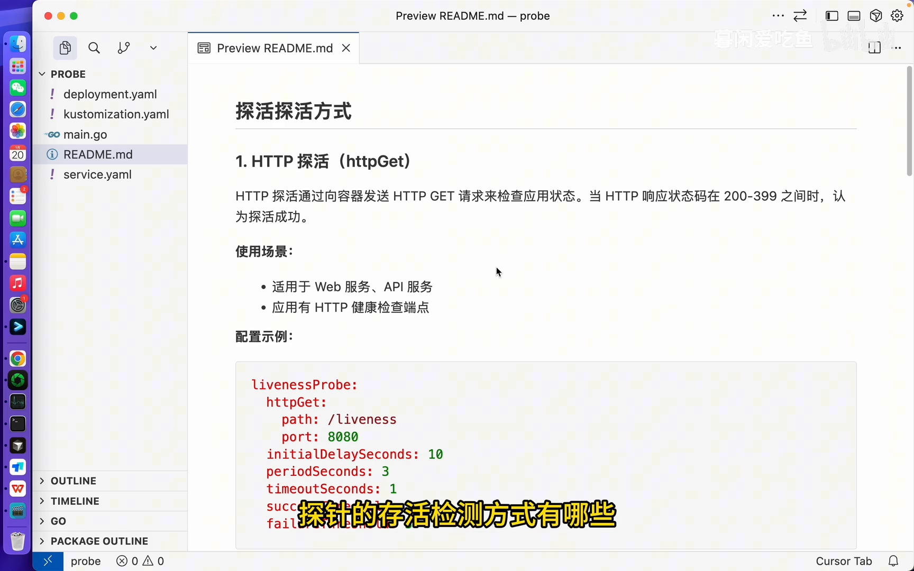

2. **gRPC**：如果服务本身是 gRPC 服务，可以直接用 gRPC 方式探测，指定 gRPC 与端口即可。
3. **EXEC（command）**：如果既不是 HTTP 服务也不是 gRPC 服务，就在容器里**执行一条命令**，根据退出状态码判定成败——**退出码为 0 表示成功，非零都算失败**。

   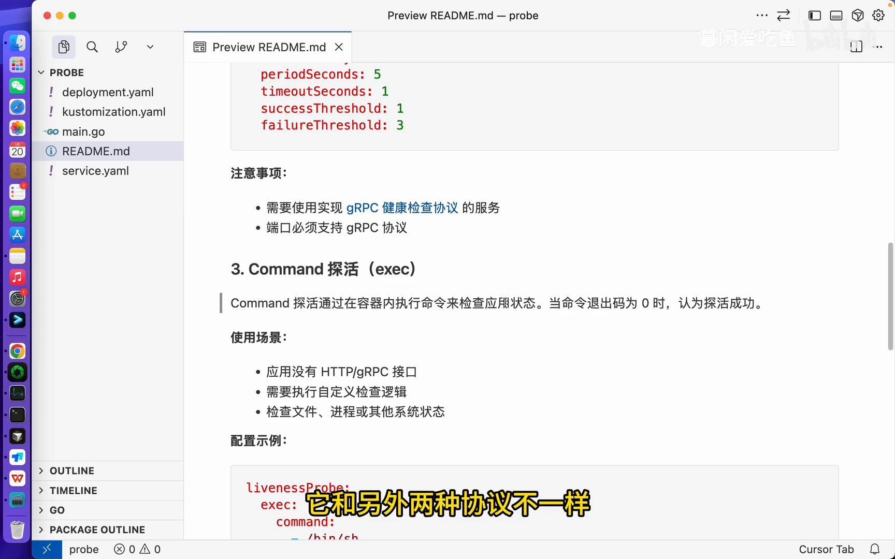

command 这种方式很灵活，因为命令内部也可以去发起 gRPC 调用或 HTTP 请求。实战演示中用一个 Go 项目、统一用 HTTP GET 来抛砖引玉。

[【跳转到 03:47】](https://www.bilibili.com/video/BV1hUzjBwECr/?t=227)

---

## 三、探针的关键参数：四个"时钟"决定探测行为

要读懂探针行为，必须先搞清这几个字段（它们在三种探针里通用）：

- **`initialDelaySeconds`（首次延迟）**：容器启动后等待多久才开始第一次探活。**默认值 0**，这一点非常重要——因为服务启动本身需要时间，把延迟设得太小会做大量"无效探活"。

  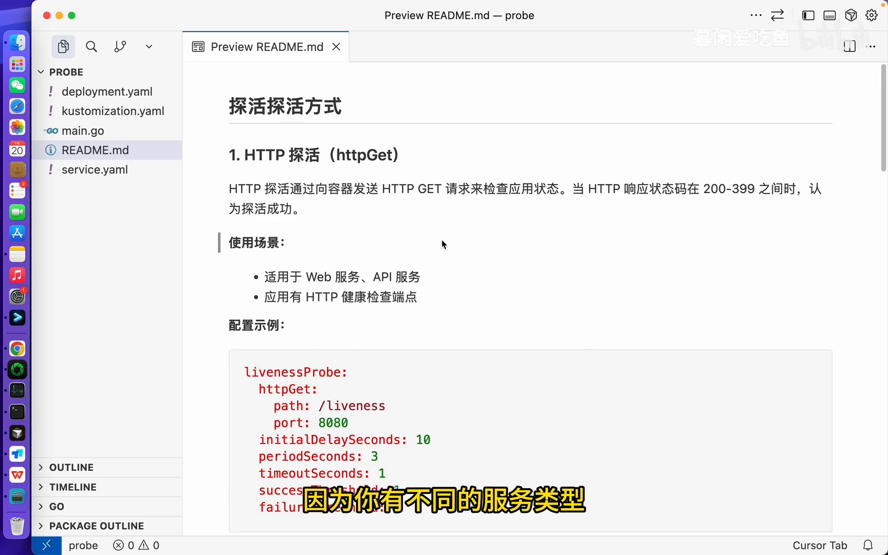

- **`periodSeconds`（探测频率）**：多久执行一次探活检查，反复进行。默认 **10 秒**一次。
- **`timeoutSeconds`（超时时间）**：单次探测最多等多久。健康检查不可能无限等待，超过超时时间没返回就算失败。

  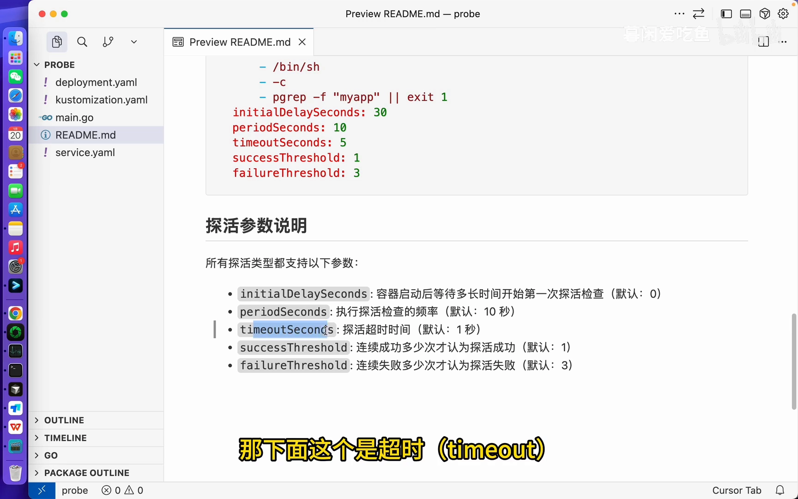

- **`failureThreshold`（失败阈值）**：连续失败多少次算整体失败。**默认 3**。一旦超过配置的次数，探针就判定失败。
- **`successThreshold`（成功阈值）**：连续成功多少次算成功，默认只需 **1 次**。

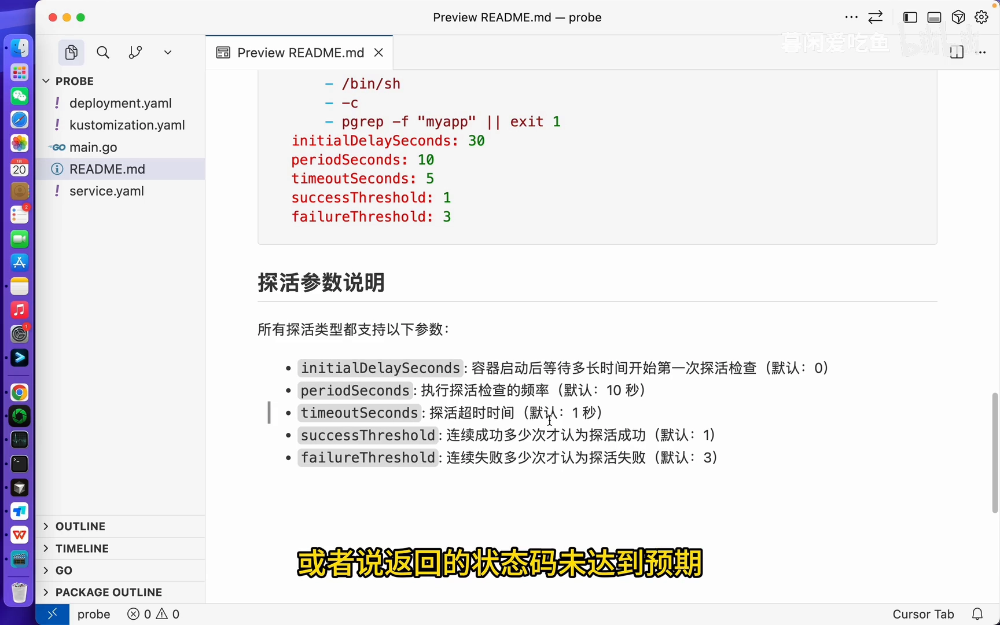

**达到失败阈值后，动作因探针类型而异**：启动探针和存活探针会**触发容器重启**；就绪探针则会**把 Pod 从 Endpoint 摘除**——流量不再进入，但容器继续运行。

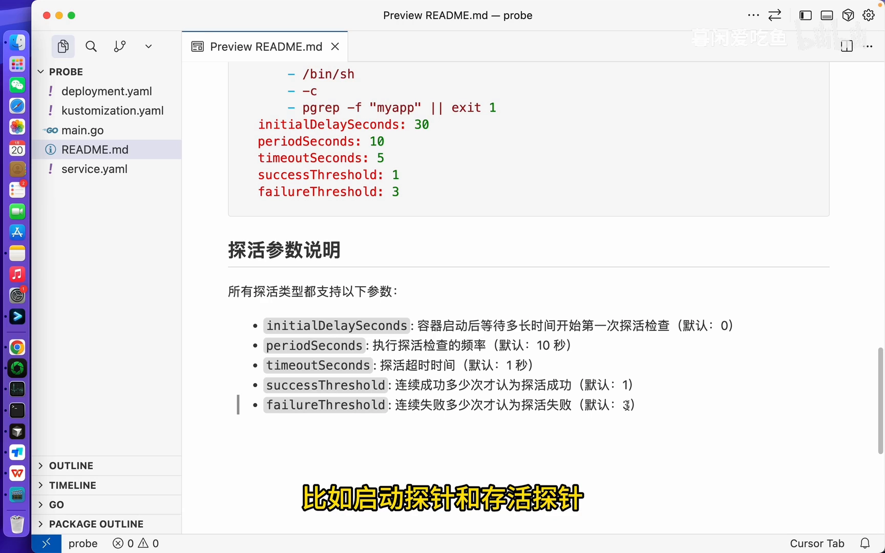

[【跳转到 04:32】](https://www.bilibili.com/video/BV1hUzjBwECr/?t=272)

---

## 四、启动探针：它是"闸门"，也最容易踩坑

启动探针要验证**两个特性**：

1. **闸门特性**：启动探针就绪之后，存活探针和就绪探针才开始工作。因为服务还没启动，另外两种探针即使工作也没有意义。

   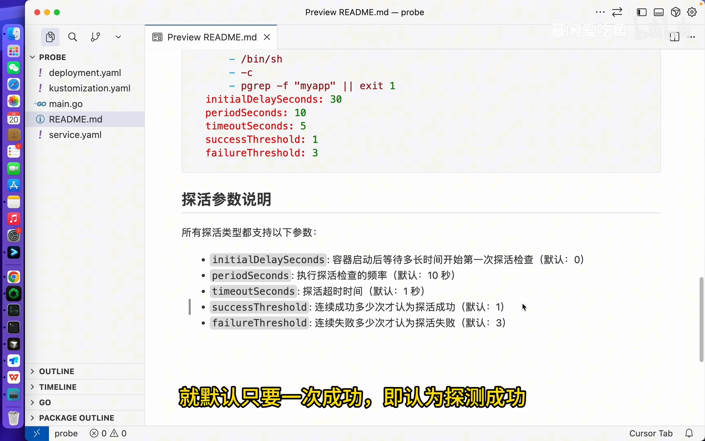

2. **重启特性**：启动探针达到失败阈值后仍未成功，就会**触发重启**。这是一个非常容易踩坑的点。

   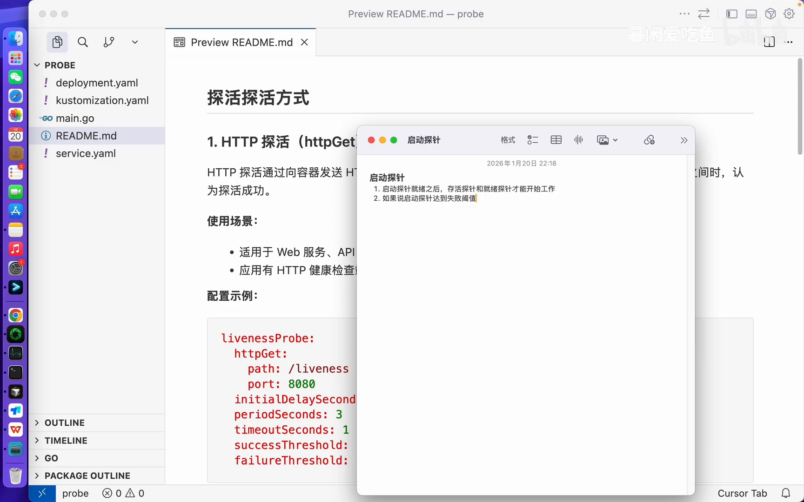

**坑的成因**：假设服务需要 10 秒才能启动，而你把 `initialDelaySeconds` 配得小于这个值，就会陷入死循环——服务还没起来 → 探测失败 → 触发重启 → 重启后再次探测时服务仍未启动完成 → 又失败。

### 4.1 实战验证：把 initialDelaySeconds 设成 3600 秒

演示项目用 **Kustomize** 编排（借助 `configMapGenerator` 把 `main.go` 变成 ConfigMap 挂进 Pod，省去反复构建镜像；用的是带 Go 环境的 arm64 基础镜像，集群是 Mac 上的 minikube）。

在 deployment 里配好探针后，把 `initialDelaySeconds` 设成 **3600 秒**（一小时）：

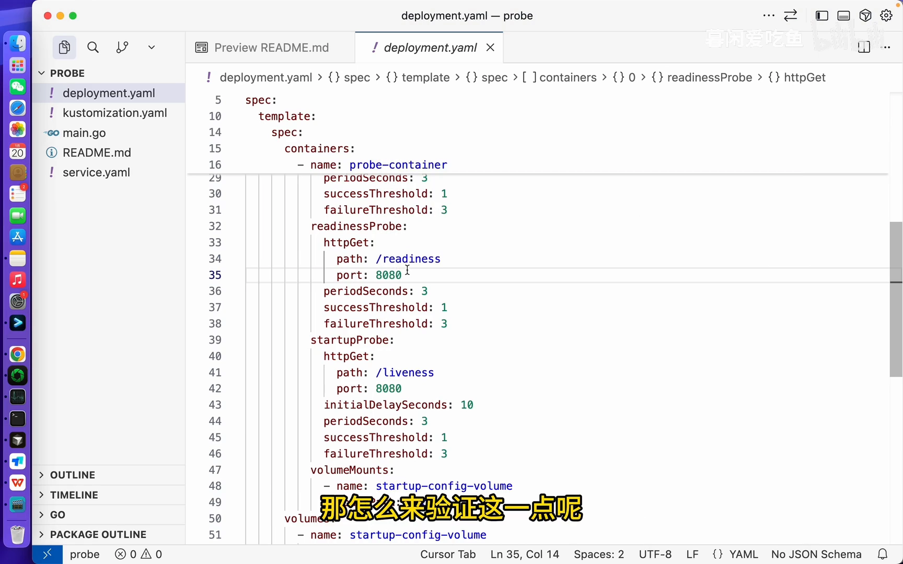

结果：服务**启动成功了**，但 Pod 一直处于 **`Not Ready`** 状态，日志里也看不到存活/就绪探针的打印——因为启动探针一小时之内不会探测，另两种探针根本没介入。这就**验证了"闸门特性"**。

### 4.2 实战验证：把延迟配小，看它反复重启

把配置改回 3 秒（即 `periodSeconds=3`、阈值 3 → **服务必须在 9 秒内完成启动**）。若服务实际需要 20 秒：

- 不到 9 秒就达到失败阈值 → **反复触发重启**，起不来；
- 把 `initialDelaySeconds` 改成 **20 秒**（大于真实启动时间）后，服务正常启动、不再重启。

[【跳转到 08:52】](https://www.bilibili.com/video/BV1hUzjBwECr/?t=532)

**结论**：当服务的启动需要较长时间时，**`initialDelaySeconds` 要尽量配大一些**。

---

## 五、就绪探针：决定"要不要把流量发给你"

就绪探针同样有两个特性：

1. **收流量特性**：就绪探针就位之后，服务才能开始接收流量。
2. **滚动更新特性**：滚动更新完全依赖就绪探针——新服务就绪后才停掉老服务。

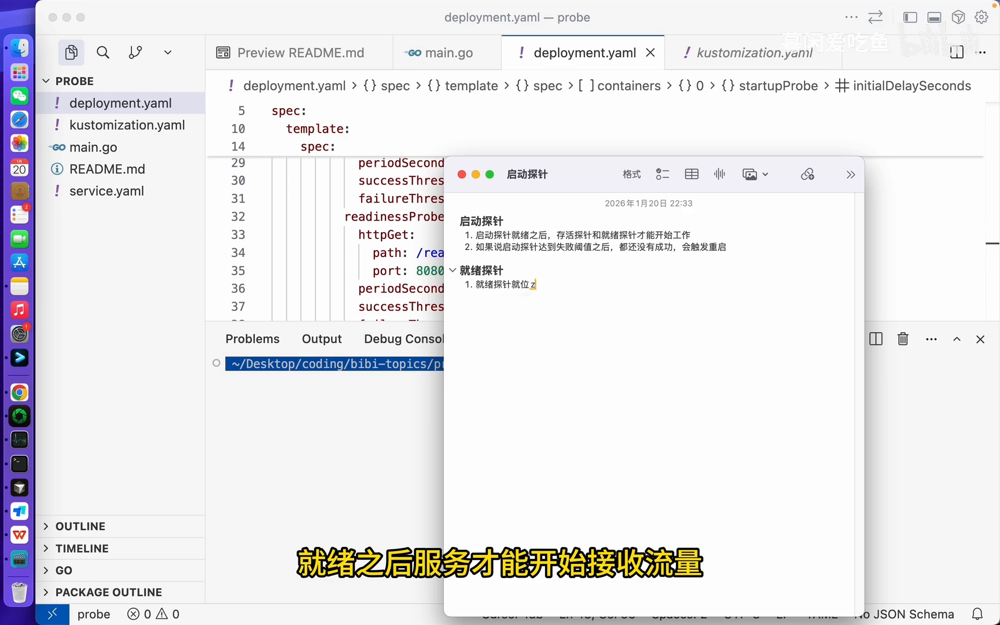

**为什么必须"就绪"才收流量？** 因为就绪之后，**Pod 的 Endpoint 才会注册到 Service** 上。K8S 里访问 Pod 一般走 `Service`（或经 `Ingress` → `Service` → Pod），Endpoint 没注册，最外层就访问不到。

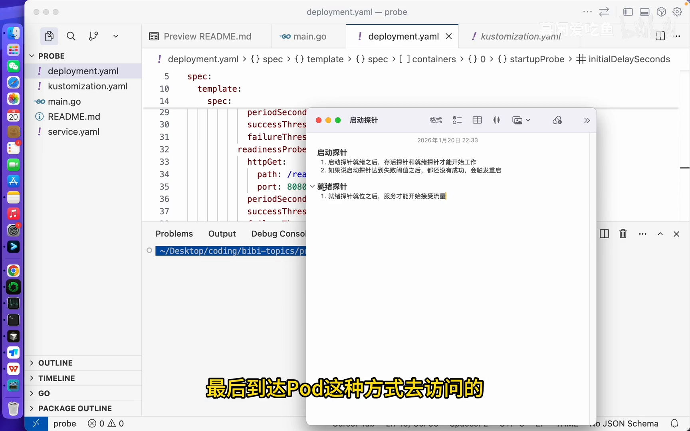

### 5.1 实战验证：让就绪探针失败，看流量是否进得来

把就绪探针的 `timeoutSeconds` 设得很短（默认 1 秒），使它必定超时失败。现象：

- Pod 一直处于 **`Not Ready`**；
- 从**最外层** `curl` Service 的 NodePort（30080）访问 **不通**；
- 但 `kubectl describe svc` 会看到 **Endpoints 为空**；
- 若 `minikube ssh` 进到 minikube 内网、直接 `curl` **容器的 Pod IP:8080**，却是**通的**——说明服务本身启动成功了，只是被就绪探针拦在了 Service 之外。

### 5.2 滚动更新：就绪探针的"死锁"演示

执行 `kubectl rollout restart deployment` 做滚动更新时，K8S 会**先起新 Pod、等它就绪，再停老 Pod**。如果新服务的就绪探针永远不就绪，老服务就一直停不掉——**滚动更新卡住**，两个服务都无法用。只有把就绪探针恢复，滚动更新才能顺利完成、实现流量无缝切换。

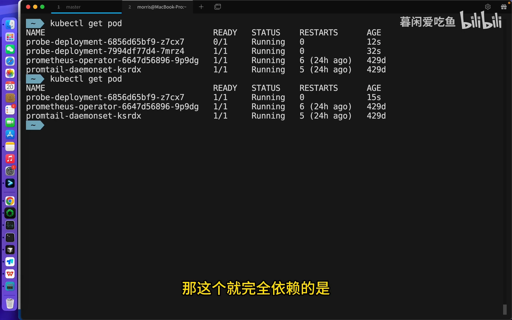

[【跳转到 11:27】](https://www.bilibili.com/video/BV1hUzjBwECr/?t=687)

---

## 六、存活探针：决定"要不要把你重启掉"

存活探针的核心特性只有一条——**服务内部探测失败时，触发容器重启**。

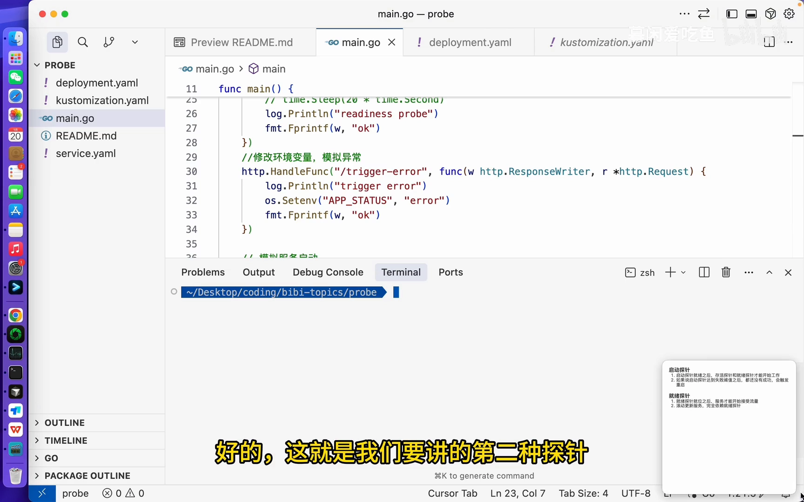

场景：Pod 是 `Running`、启动探针过了、就绪探针也过了，但服务内部死锁/阻塞/连接池耗尽。此时存活探针能**尽早发现**问题并触发重启；由于重启事件在 K8S 中可被监听，还能顺带发钉钉告警，便于进一步排查。

**实战演示**：演示项目定义了一个 `triggerError` 接口，调用后设置一个环境变量，之后所有 liveness 探测都返回 **500**。`curl` 触发 `triggerError` 后，存活探针连续失败 3 次（间隔 3 次，约 10 秒左右）即**触发重启**。

[【跳转到 16:24】](https://www.bilibili.com/video/BV1hUzjBwECr/?t=984)

---

## 小结

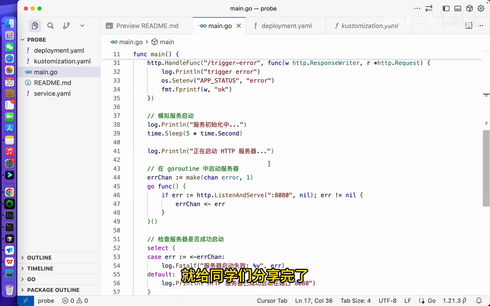

- **一共三种探针，但真正"干活"的其实只有两种**：就绪探针与存活探针。
- **启动探针是闸门**：它成功之前，存活与就绪探针都不开始工作；它失败会触发重启，`initialDelaySeconds` 配得太小会导致死循环重启。
- **就绪探针管流量**：就位后 Pod 的 Endpoint 才注册到 Service，服务才开始收流量；滚动更新完全依赖它。
- **存活探针管重启**：探测到服务内部异常并达到阈值就触发重启，是运行期的看门人。
- **探测方式三选一**：HTTP GET（200–399 成功）、gRPC、EXEC（退出码 0 成功），一条探针只能用一种。
- **参数四件套**：`initialDelaySeconds`（默认 0）、`periodSeconds`（默认 10）、`timeoutSeconds`（默认 1）、`failureThreshold`（默认 3）。
- **失败后的动作不同**：启动/存活探针 → 重启容器；就绪探针 → 摘除 Endpoint、流量离开，容器继续运行。

---

## 关键术语速查

| 术语 | 一句话解释 |
| --- | --- |
| startupProbe（启动探针） | 判断"应用起没起"；它是闸门，成功前存活/就绪探针不工作；失败会触发重启 |
| readinessProbe（就绪探针） | 判断"现在能不能接流量"；不就绪则 Endpoint 不注册、流量进不来，但容器不重启 |
| livenessProbe（存活探针） | 判断"还活不活"；探测失败并达阈值会重启容器，用于不可恢复的故障 |
| `initialDelaySeconds` | 容器启动后等待多久开始第一次探测，默认 0；配得太小是常见坑 |
| `periodSeconds` | 探测频率，默认 10 秒一次 |
| `timeoutSeconds` | 单次探测的超时时间，超时即判失败，默认 1 秒 |
| `failureThreshold` | 连续失败多少次算整体失败，默认 3 |
| `successThreshold` | 连续成功多少次算成功，默认 1 |
| HTTP GET 探测 | 请求容器内路径/端口，状态码 200–399 视为成功 |
| EXEC 探测 | 在容器内执行命令，退出码 0 为成功、非零为失败 |
| gRPC 探测 | 对 gRPC 服务做健康检查（health checking protocol） |
| Endpoint / EndpointSlice | Service 背后的后端地址集合；就绪后 Pod 才被登记，流量才进得来 |
| Kustomize | 用 `kustomization.yaml` 声明式定制部署清单；本例用 `configMapGenerator` 把源码挂进 Pod |
