# Kubernetes 探针详解：存活、就绪与启动探针的契约

## 本讲要解决的核心问题（SCQA）

**背景**：容器在跑、进程在、端口开着。那么 Kubernetes 该不该给它发流量？甚至，该不该"别管它"？

**冲突**：这是两个完全不同的问题，却常被混为一谈。一个"存在的进程"不等于一个"该收请求的进程"；一个"还在启动的进程"也不等于一个"卡死的进程"。把它们搞混，就会得到一个在负载下不断重启健康工作负载的集群，或者一个不停把用户送进"还没准备好"的容器的服务。

**疑问**：kubelet 到底怎么区分"起没起""活不活""能不能接活"？

**回答（中心思想）**：kubelet 不猜，它跑**探针（probe）**——周期性的诊断。**三种问题对应三种探针**：startup 回答"起没起"，liveness 回答"活不活"，readiness 回答"现在能不能收流量"。它们分别接到三个不同的**执行器**上：**startup 是闸门、liveness 控制重启、readiness 控制流量**。本讲逐字段拆解这套"契约"。

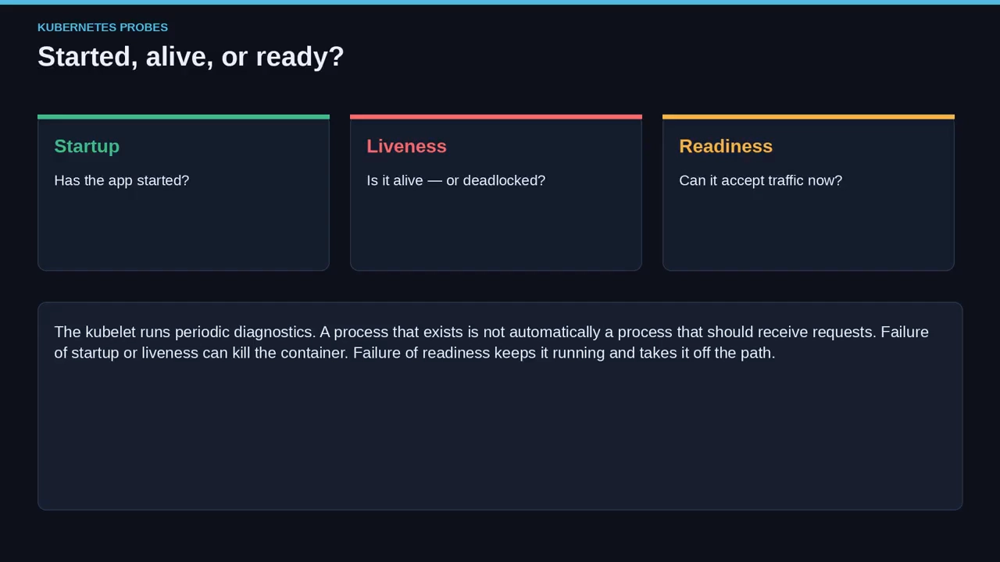

> **关键区分**：失败不是一回事。**startup / liveness 失败会杀掉容器；readiness 失败只把容器从流量路径上摘掉，容器继续运行。**

---

## 一、探针是 kubelet 的诊断，不是旁路组件

探针是**节点上的 kubelet** 按计划去问容器问题——**不是 sidecar、不是 Service、也不是集群外负载均衡器的 ingress 健康检查**。

- **探测机制只有四种**：`exec`、`gRPC`、`HTTP GET`、`TCP socket`。**同一条探针只能用其中一种**，选定一种方式，就接受它的答案。
- **为什么要周期性探测？** 因为真正棘手的故障不总是"崩溃"。Java 进程可能死锁、进程表却一片正常；Web 服务器可能接受 TCP 却一直返回 500；数据库客户端可能还在，后端却没了。kubelet 无法从"容器在运行"推断出这些——**Running 是容器运行时状态，"就绪/存活"是应用状态**。

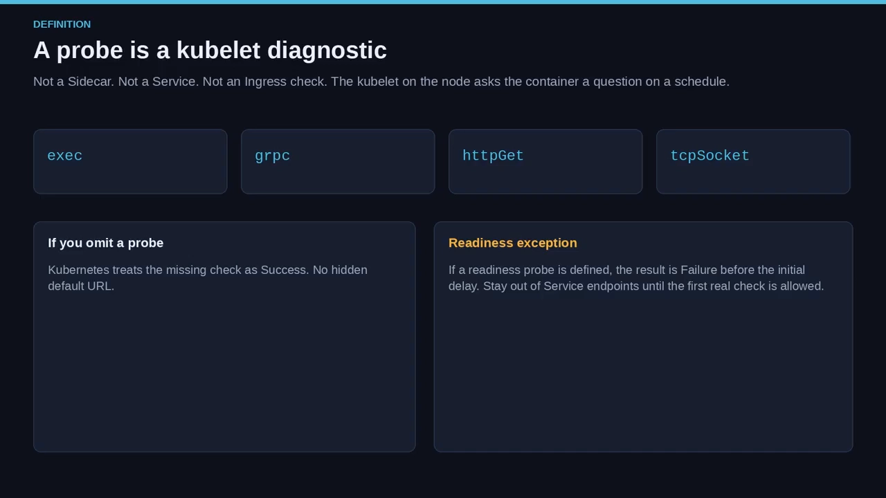

**默认语义（容易忽略）**：

- **缺省探针 = 成功**。这是设计选择，不是 bug：没配 liveness，kubelet 就不会因为你没定义的 URL 失败而重启你；没配 readiness，容器一运行就可进入流量。
- **例外**：就绪探针在 `initialDelaySeconds` 之前，结果被视为**失败**（不是"未知"）——目的是在你允许第一次真正检查之前，让容器**留在 Service 端点之外**。

**探针就是一份契约**：你告诉 kubelet 怎么问、多久问一次、几次不通过才算真失败；然后 kubelet 据此行动——重启、从流量中摘除、或等启动完成。

[【跳转到 01:33】](https://www.youtube.com/watch?v=Hs2viu0QGq0&t=93)

---

## 二、启动探针：给"慢启动"买时间

**startup 只回答一个问题：应用起了吗？** 有些容器一秒就绪，有些要加载缓存、跑迁移、预热 JIT、或等一个慢依赖。若过早对它挂上 liveness，Kubernetes 会因为"它只是慢"而把它当成"死"杀掉——这就是典型的**自伤式重启循环**。

**启动探针就是一个闸门**：在 startup 成功之前，**liveness 与 readiness 都不开始**（它们的 `initialDelaySeconds` 也不开始计时）。

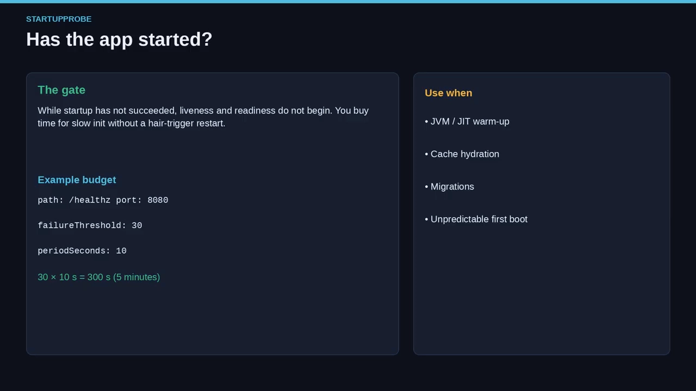

文档示例用 `HTTP GET /healthz:8080`、`failureThreshold: 30`、`periodSeconds: 10`——**30 × 10 = 300 秒**，也就是给启动 **5 分钟的耐心**。这正是启动探针的意义：**买时间**。你不是在说"应用已就绪"，而是在说"先别杀我，我还在成形"。

- **一旦 startup 成功，它就完成了**：kubelet 不会永远问这个启动问题，之后由 liveness 与 readiness 长期接管。
- **何时才需要它？** 初始化慢或不可预测时。如果镜像总是几秒内启动，你可能根本不需要启动探针。这正是文档的选择准则：**慢初始化才用 startup**。

[【跳转到 02:25】](https://www.youtube.com/watch?v=Hs2viu0QGq0&t=145)

---

## 三、存活探针：只为"不可恢复的故障"重启

**liveness 回答：这个容器是活着，还是已死锁、无法自愈？** 当 liveness 连续失败到阈值，**kubelet 杀掉容器**，随后交给 **restartPolicy** 处理。这是一个"暴力"答案，而且理当如此——liveness 只用于**不可恢复的故障**：永远不会解开的线程转储、永远不会释放的内存泄漏、技术上还在跑却毫无用处的进程。

**危险在于：配错 liveness 会在负载下引发级联重启。** 想象一下：流量上升 → 处理变慢 → 你的健康端点与用户请求共用同一线程池 → 探针超时 → Kubernetes 重启 Pod → 新 Pod 冷启动、把更多负载压给刚失去副本的邻居 → 邻居的探针也开始失败……**你把一次"变慢"变成了一场"重启风暴"。**

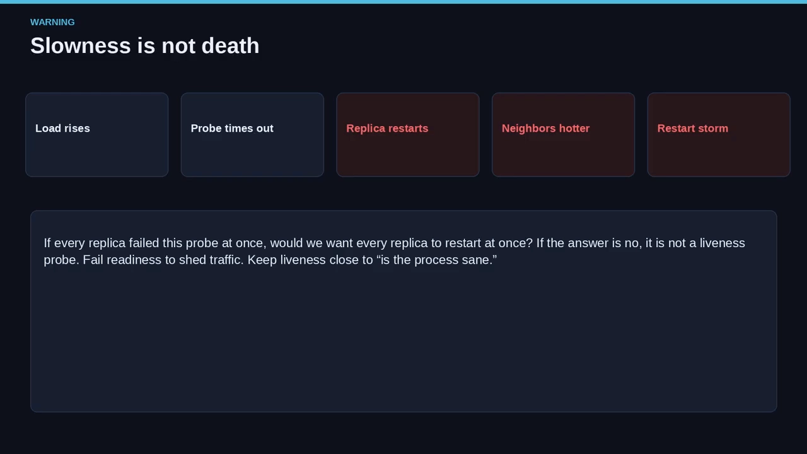

**修正是概念性的，先于数值**：liveness 不能依赖与用户流量相同的稀缺资源；若该资源在负载下饱和，应让 readiness 去承接这个信号（fail ready、摘流量、让进程恢复）。liveness 该问的是"进程是否神志清醒"，而非"此刻能否满足 SLO"。数值调优只有在信号正确之后才有用。

> **自检问题**：如果所有副本同时失败这条探针，我们希望所有副本同时重启吗？**若答案是"不"，那它就不是 liveness 探针。**

在示例里，liveness 也打 `/healthz:8080`，但时间参数不同：`initialDelaySeconds: 10`、`periodSeconds: 5`、`timeoutSeconds: 3`、`failureThreshold: 3`——启动成功后等 10 秒，之后每 5 秒查一次、每次最多等 3 秒，**连续失败 3 次即重启**。

[【跳转到 03:25】](https://www.youtube.com/watch?v=Hs2viu0QGq0&t=205)

---

## 四、就绪探针：不重启，只决定"收不收流量"

**readiness 回答：这个容器现在能收流量吗？** 这里的失败**不杀任何东西**：kubelet 保持容器运行、继续探测，把 Pod 的 **ready 条件置为 false**，匹配的 Service **把这个 Pod 从 EndpointSlice 中移除**，用户不再进来，进程则获得机会去追赶、重连或完成排空（drain）。

这正是 readiness 适用于**流量准入、后端可用性、过载恢复、维护窗口**的原因：你可以在预热缓存时就绪失败，可以在下游数据库不可用时失败，也可以用它在受控维护窗口里**故意**让 Kubernetes 把你排空——**无需重启**。

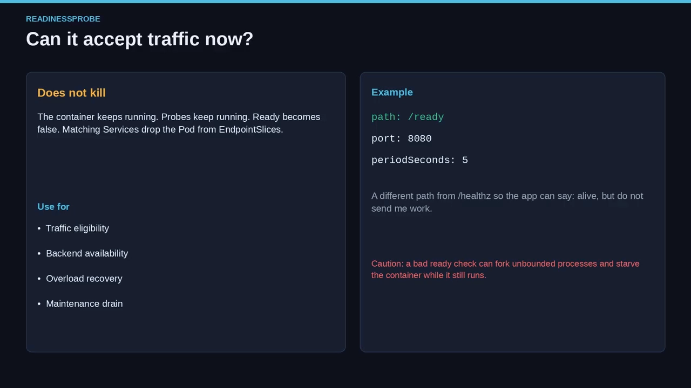

文档示例用 `HTTP GET /ready:8080`、`periodSeconds: 5`——**注意路径是 `/ready`，不是 `/healthz`**：给应用一条单独路径，用来表达"我活着，但此刻不该接活"。

**一个易被归到"进阶"的告诫**：**就绪探针实现不当，可能导致容器内进程数不断增长、资源被耗尽**。如果你的 ready 检查会 fork 工作、或 failing ready 让应用无界地生成重试循环，你就没有让 Pod 更安全，而是**把一个泄漏藏在了红色的 ready 条件背后**。

[【跳转到 05:00】](https://www.youtube.com/watch?v=Hs2viu0QGq0&t=300)

---

## 五、把三条探针放在同一条时间轴上

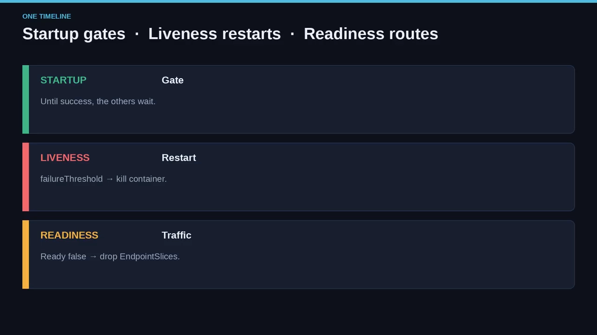

1. **容器启动**。若定义了 startup，它是当下唯一重要的应用检查；liveness、readiness 都被"闸住"。
2. **startup 成功**。其它时钟（包括 liveness / readiness 的 `initialDelaySeconds`）现在才开始计时。
3. **liveness 计时**：保持绿色 → 容器不动；失败 `failureThreshold` 次 → kubelet 杀掉容器并遵循 termination grace，随后由 restartPolicy 决定下一步。
4. **readiness 计时**：绿色 → ready 条件可为 true、Pod 可进入 EndpointSlice；红色 → ready 为 false，容器继续跑、探针继续跑，**只是没有流量**。

**别把泳道合并**：YAML 让它们看起来像"三份 HTTP GET 拷贝"，但它们不是——是**三个不同的执行器挂在相似的传感器上**。你可以只用其中一部分：

- 启动快 → 可省略 startup，只用 liveness + readiness；
- 永远不想被探针重启 → 只用 readiness（但死锁可能就一直挂着）；
- 每个活着的副本都该收流量 → 只用 liveness。

**选择准则**：**startup 用于慢初始化，liveness 用于不可恢复故障，readiness 用于"该不该来活"。** 最危险的组合是"把 readiness 检查当成 liveness 用"：后端一挂你就重启，那后端挂着的整个期间你会无限重启；"我过载了"就重启，则等于用"死掉"来卸载，把负载甩给别人。

[【跳转到 07:00】](https://www.youtube.com/watch?v=Hs2viu0QGq0&t=420)

---

## 六、先设计，再写 YAML

**选型是设计问题，不是 YAML 问题。** 先想清楚"这条探针接的是哪个执行器"。

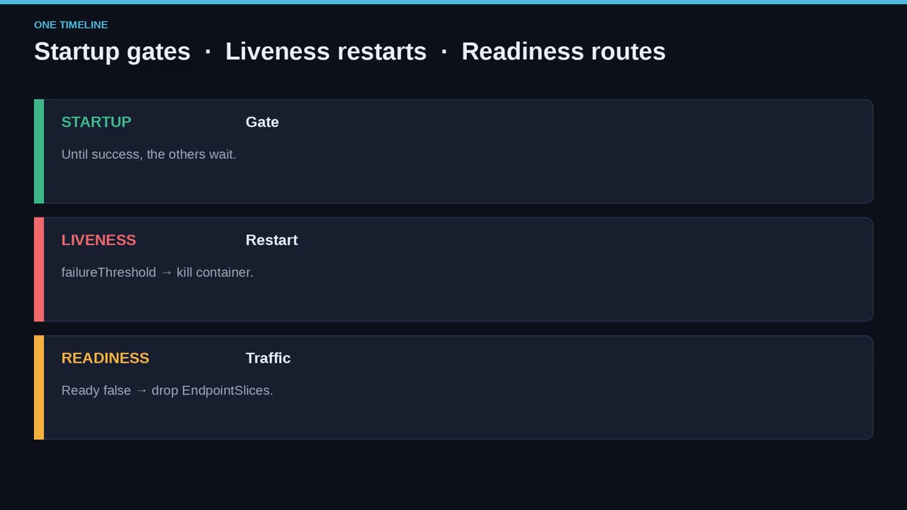

按"职责"推出组合：

- **startup**：初始化慢时用（JVM 预热、大模型加载、必须先完成的 schema 迁移……凡是合理的 liveness 周期会在启动期误伤的场景）。
- **liveness**：进程可能进入"只有重启才能修好"的状态时用（死锁、卡住的事件循环、内存状态损坏）。**不要把它当 CPU 调速器。**
- **readiness**：容器有时该"存在但不收流量"时用（等后端、从过载恢复、为维护排空、内部缓存热了才服务）。

**常见组合来自这些职责**：startup + liveness 是"慢启动，卡死就重启"；示例 Pod 还额外用不同路径加了 readiness；若信任进程不会死锁，可以 startup + readiness 而不配苛刻的 liveness；很多应用只配 readiness（进程真死时自己会崩，只需要流量控制）。

**不要把答案会分叉的检查合成一个端点**：如果 `/healthz` 同时意味着"杀了我"和"别发用户给我"，你就无法只失败其中一个。**当答案会分叉时，拆分路径**——官方示例正是 `/healthz`（startup 与 liveness）配 `/ready`（readiness）。

**再加一条实用拆分**：让 liveness **便宜且本地**（一个 discard 心跳、一个进程内标志、不回数据库的 handler）；让 readiness **可以更贵**，因为失败它只是"掉出 EndpointSlice"，比重启廉价得多。这种拆分本身就是"活命之道"。

**若拿不准，按这个顺序**：先上 readiness → 只为"亲眼见过、永不恢复"的状态加 liveness → 只有量出启动时间超过了你的 liveness 预算，再加 startup。

[【跳转到 07:25】](https://www.youtube.com/watch?v=Hs2viu0QGq0&t=445)

---

## 七、四种探测机制：传感器选对，执行器才有效

**每条探针只用一种机制**：`exec` / `gRPC` / `HTTP GET` / `TCP socket`。

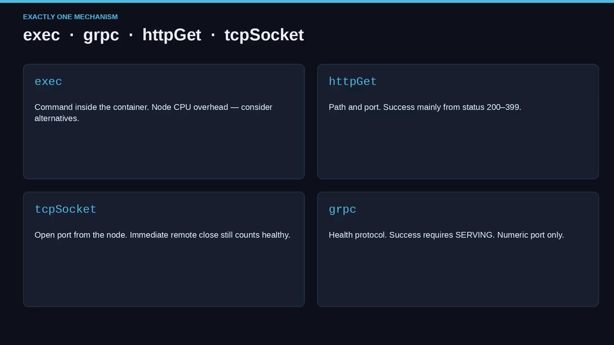

- **exec**：在容器内执行命令。**文档提醒：对探针用 exec 会给节点引入 CPU 开销**，此时可考虑替代机制。它很"贴身"也很贵，但很强大——可测本地文件、CLI、自定义二进制，代价是每个周期都要 spawn 一个进程。
- **HTTP GET**：官方示例的主力。kubelet 请求某路径与端口，成功主要看状态码 **200–399**；它理解 headers、scheme 与部分重定向规则。
- **TCP socket**：只问"这个端口能连上吗？"端口开放可达即成功，**即便对端立即关闭连接也算健康**（这一点常让人意外）。TCP 成功不代表 HTTP 服务健康，它只代表端口接受了连接——当"端口被绑定"本身是信号时用它，而不是当"应用逻辑"是信号时。
- **gRPC**：讲 gRPC 健康检查协议，成功要求状态为 **SERVING**；**必须用数字端口**，命名端口与自定义 host 都不支持；`service` 字段可在同一进程上区分 liveness / readiness / 自定义检查。

**选型对应问题**：问"某个 Unix 命令是否认可？"→ 用 exec（留意节点 CPU）；问"这个 HTTP handler 是否认为我 OK？"→ 用 HTTP GET；只问"有东西在监听吗？"→ TCP socket；工作负载是 gRPC-native 且已实现健康检查 → 用 gRPC。**别在一条探针上叠加两种机制——API 是互斥的**；若既要 HTTP 又要命令，那是两条探针，或一条在容器内两者都做的 exec。

[【跳转到 10:00】](https://www.youtube.com/watch?v=Hs2viu0QGq0&t=600)

---

## 八、三种结果：success / failure / unknown

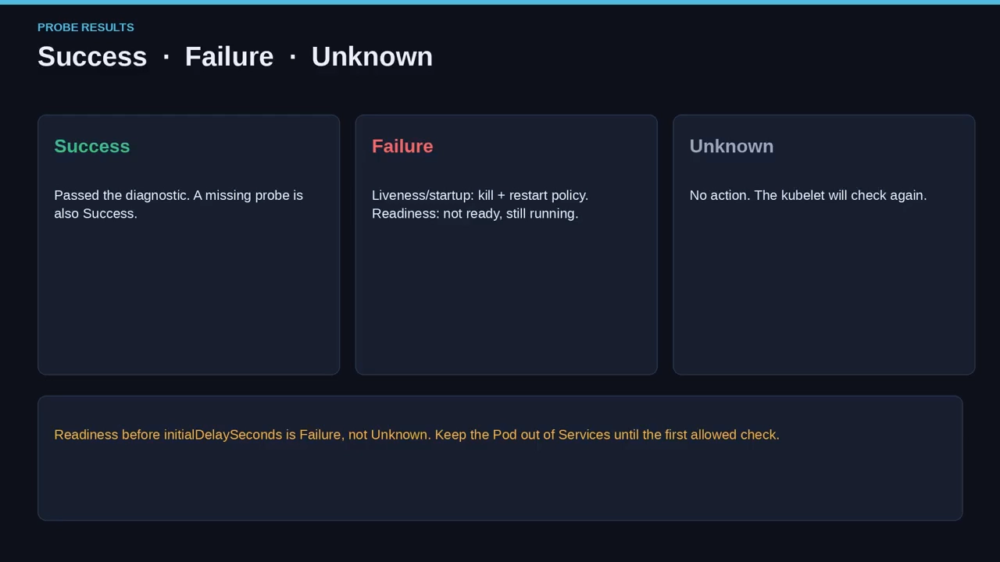

- **Success**：容器通过了诊断。**对缺失的探针，kubelet 永远视为 success**——集群不会凭空发明你没配的检查。
- **Failure**：容器未通过诊断，随后执行器分叉：**liveness 与 startup** → kubelet 杀掉容器、交 restartPolicy；**readiness** → 标记为 not ready、Pod 停止从匹配 Service 收流量，进程继续运行、探针继续跑。
- **Unknown**：诊断以"不该改变状态"的方式失败——不采取动作，kubelet 会继续后续检查。把 unknown 理解为"我没能得到干净答案，别乱动"。

这三词就是整张决策表。人们常误以为"探针把 HTTP 码返回给 ReplicaSet"——并不是：**kubelet 评估执行结果、映射到这三种结果，再由探针类型决定动作**。调试时务必把"检查返回了什么"和"Kubernetes 做了什么"分开看。

[【跳转到 11:25】](https://www.youtube.com/watch?v=Hs2viu0QGq0&t=685)

---

## 九、官方示例逐字段拆解

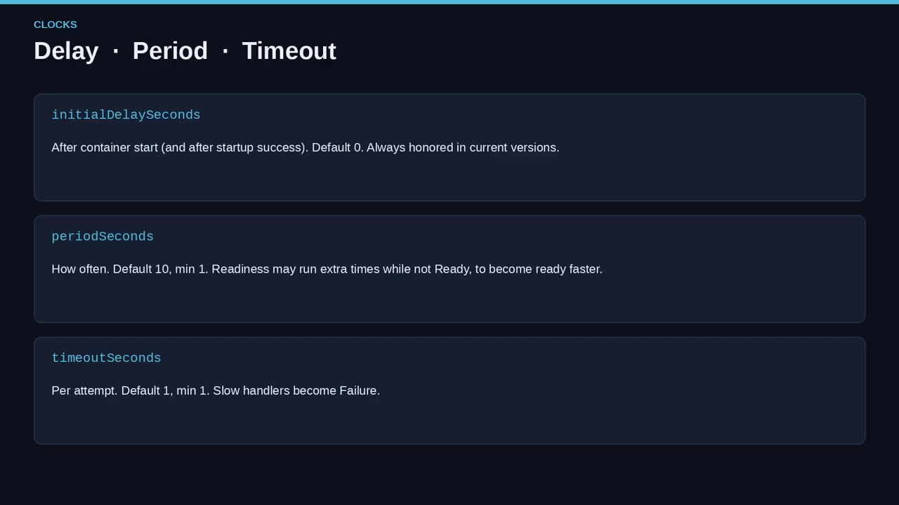

```yaml
kind: Pod
metadata:
  name: probe-example-1
spec:
  containers:
  - name: app
    image: registry.k8s.io/e2e-test-images/agnhost:2.40
    ports:
    - containerPort: 8080
    startupProbe:            # 慢启动的"耐心预算"
      httpGet: { path: /healthz, port: 8080 }
      failureThreshold: 30
      periodSeconds: 10      # 30 × 10 = 300s = 5 分钟
    livenessProbe:           # 运行期看门狗
      httpGet: { path: /healthz, port: 8080 }
      initialDelaySeconds: 10
      periodSeconds: 5
      timeoutSeconds: 3
      failureThreshold: 3
    readinessProbe:          # 独立的"接活"路径
      httpGet: { path: /ready, port: 8080 }
      periodSeconds: 5
```

**注意"缺什么"和"有什么"一样重要**：没有 exec、没有 gRPC、没有 TCP socket——每条探针只用一种机制（HTTP GET）。`successThreshold` 省略 → 默认 1；`timeoutSeconds` 在 startup/readiness 上省略 → 默认 1 秒；探针上没写 `terminationGracePeriodSeconds` → 杀掉时继承 Pod 级默认 30 秒。镜像是 e2e 测试镜像 `agnhost:2.40`，不是生产建议——**文档展示的是"形状"，不是"钦定的应用"**。

**怎么改**：若是慢 JVM，你可能只调大 **startup 的预算**、而不是放松 liveness；若是过载，你会让 **`/ready` 在饱和时失败**、而保持 `/healthz` 不这样做。**抄它的路径拆分，抄"startup 的 period × failureThreshold = 启动超时"这个思路，但别把时间参数照搬**到一个 2 秒或 15 分钟才启动的服务里。

[【跳转到 13:23】](https://www.youtube.com/watch?v=Hs2viu0QGq0&t=803)

### 9.1 计时类字段（三个"时钟"）

- **`initialDelaySeconds`**：容器启动后、探针开始前的等待秒数；**若定义了 startup，liveness/readiness 的延迟等 startup 成功后才开始**。默认 0、最小 0。（旧版本曾有"periodSeconds 大于 delay 时忽略 delay"的怪癖，现版本**始终尊重** `initialDelaySeconds`。）
- **`periodSeconds`**：探测频率，默认 10、最小 1。**readiness 特有说明**：容器未就绪时，readiness 的探测可能**快于**配置的周期——为了让 Pod 更快就绪，所以"5 秒周期"在未就绪时并非严格 5 秒网格。
- **`timeoutSeconds`**：单次探测的等待上限，默认 1、最小 1。handler 比它慢，该次即不算成功。**与共享线程池合在一起，就是"负载如何变成失败"的机制。**

[【跳转到 14:23】](https://www.youtube.com/watch?v=Hs2viu0QGq0&t=863)

### 9.2 阈值类字段（把单次尝试变成整体判定）

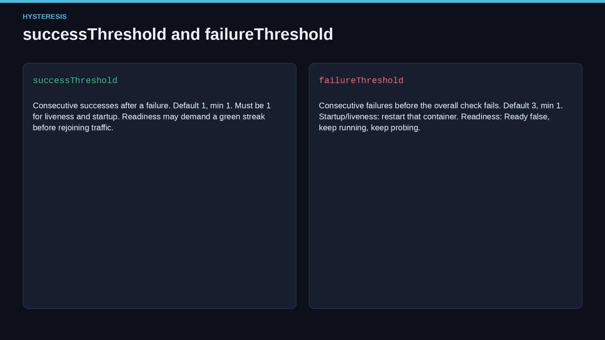

- **`successThreshold`**：失败之后，需要连续成功多少次才算重新成功；默认 1、最小 1。**对 liveness 与 startup 必须为 1**——你不能要求"失败后再连续 3 次绿灯才算活"，一次成功即视为活。readiness 允许设大于 1，用于"抖动"时先攒够连续绿灯再重回流量。
- **`failureThreshold`**：连续失败多少次才算整体失败；默认 3、最小 1。对 startup/liveness，达到即判不健康并**重启该容器**（遵循 terminationGracePeriodSeconds）；对 readiness，则设 **ready=false**、容器继续跑并继续探测。

**滞后（hysteresis）是关键**：单次抖动不该总让你重启；`period=5` 时连续 3 次失败才算"持续缺席"，startup 的"30 次 × 10 秒"则是"长时间缺席"，这正是对启动的保护。

### 9.3 terminationGracePeriodSeconds：关机执行器的"耐心"

liveness/startup 判不健康时，kubelet 不会 1 毫秒内硬拽进程——`terminationGracePeriodSeconds` 配置"触发关闭"到"强制运行时停止"之间的宽限。**默认继承 Pod 级值（未指定即 30 秒），最小 1**。

**探针级 `terminationGracePeriodSeconds` 自 v1.28 起 stable**（1.25 起可指定）；**当 Pod 级与探针级同时存在，kubelet 用探针级的值**。为什么探针失败要用不同的 grace？因为 liveness 失败往往意味着进程**已经卡死**——为一场永远不会执行的优雅关闭等满 30 秒，只是延长一个已死副本的痛苦；较短的探针级 grace 让 kubelet 更快强制运行时。而正常滚动更新可能仍想要更长的 Pod 级 grace，好让在途请求收尾。

**注意**：这个字段**不是 readiness 的故事**——readiness 失败不关容器，**要停流量请用 ready=false，而不是 grace period**。

[【跳转到 16:48】](https://www.youtube.com/watch?v=Hs2viu0QGq0&t=1008)

---

## 十、HTTP GET 的深水区：路径与端口之外

HTTP GET 不只是"一个路径 + 一个端口"：

- **host**：连接的主机名，默认 Pod IP。**虚拟主机不要用它来表达**——应把 host 放进 HTTP headers。
  - **网络陷阱**：若容器只监听 `127.0.0.1`、且 Pod 的 `hostNetwork: true`，则 httpGet 的 host 应设为 `127.0.0.1`；若保持默认，kubelet 可能敲错地址。
- **scheme**：HTTP 或 HTTPS，默认 HTTP。**HTTPS 探针跳过证书校验**——它只是"在链路上用 TLS"，不是"钉住身份"。
- **protocol**：默认 HTTP/1；设 HTTP/2 会启用明文 HTTP/2（H2C），需要对应的 feature gate，且 scheme 必须是 HTTP。
- **path / port**：默认路径 `/`；port 是命名或数字容器端口（1–65535）。
- **httpHeaders**：设置自定义请求头，允许重复头。

**默认请求长这样**：kubelet 会带上 `User-Agent: kube-probe/<版本>`（示例中 1.37）与 `Accept: */*`——你可以在日志里覆盖或清空它们。**若访问日志里突然出现 `kube-probe` 客户端，那不是神秘扫描器，是节点。**

### 10.1 重定向策略：宽容到反直觉

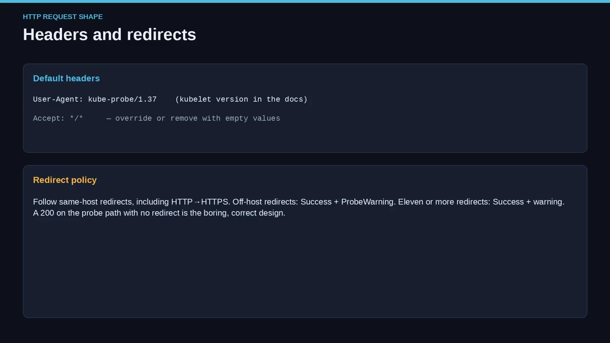

- **只跟随同一 host 上的重定向**（包括 HTTP→HTTPS 的变化）——这让 `http://foo/healthz` 能跳到 `https://foo/healthz` 而不被认为"死"。
- **跳到另一个 host 的重定向** → **视为成功，但带 probe warning**。
- **11 次及以上重定向** → **同样视为成功，但带 warning**。

也就是说，"跨主机重定向"或"重定向风暴"**不会变成 failure**，而是"成功 + 警告"。**若你指望探针去抓开放重定向或错配的负载均衡链，它做不到。** 警告是你的事件提示，安全敏感的应用别忽略它。**若能控制 handler，直接在探针路径上返回终结性的 200、不要重定向**——这是避免重定向策略意外最省事的办法。这也解释了大量"但我笔记本上 curl 是好的"——curl 的跟随规则、UA 和来源都不同，**请用探针真实的请求形状去调试，而不是浏览器**。

### 10.2 响应体上限：只读 10 KiB

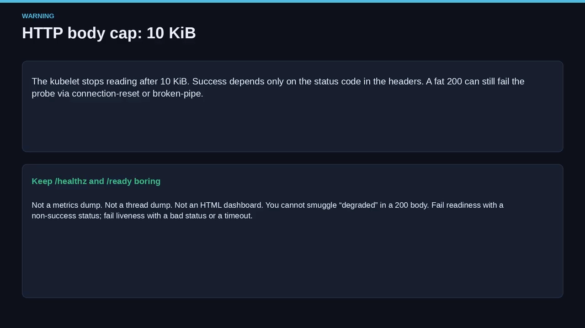

kubelet **读 HTTP 探针响应到 10 KiB 就停**；成功只取决于**状态码**，**响应体不是 kubelet 会解析的 JSON 健康载荷**。如果把线程转储、metrics 页面、HTML 状态页塞进 `/healthz`，你不是在帮探针、而是在填一个 10 KiB 预算；更大的体会导致连接重置或 broken pipe，于是**一个返回 200 的 handler 也会因为连接没干净结束而看起来像失败**。

**建议**：健康端点**尽量精简**。一行 `ok` + 200，比一个漂亮仪表盘更适合做 liveness 信号。10 KiB 不多——几页文字而已；很多 metrics 暴露轻松就超了。如果你把 liveness 指向 `/metrics`，你造出的可能是一个**在应用最"热闹"（指标序列最多）时反而失败**的探针。因为成功只看状态码，你也**无法**在 200 体里夹带 "degraded" 让 Kubernetes 读懂——要 not-ready 就在 readiness 路径返回非成功码，要 restart 就让 liveness 以坏状态码或超时失败。

[【跳转到 19:48】](https://www.youtube.com/watch?v=Hs2viu0QGq0&t=1188)

---

## 十一、TCP socket：钝器，但要看方向

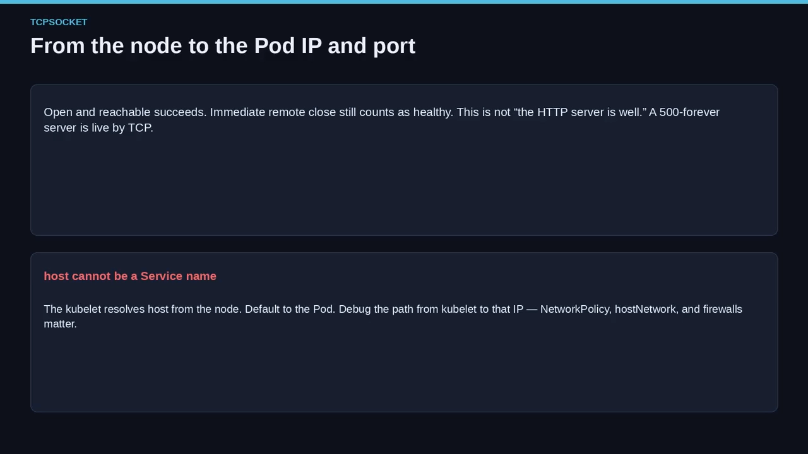

- kubelet **从节点**向 Pod IP 与端口建立 TCP 连接：端口可达且开放 → 成功；**对端立即关闭也算健康**。HTTP 问的是状态码，TCP 问的是"有没有东西接受了 socket"。绑定 8080 却永远返回 500 的服务器，**对 TCP 是活的、对写得好的 HTTP GET 是死的**。
- **host 不能用服务名**：kubelet 从**节点**解析它。填 Service DNS 名，就问错了问题——你问的是"节点侧解析问题"，它可能指向另一个副本、或以与"本容器"无关的方式失败。应指向 Pod（默认），或指向真正映射到本容器的地址（如 hostNetwork 下的 `127.0.0.1`）。
- **何时用 TCP**：当契约真的就是"端口"时——只需要被绑定的 sidecar、可自行添加健康路由的遗留服务。**别用它**当"进程能监听却已卡住"时——因为**端口接受后立即重置也不算失败**；若你需要"完成一次应用层握手"，请用 HTTP、gRPC 或 exec。
- Exec 的 CPU 开销是有人转投 TCP 的原因；TCP 比 spawn 进程便宜、也比一些 HTTP handler 便宜——但**"便宜"不等于"正确"，错的传感器照样驱动错的执行器**。已有 `/healthz` 时，liveness 不必再对同端口用 TCP；HTTP 检查更主导，TCP 只会把"应用层死亡"藏在"端口还开着"后面。
- **方向很重要**：记住是"节点 → Pod IP/端口"。防火墙、网络策略、hostNetwork 都会改变"谁在监听哪里"。TCP 探测失败时，**排查的是从 kubelet 到那个 IP 的路径，而不是你笔记本到 Service 的路径**。

[【跳转到 22:23】](https://www.youtube.com/watch?v=Hs2viu0QGq0&t=1343)

---

## 十二、gRPC 探针：成功要求 SERVING

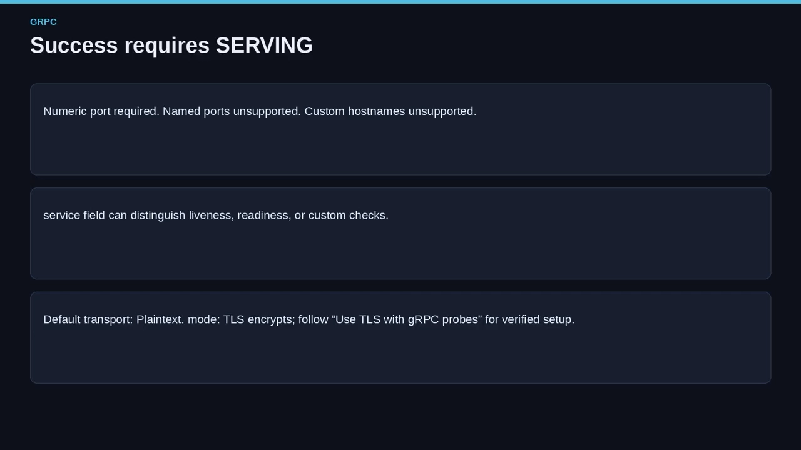

- **成功要求状态为 `SERVING`**（不是 IDLE、不是 NOT_FOUND）。
- **必须给数字端口**：命名端口不支持；**自定义 host 也不支持**——比 HTTP 的寻址更严格。
- **`service` 字段**可在同一进程上区分 liveness / readiness / 自定义检查——这是 gRPC-native 版"`/healthz` vs `/ready`"的等价物。
- **传输默认明文**；设 `mode: TLS` 可加密（该模式同样**跳过证书校验**）——你是在加密探测通道，不是做生产 mTLS 网格那样的完整身份钉扎。需要校验证书请按文档专门指南来。
- **gRPC 健康不等于"服务器接受了 TCP"**：进程可以监听却报告 not-serving——这正是价值所在。**如果应用已实现 `grpc.health.v1`，这是最诚实（honest）的机制**；否则可用 HTTP GET sidecar 或 exec 一个 gRPC 健康客户端（exec 有节点 CPU 成本）。
- 因为命名端口不支持，**别把 containerPorts 里的命名端口照抄进 gRPC 探针**，用数字；因为自定义 host 不支持，你也没法用虚拟主机绕过寻址。

[【跳转到 23:48】](https://www.youtube.com/watch?v=Hs2viu0QGq0&t=1428)

---

## 小结

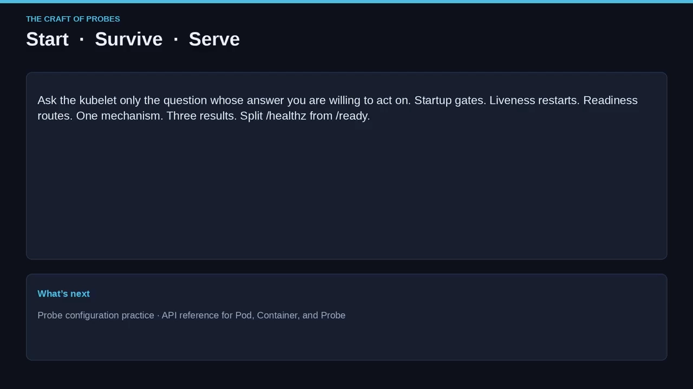

- **三问三探针**：startup 管"起没起"、liveness 管"活不活"、readiness 管"能不能接活"。
- **startup 是闸门**：成功前 liveness/readiness 不开始；其 `period × failureThreshold` 就是你的"启动超时预算"。
- **liveness 是重启执行器**：只用于不可恢复故障，不要用于负载；配错会级联重启；失败杀掉容器、随后走 restart policy 与 grace。
- **readiness 是流量执行器**：失败只设 ready=false、摘除 EndpointSlice、进程照跑；适用于后端不可用、过载、维护，以及"初始延迟前即算失败"。
- **一条探针一种机制**：exec / gRPC / HTTP GET / TCP socket；结果是 success / failure / unknown，**缺失探针=success**。
- **HTTP 成功=状态码 200–399，响应体上限 10 KiB**；TCP=端口开放即便立即关闭；gRPC=必须 SERVING、数字端口、默认明文。
- **三个时钟**：`initialDelaySeconds`、`periodSeconds`（未就绪时 readiness 可更快）、`timeoutSeconds`。
- **两个阈值（滞后）**：`successThreshold` 对 liveness/startup 必须为 1；`failureThreshold` 默认 3。
- **设计先于 YAML**：先 readiness，再按需加 liveness，最后才考虑 startup。

> **Start, survive, serve. 只向 kubelet 问那个"你愿意据其行动"的问题——这就是探针的全部技艺。**

---

## 关键术语速查

| 术语 | 一句话解释 |
| --- | --- |
| Probe（探针） | 节点上 kubelet 周期性对容器执行的诊断，非 sidecar/Service/ingress 检查 |
| startupProbe | 判断"起没起"；是闸门，成功前其他探针不工作，`period×threshold` 即启动预算 |
| livenessProbe | 判断"活不活"；达阈值即杀容器并走 restart policy，只用于不可恢复故障 |
| readinessProbe | 判断"能不能接活"；失败只摘流量不重启；初始延迟前即视为失败 |
| mechanism（传感器） | exec / gRPC / HTTP GET / TCP socket 之一，一条探针只能用一种 |
| 执行器（actuator） | 探针类型对应的动作：重启（startup/liveness）或摘流量（readiness） |
| success / failure / unknown | 每次探测的三种结果；缺失探针恒为 success，unknown 不改状态 |
| `initialDelaySeconds` | 启动后、探针开始前的等待；有 startup 时等其成功后才计时；默认 0 |
| `periodSeconds` | 探测频率，默认 10；未就绪时 readiness 可能快于该周期 |
| `timeoutSeconds` | 单次探测等待上限，默认 1；超时即该次不成功 |
| `failureThreshold` | 连续失败几次算整体失败，默认 3 |
| `successThreshold` | 失败后需连续成功几次才算恢复，默认 1；liveness/startup 必须为 1 |
| hysteresis（滞后） | 用阈值过滤单次抖动，避免"一抖就重启" |
| terminationGracePeriodSeconds | 关闭到强制停止的宽限；探针级覆盖（v1.28 stable）优先于 Pod 级 |
| HTTP 探针 | 成功看状态码 200–399；响应体上限 10 KiB；同主机重定向被跟随、跨主机重定向=成功+警告 |
| TCP socket 探针 | 端口可连即成功（即便立即关闭）；方向是"节点 → Pod IP" |
| gRPC 探针 | 讲健康检查协议，成功要求 SERVING，必须数字端口，默认明文 |
| EndpointSlice | Service 后端地址集合；readiness 通过才被登记 |
| cascading restart | 因 liveness 误把"慢"当"死"而引发的连锁重启风暴 |
