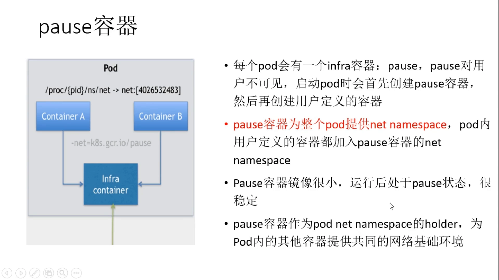
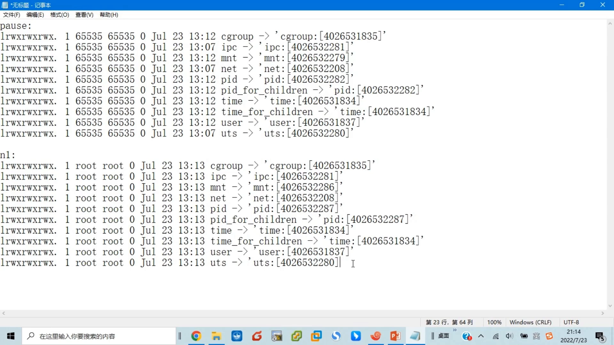
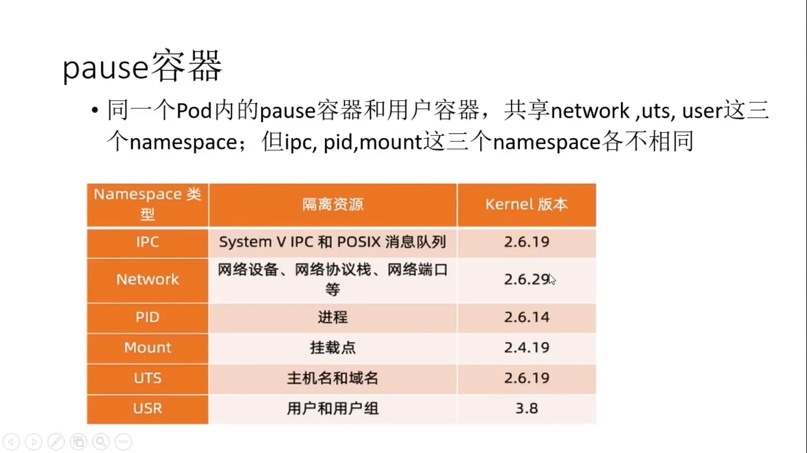

# Kubernetes 的 Pause 容器：为什么每个 Pod 里都藏着一个“什么都不做”的容器

> 本文基于视频《深入理解docker和kubernetes(k8s)--19.pause容器》整理；下方时间戳可直接跳到 B 站对应画面。

## 本讲要解决的核心问题（SCQA）

**背景**：Pod 是 Kubernetes 集群里最小的、可被调度的计算单元。一个 Pod 里可以只有一个容器，也可以有多个容器；而**同一个 Pod 内的所有容器共享同一个网络命名空间（network namespace）**，也就是说它们的网络情况（IP 地址、端口、路由、主机名解析等）是一模一样的。

**冲突**：既然网络命名空间是“共享”的，那这个命名空间究竟属于谁？如果约定成“用某个用户容器的命名空间”，就会冒出两个麻烦：一是容器之间产生了启动先后依赖（谁当主人谁得先起）；二是主人一旦崩溃被重启，它可能拿到一个**全新的**命名空间，而别的容器还留在旧的命名空间里，共享关系当场破裂。

**疑问**：Pod 里这个被大家共用的网络命名空间，到底应该由谁来做“主人”，才能既稳定、又不受任何用户容器生死的影响？

**回答（中心思想）**：Kubernetes 的答案是引入一个**用户看不见的 Pause 容器（也叫 infra / infrastructure 容器）**。它在 Pod 启动时**最先被创建**，独占 Pod 的网络命名空间，并充当这个命名空间的“持有者（holder）”，此后**基本什么都不做**；其余用户容器在启动时都**加入**它的网络命名空间。正因为 Pause 容器镜像极小、行为极简、生命周期极稳，它才能为整个 Pod 提供一个牢固、共享的网络基础环境。

下面我们先把“为什么需要它”讲透，再动手用 `crictl`、`ps`、`/proc/<pid>/ns` 亲眼验证。

---

## 一、Pod 内容器共享网络命名空间，于是问题来了

### 1.1 一个 Pod 内的两个容器，网络完全一致

视频里用上一个已知的例子切入：一个 Pod 里定义了两个容器——

- `B1`：镜像 `busybox`；
- `N1`：镜像 `nginx`。

[【跳转到 00:53】](https://www.bilibili.com/video/BV1hYLvzrEGq/?t=53)

这两个容器跑在同一个 Pod 里、在同一个 `containers` 子目录下，所以它们的**网络命名空间是同一个**，网络情况完全一样。由此就产生了一个尖锐的问题：这个共享的网络命名空间，用的是 `B1` 的，还是 `N1` 的？

- 如果“共享命名空间 = `B1` 的命名空间”，那 `B1` 必须先启动，然后 `N1` 加入 `B1` 的命名空间；
- 如果“共享命名空间 = `N1` 的命名空间”，那 `N1` 必须先启动，`B1` 再去加入 `N1` 的命名空间。

[【跳转到 01:03】](https://www.bilibili.com/video/BV1hYLvzrEGq/?t=63)

### 1.2 两种“让某个容器当主人”的方案都不好

仔细一想，这两种方案都不是好方案：

1. **启动顺序被绑死**。无论选谁当主人，容器之间就多了“谁先谁后”的硬性要求。
2. **主人重启会导致共享破裂**。假设以 `B1` 的命名空间为共有命名空间：当 `B1` 崩溃、按默认策略被重启后，它重启后的命名空间**可能和以前不一样**；而此时 `N1` 还留在**旧的**命名空间里。于是 `B1` 和 `N1` 的网络命名空间就对不上了——原本说好的“共享”就出问题了。

[【跳转到 02:23】](https://www.bilibili.com/video/BV1hYLvzrEGq/?t=143)

所以结论是：**这个共享的网络命名空间，既不用 `B1` 的，也不用 `N1` 的，即不用任何用户自定义容器的命名空间。**

---

## 二、Pause 容器：Pod 网络命名空间的“持有者”

### 2.1 用一个“专门的容器”来提供命名空间

既然不能用用户容器，那就用一个**专门为此而生**的容器——**Pause 容器**（视频里口语念成“pose 容器”）。

- 它又叫 **infra 容器**（infrastructure＝基础设施）。
- **每个 Pod 里都会有一个这样的容器**，但**它对用户不可见**：用户并不知道它存在，可它确确实实存在。

[【跳转到 03:18】](https://www.bilibili.com/video/BV1hYLvzrEGq/?t=198)

启动一个 Pod 时，会**优先创建 Pause 容器**；它创建之后拥有自己的网络命名空间，随后再创建用户自定义的那些容器。由于 Pause 容器是先创建的，它就“占住”了网络命名空间，之后 **Pod 内所有用户自定义的容器都会加入 Pause 的命名空间**，于是整个 Pod 里的容器又回到了**同一个**网络命名空间。

[【跳转到 03:53】](https://www.bilibili.com/video/BV1hYLvzrEGq/?t=233)

### 2.2 为什么偏偏是它：极小、极简、极稳

Pause 容器之所以适合当“持有者”，靠的是三点：

- **镜像极小**：大约只有几百 KB；
- **行为极简**：运行后执行的就是一个 “pause”（暂停）函数，基本上什么都不做，消耗的资源非常非常小；
- **非常稳定**：正是需要一个这样稳定又不占资源的东西，去当 Pod 网络命名空间的 holder。

它作为 Pause 容器为 Pod 内的其它容器提供一个**共同的网络基础环境**。

---

## 三、动手验证：从进程和命名空间看 Pause 容器

视频后半段完全靠实验说话：底层运行时是 **containerd**，所以用 **`crictl`** 这套命令来观察。

### 3.1 用 crictl 看 Pod 与容器

先启动 Pod，发现它被调度到 `worker2` 节点上，这个 Pod 里有**两个**容器。

[【跳转到 05:22】](https://www.bilibili.com/video/BV1hYLvzrEGq/?t=322)

用 `crictl ps` 查看，能看到 `N1` 和 `B1` 两个容器（容器最终都体现为一个进程）。输出里每一行包含：

- **container id**：容器 ID；
- **pod id**：所属 Pod 的 ID —— `B1` 和 `N1` 的 **pod id 完全相同**（它们属于同一个 Pod）。

[【跳转到 06:12】](https://www.bilibili.com/video/BV1hYLvzrEGq/?t=372)

再用 `crictl inspectp <pod id>`（inspectp 看 Pod，inspect 看容器）查看 Pod 信息，可以看到 Pod 名称、所在命名空间、ID、IP 地址等。

[【跳转到 07:02】](https://www.bilibili.com/video/BV1hYLvzrEGq/?t=422)

往下翻还能看到关键的一行：`image` 字段里是 **`pause:3.6`**——这正说明**这个 Pod 里确实存在一个 Pause 容器**，只是对用户而言“好像不存在”。此外还能看到 hostname、DNS 配置、大量挂载以及 cgroup 等信息。

### 3.2 从进程和 /proc/<pid>/ns 看命名空间

Pause 容器也是一个进程。用 `ps -ef` 能直接看到它对应的进程号（视频里是 `2011442`）：

[【跳转到 09:45】](https://www.bilibili.com/video/BV1hYLvzrEGq/?t=585)

在 Linux 里，每个进程在 `/proc/<pid>/ns` 目录下都有一组命名空间文件；进程号就是目录名。进入 `/proc/2011442/ns` 即可看到 Pause 容器当前的**所有命名空间**：

[【跳转到 10:10】](https://www.bilibili.com/video/BV1hYLvzrEGq/?t=610)

同样地，对 `N1`、`B1` 各自的容器进程，也能拿到各自的命名空间列表。把三者的命名空间编号摆在一起对比即可。

### 3.3 相同与不同：一张对照表

对比 Pause、`N1`、`B1` 三个容器的命名空间编号：

- **net（网络）**：`4026538208`——三者**完全相同**。因为 `N1`、`B1` 实际上加入的就是 Pause 容器的 net 命名空间。
- **mnt（挂载）**：末尾分别是 `283 / 286 / 279`，**各不相同**。挂载命名空间影响容器的根目录，所以在不同容器里 `ls /` 看到的东西不一样。
- **pid（进程）**：**各不相同**。所以在不同容器里执行 `ps`，看到的结果自然不同。
- **uts**：相同。它决定主机名/域名之类与网络相关的信息，既然是同一个网络，就该一样。
- **user（用户）**：相同。

[【跳转到 13:16】](https://www.bilibili.com/video/BV1hYLvzrEGq/?t=796)

### 3.4 进入容器验证“共享网络”

`nsenter -t <pid> -n ...` 进入容器后可以直接感受共享效果：

- `cat /etc/hostname`：`N1` 与 `B1` 得到相同的 `twocontainers`；
- `cat /etc/resolv.conf`：DNS 服务器地址相同；
- 网络接口与 IP 地址相同（两者共享同一个网络空间）；
- 在 `B1`（busybox，带 `wget`）里 `wget localhost:80`，能取回 `index` 主页文件——这个文件其实是 **`N1` 里 nginx 提供的**。也就是说，busybox 通过“本机 80 端口”访问到了 nginx，**间接证明了 `N1` 和 `B1` 处于同一个网络命名空间**。

[【跳转到 17:33】](https://www.bilibili.com/video/BV1hYLvzrEGq/?t=1053)

> 顺带一提：busybox 里带 `ps` 命令，而 nginx 镜像里没有（它只需提供 web 服务，命令就少）；但因为两者的 **pid 命名空间不同**，`ps` 看到的结果必然不同。

---

## 四、共享的边界：谁共享、谁隔离

把实验结论收敛成一句话：**同一个 Pod 里的 Pause 容器与用户容器，共享 net、uts、user、ipc 这 4 个命名空间；而 pid、mnt 这两个命名空间各自独立。**

- 共享的：`network`、`uts`、`user`、`ipc` → 它们看到的网络、主机名、用户、进程间通信环境一致；
- 不共享的：`pid`、`mnt` → 所以各自的进程视图与文件系统根目录互不相同。

[【跳转到 19:05】](https://www.bilibili.com/video/BV1hYLvzrEGq/?t=1145)

---

## 小结

- Pod 内的容器**共享网络命名空间**，于是产生了“这份命名空间归谁”的问题。
- 让某个**用户容器**当主人有两个致命缺陷：**启动顺序耦合**，以及**主人重启后命名空间变化导致共享破裂**。
- Kubernetes 用**用户不可见的 Pause（infra）容器**来持有 Pod 的网络命名空间：它**最先创建**、镜像极小、只执行一个 pause 动作、资源占用极低且极稳定。
- 用户容器启动时**加入** Pause 容器的网络命名空间，从而共享同一套网络视图。
- 用 `crictl ps` / `crictl inspectp` 能看到 `pause:3.6` 镜像与相同的 pod id，用 `/proc/<pid>/ns` 能对比命名空间编号。
- 同 Pod 内容器**共享** net、uts、user、ipc；**隔离** pid、mnt。

## 关键术语速查

| 术语 | 一句话解释 |
| --- | --- |
| Pod | Kubernetes 最小、可调度的计算单元，可含一个或多个容器 |
| Pause 容器（infra 容器） | 每个 Pod 里用户不可见的“占位”容器，先创建并持有 Pod 的网络命名空间 |
| 网络命名空间（network namespace） | 对内核网络资源（网卡、IP、路由、端口等）的隔离划分，Pod 内容器共享同一个 |
| 命名空间 holder | 持有并对外提供命名空间的那个“主人”进程/容器，这里是 Pause 容器 |
| crictl | 面向 CRI 运行时的命令行工具，可查看 Pod/容器（`ps`、`inspectp`、`inspect`） |
| /proc/<pid>/ns | 某进程所属各命名空间的编号入口，用于判断哪些容器共享命名空间 |
| uts 命名空间 | 隔离主机名、域名等信息的命名空间；同 Pod 内容器共享 |
| mnt / pid 命名空间 | 分别隔离挂载点（根目录）与进程号；同 Pod 内容器各自独立 |
