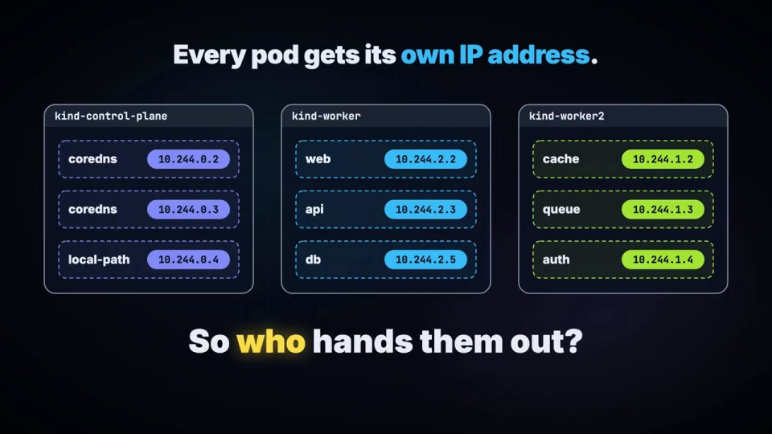
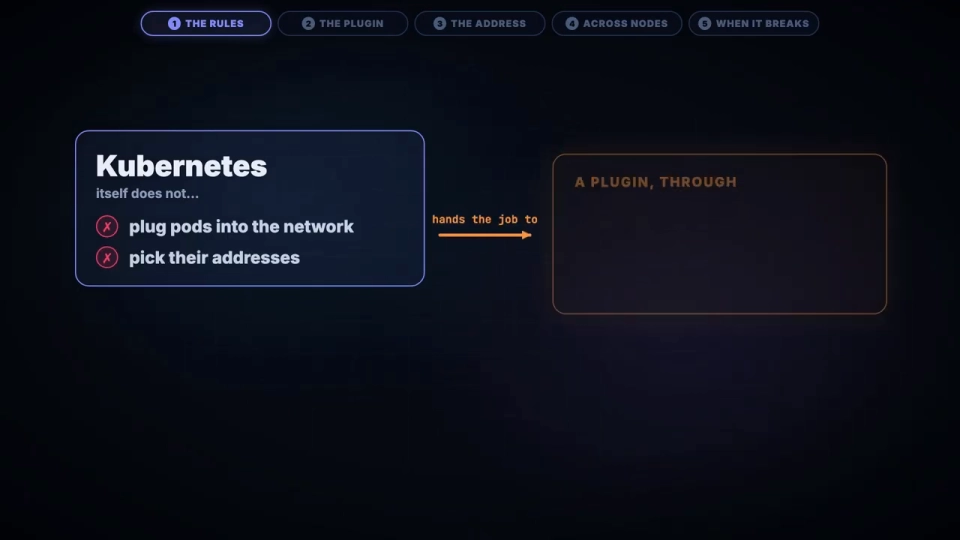
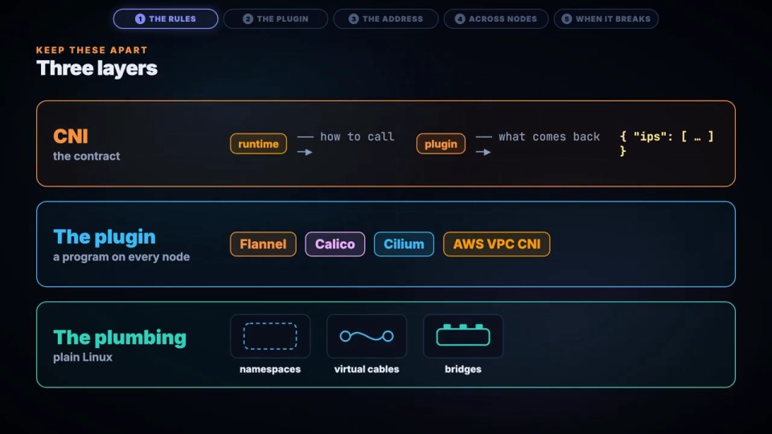
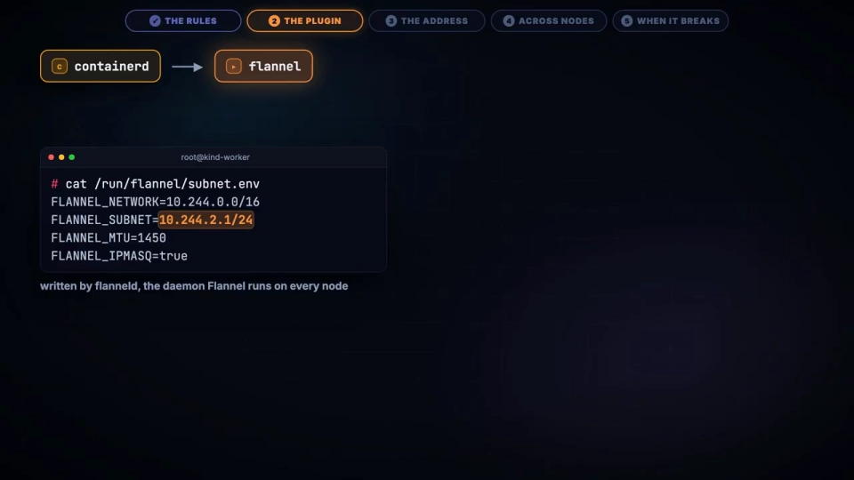
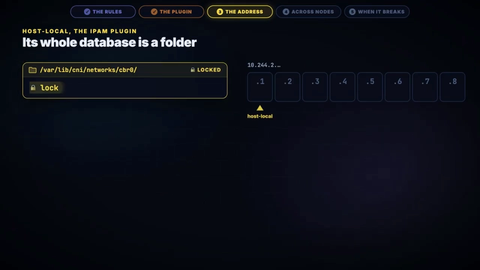
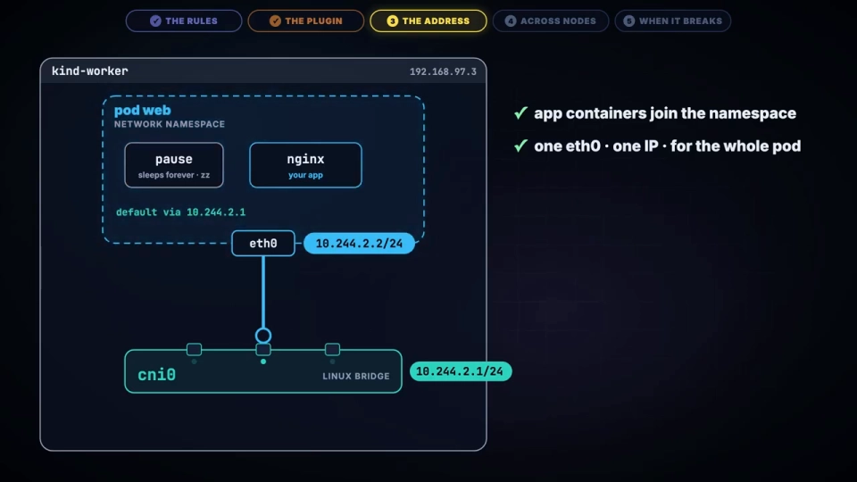
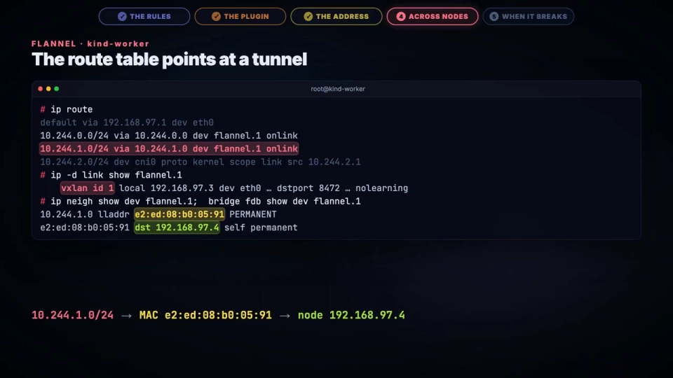
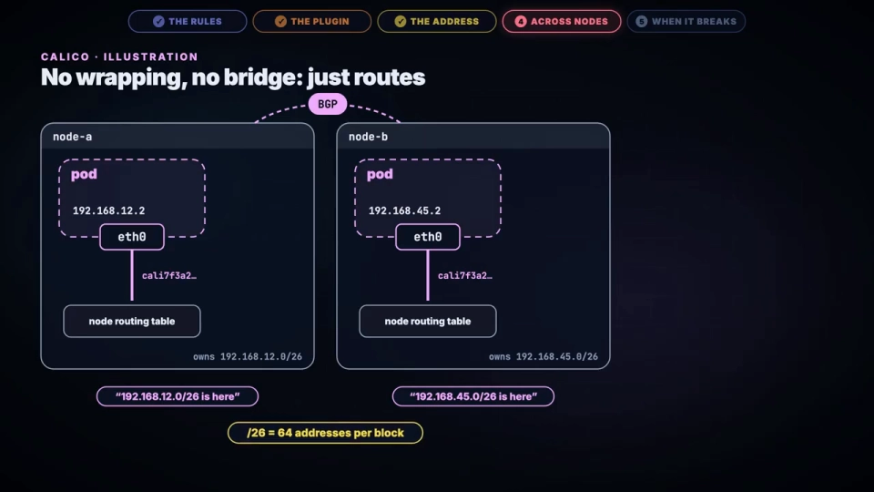
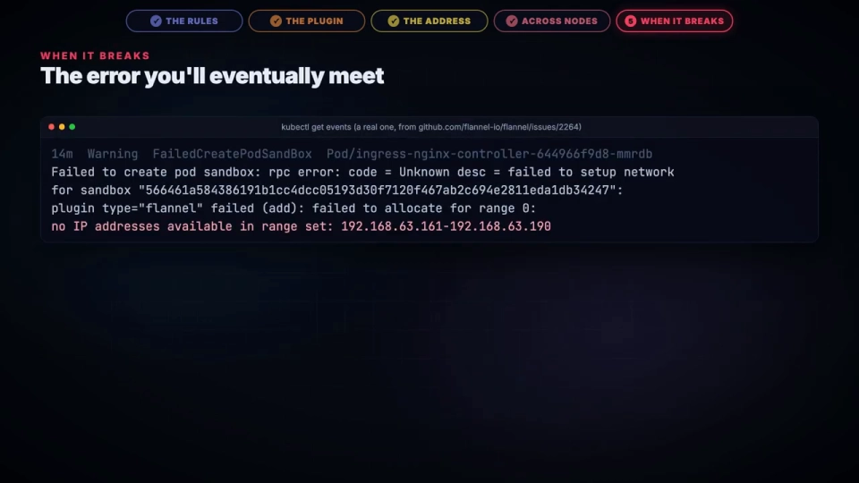

# 一个 Pod 的 IP 到底是谁发的：CNI 与 host-local IPAM 全链路拆解

> 视频来源：[How Kubernetes Networking Actually Works: CNI & IPAM Explained](https://www.youtube.com/watch?v=_t32g1tQ7_A)（YouTube，XOR）
>
> 这支视频从一个真实 Pod（`web`，IP 为 `10.244.2.2`）出发，跟着它从 `kubectl` 一路走到网络上的第一个数据包，把「**Pod 的 IP 是谁发的、怎么发的**」讲透。文稿左栏为英文自动字幕，本文已翻译并重写为中文。

## 本讲要解决的核心问题（SCQA）

**背景**：你已经知道 Kubernetes 每个 Pod 都有自己的 IP，Pod 之间可以跨节点直接通信；也知道 **Kubernetes 自己并不实现网络，而是把这件事交给 CNI 插件**（比如 Flannel、Calico、Cilium）。

**冲突**：既然「每个 Pod 一个 IP」，那这个 IP **究竟在哪个时刻、由哪个程序、按什么规则**发出来的？很多人会想当然地以为「是 kubelet 发的」「是 DHCP 发一个给它」——但都不是。真正的分配过程短小、隐藏在一个几乎没人注意的角落里：**节点上的一个文件夹**。

**疑问**：一个 Pod 从被创建到拿到 IP，中间经过哪些组件、调用哪些程序？地址是从哪来的？为什么两个节点不会发出同一个地址？地址用光了会怎样？

**回答（中心思想）**：**Pod 的 IP 是「节点本地、各管一段」地分配出来的。** 控制面（controller-manager）在节点加入时**先给每个节点切好一段专属网段**；等 Pod 落到某节点上，由**容器运行时（containerd）**调用链式 CNI 插件，最后**一个叫 `host-local` 的小程序**——它的「数据库」其实就是一个文件夹——在本地网段里挑一个空闲地址，**用「创建一个以该 IP 命名的文件」的方式把它占下来**。整条链路上没有中心化的 IP 服务器，也不需要节点之间互相通信。

---

## 一、Kubernetes 的三条网络承诺，与它自己「不干活」的分工

Kubernetes 对网络只有三条朴素承诺：[【跳转到 00:35】](https://www.youtube.com/watch?v=_t32g1tQ7_A&t=35)

1. **每个 Pod 一个 IP**，且在整个集群里唯一；
2. **任意 Pod 能直接访问任意节点上的任意 Pod**，中间不做 NAT；
3. **节点上的本地代理（如 kubelet）能直接访问本节点上的每个 Pod**。



但这里有个关键转折：**Kubernetes 本身既不给 Pod 接入网络，也不给 Pod 挑地址**。它把这份差事通过一份叫 **CNI（Container Network Interface，容器网络接口）** 的「合同」外包给了插件。[【跳转到 00:58】](https://www.youtube.com/watch?v=_t32g1tQ7_A&t=58)

要理解整件事，务必把**三层**分开：[【跳转到 01:12】](https://www.youtube.com/watch?v=_t32g1tQ7_A&t=75)

| 层 | 是什么 | 例子 |
| :--- | :--- | :--- |
| **契约（CNI）** | 规定「怎么调用插件、返回什么 JSON」的规范 | CNI 规范本身 |
| **插件（plugin）** | 每个节点上真正干活的程序 | Flannel、Calico、Cilium、AWS VPC CNI |
| **管道（plumbing）** | 底层全靠原生 Linux 能力 | network namespace、veth、网桥、路由 |



**插件的全部工作，就是把这些 Linux 管道接起来。** 理解了这条分界，后面每一步就不会混淆「谁负责什么」。

---

## 二、Pod 被创建时，IP 是在哪一步、由谁分配的

跟着 `web` 这个 Pod 走一遍：[【跳转到 01:35】](https://www.youtube.com/watch?v=_t32g1tQ7_A&t=95)

1. `kubectl` 把 Pod 发给 **API Server**，API Server 存下它，**调度器（scheduler）挑一个节点**（本例是 `kind-worker`）。
2. **注意 API Server 从不碰网络**——真正给 Pod 接上网络的，只有它落地的那个节点。



3. 在这个节点上，**kubelet 发现新 Pod**，于是请求容器运行时 **containerd** 为它建一个 **sandbox（沙箱）**。
4. 一个常见误解：**很多人以为「kubelet 运行网络插件」，其实不是——真正调用 CNI 插件的是容器运行时**。从 Kubernetes 1.24 起，kubelet 连相关参数都没有了。[【跳转到 01:59】](https://www.youtube.com/watch?v=_t32g1tQ7_A&t=119)
5. containerd 先创建一个**新的 network namespace**（一份私有的网络栈副本：自己的网卡、自己的路由表），此时它是空的，只有一个 loopback，**没有地址、无法出网**。

接下来是最容易被误解的一点：**CNI 插件既不是服务，也不是 API，它就是一个躺在节点某个目录里、可以被直接执行的程序**。containerd 像运行普通命令一样把它跑起来：[【跳转到 02:43】](https://www.youtube.com/watch?v=_t32g1tQ7_A&t=163)

- **参数走环境变量**：命令名（`ADD`）、容器 ID、namespace 文件路径、新网卡应叫的名字（`eth0`）……
- **配置从标准输入（stdin）喂进去**，**结果以 JSON 从标准输出（stdout）返回**。

**此刻还没有分配任何 IP。** 真正的地址分配，被一路「委派」到了链路的更下游。

---

## 三、地址早就划好了：controller-manager 给每个节点一段专属网段

在这条调用链里，Flannel 自己并不建任何东西。它读到一个文件（从节点的 podCIDR 得到），写着「**本节点拥有 `10.244.2.0/24`，MTU 是 1450**」，然后把配置改写一下，**转交给另一个插件 `bridge`**——规范把这种「插件调插件」称为**委派（delegation）**。[【跳转到 03:12】](https://www.youtube.com/watch?v=_t32g1tQ7_A&t=192)

`bridge` 插件负责：确保节点上有一张叫 `cni0` 的网桥（可以理解为一台**虚拟交换机**），再创建一对 **veth**（一根两端虚拟网线）——一端放进 Pod 的 namespace 并命名 `eth0`，另一端留在节点上插进网桥。[【跳转到 03:40】](https://www.youtube.com/watch?v=_t32g1tQ7_A&t=200)



但这根网线**还没有地址**。要给它地址，`bridge` 再跑一个程序：**IPAM 插件（IP Address Management，IP 地址管理）**。

关键在于：**地址不是临时现挑的，而是很久以前就划好了**。当每个节点加入集群时，**controller-manager 就已经从集群大网段里切给它一段**：本例中每节点一个 `/24`——`kind-worker` 拿到 `10.244.2.0/24`，它的邻居拿到 `10.244.1.0/24`。[【跳转到 04:10】](https://www.youtube.com/watch?v=_t32g1tQ7_A&t=250)


这样一来，**两个节点永远不会发出同一个地址**：每个节点只从自己那一段里发，也**完全不需要彼此通信**。这是「无中心、可扩展」的关键设计。

---

## 四、host-local：整个数据库就是一个文件夹

本例的 IPAM 插件叫 **`host-local`**，路由起来看，**它的全部「数据库」就是一个文件夹**。[【跳转到 04:35】](https://www.youtube.com/watch?v=_t32g1tQ7_A&t=275)

它的分配逻辑极其简单粗暴：

1. **加锁**，然后**从头遍历**本节点的网段；
2. **跳过 `.1`**——那是网桥的地址，也就是 Pod 的**网关**；
3. 对每个候选地址，**以「独占模式」尝试创建一个以该 IP 命名的文件**（only-if-not-exists）：文件创建成功 → 这个地址就是它的；文件已存在 → 说明被占用，**换下一个**；
4. 挑到空闲地址后创建文件，往里面写入**沙箱 ID 和 `eth0`**——**这个文件就是这次「租约（lease）」**。



> 一句话概括：**「这个 IP 有没有被占用」，等价于「以这个 IP 命名的文件存不存在」**。

还有两个有意思的细节：

- **释放的地址不会立刻被复用**。删掉占用 `.3` 的 Pod，下一个 Pod 拿到的不是 `.3`，而是 `.4`——`host-local` 会记住「上次发到哪」，**继续往后走**，避免地址被过快回收。[【跳转到 05:25】](https://www.youtube.com/watch?v=_t32g1tQ7_A&t=325)
- **`pause` 容器是 IP 的「锚点」**。地址分配好、JSON 回到 containerd 之后，containerd 才启动 `pause` 容器——一个几乎什么都不做、只会永远睡眠的极小进程。但它是锚：**同一 Pod 里所有业务容器都加入它的 namespace，共享同一个 `eth0` 和同一个 IP**，于是业务容器**崩溃重启也不会丢地址**。



最后，containerd 上报地址，**kubelet 把它写进 Pod 的 status**，`kubectl` 才终于显示出这个 IP。

---

## 五、跨节点：封装、路由，还是「本来就是真地址」

本节点内搞定后，真正的难点来了：`web`（`10.244.2.2`）想访问**另一个节点**上的 `db`（`10.244.1.5`）。数据包穿过网线到达网桥（Pod 的网关），可是**节点之间的底层网络只认识节点地址**（如 `192.168.97.4`），**从没听说过 `10.244.1.5`**。[【跳转到 06:31】](https://www.youtube.com/watch?v=_t32g1tQ7_A&t=391)

只有三条出路：[【跳转到 06:36】](https://www.youtube.com/watch?v=_t32g1tQ7_A&t=396)

### 5.1 封装（wrap）：Flannel 的 VXLAN

Flannel 把包**整个裹起来**。它在节点路由表里规定「**去往 `10.244.1.0/24` 的流量一律交给 `flannel.1`**」，而 `flannel.1` 是一个 **VXLAN** 设备。Flannel 已经提前记好了**每个邻居节点住在哪**（哪个 MAC 代表哪个节点、该发往哪个真实 IP），**不用猜、不用广播**。

于是内核把整个原始帧包进一个 VXLAN 头（网络 ID = 1），塞进 UDP 包，在节点之间用 **8472 端口**传输。[【跳转到 07:26】](https://www.youtube.com/watch?v=_t32g1tQ7_A&t=446)



一个有趣的实测细节：原始帧 **98 字节**，上到网线变成 **148 字节**——**多出来的 50 字节封装开销，正是为什么 Pod 的 MTU 被设成 1450 而不是 1500**。

### 5.2 路由（route）：Calico 的 BGP

Calico **干脆不封装**。它说 **BGP**（互联网在用的路由协议），让**每个节点告诉其他节点「我拥有哪些 Pod 地址段」**。它还跳过网桥：**每个 Pod 一条直达路由**，走自己的网线。它的网关是 `169.254.1.1`——一个**根本不存在于任何网卡上的地址**，由节点替它应答。[【跳转到 08:16】](https://www.youtube.com/watch?v=_t32g1tQ7_A&t=496)



### 5.3 真地址（native）：AWS VPC CNI

在 AWS 上，**VPC CNI** 走第三条路：**Pod IP 就是真实的 VPC 地址**——它们是挂在节点网卡上的附加 IP，所以**云网络会像对待任何一台机器一样为它们做路由**。[【跳转到 08:36】](https://www.youtube.com/watch?v=_t32g1tQ7_A&t=516)

代价在网卡容量上：**最大 Pod 数 = 网卡数 × (每卡地址数 − 1) + 2**。例如 `t3.medium`：3 张网卡、每张 6 个地址 → `3 × 5 + 2 = 17` 个 Pod（而不是默认的 110）。

---

## 六、地址为什么会耗尽：「无可用 IP」与租约泄漏

终于讲到那个你迟早会遇到的报错：[【跳转到 09:01】](https://www.youtube.com/watch?v=_t32g1tQ7_A&t=541)

```
No IP addresses available in range set
```

此时 Pod 会**一直卡在 `ContainerCreating`**。

诡异的是：**一个 `/24` 有 253 个可用地址，而 kubelet 默认最多只允许每个节点 110 个 Pod**——地址数比 Pod 数多一倍还不止，按 Google 的说法，这是**故意**的，为的是**让地址不要被回收得太快**。[【跳转到 09:26】](https://www.youtube.com/watch?v=_t32g1tQ7_A&t=566)



那节点怎么还会「用光」？**答案是泄漏（leak）。**

- Pod 消失时，运行时**必须再次调用插件**，这次用 **`DEL`**；插件按**相反顺序**执行，`host-local` 删掉那个文件。`DEL` 被设计成**可安全重复**：调两次也两次都成功。
- 但只要**有一次没跑到**（运行时跟丢了 Pod、或调用链里某个插件失败），**文件就留了下来**。**残留文件越积越多，一个半空的节点就可能再也启动不了下一个 Pod。**

CNI 规范其实在 **1.1 版**就为此加了**垃圾回收（GC）命令**，但 **containerd 目前还没有调用它**。


排查方法也正来自这个设计：**去那个文件夹里看**。**每个文件对应一个沙箱 ID——如果该沙箱早已不在，这个文件就是泄漏。**

---

## 七、把整条链路倒带回放

把整件事串起来：[【跳转到 10:34】](https://www.youtube.com/watch?v=_t32g1tQ7_A&t=634)

1. **调度器**挑一个节点；
2. 该节点的**运行时**建一个 network namespace；
3. **Flannel / bridge / host-local** 依次接力，接上一根网线，并**写下名字是那个地址的一个文件**；
4. 跨节点时，数据包被**封装**、被**路由**，或者**本来就是真实的网络地址**。

最后一个耐人寻味的点：**Pod 从不「搬家」**。删掉 `db`，当它以新 Pod 的身份在别的节点上回来时，**它是一个全新的 Pod，会拿到那个节点网段里的全新 IP**。那么问题来了——**如果 Pod 的 IP 一直在变，别的东西怎么找到它？** 答案是 **Service**，那是另一个故事了。[【跳转到 10:48】](https://www.youtube.com/watch?v=_t32g1tQ7_A&t=648)

## 小结

- **Kubernetes 不实现网络、也不挑地址**，它通过 **CNI 契约**把这件事交给插件；CNI 插件只是节点上的**一个可执行程序**。
- 调用 CNI 插件的是**容器运行时（containerd）**，**不是 kubelet**（1.24 起 kubelet 连相关参数都没有了）。
- 地址**提前就划好了**：**controller-manager** 在节点加入时按节点切分集群网段（这里每节点一个 `/24`），节点各管一段、无需互相通信。
- **`host-local` 的数据库就是一个文件夹**：以 IP 命名的文件即租约，「文件是否存在」即「地址是否被占用」；它还会有意**跳过刚释放的地址**。
- 跨节点通信有三条路：**封装（Flannel VXLAN）**、**路由（Calico BGP）**、**真地址（AWS VPC CNI）**。
- `No IP addresses available in range set` 的元凶通常是**租约文件泄漏**——`DEL` 没跑成、GC 又还没被 containerd 调用。

## 关键术语速查

| 术语 | 一句话解释 |
| :--- | :--- |
| CNI | 容器网络接口，规定「如何调用网络插件、返回什么 JSON」的契约 |
| IPAM | IP 地址管理，负责给 Pod 挑地址的那部分职责（CNI 的一个子插件） |
| host-local | 最常用的本地 IPAM 插件，用「一个目录、一个 IP 一个文件」记录租约 |
| podCIDR | 分配给某个节点的 Pod 网段（如 `10.244.2.0/24`），由 controller-manager 切分 |
| 委派（delegation） | 一个 CNI 插件把工作转交给另一个插件（如 Flannel → bridge → host-local） |
| veth pair | 一对虚拟网线，一端在 Pod 内（eth0），一端插在节点网桥上 |
| VXLAN | 把二层帧封装进 UDP 在三层网络里传输的隧道技术（Flannel 用）；封装开销解释了 MTU=1450 |
| BGP | 互联网使用的路由协议；Calico 用它让各节点互相通告自己拥有的 Pod 网段 |
| 租约（lease） | 一次 IP 占用的记录，在 host-local 里就是那个以 IP 命名的文件 |
