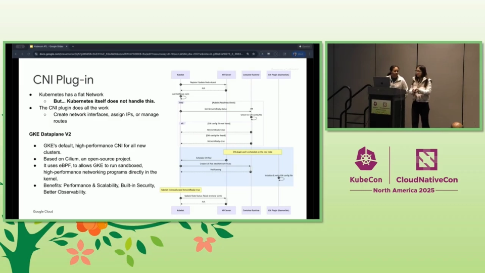
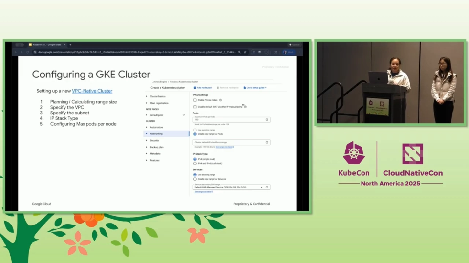
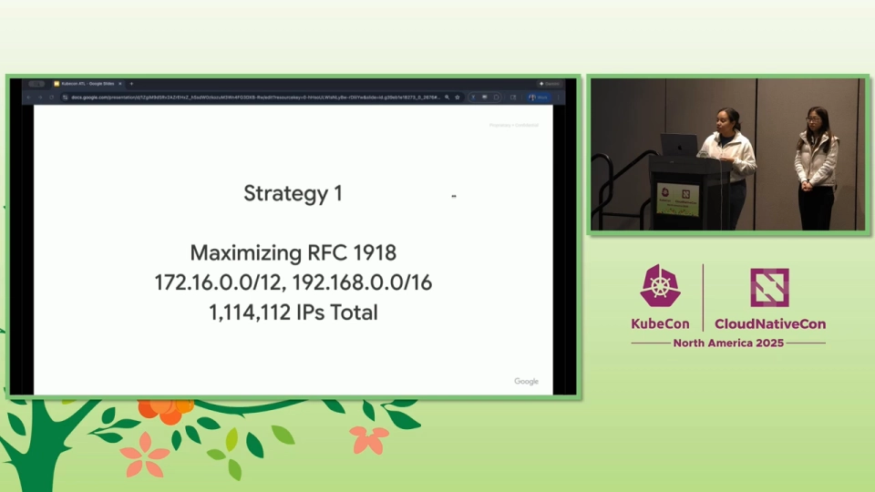
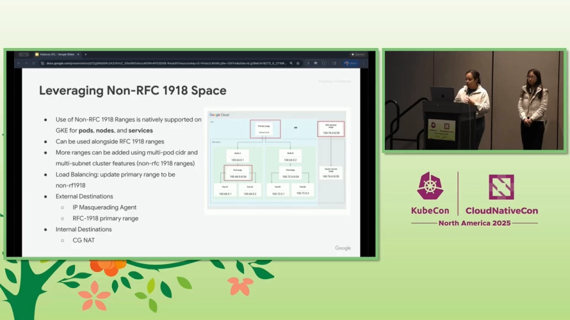
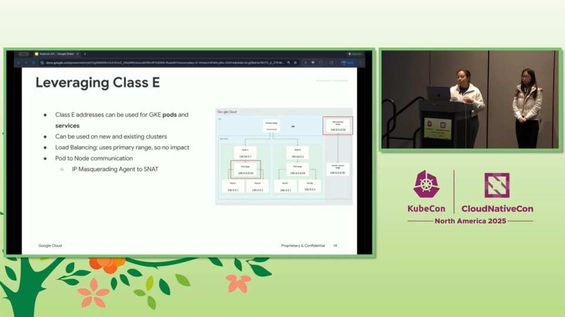
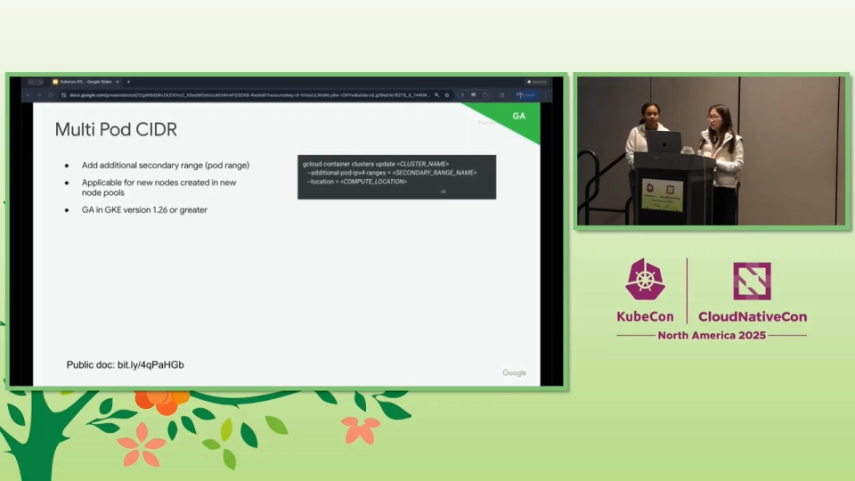
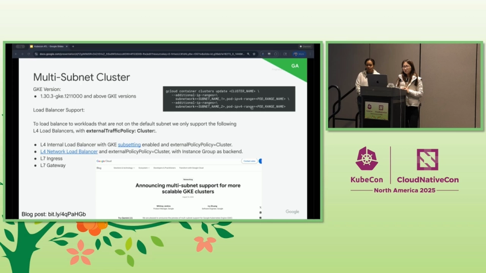
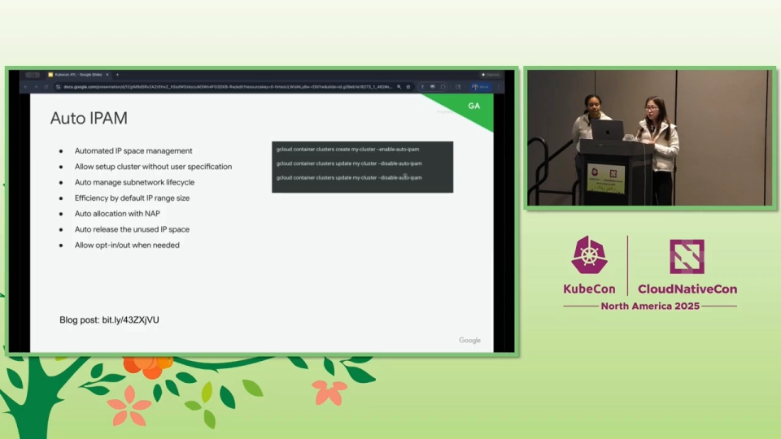
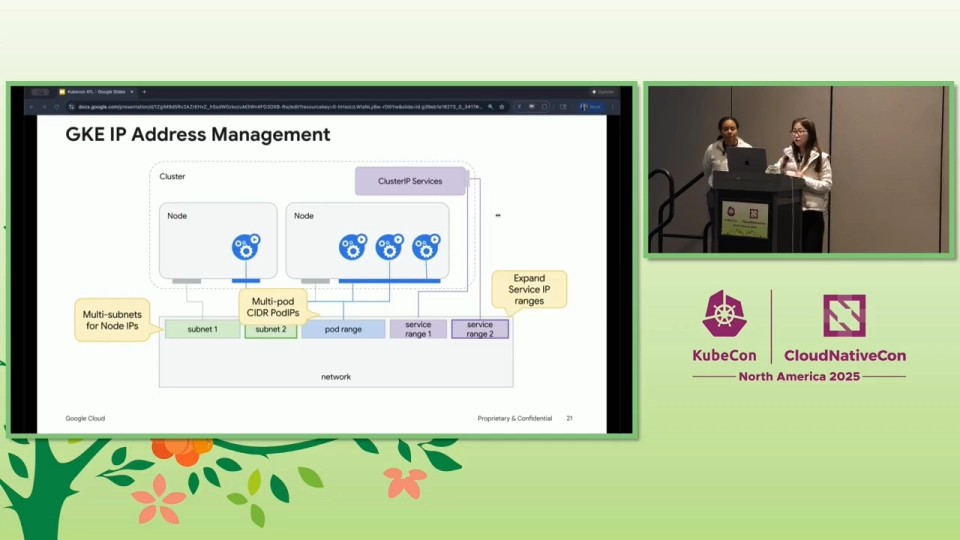
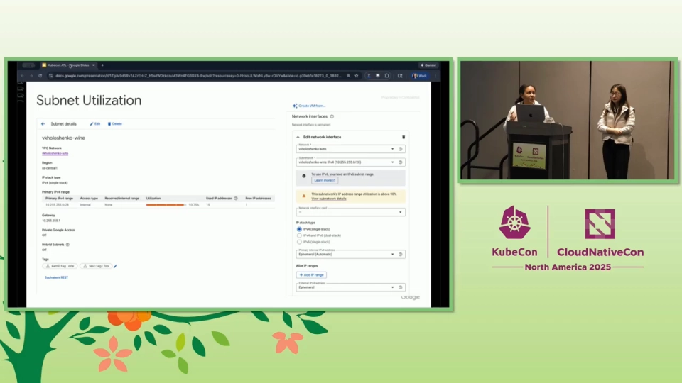

# Kubernetes 的 IP 都在哪：地址规划、IPv4 耗尽与应对策略

> 视频来源：[Kubernetes IP Management: From Core Concepts To Strategic Solutions](https://www.youtube.com/watch?v=EXxa7Qxdveg)（YouTube，KubeCon，Ivy Zhuang & Whitney Jenkins, Google）
>
> 这是一场 KubeCon 演讲：从 Kubernetes 的**扁平网络与 CNI 分工**讲起，系统梳理**为什么 IP 规划这么难、IPv4 为什么会耗尽**，以及**三条在 IPv4 星球上续命的策略**（RFC1918 盘点、非 RFC1918 段、Class E 段）和一批新特性。文稿左栏为英文自动字幕，本文已翻译并重写为中文。演讲以 **GKE** 为主要实例，但其中的**概念与思路对所有 Kubernetes 集群都通用**。

## 本讲要解决的核心问题（SCQA）

**背景**：Kubernetes 用「**每个 Pod 一个可路由 IP**」的扁平网络模型，简化了容器网络。在云上（如 GKE），Pod 拿到的是**真实、可路由、属于 VPC 地址段的 IP**，和负载均衡、服务网格、VPC 对等、共享 VPC 等服务原生打通，**Pod IP 在全网可见**，对**可观测性与排障**非常有利。

**冲突**：便捷的另一面是**代价**：这种「扁平、不伪装、不复用」的模型**极其消耗 IP 地址**。集群的 IP 规划（Pod / 节点 / Service 三段各自的网段大小）**极难算准**，还要预留未来增长；一旦规划失误，很多网络决策**不可逆**，你可能会撞上「**地址耗尽**」，甚至不得不**重建集群、迁移工作负载**。而 IPv4 本身就是稀缺资源。

**疑问**：一个集群到底需要哪几段 IP？为什么 Pod 需要的地址会「成倍」膨胀？在还没准备好上 IPv6 之前，**有没有办法让 IPv4 撑得更久**？

**回答（中心思想）**：**Kubernetes 的 IP 管理难在「规划」与「耗尽」，出路有三条：盘活 RFC1918 私网段、动用非 RFC1918 的 `100.64.0.0/10`、乃至启用超大的 Class E 段；同时用「多 Pod CIDR / 多子网 / Auto IPAM」等新特性把地址池做成「可动态扩展」的。** 而长期看，**IPv6 的近乎无限地址空间才是根治方案**。

---

## 一、扁平网络模型与 CNI 的分工：Kubernetes 并不自己实现网络

Kubernetes 采用**扁平网络模型（flat network）**。以 GKE 为例，这个模型的特点是「完全打通」：**每个 Pod 都获得一个唯一的、可路由的 IP，且该 IP 属于 VPC 的地址段**；Pod IP 在整个网络中可见——**这极大增强了遥测能力、简化了排障**；这些地址段还能通过 Cloud VPN、Cloud Interconnect 等工具**被本地（on-prem）访问**。[【跳转到 00:55】](https://www.youtube.com/watch?v=EXxa7Qxdveg&t=55)

但关键前提是：**Kubernetes 本身并不负责实现网络**，它把**全部实现细节委派给一组插件**。**CNI（一个 CNCF 项目）就是容器运行时与网络插件之间那个简单的、可插拔的接口。**[【跳转到 01:20】](https://www.youtube.com/watch?v=EXxa7Qxdveg&t=80)

Pod 调度到启动、CNI 介入的完整流程是：[【跳转到 01:34】](https://www.youtube.com/watch?v=EXxa7Qxdveg&t=94)

1. **kubelet 决定启动一个 Pod**；
2. 它促使**容器运行时创建一个 pause 沙箱**；
3. 运行时查看 **`/etc/cni/net.d`** 里的 CNI 插件配置文件；
4. 运行时执行其中定义的、对应的 **CNI 插件，运行 `ADD` 子命令**；
5. **CNI 把活全干了**：创建网络接口、**分配 IP**、管理路由；
6. 此后 Pod 便「上线」了，可以在网络上通信。

在 **IP 分配**这件事上，GKE 的两点值得注意：

- **默认（VPC-native）模式**下，Pod 从 **VPC 的二级地址段（secondary ranges）**里拿到**真实 IP**；使用的是**标准 CNI 插件**，其 IPAM 采用 **`host-local`**——它「只是看一眼预先配置好的地址段，需要时就从中分配一个」；但这个插件**可以改写逻辑**，例如**去调用你自己的云 API 来决定给 Pod 哪个 IP**。[【跳转到 02:35】](https://www.youtube.com/watch?v=EXxa7Qxdveg&t=155)
- 到了 **Dataplane V2（用 Cilium / eBPF 作为 CNI 插件）**，数据面性能、安全性和可观测性都更强，**但 IPAM 插件本身仍使用标准的 `host-local`**。[【跳转到 03:15】](https://www.youtube.com/watch?v=EXxa7Qxdveg&t=195)

> 也就是说：**数据面可以换成 eBPF，但「地址从哪来」这件事仍然由 IPAM 机制决定，两者是解耦的。**

---

## 二、规划一个集群的 IP：Pod、节点、Service 三段地址

创建一个集群时，从地址规划角度**第一件要想的事**是：**我的 Pod、节点、Service 各自需要多大的网段？** 而算清这个大小**相当复杂**——官方文档里的计算公式「看起来像微积分」。[【跳转到 04:15】](https://www.youtube.com/watch?v=EXxa7Qxdveg&t=255)

更麻烦的是：你不仅得算**当下**要跑的工作负载，还得**为集群的未来增长留余地**。而 IPv4 是**非常稀缺**的资源，预留过度就很浪费——**所以前期把规划算准，是一件至关重要、且一旦做错很难回头的事**。[【跳转到 04:40】](https://www.youtube.com/watch?v=EXxa7Qxdveg&t=280)

规划时，两个设置直接决定集群形态：

- **子网的栈类型（stack type）**：子网是 IPv4 → 建成 **IPv4 集群**；子网同时支持 IPv4/IPv6 → 才能建成 **双栈（dual-stack）集群**。[【跳转到 05:05】](https://www.youtube.com/watch?v=EXxa7Qxdveg&t=305)
- **每节点最大 Pod 数（max pods per node）**：默认是 **110**，这意味着**一个节点需要一段 `/24`（256 个 IP）**来兜底。[【跳转到 05:55】](https://www.youtube.com/watch?v=EXxa7Qxdveg&t=355)

几个数字值得记住：[【跳转到 06:20】](https://www.youtube.com/watch?v=EXxa7Qxdveg&t=380)

- **IPv4**：Pod、节点、Service **全部是 IPv4** 地址。Google 还专门**保留了 `34.118.224.0/20`（4000 多个 IP）供 Service 使用**，**不需要从你自己的 VPC 网络里划走**。
- **双栈（dual stack）**：**Pod 和节点同时获得 IPv4 和 IPv6 地址**，并且**需要启用 Dataplane V2**——它是通过 IPv4 平滑过渡到 IPv6 的一种方式。
- **IPv6**：Pod、节点、Service **全是 IPv6**。对很多人有吸引力，因为地址空间**大得「几乎像无限」**——**你不必再操心 IP 规划，也几乎不会撞上地址耗尽**。

---

## 三、大规模运行 Kubernetes 的 IP 挑战

演讲把「规模化运行 K8s」的痛点归纳为几条：[【跳转到 08:50】](https://www.youtube.com/watch?v=EXxa7Qxdveg&t=530)

1. **GKE 极其消耗 IP**，地址分配难以管理——「**很多人还在用电子表格管理 IP 地址空间**」，既难看全局、也难找出一段空闲地址；
2. **分配效率低会导致地址耗尽**——其中最常被吐槽的是「**Pod IP 需求按 2 的幂次翻倍**」带来的浪费，让你**白白消耗大量稀缺的 IPv4 地址**；
3. **可观测性差**——一旦真的耗尽，很难搞清楚「到底发生了什么、该怎么解」；
4. **缺少一些特性**——例如**纯 IPv6**（pure IPv6）支持。

一个好消息是：那个「**2 倍 IP 低效**」的问题**正在消失**。[【跳转到 28:28】](https://www.youtube.com/watch?v=EXxa7Qxdveg&t=1708)

---

## 四、在 IPv4 上续命的三条策略

不是所有人都准备好上 IPv6，所以演讲给了三条**在 IPv4 世界里缓解地址耗尽**的策略。[【跳转到 10:05】](https://www.youtube.com/watch?v=EXxa7Qxdveg&t=605)

### 4.1 策略一：盘活 RFC1918 私网段

除了众所周知的 `10/8`，还有**两段 RFC1918 私网地址**也能用于 GKE。**两段加起来能额外提供 100 万以上的 IP**，可用于 **Pod、节点、Service**。配合后续会讲到的「给已有集群追加地址段」的特性，**你不再需要为了扩容而重建集群、迁移工作负载**。[【跳转到 10:30】](https://www.youtube.com/watch?v=EXxa7Qxdveg&t=630)

### 4.2 策略二：动用非 RFC1918 段 `100.64.0.0/10`

第二段是**非 RFC1918 的 `100.64.0.0/10`**（即运营商级 NAT / CGNAT 常用段），**提供 400 多万个 IP**，同样**可用于 Pod、节点、Service**，并且能配合「多子网 / 多 Pod CIDR」特性使用；在负载均衡等高级配置里也有办法用它。[【跳转到 10:55】](https://www.youtube.com/watch?v=EXxa7Qxdveg&t=655)

### 4.3 策略三：启用超大的 Class E 段 `240.0.0.0/4`

第三段、也是演讲者认为**最令人兴奋**的一招，是动用 **Class E 地址段 `240.0.0.0/4`**——**超过 2.68 亿个 IP**。可用于 **Pod 和 Service**，**新旧集群都行**，还能用 IP 伪装代理给 Pod 到节点的通信做 SNAT。[【跳转到 11:45】](https://www.youtube.com/watch?v=EXxa7Qxdveg&t=705)

关于 Class E，演讲者专门澄清了**三个常见误解**：[【跳转到 13:25】](https://www.youtube.com/watch?v=EXxa7Qxdveg&t=805)

| 误解 | 事实 |
| :--- | :--- |
| Class E 无法与 Google 服务协作 | **错**。通过私有连接方式，Class E 可用于许多 Google 托管服务 |
| 用 Class E 会限制与 Google 之外服务的通信 | **有误导性**。Class E **不可路由、不会在公网广告**；许多操作系统已支持；本地数据中心场景下 Cisco、Juniper、Arista 也支持路由 Class E |
| Class E 有性能/规模限制 | **错**。它只是一个 IP 段，**不会有任何性能影响** |

---

## 五、把地址池做成「可动态扩展」：多 CIDR、多子网与 Auto IPAM

除了「找更多地址段」，GKE 还推出了一批**让地址池可以事后扩容**的特性。[【跳转到 14:40】](https://www.youtube.com/watch?v=EXxa7Qxdveg&t=880)

- **Multi Pod CIDR（多 Pod CIDR / 不连续 CIDR）**：过去一个集群只能有一段 Pod 地址；当集群扩容、地址不够时很难预先规划。该特性允许**给集群追加额外的 Pod 地址段**，从而**防止 Pod IP 耗尽**。[【跳转到 14:40】](https://www.youtube.com/watch?v=EXxa7Qxdveg&t=880)

- **Multi-Subnet Cluster（多子网集群）**：在**节点层面**解决地址耗尽——允许集群**使用额外的子网**，从而**扩大 Pod 地址范围**；通过集群更新操作追加子网与地址段即可，并支持最常见的 L4/L7 负载均衡与 L7 网关。[【跳转到 15:05】](https://www.youtube.com/watch?v=EXxa7Qxdveg&t=905)

- **Multi-service CIDR（灵活 Service CIDR）**：允许集群**为 Service 使用多段地址**。该特性在 **Kubernetes 侧已 GA**，GKE 1.33+ 可直接使用；在 GKE 上目前**只允许追加 `34.118.224.0/24`**（因为需要校验不与既有段重叠），放宽限制已在路线图上。[【跳转到 16:31】](https://www.youtube.com/watch?v=EXxa7Qxdveg&t=991)
- **Auto IPAM（自动 IPAM）**：**从根本上改变了集群消耗网络资源的方式**。过去你必须**预先指定节点和 Pod 的全部地址**；Auto IPAM 让集群**不必再操心这些地址段**，由 GKE **自动为你分配/预置子网与 Pod 地址段**——**从小段开始，按需增长到大空间**。当集群接近 Pod 或节点的 IP 上限时，它**自动扩出来**。[【跳转到 17:26】](https://www.youtube.com/watch?v=EXxa7Qxdveg&t=1046)

所有这些特性拼在一起，就是一张「GKE IP 管理」的全景图：**多子网 + 多 CIDR + 灵活的 Service 地址段 + Auto IPAM**，共同把「地址池」从**一次性写死**变成**可动态扩展**。[【跳转到 18:16】](https://www.youtube.com/watch?v=EXxa7Qxdveg&t=1096)

---

## 六、可观测与排障：让「快耗尽了」看得见

针对前面提到的「可观测性差」，GKE 也补了一批工具：[【跳转到 19:06】](https://www.youtube.com/watch?v=EXxa7Qxdveg&t=1146)

- **IP 伪装分析器（IP masquerading analyzer）**已集成进 **Network Intelligence Center**：可以**独立诊断**因网络配置错误（例如 Pod 地址段没在非伪装 CIDR 字段里正确声明）导致的**出网连通性问题**；连通性测试（connectivity tests）也在路上。
- **控制台内的可观测性**：直接在集群视图里**显示各地址段的利用率百分比**，并在右上角给出**修复建议**（例如「用 Multi Pod CIDR 或多子网特性追加一段地址」「考虑用 Class E」），**减少发现问题后手动排障的琐碎工作**。
- **子网利用率（subnet utilization）**：用 `gcloud` 带 `--view=utilization` 的子网查询命令，**查看 IPv4/IPv6 地址的利用率**；并且会**主动预警**——比如你创建新 VM 时选了一段高利用率子网，界面会**提示换一段**，**在事前就避免未来陷入地址不足的窘境**。[【跳转到 22:31】](https://www.youtube.com/watch?v=EXxa7Qxdveg&t=1351)

在随后的问答里，演讲者还回应了两个常见问题：**灵活的 Service CIDR 是开源特性**，非 GKE 集群也能用；而像某些云那样的「**孤岛模式（island mode，跨 VPC 复用地址）**」**GKE 并不支持、也大概率不会支持**——因为扁平网络模型带来的开箱即用体验，对多数场景更有价值，代价则是**地址不能复用、需要更大的地址空间**。[【跳转到 27:38】](https://www.youtube.com/watch?v=EXxa7Qxdveg&t=1658)

---

## 小结

- Kubernetes 采用**扁平网络模型**，**每个 Pod 一个可路由 IP**——好处是简单、可观测性强，代价是**极其消耗 IP**。
- **Kubernetes 自己不实现网络**，通过 **CNI** 把「建接口、分 IP、管路由」交给插件；**数据面（如 Cilium/eBPF）与 IPAM 是解耦的**。
- 规划一个集群要同时给出 **Pod / 节点 / Service** 三段地址；关键旋钮是**子网栈类型（IPv4 / 双栈）**与**每节点最大 Pod 数（默认 110 → 一段 /24）**。
- 大规模痛点：**地址消耗大、难管理、分配低效（2 倍幂次膨胀）、可观测性差**。
- **IPv4 续命三策略**：**盘活 RFC1918**、**用 `100.64.0.0/10`**、**启用 Class E `240.0.0.0/4`**。
- **让地址池可扩展**的新特性：**Multi Pod CIDR、Multi-Subnet Cluster、Multi-service CIDR、Auto IPAM**。
- 长期解法是 **IPv6**——它的地址空间「几乎无限」，几乎不必再担心耗尽。

## 关键术语速查

| 术语 | 一句话解释 |
| :--- | :--- |
| 扁平网络模型 | 每个 Pod 一个唯一可路由 IP、跨节点直连、不使用地址复用的网络模型 |
| CNI | 容器运行时与网络插件之间的可插拔接口规范 |
| VPC-native | 云上让 Pod 直接使用 VPC 地址段真实 IP 的模式 |
| Dataplane V2 | 用 Cilium / eBPF 实现的数据面（性能、安全、可观测性更好），但 IPAM 仍用 host-local |
| 双栈（dual-stack） | Pod 与节点同时拥有 IPv4 和 IPv6 地址 |
| RFC1918 | 私有网段（10/8、172.16/12、192.168/16），可自由内网使用 |
| `100.64.0.0/10` | 非 RFC1918 的可共享地址段（CGNAT），约 400 万 IP |
| Class E | `240.0.0.0/4`，2.68 亿以上的超大地址段 |
| Auto IPAM | 由平台自动分配/预置子网与 Pod 地址段，集群无需预先规划 |
| IP 伪装（masquerade） | 出网时把 Pod IP 伪装成节点 IP 的 SNAT 行为 |
