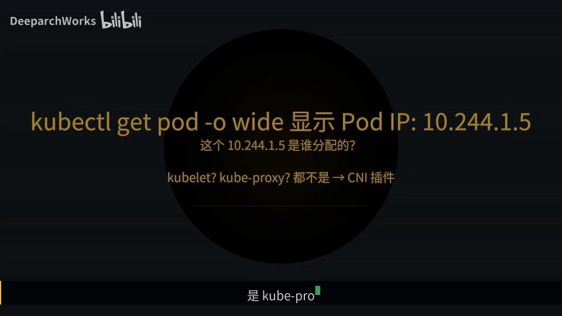
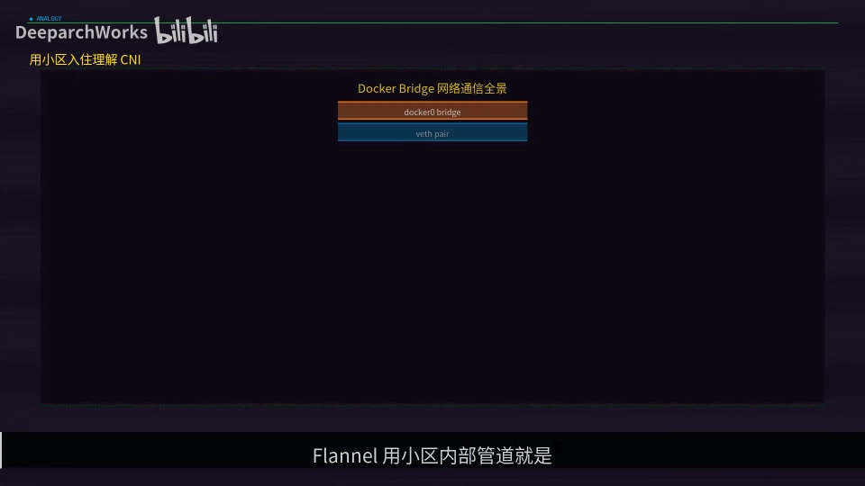
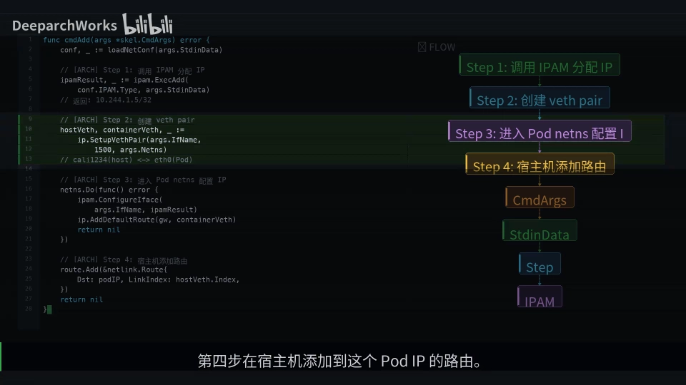
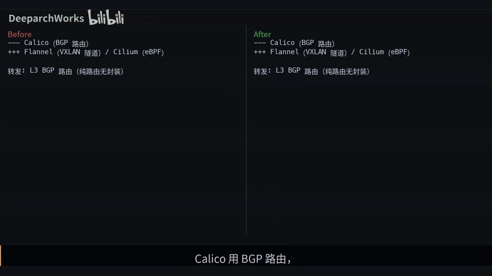
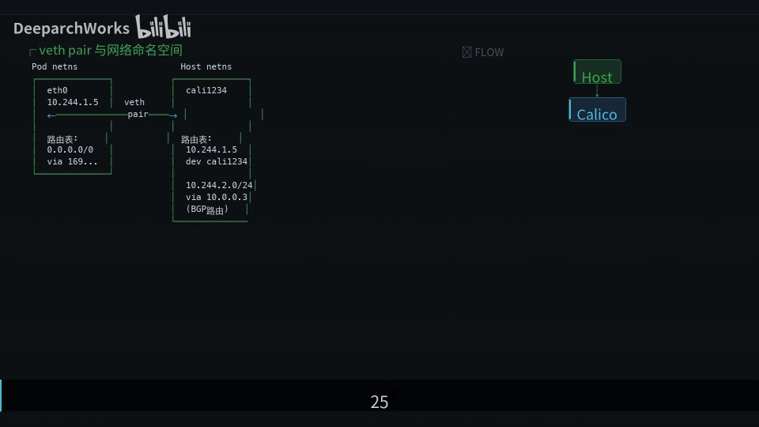
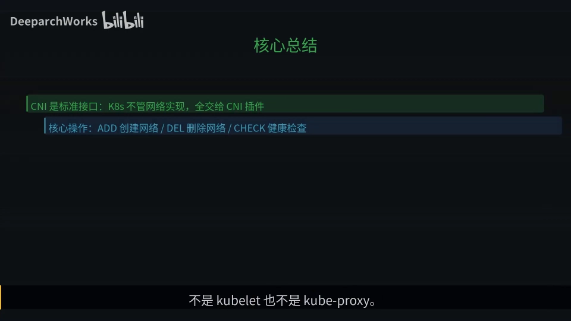

# Pod 的 IP 从哪来的：CNI 插件的秘密

> 视频来源：[Pod的IP从哪来的CNI插件的秘密](https://www.bilibili.com/video/BV1A6D7B2EpG/)（Bilibili，DeeparchWorks）｜时长 6:43
>
> 这是一支"把 Pod 网络一次讲透"的短课：它沿着 **kubelet → CRI → containerd → CNI 插件**这条链路，回答"Pod 的 IP 到底是谁分配的"，并重点讲清 **Pod sandbox 创建之后、应用容器启动之前**那段时间里，网络是怎么被配置上去的。文稿已对自动字幕的明显错拼做订正：`cuber nice`/`CUBBERT`/`CUBID`/`Cubbit`→**Kubernetes / kubelet**、`cuba proxy`→**kube-proxy**、`cubic调用链`→**调用链**、`west pair`/`vs pair`/`vs per`→**veth pair**、`IPM`→**IPAM**、`CELIUM`/`Celium`→**Cilium**、`VISAN`→**VXLAN**、`APPETBS`/`APTABLES`→**iptables**、`net filter`→**netfilter**、`adidal check`→**ADD/DEL/CHECK**、`container`→**containerd**、`gr pc`→**gRPC**、`team hawking`/`tim hawking`→**Tim Hockin**、`thomas graph`→**Thomas Graf**、`Brandon burns`→**Brendan Burns**。

## 本讲要解决的核心问题（SCQA）

**背景**：你用 `kubectl get pod -o wide` 看一个 Pod，会看到它有一个 IP，比如 `10.244.1.5`。Kubernetes 的网络模型非常简单，只有三条基本规则：Pod 之间可以直接通信、不需要 NAT；Pod 看到的"自己的 IP"就是别的 Pod 看到的那个 IP。

**冲突**：规则这么简单，可 IP 究竟是谁发下去的？很多人会猜是 kubelet，或者 kube-proxy。但 kubelet 只负责"把容器跑起来"，kube-proxy 只管 Service 的负载均衡——它们都不分配 Pod 的 IP。

**疑问**：那 Pod 的 IP 到底是谁分配的？它是怎么在这一刻被"配置"到 Pod 上的？

**回答（中心思想）**：**Pod 的 IP 由 CNI 插件分配。** 流程是：kubelet 通过 **CRI** 调用容器运行时（containerd），containerd **先创建 Pod sandbox 和它的网络命名空间**，然后调用 **CNI 插件的 ADD 操作**完成网络配置——**这一整套网络配置在 Pod sandbox 创建之后、应用容器启动之前就完成了，也就是"网络先于应用就绪"。** [【跳转到 00:25】](https://www.bilibili.com/video/BV1A6D7B2EpG/?t=25)



---

## 一、CNI 插件在 Kubernetes 里扮演什么角色

要理解"IP 从哪来"，先把 CNI 插件在集群里的位置摆正。

### 1.1 用"小区入住"类比 CNI 插件

可以把 CNI 插件想象成**物业公司**。你入住（创建一个 Pod）时，物业帮你做三件事 [【跳转到 00:50】](https://www.bilibili.com/video/BV1A6D7B2EpG/?t=50)：

1. **分配门牌号**——也就是分配 IP 地址；
2. **接通水电网络**——也就是创建 **veth pair**（虚拟网线）和**网络命名空间**；
3. **在楼栋信箱表上登记**——也就是**更新路由表**。

而 **IPAM**（IP Address Management，IP 地址管理）就是那套"门牌号管理系统"：`host-local` 相当于"每栋楼自己管"，Calico IPAM 相当于"物业总部统一管"。[【跳转到 01:06】](https://www.bilibili.com/video/BV1A6D7B2EpG/?t=66)

### 1.2 CNI 在集群中的位置：一场 gRPC 的接力

真正的调用链是这样接力的 [【跳转到 01:29】](https://www.bilibili.com/video/BV1A6D7B2EpG/?t=89)：

```
kubelet ──gRPC──▶ CRI（containerd） ──创建 sandbox──▶ CNI 插件 ──▶ IPAM 插件
```

- kubelet 通过 **gRPC** 调用 **CRI**（Container Runtime Interface，容器运行时接口）；
- CRI 的具体实现（这里以 containerd 为例）**先创建 sandbox**（Pod 的"沙箱"，承载网络命名空间的容器）；
- sandbox 就绪后，containerd 再**调用 CNI 插件**。



### 1.3 CNI 只有三种操作：ADD / DEL / CHECK

CNI 的接口规范其实非常简单，只提供三种操作：

| 操作 | 含义 |
| --- | --- |
| **ADD** | 创建网络（分配 IP、接线、配路由） |
| **DEL** | 删除网络 |
| **CHECK** | 健康检查 |

其中 **ADD 是最核心的操作**，Pod 每次获得网络都靠它。ADD 内部还会调用 **IPAM 插件**去分配 IP。[【跳转到 01:34】](https://www.bilibili.com/video/BV1A6D7B2EpG/?t=134)

关于那三条"网络基本规则"，视频还特别点名了它的设计者：**Tim Hockin** 是 Kubernetes 网络模型的核心设计者，正是他定义了"Pod 间可直接通信、不需要 NAT""Pod 看到的自己的 IP 就是其他 Pod 看到的 IP"这些规则。这些规则看似简单，但要真正实现，必须解决跨节点路由、IP 分配、网络策略等一系列问题——**而 CNI 就是把这些实现标准化下来的接口规范。** [【跳转到 01:54】](https://www.bilibili.com/video/BV1A6D7B2EpG/?t=114)

---

## 二、CNI ADD 的四步：一次网络配置具体做了什么

这是全场最"干货"的一段。CNI 的 ADD 操作分四步 [【跳转到 02:29】](https://www.bilibili.com/video/BV1A6D7B2EpG/?t=149)：

1. **调用 IPAM 插件分配 IP 地址**——先拿到那个"门牌号"，例如 `10.244.1.5`；
2. **创建 veth pair**——一端叫 `eth0`，放在 **Pod 的网络命名空间**里；另一端（宿主机侧，形如 `veth1234`）放在**宿主机的命名空间**里；
3. **进入 Pod 的网络命名空间**——给 `eth0` 配置 IP 地址和默认路由；
4. **在宿主机上添加路由**——让宿主机知道"发往这个 Pod IP 的包该走哪根 veth"。


**关键点在于时机**：这一整套动作发生在 **sandbox 创建之后、应用容器启动之前**。换句话说，当你的业务容器真正开始运行时，网络已经通了——这就是前面说的"网络先于应用就绪"。 [【跳转到 02:54】](https://www.bilibili.com/video/BV1A6D7B2EpG/?t=174)

---

## 三、IPAM：IP 地址是怎么被"分"出来的

ADD 的第一步是分配 IP，这一步由 IPAM 插件负责。视频重点对比了两种模式。

### 3.1 host-local：节点本地管理，简单但浪费

**host-local 是最简单的 IPAM**：每个节点从 **kube-controller-manager** 获得一个子网（比如 `10.244.1.0/24`），然后在这个子网内**顺序分配** IP。已分配的 IP 用**本地文件**记录——**文件名就是 IP 地址，文件内容是容器 ID**。 [【跳转到 02:54】](https://www.bilibili.com/video/BV1A6D7B2EpG/?t=174)



- **优点**：简单快速，不依赖外部存储；
- **缺点**：IP 利用率低——每个节点独占一个子网，哪怕只用了几个 IP，其余地址也被"占着"。

### 3.2 Calico IPAM：集中管理，利用率高

与 host-local 相对，**Calico IPAM 采用集中管理**，IP 利用率更高。它属于"物业总部统一管"的模式，和本节后面要讲的 Calico 网络方案配套使用。

---

## 四、三大 CNI 方案对比与选型

视频最后横向对比了三种主流 CNI 方案 [【跳转到 03:53】](https://www.bilibili.com/video/BV1A6D7B2EpG/?t=233)：

| 方案 | 转发方式 | 优点 | 代价 / 限制 |
| --- | --- | --- | --- |
| **Calico** | BGP 路由，纯三层转发 | 无封装开销、性能高 | 需要 BGP 对等配置 |
| **Flannel** | VXLAN 隧道 | 开箱即用、最简单 | 有 50 字节封装开销，且不支持网络策略 |
| **Cilium** | eBPF 内核级转发 | 性能最高，支持丰富的网络策略与可观测性 | 要求内核版本 4.9 以上 |

其中 **Cilium 代表了 K8s 网络的未来方向**。视频解释了原因：传统 CNI 方案依赖 **iptables** 做包过滤和转发规则，而这些规则的数量**与 Service 和 Pod 的数量成正比**，集群一大性能就急剧下降；**Cilium 用 eBPF 程序直接在内核数据路径上处理包，绕过了整个 iptables 和 netfilter 框架**。[【跳转到 03:31】](https://www.bilibili.com/video/BV1A6D7B2EpG/?t=211)



**选型建议** [【跳转到 04:23】](https://www.bilibili.com/video/BV1A6D7B2EpG/?t=263)：

- 小集群、想快速部署 → **Flannel**；
- 大集群、需要网络策略 → **Calico**；
- 追求极致性能和可观测性 → **Cilium**。

> 顺带一提，视频还介绍了几位关键人物：**Thomas Graf** 是 Cilium 的创始人、eBPF 网络方案的核心推动者；**Brendan Burns** 是 Kubernetes 的三位联合创始人之一，"每个 Pod 一个 IP、Pod 间直接通信"这个看似简单的网络模型，正是他和 Tim Hockin 等人的核心设计决策——它大大降低了传统应用向容器迁移的难度，只要实现 ADD/DEL/CHECK 三个接口就能接入 K8s。

---

## 五、veth pair：Pod 网络的物理基础

`veth pair` 是理解 Pod 网络绕不开的概念，它**像一根虚拟网线，连接两个网络命名空间** [【跳转到 04:51】](https://www.bilibili.com/video/BV1A6D7B2EpG/?t=291)：

- 一端是 **Pod 里的 `eth0`**，配了 IP `10.244.1.5`；
- 另一端是**宿主机的 `veth1234`**。

Pod 发出的包通过 veth pair 到达宿主机，宿主机再**根据路由表**转发：

- 目标**是本机 Pod** → 走对应的 veth；
- 目标是**其他节点的 Pod** → 走 **BGP 学到的路由**。

值得一提的是 **Calico 的网关设计**：它用 `169.254.1.1` 这个 **link-local 地址**作为网关，**不需要真实的网关设备**。


---

## 六、把整条链路串起来：Pod 创建时的网络配置时间线

最后，用一条时间线把前面所有环节串起来 [【跳转到 05:16】](https://www.bilibili.com/video/BV1A6D7B2EpG/?t=316)：

1. **API Server** 收到创建 Pod 的请求；
2. 调度器把 Pod 调度到某个节点；
3. **kubelet** 通过 **CRI** 让 containerd **创建 sandbox 和网络命名空间**；
4. 调用 **CNI ADD**：**IPAM 分配 IP → 创建 veth pair → 配置 Pod 内的 eth0 → 宿主机添加路由**；
5. **Calico 通过 BGP** 把这条路由广播给集群其他节点；
6. 整个网络配置在 **约 20ms** 内完成，**之后 kubelet 才启动应用容器**——网络先于应用就绪。



---

## 小结

- **Pod 的 IP 来自 CNI 插件**，不是 kubelet，也不是 kube-proxy；kube-proxy 只负责 Service 的负载均衡。
- 调用链是 **kubelet → CRI → containerd（创建 sandbox）→ CNI 插件 → IPAM**；**网络配置在 sandbox 创建之后、应用容器启动之前完成。**
- CNI 定义了标准接口 **ADD / DEL / CHECK**，K8s 核心不关心网络的具体实现，只要插件实现这三个接口就能接入。
- **ADD 四步**：① IPAM 分配 IP ② 创建 veth pair ③ 配置 Pod 网络命名空间里的 eth0 ④ 宿主机添加路由。
- **IPAM 两种模式**：`host-local` 节点本地管理，简单但浪费 IP（文件名即 IP、内容即容器 ID）；**Calico IPAM** 集中管理，利用率高。
- **三大 CNI 方案选型**：简单部署选 **Flannel**（VXLAN），需要网络策略选 **Calico**（BGP），追求性能与可观测性选 **Cilium**（eBPF）。
- K8s 的设计哲学始终是**"核心精简、接口标准化，让生态多样发展"**。



---

## 关键术语速查

| 术语 | 一句话解释 |
| --- | --- |
| **CNI** | Container Network Interface，容器网络接口规范；规定 ADD/DEL/CHECK 三种操作，负责给 Pod 配网络 |
| **CRI** | Container Runtime Interface，容器运行时接口；kubelet 通过它（gRPC）指挥 containerd 等运行时 |
| **Pod sandbox** | Pod 的"沙箱"，承载 Pod 网络命名空间的容器；先于业务容器创建 |
| **IPAM** | IP Address Management，IP 地址管理；负责给 Pod 分配 IP |
| **host-local** | 一种 IPAM，节点从分配到的子网内顺序发 IP，用本地文件记录 |
| **veth pair** | 一对虚拟网卡，像一根虚拟网线连接 Pod 命名空间与宿主机命名空间 |
| **ADD / DEL / CHECK** | CNI 的三种操作：创建网络 / 删除网络 / 健康检查 |
| **link-local 地址** | 仅在本链路有效的地址（如 Calico 的 169.254.1.1），无需真实网关设备 |
| **eBPF** | 内核级可编程技术；Cilium 用它绕开 iptables/netfilter，提升转发性能 |
| **BGP** | 边界网关协议；Calico 用它做纯三层路由转发，无封装开销 |
| **VXLAN** | 一种 Overlay 隧道封装技术；Flannel 默认用它，有约 50 字节封装开销 |
