# Kubernetes CNI 剖析：网络配置是怎么落到 Pod 上的

> 视频来源：[kubernetes cni剖析](https://www.bilibili.com/video/BV1UQ4y147od/)（Bilibili，phoa-ldnn）｜时长 51:25
>
> 这是一支偏"机制剖析"的长课，按 **概念 → 架构原理 → 运作机制 → 问题排查**四个章节，把 K8s 里"Pod 的网络配置到底由谁、在什么时候、怎么配上去"讲了个透。它的落点正是本条目关心的两件事：**网络配置**（IPAM、CNI 插件的部署与配置目录）与 **Pod sandbox**（创建 Pod 前为容器建网络命名空间、创建中配 IP/路由、创建后配 DNS）。文稿已对自动字幕的明显错拼做订正：`CODIS`/`CI`/`CN`→**CNI**、`IPM`/`IP10`（地址池处）→**IPAM / IPPool**、`C2D`→**CRD**、`JPC`/`jrpc`→**gRPC**、`瞬间技术`→**虚拟化技术**、`武器化`/`多口`/`部落`/`破`→**容器 / Pod**、`chemical`→**Calico**、`弗兰德`/`FLO`→**Flannel**、`cl`→**Cilium**、`微操`→**VXLAN**、`EBPF`/`1BPF`→**eBPF**、`tm set`/`节目set`/`modem set`→**DaemonSet**、`国内网络`/`安内`→**Underlay**、`over l`→**Overlay**、`coda`→**kubelet**、`CRA`/`CRICI`→**CRI**。

## 本讲要解决的核心问题（SCQA）

**背景**：K8s 里每个 Pod 都有自己的 IP，而给它配 IP、接线、配路由的活是 **CNI** 干的。要看懂 CNI，得先知道它是怎么从旧的网络配置方式一步步演进出来的。

**冲突**：网络配置这件事，"能用"和"规模化能用"是两回事。早期靠 DHCP、Docker 自带 bridge/NAT，在单机或小规模下没问题；但到了生产环境，成千上万个容器、跨节点、要规划地址、要回收地址，就必须有一套**规范化、标准化的流程**。

**疑问**：那 CNI 这套标准具体由哪些模块组成？它又是怎么把网络"配"到一个刚创建出来的 Pod 上的？

**回答（中心思想）**：**CNI 由两个模块组成——负责"配网络"的 CNI 插件，和负责"发地址"的 IPAM 系统。** kubelet 通过 CRI 让容器运行时创建 Pod，**在创建前先为容器建好网络命名空间、创建中分配 IP 并配好路由、创建后配置 DNS**；整套动作会被拆成"部署分发 → IP 池配置 → IP 分配生效"三个阶段，并靠 CRD 把分配结果持久化下来。[【跳转到 30:16】](https://www.bilibili.com/video/BV1UQ4y147od/?t=1816)

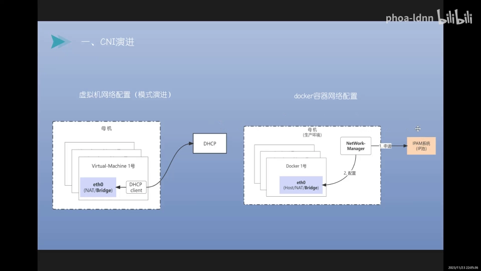

---

## 一、从 DHCP 到 IPAM：网络配置为什么必须标准化

### 1.1 旧时代：物理机 → 虚拟机，用 DHCP 配网络

最早我们的服务器都是物理机、跑一体化的服务；后来因为成本、CPU 性能挖掘等需求，**诞生了虚拟化技术**。但虚拟化之后，网络配置的管理方式并没有大改——那时互联网规模还不大，**靠 DHCP 就够了**：用 DHCP client 找 DHCP server 申请 IP、路由、网关等信息，再配到虚拟机上。[【跳转到 01:08】](https://www.bilibili.com/video/BV1UQ4y147od/?t=68)

### 1.2 新时代：容器规模化，通用 DHCP 撑不住了

随着移动互联网的发展，业务体系越来越庞大、用户规模越来越大，**DHCP 这套网络分配管理系统无法支撑生产环境的大规模应用**。于是诞生了 **IPAM（IP Address Management，IP 地址池管理系统）**，它负责 IP 池的管理、分配、回收、查询，以及路由信息配置、网络划分等。另一块是 **network manager**，负责从 IPAM 系统申请 IP，再配置到容器里。[【跳转到 02:03】](https://www.bilibili.com/video/BV1UQ4y147od/?t=118)

> 你也可以在个人电脑上用 Docker 单起一个容器，走 host 模式，或者挂一个 bridge、用 172 网段的默认 IPAM，一样能通。但**生产环境必须走规范化流程**——这正是 IPAM + network manager 存在的意义。

### 1.3 沉淀成标准：network manager → CNI，IPAM → 通用功能模块

这套模式继续演进：**network manager 模块演化成了 CNI 标准**（规定提供哪些接口、实现哪些能力），**IPAM 演化成了通用的 IP 网络地址管理系统**。此后，不管是开源的 Calico、Flannel，还是公有云厂商（阿里云 Terway、华为云 CCE、腾讯云 TKE CNI 等）的定制组件，里面都同时具备这两块功能：**一块是网络配置，一块是 IP 的分配管理**。[【跳转到 03:03】](https://www.bilibili.com/video/BV1UQ4y147od/?t=303)

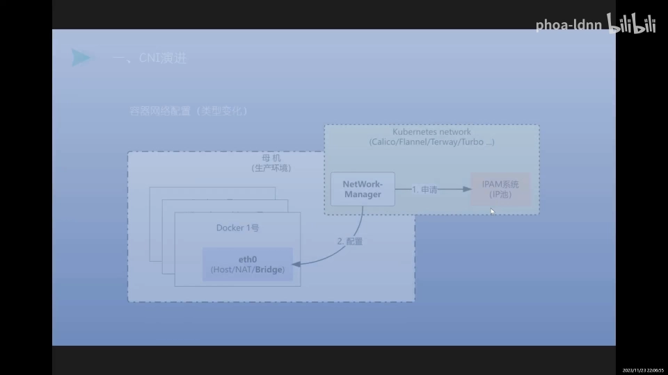

---

## 二、CNI 的网络模式与分类

### 2.1 两种网络模式：容器独立 vs 主机共享

CNI 的整个网络模式大概分两种 [【跳转到 03:53】](https://www.bilibili.com/video/BV1UQ4y147od/?t=353)：

- **容器独立模式**：容器有独立的网络环境，有独立网络设备、独立的 IP 或网络设备；
- **主机共享模式**：共享宿主机的网络栈，使用宿主机的 IP 地址和网络设备来通信（可以类比成"顺丰物流"——直接指定最直接高效的一条链路）。

而**容器独立模式**又分 Overlay 与 Underlay 两种网络。[【跳转到 04:08】](https://www.bilibili.com/video/BV1UQ4y147od/?t=408)

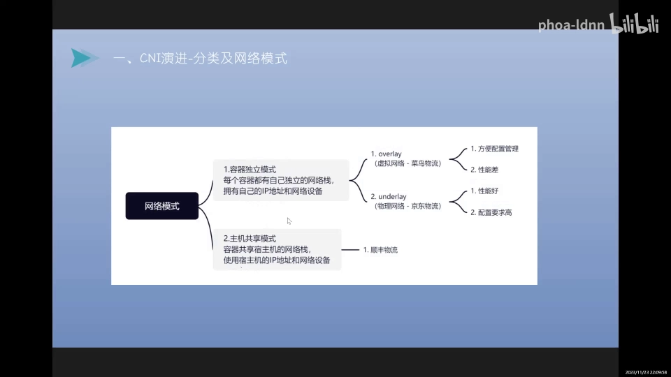

### 2.2 Overlay 与 Underlay：虚拟隧道 vs 物理路由

用物流来类比最直观 [【跳转到 04:33】](https://www.bilibili.com/video/BV1UQ4y147od/?t=433)：

- **Overlay（虚拟网络/逻辑网络）** 像菜鸟物流：它本身不是一家物流公司，而是一套"物流管理系统"，底层对接很多物流公司——**方便配置管理，但性能较差、效率较低**。技术上它**用 IP 隧道做封装**，底层可以走任何网络或路由。
- **Underlay（物理网络）** 像京东物流：通过交换机、路由器等各种网络设备打通，**性能更好，但配置要求高、成本高**。

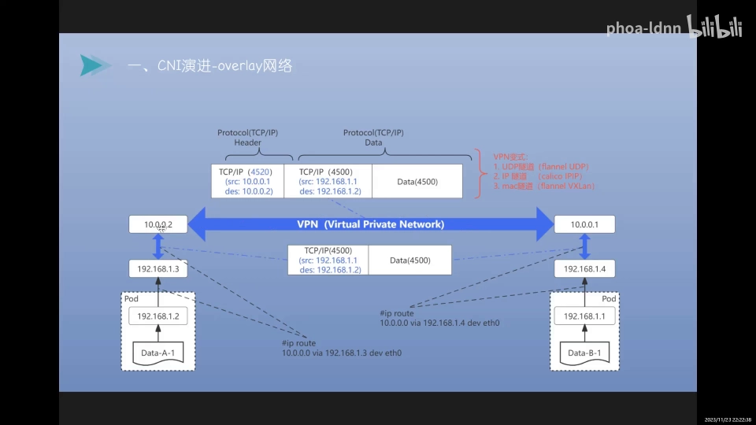

视频还详细拆了一个 Overlay 的封包过程：Pod 里的包（源 `192.168.1.1`、目的 `192.168.1.2`）经过隧道时**增加一层协议头**，把原始数据整个当作载荷，长度从约 4500 字节变成约 4520 字节；到对端先做第一次解压，再经第二次解压拿到真实数据。而 **Underlay 全程走路由、不做封装**——数据"拿进来什么样、出去还是什么样"。[【跳转到 10:23】](https://www.bilibili.com/video/BV1UQ4y147od/?t=623)

### 2.3 CNI 分类：Calico / Flannel / Cilium / 定制

CNI 正规的分类如下 [【跳转到 06:53】](https://www.bilibili.com/video/BV1UQ4y147od/?t=413)：

| CNI | 支持的网络模式 | 特点 |
| --- | --- | --- |
| **Calico** | BGP（可跨子网）、IPIP（内核基于三层）、VXLAN（内核基于二层） | BGP 三层互通、可跨子网、效率高 |
| **Flannel** | UDP（agent 代理）、VXLAN（内核基于二层）、host-Gateway（同子网，节点多时规则复杂） | 简单，但 UDP 效率低、host-gw 维护难 |
| **Cilium** | eBPF & XDP | 在协议层做转换管理，性能高，代表未来方向 |
| **定制** | 阿里云 Terway、腾讯云 TKE CNI、华为云 Turbo | 公有云为适配自家网络产品而做 |

关于 Flannel 的一个常见误区：**UDP 模式像"代理"，效率非常低**——数据流不仅经过多层协议，还要在内核态与用户态之间来回转换，开销大，**一般生产环境没法用，只适合测试**。所以大规模场景、生产环境不建议用 UDP 模式的 Flannel，Calico 的 BGP 往往更好。[【跳转到 07:43】](https://www.bilibili.com/video/BV1UQ4y147od/?t=463)

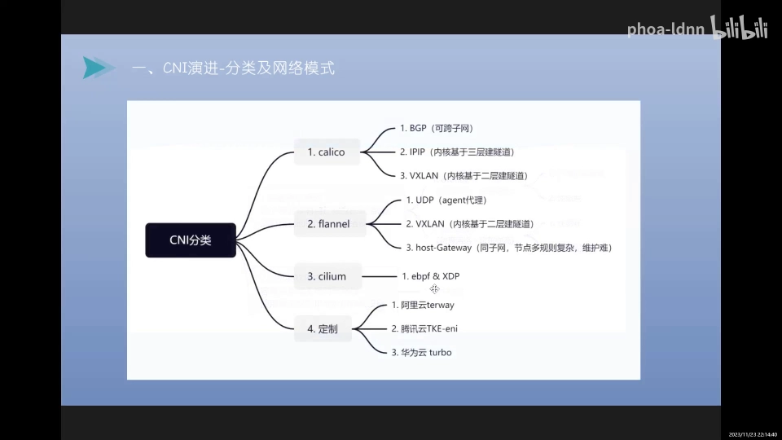

---

## 三、CNI 架构原理

### 3.1 Pod 的调度与创建链路

先看 Pod 是怎么被创建出来的 [【跳转到 13:05】](https://www.bilibili.com/video/BV1UQ4y147od/?t=785)：

1. 你部署一个 Deployment 或 StatefulSet，**通过 API Server 下发、写入 etcd**；
2. **controller-manager** 监听到新的工作负载，创建 ReplicaSet，再创建对应的 Pod；
3. Pod 创建时经过 **schedule 回调**，通过**预选、优选**做调度，最后**绑定到一个 node**；
4. 该 node 上的 **kubelet** 监听到"有 Pod 调度到我这里"，拿到 Pod 信息后**创建 Pod、创建容器、配置网络**。

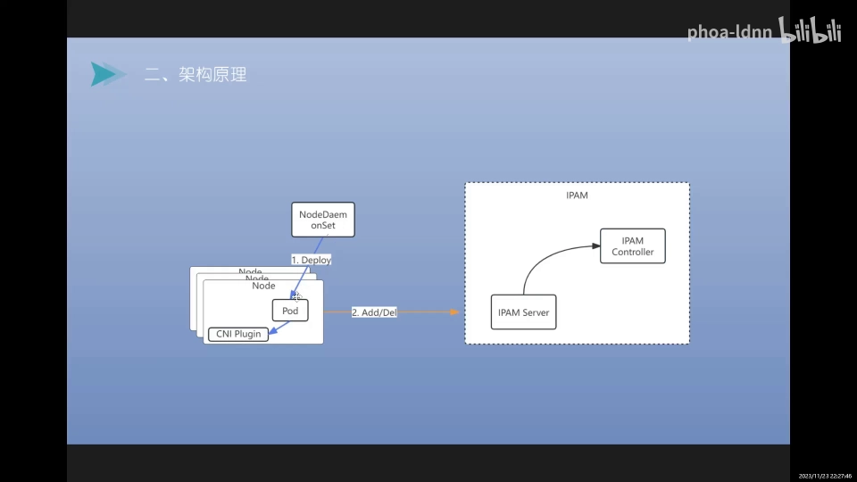

### 3.2 CNI 的两大模块：CNI 插件 与 IPAM

整个架构就是 **一个 IPAM 系统 + 一个 CNI 插件** [【跳转到 15:13】](https://www.bilibili.com/video/BV1UQ4y147od/?t=913)：

- **CNI 插件**（CNI plugin）作为核心组件，**通过 DaemonSet 下发**，给每台机器部署一个 Pod，把插件下发到 node 上指定的目录；
- **IPAM** 分两块：一块是 **IPAM control / operator**，另一块是 **IPAM server**（主要提供 gRPC server）。**CNI 插件通过接口规范（ADD / DELETE 等，即申请、回收）调用 IPAM server**；control 这边负责分配 IP 及相关路由信息，并记录它关联的 namespace、Pod、节点等信息。

### 3.3 创建 Pod 前 / 中 / 后：网络配置与 Pod sandbox

这一段是本条目最核心的内容——**CNI 在创建 Pod 的三个时间点分别做什么** [【跳转到 17:37】](https://www.bilibili.com/video/BV1UQ4y147od/?t=1057)：

| 阶段 | 动作 |
| --- | --- |
| **创建前** | 为容器**创建网络命名空间（network namespace）**，并配置网络设备 |
| **创建中** | 为容器**分配 IP 地址**，并配置**路由、网关**信息 |
| **创建后** | 为容器**配置 DNS 解析**及其附加配置 |

其中"创建前为容器建好网络命名空间"就是 **Pod sandbox 概念落地的地方**——kubelet 通过 CRI 让容器运行时先把承载网络命名空间的 sandbox 建出来，之后 CNI 插件才把网络配置写进去。

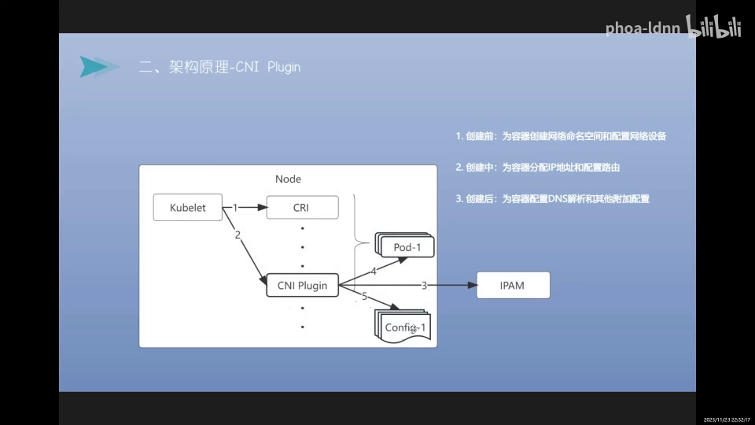

---

## 四、IP 分配的架构：IPPool → IP Block → Pod IP

IP 的分配有一套清晰的三层结构 [【跳转到 18:57】](https://www.bilibili.com/video/BV1UQ4y147od/?t=1137)：

1. 你给一个**较大的 IP 池**，例如 `10.0.0.0/16`（IPPool）；
2. IPAM control 把它**按 /24 切成很多小的 IP Block**（每个 node 一块，如 `10.0.0.1/24`）；
3. 每个 node 在自己的 IP Block 内，为 Pod 逐个分配 **Pod IP**（如 `10.0.0.1 ~ 10.0.0.255`）。

**节点上的 CNI 插件向 IPAM 申请 IP，control 分配并记录信息，保存到 CRD 里。** 视频还举了一个更完整的例子：给一个 `192.168.0.0/16` 的 B 段地址，按 /24 分成 256 个小块，**每个节点分一个 /24（最多 256 个节点），每个节点上能创建两百多个带 IP 的容器**。[【跳转到 16:28】](https://www.bilibili.com/video/BV1UQ4y147od/?t=988)

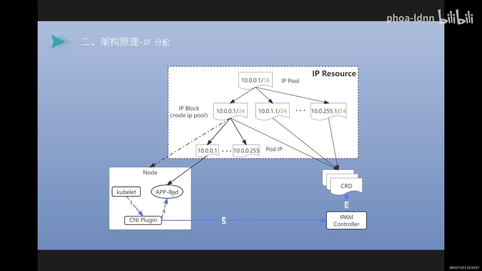

---

## 五、运作机制：三个阶段

整个运作机制可以拆成三个阶段 [【跳转到 20:21】](https://www.bilibili.com/video/BV1UQ4y147od/?t=1221)：**① IPAM 与 CNI 插件的部署分发；② IP 池的配置与管理；③ IP 的分配与配置生效。**

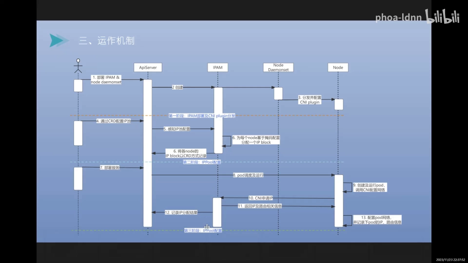

### 5.1 阶段一：IPAM 与 CNI 插件的部署分发

- **IPAM 通过 Operator 的方式部署**；
- **CNI 插件通过 DaemonSet 下发**到每个 node 上对应的目录；
- 节点上的 DaemonSet Pod 还会把相关的 CNI 插件转发到 node 的指定目录下（除分发插件外，它可能还承担 BGP 传播等其他工作）。

### 5.2 阶段二：IP 池的配置与管理

通过 **CRD 给网络组件配置 IPPool**，让它感知到 IPPool 配置后，**为每个 node 分配一个 IP 块**，并将各节点的 IP 块**以 CR 的方式绑定记录**。这样整个 IP 池、以及"IP 块 ↔ node"的绑定关系就建立好了。[【跳转到 21:50】](https://www.bilibili.com/video/BV1UQ4y147od/?t=1310)

### 5.3 阶段三：IP 分配与配置生效

部署应用时 [【跳转到 22:00】](https://www.bilibili.com/video/BV1UQ4y147od/?t=1320)：

1. 创建 Pod，调度到某个 node；
2. **CNI 配置插件向 IPAM 系统申请 IP**，返回相关的 IP、路由等信息，并把分配结果**通过 CR 记录**；
3. node 侧收到配置信息后，**把网络配置写入 Pod 容器**，并记录 Pod 的 IP 等映射关系。

---

## 六、CNI 接口规范与 kubelet 的加载启用

### 6.1 三个接口：ADD / DEL / CHECK

CNI 的接口规范其实非常简单，**主要就提供三个接口** [【跳转到 22:50】](https://www.bilibili.com/video/BV1UQ4y147od/?t=1370)：**ADD（申请）、CHECK（查看）、DEL（回收）**。不管是 Calico、Flannel 还是公有云定制的插件，**最基本都要有这三个接口**；在此基础上，各插件再针对自己的网络模式实现额外的功能模块，以拓展适用场景。

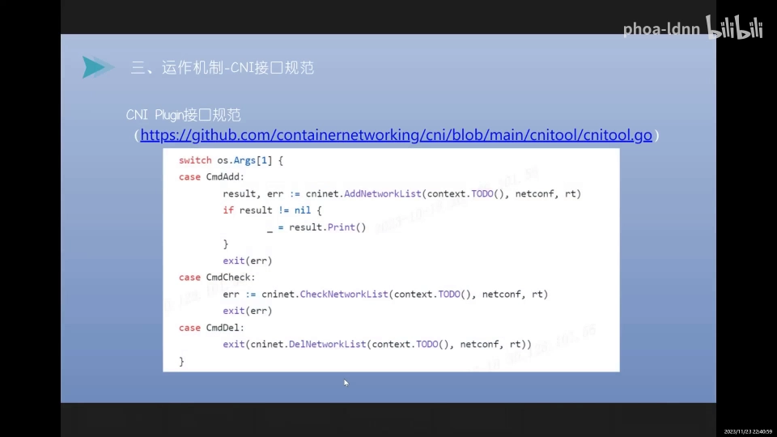

### 6.2 kubelet 如何加载启用 CNI 配置

这是"网络配置"真正落到文件系统的一环 [【跳转到 23:52】](https://www.bilibili.com/video/BV1UQ4y147od/?t=1432)：

1. **kubelet 启动时读取指定的 CNI 配置目录**（如 `/etc/cni/net.d`、CNI 插件可执行文件目录、以及 var 下存放网络信息的目录）；
2. 当它要创建 Pod 时，**启动 CNI 插件来配置网络**；
3. 插件读取 `/etc/cni/net.d` 下的配置（例如写着用哪个 IPAM、组件类型是 Calico 等）；
4. 到可执行文件目录找到对应的 CNI 插件并调用，**插件向 IPAM 系统 watch / 申请**——通过提供 Pod 名称、namespace、node 名称，获取该 Pod 的网络配置；
5. 拿到后**写入 Pod 使其生效**，并把 Pod 的网络配置信息**保存在本地目录**下（其子目录里还有基于网卡名的配置信息）。

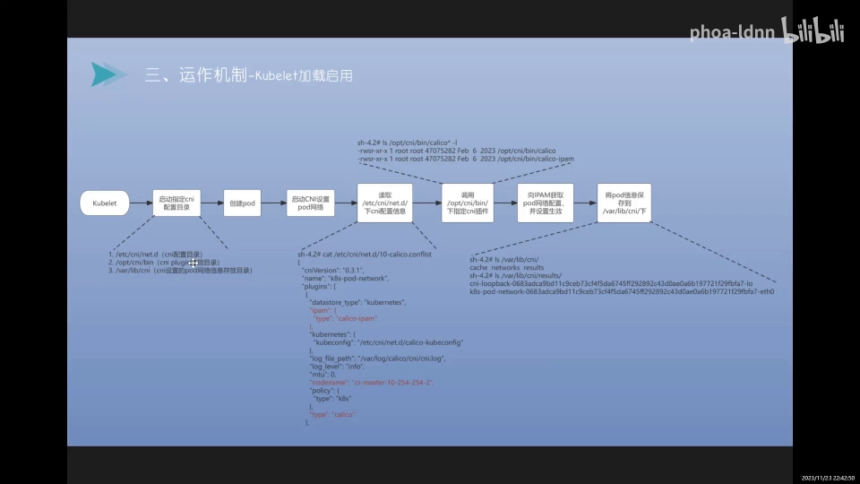

---

## 七、实战：用 Calico 实现固定 IP

视频用 Calico 演示了 IPPool 的配置，并引申出"固定 IP"这个实战话题 [【跳转到 25:02】](https://www.bilibili.com/video/BV1UQ4y147od/?t=1502)。

一份 Calico 的 IPPool 长这样：`apiVersion: crd.projectcalico.org/v1`、`kind: IPPool`、`blockSize: 24`（即每个节点的 IP 块是 /24）、还有 `natOutgoing`、`vxlanMode` 等配置项。默认用 IP-in-IP 时，这些模式一般都不配。[【跳转到 25:32】](https://www.bilibili.com/video/BV1UQ4y147od/?t=1532)

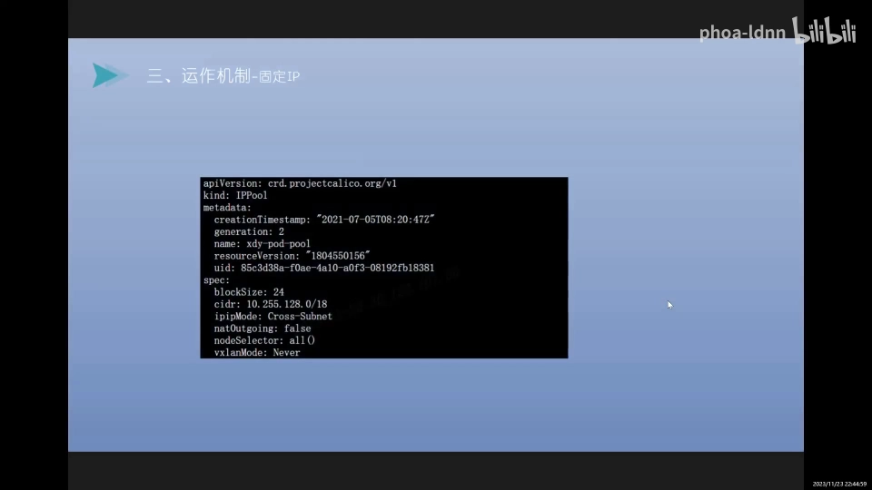

**关键观察**：Calico 只是把"给某个 Pod 分配的 IP"**绑定到一个 node**，并**没有记录具体 IP 与 Pod 的强绑定关系**[【跳转到 26:57】](https://www.bilibili.com/video/BV1UQ4y147od/?t=1617)。所以要实现固定 IP，需要**自己扩展一个 IPAM 组件**，把 Pod 与 IP 的对应关系记录到 CRD 里。这里有个细节：

- **Deployment 模式**下每次 Pod 重建、名字都会变，不好做绑定；
- **StatefulSet 模式**下有 `0、1、2` 这样的编号，可以按编号做绑定。

重建时可以检测 workload 是否存在、当前容器编号是否在副本范围内，由 **IPAM control 判断要不要回收 IP**；不回收就能扩展到"固定 IP"——重建后仍保留原 IP，**效果和虚拟机一样**。[【跳转到 27:23】](https://www.bilibili.com/video/BV1UQ4y147od/?t=1643)

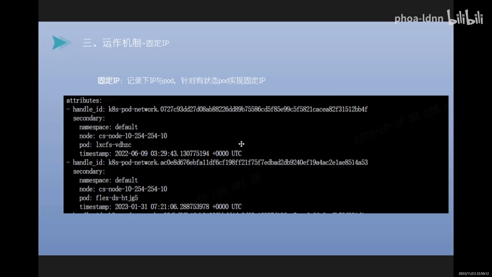

> 为什么固定 IP 重要？很多传统行业做产业互联网转型时，业务模式是按**虚拟机/物理机**设计的，切到容器后 **IP 一变就非常不适应**，配置管理、运行服务稍有变动都可能引发问题或故障。所以在特定场景下，固定 IP 的需求很强烈。

---

## 八、问题排查

排查主要从"日志观察"和"运维排查"两条线入手 [【跳转到 28:23】](https://www.bilibili.com/video/BV1UQ4y147od/?t=1703)：

**日志观察：**

1. **IP 地址分配**：看 IPAM control 是否正常、是否挂掉，有没有错误日志、异常；
2. **组件状态**：看 DaemonSet Pod 是否正常（它还承担 BGP 传播等工作）；
3. **配置是否生效**：看 CNI 插件日志、Calico 组件日志，确认模式/策略是否异常；
4. **IP 自然状态**：看 CRD 的配置记录，确认是否正常分配；看 IP 块是否被耗完（比如某节点只有 /24，分满 256 个 IP 后新 Pod 就分不到 IP）。

**运维排查：**

- 看**网卡与路由**（容器网卡、路由信息是否生效），可跨主机做网络探测；
- 看**网络策略**，或用 **tcpdump** 抓包看实际通信；
- 看**网络命名空间**是否连到了对应的网卡/网桥上，检查虚拟网桥的配置。

> 补充一点：在公有云场景，调度器做预选时会把"节点是否还有可分配的 IP"纳入判断，避免把 Pod 调度到网络打不通的 node 上。

---

## 小结

- 网络配置经历了一条演进路线：**DHCP → IPAM + network manager → CNI 标准**；生产环境必须走标准化流程。
- CNI 有两种网络模式：**容器独立模式**（含 **Overlay** 虚拟隧道 / **Underlay** 物理路由）与**主机共享模式**。
- CNI 方案主要有 **Calico（BGP/IPIP/VXLAN）、Flannel（UDP/VXLAN/host-gw）、Cilium（eBPF/XDP）** 及公有云定制方案。
- CNI 架构 = **CNI 插件（配网络）+ IPAM 系统（发地址）**；插件由 DaemonSet 下发，IPAM 由 Operator 部署，二者通过 gRPC 交互。
- 创建 Pod 的三个时间点：**创建前建网络命名空间（Pod sandbox 落地处）、创建中分配 IP 与路由、创建后配置 DNS。**
- IP 按 **IPPool → IP Block（每 node 一个 /24）→ Pod IP** 三层分配，结果通过 **CRD** 持久化。
- CNI 只要求 **ADD / CHECK / DEL** 三个接口；kubelet 启动时读取 **`/etc/cni/net.d`**，创建 Pod 时调用插件加载启用配置。
- **固定 IP** 需要自己扩展 IPAM 并把 Pod↔IP 关系记入 CRD，StatefulSet 的编号是可行抓手。
- 排查思路：查 IPAM control 日志、DaemonSet 状态、CNI/Calico 日志、CRD 记录、IP 块余量，以及网卡/路由/网络命名空间。

---

## 关键术语速查

| 术语 | 一句话解释 |
| --- | --- |
| **CNI** | Container Network Interface，容器网络接口标准；规定 ADD/CHECK/DEL 三个接口 |
| **IPAM** | IP Address Management，IP 地址管理系统；负责 IP 池的分配、回收、查询 |
| **network manager** | 从 IPAM 申请 IP 并配置到容器里的配置模块，是 CNI 的前身 |
| **Pod sandbox** | 承载 Pod 网络命名空间的容器；创建 Pod 前先建好它，网络配置写在其中 |
| **Overlay** | 逻辑网络，用隧道（如 VXLAN/IPIP）封装，配置方便但性能较差 |
| **Underlay** | 物理网络，靠交换机/路由器打通，性能好但配置要求高 |
| **IPPool** | 一个较大的地址池（如 10.0.0.0/16），被切成小块分配给各节点 |
| **IP Block** | 从 IPPool 切出、绑定给某个 node 的地址块（如 /24） |
| **CRD** | 自定义资源定义；CNI/IPAM 用它持久化分配结果与绑定关系 |
| **DaemonSet** | 每个节点跑一个 Pod 的工作负载；用来下发 CNI 插件 |
| **host-gw** | Flannel 的一种模式，同子网内直接路由，节点多时规则复杂 |
| **gRPC** | 高性能 RPC 框架；CNI 插件与 IPAM server 之间用它通信 |
