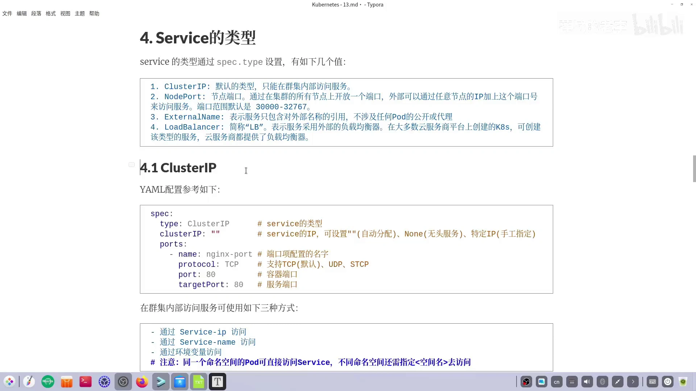
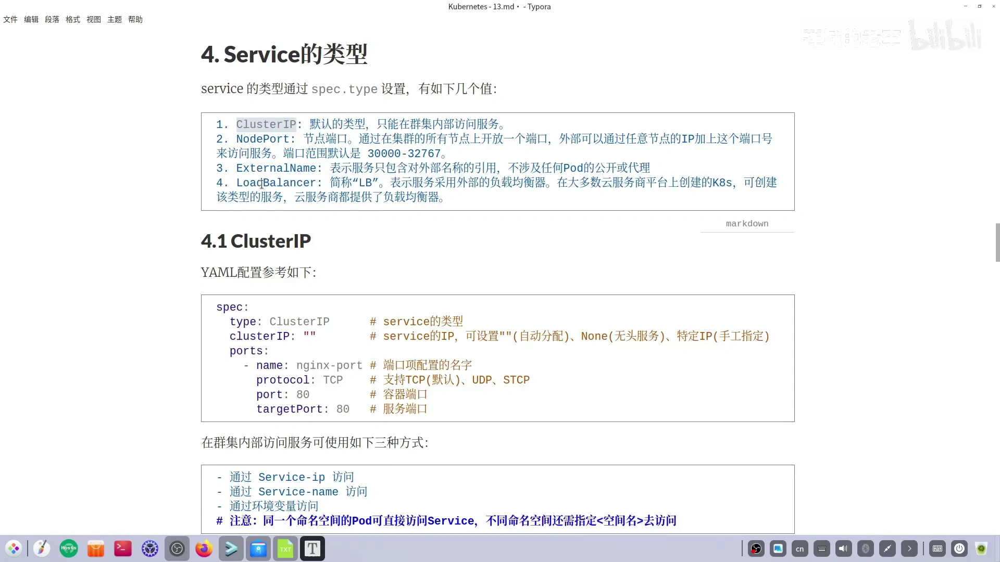
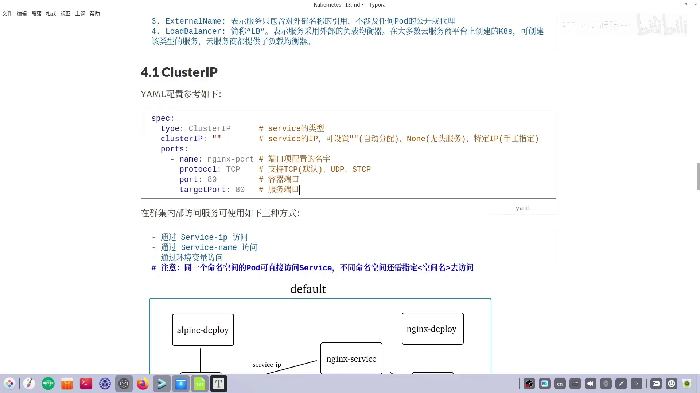
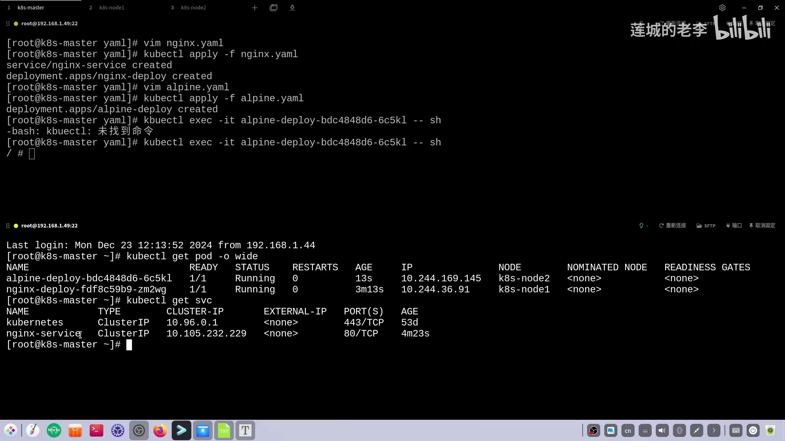
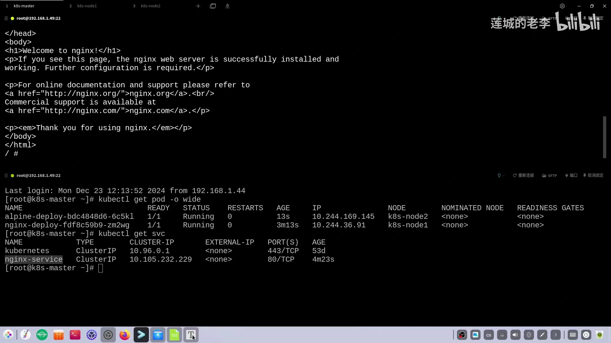
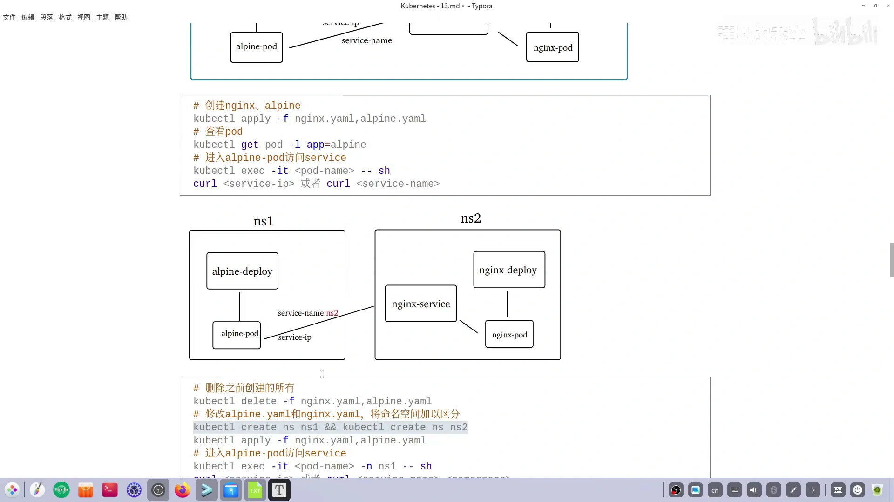
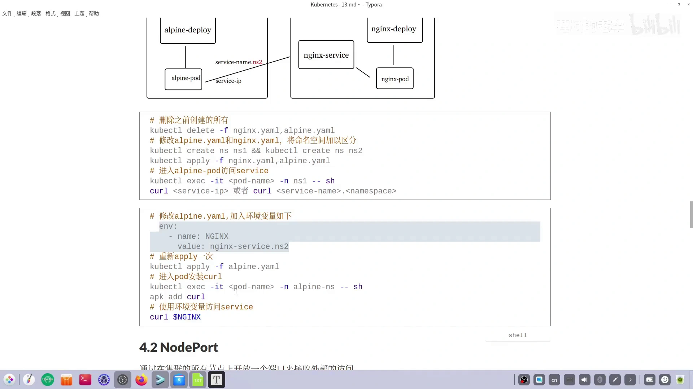
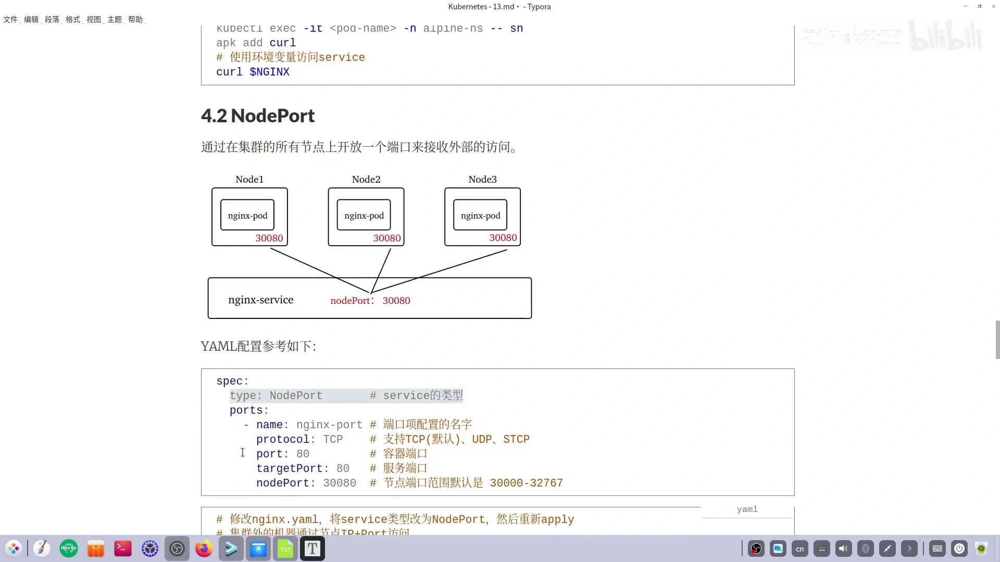
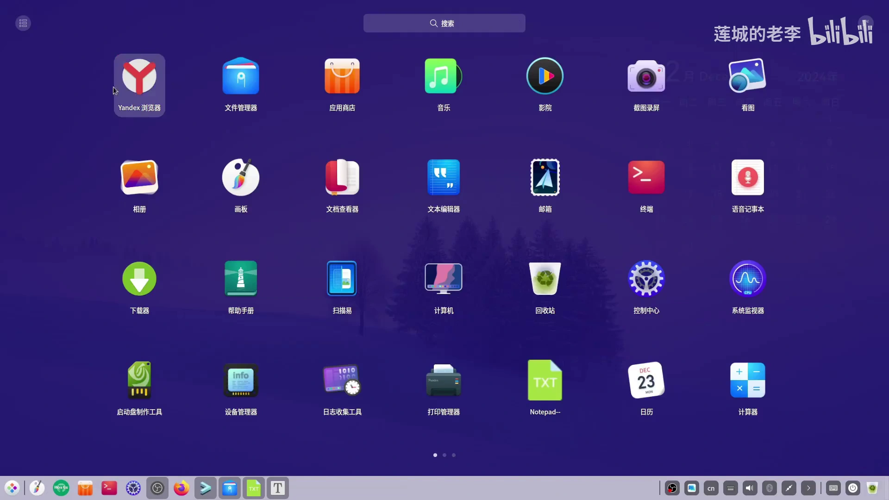

# ClusterIP 与 NodePort：集群内的稳定入口，和通往集群外的那扇门

> 本文整理自 B 站视频《[ClusterIP和NodePort类型的Service](https://www.bilibili.com/video/BV1YMCGYMEJ3/)》（时长约 15 分钟，UP 主「莲城的老李」，Service 系列的一集）。文中的机制描述、YAML、命令与实验结果均来自该视频的图-字幕稿，可逐帧核对。

## 本讲要解决的核心问题（SCQA）

**背景（S）**：创建 Service 时，`spec.type` 决定它是哪一类 Service，可取的值有四个：`ClusterIP`（默认，只能在集群内部访问）、`NodePort`（在集群所有节点上开放一个端口供外部访问）、`ExternalName`（只引用外部服务，不为后端 Pod 做负载均衡）、`LoadBalancer`（外部的负载均衡器，云平台上由云厂商提供，裸机集群要靠第三方工具）。[【跳转到 00:10】](https://www.bilibili.com/video/BV1YMCGYMEJ3/?t=10)

**冲突（C）**：类型名好记，真正容易卡住的是细节——ClusterIP 的 `clusterIP` 字段除了写地址还能写什么？Pod 到底有几种方式能访问到一个 Service？跨命名空间时为什么名字突然就不好使了？NodePort 里 `nodePort`、`port`、`targetPort` 三个端口又是什么关系？

**疑问（Q）**：ClusterIP 和 NodePort 分别解决什么问题，各自的配置与访问路径长什么样？

**回答（中心思想 A）**：**ClusterIP 解决的是「集群内部要有一个稳定入口」**——它由 K8s 自动分配一个集群网段的虚拟 IP（也可以手动指定、或写成 `None` 变成无头服务），Pod 可以通过 **Service 的 IP、Service 的名字、或容器里的环境变量** 三种方式访问它；**NodePort 解决的是「集群外部怎么进来」**——它在 ClusterIP 的基础上，让**每个节点**都开放同一个端口（默认 30000–32767），外部流量打「任意节点 IP + nodePort」，就会被转到 Service 的 `port`，再转到容器的 `targetPort`。[【跳转到 12:14】](https://www.bilibili.com/video/BV1YMCGYMEJ3/?t=734)、[【跳转到 12:44】](https://www.bilibili.com/video/BV1YMCGYMEJ3/?t=764)

---

## 一、先认清 Service 的四种类型

`type` 是 Service 类型的总开关，四个取值对应四种「可达范围」：

| type | 可达范围 | 一句话说明 |
| :--- | :--- | :--- |
| `ClusterIP` | 仅集群内部 | 默认类型，分配一个集群内虚拟 IP |
| `NodePort` | 集群外部（节点 IP） | 在所有节点上开放一个端口，外部经节点访问 |
| `ExternalName` | —— | 只做「引用/别名」，不选 Pod、不做负载均衡 |
| `LoadBalancer` | 集群外部（专用 IP） | 外部负载均衡器；云平台由云厂商提供，裸机需第三方工具 |



NodePort 的端口范围默认为 **30000–32767**；视频所用集群是自建的裸机环境（不是云服务器），所以后面讲 LoadBalancer 时会用第三方工具来实现外部的负载均衡器。[【跳转到 00:35】](https://www.bilibili.com/video/BV1YMCGYMEJ3/?t=35)

---

## 二、ClusterIP：集群内的默认入口

### 2.1 `clusterIP` 字段的三种写法

一份 `type: ClusterIP` 的样本配置里，`spec` 下的 `clusterIP` 有三条路：

- **手动指定一个 IP**：直接写入地址；
- **写 `None`**：即**无头服务（Headless Service）**，这个服务**不会分配集群 IP**——配合 StatefulSet 的场景在后面单独讲过；
- **留空（默认值）**：由 K8s 集群**自动分配**。

底下的 `ports` 是常规端口设计：端口的数值、名字、协议（默认 TCP，也支持 UDP 与 SCTP），以及服务要监听的**容器端口**。为了省事，名字与协议是 TCP 时通常省略，最终只留下 `port` 与 `targetPort` 两项。[【跳转到 01:25】](https://www.bilibili.com/video/BV1YMCGYMEJ3/?t=85)



### 2.2 一份可跑的最小清单

视频里的实验清单同时定义了两个资源：一个 **Service** 和一个 **Deployment**（Deployment 用 `nginx` 镜像跑容器）。Service 这边 `type` 为 `ClusterIP`，**IP 由系统自动分配**，端口按笔记里的设计给出。[【跳转到 02:33】](https://www.bilibili.com/video/BV1YMCGYMEJ3/?t=153)


保存为 `NGINX.yaml` 后 `kubectl apply` 创建即可。Service 创建出来就拥有了自己的集群 IP——这个 IP **在集群内部**可用。

### 2.3 Pod 访问 Service 的三种方式

集群内部的 Pod 要访问这个 Service，有三条路：

1. **通过 Service 的 IP** 访问；
2. **通过 Service 的名字**访问；
3. **通过环境变量**访问。

这里有个必须记住的前提：**同一个命名空间的 Pod 可以直接访问 Service；不同命名空间的 Pod 去访问，还必须带上 Service 所属的命名空间**。[【跳转到 03:14】](https://www.bilibili.com/video/BV1YMCGYMEJ3/?t=194)



#### 实验一：同一个命名空间（default）

在 `default` 下，已有 NGINX 的 Service、Deployment 生成的 Pod；再创建一个**轻量测试镜像**的 Pod 作为客户端，于是同一个命名空间里就同时有了「发起请求的 Pod」与「提供服务的 Pod」，中间的桥梁就是刚创建的 `nginx service`。

进入客户端 Pod 后，先 `kubectl get svc` 拿到 Service 的 IP，`curl` 这个 IP（端口 80 可省略）——看到了 NGINX 首页；再直接 `curl nginx-service` 用**名字**访问，同样成功。[【跳转到 05:10】](https://www.bilibili.com/video/BV1YMCGYMEJ3/?t=310)、[【跳转到 05:35】](https://www.bilibili.com/video/BV1YMCGYMEJ3/?t=335)



这验证了 Service 的定位：**客户端 Pod 只面向 Service，Service 起「沟通的桥梁」作用**。

#### 实验二：跨命名空间（NS1 → NS2）

把资源拆到两个命名空间：客户端 Deployment 及其 Pod 放进 `NS1`，NGINX 那套（Deployment + Service）放进 `NS2`。清掉旧资源、建好两个命名空间、改完清单里的 `namespace`，再重建。[【跳转到 05:58】](https://www.bilibili.com/video/BV1YMCGYMEJ3/?t=358)



进入 `NS1` 的客户端 Pod 后：

- **按 IP 访问**：照旧成功，因为 IP 本身是全局可达的集群地址；
- **按名字访问**：`curl nginx-service` **失败**——它现在在 `NS2`，必须写成 **`nginx-service.NS2`**（Service 名 + 命名空间后缀）才通。



#### 实验三：通过环境变量访问

第三种方式是在**访问方容器**里加一个环境变量，例如 `NGINX_SERVICE=nginx-service.NS2`（仍是「Service 名字 + 命名空间」），改完清单后重新 `kubectl apply`，Pod 会重建。进入新 Pod 之后，直接 `curl $NGINX_SERVICE`（访问环境变量要加 `$`）即可访问到服务。[【跳转到 09:43】](https://www.bilibili.com/video/BV1YMCGYMEJ3/?t=583)、[【跳转到 11:09】](https://www.bilibili.com/video/BV1YMCGYMEJ3/?t=669)



（顺带一个实操细节：客户端容器里本来没有 `curl`，视频把「进入容器先安装 curl、再休眠 3600 秒」写进了 `command`，所以看起来一进容器就能直接执行 `curl`。[【跳转到 11:32】](https://www.bilibili.com/video/BV1YMCGYMEJ3/?t=692)）

---

## 三、NodePort：在集群的每个节点上开一扇门

### 3.1 三个端口的接力关系

**NodePort 的含义是：在集群的所有节点上开放一个端口来接受外部访问。** 在 NGINX 的 Service 里把 `nodePort` 定为 `30080`，集群的每个节点上就都会开放 30080 端口。[【跳转到 12:19】](https://www.bilibili.com/video/BV1YMCGYMEJ3/?t=739)

代价是 `ports` 区域要**多加一个 `nodePort` 设置**，于是出现了三个端口，它们的关系正好是一条链路：

```
外部流量 ──► 节点 IP : nodePort(30080) ──► Service 的 port(80) ──► 容器的 targetPort(80)
```

- `nodePort`：节点上对外开放的端口，取值在 30000–32767，不冲突即可；
- `port`：Service 自身的端口；
- `targetPort`：Service 所监听的容器端口。



### 3.2 实验：从集群外访问任意一个节点

把 NGINX 清单的 `type` 改成 `NodePort`，补上 `nodePort: 30080`，`kubectl apply` 之后，从**集群之外的一台机器**上访问：

- `192.168.1.49:30080`（master 节点）→ 成功；
- `192.168.1.50:30080`、`192.168.1.51:30080`（两个工作节点）→ 同样成功；
- 在**集群内的节点上**请求 `192.168.1.50:30080`，也能访问。[【跳转到 13:47】](https://www.bilibili.com/video/BV1YMCGYMEJ3/?t=827)、[【跳转到 14:02】](https://www.bilibili.com/video/BV1YMCGYMEJ3/?t=842)、[【跳转到 14:11】](https://www.bilibili.com/video/BV1YMCGYMEJ3/?t=851)



**任意节点都能接住流量**，这正是 NodePort 好用的地方：外部客户端不需要知道 Pod 在哪台机器上，也不需要知道 Service 的虚拟 IP。

---

## 四、小结：两种类型，两个「可达范围」

- **ClusterIP**：集群内部访问的 Service。Pod 可以通过 **Service 的 IP**、**Service 的名字**（跨命名空间要加 `.命名空间` 后缀）以及**环境变量**三种方式访问它；`clusterIP` 字段支持手动指定、`None`（无头服务）与留空自动分配。
- **NodePort**：以**节点端口**的形式，把集群内部的服务暴露给集群外部。它建立在 ClusterIP 之上——`nodePort → port → targetPort` 的接力，最终仍然是把流量送到 Service 背后的 Pod。[【跳转到 14:18】](https://www.bilibili.com/video/BV1YMCGYMEJ3/?t=858)

看懂这两类之后，`ExternalName`（别名/引用）与 `LoadBalancer`（外部负载均衡器）就是同一套配置思路的延伸——它们分别是本系列接下来的内容。
