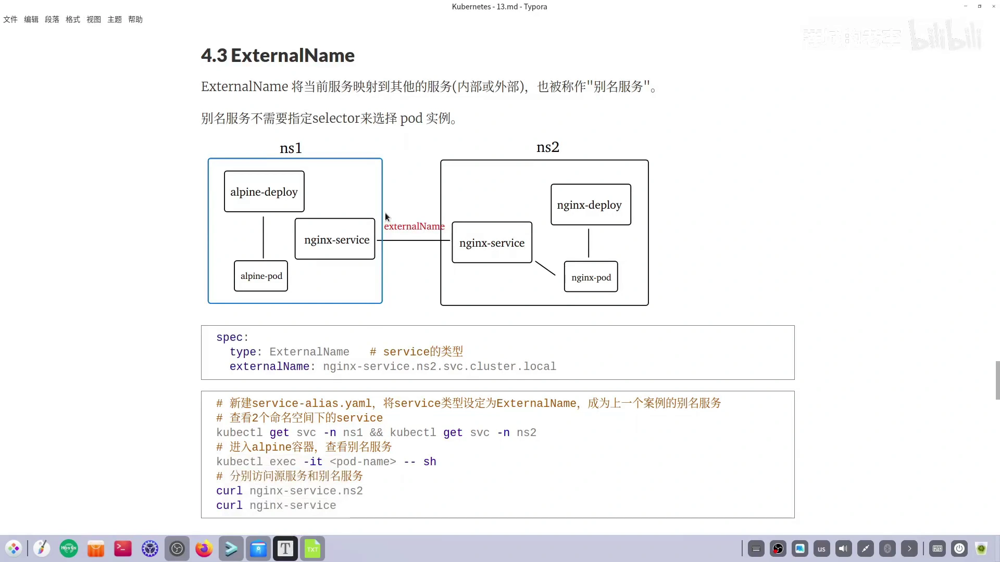
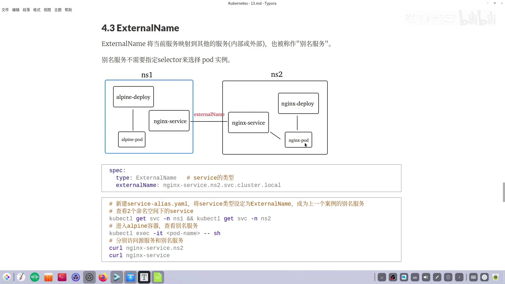
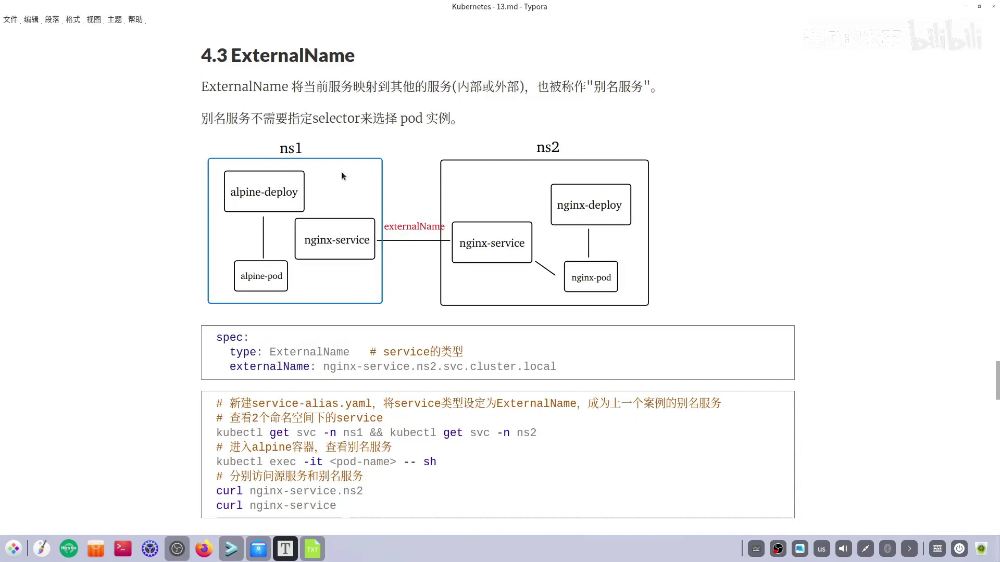
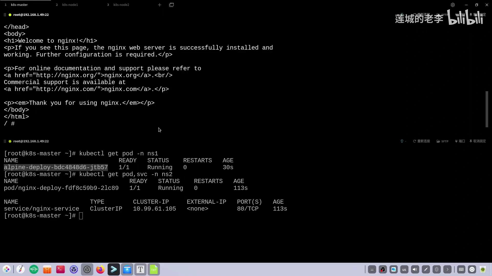
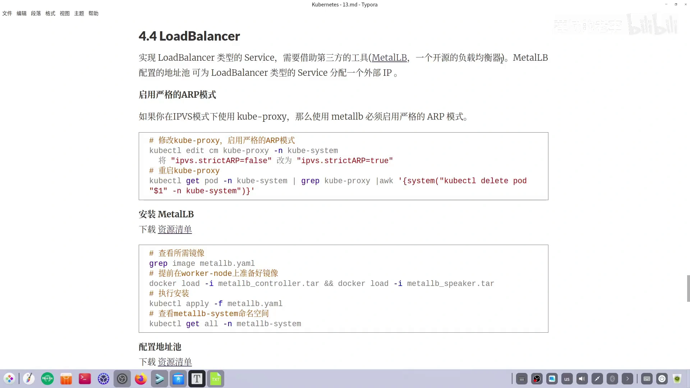
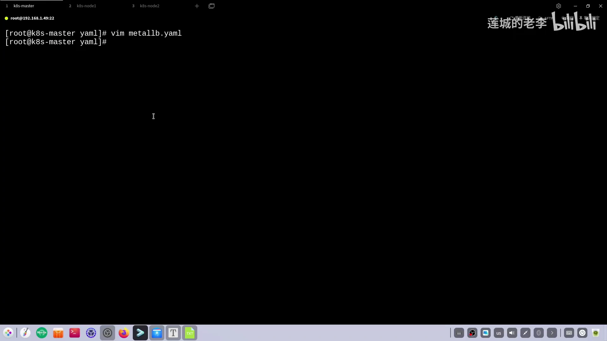
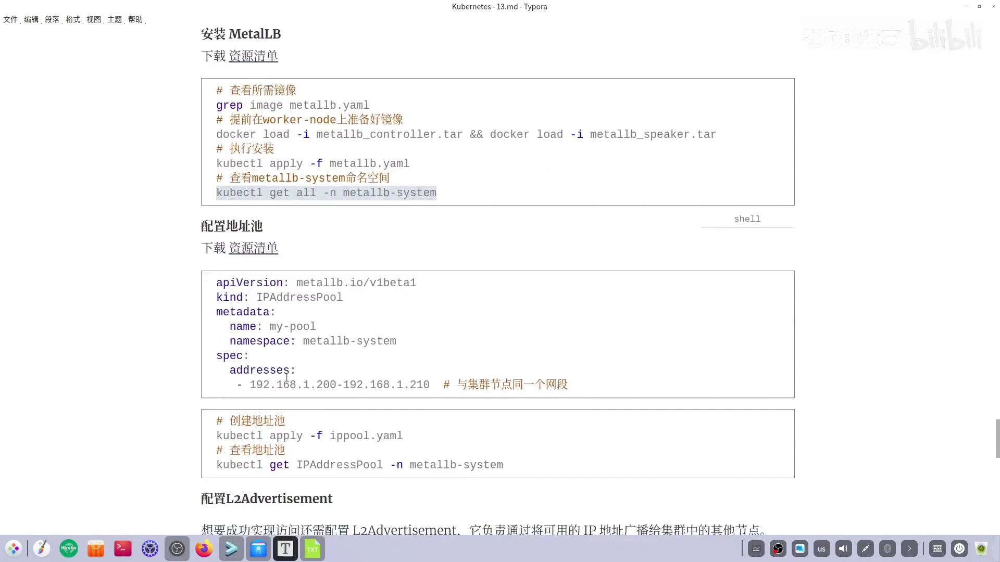
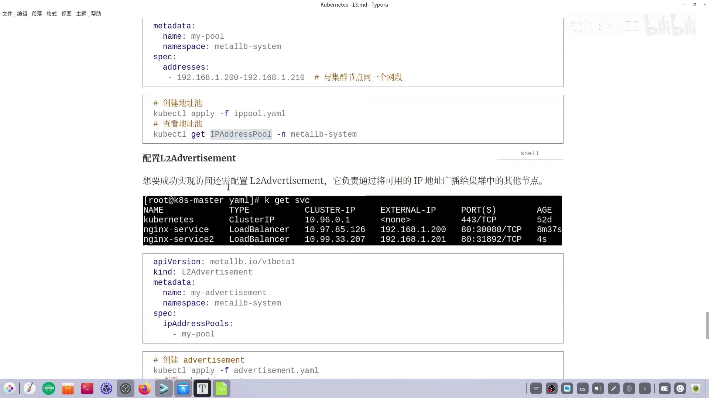
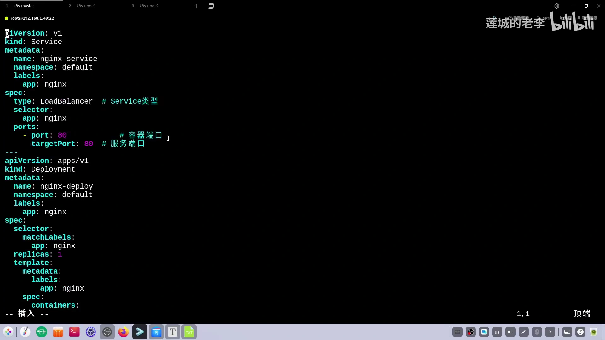
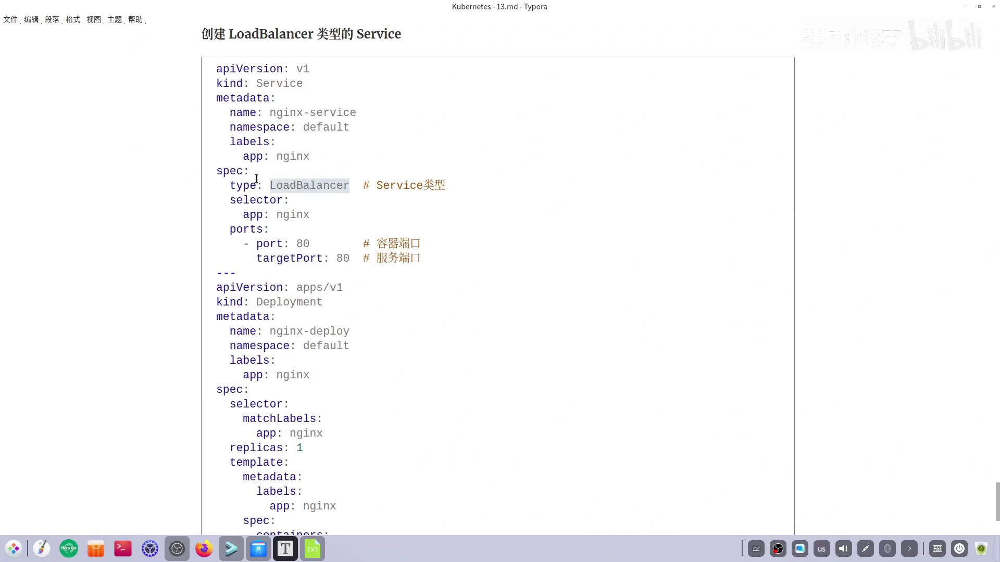

# ExternalName 与 LoadBalancer：别名引用，和裸机集群上的外部负载均衡器

> 本文整理自 B 站视频《[ExternalName和LoadBalancer类型的Service](https://www.bilibili.com/video/BV1N8k9Y3Ep8/)》（时长约 15 分钟，UP 主「莲城的老李」，Service 系列的下一集）。文中的机制描述、YAML、命令与实验结果均来自该视频的图-字幕稿，可逐帧核对。

## 本讲要解决的核心问题（SCQA）

**背景（S）**：上一集讲了 `ClusterIP` 与 `NodePort`。这一集继续 Service 的类型：`ExternalName` 与 `LoadBalancer`（简称 LB）。先说 ExternalName——**这种类型的服务可以把当前的服务映射到其他的服务**，这里的「其他服务」既可以是集群内部的，也可以是集群外部的；说白了就是**用当前服务去引用一下别的服务**，这种操作也被称为**别名服务**。[【跳转到 00:00】](https://www.bilibili.com/video/BV1N8k9Y3Ep8/?t=0)

**冲突（C）**：Service 一向靠 `selector` 挑 Pod，可**别名服务并不需要指定 selector 来选定 Pod 实例**；而 LoadBalancer 在云平台上由云厂商提供，课堂上的裸机集群根本没有云负载均衡器——那 `type: LoadBalancer` 还会不会给 IP？

**疑问（Q）**：ExternalName 怎么用、平时解决什么问题？裸机集群上谁来充当「外部负载均衡器」？

**回答（中心思想 A）**：**ExternalName 提供的是「别名」而非「转发」**——它不做负载均衡、不选 Pod，只是把一个服务名映射到另一个服务名（内部服务或外部域名），由 DNS 层面的解析来完成跳转。**LoadBalancer 解决的是「从集群外部拿一个专属 IP 进来」**——云上由云厂商的 LB 提供，裸机上则由开源的 **MetalLB** 顶替：MetalLB 先准备一个**地址池**，再通过**二层公告**把这个池里的 IP 广播给集群中的节点，于是 LB 类型的 Service 就能拿到一个**外部可直接访问、且与节点同网段**的 `EXTERNAL-IP`。[【跳转到 06:11】](https://www.bilibili.com/video/BV1N8k9Y3Ep8/?t=371)、[【跳转到 11:26】](https://www.bilibili.com/video/BV1N8k9Y3Ep8/?t=686)

---

## 一、ExternalName：不做负载均衡的「别名服务」

### 1.1 别名要解决什么场景

实验准备两个命名空间：`NS1` 里用 Deployment 部署了客户端 Pod，`NS2` 里用 Deployment 部署了 NGINX Pod **并配了一个 Service**。[【跳转到 00:25】](https://www.bilibili.com/video/BV1N8k9Y3Ep8/?t=25)

按上一集学过的结论，`NS1` 的客户端 Pod 要访问 `NS2` 的这个 Service，有两条路：直接访问它的 **IP**，或访问它的**名字并补上命名空间后缀**。

现在换一个需求：**想在 `NS1` 这个命名空间里也创建一个叫 `nginx-service` 的服务**，它不需要去选 Pod，而是设计成 `NS2` 里同名服务的**别名**。这样创建之后，`NS1` 就有了自己的服务，该空间下的所有 Pod 都能直接访问这个别名服务；而访问别名服务，实际访问到的就是原服务（`nginx-service`），效果一样，最终都能到达 nginx Pod。[【跳转到 01:13】](https://www.bilibili.com/video/BV1N8k9Y3Ep8/?t=73)

### 1.2 怎么定义：`type: ExternalName`

把服务的 `type` 设为 `ExternalName` 即可。样本清单里：命名空间是 `NS1`，`type` 是 `ExternalName`，而它**所引用的外部服务名字**也叫 `nginx-service`，只不过处于 `NS2` 命名空间。[【跳转到 02:03】](https://www.bilibili.com/video/BV1N8k9Y3Ep8/?t=123)

保存为 `alias` 相关文件后 `kubectl apply` 创建，再用 `kubectl get svc -n NS1` 查看：服务确实存在，而且它那一行的 **`EXTERNAL-IP` 显示的正是另一个命名空间下同名的那个 Service**。[【跳转到 02:28】](https://www.bilibili.com/video/BV1N8k9Y3Ep8/?t=148)、[【跳转到 02:57】](https://www.bilibili.com/video/BV1N8k9Y3Ep8/?t=177)

验证：进入 `NS1` 的客户端 Pod，分别请求**原服务**（`curl nginx-service.NS2`）和**本命名空间下的别名服务**（`curl nginx-service`），两者都能看到 NGINX 首页——**结果一样，但走的路不一样**。[【跳转到 03:04】](https://www.bilibili.com/video/BV1N8k9Y3Ep8/?t=184)、[【跳转到 03:50】](https://www.bilibili.com/video/BV1N8k9Y3Ep8/?t=230)

### 1.3 还能引用集群外的服务

ExternalName 的引用对象不限于集群内部，**公网服务同样可以**。做法是把 `namespace` 去掉（放到 `default`），服务改名 `baidu-service`，**删掉 selector**（ExternalName 类型不需要选 Pod 实例），**删掉 port 部分**，只留下一个外部域名 `www.baidu.com`。[【跳转到 04:06】](https://www.bilibili.com/video/BV1N8k9Y3Ep8/?t=246)

创建之后，在 `NS1` 的客户端 Pod 里用 `nslookup` 验证：直接查外网域名能拿到 IP；查自己定义的 `baidu-service` 时**一开始查不到**——因为它位于 `default` 命名空间，而当前 Pod 在 `NS1`，所以要写成 `baidu-service.default`；补上命名空间后缀后，**返回的 IP 与原服务一致**。[【跳转到 05:21】](https://www.bilibili.com/video/BV1N8k9Y3Ep8/?t=321)、[【跳转到 05:46】](https://www.bilibili.com/video/BV1N8k9Y3Ep8/?t=346)

---

## 二、LoadBalancer：谁来当裸机集群的外部负载均衡器

### 2.1 为什么需要 MetalLB

实现 LB 类型的 Service 需要**第三方工具 MetalLB**——一个开源的负载均衡器。如果集群建在云服务上，云厂商一般自带自己的负载均衡器；而视频演示的是自建裸机集群，于是用 MetalLB 自己搭一个。

**MetalLB 的作用**：它可以配置一个**地址池**，从池里分配一个地址给 LB 类型的 Service，让它**具备一个外部可以访问的 IP**。[【跳转到 06:31】](https://www.bilibili.com/video/BV1N8k9Y3Ep8/?t=391)

### 2.2 安装 MetalLB：四步

**第一步：开启 strictARP。** 打开 kube-proxy 的配置文件，搜索 `strictARP`，把它从默认的 `false` 改成 `true`，保存；然后**重启 kube-proxy**（会看到三个 delete，即每个节点上的 Pod 被删除并以新配置重建）。[【跳转到 06:56】](https://www.bilibili.com/video/BV1N8k9Y3Ep8/?t=416)、[【跳转到 07:16】](https://www.bilibili.com/video/BV1N8k9Y3Ep8/?t=436)

**第二步：安装 MetalLB。** MetalLB 通过 YAML 清单安装（清单内容较长，可以用 `grep` 找出它需要的镜像：主要是 **controller** 与 **speaker**）。建议在安装前先把镜像在工作节点上备好——视频是提前下载并打成 tar 包，再用 `docker load -i` 逐台节点加载，这样 `kubectl apply` 时速度很快。[【跳转到 08:27】](https://www.bilibili.com/video/BV1N8k9Y3Ep8/?t=507)、[【跳转到 08:45】](https://www.bilibili.com/video/BV1N8k9Y3Ep8/?t=525)

安装完成后，相关资源全部位于 **`metalLB-system`** 命名空间：会跑起**四个 Pod**，此外还创建了一个 **Service、一个 DaemonSet、一个 Deployment 以及一个 ReplicaSet**。[【跳转到 10:05】](https://www.bilibili.com/video/BV1N8k9Y3Ep8/?t=605)、[【跳转到 10:13】](https://www.bilibili.com/video/BV1N8k9Y3Ep8/?t=613)

**第三步：配置地址池（IPAddressPool）。** 地址池的名字可自定义（例子里叫 `my-pool`），`addresses` 定义一个地址段——`192.168.1.200` 到 `192.168.1.210`，这段地址将作为 Service 的 IP。设计时要记住：**地址段与集群节点在同一网段**。[【跳转到 10:18】](https://www.bilibili.com/video/BV1N8k9Y3Ep8/?t=618)、[【跳转到 10:30】](https://www.bilibili.com/video/BV1N8k9Y3Ep8/?t=630)

**第四步：配置二层公告（L2Advertisement）。** **二层公告负责把可用的 IP 地址广播给集群中的其他节点**，想成功访问 Service 就少不了它。创建时要注意 `ipAddressPool` 字段——它表示当前公告依附于哪个地址池，这里要引用刚创建的 `my-pool`。[【跳转到 11:26】](https://www.bilibili.com/video/BV1N8k9Y3Ep8/?t=686)、[【跳转到 12:03】](https://www.bilibili.com/video/BV1N8k9Y3Ep8/?t=723)

四步走完，MetalLB 就开始工作了，之后放心创建 LB 类型的 Service 即可。[【跳转到 12:33】](https://www.bilibili.com/video/BV1N8k9Y3Ep8/?t=753)

### 2.3 验证：LB 类型的 Service 拿到了 EXTERNAL-IP

创建一个类型为 `LoadBalancer`、端口为 80 的 Service，它为该 Deployment 的 Pod 提供访问入口。创建后 `kubectl get svc` 看到：

- 前面那个是**集群内部**的访问 IP；
- 后面那个 `EXTERNAL-IP`（例子里是 `192.168.1.200`）就是 **MetalLB 分配的外部可访问地址**。[【跳转到 13:19】](https://www.bilibili.com/video/BV1N8k9Y3Ep8/?t=799)、[【跳转到 13:24】](https://www.bilibili.com/video/BV1N8k9Y3Ep8/?t=804)

**一个容易踩的坑**：输出里那个 `30226` 的节点端口在这里**没有作用**，真正要用的是 **80 端口**。原因写在视频的笔记里——LB 类型的 Service 已经由 MetalLB 给了一个外部可访问、且与节点同网段的 IP，服务既然可以直接从外面请求，**它就不依赖节点端口**，只依赖自己的服务端口。[【跳转到 13:49】](https://www.bilibili.com/video/BV1N8k9Y3Ep8/?t=829)、[【跳转到 14:10】](https://www.bilibili.com/video/BV1N8k9Y3Ep8/?t=850)

验证：浏览器访问 `192.168.1.200:80`，或者直接在节点上请求 `192.168.1.200:80`，都能看到 NGINX 首页。[【跳转到 14:42】](https://www.bilibili.com/video/BV1N8k9Y3Ep8/?t=882)、[【跳转到 14:52】](https://www.bilibili.com/video/BV1N8k9Y3Ep8/?t=892)

---

## 三、小结

- **ExternalName**：一种「别名服务」，把当前服务映射到内部或外部的其他服务；**不需要 selector，也不做负载均衡**，`kubectl get svc` 的 `EXTERNAL-IP` 一列会显示被引用的目标；跨命名空间引用时要带上 `.命名空间` 后缀。
- **LoadBalancer**：为服务提供一个外部可访问的专属 IP。云上由云厂商提供，**裸机上用开源的 MetalLB**：`strictARP=true` → 安装 MetalLB（controller + speaker）→ 配 `IPAddressPool`（与节点同网段）→ 配 `L2Advertisement` 广播地址；此后 LB 类型的 Service 就会拿到 `EXTERNAL-IP`，并且**只需访问服务端口（80），与 nodePort 无关**。[【跳转到 15:01】](https://www.bilibili.com/video/BV1N8k9Y3Ep8/?t=901)

到这里，Service 的四种类型（ClusterIP、NodePort、ExternalName、LoadBalancer）就全部讲完了——从「集群内可达」到「外部专属 IP」，配置在变，但**背后仍然是同一套「Service → 后端 Pod」的转发机制**。
