# ClusterIP 是个「假 IP」吗：它不住在网卡上，住在内核的规则里

> 本文整理自 B 站视频《[KubernetesService的ClusterIP是个假IP真相在这里](https://www.bilibili.com/video/BV1KpXABSESM/)》（时长约 20 分钟，UP 主 DeeparchWorks）。文中的机制描述、源码级判断与数据均来自该视频的图-字幕稿，可逐帧核对。

## 本讲要解决的核心问题（SCQA）

**背景（S）**：在 K8s 里创建一个 Service，系统会分配一个 ClusterIP。用它发请求一切正常，但你 **ping 它却不通**；去节点上找，**没有任何网卡拥有这个 IP**；`ip addr` 查不到、路由表里没有它的路由、它甚至**不回应 ARP**。[【跳转到 00:00】](https://www.bilibili.com/video/BV1KpXABSESM/?t=0)、[【跳转到 00:25】](https://www.bilibili.com/video/BV1KpXABSESM/?t=25)

**冲突（C）**：一个「哪儿都不存在」的地址，为什么 `curl` 它却能建立 TCP 连接、能拿到 HTTP 响应？这个 IP 到底存在还是不存在？

**疑问（Q）**：ClusterIP 究竟是什么？它在控制面和数据面上分别由谁维护、又是怎么让流量落到真实 Pod 上的？

**回答（中心思想 A）**：**ClusterIP 不是假的**——它真实存在、也确实在承载集群内所有服务间通信；**它只是不住在网卡上，而是住在内核的规则里**。整个机制分两条线：**控制面**由 API Server 分配 ClusterIP、由 EndpointSlice 控制器维护「谁是真后端」、由 kube-proxy watch 变更并把它翻译成内核规则；**数据面**则由内核的 netfilter 在 `PREROUTING` 链上做 **DNAT**（把目标地址从 ClusterIP 偷换成 Pod IP），回包时再由 **conntrack** 自动做反向 NAT。**kube-proxy 自始至终不转发任何数据包，它只是个规则的搬运工。**[【跳转到 04:35】](https://www.bilibili.com/video/BV1KpXABSESM/?t=275)

---

## 一、先理解这个「400 总机号码」

视频用一个生活场景做类比：你拨打一家公司的 **400 总机号码**，这个号码其实**不对应任何一部真实的电话机**，它只存在于**运营商交换机的路由规则**里；交换机收到呼叫后查表，把你转接到某个分机——而你全程以为自己在和总机通话。[【跳转到 00:50】](https://www.bilibili.com/video/BV1KpXABSESM/?t=50)

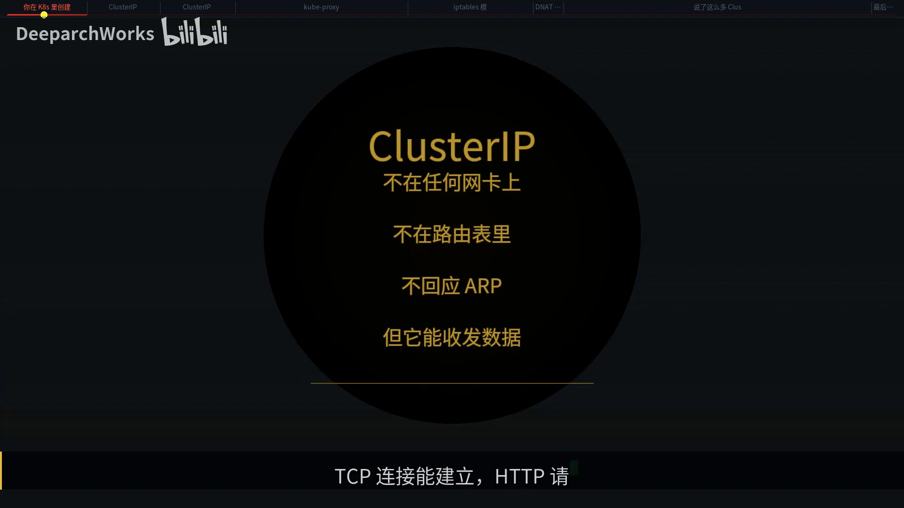

| 电话场景 | K8s 世界 |
| :--- | :--- |
| 400 总机号码 | **ClusterIP** |
| 交换机里的路由规则 | **kube-proxy 写入内核的规则** |
| 分机号 | **后端 Pod 的真实 IP** |
| 查表转接 | **DNAT** |
| 通话记录 | **conntrack** |

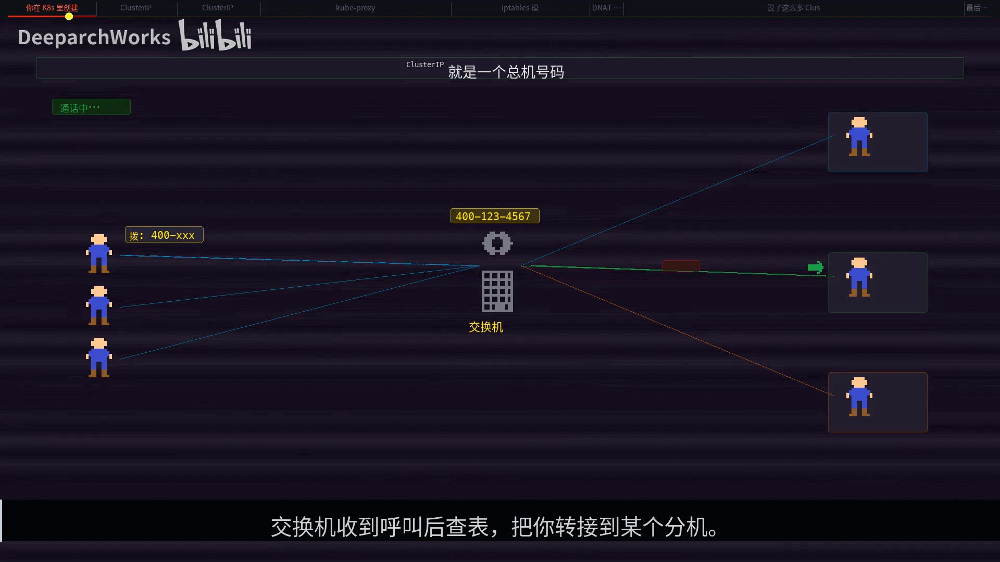

---

## 二、控制面：ClusterIP 是谁分配的，后端是谁维护的

### 2.1 全景：两条线

ClusterIP 的工作涉及两条线：**控制面**决定规则怎么生成，**数据面**决定数据包怎么走。[【跳转到 01:40】](https://www.bilibili.com/video/BV1KpXABSESM/?t=100)

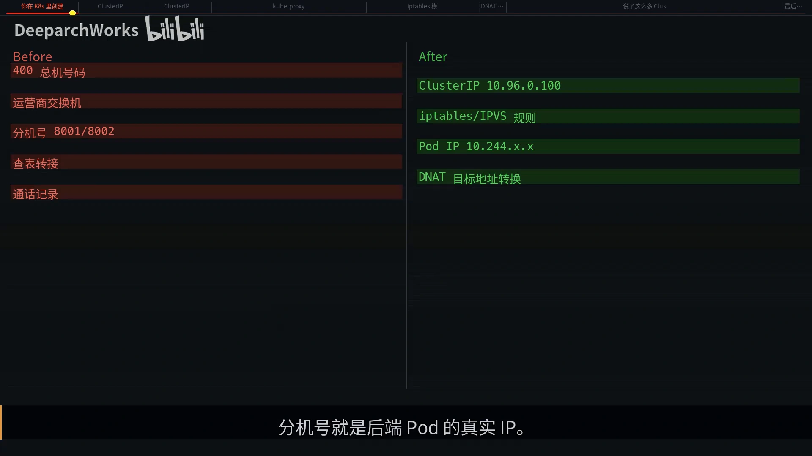

### 2.2 地址从哪来：service CIDR + bitmap

ClusterIP 的地址来自**集群启动时配置的 service CIDR**，默认是 **`10.96.0.0/12`**，这个范围大约有 **100 万个地址**。创建 Service 时你可以指定一个 IP，也可以留空让系统自动分配。[【跳转到 02:30】](https://www.bilibili.com/video/BV1KpXABSESM/?t=150)

分配过程发生在 **API Server 的 registry 层**：底层用一个 **bitmap** 追踪哪些地址已被占用，**每个 bit 对应 CIDR 中的一个地址**。关键在于——**这个分配纯粹是在 etcd 里记一笔「这个 IP 被占了」，完全不涉及网卡配置或路由下发**。[【跳转到 02:55】](https://www.bilibili.com/video/BV1KpXABSESM/?t=175)

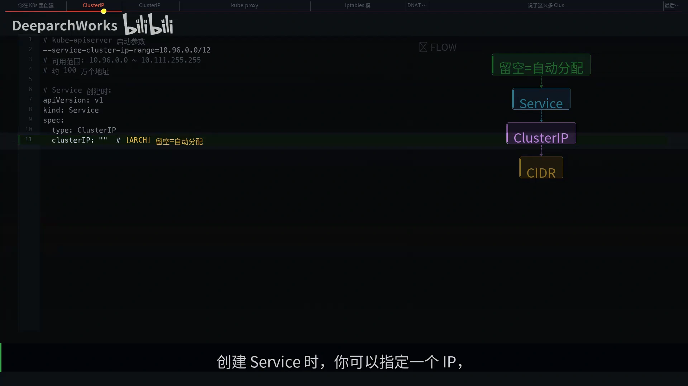

这正是 ClusterIP **不存在于任何网络设备上**的原因。

### 2.3 后端是谁：EndpointSlice 控制器

光有虚拟 IP 还不够，系统还得知道这个 IP 对应哪些**真实 Pod**。这件事由 **EndpointSlice 控制器**负责：用 Service 的 `selector` 去匹配 Pod 标签，**过滤出 Ready 状态的 Pod**，把它们的 IP 打包成 EndpointSlice 对象。注意：**只有 readiness 探针通过的 Pod 才会进入 Endpoints**——这就是「Pod 还没启动完，流量就不会打过去」的原因。[【跳转到 03:20】](https://www.bilibili.com/video/BV1KpXABSESM/?t=200)

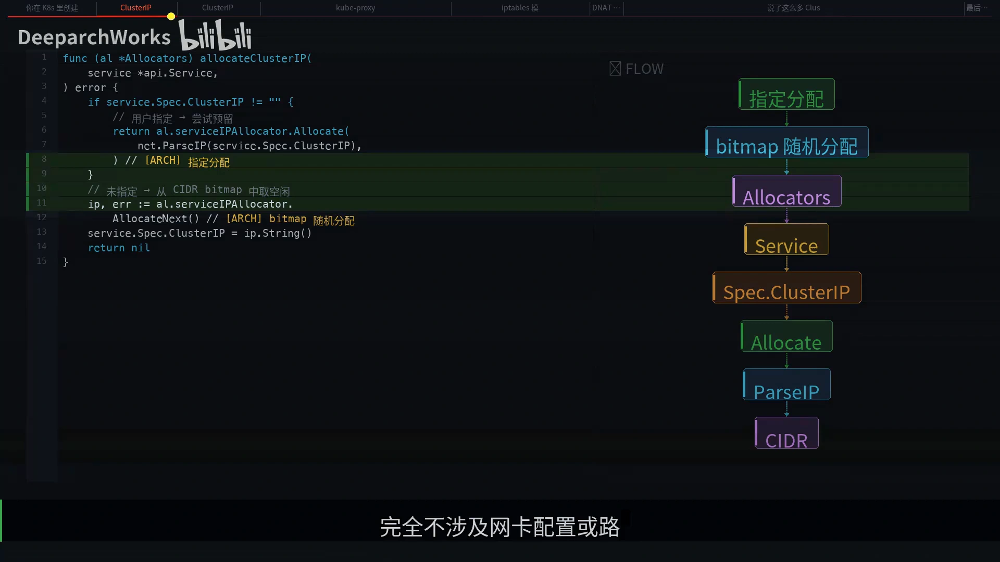

**为什么会有 EndpointSlice？** 早期的 `Endpoints` 对象把所有 Pod IP 打包在一起，**任何一个 Pod 变更都要推送整个对象**。大规模集群下，一个 Service 后面挂 1000 个 Pod、每秒都有滚动更新，推送量是灾难级的。EndpointSlice 把一个大对象**拆成多个小片，每片最多 100 个端点，做增量更新**。[【跳转到 04:10】](https://www.bilibili.com/video/BV1KpXABSESM/?t=250)

---

## 三、数据面：DNAT 与 conntrack

### 3.1 先纠正一个误解：kube-proxy 不转发流量

很多人以为 kube-proxy 像代理一样在中间转发流量——**错了**。kube-proxy **不处理任何数据包**，它的全部工作就是 watch API Server 的变更，把 Service 到 Pod 的映射翻译成 iptables 或 IPVS 规则写进内核。**真正转发流量的是内核的 netfilter 模块**，kube-proxy 只是个搬运工。[【跳转到 04:35】](https://www.bilibili.com/video/BV1KpXABSESM/?t=275)

### 3.2 iptables 模式把 Service 变成规则的两步

以最常用的 **iptables 模式**为例，核心逻辑分两步：

1. **入口**：在 `KUBE-SERVICES` 链里加一条规则——如果数据包的目标地址是这个 ClusterIP 加端口，就**跳转到该 Service 专属的链**。
2. **选后端**：Service 链里用**概率跳转**实现负载均衡。三个后端时：第一条概率 **1/3**，第二条 **1/2**，第三条**兜底**——数学上每个 Pod 被选中的概率是均等的。被选中的 **Endpoint 链只干一件事：DNAT**，把数据包的目标地址从 ClusterIP 换成 Pod 的真实 IP。[【跳转到 05:00】](https://www.bilibili.com/video/BV1KpXABSESM/?t=300)、[【跳转到 05:25】](https://www.bilibili.com/video/BV1KpXABSESM/?t=325)

所有规则生成完之后，用 **`iptables-restore` 一次性原子写入内核**——不是一条一条加，而是**整批替换**，保证中间不会出现半成品状态。[【跳转到 05:50】](https://www.bilibili.com/video/BV1KpXABSESM/?t=350)

### 3.3 DNAT 在哪发生：PREROUTING

**DNAT 的触发位置很关键**：数据包一进 netfilter，首先经过 **`PREROUTING` 链**，DNAT 就在这里把目标地址从 ClusterIP 偷换成 Pod IP，**然后内核再根据新的目标地址做路由决策**：如果目标 Pod 在本机就走 `INPUT`，在其他节点就走 `FORWARD` 加 `POSTROUTING`。[【跳转到 06:15】](https://www.bilibili.com/video/BV1KpXABSESM/?t=375)

具体到一次请求：客户端 Pod 发出的包目标地址是 ClusterIP（例：`10.96.0.100`），经过 DNAT 规则后，**目标地址被偷偷换成了后端 Pod 的真实 IP（例：`10.244.2.3`），源地址完全不变**。从这一刻起，内核就当这个包本来就是发给 `10.244.2.3` 的，走正常的 Pod 网络路由。[【跳转到 06:40】](https://www.bilibili.com/video/BV1KpXABSESM/?t=400)

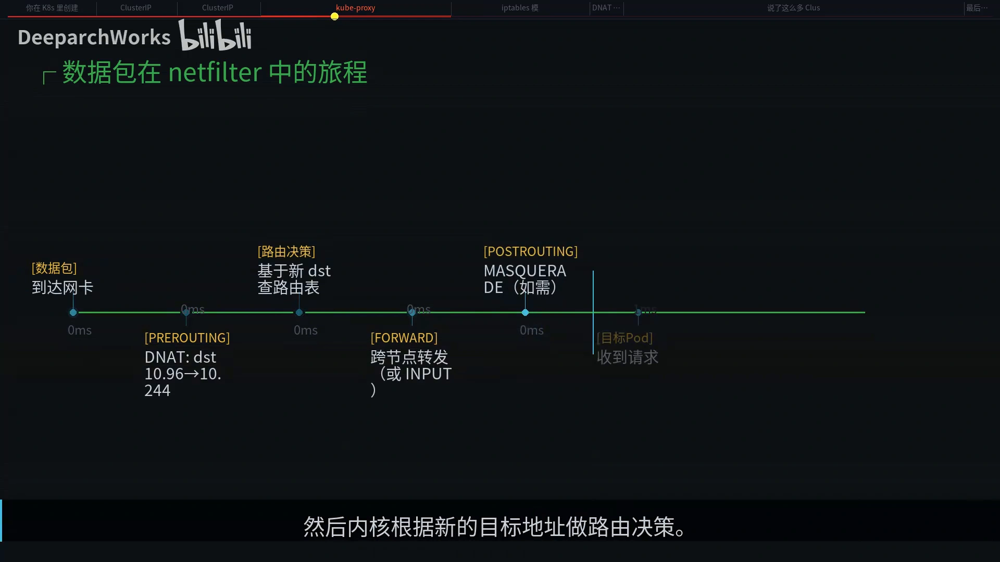

### 3.4 回包怎么回来：conntrack 反向 NAT

问题来了：Pod 收到的请求来自 `10.96.0.100`，但它**回包时的源地址是 Pod IP（`10.244.2.3`）**。客户端请求的是 ClusterIP，突然收到一个 `10.244.2.3` 的回复，**它会直接丢弃——不认识你**。那回包到底怎么正确送达？**答案是 conntrack。**

DNAT 发生时，内核会在 **conntrack 表里记一条映射**：原始目标是 ClusterIP，实际 DNAT 到了 Pod IP。回包到达节点时，conntrack 模块查到这条记录，**自动执行反向 NAT**，把源地址从 Pod IP 改回 ClusterIP。客户端收到的回包源地址是 `10.96.0.100`，它以为自己一直在和 ClusterIP 通信——闭环了。[【跳转到 07:55】](https://www.bilibili.com/video/BV1KpXABSESM/?t=475)

### 3.5 回到开头：为什么 curl 能通、ping 不通

因为 **iptables 的 DNAT 规则匹配条件是「TCP 协议 + 特定端口」**：ICMP ping **既不是 TCP、也没有端口号**，不匹配任何规则；数据包到了内核，既没有对应这个目标地址的路由、也没有 ARP 响应，**只能被丢弃**。所以——**ClusterIP 只在「有端口的传输层协议」下存在**。[【跳转到 08:20】](https://www.bilibili.com/video/BV1KpXABSESM/?t=500)

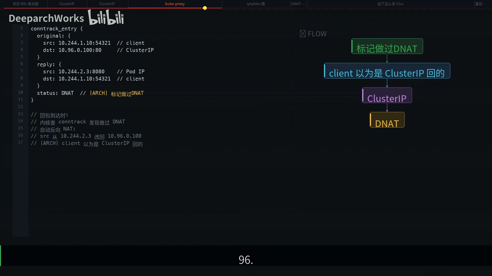

---

## 四、规模问题：iptables、IPVS 与 nftables

### 4.1 iptables 的瓶颈：链表是 O(n)

小规模集群下 iptables 够用，但**上千个 Service、每个 Service 十个后端**时问题就暴露了：iptables 的规则是**一条链表**，每个数据包要从头开始**一条一条匹配**，直到命中；**1 万个 Service 就是 8 万多条规则**，每个包都要线性扫描。[【跳转到 09:10】](https://www.bilibili.com/video/BV1KpXABSESM/?t=550)

### 4.2 IPVS：哈希表 O(1)

**IPVS 用的是哈希表**：把「ClusterIP + 端口 + 协议」做哈希，直接定位到 virtual server，**O(1) 查找**——不管有 100 个还是 1 万个 Service，延迟几乎不变。

代码逻辑也不同：IPVS 会先把 ClusterIP 绑定到一个叫 **`kube-ipvs0` 的 dummy 网卡**上（注意：**这不表示它是真正的网络端点，只是让内核不要因为「目标 IP 不是本机」而丢包**），然后创建 **IPVS virtual server**、指定调度算法，再把每个后端 Pod 作为 **real server** 注册进去。[【跳转到 09:35】](https://www.bilibili.com/video/BV1KpXABSESM/?t=575)

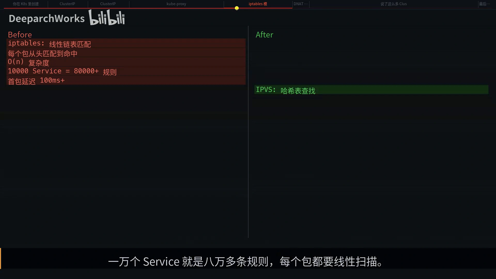

IPVS 还有个优势是**调度算法丰富**：iptables 只能用随机概率，IPVS 支持**轮询、最少连接、源地址哈希**等。比如用「最少连接」，流量会自动偏向空闲的 Pod，对处理时间差异大的场景特别有用。[【跳转到 10:25】](https://www.bilibili.com/video/BV1KpXABSESM/?t=625)

### 4.3 nftables：解决的是锁竞争

**K8s 1.31 又引入了 nftables 模式**。有了 IPVS 为什么还要 nftables？因为 nftables 解决的是 iptables 的**另一个痛点——锁竞争**：iptables 的写入需要**全局锁**，大规模并发更新时会卡住；而 nftables 用 **set 与 map 数据结构**，支持**原子批量操作和增量更新**。[【跳转到 10:50】](https://www.bilibili.com/video/BV1KpXABSESM/?t=650)

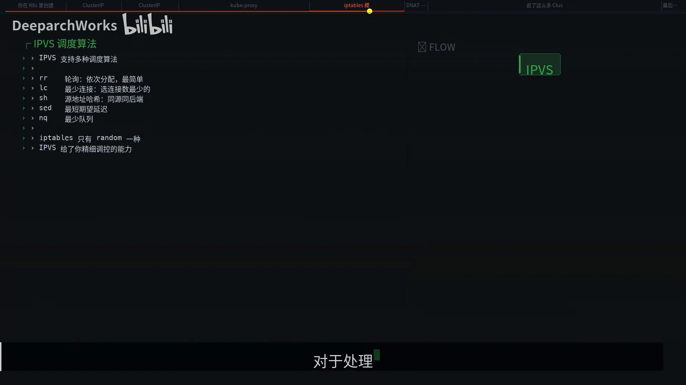

三种模式可以这样理解：**iptables 是兼容性最好的默认选择**，小集群够用；**IPVS 是大规模集群的高性能之选**；**nftables 是面向未来的新一代方案**。它们底层都依赖 Linux 内核的 netfilter 框架，只是上层的规则组织方式不同。

### 4.4 跨节点：还要 SNAT

DNAT 解决了目标地址的问题，但如果**客户端 Pod 与目标 Pod 不在同一个节点**呢？还需要一个机制：跨节点时 **`POSTROUTING` 链会做 masquerade，也就是 SNAT**，把源地址从 Pod IP 换成 **node 的 IP**。[【跳转到 11:40】](https://www.bilibili.com/video/BV1KpXABSESM/?t=700)

为什么必须这样？因为**回包必须经过 node 才能触发 conntrack 的反向 NAT**；如果不做 NAT，回包可能直连 client Pod 所在节点、但走了另一条路径，**conntrack 条目不在那里，连接就断了**。[【跳转到 12:05】](https://www.bilibili.com/video/BV1KpXABSESM/?t=725)

---

## 五、延伸与排障

### 5.1 不想用 ClusterIP 也行：Headless Service

**Headless Service** 把 `clusterIP` 设为 `None`：DNS **不再返回一个虚拟 IP**，而是**直接返回所有后端 Pod 的真实 IP**——**没有 iptables 规则、没有 DNAT、没有 conntrack**，客户端拿到 Pod IP 列表自己决定连谁。**StatefulSet 场景下需要直接访问特定 Pod 实例时，Headless 就派上用场了。**[【跳转到 12:30】](https://www.bilibili.com/video/BV1KpXABSESM/?t=750)

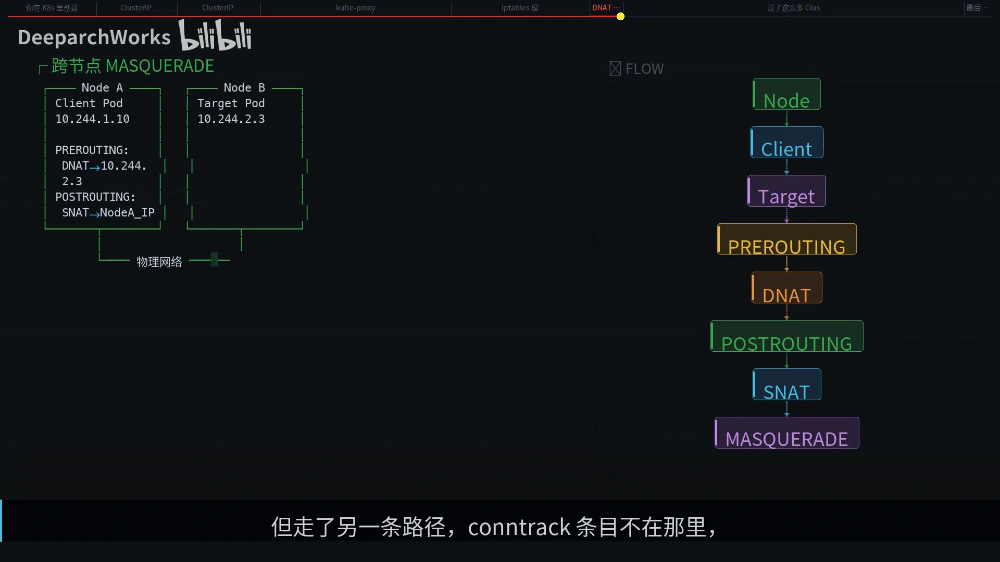

### 5.2 ClusterIP 是「所有类型的地基」

ClusterIP 不只是一种 Service 类型，**它还是所有其他类型的地基**：

- **NodePort** 在每个节点开一个端口，流量进来后**跳转到 ClusterIP 的规则链**，走同样的 DNAT 逻辑；
- **LoadBalancer** 又在 NodePort 之上加一层，与厂商的负载均衡器三层嵌套——但**核心都是 ClusterIP 的 DNAT 机制**。[【跳转到 13:20】](https://www.bilibili.com/video/BV1KpXABSESM/?t=800)

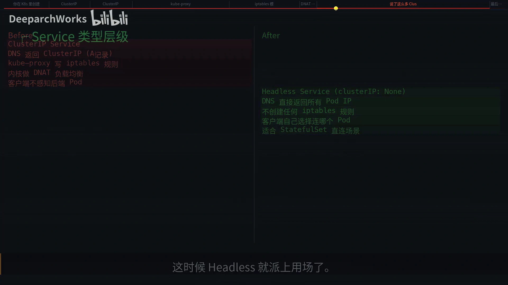

### 5.3 把整条链路串起来

`kubectl` 创建 Service → API Server 在 etcd 里分配 ClusterIP → 约 **10ms** 后 EndpointSlice 控制器找到匹配的 Pod 并创建映射 → 约 **50ms** 后 kube-proxy 把规则写入内核 → 客户端发请求 → netfilter 做 DNAT、conntrack 记录映射 → 回包自动反向 NAT。**从创建到可用大约不到 100ms。**

Pod 下线时则反过来：发送 `SIGTERM` → EndpointSlice 控制器移除该 Pod 的地址 → kube-proxy 删除对应的 DNAT 规则；**已建立的连接不受影响**（conntrack 条目还在），**新请求只会被分配到存活的 Pod**——这就是 K8s 的**优雅下线**。[【跳转到 13:45】](https://www.bilibili.com/video/BV1KpXABSESM/?t=825)、[【跳转到 14:10】](https://www.bilibili.com/video/BV1KpXABSESM/?t=850)

### 5.4 生产环境常见的坑

- **conntrack 表满**：表有容量上限，**默认 6 万多条**，高并发下每个 TCP 连接占一个条目，连接一多就溢出。症状是「**新建连接间歇性超时、但旧连接正常**」，日志里出现 `nf_conntrack table full`。办法是调大 `nf_conntrack_max`（一般设到 100 万足够），或缩短 TCP established 超时让不活跃条目更快释放；治本则是**上 eBPF（如 Cilium）绕过 conntrack**。[【跳转到 14:35】](https://www.bilibili.com/video/BV1KpXABSESM/?t=875)、[【跳转到 15:25】](https://www.bilibili.com/video/BV1KpXABSESM/?t=925)
- **会话保持**：需要同一客户端始终连到同一 Pod（WebSocket 长连接、有状态会话）时，把 **session affinity 设为 `ClientIP`**；iptables 模式用 `recent` 模块记住上次选的 Endpoint，IPVS 用 persistent connection 机制。**但注意它不是 sticky session，超时后会重新选择。**[【跳转到 15:50】](https://www.bilibili.com/video/BV1KpXABSESM/?t=950)
- **ClusterIP 不能从集群外访问**：DNAT 规则只存在于集群节点的内核里，集群外的机器没有这些规则、也没有到 service CIDR 的路由。要从外部访问，得用 **NodePort、LoadBalancer 或 Ingress**。[【跳转到 16:15】](https://www.bilibili.com/video/BV1KpXABSESM/?t=975)
- **Service 建了但 Endpoints 是空的**，排查顺序：Pod 是否存在、标签是否匹配 → Pod 是否 Running、readiness 探针是否通过 → **Service 与 Pod 是否在同一个 namespace**。[【跳转到 16:40】](https://www.bilibili.com/video/BV1KpXABSESM/?t=1000)
- **iptables 的负载均衡是否均匀**：数学上是均匀的——三个后端时，第一条 `1/3`，第二条 `1/2 × (1 − 1/3) = 1/3`，第三条兜底也是 `1/3`；**但它是逐包随机的，短期内可能分布不均**，需要严格轮询就用 IPVS 的 `rr` 调度。[【跳转到 17:05】](https://www.bilibili.com/video/BV1KpXABSESM/?t=1025)
- **`externalTrafficPolicy: Local`**：NodePort 与 LoadBalancer 的流量**只转发到本节点上的 Pod**、不做跨节点转发。好处是**保留客户端源 IP**，坏处是**某些节点上如果没有 Pod，那些节点的 NodePort 会返回 503**。[【跳转到 17:30】](https://www.bilibili.com/video/BV1KpXABSESM/?t=1050)

### 5.5 选型不看功能，看规模

iptables 与 IPVS 的性能差异**本质上不是什么高深的优化技巧，就是数据结构的差异**：链表查找是 **O(n)**，哈希表查找是 **O(1)**。**一千个 Service 以下感知不明显，1 万个 Service 就是十倍百倍的延迟差距**；实测上：100 个 Service 时差异不大，1000 个开始拉开差距，到 1 万个 Service 时 iptables 的**首包延迟超过 100ms**，而 IPVS 几乎不变。**集群 Service 数量超过 1000，就值得认真考虑切到 IPVS。**[【跳转到 17:55】](https://www.bilibili.com/video/BV1KpXABSESM/?t=1075)、[【跳转到 18:20】](https://www.bilibili.com/video/BV1KpXABSESM/?t=1100)

---

## 六、小结

今天的核心知识点可以压缩成几句：[【跳转到 18:45】](https://www.bilibili.com/video/BV1KpXABSESM/?t=1125)

- **ClusterIP 是一个只存在于内核规则中的虚拟 IP**；
- **DNAT 在 `PREROUTING` 链上偷换目标地址**，**conntrack 保证回包能正确恢复源地址**；
- **iptables 与 IPVS 的性能差异是数据结构的差异**（O(n) vs O(1)）；
- **kube-proxy 不转发流量、只搬运规则**；
- **所有 Service 类型的核心都是 ClusterIP 的 DNAT 机制**。

最后回到开头那个问题：**ClusterIP 是假 IP 吗？——不是。** 它是真实存在、可以工作的地址，承载着集群内所有服务间通信；**它只是不住在网卡上，而是住在内核的规则里**。就像 400 号码不对应任何电话机，但每天有几百万通电话通过它接通。[【跳转到 19:35】](https://www.bilibili.com/video/BV1KpXABSESM/?t=1175)
