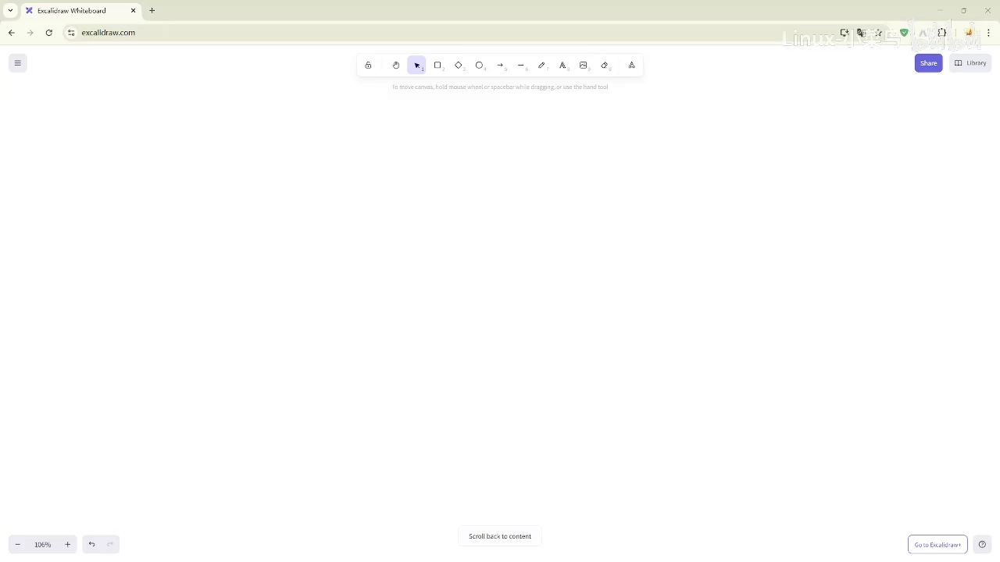
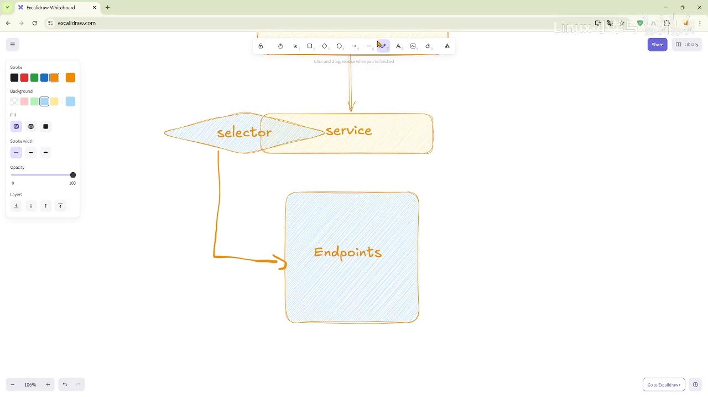
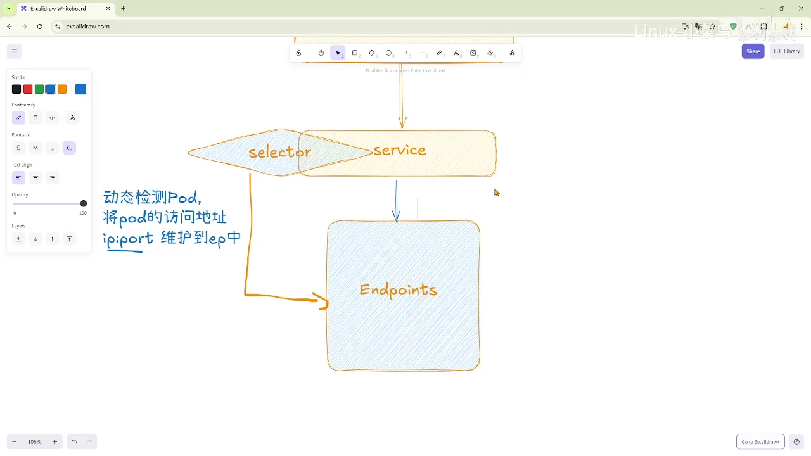
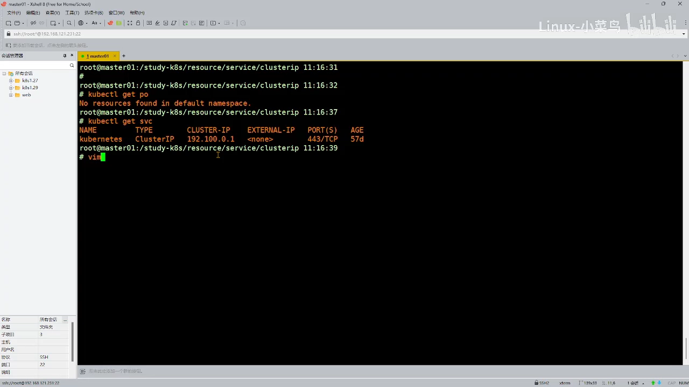
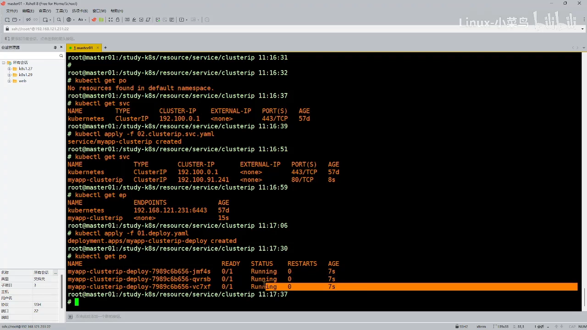
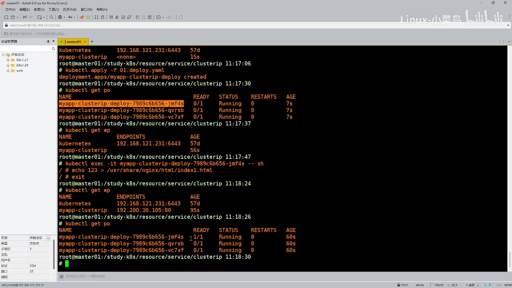
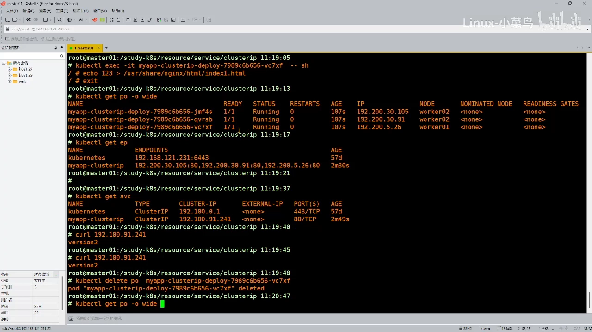
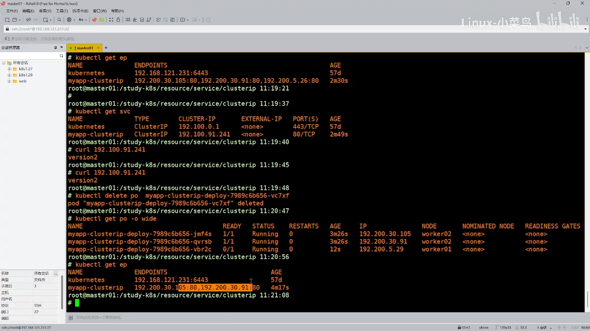
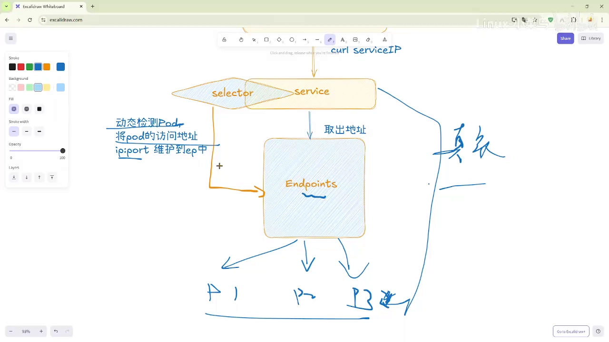

# Endpoints 自动关联体系：Service 是怎么自动找到后端 Pod 的

> 本文整理自 B 站视频《[66 Endpoints 自动关联体系](https://www.bilibili.com/video/BV1fNaRzJE12/)》（Endpoints 系列上篇）。文中机制、命令与实验结论均来自该视频的图文稿，可逐句核对。

## 本讲要解决的核心问题（SCQA）

**背景（S）**：我们已经知道 Service（服务）能为后端 Pod 提供一个稳定的访问入口。可 Service 本身只是一个「虚拟入口」，它并不会天然地知道后端到底有哪些 Pod。[【跳转到 00:00】](https://www.bilibili.com/video/BV1fNaRzJE12/?t=0)

**冲突（C）**：Pod 随时可能被控制器删除、重建，重建后 IP 就变了。如果后端名单要靠人去手工更新，那么「负载均衡」就成了一句空话。

**疑问（Q）**：Service 究竟靠什么机制，才能始终掌握「此刻有哪些 Pod 可以接收流量」这份名单？

**回答（中心思想 A）**：靠 **Endpoints 对象 + 标签选择器（selector）** 组成的**自动关联体系**。selector 按标签动态筛选 Pod，把它们的 `IP:端口` 实时写进 Endpoints；请求进来时，Service 先去 Endpoints 里取地址，再把流量转发到真正的后端 Pod。理解这套「自动关联」，是理解 K8s 负载均衡的起点。

---

## 一、自动关联的三个角色

在「自动关联体系」里，有三个角色各司其职：**Service**、**标签选择器（selector）**、**Endpoints 对象**。

假设集群内部要发起一次请求，请求先到达 Service。因为 Service 与后端 Pod 之间是**自动关联**的，所以它需要一个 **selector** 去做标签匹配。[【跳转到 00:25】](https://www.bilibili.com/video/BV1fNaRzJE12/?t=25)



那么这个标签匹配具体怎么做？就落到了 **Endpoints 对象**头上：**标签选择器会动态地去监测 Pod**，把 Pod 的访问地址（也就是 `IP:Port`）维护进 Endpoints 里。[【跳转到 00:50】](https://www.bilibili.com/video/BV1fNaRzJE12/?t=50)



一句话概括这套分工：

- **Service**：对外提供稳定入口，负责「按规则取地址」；
- **selector**：负责「动态监测」，盯住哪些 Pod 符合标签条件；
- **Endpoints**：负责「存地址」，保存符合条件 Pod 的 `IP:Port`，并随变化实时更新。

## 二、请求的真实路径

当 selector 把 IP 和端口写进 Endpoints 之后，Service 就可以按规则从 Endpoints 里取出地址。因为 Endpoints 后面往往关联着很多 Pod（比如 P1、P2、P3），**真实的请求路径其实是**：

```
客户端  →  Service  →  Endpoints  →  后端某个 Pod
```

[【跳转到 02:05】](https://www.bilibili.com/video/BV1fNaRzJE12/?t=125)



这正是我们之前在「Service 工作原理」里讲过的流程：selector 动态监测 Pod，把 `IP:Port` 保存到 Endpoints；一旦有请求，Service 就到 Endpoints 里找地址，找到后把请求发送给对应 Pod。[【跳转到 03:20】](https://www.bilibili.com/video/BV1fNaRzJE12/?t=200)

## 三、实验：Endpoints 是怎么「活」起来的

讲原理不如看现象。下面把之前的实验重做一遍，重点观察 Endpoints 内容的变化。

### 3.1 先建 Service：Endpoints 自动出现，但内容是空的

集群里初始既没有 Pod，也没有我们自己创建的 Service，那就先建起来。创建完 Service 后观察：由于是自动关联体系，**K8s 会自动创建一个与 Service 同名的 Endpoints**，但此时它里面是空的（`<none>`）——因为集群里还没有符合 selector 的 Pod。[【跳转到 04:22】](https://www.bilibili.com/video/BV1fNaRzJE12/?t=262)



### 3.2 再建 Pod：就绪之后 IP 才进来

接着把 Pod 创建出来。这时 Service 与 Pod 都已存在，但 Pod 还没就绪。**趁它们没就绪再看 Endpoints——里面依旧没有内容，它在等待 Pod 就绪。**[【跳转到 04:53】](https://www.bilibili.com/video/BV1fNaRzJE12/?t=293)



等这些 Pod 全部就绪后再看：第一个 Pod 的 IP 是 `.30.105`，而 Endpoints 里正好出现了 `.30.105`、端口 `80`——两者对上了。[【跳转到 05:43】](https://www.bilibili.com/video/BV1fNaRzJE12/?t=343)



这就是「自动关联体系」：只要 Pod 就绪，Endpoints 里就都会有它们的 IP。此时访问 Service 的 IP，它一定会走负载均衡，把请求调度到后端的 Pod 上。[【跳转到 06:33】](https://www.bilibili.com/video/BV1fNaRzJE12/?t=393)

### 3.3 删掉一个 Pod：旧 IP 剔出、新 IP 加入

来做个「破坏性」验证：删掉一个 Pod（比如 `v7xf`）让它重建。删掉后控制器新建了一个 Pod `vb22c`，它的 **IP 也变了**。再来看 Endpoints：[【跳转到 07:42】](https://www.bilibili.com/video/BV1fNaRzJE12/?t=462)



可以看到，Endpoints 会把旧 Pod 的 `.5.26` **剔除**（因为那个 Pod 已经不在了）；等新 Pod 就绪后，新的 IP `.5.29` 又被**加了进来**。[【跳转到 08:32】](https://www.bilibili.com/video/BV1fNaRzJE12/?t=512)



## 四、小结：动态监测才是负载均衡的底气

关键就在「**动态**」二字：并不是这次匹配好了就不管了。后面 Pod 该销毁销毁、该新建新建，Endpoints 都会**持续跟踪**——你的 IP 没了就剔除，有新的满足条件的就加进来。[【跳转到 09:07】](https://www.bilibili.com/video/BV1fNaRzJE12/?t=547)



正因为有了这种机制，Service 才能实现负载均衡。回顾一下：无论是 ClusterIP 还是 NodePort 类型，我们从来没有手工创建过 Endpoints——它都会**自动生成一份**，让 Service 实现稳定的负载均衡访问。这就是「自动关联体系」的全部秘密。[【跳转到 09:32】](https://www.bilibili.com/video/BV1fNaRzJE12/?t=572)
