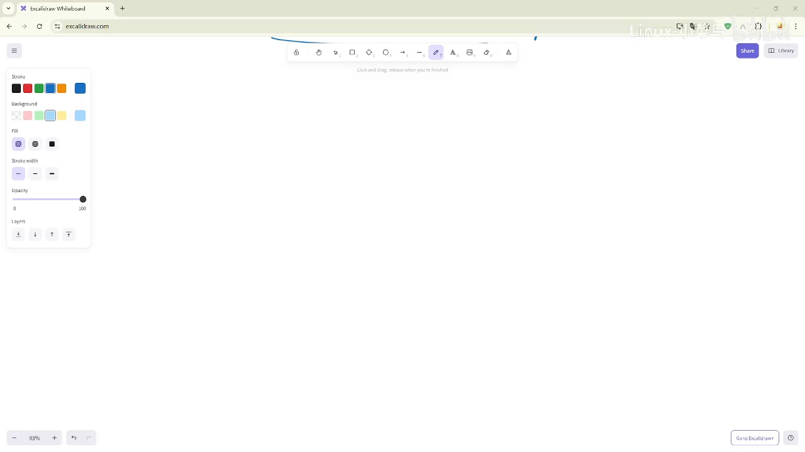
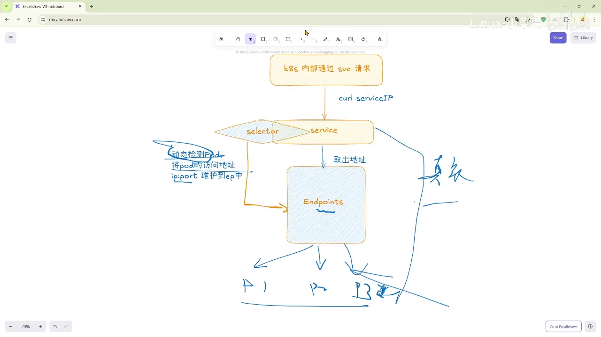
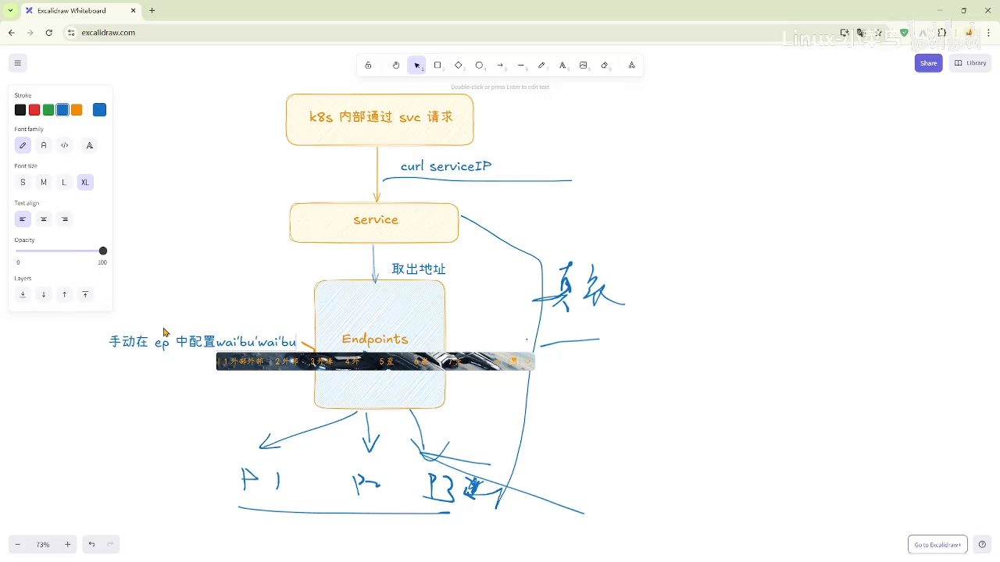
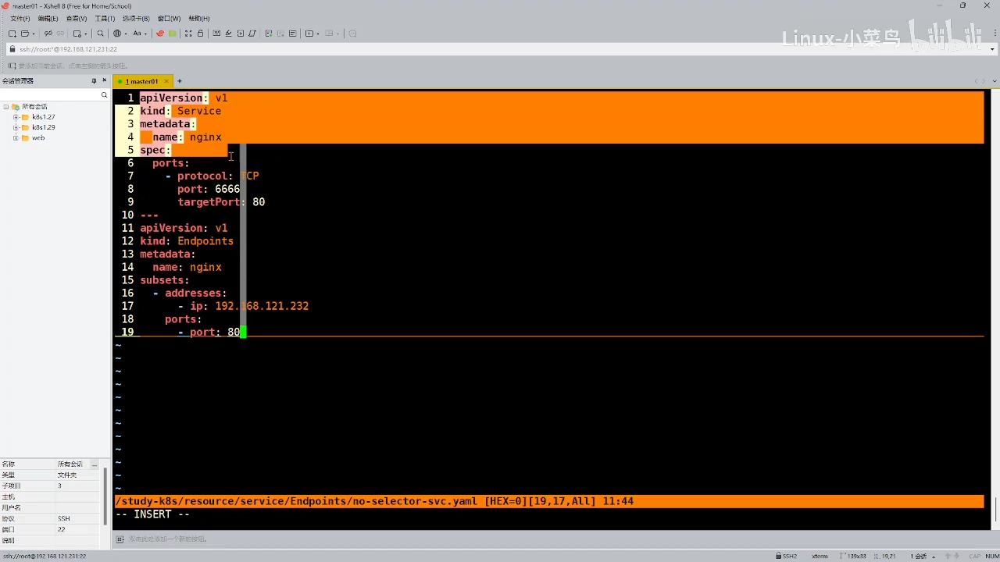
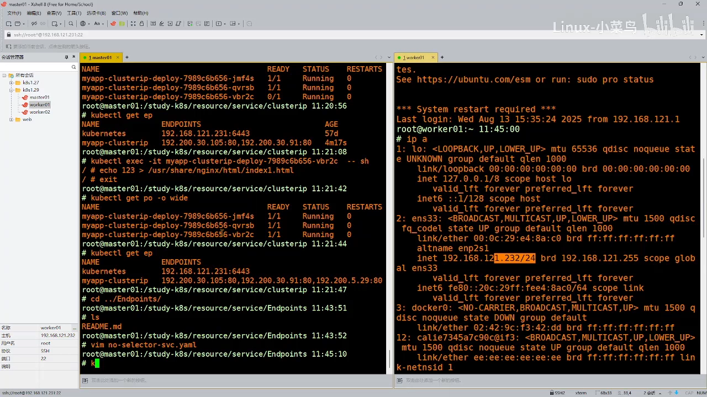
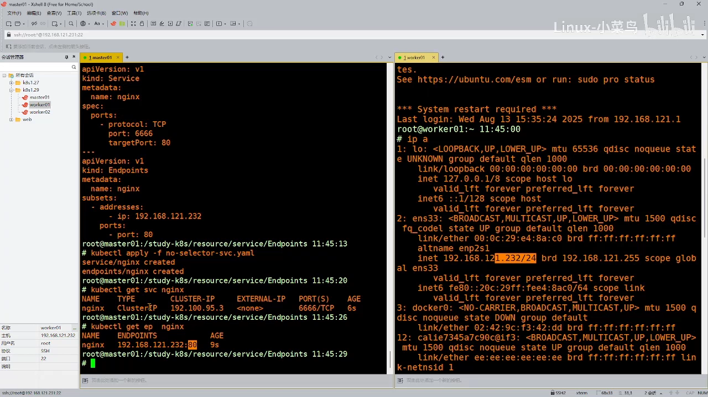
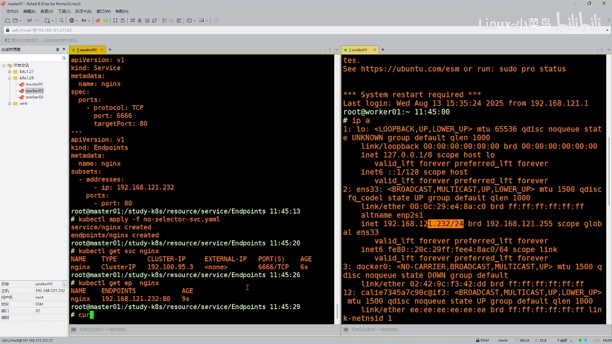
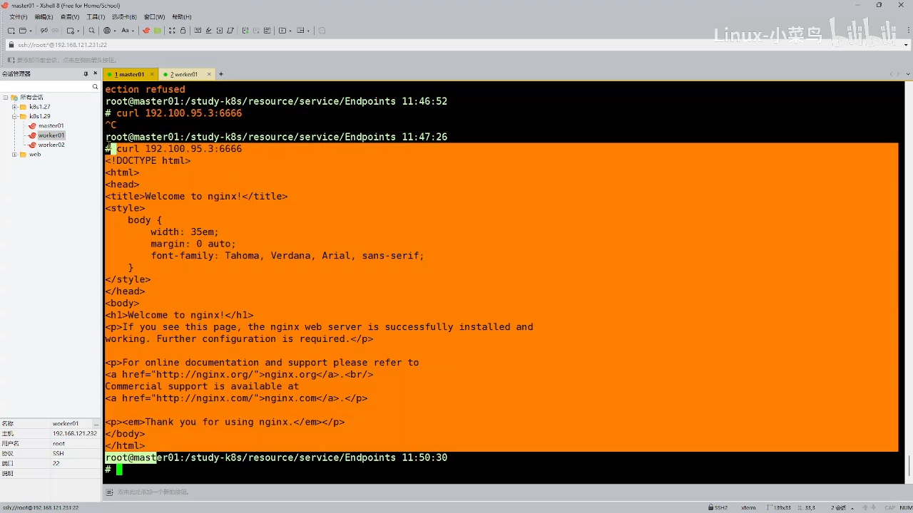
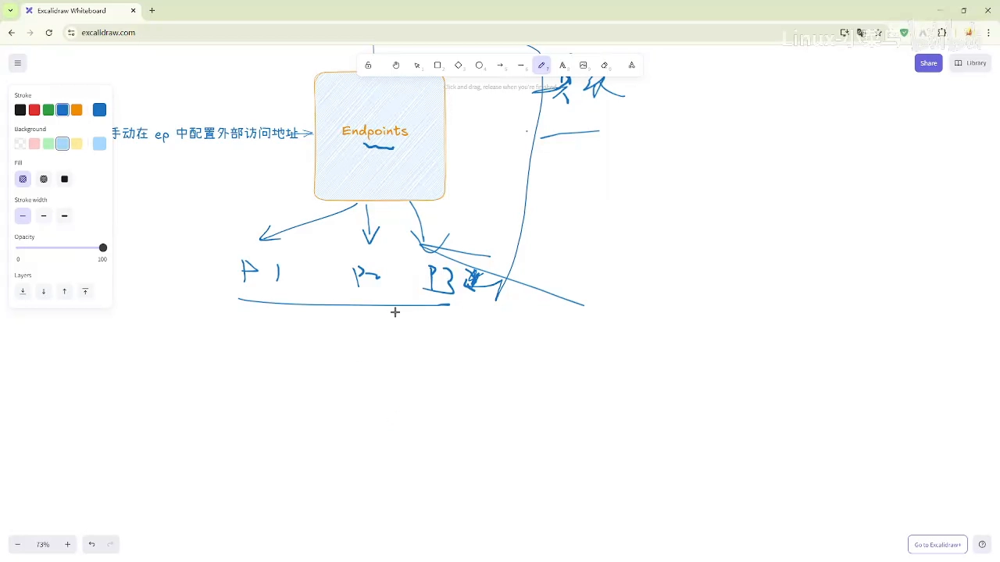

# Endpoints 手动关联体系：让 Service 把请求转发到集群外的服务

> 本文整理自 B 站视频《[67 Endpoints 手动关联体系](https://www.bilibili.com/video/BV1FAaRzQEhm/)》（Endpoints 系列下篇，紧接上篇《自动关联体系》）。文中机制、命令与实验结论均来自该视频的图文稿，可逐句核对。

## 本讲要解决的核心问题（SCQA）

**背景（S）**：上篇讲了「自动关联体系」——Service 靠 selector 动态监测 Pod，自动把 Pod 的 `IP:Port` 写进 Endpoints。

**冲突（C）**：可现实里有一类后端**根本不是 Pod**：比如部署在集群之外、或另一个集群里的服务。它们没有标签，selector 匹配不到，自动关联自然也就无从谈起。

**疑问（Q）**：如果后端不在集群里、也不受 selector 管辖，Service 还能不能把流量转过去？

**回答（中心思想 A）**：能。办法是**手动关联体系**——Service 不写 selector，Endpoints 也由我们手工维护。于是 Endpoints 里放的就不再是 Pod，而是**任意外部地址**。这恰好补上了自动关联体系的盲区。

---

## 一、手动关联：没有 selector，就没有「动态监测」

手动关联体系与自动关联体系的最大区别，就是**没有了 selector，自然也就没有「动态监测」这回事**。那它是怎么工作的呢？[【跳转到 00:25】](https://www.bilibili.com/video/BV1FAaRzQEhm/?t=25)

集群内部仍然照旧发起请求：`curl` 这个 Service 的 IP，Service 还是要到 Endpoints 里去找「哪些 IP 是自己的」。[【跳转到 00:25】](https://www.bilibili.com/video/BV1FAaRzQEhm/?t=25)



区别在于：既然没有 selector 去挑 Pod，**这些地址就只能由我们手动写进 Endpoints**——手动把外部访问地址关联进来。[【跳转到 00:50】](https://www.bilibili.com/video/BV1FAaRzQEhm/?t=50)



## 二、怎么造一个「不会自动创建 Endpoints」的 Service？

方法简单到一句话：**不写 selector 就好了**。[【跳转到 01:15】](https://www.bilibili.com/video/BV1FAaRzQEhm/?t=75)

原因是——只要 Service 里带了 selector，K8s 就会自动为它生成并接管一个同名 Endpoints；反过来，**没有 selector，就不会触发这份自动的 Endpoints**，Endpoints 的内容就完全交给我们自己掌握。



## 三、实验：给 Service 手工挂一个「外部」后端

回来看资源配置。[【跳转到 02:04】](https://www.bilibili.com/video/BV1FAaRzQEhm/?t=124)

上面是一个 **Service**：它**没有 selector**，而且没有写 `type`，所以**默认就是 ClusterIP 类型**。下面是一个 **Endpoints**，名字叫 `nginx`，里面填的是一个具体的外部地址（某个 IP），端口 `80`。[【跳转到 02:14】](https://www.bilibili.com/video/BV1FAaRzQEhm/?t=134)



把这两个资源 `apply` 上去，然后查看是否创建成功：

```bash
kubectl get svc nginx
kubectl get endpoints
```

可以看到，我们在资源清单里定义好的内容，已经**原样写进了 Endpoints**。[【跳转到 03:05】](https://www.bilibili.com/video/BV1FAaRzQEhm/?t=185)



这意味着：当我们访问这个 nginx 服务（此处为 NodePort Service）的 IP 时，**它就会把请求调度到 Endpoints 里那个 IP 上**。不过，此刻直接访问还没有效果。[【跳转到 03:30】](https://www.bilibili.com/video/BV1FAaRzQEhm/?t=210)



为什么没效果？因为被指向的那台机器 (`...232`) 上**并没有谁在监听 80 端口**。于是需要先在那台机器上开一个 80 端口，方法很简单——跑一个容器把它映射出来即可：

```bash
docker run -d --name nginx7 -p 80:80 <image>
```



（演示中途端口映射配置出过一点小状况，修正后 80 端口顺利起来。）容器跑起来后再去访问，就**能正常访问到了**：请求被调度到了 `...232` 的 80 端口上。[【跳转到 08:27】](https://www.bilibili.com/video/BV1FAaRzQEhm/?t=507)



## 四、手动关联的价值：Endpoints 里可以放「非 Pod」

这个实验真正的意义在下篇的收尾处点破了：**Endpoints 里不仅可以放 Pod，它还可以放别的**——也就是 **K8s 外部的服务（集群外部的服务）**，通过这种方式同样可以做到。[【跳转到 08:38】](https://www.bilibili.com/video/BV1FAaRzQEhm/?t=518)



**这正是「自动关联体系」所做不到的地方。**

| | 自动关联体系 | 手动关联体系 |
| --- | --- | --- |
| selector | 需要 | 不需要（不写） |
| Endpoints | K8s 自动创建并维护 | 手工创建、手工维护 |
| 动态监测 | 有，随 Pod 变化实时更新 | 没有，内容由人决定 |
| 后端可以是 | 集群内、匹配标签的 Pod | 任意地址，含集群外服务 |

把上、下两篇合起来看：**自动关联**解决「集群内 Pod 天天变、入口要稳」的问题，**手动关联**解决「后端压根不在集群里」的问题。两者共享同一个抽象——**Endpoints 里那份「IP:Port 名单」**，区别只在于名单由谁填、会不会自动变。
