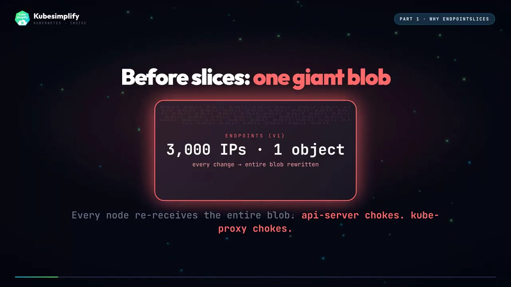
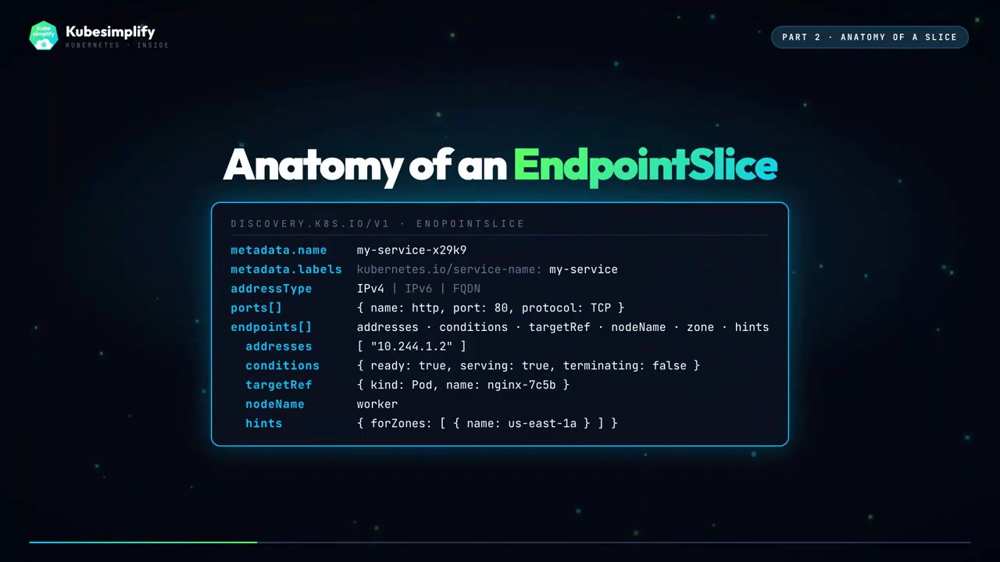
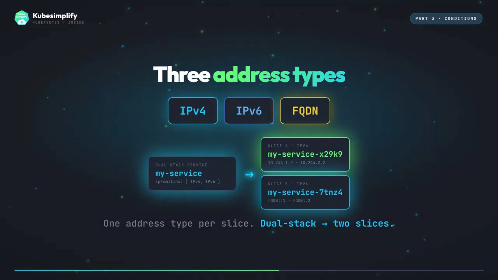
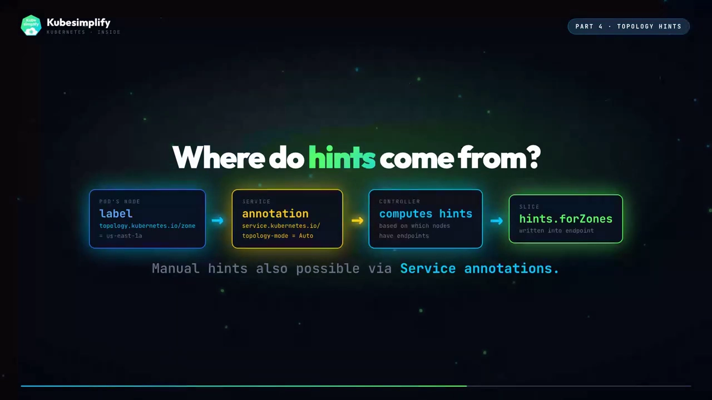
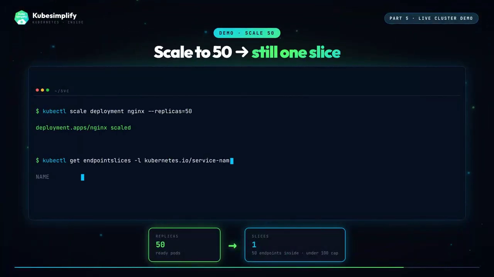

# EndpointSlice：Service 如何扩展到数千个 Pod

> 本文整理自 YouTube 视频《[EndpointSlices — how Kubernetes Services scale to thousands of pods without falling over](https://www.youtube.com/watch?v=_MJ1ou-Oj-s)》（频道 Kubesimplify）。文中机制、命令与实验结论均来自该视频的图文稿，可逐句核对；跳转链接为 YouTube 时间戳。

## 本讲要解决的核心问题（SCQA）

**背景（S）**：Service 自己没有 IP；但总得有个「某处」在保存「所有匹配它 selector 的 Pod IP」的名单——好让 **kube-proxy** 能据此改写内核规则，好让 **CoreDNS** 能解析无头（headless）Service。这个「某处」，就是 **EndpointSlice**。[【跳转到 00:00】](https://www.youtube.com/watch?v=_MJ1ou-Oj-s&t=0)


**冲突（C）**：最初的实现是**每个 Service 只有一个 Endpoints 对象**——一大坨，装着所有后端 Pod IP。3 个 Pod 还好；可 3000 个 Pod 时，这个对象会变得巨大。每个节点上的每个 kube-proxy 都在 watch 它；**任何一次变更都要重写整坨**，而**每个节点都要重新接收整坨**。于是 API Server 喘不过气，kube-proxy 也喘不过气——系统根本**无法扩展**。[【跳转到 00:21】](https://www.youtube.com/watch?v=_MJ1ou-Oj-s&t=21)

**疑问（Q）**：如何在 Pod 数量上千时，仍让这份「后端名单」的读写与分发保持线性、可扩展？

**回答（中心思想 A）**：**EndpointSlice**。它把「一个巨型的 Endpoints」拆成「许多小的切片」，每片默认最多 **100 个 endpoint**。新增一个 Pod，只有它落进去的那一片被重写，watch 者只重新处理那一片——**线性扩展**。

---

## 一、为什么需要 EndpointSlice：从「一大块」到「许多小片」

EndpointSlice 在 **Kubernetes 1.21** 修复了上面这个扩展性问题：不再是一个巨大的 Endpoints 对象，而是**许多小的 EndpointSlice 对象**，每个默认上限 **100 个 endpoint**。[【跳转到 00:46】](https://www.youtube.com/watch?v=_MJ1ou-Oj-s&t=46)



从「一块」到「多片」带来的变化非常直接：

- 3 个 Pod → **1 片**；300 个 Pod → **3 片**；3000 个 Pod → **30 片**。
- 新增一个 Pod，**只有它所在的那一片被改写**，watch 者只重处理这一片。
- 旧的 **Endpoints API 自 1.33 起被正式弃用**（deprecated）。

这就是 EndpointSlice 存在的理由：**它是 Kubernetes 把 Service 抽象扩展到数千个 Pod 的方式。**

## 二、切片里的内容是怎么被写出来的

当你创建一个 Service 时，**EndpointSlice 控制器**就被唤醒。它运行在 `kube-controller-manager` 里，同时 watch **Service** 和 **Pod** 的变化；两者任一变化，它就执行一次协调（reconcile）。[【跳转到 01:30】](https://www.youtube.com/watch?v=_MJ1ou-Oj-s&t=90)

协调的过程是：对命名空间内**每个匹配该 Service label selector 且已就绪（ready）的 Pod**，控制器构造一条 slice 条目——包含 **Pod IP、所在节点、端口、conditions** 等。然后它写入或更新一个或多个 EndpointSlice 对象；API Server 校验后写入 etcd；kube-proxy 与 CoreDNS 再通过 API Server watch 到这些变化。

> 注意：片子里不含「Pod 状态」之外的智能决策——**条件（conditions）决定谁拿到流量**，控制器只负责如实填写。

## 三、切片里都有什么

一个切片里有：**地址类型（address type）**——IPv4、IPv6 或 FQDN——外加一个 **endpoints 列表**。每个 endpoint 又包含：`addresses`（地址）、`conditions`（条件）、指回 Pod 的 `targetRef`、用于拓扑的 **node name**、`ports`（端口列表），以及把它绑定到父 Service 的 `labels`。这些都能用 `kubectl get endpointslice` 看到。[【跳转到 02:20】](https://www.youtube.com/watch?v=_MJ1ou-Oj-s&t=140)



**为什么默认是 100？这是个权衡**：切片越小，对象越多，但每个 watch 事件的字节数越少；切片越大，对象越少，但每次变更要重写的块越大。**100 是那个甜点**。这个上限可通过 `--max-endpoints-per-slice` 调整，最大到 **1000**。

## 四、三种 conditions：ready / serving / terminating

每个 EndpointSlice 里的 endpoint 带着三种条件——`ready`、`serving`、`terminating`。它们听起来相似，含义却不同，并直接决定流量是否真的会去那个 Pod。[【跳转到 03:08】](https://www.youtube.com/watch?v=_MJ1ou-Oj-s&t=188)


- **`serving`**：由**就绪探针（readiness probe）**设置。探针通过 → `serving == true`，表示这个 Pod 愿意且能够处理请求，kube-proxy 可以把流量路由过来。
- **`ready`**：一个便利标志——它是 `serving == true` **且** `terminating == false` 的简写。正常接收流量、也没在被删除的 Pod，就是 `ready == true`。
- 两者**可能不一致**：在优雅关闭（graceful shutdown）期间，Pod 仍能应答请求、但正在被排空（draining），此时它可能 **serving 但 not ready**。把两者拆开，正是为了让 kube-proxy 能更聪明地决定「什么时候还可以继续用这个正在排空的 Pod」。[【跳转到 03:43】](https://www.youtube.com/watch?v=_MJ1ou-Oj-s&t=223)


- **`terminating`**：表示 Pod 正在被删除。kube-proxy 通常会停止把**新连接**发往 terminating 的 endpoint，但留了一个**兜底**：如果某个 Service 的**所有** endpoint 都处于 terminating，kube-proxy 仍会继续把流量路由过去，而不是在滚动重启期间把连接直接丢掉。这是一个防止「零停机」被破坏的优雅关闭保护。[【跳转到 04:19】](https://www.youtube.com/watch?v=_MJ1ou-Oj-s&t=259)


另外还有一个字段决定「去哪里」：**每个切片有且只有一种地址类型**（IPv4 或 IPv6）。双栈（dual-stack）Service 会拿到两个切片，每个协议一个。`FQDN` 虽在规范里，但在实践中没有定义语义，真实集群里看不到它。[【跳转到 04:49】](https://www.youtube.com/watch?v=_MJ1ou-Oj-s&t=289)

## 五、拓扑提示：让流量就近落区

这是多数人不知道的部分。每个 endpoint 可以带一个 **`hints` 字段**，列出它「偏好的可用区（zone）」。kube-proxy 会读这些 hints：如果某个 Pod 在 `us-east-1a`，那么位于 `us-east-1a` 节点上的 kube-proxy 就会**优先选那些被提示为同一 zone 的 endpoint**——同区路由，更低延迟、更低的跨区流量成本。[【跳转到 05:05】](https://www.youtube.com/watch?v=_MJ1ou-Oj-s&t=305)



hints 从哪来？还是 **EndpointSlice 控制器**：当 Service 带有注解 **`service.kubernetes.io/topology-mode=Auto`** 时，它会去读 Pod 所在节点的标签 **`topology.kubernetes.io/zone`**，并按**各 zone 的可分配 CPU 加权**，把 endpoint 均衡到各 zone 上——让每个 zone 服务的流量与其容量成比例。也可以经由 Service 注解配置**手工 hints**。

## 六、谁来消费切片：kube-proxy 与 CoreDNS

watch EndpointSlice 的有两位：**kube-proxy** 与 **CoreDNS**。[【跳转到 06:00】](https://www.youtube.com/watch?v=_MJ1ou-Oj-s&t=360)

- **kube-proxy**：每个节点上都在跑，它 diff 各切片，并据此**重新编程 iptables**。
- **CoreDNS**：同样 watch 每个切片，但用途不同——对普通 Service，它返回 **ClusterIP**；对**无头 Service（`clusterIP: None`）**，它**直接从切片里返回 Pod IP**——完全不经过虚拟 IP。

两者都走 **list-watch**：先拿全量初始状态，之后接收增量事件。



## 七、在真实集群里看切片

准备三个 worker。先 apply 一个带 3 个 nginx Pod 的 Deployment，再建一个 Service，然后看发生了什么：[【跳转到 06:42】](https://www.youtube.com/watch?v=_MJ1ou-Oj-s&t=402)

```bash
kubectl get endpointslice -l kubernetes.io/service-name=my-service
```

结果是：**一个切片、三个 endpoint**，每个都带着自己的 Pod IP、节点与 ready 状态——对 3 个 Pod 来说完全符合预期。[【跳转到 06:53】](https://www.youtube.com/watch?v=_MJ1ou-Oj-s&t=413)


```bash
kubectl describe endpointslice my-service-x29k9
```

可以看到：地址类型 `IPv4`、三个 endpoint，每个都有地址、conditions（`ready true`、`serving true`）、指回 Pod 的 `targetRef` 与 node name。注意这个切片**其实在 Service 创建的那一刻就已经建好了**——最开始是一个空的占位切片；随着每个 Pod 就绪，控制器把内容填进去，并在原地更新同一个切片。

接着扩到 50 个：

```bash
kubectl scale deployment nginx --replicas=50
```

仍是**一个切片、50 个 endpoint**（在 100 默认上限之下）。再扩到 200——切片**一分为二**，一个 100、一个 100，kube-proxy 把它们缝合在一起。Service 仍拥有 200 个后端，拆分对使用 Service 的人**完全不可见**。[【跳转到 07:32】](https://www.youtube.com/watch?v=_MJ1ou-Oj-s&t=452)



最后做一次滚动更新，实时观察切片：Pod 进入 terminating → 切片更新；新 Pod 就绪 → 切片更新；kube-proxy 随之重编。**整个滚动更新期间的全部重编时间：几秒钟**。而 **Service IP 始终不变，流量持续不断。**

## 八、小结

EndpointSlice 是 **Service 定义 与 真正路由流量的内核规则 之间的桥梁**。[【跳转到 08:02】](https://www.youtube.com/watch?v=_MJ1ou-Oj-s&t=482)


记住四件事：

1. **一个控制器**（EndpointSlice 控制器，跑在 kube-controller-manager 里）负责写切片；
2. **kube-proxy 与 CoreDNS** 负责 watch 消费；
3. **默认每片上限 100**（可调，最大 1000），让扩展呈线性；
4. **conditions** 支撑优雅关闭，**拓扑 hints** 支撑按 zone 的路由。

正是这些设计，让 Kubernetes 的 Service 在扩展到**数千个 Pod** 时依然稳如泰山。
