# 手工实现 Kubernetes 下 IPVS 模式的转发：从切换模式到手写一条 IPVS 规则

> 视频来源：[手工实现kubernetes下ipvs模式的转发](https://www.bilibili.com/video/BV1M34y1N7SA/)（Bilibili）｜时长约 18 分钟
>
> 这是一支**动手实操**的视频：先把 kube-proxy 从默认的 iptables 模式切换成 IPVS 模式，验证 Service 的 VIP 确实由 IPVS 接管；再用命名空间（netns）和 `ipvsadm` **手工搭一条 IPVS 规则**，亲眼看到轮询是"一比一"地分配。它回答的是那句常见的疑问——"既然 IPVS 更快，那到底快在哪、怎么切、切完长什么样"。文稿左栏为 B 站 AI 字幕，本文已重写为面向初学者的讲解，并逐窗口纠正错拼（`IP table`→**iptables**、`ip vs`→**IPVS**、`q proxy`→**kube-proxy**、`configmap`→**ConfigMap**、`netns`→**network namespace** 等）。

## 本讲要解决的核心问题（SCQA）

**背景（S）**：Kubernetes 的 Service 是一层"虚拟"抽象，真正把访问分到后端 Pod 的是每个节点上的 kube-proxy。而 kube-proxy 支持好几种**模式（mode）**，默认是 `iptables`，也可以改成 `ipvs`。[【跳转到 00:05】](https://www.bilibili.com/video/BV1M34y1N7SA/?t=5)

**冲突（C）**：iptables 模式的规则会随着 Service 数量膨胀——规则又长又复杂，规模一大，性能会落后于 IPVS。所以"规模很大时首选 IPVS 模式"几乎成了共识，可很多人只停留在结论，没真正看过 IPVS 规则长什么样。[【跳转到 00:30】](https://www.bilibili.com/video/BV1M34y1N7SA/?t=30)

**疑问（Q）**：把 iptables 模式切成 IPVS，具体要动哪些东西？切完之后，Service 的虚拟 IP 在节点上究竟变成了什么？能不能**脱开 Kubernetes**，纯手工建一条 IPVS 规则来理解它？

**回答（中心思想 A）**：切换 IPVS 分四步——**装包、加载内核模块、改 ConfigMap、删 kube-proxy Pod 重启**；切完之后，用 `ipvsadm -Ln` 就能看到节点上多了一张"虚拟服务 → 真实服务器"的表，而 iptables 里那条 DNAT 规则**消失了**（但这不等于完全不用 iptables，做 SNAT 时仍需要它）。更精彩的是后半段：用 `ipvsadm` 手工建一条虚拟服务 + 两个真实服务器，压测结果**严格一比一**——IPVS 的调度精准度明显优于 iptables。[【跳转到 15:05】](https://www.bilibili.com/video/BV1M34y1N7SA/?t=905)

---

## 一、为什么要把 iptables 换成 IPVS

视频开场先回顾：前几讲讲的都是 **iptables 规则**——Service 的流量到 Pod 的转发，全靠 iptables 完成。这一讲则改用 **IPVS（`ip_vs`）的规则**，把生产流量导入 Pod。[【跳转到 00:05】](https://www.bilibili.com/video/BV1M34y1N7SA/?t=5)

抛弃 iptables 改用 IPVS 的理由很直接：[【跳转到 00:30】](https://www.bilibili.com/video/BV1M34y1N7SA/?t=30)

- iptables 的规则**臃肿、长、复杂**；
- iptables 的**性能低于 IPVS**。

所以"一旦规模很大，就首选 IPVS 模式"。

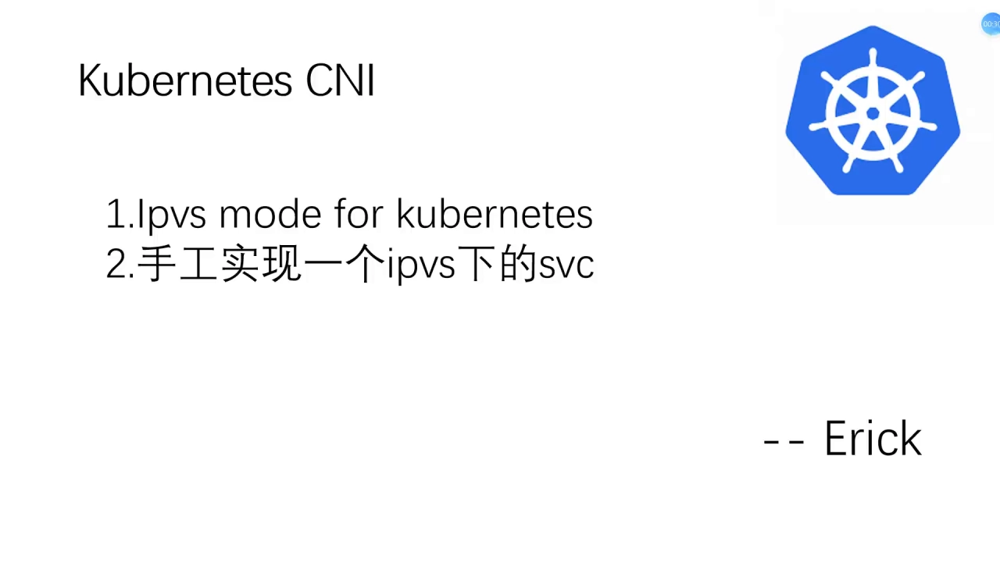

这次实操分两部分：[【跳转到 00:55】](https://www.bilibili.com/video/BV1M34y1N7SA/?t=55)

1. 把已有的 **iptables 方式切换成 IPVS 模式**；
2. **手工创建一条 IPVS 规则**，模拟 Service 流量到达后端 Pod 的转发。

---

## 二、切换模式四步走

把 iptables 模式改成 IPVS 模式，只需要依次做四件事：[【跳转到 01:43】](https://www.bilibili.com/video/BV1M34y1N7SA/?t=103)、[【跳转到 02:08】](https://www.bilibili.com/video/BV1M34y1N7SA/?t=128)

1. **装软件包**：在所有节点（整个集群里 master 之外的节点）安装 `ipvsadm`、`ipset`、`conntrack` 等工具包；
2. **加载内核模块**：把需要加载的 `ip_vs` 相关模块写进一个文件，并让它**开机自启**；
3. **改 ConfigMap**：把 kube-proxy 的 ConfigMap 里的模式字段改成 `ipvs`；
4. **删掉 kube-proxy 的 Pod**：让它重新生成/重新加载。

> **为什么一定要删 Pod？** 因为手工改了 ConfigMap 之后，kube-proxy 的 Pod **不会热加载、不会自动更新**，必须删掉它、让它重启才能生效。[【跳转到 02:33】](https://www.bilibili.com/video/BV1M34y1N7SA/?t=153)

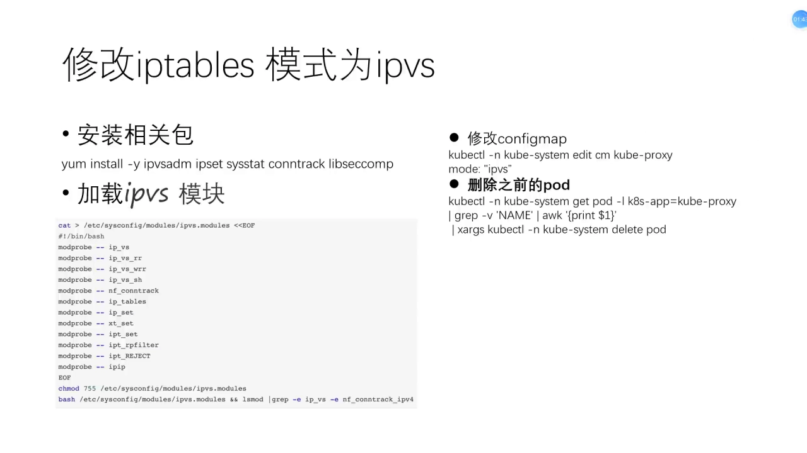

在 ConfigMap 里，要改的字段是 kube-proxy 的 **`mode`**：iptables 模式下这个位置是空的，手工把 `ipvs` 填进去，ConfigMap 就更新了。[【跳转到 03:57】](https://www.bilibili.com/video/BV1M34y1N7SA/?t=237)

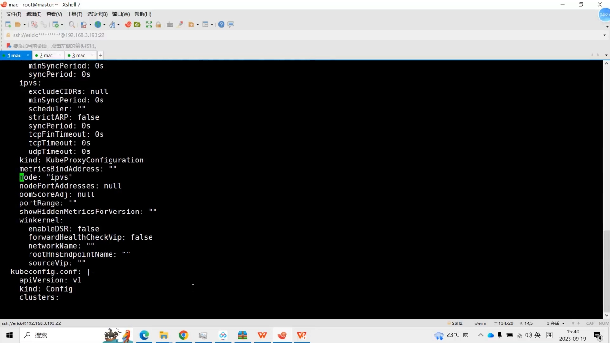

删 kube-proxy Pod 时，也可以按标签批量删：

```bash
kubectl -n kube-system delete pod -l k8s-app=kube-proxy
```

[【跳转到 04:47】](https://www.bilibili.com/video/BV1M34y1N7SA/?t=287)

---

## 三、验证：IPVS 规则长什么样

kube-proxy 重启后，用 `ipvsadm` 就能看到规则：

```bash
ipvsadm -Ln
```

能看到里面有很多条规则，"像这样的就是轮询的"，每条虚拟服务下面还跟着一个个 backend。[【跳转到 05:12】](https://www.bilibili.com/video/BV1M34y1N7SA/?t=312)

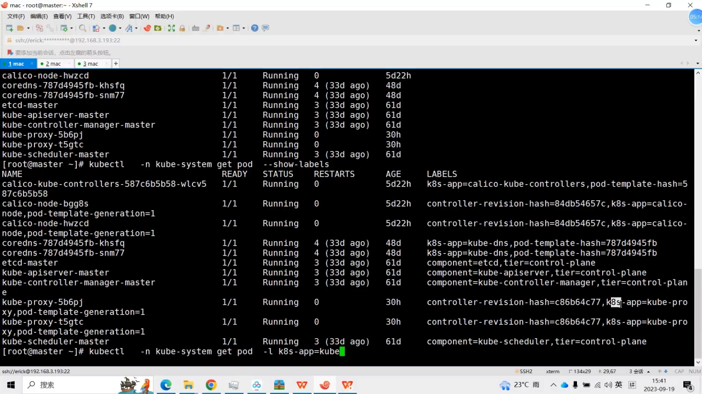

接着创建一个 Service 来对照观察：先建一个 Deployment/Pod，再把它暴露成 Service。这个 Service 的 IP 是 `10.96.255.250`，用 `ipvsadm` 过滤它：[【跳转到 06:27】](https://www.bilibili.com/video/BV1M34y1N7SA/?t=387)

```bash
ipvsadm -Ln | grep 10.96.255.250
```

结果能看到它后面挂着**两个 backend**（都是 `:80`），分别对应两个 Pod（例如 `…136` 和 `…71`）。手工 `curl` 一下 VIP 就能访问到 Pod，说明转发完全正常。[【跳转到 06:52】](https://www.bilibili.com/video/BV1M34y1N7SA/?t=412)、[【跳转到 07:17】](https://www.bilibili.com/video/BV1M34y1N7SA/?t=437)

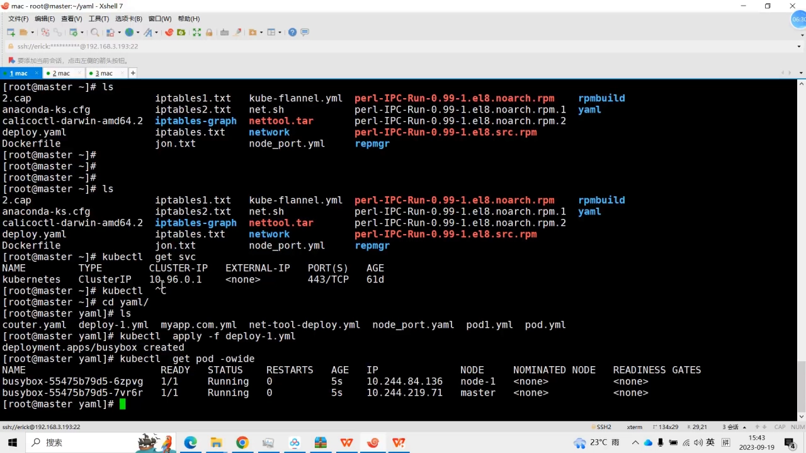

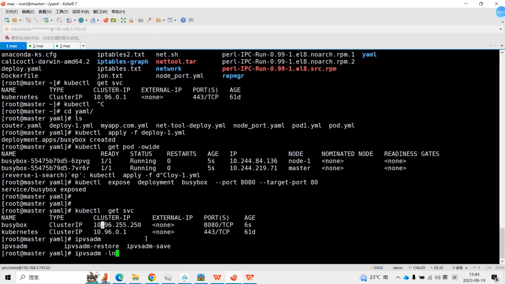

---

## 四、一个关键对照：iptables 里的 DNAT 不见了

切换成功最直观的证据，是回头去看 iptables：以前 Service 会生成一堆新链和 DNAT 规则，现在**这些都不见了**。再严谨一点，直接 `grep` 这个 Service 的 IP：[【跳转到 07:42】](https://www.bilibili.com/video/BV1M34y1N7SA/?t=462)、[【跳转到 08:07】](https://www.bilibili.com/video/BV1M34y1N7SA/?t=487)

```bash
iptables-save | grep 10.96.255.250
```

结果**没有匹配**。所以用 IPVS 模式时，就大可不必依赖这些 iptables 规则——它**不依靠 iptables**。[【跳转到 08:32】](https://www.bilibili.com/video/BV1M34y1N7SA/?t=512)

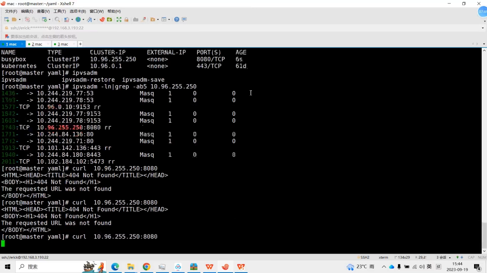

> **但别急着下结论**："用了 IPVS 是否就完全和 iptables 没关系了？"——**不是**。比如在做 **SNAT** 的时候，仍然需要使用 iptables。IPVS 取代的是"服务负载均衡"那部分规则，并不等于内核里再没有 iptables。[【跳转到 08:57】](https://www.bilibili.com/video/BV1M34y1N7SA/?t=537)

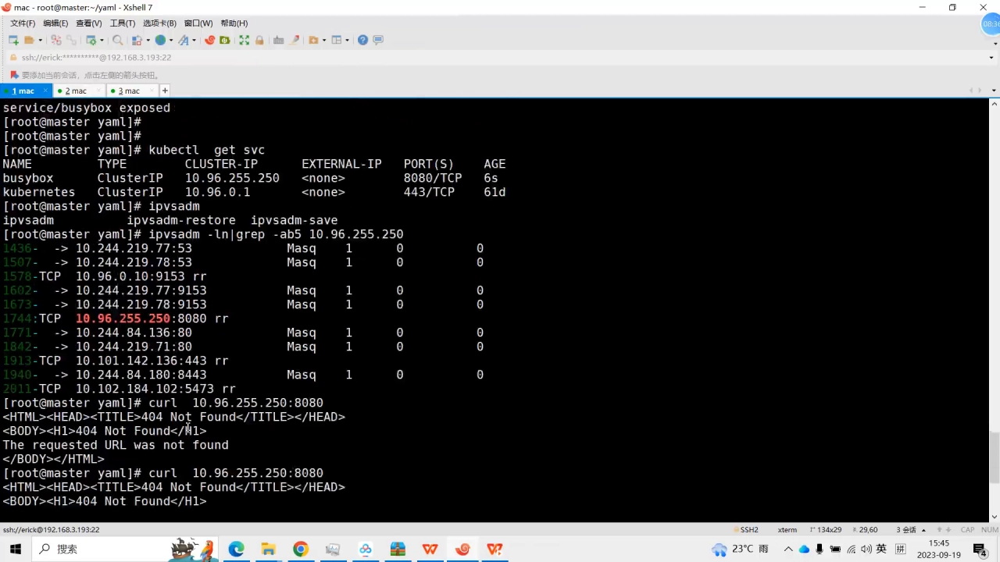

---

## 五、脱开 Kubernetes：手工搭一条 IPVS 规则

第二部分不再依赖 Kubernetes——用两个 network namespace 加 `ipvsadm`，把 IPVS 的转发原理"手搓"一遍。

**第一步，准备两个 netns**：给它们配上 IP、起好网络，互相 `ping` 通。[【跳转到 09:40】](https://www.bilibili.com/video/BV1M34y1N7SA/?t=580)、[【跳转到 10:05】](https://www.bilibili.com/video/BV1M34y1N7SA/?t=605)

**第二步，两个 netns 各起一个 HTTP 服务**（比如 `python3 -m http.server`），`curl` 一下确认都能访问。[【跳转到 10:30】](https://www.bilibili.com/video/BV1M34y1N7SA/?t=630)

**第三步，用 `ipvsadm` 创建虚拟服务**（`ipvsadm` 就是 IPVS 的规则管理工具）。先看规则是空的，然后添加一条虚拟服务，模式用轮询（`rr`）：[【跳转到 12:35】](https://www.bilibili.com/video/BV1M34y1N7SA/?t=755)

```bash
# -A 添加虚拟服务；-t 指定 VIP:端口；-s 指定调度算法（rr = 轮询）
ipvsadm -A -t 10.100.100.100:80 -s rr
```

此时能看到有了一个头部，但 backend 还是空的。于是往它下面**添加真实服务器**（`-m` 表示用 NAT/转发模式）：[【跳转到 13:00】](https://www.bilibili.com/video/BV1M34y1N7SA/?t=780)、[【跳转到 13:25】](https://www.bilibili.com/video/BV1M34y1N7SA/?t=805)

```bash
# -a 添加真实服务器；-r 指定 real server:端口；-m 指定转发方式
ipvsadm -a -t 10.100.100.100:80 -r <real-server>:80 -m
```

再加第二个真实服务器，两条规则权重都是 1：

```bash
ipvsadm -Ln            # 查看规则：现在有两条 backend，权重均为 1
```

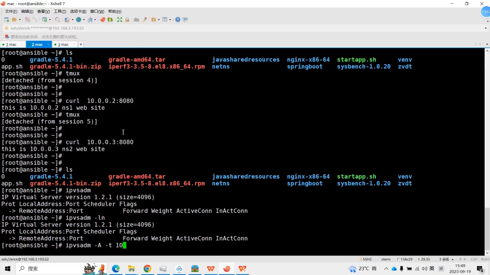

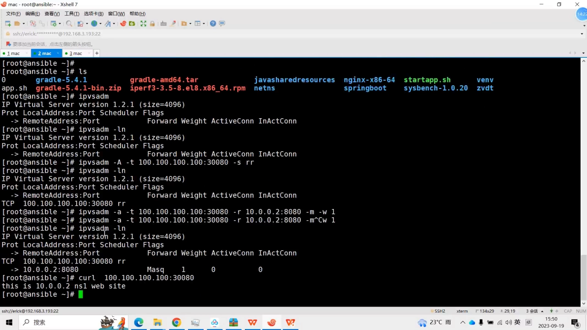

---

## 六、压测验证：一比一的轮询

规则就绪后，写一个循环压一下，观察是不是"一比一"分流。[【跳转到 14:40】](https://www.bilibili.com/video/BV1M34y1N7SA/?t=880)

结果是 **2、1、2、1、2、1……** 这样交替出现——非常明显地按一比一分配。视频作者的结论很直接：**用 IPVS，它的调度计算比 iptables 精准好多**。[【跳转到 15:05】](https://www.bilibili.com/video/BV1M34y1N7SA/?t=905)

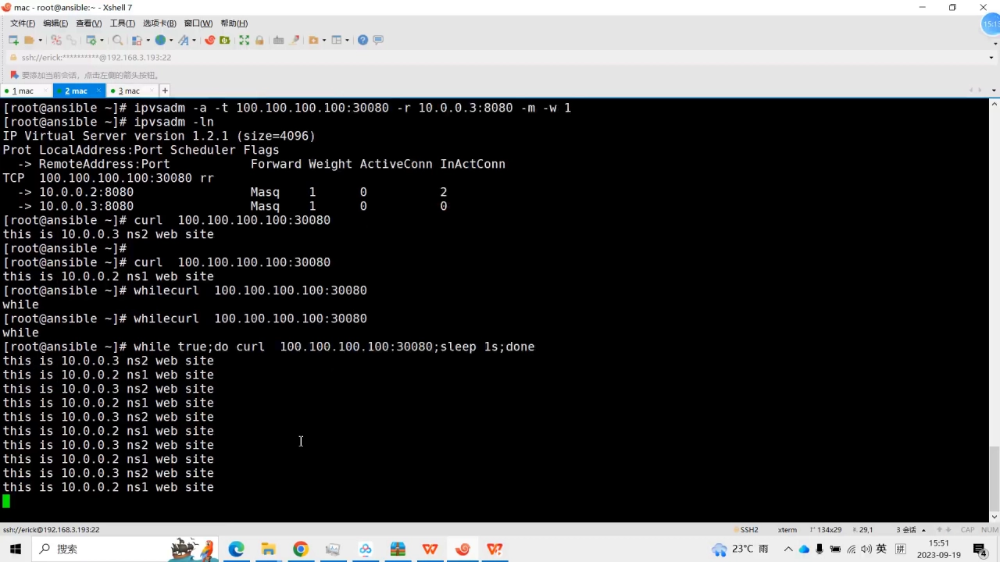

按同样的方式，也可以只留一个真实服务器来做单后端压测对照：`ipvsadm -Ln` 里就只剩一条 backend。[【跳转到 16:45】](https://www.bilibili.com/video/BV1M34y1N7SA/?t=1005)

---

## 小结

- **切换 IPVS = 四步**：装包（`ipvsadm`/`ipset`/`conntrack`）→ 加载 `ip_vs` 内核模块并开机自启 → 改 kube-proxy 的 ConfigMap（`mode: ipvs`）→ 删 kube-proxy Pod 重启。
- **看结果**：`ipvsadm -Ln` 里出现"虚拟服务 → 真实服务器"的表；同一个 VIP 下挂着多个 backend。
- **关键对照**：切到 IPVS 后，iptables 里 Service 的 DNAT 规则消失；**但 SNAT 等场景仍需 iptables**，两者并非互斥。
- **手搓实验**：用两个 netns + `ipvsadm -A/-a` 就能脱开 Kubernetes 建一条 IPVS 规则，压测里**严格一比一**的轮询，印证了"IPVS 的计算比 iptables 更精准"。
