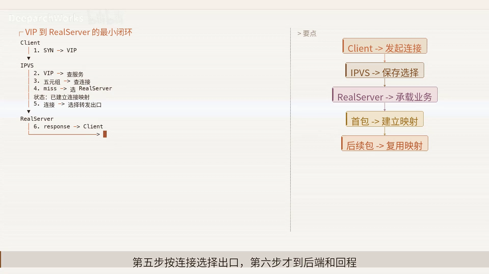
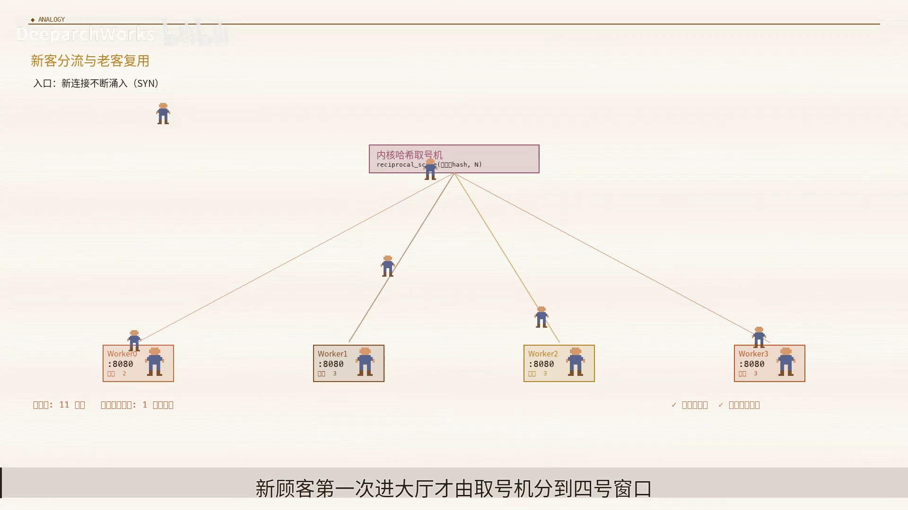
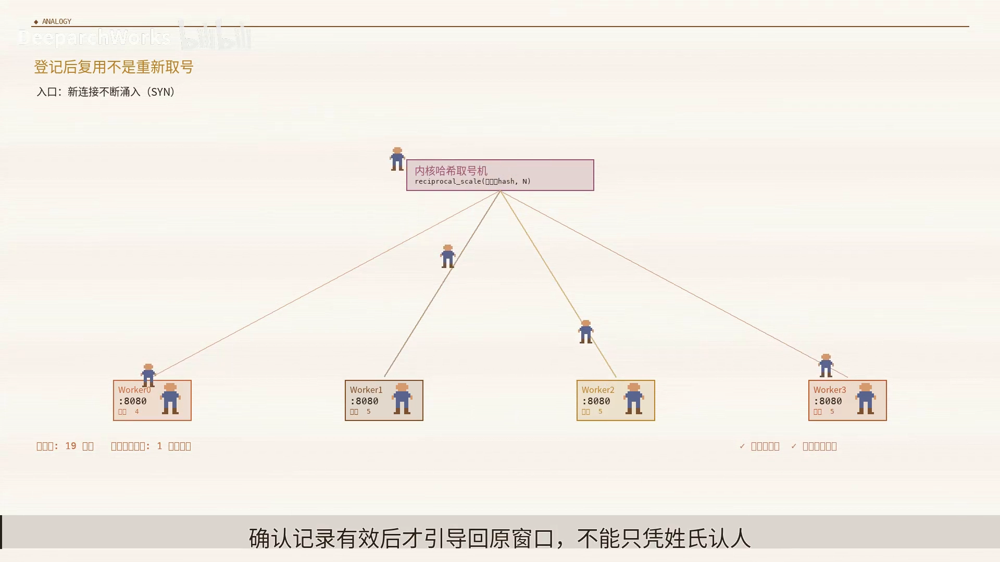
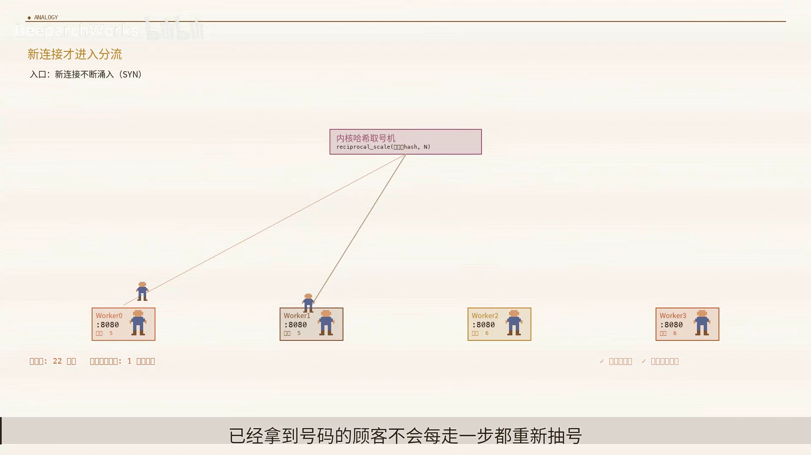
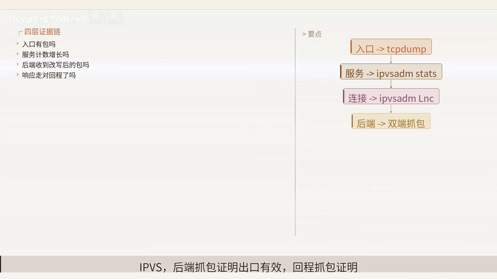

# 揭秘 IPVS：一张连接表凭什么扛住四层负载均衡

> 视频来源：[揭秘IPVS：一张连接表凭什么扛住四层负载均衡](https://www.bilibili.com/video/BV11C3B62EPR/)（Bilibili，up：DeeparchWorks）｜时长约 11 分钟
>
> 这支视频不讲"怎么敲命令配一个 IPVS 服务"，而是钻进 Linux 内核里 IPVS（`ip_vs`）的那条**四层数据路径**，回答一个反直觉的问题：为什么"每来一个包都挑一次最空闲后端"的积极负载均衡，反而会让连接更快崩掉？答案藏在"一张连接表"里。文稿左栏为 B 站 AI 字幕，本文已重写为面向初学者的讲解，并逐窗口纠正错拼（`IP vs`→**IPVS**、`schedule`→**scheduler**、`net filter`→**netfilter**、`real server`→**真实服务器** 等）。

## 本讲要解决的核心问题（SCQA）

**背景（S）**：Kubernetes 的 Service 需要一个四层负载均衡器，把落到虚拟 IP（VIP）上的海量连接，稳定地分给后面的一组真实服务器（real server）。Linux 内核自带的 IPVS（IP Virtual Server）就是干这个的——它源自章文嵩发起的 Linux Virtual Server（LVS）项目，把多台真实服务器藏在一个虚拟入口之后。[【跳转到 00:25】](https://www.bilibili.com/video/BV11C3B62EPR/?t=25)、[【跳转到 00:47】](https://www.bilibili.com/video/BV11C3B62EPR/?t=47)

**冲突（C）**：直觉上，"负载均衡"意味着每来一个包都重新挑一次最空闲的后端，听起来最公平。可这条路径上的核心矛盾恰恰相反：**同一条 TCP 的后续包，绝不能各自重新做选择**。如果每个包都独立挑后端，一条连接的状态就会散落到多台机器上，越"积极"的调度，连接反而越快崩掉。[【跳转到 00:00】](https://www.bilibili.com/video/BV11C3B62EPR/?t=0)

**疑问（Q）**：那么 IPVS 到底是怎么做到的？一个包进入 VIP 之后，是谁、在什么时机决定它的去向？"省下来"的性能究竟省在哪一步？

**回答（中心思想 A）**：**IPVS 真正省下的不是某一次轮询，而是"后续每个包都不用再重新选择"**——首包只决定一次，此后这条流的所有包都沿着写好在**连接表（connection table）**里的决定被送走。整个数据路径是：包经 netfilter 进入 IPVS，命中连接表就走快路径，未命中才交给调度器选出真实服务器并创建连接，两条路径最后汇合到输出函数 `ip_vs_xmit`。[【跳转到 02:40】](https://www.bilibili.com/video/BV11C3B62EPR/?t=160)

---

## 一、先把三个角色摆清楚：VIP、真实服务器与连接状态

- **VIP（虚拟服务入口）**：客户端看到的统一入口，是"一个虚拟服务"对外暴露的地址。[【跳转到 01:25】](https://www.bilibili.com/video/BV11C3B62EPR/?t=85)
- **真实服务器（real server）**：真正处理连接的目标。
- **连接状态**：保存的是"**一次选择**"的结果——某条 TCP 这次被分给了谁，之后就一直认准它。

最朴素的形态是"让单台服务器直接监听 VIP"，缺口很明显：吞吐上限和故障域都被单机约束。IPVS 要解决的问题，就是让**一个虚拟服务把大量四层连接稳定地分散到多台真实服务器**上。[【跳转到 01:25】](https://www.bilibili.com/video/BV11C3B62EPR/?t=85)

> **一个恰到好处的类比（也只是类比）**：把 VIP 想成商场统一的入口、连接状态想成"取号小票"、真实服务器想成"收银窗口"。顾客第一次进商场被分配到 3 号窗口，之后补货、退款、结账都沿着同一张小票回到 3 号窗口，**不会每一步重新换窗口**。这个类比只表达"为什么需要状态"的直觉——顾客对应连接、统一入口对应 VIP、小票对应连接状态；它**不表达**真实的哈希、RCU 或报文改写，那些必须回到内核图和源码里看。[【跳转到 02:15】](https://www.bilibili.com/video/BV11C3B62EPR/?t=135)

---

## 二、首包与后续包：两条节奏完全不同的路径

把一条连接的生命周期压到时间轴上，会看到两个截然不同的阶段：[【跳转到 08:33】](https://www.bilibili.com/video/BV11C3B62EPR/?t=513)

- **首包（SYN 到达 VIP）**：承担**服务匹配、调度、连接创建**三件重活。流程是——先查服务、再查连接；没有记录才交给调度器选出真实服务器，并形成一条"已建立连接"的映射；然后按连接选择出口，最后到后端与回程。[【跳转到 02:15】](https://www.bilibili.com/video/BV11C3B62EPR/?t=135)
- **后续包**：只需**查表、更新状态、执行出口**。最关键的那一步转折就发生在第二包——它**不再重复前面那七步**。连接表的价值，正体现在"被省掉的重复工作"里。[【跳转到 08:33】](https://www.bilibili.com/video/BV11C3B62EPR/?t=513)

完整边界可以这样描述：**client 的包经 netfilter 进入 IPVS → 命中 connection table 走快路径 → 未命中进入 scheduler 选出 real server 并创建连接 → 两条路径汇合到 `ip_vs_xmit`**。[【跳转到 02:40】](https://www.bilibili.com/video/BV11C3B62EPR/?t=160)

需要强调 IPVS 的**边界**：它只负责四层连接选择与转发，**不解析七层业务语义**——HTTP 路径、cookie、业务健康都不属于这张图。因此别指望四层调度器去理解应用内容。[【跳转到 03:05】](https://www.bilibili.com/video/BV11C3B62EPR/?t=185)

---

## 三、连接表怎么查：先缩范围，再验全键

后续包要复用已有决定，第一步就是**在连接表里找到那条连接**。源码里这个动作是 `ip_vs_conn_hashkey`：它先把查找范围缩小到一个哈希桶。但**哈希命中不等于身份命中**——它还要继续核对客户端端口、虚拟端口、地址、双方地址协议和网络命名空间，最后取得一个有效引用。[【跳转到 03:30】](https://www.bilibili.com/video/BV11C3B62EPR/?t=210)

这套做法可以概括为"**先缩范围、再验全键**"：

- **哈希**负责缩小范围；
- **完整元组**负责确认身份；
- **引用获取**负责确认生命周期。

它高明的地方不是"用了哈希"，而是**没有迷信哈希**。正常作用是复用已有决定；边界是它**不替新流选择目标**。代价则是：连接表仍要占内存，冲突桶仍要遍历。[【跳转到 03:55】](https://www.bilibili.com/video/BV11C3B62EPR/?t=235)

---

## 四、连接是有生命周期的：为什么"过期回收"同样是机制

连接状态不是永久缓存。它的生命轨迹是：**首包未命中 → 经调度创建 → 后续包不断命中并更新协议状态 → 按超时或控制条件失效**，过期后还要被安全回收。[【跳转到 04:20】](https://www.bilibili.com/video/BV11C3B62EPR/?t=260)

这个状态机解释了连接表的代价：**它用内存换单流一致性**，因此必须支付回收、同步和主备复制的成本。

---

## 五、调度入口：把"谁可以被调度"和"怎样选"拆开

新流来到 IPVS 时会进入调度核心入口。这里的关键设计是**分层**：

- `ip_vs_svc` 描述虚拟服务；
- `scheduler` 留给具体算法；
- `dest` 承接最终目标。

它的原理是**把"谁可以被调度"和"怎样选"拆开**，让 RR、WLC 等策略共享同一套连接创建框架。边界也很清楚：这个入口**还没有承诺一定能找到目标**。[【跳转到 05:10】](https://www.bilibili.com/video/BV11C3B62EPR/?t=310)

真正做选择的动作只有一行：**scheduler 的 `schedule` 函数返回目标**。它为"没有连接记录的新流"选出 real server，受服务配置的**权重**和目标可用性约束，却**不解析 HTTP URL 或 cookie**；如果没有调度器、或没有可用目标，就把空结果交回上层处理。[【跳转到 05:35】](https://www.bilibili.com/video/BV11C3B62EPR/?t=335)

> 提醒一句：real server 的权重对应的是**承载能力**，不要把"连接数"误当成 CPU 成本或应用健康——那需要另外的健康探测机制。

---

## 六、`ip_vs_in`：包进入 IPVS 的那道门

`ip_vs_in` 这个钩子，是包真正进入 IPVS 的门：[【跳转到 06:25】](https://www.bilibili.com/video/BV11C3B62EPR/?t=385)

- `skb` 带来报文；
- `state` 带来钩子和网络命名空间；
- `conn` 承接连接决定。

这个入口的作用是**编排**，而不是亲自实现所有算法。也正因如此，边界很清楚：**未匹配到 IPVS 服务的包，仍可以继续走 netfilter 的遍历**。用一句话概括这段代码："连接为空才调度"。

拿到连接之后，IPVS 会统一更新统计、更新协议状态，再调用连接绑定的输出路径 `ip_vs_xmit`。这一步的原则是"**决定留在连接里、执行交给出口**"；它的边界也很明确——只做四层转发，**不保证后端应用一定健康**。出口本身还可能改地址、改二层目的地址，或加上隧道头。[【跳转到 06:50】](https://www.bilibili.com/video/BV11C3B62EPR/?t=410)、[【跳转到 07:15】](https://www.bilibili.com/video/BV11C3B62EPR/?t=435)

---

## 七、一定要分清的两条节奏：控制面与数据面

这是全文最需要记住的一条分界线：[【跳转到 07:38】](https://www.bilibili.com/video/BV11C3B62EPR/?t=458)

- **控制面是低频的**：负责修改服务权重、增删可用目标。
- **数据面是高频的**：负责处理**每一个包**。

健康探测通常由 `keepalived` 这类组件完成，**IPVS 只消费配置的结果**；如果把探测塞进转发路径，就会让热路径承担本不该它承担的波动和延迟。

---

## 八、三种转发模式：差别主要在"回程"

IPVS 的三种转发模式，最大的差异在**回程**走法：[【跳转到 07:43】](https://www.bilibili.com/video/BV11C3B62EPR/?t=463)

| 模式 | 改写方式 | 回程 | 代价 |
| :--- | :--- | :--- | :--- |
| **NAT** | 改写地址，响应通常也经过 IPVS | 经过 IPVS | 配置直观，但**回程可能成为瓶颈** |
| **DR**（直接路由） | 只改二层目的地址 | 后端**直接回给客户端** | 要求 **VIP 与 ARP 配置正确** |
| **TUN**（隧道） | 用外层封装跨三层网络 | 经隧道 | **MTU 与隧道可达性**的成本 |

再提醒一个常被忽略的事实：**连接调度只发生在新流上**，但容量由**新建率、活跃连接、包速率和回程**共同决定——就像机场不能只看"分配登机口有多快"，还要看候机人数、航班频率和返程道路。**真正的瓶颈常常藏在算法之外**。[【跳转到 08:08】](https://www.bilibili.com/video/BV11C3B62EPR/?t=488)

---

## 九、IPVS 不是无状态魔法：把成本说清楚

一句话拆穿幻想：**IPVS 不是无状态魔法**。[【跳转到 08:58】](https://www.bilibili.com/video/BV11C3B62EPR/?t=538)

- **连接表**用内存换单流一致性；
- **RCU** 用更复杂的更新/回收换取更低的开销；
- **主备同步**用额外的网络流量来降低切换损失。

把边界说清楚，才不会把"内核态"误解成"没有成本"。两个典型的边界案例：[【跳转到 09:23】](https://www.bilibili.com/video/BV11C3B62EPR/?t=563)

- 一个**长连接**的后端已经被控制面摘除，新连接会绕开它，但**已有连接仍可能按原映射继续存在**；
- 若**主备切换**恰逢状态尚未同步，**少量连接仍可能中断**。

---

## 十、出问题怎么查：沿数据路径收集证据

排查时**别从调参数开始**，而要沿着数据路径逐层收集证据：[【跳转到 09:48】](https://www.bilibili.com/video/BV11C3B62EPR/?t=588)

1. **入口抓包** → 证明包到了节点；
2. **服务统计** → 证明匹配到了 IPVS；
3. **后端抓包** → 证明出口有效；
4. **回程抓包** → 证明模式假设成立。

每一层只回答一个问题，证据才能把范围越缩越小。而且三种模式的检查点**不能混用**：[【跳转到 10:13】](https://www.bilibili.com/video/BV11C3B62EPR/?t=613)

- **NAT**：先看回程是否经过 IPVS；
- **DR**：先看目的 MAC、VIP 和 ARP 行为；
- **TUN**：先看外层协议、解封装与 MTU；
- **共同终点**：real server 是否在监听、响应是否以客户端预期的 VIP 返回。

---

## 小结

- IPVS 的性能优势**不在"某次轮询更快"，而在"后续包不必再选择"**：首包决定一次，之后全写进连接表。
- 数据路径的核心是"**命中连接表走快路径，未命中才调度建连**"，两条路径最终汇合到 `ip_vs_xmit`。
- 连接表查询遵循"**先缩范围、再验全键**"：哈希只是缩小范围，完整元组才确认身份。
- 一定要分清**低频的控制面**与**高频的数据面**；健康探测属于前者，别塞进热路径。
- IPVS 只做**四层**选择与转发；它用内存、RCU 与主备同步换来单流一致性——**不是没有成本**。

> 一句话记住它：**连接表用"记住一次选择"换来了"后续每个包都不必重新选择"**——这正是它扛住四层负载均衡的底气。
