# eBPF services：Calico 怎么用一张 map 把 kube-proxy 整个换掉

> 本文整理自 B 站视频《[11·eBPF services：把 kube-proxy 换掉｜Calico 源码深读](https://www.bilibili.com/video/BV1nSh265EPh/)》（时长约 11 分钟）。视频属于「Calico 源码深读」系列：上一期看的是挂在 TC 钩子上的 BPF 程序，这一期接着往下，把 Service 的地址由谁翻译、后端怎么选、连接建立那一刻发生了什么一次讲清。下文中的机制、字段、文件与数字都来自该视频的图-字幕稿，可逐帧核对。

## 本讲要解决的核心问题（SCQA）

**背景（S）**：在 Kubernetes 里，客户端访问的是 Service 的虚拟地址（ClusterIP、NodePort、LoadBalancer），真正干活的是它背后的一批 Pod。把「访问 Service」翻译成「访问某个具体 Pod」，默认由 kube-proxy 负责，它走的是 iptables（或 IPVS）那套规则链。Calico 作为 CNI，在 BPF 模式下可以选择另一条路——它把 kube-proxy 整个禁掉，自己在数据面实现 Service 语义。

**冲突（C）**：规则方案的代价是「每包逐条匹配」：规则链会随 Service 与 Endpoint 的数量不断变长，每个进包的包都要在这串规则里从头匹配一遍；规则增删还常常牵动成百上千条重写。Calico 凭什么敢把 kube-proxy 换掉，换掉之后又快在哪、贵在哪？

**疑问（Q）**：Calico 用什么样的数据结构表示一个 Service？用户态和内核侧各自做什么？一个包从 Pod 出发到后端 Pod，中间究竟走了哪几步？

**回答（中心思想 A）**：**Calico 用「用户态半场把 Service 翻译进 BPF map + 内核侧只做一次哈希查找」替换了「内核里一大堆规则」**。Felix 之下的 `bpf-proxy` 读 Kubernetes 的 Service/Endpoint，把它们翻译成 BPF map（前端表、后端表、亲和表、Maglev 表）；包在 TC 侧只看到「前端指向后端」，同一台主机上的流量甚至用重定向（redirect to peer）把包直接交付给后端 Pod 的网卡，连主机路由、连接跟踪和 iptables 链都不触发。功能上它和规则方案等价，成本模型却从「每包逐条匹配」变成了「每包一次定长查表」——交换的代价，是对 DS2（直接服务器返回）和较新内核版本的硬依赖。

---

## 一、为什么 Calico 要让数据面自己实现 Service 转发

答案写在 Calico 的设计文档里：**BPF 模式下，Calico 直接禁用 kube-proxy，由自己承担全部 Service 实现**，也就是 Felix 下面的 `bpf-proxy` 这一套组件。它读 Kubernetes 的 Service 和 Endpoint，翻译成 BPF map，包在 TC 侧只看到「map 里 front end 指向 back end」。

这么做的底气，是快路径能整体绕过主机协议栈：用「重定向到对端」（redirect to peer）的 helper 把包直接交给 Pod，不触发主机路由、连接跟踪和 iptables 链。

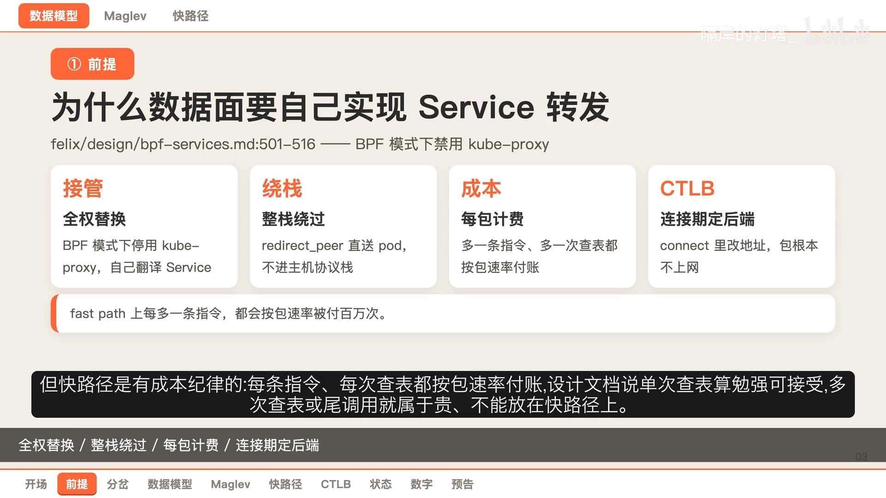

但**快路径是有「成本纪律」的**：在这个路径上，每条指令、每次查表都按包速率付账。设计文档的说法是——单次查表勉强可接受，多次查表或伪调用（pseudo call）就属于「贵」，不能放在快路径上。这条纪律是后面所有设计的隐性前提：用户态宁愿多干一点活，也要把内核快路径压到只剩一次查找。[【跳转到 01:54】](https://www.bilibili.com/video/BV1nSh265EPh/?t=114)

## 二、两条路线：表规则 vs BPF map

把两条路摆在一起看，差别在成本模型而不在功能。

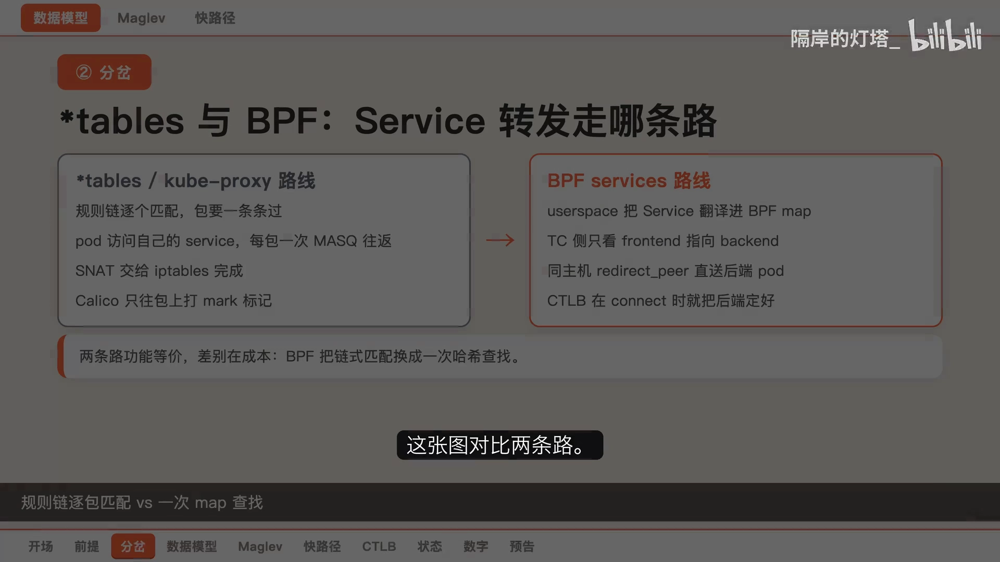

- **左边：表规则路线**（传统 kube-proxy + iptables）。规则链逐个匹配；同一个 Pod 访问自己的 Service，每个包都要走一次地址转换的往返；完整的外部源地址转换（SNAT）仍然交给 iptables 完成，Calico 只在包上打一个标记。
- **右边：BPF 路线**。用户态半场把 Service 翻译进 map，TC 侧只做一次查找；同一主机上直接用重定向把包送进后端 Pod 的网卡；回程命中反向连接跟踪条目，连第二次查找都省了。

要特别说明：**这两条路在功能上是等价的，差别在成本模型上——BPF 把「链式匹配」换成了一次哈希查找，把每包开销变成了常数**。[【跳转到 02:06】](https://www.bilibili.com/video/BV1nSh265EPh/?t=126)

## 三、代码地图：`felix/bpf-proxy` 里有什么

`felix/bpf-proxy` 目录就是 Calico 版的 kube-proxy，关键文件各管一段：

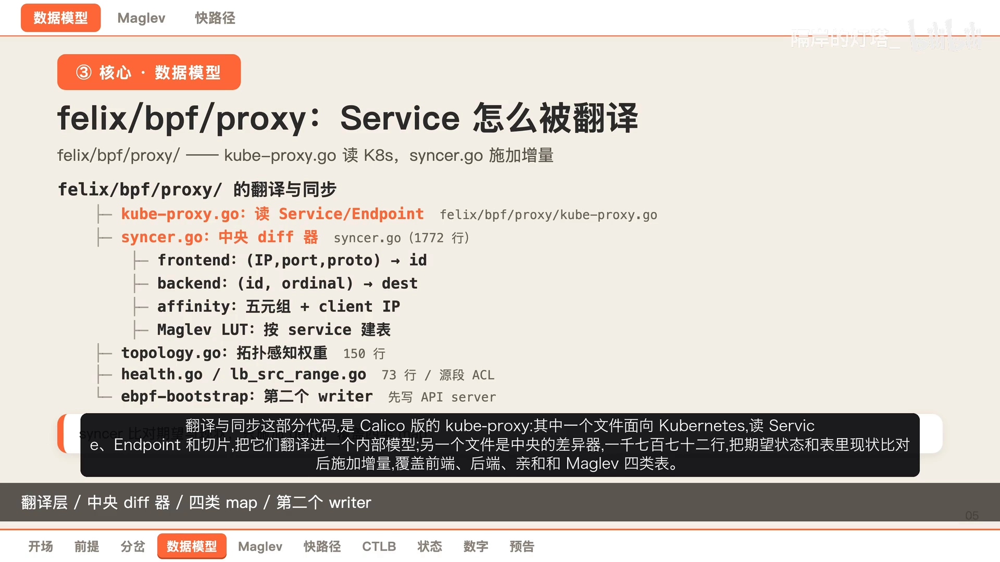

- **`kube-proxy.go`（425 行）**：面向 Kubernetes，读 Service、Endpoint 和 EndpointSlice，翻译进一个内部模型；
- **`syncer.go`（1772 行）**：中央的差异器（differ），把期望状态和 map 现状比对之后，施加增量覆盖——覆盖 front end、back end、亲和（affinity）和 Maglev 四种 map；
- **map 定义（962 行）**、**一致性哈希（165 行）**：前面提到的两张专门的表；
- 还有几个小文件：`topology` 管拓扑感知的权重，`health` 管就绪/未就绪端点，源地址访问控制放在另一处。

还有一个容易被忽略的细节：**map 的第二个写入者**。BPF map 是「钉住」（pinned）的，比 Felix 进程活得更久；当引导开关（bootstrap）打开时，一个初始化容器会在 Felix 之前，先把 API Server 的 Service 写进去。[【跳转到 02:52】](https://www.bilibili.com/video/BV1nSh265EPh/?t=172)

## 四、前端表：为什么必须是 LPM 前缀树

第一个核心结构是**前端 key**。开了口的（带源地址范围匹配的）前端表不是普通哈希，而是 **LPM（最长前缀匹配）前缀树**。

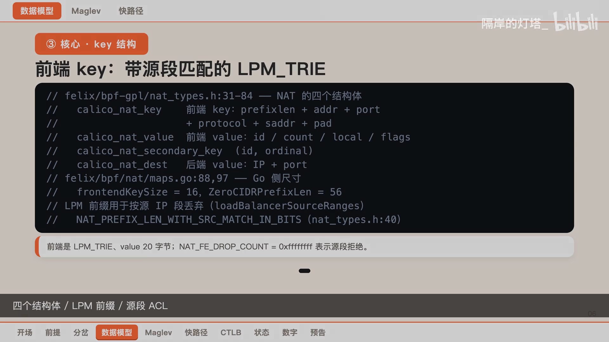

- key 里除了前缀长度、地址、端口和协议，还带一个**源地址字段**，这是为了支持「按源 IP 段丢弃」（负载均衡服务的源地址范围限制）；
- 实测尺寸：**前端 key 16 字节，0 号前缀长度是 56 位，value 20 字节**；
- 前端值里有一个 `flags` 字段，决定这条前端属于哪种派生类型；
- 还有一个特殊值 **`0xFFFFFFFF`，专门表示「源地址段拒绝」，而不是「没有后端」**。

理解这几个字段，后面看查表逻辑时就不会迷路。[【跳转到 04:07】](https://www.bilibili.com/video/BV1nSh265EPh/?t=247)

## 五、service id：整块后端的钥匙

第二个关键点是 **service id**。它不是随手发的号，而是**后端表里「整块后端」的钥匙**：

- 一个 Service 的所有后端，在表里都是「id + 序号」的形式，所以**两个不同的 Service 绝对不能共用同一个 id**，否则它们的后端会互相覆盖；
- 反过来，**一个 Service 和它自己派生出来的前端（NodePort、external IP、LoadBalancer）共用同一个 id**，因为它们本来就该指向同一批后端；
- id 由发号函数（`newSvcID` 一类）分配；
- 更妙的是：重启时 map 是钉住的，Felix 靠一个函数从表里反推、再「收养」（adopt），把每条前端记录配对到必然写过它的那个 Service。

一句话：**一个 id 就是一块后端；派生前端共用它，两个 Service 绝不能重号**。[【跳转到 04:52】](https://www.bilibili.com/video/BV1nSh265EPh/?t=292)

## 六、两种选后端：普通取模 vs Maglev 一致哈希

后端选出来是谁，取决于用的是哪种方式。

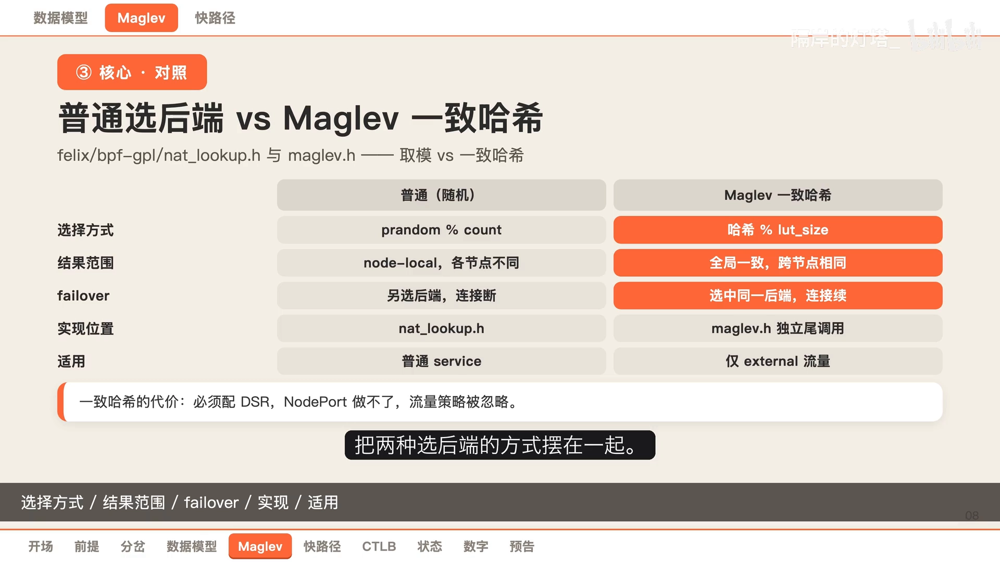

- **普通 Service**：用随机数对后端数取模，**结果是节点本地的**——同一个外部五元组，在甲、乙两台负载均衡节点上会落到不同后端；
- **Maglev（一致哈希）**：结果只跟五元组和那张查找表有关，所以甲节点挂了、流量导到乙节点，乙节点会选中**同一个后端**，连接可以延续。

实现上的差别也值得记：普通路径走的就是取模那段；而 Maglev 因为内联的哈希代码超过了验证器（verifier）的指令预算，被单独拆成一个**尾调用（tail call）子程序**，并且只有主机端点（host endpoint）的入口才需要装载它。[【跳转到 04:45】](https://www.bilibili.com/video/BV1nSh265EPh/?t=285)

## 七、Maglev 的两半：用户态建表、内核侧查表

Maglev 由「用户态建表」和「内核侧查表」两半组成。

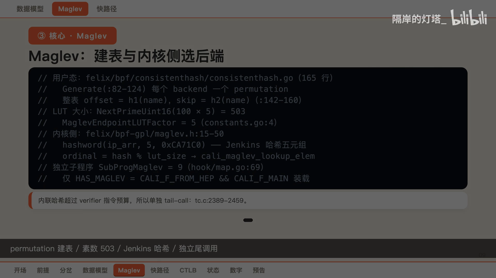

- **用户态那一半**在一致性哈希文件里，是标准的建表算法：为每个后端生成一个素数长度上的排列（permutation），再按后端顺序轮流取各自排列里的下一个空槽填表；整张表的**起始偏移和步长**，分别由后端名的两个哈希值决定；
- **表大小是算出来的**：每个 Service 最多 100 个端点，乘以因子 5，再取不小于 500 的最小素数——**得到 503**；
- **内核那一半**：对五元组做一次 Jenkins 哈希，对表长取模得到槽位，再去读 Maglev 表。因为这段代码太长，它单独占一个尾调用槽位，只对主机端点的入口挂载。

[【跳转到 06:03】](https://www.bilibili.com/video/BV1nSh265EPh/?t=363)

## 八、一条包在 TC 路径上的七跳

现在走一条真实的包，看它从 Pod 到后端 Pod，在 TC 路径上经过的七跳：

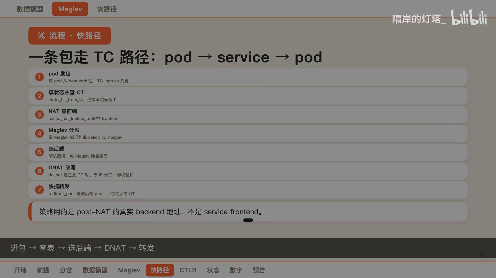

1. **Pod 发出的包**从主机侧网卡进来，TC 程序先跑；
2. **填好包状态**，查一次连接跟踪，新流没有命中；
3. **拿目的地址和端口去查前端表**，命中得到 service id；
4. 如果这条前端带 **Maglev 标记**，就跳进专门的子程序去选后端；
5. **选后端**：普通 Service 用随机数取模，Maglev 则用哈希读表；
6. **改写目的地址和端口**，同时建出一条正向和一条反向的连接跟踪条目；
7. **用重定向到对端**，把包直接交进后端 Pod 的网卡，回程命中反向条目自动还原。

[【跳转到 06:47】](https://www.bilibili.com/video/BV1nSh265EPh/?t=407)

## 九、连接时负载均衡（CTLB）的七跳

同一件事还有另一种做法：**连接时负载均衡（CTLB，Connect Time Load Balancing）**，它把地址转换提前到连接建立的那一刻。

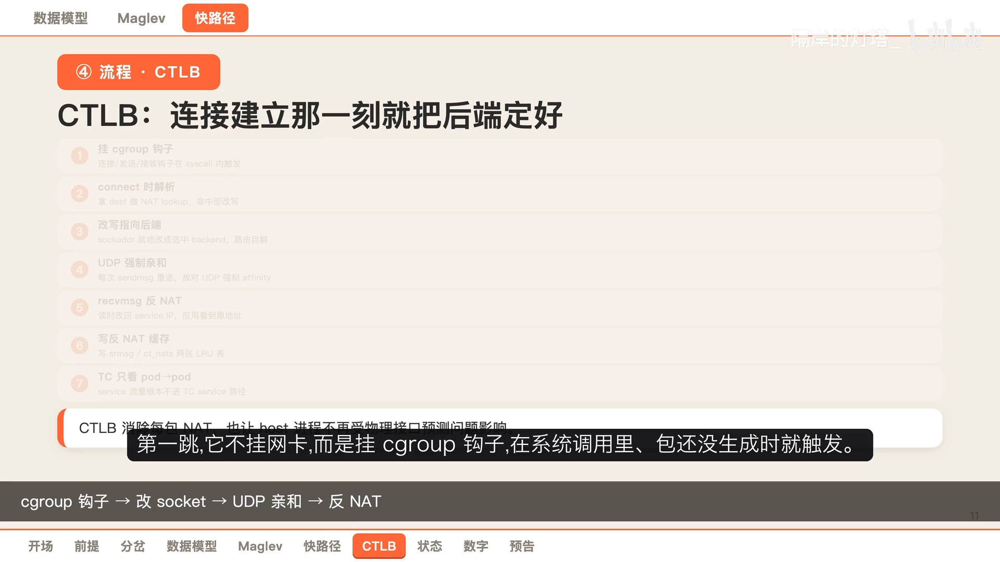

1. 它**不挂网卡，而是挂 cgroup 钩子**，在系统调用里、包还没生成时就触发；
2. 应用调用 `connect` 系统调用时，拿目的地去查一次前端表；
3. 命中就把 **socket 地址就地改成选中的后端**，后面的路由问题自然解决；
4. 对无连接的 **UDP**，每次发送都要重新选，所以对它强制亲和（affinity）；
5. 读的时候用**接收钩子**把地址改回 Service 地址，让应用看到原来的地址；
6. 反向结果**缓存在两张 LRU 表**里；
7. 因为地址在建立时就定好了，**TC 侧根本看不到 Service 流量，只看到 Pod 到 Pod**。

[【跳转到 06:52】](https://www.bilibili.com/video/BV1nSh265EPh/?t=412)

## 十、四张 map：键与容量对上号

回过头把这几张 map 一一对上号：

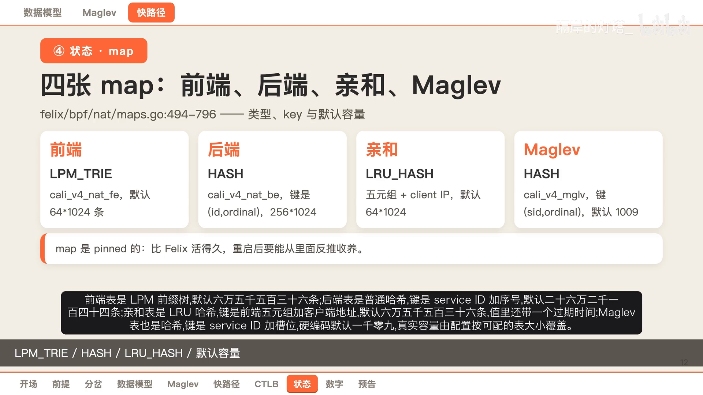

| map | 类型 | 键 | 默认容量 |
| :--- | :--- | :--- | ---: |
| 前端（front end） | `LPM_TRIE` | `calico_lpm_key`，前端地址 + 端口 | 65536 |
| 后端（back end） | `HASH` | `service id + 序号` | 262144 |
| 亲和（affinity） | `LRU_HASH` | 前端五元组 + 客户端地址 | 65536（值带过期时间） |
| Maglev | `HASH` | `service id + 槽位` | 1009（硬编码默认值，可由配置覆盖） |

有一点要记住：**这些表都是钉住的**，会比 Felix 进程活得更久，所以重启之后，程序必须能从表里反推出「谁是谁」。[【跳转到 07:35】](https://www.bilibili.com/video/BV1nSh265EPh/?t=455)

## 十一、四处约束：Maglev 的搭档与忽略项

Maglev 很强，但它不是随便配都行——这条数据面里有四处硬约束：

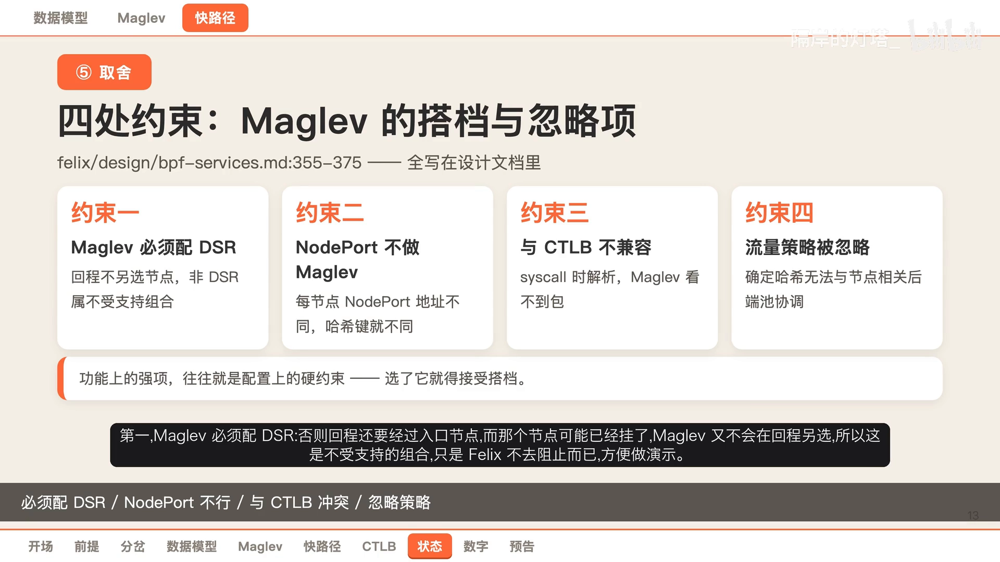

1. **Maglev 必须配 DS2**，否则回程还要经过入口节点，而那个节点可能已经挂了，Maglev 又不会再回程另选——这是不受支持的组合，只是 Felix 不去阻止而已（方便做演示）；
2. **NodePort 不能做 Maglev**：每个节点的 NodePort 地址都不一样，故障转移后哈希的键就不一样了；
3. **CTLB 与 Maglev 不兼容**：CTLB 在系统调用时就解析了 Service，Maglev 根本看不到包；
4. **流量策略对 Maglev 被忽略**：外部和内部流量策略都在限定可选后端，而确定性的哈希没法跟「节点相关的池子」协调。

**功能上的强项，往往就是配置上的硬约束**——这句话在这里体现得很清楚。[【跳转到 08:11】](https://www.bilibili.com/video/BV1nSh265EPh/?t=491)

## 十二、边界与运维难点：六条要记住的坑

最后把边界和运维难点列出来，共六条：

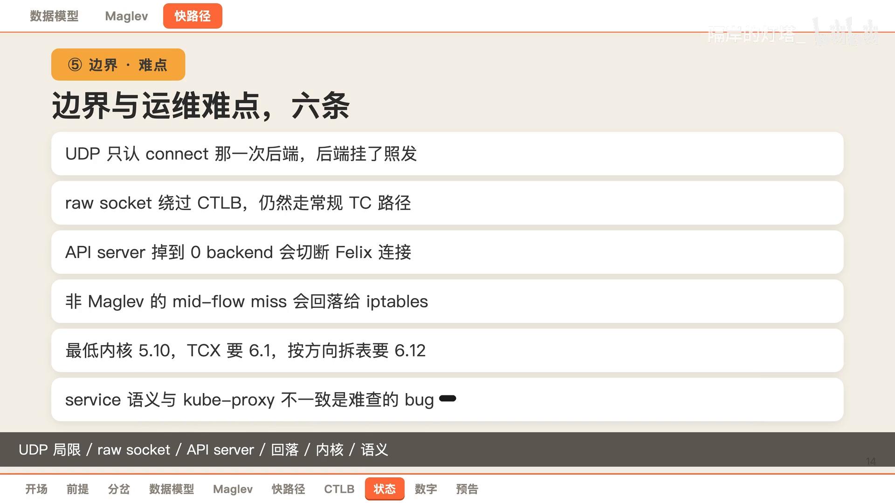

1. **连接式 UDP 只在连接时记一次**：后端挂了也照发，但 TCP 不受影响；
2. **socket 绕过之后仍然走常规的 TC 路径**（连接式 Pod 到 Pod 不走，但一般情况下这条 TC 路必须一直在）；
3. **API Server 的 Service 不能调到 0 个后端**：否则引导模式下会切断 Felix 自己到 API Server 的连接、形成死锁，所以它保留上一个好后端；
4. **不是 Maglev 的故障转移**：连接跟踪未命中会回落给 iptables 处理，内核连接跟踪里已有的连接同理；
5. **内核门槛**：TCX 要 6.1，按方向拆表要 6.12；
6. **Service 语义若和 kube-proxy 不一致**，是一类很难查的 bug。

[【跳转到 09:29】](https://www.bilibili.com/video/BV1nSh265EPh/?t=569)

## 十三、用几组硬数字收尾

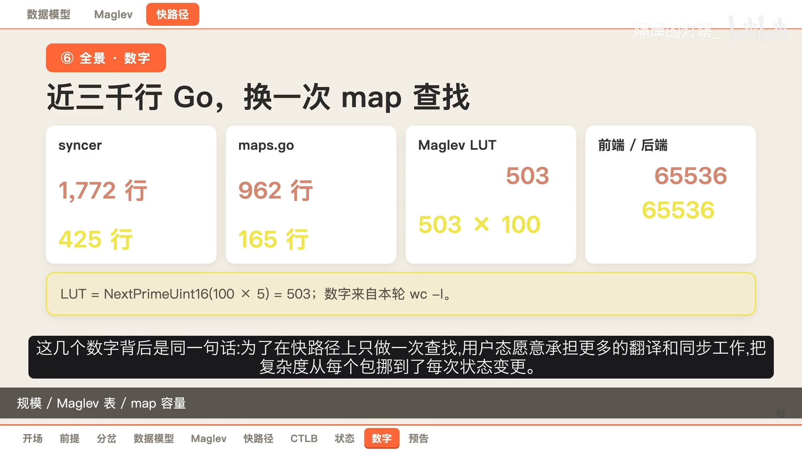

- **Go 侧最大的文件是 `syncer.go`，1772 行**；`kube-proxy.go` 425 行；map 定义 962 行；一致性哈希 165 行；
- **Maglev 的表大小**：每个 Service 是 **503** 个槽（`NextPrimeLimit(100 × 5) = 503`），整张表上限是 **503 × 100 = 50300**；
- **map 容量**：前端和后端默认分别是 **65536** 和 **262144**，亲和表同样是 **65536**。

这几个数字背后是同一句话：**为了在快路径上只做一次查找，用户态愿意承担更多的翻译和同步工作。**[【跳转到 09:59】](https://www.bilibili.com/video/BV1nSh265EPh/?t=599)

## 小结

- **为什么要自己实现**：BPF 模式下 Calico 禁用 kube-proxy，由 `bpf-proxy` 承担全部 Service 语义；底气是快路径能绕过主机栈，纪律是「每条指令都按包速率付账」。
- **成本模型**：规则方案的成本藏在规则数量里，BPF 把它换成了一次定长查表；两条路功能等价，差在扩展性。
- **数据模型**：前端表是 LPM 前缀树（16 字节 key、20 字节 value，`0xFFFFFFFF` 表示源地址段拒绝）；`service id` 是整块后端的钥匙，派生前端共用它。
- **选后端**：普通 Service 随机取模（节点本地），Maglev 一致哈希（跨节点稳定，但被拆成尾调用子程序）。
- **转发流程**：TC 路径七跳（查前端 → 选后端 → DNAT + 建 CT → 重定向直达后端网卡）；CTLB 七跳则把翻译提前到 `connect` 系统调用，TC 侧看不到 Service 流量。
- **代价**：Maglev 必须配 DS2、不支持 NodePort、与 CTLB 不兼容；内核门槛 TCX 6.1 / 按方向拆表 6.12；语义与 kube-proxy 不一致最难排查。

## 关键术语速查

| 术语 | 一句话解释 |
| :--- | :--- |
| bpf-proxy | Calico（Felix）里替代 kube-proxy 的组件，把 Service/Endpoint 翻译成 BPF map |
| front end / back end | 前端表存 Service 虚拟地址到 service id 的映射，后端表按 service id + 序号存真实后端 |
| LPM_TRIE | 最长前缀匹配前缀树；前端表用它支持按源 IP 段匹配/拒绝 |
| service id | 一整块后端的钥匙；Service 与其派生的前端共用，两个 Service 不能重号 |
| Maglev | 一致性哈希方案，扩容/缩容时只有少量槽位指向变化，扩容缩容对业务几乎无感 |
| TC path / CTLB | 两种介入点：包到达网卡时处理（TC），或连接建立时就把 socket 地址改好（CTLB） |
| DS2（Direct Server Return） | 直接服务器返回：回程绕开入口节点，由后端直接回给客户端；Maglev 依赖它 |
| pinned map | 「钉住」的 BPF map，生命周期长于 Felix 进程，重启后需要从表里反推收养 |
