# 为什么 Cilium 能干掉 kube-proxy：服务负载均衡的全局设计

> 本文整理自 B 站视频《[14·为什么能干掉 kube-proxy：服务负载均衡的全局设计｜Cilium 源码深读（第三季开篇）](https://www.bilibili.com/video/BV1EopJ6LEPo/)》（时长约 14 分钟）。这是「Cilium 源码深读」第三季的开篇：前两季把 eBPF 数据面拆了个遍，本季进入 Cilium 最有名、也最能体现价值的一块能力——替代 kube-proxy 做服务负载均衡。本期先不动细节，只把全局框架讲清楚。下文中的机制、结构与数据都来自该视频的图-字幕稿，可逐帧核对。

## 本讲要解决的核心问题（SCQA）

**背景（S）**：在 Kubernetes 里，客户端访问的是 Service 的虚拟地址（ClusterIP），而真正接收流量的是后端 Pod。把这个「虚拟地址」翻译成「某个 Pod 的地址」的活，默认由 kube-proxy 干，它走的是 iptables 或 IPVS 那条线。Cilium 走的是另一条线——eBPF。你可能早就听过「Cilium 能干掉 kube-proxy」这句话。

**冲突（C）**：kube-proxy 的路子有一个绕不开的痛点：它把每个服务翻译成内核里的一条或一堆转发规则，包来了要在这一大串规则里从头匹配过去；集群里有几千个服务和端点时，规则就是成千上万条。Cilium 凭什么能替掉它？替换之后，服务的流量又是怎么被转发的？

**疑问（Q）**：服务负载均衡在 Cilium 的数据面里长什么样？一个服务是如何被表示的？后端是怎么被选中的？Cilium 在哪些地方介入？

**回答（中心思想 A）**：**Cilium 用「哈希表 + 两个重点」替换了「规则链」**。三个关键点：一是**挂载层**，有三个介入点（连接建立时、包到达网卡时、更靠前的快速路径）；二是**数据表**，一个服务不是一条记录，而是服务表、后端表、反向转换表三张表配合，中间靠「一排槽位」串起来；三是**选择算法**，随机、一致性哈希（Maglev）或取第一个。这样一来，成本从「规则的数量」换成了「表的大小」——查表是常数时间，增删只是写一条记录，因此规则不会再随服务数量膨胀。而服务转发这件事的本质并没有变：**它依然是一次目的地址转换（DNAT），依然离不开连接跟踪**。

---

## 一、前提：kube-proxy 到底在干什么

先说前提。kube-proxy 说到底就三件事：

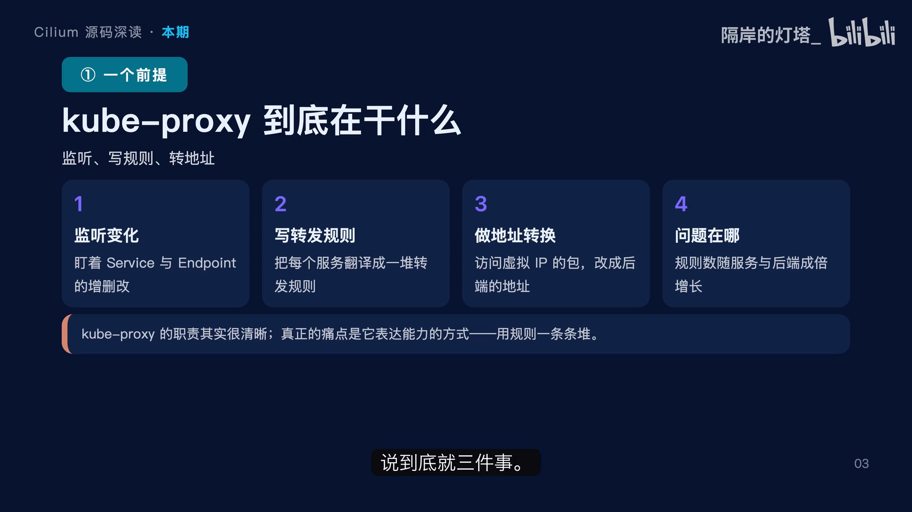

1. **监听变化**：盯着集群里所有 Service 和 Endpoint 的增删改；
2. **写转发规则**：每来一个 Service，就把它翻译成一条或一堆转发规则，塞进内核；
3. **做地址转换**：当有包访问服务的虚拟地址时，规则会把这个包的目的地址改成某个真正后端的地址。

职责很清晰，问题出在第三条的**表达方式**上：一个服务如果有十个后端，规则数量就会跟着涨；集群里有几千个服务和端点的时候，内核里的规则就是成千上万条，包每进来一个，都要在这一大串规则里从头匹配过去。这就是性能与扩展性的痛点所在，也是 Cilium 要解决的问题。

给个定位：kube-proxy 是一个**用户态守护进程 + 内核规则**的组合；Cilium 则把服务和后端**直接存进 eBPF 的哈希表**，一个包来了，拿它的目的地址和端口去查表，一次命中，不需要遍历。[【跳转到 01:25】](https://www.bilibili.com/video/BV1EopJ6LEPo/?t=85)

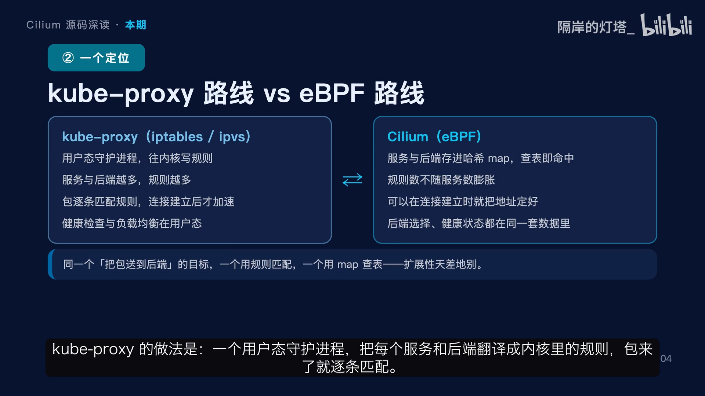

两条路的差别可以归纳成三点：**规则数量**——kube-proxy 会随服务和后端增长，Cilium 不会；**查询方式**——规则是逐条遍历，map 是一次哈希命中；**生效时机**——kube-proxy 常常要等连接跑几个包才进入加速路径，Cilium 可以在连接建立的那一刻就把后端地址定好。同样一个目标（把包送到正确的后端），一个用规则匹配、一个用 map 查表，扩展性和性能差出一大截。[【跳转到 02:12】](https://www.bilibili.com/video/BV1EopJ6LEPo/?t=132)

## 二、数据模型：一个服务 = 三张表 + 一排槽位

先看全貌。服务负载均衡可以归纳成三大件：**挂载层**（在哪介入）、**数据表**（服务存哪、后端在哪、反向转换用什么）、**选择算法**（这次请求选哪个后端）。

具体到一个服务，它在数据面里**不是一条记录，而是三张表配合**：

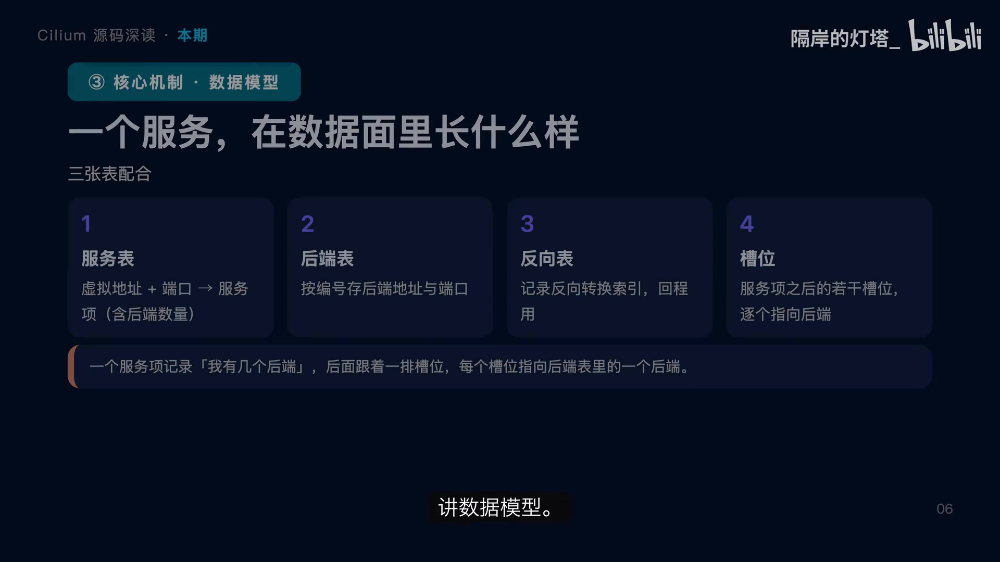

1. **服务表**：键是服务的虚拟地址加端口，值是一个「服务项」，服务项里记录了这个服务**有几个后端**；
2. **后端表**：按编号存放每个后端的地址和端口；
3. **反向转换表**：存一个索引，回程做地址还原时要用。

它们怎么配合？关键在**槽位**：服务项本身只占一个位置，但**它后面紧跟着若干个槽位，每个槽位指向后端表里的一个后端**。所以数据面查一个服务的时候，是先查到服务项、知道有几个后端，然后在这些槽位里选一个，再用这个编号去后端表拿具体地址。这种「服务在前、后端在后」的连续排布，正是它能**一次命中、不需要遍历规则**的原因。[【跳转到 03:42】](https://www.bilibili.com/video/BV1EopJ6LEPo/?t=222)

看一段真实的结构体 `lb4_service`，它有一个巧妙的复用：**一个联合体（union）**。

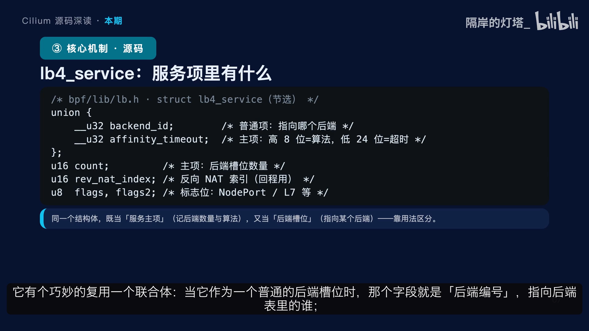

- **当它作为普通的后端槽位时**，那个字段就是「后端编号」，指向后端表里的谁；
- **当它作为服务的主项时**，同一个字段就变成别的意思——**高位编码负载均衡算法，低位是会话亲和的超时时间**；
- `Count` 只有主项才有意义，记录后端槽位有多少个；
- 反向 NAT 索引（`rev_nat_index`）在回程做地址还原时要用；
- 还有两个标志位，标记这个服务是不是 NodePort、是不是需要七层代理。

这是设计精髓所在：**同一个结构体，既当服务主项又当后端槽位，靠它在表里的位置和用法来区分**——紧凑的设计节省了内存，也解释了为什么服务表和后端表能这样排在一起。[【跳转到 04:37】](https://www.bilibili.com/video/BV1EopJ6LEPo/?t=277)

## 三、从「访问哪个服务」到「发给哪个后端」：五步选择

选中后端这个过程可以拆成五步：

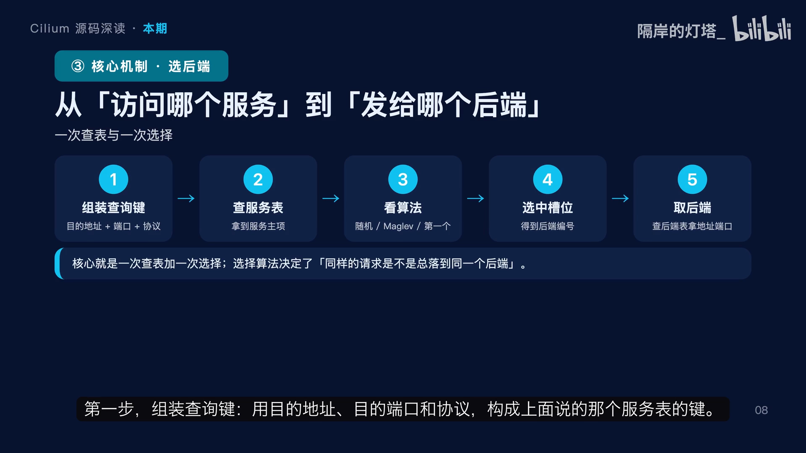

1. **组装查询键**：用目的地址、目的端口和协议，构成服务表的键；
2. **查服务表**：拿到服务主项，也就知道了它有多少个后端、用的是什么算法；
3. **看算法**：如果配的是一致性哈希，就去查那张哈希表；如果是随机，就在所有槽位里随机挑一个；如果是「取第一个」，就直接用第一个；
4. **选中一个槽位**，得到后端编号；
5. **拿这个编号去后端表**，取出后端的地址和端口。

所以整个过程就是**一次查表加一次选择**。这里面最关键的其实是第三步那个选择算法——**它决定了相同的请求是不是总会落到同一个后端上**，这个性质对缓存命中率、对扩容缩容时的影响面都至关重要。这也是后面要专门讲 Maglev 的原因。[【跳转到 05:27】](https://www.bilibili.com/video/BV1EopJ6LEPo/?t=327)

## 四、挂载层：在哪儿介入

服务负载均衡在**三个地方**介入，这也是 Cilium 设计里很漂亮的一点：

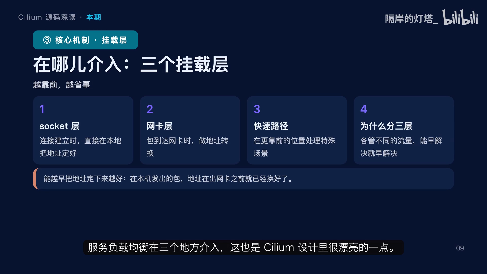

1. **连接建立时（socket 层）**：同一台机器上的程序去连接一个服务地址，程序可以在连接刚建立的时候，就把目的地址直接换成后端地址。好处是**包还没出网卡，地址就已经定好了**，后面全程不用再改；
2. **包到达网卡时（TC 层）**：对于外部进来的流量，或者不走前面那条路的流量，就在包进入网卡的时候做地址转换；
3. **更靠前的快速路径**：处理一些需要特别早介入的场景，比如外部的节点端口（NodePort）流量。

为什么要分三层？因为**不同的流量有不同的最优处理点**——能本机早解决的就别拖到网卡，能早处理的就别晚处理。这背后是一个朴素的原则：**越早定下地址，后面越省事**。下一期会专门讲三层里第一个、也是最有意思的 socket 层。[【跳转到 06:17】](https://www.bilibili.com/video/BV1EopJ6LEPo/?t=377)

## 五、选中后端之后：改地址、记连接，以及一次完整旅程

选中后端之后要做两件事：**改地址、记连接**。

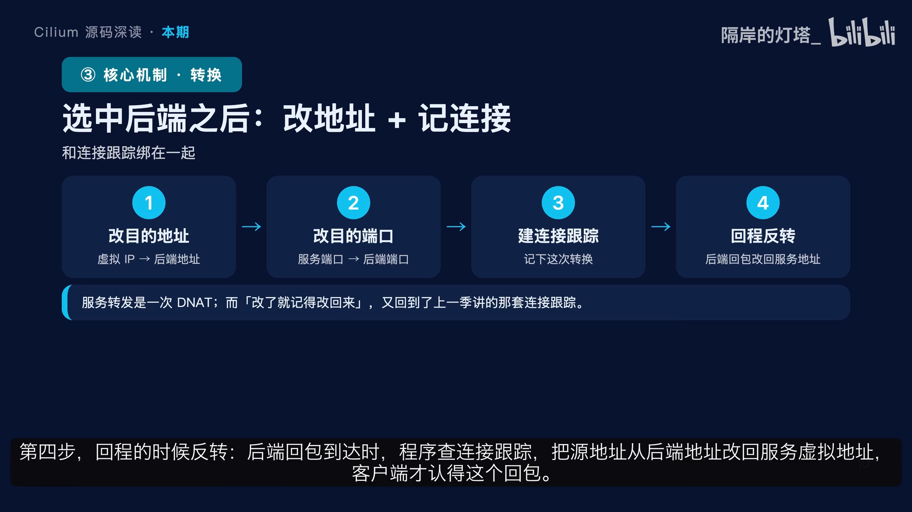

1. **改目的地址**：把包的目的地址从服务的虚拟地址换成选中后端的地址；
2. **改目的端口**：服务端口换成后端的端口；
   （这两步合起来就是我们说的**目的地址转换，DNAT**）
3. **创建一条连接跟踪记录**，把这次转换记下来；
4. **回程的时候反转**：后端回包到达时，程序查连接跟踪，把源地址从后端地址改回服务虚拟地址，客户端才认这个回包。

服务转发本质上就是一次目的地址转换，而**所有地址转换都必须和连接跟踪绑在一起做**。

把一次 ClusterIP 访问完整串一遍：

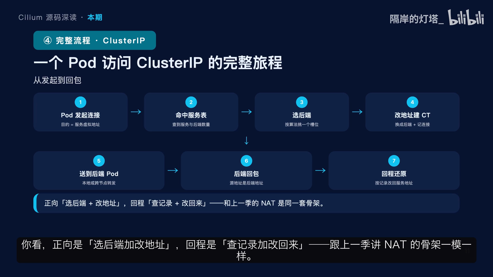

1. **Pod 发起连接**，目的地址是服务的虚拟地址；
2. 程序拿这个地址和端口**去查服务表**，命中后拿到服务项和后端数量；
3. **按配置的算法**从槽位里挑一个后端；
4. 把包的**目的地址和端口改成这个后端的**，同时创建一条连接跟踪记录；
5. **把包送到后端**：如果后端在本机就走本地投递，在别的节点就先转发或者封装过去；
6. **后端处理完，回包回来**，源地址是后端的地址；
7. **回程还原**：程序查连接跟踪，把源地址改回服务的虚拟地址，客户端才认得。

你看，**正向是「选后端 + 改地址」，回程是「查记录 + 改回来」**——跟上一季讲 NAT 的骨架一模一样。这说明 Cilium 的各个机制底层是共通的。[【跳转到 07:32】](https://www.bilibili.com/video/BV1EopJ6LEPo/?t=452) [【跳转到 08:47】](https://www.bilibili.com/video/BV1EopJ6LEPo/?t=527)

## 六、为什么规则不会膨胀：这是能替代 kube-proxy 的核心价值

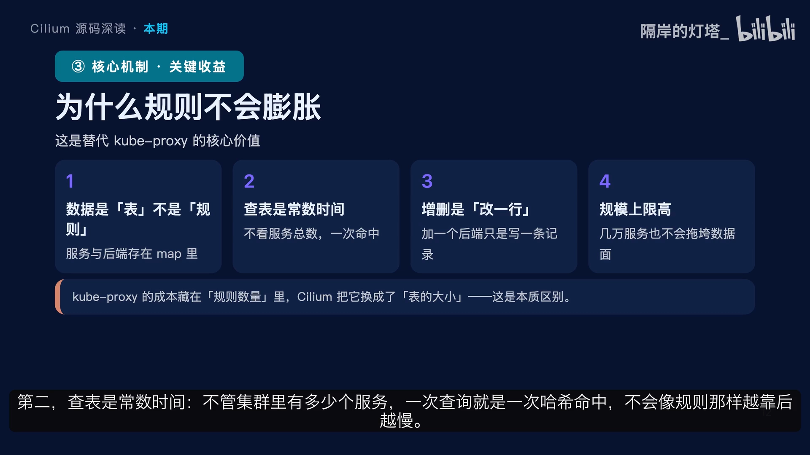

1. **数据是「表」和「规则」的区别**：Cilium 把服务和后端存成表里的记录，而不是内核里的一条条匹配规则；
2. **查表是常数时间**：不管集群里有多少个服务，一次查询就是一次哈希命中，不会像规则那样越靠后越慢；
3. **增删的成本极低**：加一个后端不过是往表里写一条记录，删一个删一条；而在规则方案里，一个服务的增删可能牵动成百上千条规则的重写；
4. **规模上限更高**：从实践经验看，能支撑的服务和后端数量远大于传统方案，而且扩缩容时的抖动也小。

核心区别一句话：**传统方案的成本藏在规则数量里，Cilium 把它换成了表的大小，后者是可以从容扩展的**。[【跳转到 09:12】](https://www.bilibili.com/video/BV1EopJ6LEPo/?t=552)

## 七、Maglev：让后端变动的影响面最小

单独讲一下 **Maglev，也就是一致性哈希**。

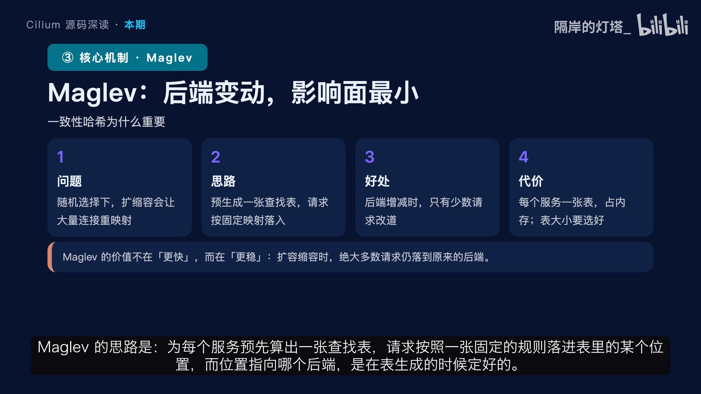

- **问题**：如果用纯随机选择后端，那么每次扩容或者缩容，**几乎所有的请求都可能被重新映射到不同的后端上**。对于有状态的连接、或者缓存型的后端来说，这是灾难——缓存大量失效、连接被打断。
- **思路**：Maglev 为每个服务**预先算出一张查找表**，请求按照一张固定的规则落进表里的某个位置，而位置指向哪个后端，是在表生成的时候定好的。
- **好处**：当后端数量发生变化时，**只有一小部分位置的指向会改变**，绝大多数请求仍然落到原来的后端上，所以扩容缩容对业务几乎无感。
- **代价**：每个服务要存一张表，占内存，而且表的大小要提前选好，表越大能支撑的后端越多。

一句话：**Maglev 的价值不在「更快」，而在「更稳」**。[【跳转到 10:16】](https://www.bilibili.com/video/BV1EopJ6LEPo/?t=616)

后端选择也不是单纯随便挑一个，还有四个边界要处理：

1. **健康状态**：如果一个后端被判定不健康，它要被剔除、不能再被选中——这一状态和选择逻辑共用同一套数据，所以生效很快；
2. **访问范围**：有些流量要求只选**本节点上的后端**（比如外部流量希望就近处理），这时查表会带上一个范围的限定；
3. **标志位**：服务是不是节点端口类型、要不要走七层代理，这些都靠服务项里的标志位表达，选择逻辑会据此调整；
4. **隔离**：正在下线的后端会**先被隔离**，而不是立刻移除，等现有连接自然结束。

所以后端选择这件事听起来简单，真正落地要考虑「**健康、范围、生命周期**」三件事，而它们都被统一编码在服务项和它的标志里——这也是数据驱动模型的又一个好处。[【跳转到 11:06】](https://www.bilibili.com/video/BV1EopJ6LEPo/?t=666)

## 八、用户态那半边：数据面负责查表转发，用户态负责盯变化

最后看用户态这一侧。它由几块组成：

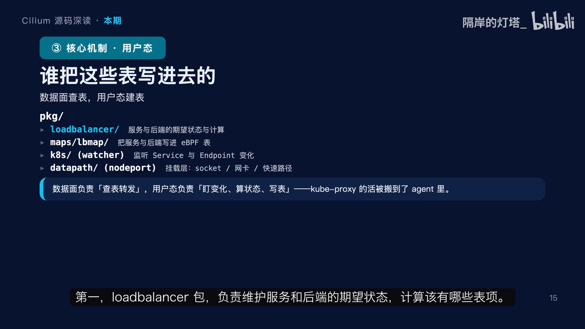

1. **`loadbalancer` 包**：负责维护服务和后端的期望状态，计算该有哪些表项；
2. **`maps` 里的包**：负责把这些表项真正写进 eBPF 哈希表；
3. **`k8s` 那部分**：负责监听服务和端点的变化——**这本来是 kube-proxy 的活，现在搬到了 agent 里**；
4. **`datapath` 里与节点端口相关的部分**：负责把服务程序挂到三个挂载层上。

所以可以这样理解：**数据面负责查表转发，用户态负责盯变化、算状态、写表**。kube-proxy 的那份工作并没有消失，它只是被并进了 Cilium 的 agent，而且用的是更高效的数据结构——这也解释了为什么 Cilium 能做到不需要 kube-proxy。[【跳转到 11:41】](https://www.bilibili.com/video/BV1EopJ6LEPo/?t=701)

## 九、算笔账：替代 kube-proxy 的得与失

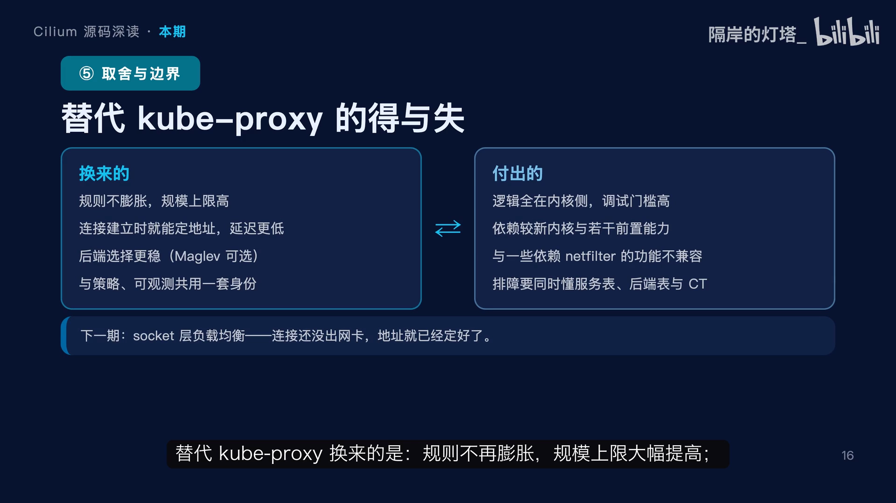

**换来的是：**

- **规则不再膨胀**，规模上限大幅提高；
- **连接建立的那一刻地址就定好了**，延迟更低；
- **后端选择更稳**，还可以选一致性哈希；
- 服务和策略、可观测**共用同一套身份体系**，一份数据多处用。

**代价也很实在：**

- 逻辑全在内核侧，**出问题调试门槛高**；
- **依赖较新的内核**以及几个前置能力，最典型的就是下一期要讲的 socket 层能力；
- 和一些**依赖网络过滤框架的功能不兼容**；
- 排查问题时，你得同时看懂**服务表、后端表和连接跟踪**三样东西。

这就是它能剃掉 kube-proxy 的底气，也是它对使用者提出的知识要求。[【跳转到 12:29】](https://www.bilibili.com/video/BV1EopJ6LEPo/?t=749)

## 小结

- **kube-proxy 的职责**：监听变化、写转发规则、做地址转换；痛点在于「规则会膨胀」。
- **Cilium 的替换方案**：用哈希表替代规则，把成本从「规则数量」换成了「表的大小」。
- **服务的数据模型**：三张表（服务表、后端表、反向转换表）配合，加上一排槽位；同一个结构体既当服务项又当后端槽位。
- **三个挂载层**：连接建立时（socket）、包到达网卡时（TC）、更靠前的快速路径；原则是「越早定下地址越省事」。
- **转发闭环**：正向「选后端 + 改地址（DNAT）+ 建连接跟踪」，回程「查记录 + 改回来」。
- **后端选择**：随机、一致性哈希（Maglev）、取第一个；Maglev 让扩缩容的影响面最小，代价是每个服务存一张表。
- **得与失**：换来不膨胀、低延迟、更稳的选择；代价是内核侧难调试、依赖新内核、与部分功能不兼容。

下一期讲三个挂载层里的第一个、也是最重要的一个——**socket 层负载均衡**：它能让连接还没离开本机，目的地址就已经定好了。

## 关键术语速查

| 术语 | 一句话解释 |
| :--- | :--- |
| ClusterIP | Service 的虚拟 IP，集群内访问入口；本身不是真实网卡地址，需要被翻译成后端地址 |
| DNAT | 目的地址转换：把包的目的地址（和端口）从 Service 虚拟地址改成选中后端的地址 |
| 连接跟踪（conntrack） | 内核记录每条连接转换结果的状态表；回程靠它把源地址改回服务的虚拟地址 |
| 三个挂载层 | socket 层（连接建立时）、TC/网卡层（包到达网卡时）、快速路径（更早介入的场景） |
| 服务表 / 后端表 / 反向转换表 | 服务项（含后端数量）、按编号存的后端地址端口、回程还原用的索引 |
| 槽位（slot） | 紧跟在服务项后面的一排位置，每个槽位指向一个后端；选后端就是在槽位里挑一个 |
| Maglev | 一致性哈希方案：预生成查找表，后端数量变化时只有少量槽位指向改变，扩缩容无感 |
| 会话亲和（session affinity） | 让同一客户端的请求固定落到同一后端；超时时间编码在服务项的低位 |
| LB4 / LB6 | 四层（传输层）负载均衡，分别对应 IPv4 与 IPv6 的服务表示 |
