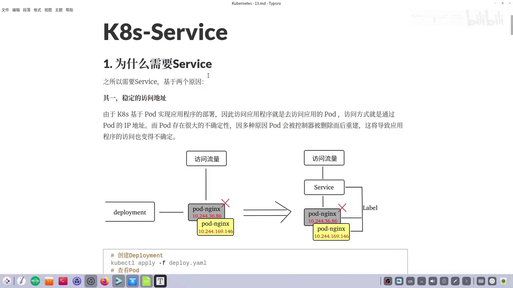
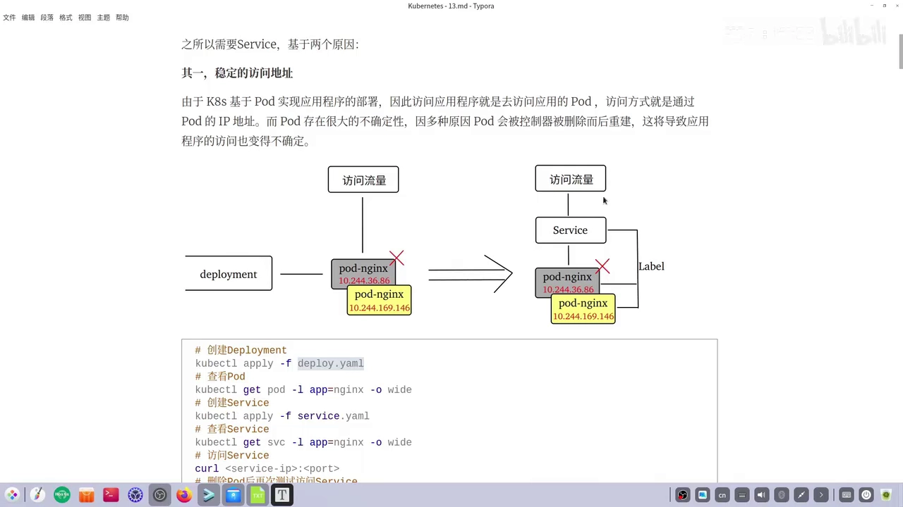
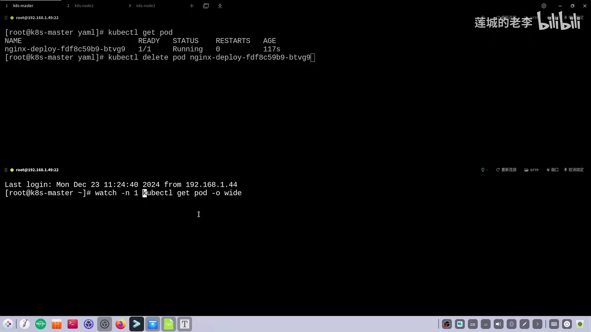
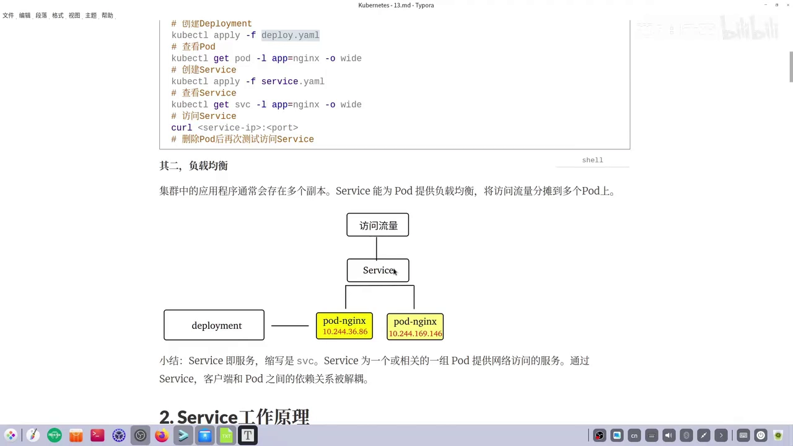
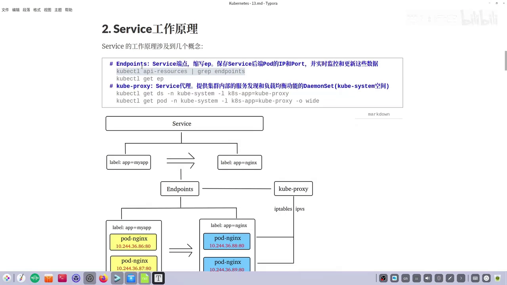
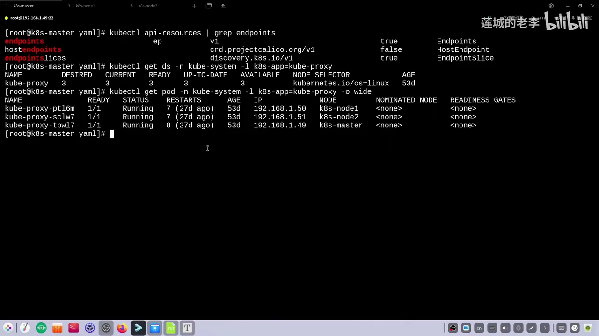
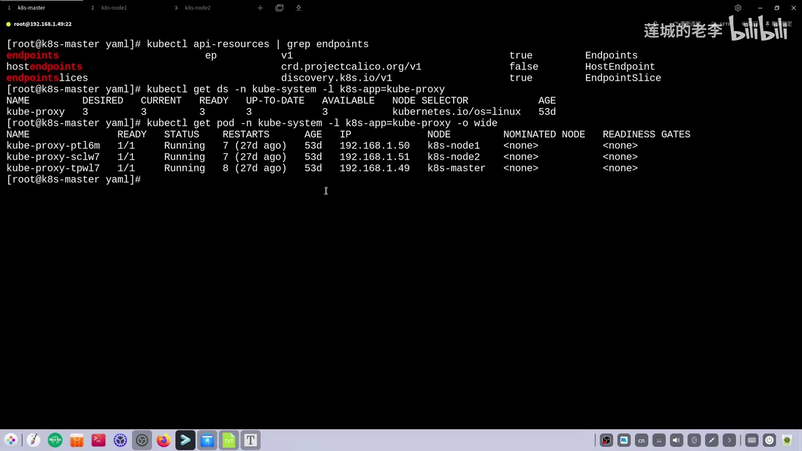

# Service 模型：一个稳定的虚拟入口，和它的两个工作伙伴

> 本文整理自 B 站视频《[Service的含义和基本工作原理](https://www.bilibili.com/video/BV1psCgYUEWk/)》（时长约 11 分钟，UP 主「莲城的老李」，K8s Service 系列第一篇）。文中的机制描述、命令与结论均来自该视频的图文稿，可核对。

## 本讲要解决的核心问题（SCQA）

**背景（S）**：K8s 用 Pod 来部署应用程序。所以在字面上，「访问应用」就是「访问这个应用对应的 Pod」——方式是连它的 Pod IP；而每个 Pod 都有自己的 IP（这是集群内部的地址，访问的前提是你得知道它的 IP）。[【跳转到 00:00】](https://www.bilibili.com/video/BV1psCgYUEWk/?t=0)

**冲突（C）**：Pod 具有很大的不确定性。控制器（如 Deployment）会因各种原因把 Pod 删除而后重建，重建后 IP 就变了。客户端一旦记住的是老 Pod 的 IP，Pod 一变，访问立刻失效。再加上一个应用通常有多个副本，「流量到底该去哪一个 Pod」本身就是个麻烦。[【跳转到 00:25】](https://www.bilibili.com/video/BV1psCgYUEWk/?t=25)

**疑问（Q）**：K8s 用什么抽象，才能给一组随时变化的 Pod 提供一个「永远不变」的访问入口，并且顺带把负载均衡也做掉？

**回答（中心思想 A）**：K8s 的答案是 **Service（服务，缩写 SVC）**——它为一个或一组 Pod 提供网络访问，正是靠它，**客户端与 Pod 之间的依赖被解耦**。理解 Service 的关键不是背它的 YAML，而是记住它干活时依赖的**两个「工作伙伴」**：**Endpoints 对象**（记录后端 Pod 的 IP 与端口，随变化实时更新）和 **kube-proxy**（每个节点上的 Service 代理，真正决定流量落到哪个 Pod）。

---

## 一、为什么需要 Service：两个原因

### 1.1 原因一：提供稳定的访问地址

K8s 基于 Pod 部署应用，因此访问应用就是去访问它的 Pod，访问方式就是通过 Pod 的 IP 地址。但 Pod 具有很大的不确定性：因为各种原因被控制器删除而后重建，重建后 IP 就发生了改变——这样一来，我们的访问就变得非常不确定。



Service 的解法是：**通过标签（Label）与后面的 Pod 建立关联**。这样客户端访问的不再是某个 Pod，而是这个 Service；即便后面的 Pod 发生了改变，也不要紧——**Service 能为访问流量提供一个稳定的访问地址**。[【跳转到 00:50】](https://www.bilibili.com/video/BV1psCgYUEWk/?t=50)

一个「创建 Deployment → 创建 Service → 访问 Service」的最小实验就能说明问题：

```bash
# 创建 Deployment，并确认 Pod 处于 Running
kubectl apply -f deploy.yaml
kubectl get pod -l app=nginx -o wide

# 创建 Service，并查看它拿到的 IP（记住它对外暴露 80 端口即可）
kubectl apply -f service.yaml
kubectl get svc -l app=nginx -o wide

# 直接访问 Service 的 IP（80 端口可以省略）
curl <service-ip>:<port>

# 删除 Pod 后，再次访问 Service
```



Service 创建出来后就有了自己的 IP（例子里是 10.230.x.146），此后访问只要访问 Service 即可。接着做删除实验：把后端那个 Pod 删掉，用 `kubectl get pod -o wide` 配合 `watch` 观察整个过程。



可以看到原来的 Pod 被删除、一个新的 Pod 顶替它，**IP 已经不再是原来那个老 Pod 的 IP**。但这个变化对我们的访问不要紧，因为现在有一个 Service；再次访问 Service 的 IP，仍旧能访问到对应 nginx Pod 提供的服务。[【跳转到 03:10】](https://www.bilibili.com/video/BV1psCgYUEWk/?t=190)、[【跳转到 03:35】](https://www.bilibili.com/video/BV1psCgYUEWk/?t=215)

这就验证了需要 Service 的**第一个原因：稳定的访问地址**。

### 1.2 原因二：提供负载均衡

集群中的应用程序通常会存在多个副本。Service 能把访问流量分摊到多个 Pod 上，也就是提供**负载均衡**。示意图假定我们用某个 Deployment 创建了多个 Pod 副本：这些 Pod 究竟访问哪一个？自己去做负载均衡比较麻烦，而有了 Service 之后就变得十分简单。[【跳转到 04:05】](https://www.bilibili.com/video/BV1psCgYUEWk/?t=245)



（负载均衡的实操演示，视频留到下一集讲解。）

### 1.3 一句话给 Service 下定义

**Service 就是「服务」，缩写 SVC，它是为一个或一组 Pod 提供网络访问的一种服务。** 正是通过 Service，客户端与 Pod 之间的依赖关系被解耦。[【跳转到 04:30】](https://www.bilibili.com/video/BV1psCgYUEWk/?t=270)

---

## 二、Service 的工作原理：两个工作伙伴

讲 Service 的工作原理会涉及几个概念：**Service 在工作时有两个「工作伙伴」——一个是 Endpoints，另一个是 kube-proxy**。[【跳转到 04:55】](https://www.bilibili.com/video/BV1psCgYUEWk/?t=295)

### 2.1 工作伙伴一：Endpoints——记录后端 Pod 的「清单」

**Endpoints** 是 Service 的端点对象，缩写 **EP**，它本身也是 K8s 中的一种资源。它的职责是：**保存 Service 后端 Pod 的 IP 和端口，并实时监控、更新这些数据。**



为什么需要它？看这张示意图：一个 Service 通过标签与一些 Pod 关联，但**标签并不是固定的**。第一次可能把标签设成 `app=my-app`，这时 Service 与这几个 Pod 关联；后来假定把标签改成 `app=nginx`，Service 又要去关联另一批 Pod。那么「在两个不同时刻各自关联了哪些 Pod」，该由谁存储？**Service 自己并不干这件事，而是交给 Endpoints 对象**去处理，由它实时监控和更新这些数据。

即便标签不变，Endpoints 也会变化：比如某个 Pod 在健康检查时没有通过**就绪（readiness）检测**，它也会从 Endpoints 里被移除——被移除的 Pod 就不会再得到 Service 分发过来的流量。[【跳转到 06:05】](https://www.bilibili.com/video/BV1psCgYUEWk/?t=365)

在集群里可以直接看到端点资源，以及与它并列的 EndpointSlice：

```bash
kubectl api-resources | grep endpoints   # Endpoints(ep) 与 EndpointSlice
kubectl get ep nginx                     # 名字与 Service 同名
kubectl get ep nginx -o yaml             # 看 subsets.addresses 里的后端 Pod IP
```



### 2.2 工作伙伴二：kube-proxy——Service 的代理，负责负载均衡

第二个工作伙伴是 **kube-proxy**，我们把它称为 **Service 的代理**。Service 之所以需要一个代理，其实就是用来做负载均衡：**真正有访问流量到达时，究竟转发到哪一个 Pod，实际上是由 kube-proxy 来完成的。**[【跳转到 06:30】](https://www.bilibili.com/video/BV1psCgYUEWk/?t=390)

kube-proxy 本质上是我们之前讲过的一种控制器——**DaemonSet**，所以**每一个节点上都会有一个对应的 Pod**，并且它们位于 `kube-system` 命名空间里。



```bash
kubectl get ds  -n kube-system -l k8s-app=kube-proxy
kubectl get pod -n kube-system -l k8s-app=kube-proxy -o wide
```

### 2.3 串起来：一次访问走了哪些环节

把两个伙伴连起来看，一次「访问 Service」的链路是：**Service（selector 选中 Pod）→ Endpoints（保存这批 Pod 的 IP:端口）→ 每个节点上的 kube-proxy（按 iptables/IPVS 规则做转发与负载均衡）→ 目标 Pod**。这也解释了第 1 节里那个「Pod 换了 IP、访问还正常」的现象：客户端面向的始终是 Service，后端 Pod 的进出由 Endpoints 与 kube-proxy 在背后跟着更新。

---

## 三、动手验证：三个小实验

### 3.1 实验一：Pod 删了重建，Service 入口照样能用

见 1.1 节：删除 Pod 后 Deployment 拉起新 Pod、IP 发生变化，但再次访问 Service 的 IP，依旧能访问到 nginx 服务。

### 3.2 实验二：Endpoints 会随 Pod 实时更新

- `kubectl get pod` 拿到原 Pod 的 IP（例子里是 `10.244.169.143`），与 `kubectl get ep nginx -o yaml` 里 `subsets.addresses` 中的 IP 一致；
- 删除该 Pod，Deployment 拉起新 Pod（IP 变成例如 `10.244.36.88`）；
- 再查 Endpoints，`addresses` 已经同步更新为新 IP。

这说明 **Endpoints 里随时维持着 Service 所关联的 Pod 信息，而且是实时变化、同步更新的**。[【跳转到 09:48】](https://www.bilibili.com/video/BV1psCgYUEWk/?t=588)

### 3.3 实验三：改错 selector，Endpoints 会变空

把 Service YAML 里的 `selector` 从 `app=nginx` 改成 `app=my-app`，而此时集群里并不存在 `app=my-app` 的 Pod——于是这个 Service 找不到它要关联的 Pod，Endpoints 里也就不会存相应的 Pod 信息。


保存并重新 `apply` 之后，再看这个 Endpoints 对象，会发现它里面已经没有所关联的 Pod 信息了。[【跳转到 10:29】](https://www.bilibili.com/video/BV1psCgYUEWk/?t=629)

---

## 小结

- 需要 Service 的两个原因：**提供稳定的访问地址** + **提供负载均衡**。
- Service（SVC）= 为一个或一组 Pod 提供网络访问的服务；它把**客户端与 Pod 解耦**。
- Service 通过**标签（selector）** 选中后端 Pod。
- 两个工作伙伴：**Endpoints**（保存后端 Pod 的 IP/端口并实时更新）、**kube-proxy**（每个节点一个的 DaemonSet，作为 Service 代理做转发与负载均衡）。
- 因此后端 Pod 的增减、换 IP，都不会影响客户端所面对的 Service 入口。

## 关键术语速查

| 术语 | 一句话解释 |
| --- | --- |
| Service（SVC） | 为一个或一组 Pod 提供稳定访问入口与负载均衡的抽象 |
| 虚拟 IP | Service 分到的集群内部 IP，客户端访问的就是它 |
| selector（标签选择器） | Service 用来「选中」后端 Pod 的标签条件 |
| Endpoints（EP） | Service 的端点对象，保存后端 Pod 的 IP:端口并实时更新 |
| EndpointSlice | Endpoints 的分片/扩展形态，与 ep 并列的一种资源 |
| kube-proxy | 每个节点上的 Service 代理（DaemonSet），决定流量转发到哪个 Pod |
| 就绪（readiness）探针 | 就绪检测；未通过的 Pod 会被移出 Endpoints，不再收流量 |
