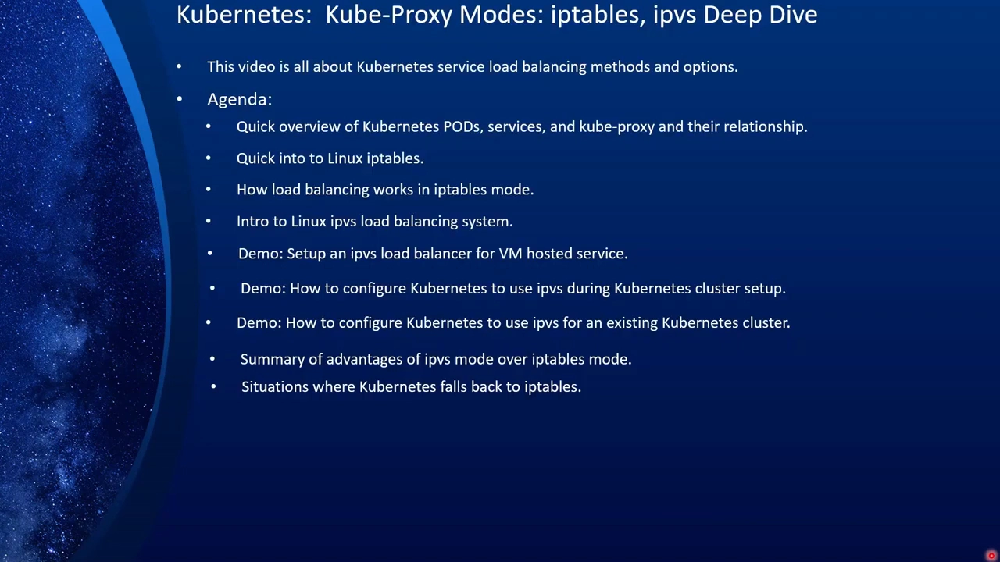
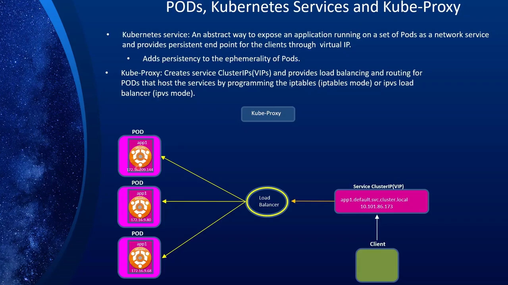
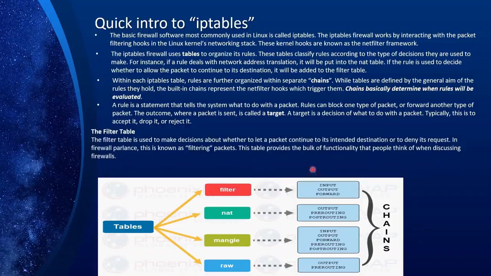
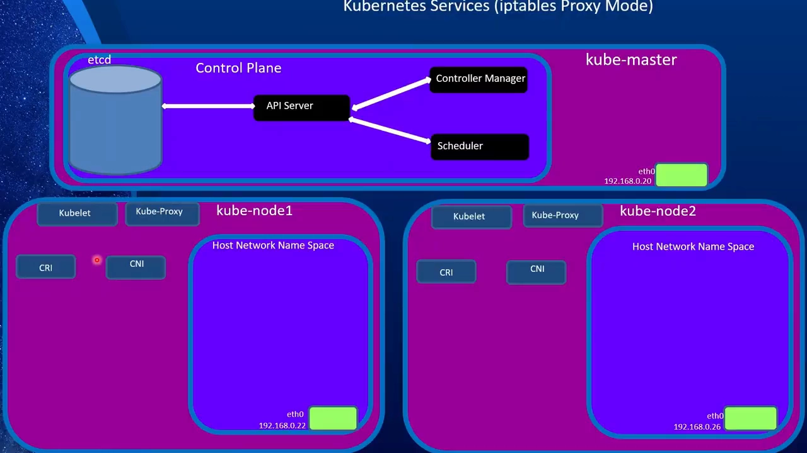
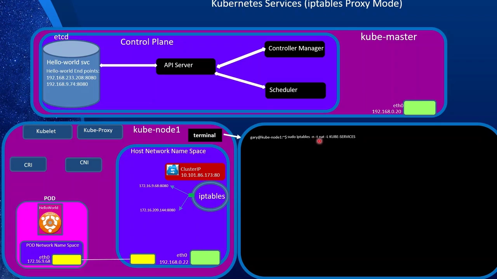
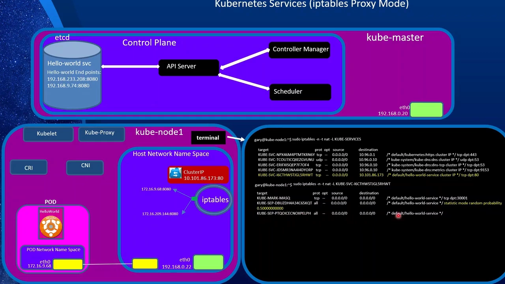
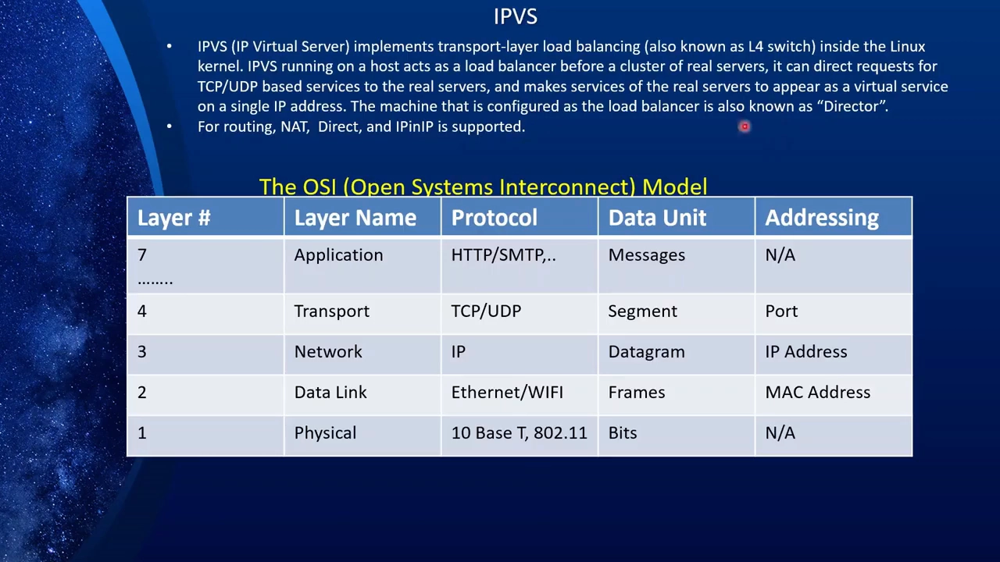
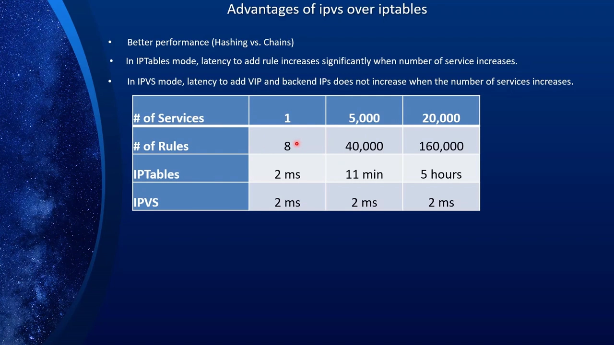
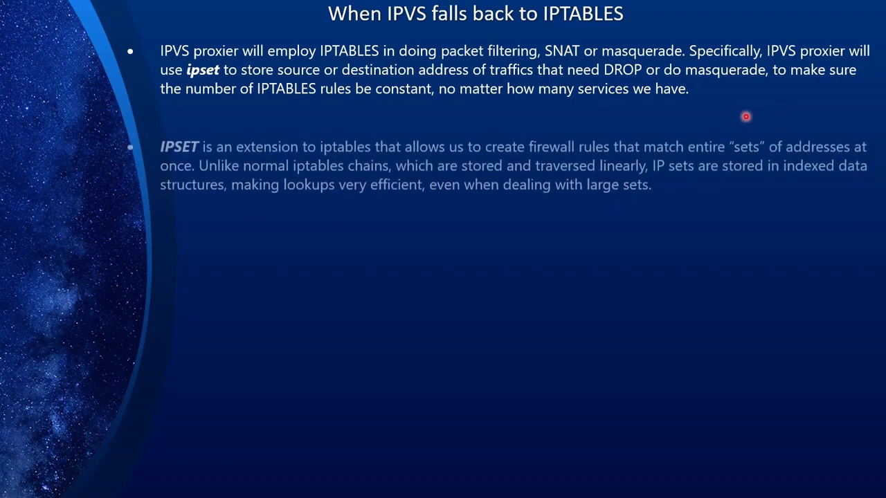

# kube-proxy 的 iptables 模式：Service 的虚拟 IP 如何变成内核里的一条条规则

> 本文整理自 B 站视频《[Kubernetes kube-proxy Modes：iptables 与 ipvs, Deep Dive](https://www.bilibili.com/video/BV1Q14y1a7Yc/)》（时长约 60 分钟，作者 "The Learning Channel"，视频里附带了一套 GitHub Demo 脚本）。视频用一整集，从 Linux 的 iptables 讲起，一路走到 kube-proxy 在节点上生成的具体规则，再对比 IPVS 模式，并给出两者的取舍。下文中的机制描述、命令与输出都来自该视频的图-字幕稿，可逐帧核对。

## 本讲要解决的核心问题（SCQA）

**背景（S）**：Kubernetes 用 Pod 跑应用，每个 Pod 都有自己的 IP。但 Pod 是「短暂的」（ephemeral）——控制器随时可能把它删掉重建，重建后 IP 就变了。所以客户端不能直接连 Pod 的 IP。为此 Kubernetes 提供了 Service：它有一个长期不变的虚拟 IP（VIP），以及一个稳定的域名（形如 `服务名.命名空间.svc.cluster.local`），客户端只跟 Service 打交道。[【跳转到 02:35】](https://www.bilibili.com/video/BV1Q14y1a7Yc/?t=155)、[【跳转到 03:25】](https://www.bilibili.com/video/BV1Q14y1a7Yc/?t=205)

**冲突（C）**：可 Service 只是一个「虚拟」IP——它背后并没有一台真机在监听，真正干活的是 Pod。那么数据包发到这个 VIP 上时，究竟是谁、在什么时候把它改写成某个具体 Pod 的地址？又凭什么在多个 Pod 之间做负载均衡？

**疑问（Q）**：kube-proxy 到底做了什么？它所谓的「iptables 模式」，内部到底是什么样子？

**回答（中心思想 A）**：**kube-proxy 本身不碰数据包，它是一个「规则生成器」**——它监听 Service 与 Endpoint 的变化，把「哪个 VIP 对应哪些 Pod」翻译成每个节点上的 iptables 规则，真正转发数据包的是 Linux 内核。在 iptables 模式下，这条路走的是 nat 表里三条约定俗成的链：`KUBE-SERVICES`（入口）→ `KUBE-SVC-xxx`（按概率挑后端）→ `KUBE-SEP-xxx`（做 DNAT、改写目的地址）。iptables 模式简单、久经考验，但它本质是「让防火墙兼职做负载均衡」：规则会随 Service 数量膨胀、又没有索引要线性扫描，**规模一旦上到成百上千个 Service 就会退化**——这正是 IPVS 模式存在的理由。[【跳转到 04:40】](https://www.bilibili.com/video/BV1Q14y1a7Yc/?t=280)

---

## 一、三个角色：Pod、Service 与 kube-proxy

理解 kube-proxy 之前，先把三个主角的分工摆清楚。

- **Pod 是短暂的**。它可能因为任何原因被删除、重建，IP 随之改变，所以客户端绝不能直接绑定 Pod 的 IP。[【跳转到 02:35】](https://www.bilibili.com/video/BV1Q14y1a7Yc/?t=155)
- **Service 是稳定的抽象**。它给一组 Pod 提供一个固定的虚拟 IP 和一个可预测的名字。只要 Service 存在，这个 IP 和名字就一直是它，跟背后 Pod 的生死无关。名字的构成规则是 `服务名.命名空间.svc.cluster.local`。[【跳转到 03:25】](https://www.bilibili.com/video/BV1Q14y1a7Yc/?t=205)
- **kube-proxy 是「落地」的那一环**。它把 Service 这个「虚拟」的东西，变成内核里真实生效的负载均衡规则；具体怎么落地，取决于它运行在哪种**模式**（mode）——默认是 iptables，也可以改成 IPVS。[【跳转到 04:15】](https://www.bilibili.com/video/BV1Q14y1a7Yc/?t=255)

三种角色的关系可以这样记：客户端只认识 Service 这个 VIP；负载均衡器从后端一串 Pod 里挑一个；而「用哪个算法挑、怎么挑」由模式决定。**在 iptables 模式下，可选的算法只有一种——轮询（round robin）**；换到 IPVS，才有更多算法可选。这是后文一个重要伏笔。[【跳转到 04:40】](https://www.bilibili.com/video/BV1Q14y1a7Yc/?t=280)

---

## 二、先补一课：iptables 到底是什么

要讲清楚 iptables 模式，绕不开 iptables 本身。它其实是 Linux 里的一套防火墙系统。

**规则按「表」分类**，这也是 `iptables` 这个名字的来历。不同的表管不同的事：[【跳转到 05:40】](https://www.bilibili.com/video/BV1Q14y1a7Yc/?t=340)

- **filter 表**：决定数据包能否进入或离开本机；
- **nat 表**（网络地址转换）：决定数据包的源地址或目的地址是否需要改写——**kube-proxy 的负载均衡就发生在这张表里**，因为「把 Service 的 IP 改成某个 Pod 的 IP」正是它的活；
- **mangle 表**：以各种方式修改 IP 头部，比如调整 TTL；它还能给数据包打一个内核标记（mark），供后续处理使用；
- **raw 表**：让某些数据包豁免于连接跟踪。

**表下面再分「链」（chain）**，链决定规则在数据包旅途的哪个点生效。五个常用链是：`INPUT`（本机收到的包）、`OUTPUT`（本机发出的包）、`FORWARD`（被路由穿过本机的包）、`PREROUTING`（包刚到达、路由前）、`POSTROUTING`（包即将离开前）。[【跳转到 07:20】](https://www.bilibili.com/video/BV1Q14y1a7Yc/?t=440)

还有一点非常关键：**Linux 的防火墙是「有状态」的（stateful）**。它会记住之前经过的数据包（连接跟踪，conntrack）。这为什么重要？以负载均衡为例：你第一次访问某个 Service，请求可能被转给 1 号 Pod；防火墙必须记住这件事，这样第二次访问就能转给 2 号 Pod，而不是又回到 1 号——**正是「有状态」让轮询式的负载均衡成为可能**。反过来，有些场景不需要连接跟踪，才用 raw 表把包豁免出去。[【跳转到 09:25】](https://www.bilibili.com/video/BV1Q14y1a7Yc/?t=565)

---

## 三、iptables 模式：一个 Service 从创建到流量落地

有了前面的底子，我们走一遍完整流程：部署一个 Deployment + Service，看数据包最后是怎么落地的。

### 3.1 从一个 YAML 说起

示例 YAML 分两部分：[【跳转到 10:12】](https://www.bilibili.com/video/BV1Q14y1a7Yc/?t=612)

- 第一部分 `kind: Deployment`：给 Pod 起名、打标签 `app=hello-world`，在 `containers` 里指定镜像和容器监听的端口 `8080`；
- 第二部分 `kind: Service`：选择要匹配的标签（同样匹配 `hello-world`），`port: 80`——**Service 自己监听 80，却把调用转发到容器的 8080**。

### 3.2 创建时，各组件依次做了什么

执行这个 YAML 后，一系列组件接力干活：

1. 请求到达 **API Server**，进而到 **kubelet**；kubelet 通过 **CRI**（容器运行时接口）让运行时下载镜像、拉起容器；
2. **CNI**（容器网络接口）为 Pod 建好网络：创建成对的 veth 网卡、设置默认路由、写入路由表并加一条路由，让主机与 Pod 能互通；
3. 因为还创建了 Service，请求写入 **etcd**；**endpoints controller（端点控制器）**被唤醒。此时 Pod 已有 IP，控制器就把这些 Pod 及其端口登记进 **Endpoints** 对象；
4. 轮到 **kube-proxy**：它创建 ClusterIP，**并在节点上写好 iptables 规则**，为这些 Pod 建立负载均衡。有多台节点时，每台节点上都做同样的事。[【跳转到 12:00】](https://www.bilibili.com/video/BV1Q14y1a7Yc/?t=720)、[【跳转到 13:15】](https://www.bilibili.com/video/BV1Q14y1a7Yc/?t=795)

### 3.3 钻进 nat 表：三条链的分工

现在来看 kube-proxy 到底写了什么。命令是 `sudo iptables -t nat -nL <链名>`，逐段理解：`-t nat` 指定看 nat 表（负载均衡在这张表），`-n` 表示显示数字 IP、不解析主机名，`-L` 是列出，最后跟链名。[【跳转到 14:01】](https://www.bilibili.com/video/BV1Q14y1a7Yc/?t=841)

**① `KUBE-SERVICES`——所有 Service 的入口。** 所有由 Kubernetes 创建的 Service 都挂在这条链下，每条 Service 会有一条对应的子链 `KUBE-SVC-xxx`。这条子链的规则说：凡目的地是「这个 ClusterIP + 这个端口」的数据包，就交给 KUBE-SVC-xxx 去处理。[【跳转到 14:26】](https://www.bilibili.com/video/BV1Q14y1a7Yc/?t=866)

**② `KUBE-SVC-xxx`——负载均衡器。** 它把数据包大致均分到后端。示例里有两条后端条目，第一条的概率是 `0.5`（选中第一个 Pod 的概率 50%）；如果没被选中，就落到下一条、概率 100%。**这就是 iptables 模式下唯一的算法：轮询。** [【跳转到 15:41】](https://www.bilibili.com/video/BV1Q14y1a7Yc/?t=941)、[【跳转到 16:06】](https://www.bilibili.com/video/BV1Q14y1a7Yc/?t=966)

**③ `KUBE-SEP-xxx`——Service Endpoint，真正做 DNAT 的地方。** 每条对应一个后端。规则是：当请求的目的地址是这个 Service 的 ClusterIP 时，做一次 **DNAT**（目的地址转换），改成某个 Pod 的 IP 与端口（本例 8080）。这就是「流量如何落到具体 Pod」的最后一跳。[【跳转到 16:31】](https://www.bilibili.com/video/BV1Q14y1a7Yc/?t=991)、[【跳转到 16:56】](https://www.bilibili.com/video/BV1Q14y1a7Yc/?t=1016)

**④ 还有一条 `KUBE-MARK-MASQ`。** 它处理一种特殊情况：如果某个 Pod 访问的正是它自己所在的 Service（自己调自己「绕了一圈」），就做一次源地址转换（SNAT），把源地址改成节点本身的 IP。这样做的目的是**不让它就地应答、从而跳过整套流程**——让它重新走一遍完整路径，保证行为一致。[【跳转到 17:21】](https://www.bilibili.com/video/BV1Q14y1a7Yc/?t=1041)

把这段串起来：**`KUBE-SERVICES` 认领 → `KUBE-SVC` 按概率挑一个后端 → `KUBE-SEP` 把目的地址 DNAT 成那个 Pod**。iptables 模式下的 Service 负载均衡，就是由这三层链协作完成的。[【跳转到 18:26】](https://www.bilibili.com/video/BV1Q14y1a7Yc/?t=1106)

---

## 四、iptables 模式的三个天花板

iptables 模式是 Kubernetes 的默认行为、久经考验，但它在规模上会撞墙。视频点出了几个原因：[【跳转到 19:01】](https://www.bilibili.com/video/BV1Q14y1a7Yc/?t=1141)

1. **规则随 Service 数量线性膨胀**。每加一个 Service，就要加一大批规则；为每个 Service 的负载均衡创建一整套链，还要为 NodePort 等场景再建别的链。Service 少时无所谓，**一旦超过约 1000 个就可能出问题**。[【跳转到 19:51】](https://www.bilibili.com/video/BV1Q14y1a7Yc/?t=1191)
2. **没有索引，只能顺序扫描**。iptables 规则是线性遍历的，查找时相当于全表扫描。Service 少时因为发生在内核里还很快，但上量后会明显退化。[【跳转到 20:16】](https://www.bilibili.com/video/BV1Q14y1a7Yc/?t=1216)
3. **不支持增量更新**。想改动哪怕一点点，也得把整批规则复制出来、改好、整体写回去。[【跳转到 20:41】](https://www.bilibili.com/video/BV1Q14y1a7Yc/?t=1241)

再加上一条更根本的：**它本质是防火墙系统，从来就不是为「负载均衡」设计的**，只是这些年被拿来兼做负载均衡。[【跳转到 21:06】](https://www.bilibili.com/video/BV1Q14y1a7Yc/?t=1266)

正因为这些限制，我们需要另一条路：**IPVS**。

---

## 五、IPVS：为什么、以及如何换掉 iptables

> 说明：题目「5.1.4」聚焦 iptables 模式，但视频后半段顺带把 IPVS 也讲透了（IPVS 模式本身是下一节 5.1.5 的主题），这里按视频脉络做概述与对比。

### 5.1 IPVS 是什么

**IPVS 全称 IP Virtual Server，它在 Linux 内核里实现传输层负载均衡，也就是常说的「四层交换机（L4 switch）」。** 四层对应 OSI 模型的传输层（TCP/UDP）；也有像 Nginx 那样工作在七层的负载均衡器，但**就原始性能而言，四层总是胜过七层**，这也是 Kubernetes 在底层选用它的原因。[【跳转到 21:56】](https://www.bilibili.com/video/BV1Q14y1a7Yc/?t=1316)

工作方式是：在主机上搭好 IPVS，让它作为负载均衡器坐在客户端和服务器之间。客户端完全不知道后端服务器，它调用的是 IPVS 上的虚拟 IP，请求再由 IPVS 代表它发给后端。**这台充当负载均衡器的机器，文档里称作 director（调度器）。**[【跳转到 23:02】](https://www.bilibili.com/video/BV1Q14y1a7Yc/?t=1382)

转发方式有三种：**NAT**（改写 IP 地址）、**直接路由 direct routing**（客户端与服务器在同一物理网时改写 MAC 地址，更快）、**封装 encapsulation**（IP 套 IP，走 UDP 隧道）。而调度算法也更丰富：轮询（rr）、最小连接（lc）、目的地址哈希（dh）、源地址哈希（sh）、最短预期延迟（sed）、不排队（nq）。[【跳转到 23:27】](https://www.bilibili.com/video/BV1Q14y1a7Yc/?t=1407)、[【跳转到 24:52】](https://www.bilibili.com/video/BV1Q14y1a7Yc/?t=1492)

### 5.2 视频里的三个 Demo（按需了解）

视频用三个演示把上述机制落地（脚本在作者的 GitHub 仓库里）：

1. **在纯 Linux 环境手搭一个 IPVS 负载均衡器**：用 `ipvsadm` 添加 VIP（`ipvsadm -A -t <vip>:<port> -s rr`），再挂上两台真实服务器（`ipvsadm -a -t <vip>:<port> -r <后端>:8080 -m`，`-m` 即 masquerade/NAT）；随后 `curl` 这个 VIP，两次请求分别落到两台后端；`ipvsadm -L` 看虚拟服务器表，`ipvsadm -Lcn` 看连接表。这一段完全不涉及 Kubernetes，只为说明 IPVS 本身怎么工作。[【跳转到 27:02】](https://www.bilibili.com/video/BV1Q14y1a7Yc/?t=1622)、[【跳转到 32:02】](https://www.bilibili.com/video/BV1Q14y1a7Yc/?t=1922)
2. **在「安装集群时」启用 IPVS**：准备阶段要装 `ipvsadm`、开启 `ip_forward`、加载 `overlay` 与 `br_netfilter` 模块等；随后用 `kubeadm config print init-defaults` 生成配置模板并修改，关键是在配置里加上 `KubeProxyConfiguration`，把 **`mode: ipvs`**；再 `kubeadm init --config ...`。[【跳转到 33:42】](https://www.bilibili.com/video/BV1Q14y1a7Yc/?t=2022)、[【跳转到 40:47】](https://www.bilibili.com/video/BV1Q14y1a7Yc/?t=2447)
3. **给「已有集群」切换到 IPVS**：编辑 ConfigMap `kubectl edit configmap kube-proxy -n kube-system`，把 `mode` 设为 `ipvs`（顺带可改调度算法）；**改完必须删掉 kube-proxy 的 Pod**，让它重建才生效；之后看新 kube-proxy 的日志出现 `Using ipvs Proxier` 即为切换成功的证据。视频特别提醒：切换前务必确认你用的 CNI 与 IPVS 兼容。[【跳转到 49:57】](https://www.bilibili.com/video/BV1Q14y1a7Yc/?t=2997)、[【跳转到 53:17】](https://www.bilibili.com/video/BV1Q14y1a7Yc/?t=3197)

### 5.3 IPVS 强在哪：一张对比表

视频给出的核心对比（也是 Kubernetes 团队发布过的数据）：[【跳转到 55:14】](https://www.bilibili.com/video/BV1Q14y1a7Yc/?t=3314)、[【跳转到 55:39】](https://www.bilibili.com/video/BV1Q14y1a7Yc/?t=3339)

| Service 数量 | 规则数量 | iptables | IPVS |
| ---: | ---: | ---: | ---: |
| 1 | 8 | 2 ms | 2 ms |
| 5,000 | 40,000 | 11 分钟 | 2 ms |
| 20,000 | 160,000 | 5 小时 | 2 ms |

**IPVS 的耗时几乎是一条平线**，因为它用哈希表、全部有索引；而 iptables 越往上越像「没索引的数据库表」在硬扫。此外 IPVS 还有这些优势：[【跳转到 56:39】](https://www.bilibili.com/video/BV1Q14y1a7Yc/?t=3339)

- **算法更多**：iptables 只有轮询，IPVS 还支持最小连接、按目的/源地址哈希、最短预期延迟、不排队等；
- **支持服务器健康检查与连接重试**（iptables 模式没有）；
- **支持会话保持（sticky sessions）**。

---

## 六、反过来问：IPVS 什么时候还会回退到 iptables

一个容易被忽略的事实：**即使用了 IPVS 模式，iptables 也不会被彻底扔掉**。IPVS 会借助 iptables 做包过滤、SNAT 或 masquerade。具体来说，IPVS 的 proxier 会用 **ipset** 存放那些需要被丢弃或伪装的源/目的地址，**让 iptables 规则的数量保持恒定、不随 Service 增长**。[【跳转到 57:18】](https://www.bilibili.com/video/BV1Q14y1a7Yc/?t=3438)

**ipset 是 iptables 的一个扩展**，允许用一条规则匹配一整组地址。普通 iptables 链是线性存储、线性遍历的，而 ipset 存在索引数据结构里，**快得多**——所以即便回退到 iptables，也不会遭受「纯 iptables 模式」那种性能打击。[【跳转到 58:08】](https://www.bilibili.com/video/BV1Q14y1a7Yc/?t=3488)

那哪些情况会回退？基本都是**「要从集群外部访问 Service」**的场景：[【跳转到 58:33】](https://www.bilibili.com/video/BV1Q14y1a7Yc/?t=3513)

- **NodePort** 与 **LoadBalancer** 类型的 Service；
- 启动 kube-proxy 时传入 `--masquerade-all`，再从外部把路由引进来；
- 创建 **externalIPs** 的 Service，直接对外提供入口。

---

## 小结

- **kube-proxy 是「规则生成器」**，不转发数据包；它监听 Service / Endpoint 的变化，把结果翻译成节点上的内核规则，真正转发的是内核。
- **iptables 模式的三条链就是全部秘密**：`KUBE-SERVICES`（认领 ClusterIP）→ `KUBE-SVC`（按概率挑后端）→ `KUBE-SEP`（DNAT 改成 Pod IP）；`KUBE-MARK-MASQ` 处理「自己访问自己」的特例。
- **iptables 模式的算法只有轮询**，且它本质是「防火墙兼职做负载均衡」：规则随 Service 膨胀、无索引要线性扫描、不支持增量更新，约 1000 个 Service 以上开始退化。
- **IPVS 是内核里的四层负载均衡**（director + NAT/DR/IPIP 三种转发 + 更丰富的调度算法），性能几乎不随 Service 数量增长。
- **切换 IPVS 有两法**：安装时用 kubeadm 配置 `mode: ipvs`；或对已有集群改 `kube-proxy` ConfigMap 后删掉 kube-proxy Pod；无论哪种，都要先确认 CNI 兼容。
- **即便用 IPVS，也会用 iptables + ipset 处理**外部访问（NodePort / LoadBalancer / externalIPs / `--masquerade-all`）等回退场景。

## 关键术语速查

| 术语 | 一句话解释 |
| --- | --- |
| kube-proxy | 每个节点上的 Service 代理；不碰数据包，只把 Service/Endpoint 翻译成内核规则（iptables 或 IPVS）。 |
| Service / ClusterIP | 给一组 Pod 的稳定虚拟 IP 与域名，客户端只跟它打交道。 |
| Endpoint / EntryPoint | 记录某个 Service 背后真实的 Pod IP 与端口，随变化实时更新。 |
| iptables | Linux 防火墙，规则按「表 / 链」组织；负载均衡用的是 nat 表。 |
| netfilter | 内核里的钩子，iptables 借它与数据包交互。 |
| DNAT | 目的地址转换：把 Service 的 ClusterIP 改写成某个 Pod 的 IP。 |
| KUBE-SERVICES / KUBE-SVC / KUBE-SEP | iptables 模式下三层约定链：入口 / 按概率选后端 / 做 DNAT。 |
| KUBE-MARK-MASQ | 处理 Pod 访问自身所在 Service 的特例，做 SNAT 让它重走流程。 |
| IPVS | 内核里的四层（L4）负载均衡，也叫 IP Virtual Server；用哈希表，快且可扩展。 |
| director | IPVS 里充当负载均衡器的那台机器。 |
| ipvsadm | 配置 / 查看 IPVS 的命令行工具（`ipvsadm -L`、`-Lcn`）。 |
| ipset | iptables 的扩展，可用一条规则匹配整组地址，靠索引数据结构提速。 |
| 有状态（stateful） | 防火墙会记住此前经过的连接（conntrack），轮询式负载均衡依赖它。 |
