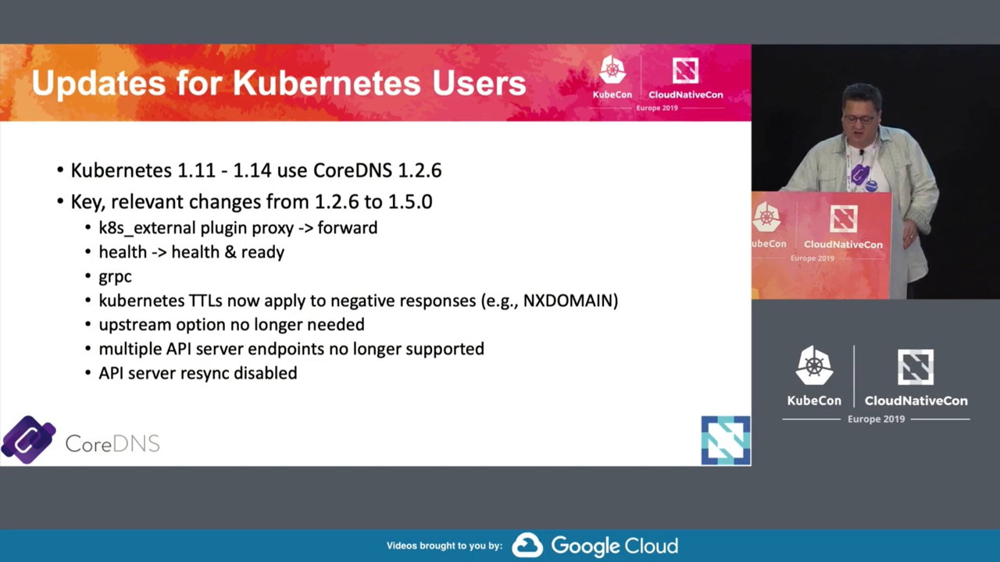
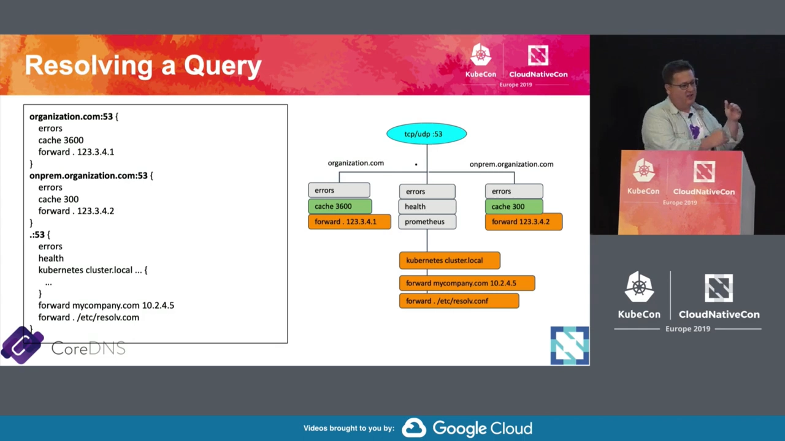
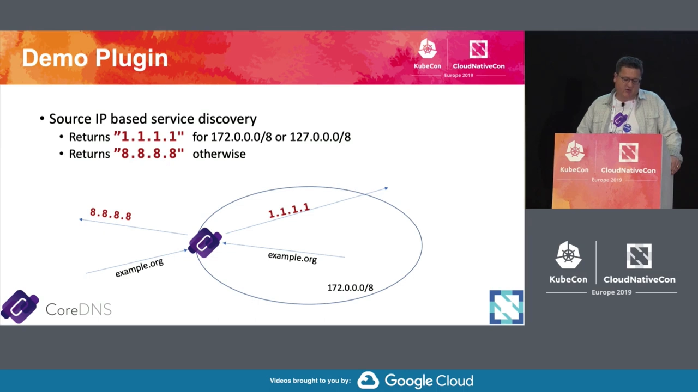
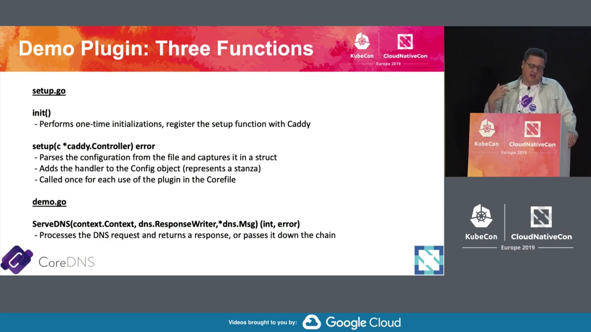
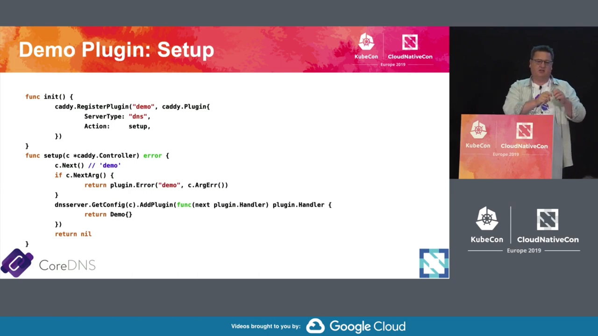
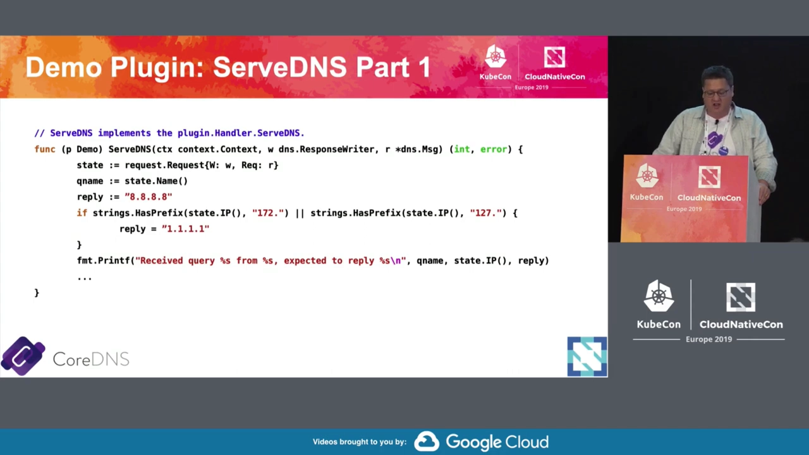

# CoreDNS：一条插件链，把 DNS 服务器变成可组装的乐高

> 视频来源：[Deep Dive: CoreDNS - Yong Tang, MobileIron & John Belamaric, Google](https://www.youtube.com/watch?v=yHXGtFTOQmY)（CNCF / KubeCon 2019，时长约 35 分钟）。
>
> 这是 CNCF 的 CoreDNS 深潜。它先讲 CoreDNS 的定位与那一年与 Kubernetes 相关的新变化，再把重点放在 CoreDNS 最核心的设计——**插件链**：一次查询如何按域名被路由到不同的插件组合、一个插件由哪几个函数构成、怎么把新插件注册进链里（现场还写了一个不到 100 行的 demo 插件）。下文机制、代码与数字都来自该视频的图-字幕稿，可逐帧核对。

## 本讲要解决的核心问题（SCQA）

**背景（S）**：在 Kubernetes 里，我们能直接用 `my-svc.my-ns` 这样的名字访问服务，背后靠的是集群 DNS。自 Kubernetes **1.13** 起，集群默认的 DNS 服务器就是 **CoreDNS**——很多人天天在用，却未必见过它内部长什么样 [【跳转到 05:51】](https://www.youtube.com/watch?v=yHXGtFTOQmY&t=351)。

**冲突（C）**：CoreDNS 要同时干很多彼此不同的活：解析集群内 Service/Pod 的服务发现记录、把公网域名转发给上游 DNS、加缓存、做健康检查、把 Service 对外发布……如果把这些功能全部硬编码进一个程序，代码会变得僵化、难扩展、难裁剪。

**疑问（Q）**：CoreDNS 到底用什么机制，把这么多功能拼在一起？一次查询进来，它按什么规则决定「交给谁处理」？

**回答（中心思想 A）**：答案是**插件链（plugin chain）**。CoreDNS 的配置文件 **Corefile** 由若干个「服务器块（stanza）」组成，每个块以「域名:端口」开头，声明该域名要走哪一串插件；查询先按域名匹配到某个块，再在这条链上被插件**依次处理、逐级传递**。要加功能，就写一个插件——通常只要三个函数（`init`、`setup`、`ServeDNS`）——注册进链即可。于是 CoreDNS 就像一套**以域名/区域为插槽的乐高**：换一组插件，就换了这台 DNS 服务器的行为。

---

## 一、CoreDNS 是什么：面向服务发现、以插件为中心

**CoreDNS 是一个灵活的、以插件为中心的 DNS 服务器，重点面向服务发现（service discovery）** [【跳转到 01:16】](https://www.youtube.com/watch?v=yHXGtFTOQmY&t=76)。这句话里的每个词都很关键：

- **灵活的（flexible）、插件式（plugin based）**：功能由插件拼装，因此很容易扩展出额外能力。
- **面向服务发现**：它的首要场景不是当公网权威 DNS，而是在动态环境（如 Kubernetes）里把「服务名 → 地址」这件事做对。
- 它还支持 **gRPC** 等特性，能很好地贴合云原生应用；并能与云上的 DNS（如 AWS Route 53）做同步 [【跳转到 01:41】](https://www.youtube.com/watch?v=yHXGtFTOQmY&t=101) [【跳转到 02:06】](https://www.youtube.com/watch?v=yHXGtFTOQmY&t=126)。

在 Kubernetes 里的时间线是：CoreDNS 于 1.11 达到 GA（正式可用），并在 **1.13 成为默认集群 DNS** [【跳转到 05:51】](https://www.youtube.com/watch?v=yHXGtFTOQmY&t=351)。项目由 **Miek Gieben** 发起并主导 [【跳转到 02:31】](https://www.youtube.com/watch?v=yHXGtFTOQmY&t=151)。

**一个少有人知的技术渊源**：CoreDNS 并不是从零写的，它建立在一个 Go 写的 Web 服务器框架 **Caddy** 之上。最初只是把 Caddy fork 出来改，后来干脆把 Caddy 作为库引入——这样，**服务器生命周期管理、配置文件解析、信号触发的配置重载、优雅重启**这些「脏活」全部免费继承，CoreDNS 只需专注实现 DNS 逻辑 [【跳转到 12:31】](https://www.youtube.com/watch?v=yHXGtFTOQmY&t=751) [【跳转到 12:56】](https://www.youtube.com/watch?v=yHXGtFTOQmY&t=776)。这也解释了后文一个现象：**写 CoreDNS 插件时，你会直接面对一些 Caddy 的库**（尤其是配置解析那部分）。

## 二、Kubernetes 用户该留意的新变化

视频里列了一批与 Kubernetes 用户直接相关的变化 [【跳转到 07:06】](https://www.youtube.com/watch?v=yHXGtFTOQmY&t=426)。概括成一句话：**一批老插件被更高效的实现替换，配置写法也随之变化。**



- **新增 `k8s_external` 插件**：把 LoadBalancer / ExternalIP 类型的 Service 发布到另一个区域，供集群外部解析（下面单列一节）。
- **`proxy` → `forward`**：老的 `proxy` 插件被弃用，换成 `forward`。
- **`health` 拆成 `health` 与 `ready`**：把「存活」和「就绪」两个端点分开。
- **支持 gRPC**。
- **kubernetes 的 TTL 现在也作用于否定响应**（例如 NXDOMAIN）。
- **去掉了 `upstream` 选项**：默认行为就等价于以往常规配置，升级时把它删掉即可。
- **不再支持多个 API Server 端点**，API Server 的 resync 也被禁用。

为什么要专门讲这些？因为 CoreDNS 与 Kubernetes 的**弃用策略（deprecation policy）不同** [【跳转到 06:16】](https://www.youtube.com/watch?v=yHXGtFTOQmY&t=376)：CoreDNS 改配置项时会尽量先弃用、给足迁移时间，并配套迁移工具，所以「新版本里有向后不兼容的改动」并不意味着它马上会被 Kubernetes 采纳为默认 [【跳转到 10:01】](https://www.youtube.com/watch?v=yHXGtFTOQmY&t=601)。当前正在推进的弃用项包括：`proxy` 的移除、`proxy → forward`、`health → health & ready`、去掉 `upstream` 选项、去掉多 API Server 端点支持 [【跳转到 10:01】](https://www.youtube.com/watch?v=yHXGtFTOQmY&t=601)。

### 2.1 `forward` 为什么比 `proxy` 快

`forward` 替换 `proxy` 不只是改名。老的 `proxy` **几乎对每一个请求都新开一条连接**；而 `forward` **在多个请求之间复用同一个 socket**，因此跑得快得多 [【跳转到 08:21】](https://www.youtube.com/watch?v=yHXGtFTOQmY&t=501)。

### 2.2 `k8s_external`：把集群里的服务「发布」出去

Kubernetes 定义的那套 DNS 服务发现规范（也就是 `kubernetes` 插件实现的东西）**本来只管集群内部**。可如果你想通过负载均衡器或 ExternalIP 把服务暴露出去，也会希望有一个 DNS 名能对外发布 [【跳转到 06:41】](https://www.youtube.com/watch?v=yHXGtFTOQmY&t=401)。

- 过去要灵活地做这件事，得上 **external-dns** 这样的项目，跑一整个控制器。
- 对「简单场景」，CoreDNS 给出了更轻的方案：**开启 `k8s_external` 插件**，它会**再建一个区域**，把带 LoadBalancer 或 ExternalIP 的 Service **按固定 schema**（不是随便加注解自定义成任意名字）发布在那个域名下 [【跳转到 07:06】](https://www.youtube.com/watch?v=yHXGtFTOQmY&t=426) [【跳转到 07:31】](https://www.youtube.com/watch?v=yHXGtFTOQmY&t=451)。
- 你甚至可以在企业 DNS 里**把这个区域委派（delegate）**给这台 CoreDNS 实例。
- **最佳实践**：如果要做对外发布，**另起一个独立的 CoreDNS 实例**，别让外部流量「撬」进你集群内网的 DNS [【跳转到 08:21】](https://www.youtube.com/watch?v=yHXGtFTOQmY&t=501)。

---

## 三、一次查询的解析过程：从 Corefile 到插件链

这是全文的机制核心 [【跳转到 10:01】](https://www.youtube.com/watch?v=yHXGtFTOQmY&t=601)。

**Corefile 就是 CoreDNS 的配置文件**，它由若干 **stanza（服务器块）**组成，每个块以「**域名 + 端口**」开头（通常端口都是 53，因为你只在一个端口上服务）。这些块会被汇总起来，**查询则按规则被路由进这些插件链**——每个块定义了一组「要对请求做的操作（插件）」 [【跳转到 10:26】](https://www.youtube.com/watch?v=yHXGtFTOQmY&t=626)。

于是，**同一个 CoreDNS 可以按「查询属于哪个区域」执行不同的操作**。视频给的例子是这样一份 Corefile [【跳转到 10:51】](https://www.youtube.com/watch?v=yHXGtFTOQmY&t=651) [【跳转到 11:16】](https://www.youtube.com/watch?v=yHXGtFTOQmY&t=676)：



- `organization.com`：走 `errors` + `cache`（TTL 3600）+ `forward`，转发到**上游 1**；
- `onprem.organization.com`：走同样的插件，但 `cache` 的最大保留时间**降到 300 秒**，且 `forward` 到**另一台上游**；
- `.`（任何其它域名）：走另一组插件，`forward` 到互联网（`/etc/resolv.conf` 指定的上游）。

用一张图理解这条链：查询进来 → 先匹配到某个 stanza → 依次经过该 stanza 声明的插件 → 没被处理的请求被「往下传」给链上的下一个插件。**这就是「插件链」的全部含义**：CoreDNS 的行为不是写死的，而是由「哪个区域、按什么顺序挂了哪些插件」决定的。

## 四、写一个 CoreDNS 插件：三个函数、一条链

既然一切都是插件，那插件长什么样？视频现场写了一个**不到 100 行**的 demo 插件 [【跳转到 11:41】](https://www.youtube.com/watch?v=yHXGtFTOQmY&t=701)。

### 4.1 先看它想干什么

这是个「按来源 IP 做服务发现」的小插件 [【跳转到 11:41】](https://www.youtube.com/watch?v=yHXGtFTOQmY&t=701)：

- 如果请求来源 IP 属于 `172.0.0.0/8` 或 `127.0.0.0/8`，返回 **`1.1.1.1`**；
- 否则返回 **`8.8.8.8`**。



### 4.2 三个函数

一个插件**通常只要三个函数，放进两个文件**即可 [【跳转到 12:06】](https://www.youtube.com/watch?v=yHXGtFTOQmY&t=726)：



- **`init.go`**：做一次性初始化，**把 `setup` 函数注册给 Caddy**。
- **`setup.go`**：解析 Corefile 里的配置，塞进一个结构体；**Corefile 里每出现一次该插件指令，就调用一次**。签名形如 `setup(*caddy.Controller) error`。
- **`demo.go`**：实现 `ServeDNS(context.Context, dns.ResponseWriter, *dns.Msg) (int, error)`——**真正处理 DNS 请求**：要么返回响应，要么把请求交给链上的下一个插件。

三个函数各司其职：`init` 只跑一次、`setup` 每个 stanza 各跑一次、`ServeDNS` 每个请求都可能跑。

### 4.3 注册进 Caddy

`init.go` 里做的事很直白：**把一个指令（directive）和你的 `setup` 方法关联起来** [【跳转到 14:06】](https://www.youtube.com/watch?v=yHXGtFTOQmY&t=846)：



```go
func init() {
    plugin.Register("demo", caddy.Plugin{
        ServerType: "dns",
        Action:     setup,
    })
}
```

`setup` 会拿到一个指向 Corefile 的控制器，你自己从里面把 token 读出来、解析成需要的配置 [【跳转到 14:06】](https://www.youtube.com/watch?v=yHXGtFTOQmY&t=846)。**只要不违反 Caddy 的语法，配置想怎么写都行**（Caddy 的语法相当灵活） [【跳转到 21:47】](https://www.youtube.com/watch?v=yHXGtFTOQmY&t=1307)。

### 4.4 处理请求：`ServeDNS` 与「响应写入器」

`ServeDNS` 拿到的三样东西是 [【跳转到 14:31】](https://www.youtube.com/watch?v=yHXGtFTOQmY&t=871) [【跳转到 15:21】](https://www.youtube.com/watch?v=yHXGtFTOQmY&t=921)：

- 一个 `context`；
- 一个 **`dns.ResponseWriter`**（响应写入器）；
- 真正的 DNS 查询报文 `*dns.Msg`。

**响应写入器本质上是一个接口**，最基础的情况下就是「向客户端回写的那个 socket」 [【跳转到 15:21】](https://www.youtube.com/watch?v=yHXGtFTOQmY&t=921)。但它有个巧妙之处：插件可以在调用下一个插件前**把响应写入器包一层（wrap）**，于是下游插件写出的报文会先被存到内存里，包它的插件再**解开（unwrap）**、加工后回给客户端 [【跳转到 15:46】](https://www.youtube.com/watch?v=yHXGtFTOQmY&t=946)。

demo 插件的 `ServeDNS` 逻辑是 [【跳转到 15:46】](https://www.youtube.com/watch?v=yHXGtFTOQmY&t=946)：取 `state.IP()` 看来源地址，按其第一个八位字节决定应答地址，顺手打个日志，然后把报文写回。



链式处理的规则很简单：**如果某个插件处理不了这个请求，就把它「往下传」给下一个插件**；链上的插件一个接一个地判断、处理 [【跳转到 14:56】](https://www.youtube.com/watch?v=yHXGtFTOQmY&t=896)。

### 4.5 一个现实约束：插件是「静态编译」的

CoreDNS 决定**编译进哪些插件**，靠的是一份 **`plugin.cfg`**，再用 `go generate` 生成一个把所有插件拉进来的 Go 文件；想减体积就**关掉用不到的插件重新编译** [【跳转到 18:31】](https://www.youtube.com/watch?v=yHXGtFTOQmY&t=1111)。

这意味着：**CoreDNS 至今是静态编译的，没有动态加载模块的能力** [【跳转到 17:01】](https://www.youtube.com/watch?v=yHXGtFTOQmY&t=1021)。原因是它复用了 Caddy 的这套机制，而 Caddy 没有转向 Go 的新插件体系；要为此改动 Caddy 这个「大工程」，成本太高 [【跳转到 26:32】](https://www.youtube.com/watch?v=yHXGtFTOQmY&t=1592)。

所以**每次新增/修改插件，都得重新编译出一个新的 CoreDNS 二进制** [【跳转到 17:26】](https://www.youtube.com/watch?v=yHXGtFTOQmY&t=1046)。不过也正因如此，可以做出**很小的镜像**——比如节点本地 DNS 缓存（node-local DNS cache）只加载少数几个插件，**不到 10 MB**，很适合放到每台节点上 [【跳转到 18:56】](https://www.youtube.com/watch?v=yHXGtFTOQmY&t=1136)。

另外，CoreDNS 已迁移到 **Go modules**：不再需要把代码放进 `GOPATH`，任何目录都能构建，也方便用自己的仓库/CI 来 build [【跳转到 20:35】](https://www.youtube.com/watch?v=yHXGtFTOQmY&t=1235) [【跳转到 28:12】](https://www.youtube.com/watch?v=yHXGtFTOQmY&t=1692)。

## 五、问答里的几个要点

- **能把 CoreDNS 指向 Route 53 吗？** 可以，而且有两种方式：一是把 `forward` 上游设成 Route 53（当作普通上游）；二是用 **`route53` 插件**直接读 Route 53 的 API、把记录直接服务出来，省掉再去查 Route 53 的往返 [【跳转到 22:37】](https://www.youtube.com/watch?v=yHXGtFTOQmY&t=1357) [【跳转到 23:12】](https://www.youtube.com/watch?v=yHXGtFTOQmY&t=1392)。
- **第三方插件 vs 内置插件？** 内置的写在默认 `plugin.cfg` 里；第三方（external）插件放在自己的 GitHub 仓库，只要能 `go get` 就能加进你的构建，也能登记到官网的 external plugins 列表。判断标准是：**是否对大多数人有广泛价值、是否足够简单、是否会引入过多依赖**——`kubernetes` 插件虽然依赖极多，但价值太大，所以被内置 [【跳转到 23:52】](https://www.youtube.com/watch?v=yHXGtFTOQmY&t=1432) [【跳转到 25:00】](https://www.youtube.com/watch?v=yHXGtFTOQmY&t=1500)。
- **能否像 Terraform provider 那样独立维护插件生命周期？** 理想情况是支持 Go 的动态插件，但由于 Caddy 的静态编译现状，目前做不到；Caddy 官网那种「勾选插件、在线构建二进制」的方式 CoreDNS 也不太想采用（不利于分享统一镜像） [【跳转到 26:07】](https://www.youtube.com/watch?v=yHXGtFTOQmY&t=1567) [【跳转到 26:57】](https://www.youtube.com/watch?v=yHXGtFTOQmY&t=1617)。
- **在集群里升级 CoreDNS 会中断 DNS 吗？** 基本不会。CoreDNS 在 Kubernetes 里是**无状态**的：它只是把从 API Server 缓存来的数据提供服务；杀掉一个 Pod，其它副本照常服务 [【跳转到 29:24】](https://www.youtube.com/watch?v=yHXGtFTOQmY&t=1764) [【跳转到 29:34】](https://www.youtube.com/watch?v=yHXGtFTOQmY&t=1774)。**只改 Corefile** 会触发优雅重载，配置写坏了会被拒绝、继续按旧配置运行；但要注意——如果坏掉的 Corefile 被持久化在 ConfigMap 卷上，**下次 Pod 重启可能起不来**，所以别在生产上乱来 [【跳转到 29:49】](https://www.youtube.com/watch?v=yHXGtFTOQmY&t=1789)。
- **UDP 拉数据 vs 走 API（TCP/HTTPS）拉数据？** 走 API 更可靠（出错能像 TCP 一样看到错误）、更安全、还能绕开 VPN/防火墙对协议的限制——只需访问到对方的 API 端点，不必打通 UDP 直连 [【跳转到 31:28】](https://www.youtube.com/watch?v=yHXGtFTOQmY&t=1888) [【跳转到 33:13】](https://www.youtube.com/watch?v=yHXGtFTOQmY&t=1993)。

## 小结

- **CoreDNS 的定位**：一个灵活、插件式的 DNS 服务器，重点做服务发现；自 Kubernetes 1.13 起是默认集群 DNS；它建立在 Go 的 Web 框架 **Caddy** 之上，白得了服务生命周期与配置解析能力。
- **核心机制是插件链**：Corefile 由若干以「域名:端口」开头的 stanza 组成，每个 stanza 声明一串插件；查询按区域匹配后在这条链上被逐级处理。
- **写插件只要三件事**：`init.go`（注册）、`setup.go`（解析配置）、`ServeDNS`（处理请求）；不处理的请求「往下传」。
- **`forward` 取代 `proxy`**：复用 socket，比「一请求一连接」的 `proxy` 快得多。
- **`k8s_external`**：把 LoadBalancer/ExternalIP 的 Service 发布到单独区域，建议单起实例、并由企业 DNS 委派该区域。
- **插件是静态编译的**：改插件要重新编译；好处是可以裁出极小镜像（如 node-local cache 不到 10 MB）。

## 关键术语速查

| 术语 | 一句话解释 |
| --- | --- |
| CoreDNS | 以插件为中心、面向服务发现的 DNS 服务器，Kubernetes 默认集群 DNS |
| Caddy | CoreDNS 依赖的 Go Web 服务器框架，提供了服务生命周期与配置解析 |
| Corefile | CoreDNS 的配置文件，由若干「域名:端口」开头的 stanza 组成 |
| stanza（服务器块） | Corefile 里的一段配置，声明某区域要走哪一串插件 |
| 插件链（plugin chain） | 查询在链上被插件依次处理、逐级传递的机制 |
| `forward` | 取代 `proxy` 的转发插件，复用 socket，更快 |
| `k8s_external` | 把 LoadBalancer/ExternalIP 服务发布到单独区域的插件 |
| `ready` / `health` | 分别提供就绪、存活端点的插件 |
| `plugin.cfg` | 决定编译进哪些插件的清单，配合 `go generate` 使用 |
