# Pod 里的一次 DNS 查询，到底走了哪些路

> 视频来源：[DNS Deep Dive in Kubernetes with CoreDNS - Jingming Guo, Airbnb](https://www.youtube.com/watch?v=lAUmdIGP_fE)（CNCF / KubeCon 2024，时长约 33 分钟）。
>
> 这支深潜从「一个 Pod 发出的一次 DNS 查询」讲起，把 Kubernetes DNS 全链路拆开：`resolv.conf` 的每一行、`ndots` 与 search domain 如何影响解析、CoreDNS 的 `kubernetes` 插件如何 watch 出服务发现记录，再到 Airbnb 迁移 CoreDNS 的实测收获与多集群 DNS 方案。下文内容来自该视频的图-字幕稿，可逐帧核对。

## 本讲要解决的核心问题（SCQA）

**背景（S）**：Kubernetes 里，应用用「服务名」互相访问，靠的是集群 DNS；CoreDNS 是默认的集群 DNS 服务器。

**冲突（C）**：但 DNS 在 K8s 里常被吐槽「玄学」——同一个服务名，有时一次就解析成功，有时要绕好几圈；出错时不知道查询到底发给了谁、又被自动追加了哪些后缀。演讲者一开场就问「有多少人排查过 K8s 里让人困惑的 DNS 问题」，结果**举手的特别多** [【跳转到 01:13】](https://www.youtube.com/watch?v=lAUmdIGP_fE&t=73)。

**疑问（Q）**：一个 Pod 发出的 DNS 查询，从程序到解析结果，中间到底发生了什么？CoreDNS 又是怎么知道集群里有哪些 Service/Endpoint 的？

**回答（中心思想 A）**：查询走一条固定的链路——**应用 → 解析器（读 `resolv.conf`）→ 集群 DNS Service 的 ClusterIP → kube-proxy → CoreDNS**。CoreDNS 里最关键的是 **`kubernetes` 插件**：它用 client-go 的 **watch** 持续跟踪 Service/Endpoints，在**本地内存里维护一份缓存**，并据此生成 DNS 记录；集群外的域名则交给 `forward` 转发到上游（如 Route 53）。而**「玄学」多半来自 `resolv.conf` 里的 `ndots` 与 `search`**——搞懂它，就搞懂了 K8s DNS 的行为。

## 一、一次 DNS 查询的完整生命周期

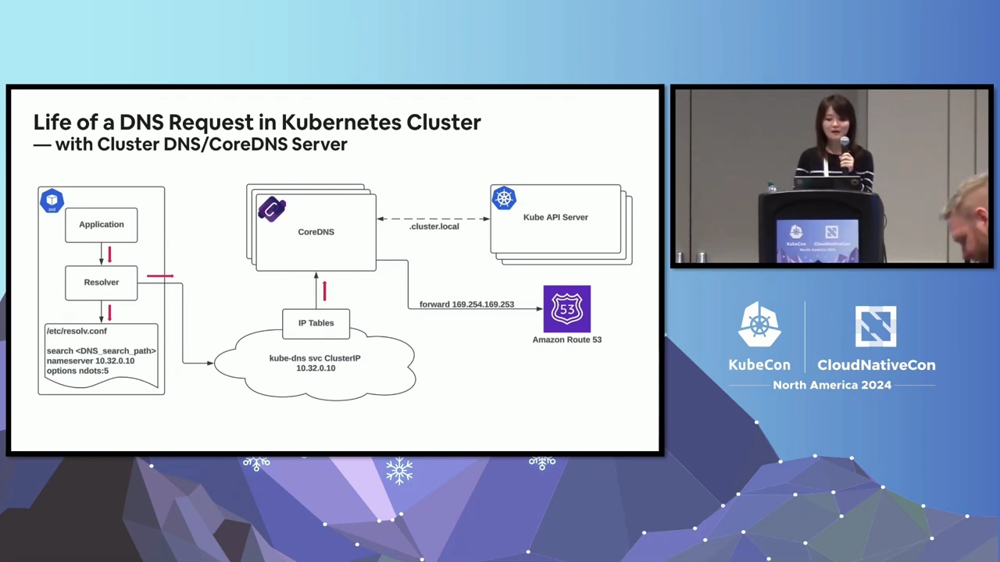

- **应用发查询**：应用把「域名 → IP」的解析交给**解析器（resolver）**。解析器是运行在系统里、提供域名解析核心功能的库；不同语言/操作系统的实现不同——**以 Go 为例，有 `cgo` 解析器（调用标准 C 库）和纯 Go 解析器两种** [【跳转到 01:38】](https://www.youtube.com/watch?v=lAUmdIGP_fE&t=98) [【跳转到 02:03】](https://www.youtube.com/watch?v=lAUmdIGP_fE&t=123)。
- **读配置**：解析器读取 Pod 里的 **`/etc/resolv.conf`**，其中的 `nameserver` 就是它要发查询的目标。如果用的是集群 DNS，这个 IP 就应该是**集群 DNS Service 的 ClusterIP**（例如 `kube-dns` 的 `10.32.0.10`） [【跳转到 02:28】](https://www.youtube.com/watch?v=lAUmdIGP_fE&t=148)。
- **到达集群 DNS**：请求发到 ClusterIP 后，由 **kube-proxy** 把流量路由到 CoreDNS 的 Pod；若 kube-proxy 是 **iptables 模式**，就经 iptables 规则转发 [【跳转到 02:53】](https://www.youtube.com/watch?v=lAUmdIGP_fE&t=173)。
- **CoreDNS 处理**：CoreDNS 是灵活、可扩展的 DNS 服务器，也是当前默认的集群 DNS。作为集群 DNS 时，它**与 Kubernetes API Server 交互**，解析**由 Kubernetes 定义的 Service 与 Pod 的 DNS**；**不属于集群定义的域名**则 `forward` 到上游解析器（例如 Route 53） [【跳转到 03:18】](https://www.youtube.com/watch?v=lAUmdIGP_fE&t=198) [【跳转到 03:43】](https://www.youtube.com/watch?v=lAUmdIGP_fE&t=223)。

一句话概括：**集群内的名字由 `kubernetes` 插件回答，集群外的名字由 `forward` 转发出去。**

## 二、resolv.conf：三行配置决定了解析行为

Pod 里的 `/etc/resolv.conf` 能直接看到 DNS 配置，它包含三部分：`nameserver`、`search`、`options` [【跳转到 04:08】](https://www.youtube.com/watch?v=lAUmdIGP_fE&t=248)：

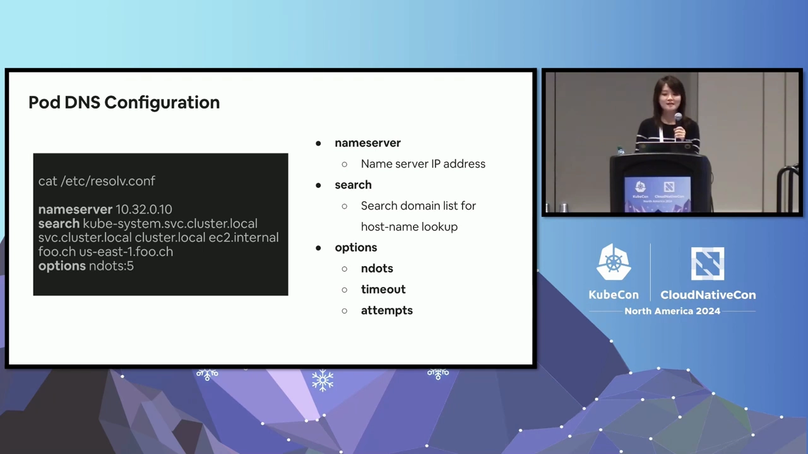

- **`nameserver`**：DNS 服务器的 IP 地址。
- **`search`**：**搜索域列表**（search domain 列表），后面讲「为什么短名字也能解析」就靠它。
- **`options`**：对解析器内部设置的修改。常见的有 `ndots`、`timeout`、`attempts` [【跳转到 04:49】](https://www.youtube.com/watch?v=lAUmdIGP_fE&t=289)：
  - **`ndots`**：一个名字里**至少要含多少个「点」，才会被当作绝对名字（直接一次查询）**；点数不足 `ndots` 时，解析器会先按搜索域补后缀再查。
  - **`timeout`**：解析器等某个 nameserver 响应的时长，超时后换另一个 nameserver 重试。
  - **`attempts`**：解析器向 nameserver 发查询的重试次数，超过就报错给应用。

## 三、FQDN 与 PQDN：为什么 Pod 里能直接用短名字

- **FQDN**（Fully Qualified Domain Name，完全限定域名）：一个地址的**完整域名**。
- **PQDN**（Partially Qualified Domain Name，部分限定域名）：只写了完整域名的一部分。

Kubernetes 为 Service 定义的 DNS 记录格式是 **`<service>.<namespace>.svc.<cluster domain>`**，解析结果是该 Service 的 **ClusterIP**（一个虚拟 IP） [【跳转到 06:28】](https://www.youtube.com/watch?v=lAUmdIGP_fE&t=388)。例如：

- Service 名 `foo`、命名空间 `bar`、集群域 `cluster.local`；
- 写成 FQDN 就是 **`foo.bar.svc.cluster.local`**——**用正确的 DNS 配置，它一定能被集群 DNS 解析**；
- 而我们平时只写 PQDN **`foo.bar`**，它**也能被解析**——怎么做到的？看搜索域。

### 3.1 `ndots` 怎么决定「先补后缀还是直接查」

解析器会数名字里的点：

- **`www.airbnb.com`** 有 2 个点，**达到 `ndots` 阈值** → **直接发给 nameserver**（这里是 Route 53）→ 一次拿到结果 [【跳转到 05:38】](https://www.youtube.com/watch?v=lAUmdIGP_fE&t=338)。
- **`foo.bar`** 只有 1 个点，**没到阈值** → 不会直接当成绝对名字，而是**依次追加 search domain 列表里的每个后缀**去试 [【跳转到 06:53】](https://www.youtube.com/watch?v=lAUmdIGP_fE&t=413)。

以 `foo.bar` 为例（`ndots=1`），解析器会这样试：

1. 先直接查 `foo.bar` → 集群 DNS 解析不了 → 返回 **NXDOMAIN**（域名不存在）；
2. 这个结果**不会马上返回给客户端**，因为配置里有 search domain 列表；解析器**追加第一个搜索域**，拼成 `foo.bar.bar.svc.cluster.local` 再查 → 又一个 NXDOMAIN；
3. 继续追加下一个搜索域，拼成 `foo.bar.svc.cluster.local` → **这次对了**，返回给客户端 [【跳转到 07:43】](https://www.youtube.com/watch?v=lAUmdIGP_fE&t=463) [【跳转到 08:08】](https://www.youtube.com/watch?v=lAUmdIGP_fE&t=488)。

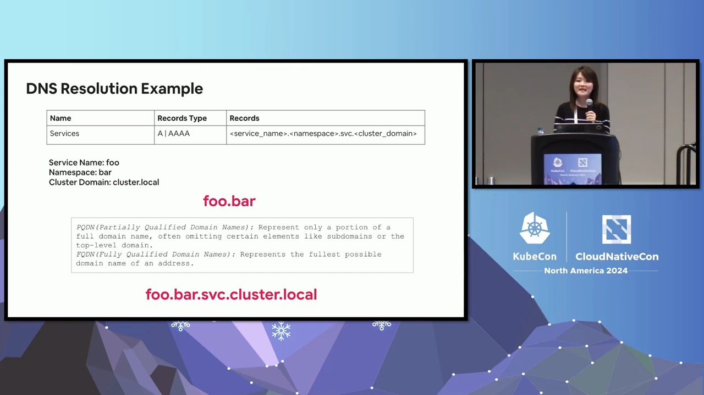

### 3.2 K8s 默认 `ndots=5` 的「坑」

有意思的是，**`ndots=5` 正是 Kubernetes 集群 DNS 的默认 `ndots` 设置** [【跳转到 08:33】](https://www.youtube.com/watch?v=lAUmdIGP_fE&t=513)。这意味着：**几乎任何普通域名都会先把 search 列表里所有搜索域都追加一遍、查完一轮，最后才按原样发一次绝对查询。**

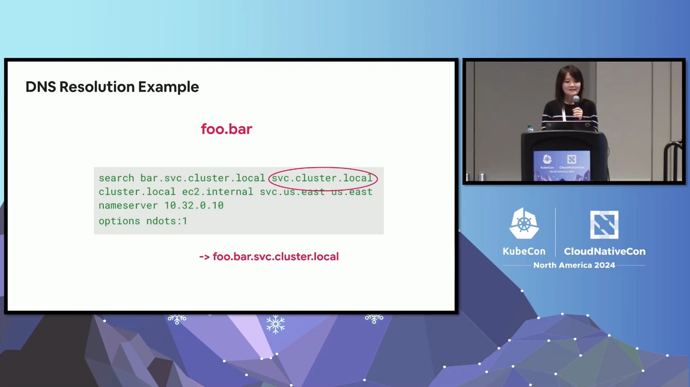

结果就是：客户端**最终可能拿到正确结果，但客户端侧 DNS 请求延迟没有被优化**——这就是很多人抱怨「K8s DNS 慢/绕」的根源之一 [【跳转到 08:33】](https://www.youtube.com/watch?v=lAUmdIGP_fE&t=513)。

## 四、定制 Pod 的 DNS 配置

既然默认不理想，能不能改？可以。有三种入口 [【跳转到 08:58】](https://www.youtube.com/watch?v=lAUmdIGP_fE&t=538)：

- **kubelet 配置**：kubelet 负责在创建 Pod 时**构造 Pod 的 DNS 配置**，可用它来定制：
  - **`clusterDNS`**：集群 DNS 的 IP 地址列表；设置后，kubelet 会把集群内**所有容器**的 nameserver 配上这些地址（对应 `ClusterFirst` 策略） [【跳转到 09:20】](https://www.youtube.com/watch?v=lAUmdIGP_fE&t=560)；
  - **`clusterDomain`**：集群的 DNS 域（如 `cluster.local`）；
  - **`resolvConf`**：作为「基础解析配置文件」的路径，用于 `Default` 策略的 Pod；Airbnb 就用它来指定 Node 上的自定义 DNS 配置 [【跳转到 10:10】](https://www.youtube.com/watch?v=lAUmdIGP_fE&t=610)。
- **`dnsPolicy`**：kubelet 依据策略生成 Pod 的 DNS 配置。Kubernetes 定义了四种 [【跳转到 11:00】](https://www.youtube.com/watch?v=lAUmdIGP_fE&t=660)：
  - **`Default`**：继承宿主/基础容器的 DNS 配置；
  - **`ClusterFirst`**：用集群 DNS 解析集群域名。**注意：`Default` 并不是默认值——未显式指定时用的是 `ClusterFirst`**；
  - **`ClusterFirstWithHostNet`**：给使用 hostNetwork 的 Pod 用，显式声明走集群 DNS；
  - **`None`**：不做任何设置，DNS 配置完全由 Pod 自己（通过 `dnsConfig`）提供。
- **`dnsConfig`**：在 Pod spec 里直接定义全部 DNS 配置——如果想完全自定义、又不想动 kubelet 的全局设置，就用它 [【跳转到 11:50】](https://www.youtube.com/watch?v=lAUmdIGP_fE&t=710)。

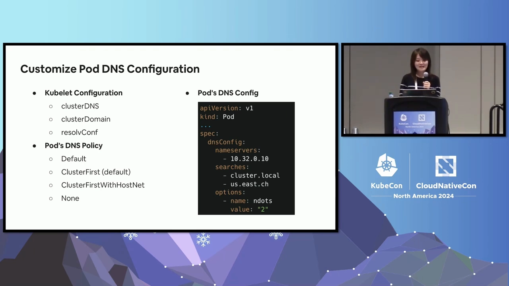

### 4.1 Airbnb 的例子：service mesh + AWS 服务

Airbnb 有个典型场景：**应用跑在 service mesh 里，同时还要访问 AWS 服务** [【跳转到 12:08】](https://www.youtube.com/watch?v=lAUmdIGP_fE&t=728)。

- service mesh 应用之间用 **`<service>.<namespace>`** 的 PQDN 互访，完整记录形如 `service.namespace.mesh.domain`，而 **mesh 的 DNS 记录存在 Route 53** 里；
- 于是他们把配置设成：**search 列表里放 mesh 域、`ndots` 设成 2、nameserver 指向 Route 53** [【跳转到 12:33】](https://www.youtube.com/watch?v=lAUmdIGP_fE&t=753)；
- 这样两类查询都被优化到「**一次 DNS 请求**」 [【跳转到 12:58】](https://www.youtube.com/watch?v=lAUmdIGP_fE&t=778)：
  - **mesh 的 PQDN** 只有 1 个点（不到 `ndots=2`）→ **总会先补上 mesh 域**再发查询，正好命中；
  - **AWS 服务端点**至少含 2 个点（达到阈值）→ **直接发绝对查询**。

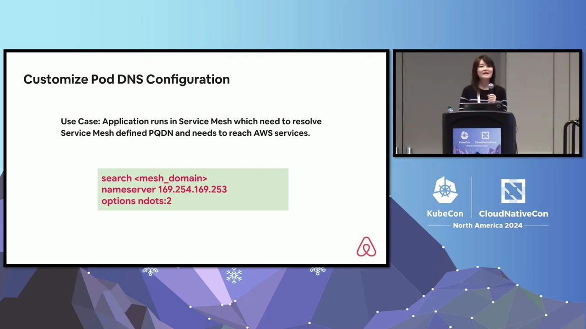

### 4.2 一个容易忽略的限制：search domain 数量上限

留意 DNS 配置的**上限** [【跳转到 13:23】](https://www.youtube.com/watch?v=lAUmdIGP_fE&t=803)：

- **glibc 标准库的解析器**曾限制 search domain 的**数量与字符数**，但在 **v2.26 起移除了该限制**；
- Kubernetes 自 **v1.28 起也放宽**了 search 域与 search path 的限制；
- 但 **busybox** 自带的 `nslookup`/`dig` 等工具**仍有 8 个 search domain 的上限**——**如果你在高于 v1.28 的集群里、用了超过 8 个搜索域，又用 busybox 工具去查，超出的搜索域不会被使用** [【跳转到 13:48】](https://www.youtube.com/watch?v=lAUmdIGP_fE&t=828) [【跳转到 14:13】](https://www.youtube.com/watch?v=lAUmdIGP_fE&t=853)。

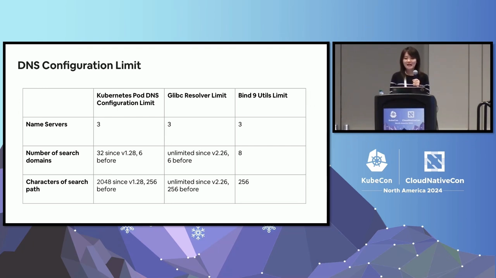

## 五、CoreDNS 作为集群 DNS：插件链 + kubernetes 插件

CoreDNS 本质是一个「**DNS 服务器 + 转发器（forwarder）**」，用 Go 写成，靠**插件链（plugin chain）**工作，每个插件负责一项具体功能 [【跳转到 15:03】](https://www.youtube.com/watch?v=lAUmdIGP_fE&t=903)。要让它当集群 DNS 服务器，最关键的是启用并配置 **`kubernetes` 插件**：

- **`kubernetes` 插件**实现了 Kubernetes 基于 DNS 的服务发现：它**用 Kubernetes client 的 API watch 功能跟踪 Service 与 Endpoint 对象**，据此按 K8s 定义的 DNS 格式**构造 DNS 记录**，并**在本地维护一份被 watch 对象的缓存** [【跳转到 15:28】](https://www.youtube.com/watch?v=lAUmdIGP_fE&t=928)。

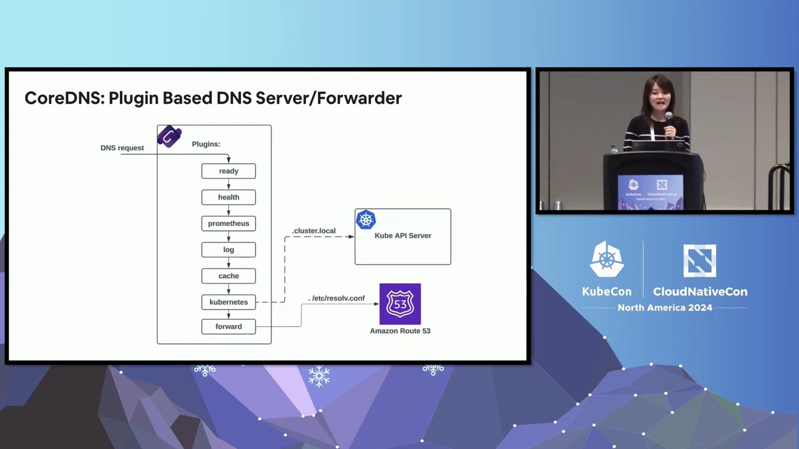

除 `kubernetes` 外，常用的插件还有 [【跳转到 15:53】](https://www.youtube.com/watch?v=lAUmdIGP_fE&t=953)：`ready`（提供就绪端点）、`health`（提供存活端点）、`prometheus`（暴露指标）、`log`（查询日志）、`cache`（服务端前端缓存）、`forward`（把请求代理给上游解析器）。CoreDNS 也支持自定义插件，但**注意插件的顺序非常重要**——顺序定义在 CoreDNS 的 `plugin.cfg` 里，自定义插件必须插到链上**正确的位置** [【跳转到 16:18】](https://www.youtube.com/watch?v=lAUmdIGP_fE&t=978)。

插件还能**按不同域名/区域**分别配置：Corefile（存放在 ConfigMap 里）可以规定 `cluster.local` 的请求交给 `kubernetes` 插件，其它域名交给 `forward` 转发到上游 DNS [【跳转到 16:43】](https://www.youtube.com/watch?v=lAUmdIGP_fE&t=1003) [【跳转到 17:08】](https://www.youtube.com/watch?v=lAUmdIGP_fE&t=1028)。此外还能开：查询日志、设置前端缓存 TTL、Corefile 变更时**自动重载**等 [【跳转到 17:38】](https://www.youtube.com/watch?v=lAUmdIGP_fE&t=1058)。

CoreDNS 作为集群 DNS，能解析出 Kubernetes 为 Service 与 Pod 定义的 DNS 记录——**这些记录正是被各类 Kubernetes 服务与项目广泛采用的「服务发现」基础** [【跳转到 17:54】](https://www.youtube.com/watch?v=lAUmdIGP_fE&t=1074)。

## 六、Airbnb 迁移 CoreDNS 的三条经验

到 2024 年 3 月，Airbnb 的 Kubernetes 平台已**全面接入 CoreDNS**，是一次在运维与可靠性上都相当成功的集成 [【跳转到 18:19】](https://www.youtube.com/watch?v=lAUmdIGP_fE&t=1099)。他们分享了三条经验：

1. **先评估功能与性能再采用**。Airbnb 的评估里，**平均 DNS 请求延迟改善了约 70%**，这大大增强了他们迁移的信心 [【跳转到 18:44】](https://www.youtube.com/watch?v=lAUmdIGP_fE&t=1124)。

   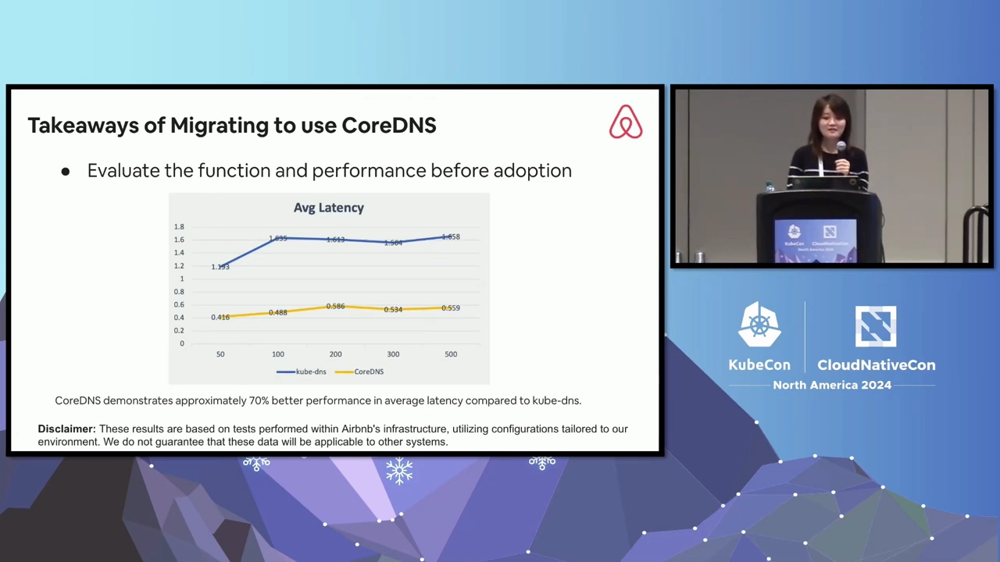

2. **迁移期间复用同一个 DNS Service**。集群初始化时，集群 DNS 的 Service IP 已经预留；如果新建一个 Service、再改 Pod 的 DNS 配置去指向新 IP，工作量巨大。**由于 Service 靠 label selector 选择 Pod**，可以让新老两个 Deployment 的 Pod 都带上**同一个 DNS Service 的 selector**——于是**迁移期间无需新建 Service、也无需改 Pod 的 DNS 配置**，还能**逐步切换流量、控制故障影响面（blast radius）** [【跳转到 19:09】](https://www.youtube.com/watch?v=lAUmdIGP_fE&t=1149) [【跳转到 19:34】](https://www.youtube.com/watch?v=lAUmdIGP_fE&t=1174)。

   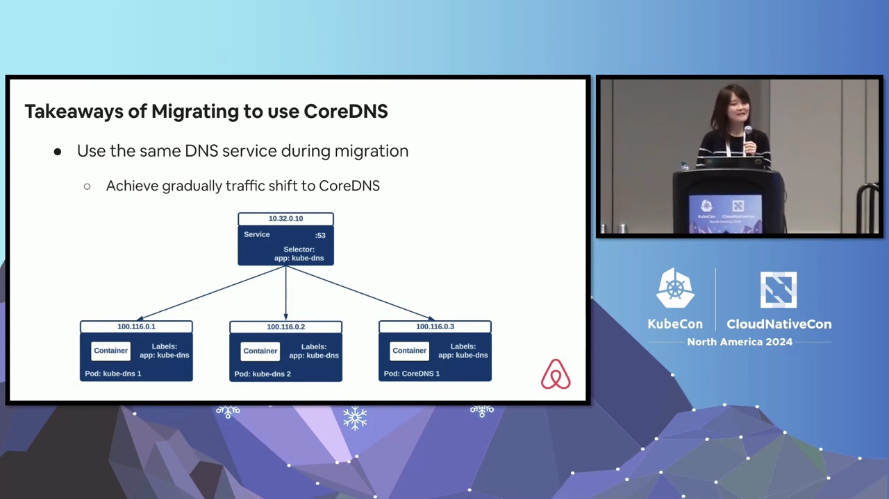

3. **给 CoreDNS 容器设合适的 memory/CPU request** [【跳转到 19:59】](https://www.youtube.com/watch?v=lAUmdIGP_fE&t=1199)：
   - CoreDNS 作集群 DNS 时，**内存占用随 Service 与 Endpoint 数量增长**（因为它本地缓存了这些对象）；而**所有副本的本地缓存大小是一样的**，**不会随 HPA（水平自动扩缩）自动变化**；
   - Airbnb 评估发现 **CoreDNS 性能是 CPU 驱动的**，因此**基于 CPU 使用率开 HPA 是有益的** [【跳转到 20:24】](https://www.youtube.com/watch?v=lAUmdIGP_fE&t=1224)。

   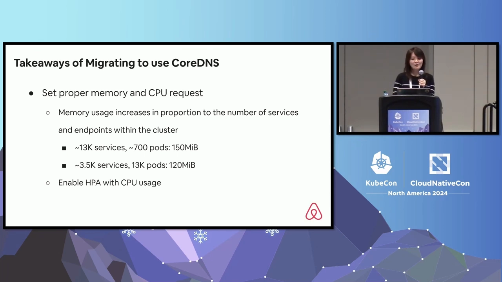

## 七、多集群 DNS 与它的挑战

Airbnb 还分享了跨集群（multi-cluster）的 DNS 用法 [【跳转到 20:49】](https://www.youtube.com/watch?v=lAUmdIGP_fE&t=1249)。

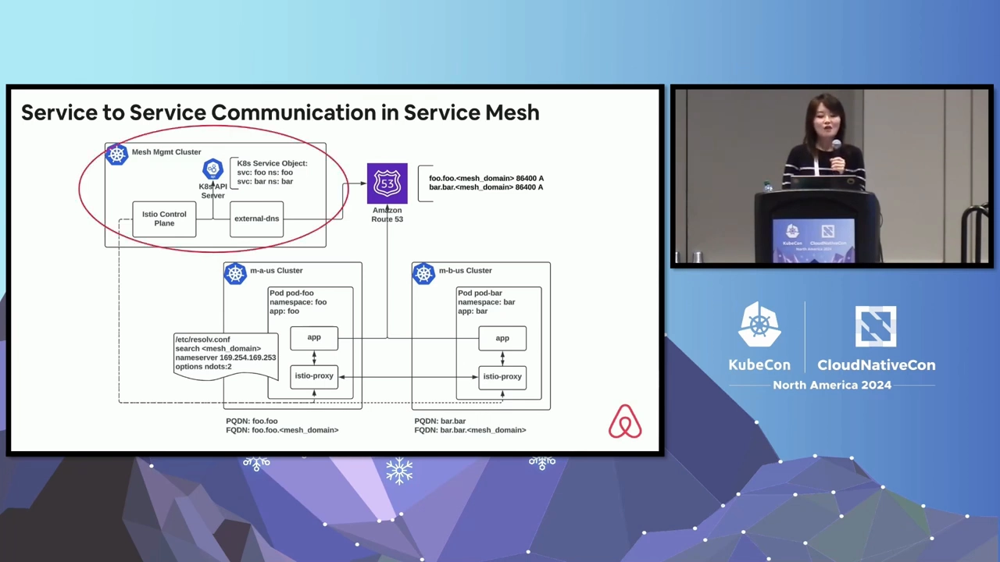

- **service mesh 的服务间通信**：mesh 是「加速服务间通信的专用基础设施层」，用代理（proxy）承载。Airbnb 用的是 **Istio**，架构是「**一个专用的 mesh 管理集群跑控制面 + 多个工作负载集群跑数据面**」。控制面会 **watch 所有集群的 endpoint、把同一命名空间的 endpoint 合并**，再推给各数据面的 Envoy sidecar 做路由。要让工作负载集群之间用 PQDN 互访，他们会在**管理集群里按应用所在命名空间创建一个 Service 对象**，保证每个应用有唯一 IP，并通过 **external-dns** 把该 Service 的 DNS 记录同步到 **Route 53**；应用再通过 Route 53 解析，剩下的流量交给 Envoy [【跳转到 21:14】](https://www.youtube.com/watch?v=lAUmdIGP_fE&t=1274) [【跳转到 22:54】](https://www.youtube.com/watch?v=lAUmdIGP_fE&t=1374)。
- **StatefulSet 的直接 Pod 寻址**：分布式数据库跑在 K8s 上时，**StatefulSet 对数据分区与同步很重要**，而每个 Pod 有**可预测的 DNS 名**（从 StatefulSet 名 + Pod 序号派生）。为了跨集群直接寻址，**同样借助 external-dns + Route 53**：每个集群把 Pod IP 用不同域名同步到 Route 53，应用查询带目标域的 DNS 名就能直达目标 Pod [【跳转到 23:44】](https://www.youtube.com/watch?v=lAUmdIGP_fE&t=1424) [【跳转到 24:34】](https://www.youtube.com/watch?v=lAUmdIGP_fE&t=1474)。

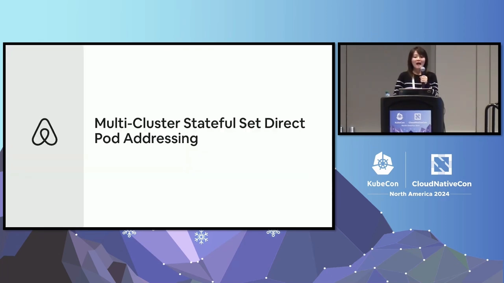

**挑战**在于他们**重度依赖云 DNS（Route 53）**，而 Route 53 有硬限制 [【跳转到 24:59】](https://www.youtube.com/watch?v=lAUmdIGP_fE&t=1499)：

- Route 53 的 API 有「**每 AWS 账号每秒 5 个请求**」的硬限制，会影响托管 DNS 记录的更新；
- 还有「**每个弹性网卡每秒的查询/包数**」硬限制，会影响 DNS 查询。

**正在探索的替代方案** [【跳转到 25:24】](https://www.youtube.com/watch?v=lAUmdIGP_fE&t=1524)：

- **Kubernetes 的 Multi-Cluster Services API（MCS）**；
- **CoreDNS 的 multicluster 插件**：支持 Kubernetes 多集群 DNS 解析，引入 **clusterset**（一组高度互信、共享所有权的集群的占位名）概念，并用 **multicluster service controller** 跨集群同步 Service、使其可用于多集群服务发现与连通；
- **Istio 的 DNS sidecar 代理**：把域名→IP 的映射存在 sidecar 本地；**局限是只对带了 Istio sidecar 的应用生效** [【跳转到 25:49】](https://www.youtube.com/watch?v=lAUmdIGP_fE&t=1549) [【跳转到 26:39】](https://www.youtube.com/watch?v=lAUmdIGP_fE&t=1599)。

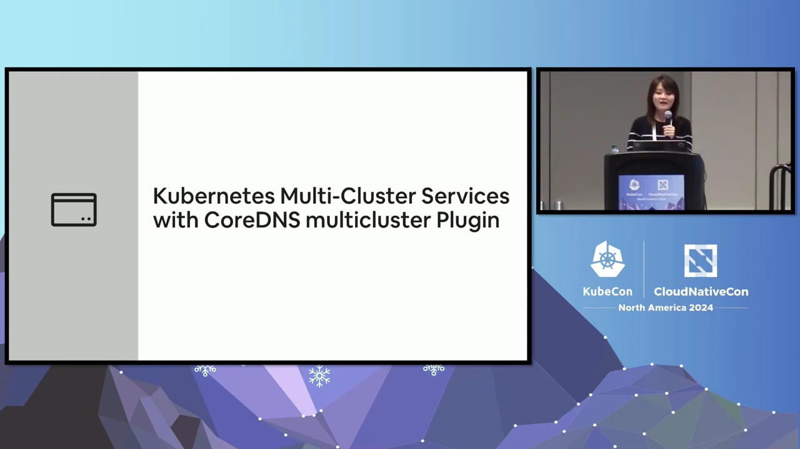

## 八、问答里的几个要点

- **CoreDNS 怎么做缓存失效？** 如果用 CoreDNS 的前端缓存，**失效依赖记录的 TTL**——TTL 到期即失效 [【跳转到 27:34】](https://www.youtube.com/watch?v=lAUmdIGP_fE&t=1654)。
- **能用 NS update 动态更新 DNS 区域吗？** NS update（RFC 2136，BIND 用于动态更新的机制）在某些内部区域/测试场景可能有用；能否支持取决于具体插件——Airbnb 有一批 CoreDNS 插件，可以查阅对应插件的文档 [【跳转到 28:49】](https://www.youtube.com/watch?v=lAUmdIGP_fE&t=1729)。
- **试过 node-local DNS cache 吗？** 那是**在每个节点上以 DaemonSet 跑的额外缓存层**（本身也是一个以 DaemonSet 运行的 CoreDNS）。它能提升 DNS 请求性能，但**会在每个节点多引入一个组件和额外成本**，要看系统是否真的需要；Airbnb 当时**仍在评估** [【跳转到 29:14】](https://www.youtube.com/watch?v=lAUmdIGP_fE&t=1754) [【跳转到 30:29】](https://www.youtube.com/watch?v=lAUmdIGP_fE&t=1829)。
- **性能测试怎么做？** 取决于应用的 DNS 使用模式：想测「不带缓存」的裸性能就**禁用缓存**；如果缓存容量足以装下集群里的 DNS 记录，也可以**开着缓存测**——按你的场景选择 [【跳转到 31:19】](https://www.youtube.com/watch?v=lAUmdIGP_fE&t=1879) [【跳转到 31:44】](https://www.youtube.com/watch?v=lAUmdIGP_fE&t=1904)。

## 小结

- **查询链路**：应用 → 解析器（读 `/etc/resolv.conf`）→ 集群 DNS Service 的 ClusterIP → kube-proxy → CoreDNS。
- **resolv.conf 三个关键词**：`nameserver`（发给谁）、`search`（补哪些后缀）、`options`（`ndots`/`timeout`/`attempts`）。
- **「玄学」的根源是 `ndots`**：默认 `ndots=5` 会让普通域名先追加完所有搜索域再查，延迟自然不优；按场景调 `ndots` 与 `search` 能显著改善。
- **CoreDNS 的服务发现靠 `kubernetes` 插件**：用 client-go **watch** 跟踪 Service/Endpoints，本地缓存并据此生成 DNS 记录。
- **迁移经验**：先测性能（Airbnb 约 70% 延迟改善）、复用同一个 DNS Service、按 CPU 给 CoreDNS 配 HPA 与资源。
- **多集群 DNS**：常用 external-dns + Route 53，但要警惕 Route 53 的硬限流；替代方向有 MCS API、CoreDNS multicluster 插件、Istio DNS sidecar。

## 关键术语速查

| 术语 | 一句话解释 |
| --- | --- |
| resolver（解析器） | 系统里把域名解析成 IP 的库，如 Go 的 cgo / 纯 Go 解析器 |
| `/etc/resolv.conf` | Pod 里的 DNS 配置文件，含 nameserver、search、options |
| `ndots` | 名字里至少含几个点才被当作绝对名字直接查询，K8s 默认为 5 |
| search domain | 域名点数不足 `ndots` 时，依次追加尝试的搜索后缀 |
| FQDN / PQDN | 完全限定域名 / 部分限定域名 |
| ClusterIP | Service 的虚拟 IP，`<svc>.<ns>.svc.<domain>` 会解析到它 |
| `kubernetes` 插件 | CoreDNS 里实现 K8s 服务发现的插件，靠 watch + 本地缓存 |
| `dnsPolicy` | Pod 的 DNS 策略：Default / ClusterFirst / ClusterFirstWithHostNet / None |
| `dnsConfig` | 在 Pod spec 里完全自定义 DNS 配置 |
| external-dns | 把 K8s Service 的 DNS 记录同步到外部 DNS 提供商（如 Route 53）的组件 |
| clusterset | 多集群 DNS 里「一组互信、共享所有权的集群」的概念 |
