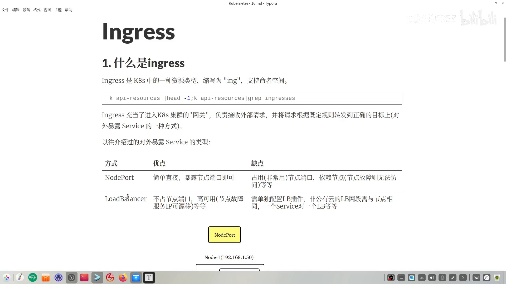
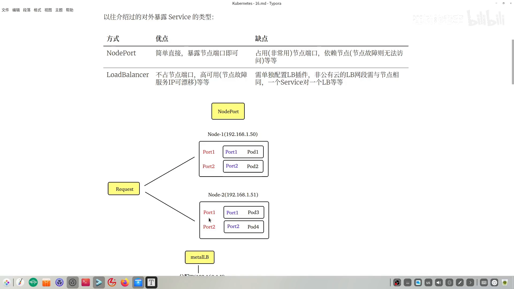
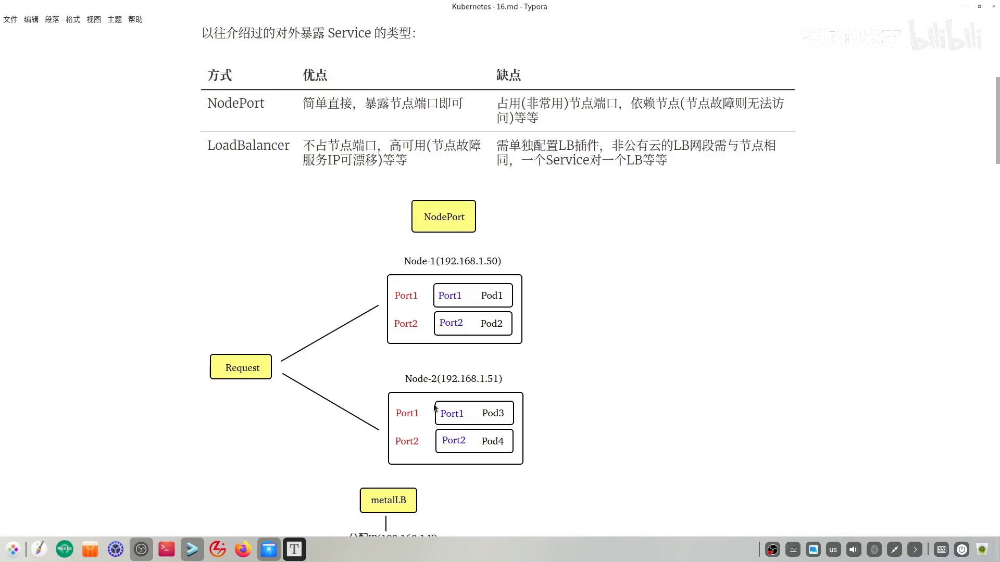
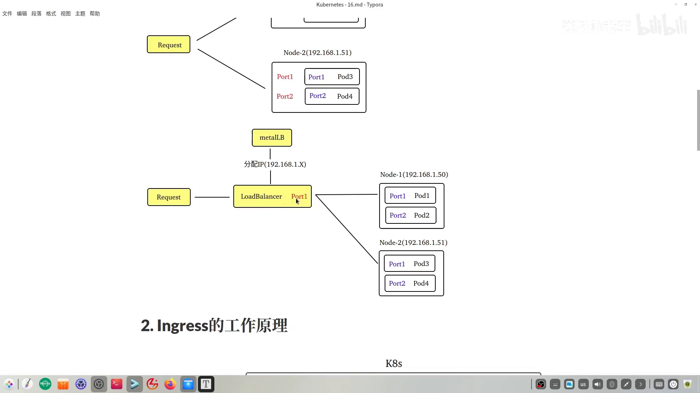
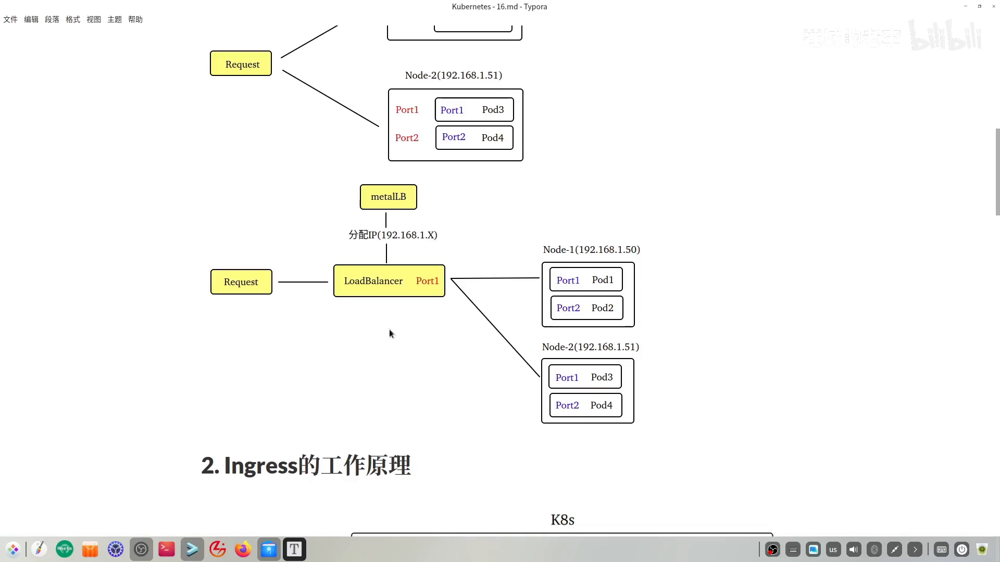
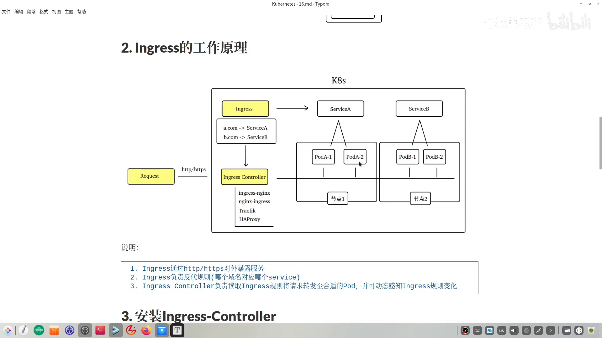
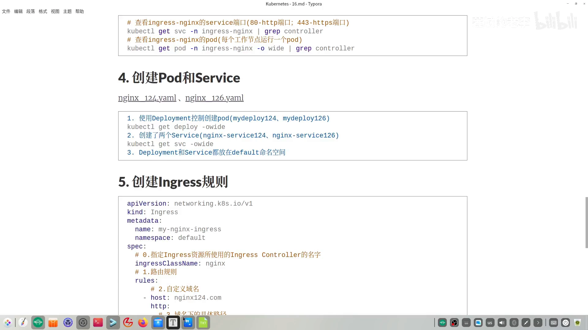
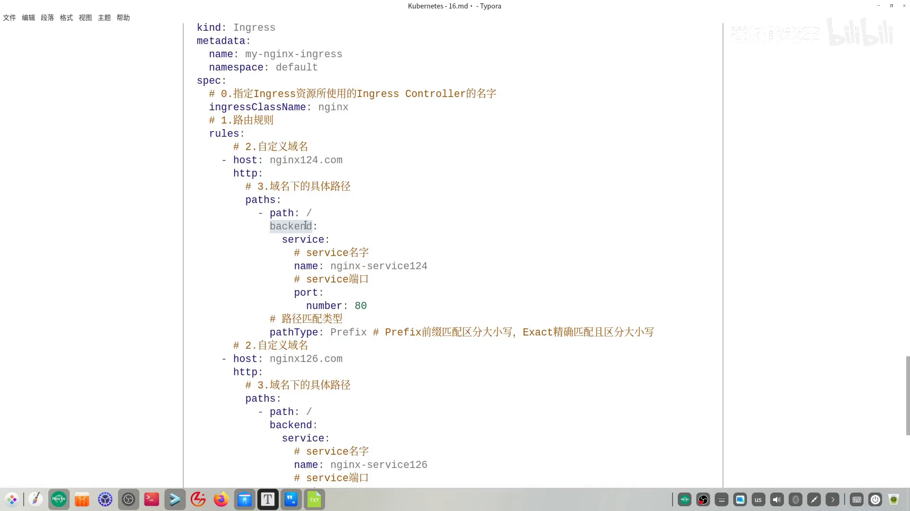
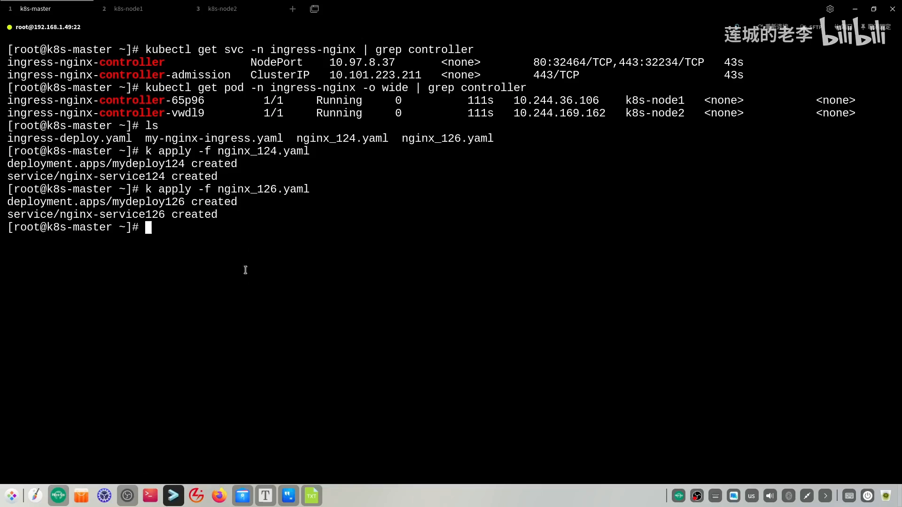
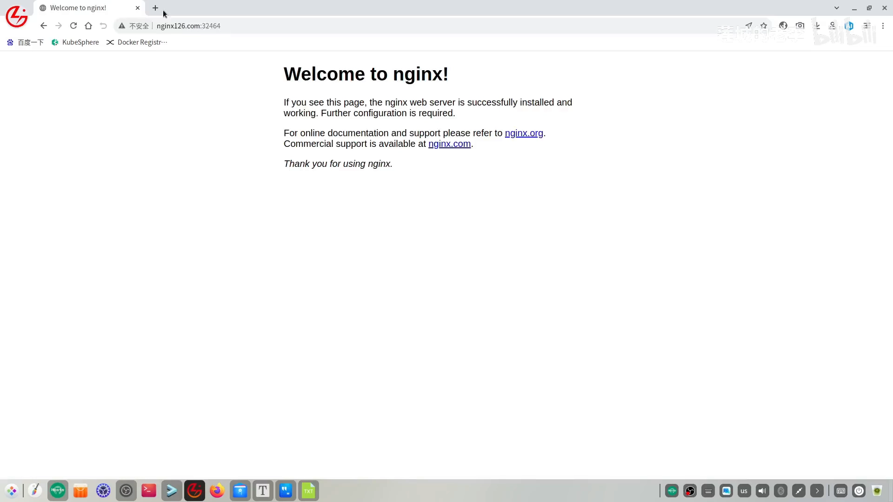

# Ingress：用一个七层网关统一集群入口

> 视频来源：[K8s 网关生态标准 Ingress](https://www.bilibili.com/video/BV1RKc2eEEd8/)（B 站，up 主「连长老李」，时长约 18 分钟）。
>
> 这支视频先讲清 Ingress「是什么、为什么需要」，再动手用**官方 Ingress Controller** 搭一套环境：装控制器、建业务 Pod/Service、写 Ingress 路由规则，最后用「404 页面里显示 NGINX 版本」的小技巧验证域名确实路由到了目标 Pod。下文机制、命令与输出都来自该视频的图-字幕稿，可逐帧核对。

## 本讲要解决的核心问题（SCQA）

**背景（S）**：集群里的应用要对外提供服务，之前我们已经学过两种「暴露 Service」的方式——**NodePort** 和 **LoadBalancer**。它们都能让外部流量进到集群里的 Pod。

**冲突（C）**：但这两者都有硬伤。NodePort 要在每个节点上开放 `30000~32767` 区间的高位端口，Pod 一多，节点上端口就多得难以管理；而且客户端得记住「节点 IP:端口」，节点一挂还得手动把 IP 换成另一个节点。LoadBalancer 好一些，但它**一个 Service 就要配一个负载均衡器对象**，服务一多，LB 对象也成堆，管理越来越复杂，还依赖外部（如私有云的 MetalLB）来实现。

**疑问（Q）**：有没有一种办法，既不用一个 Service 配一个负载均衡器，又能在**七层**（能看域名、能上 HTTPS）上按规则把外部请求分发到集群里的不同服务？

**回答（中心思想 A）**：**用 Ingress**。Ingress 是 K8S 里内置的一种资源类型（缩写 `ING`，支持命名空间），它充当**进入集群的网关**：接收外部请求，再按既定规则转发到正确的目标。它由**两个角色**配合完成——`Ingress`（存「哪个域名对应哪个服务」的反向代理规则）和 `Ingress Controller`（读取规则、真正转发、并动态感知规则变化）。因为要按**域名/路径**转发，Ingress 工作在**七层**，天然支持 HTTP/HTTPS；而 NodePort、LoadBalancer 只到四层，不支持域名和 HTTPS。

---

## 一、为什么需要 Ingress：先在四层方案上「踩坑」

理解 Ingress 的价值，最好的方式是先看它的两个前辈怎么不够用。

### 1.1 NodePort：端口太多、IP 要手动切

先看第一种 NodePort。做法很直接——**把节点上的某个端口直接暴露出去**。[【跳转到 00:50】](https://www.bilibili.com/video/BV1RKc2eEEd8/?t=50)

设想节点一、节点二上分别跑了一些 Pod：Pod1 里是 NGINX 容器，Pod2 里是 Tomcat 容器。外部请求要访问这些容器服务，得**借助节点的 IP + 节点上开放的静态端口**。问题在于：[【跳转到 00:50】](https://www.bilibili.com/video/BV1RKc2eEEd8/?t=50)

- **端口范围固定在 30000~32767**，而且每个 Pod 应用都要在节点上开一个这样的端口。Pod 一多，节点上的端口就多得难管——这是第一个弊端。[【跳转到 01:15】](https://www.bilibili.com/video/BV1RKc2eEEd8/?t=75)
- **请求依赖节点 IP**。假设这个节点故障了，我们得**手动**把这个 IP 切换成另一个节点，动态管理很不方便——这是第二个弊端。[【跳转到 01:15】](https://www.bilibili.com/video/BV1RKc2eEEd8/?t=75)

### 1.2 LoadBalancer：一个 Service 配一个负载均衡器

既然「节点 IP + 端口」不便于动态管理，那就**在前面加一层中间层**：请求来了先访问负载均衡器，再由它转到对应的 Pod。这样某个节点上的 Pod 故障时，负载均衡器可以把服务漂移到另一个节点，实现高可用。[【跳转到 01:40】](https://www.bilibili.com/video/BV1RKc2eEEd8/?t=100)

但 LoadBalancer 这种 Service 也有弊端：**创建它需要依赖外部的负载均衡器**（视频里用的是私有云方案 MetalLB，它会给 Service 分配一个与节点同网段的 IP）。最大的缺陷是——**一个 Service 需要配备一个 LoadBalancer**。要跑的服务越多，新建的 LB 对象就越多，管理复杂度又上去了。[【跳转到 02:30】](https://www.bilibili.com/video/BV1RKc2eEEd8/?t=150)

### 1.3 于是 Ingress 应运而生

正是在这样的情景下，**Ingress 出现了**——它要一次性解决前面这些问题。先看它的工作原理总图。[【跳转到 02:55】](https://www.bilibili.com/video/BV1RKc2eEEd8/?t=175)

---

## 二、Ingress 的两个角色，以及它为什么是「七层」

讲工作原理图之前，先把几个关键部分拆开。

**Ingress 基于 HTTP 或 HTTPS 对外暴露服务**。在 Ingress 这套体系里，有**两个主要组件**：[【跳转到 03:20】](https://www.bilibili.com/video/BV1RKc2eEEd8/?t=200)

- **Ingress**：负责**反向代理的规则**——具体说就是「哪个域名对应哪个服务」。注意这里出现了**域名**的概念，也就意味着 **Ingress 支持七层网络协议**。
- **Ingress Controller**（Ingress 控制器）：负责**读取 Ingress 规则**，并把请求转发给合适的 Pod。

这一点是理解 Ingress 的关键：**七层 vs 四层**。前面讲的 NodePort 和 LoadBalancer **只支持四层**——四层不认识域名，也不支持 HTTPS。所以如果你需要在集群里用到**域名服务**或 **HTTPS**，前两者就不适合，得靠 Ingress。[【跳转到 03:45】](https://www.bilibili.com/video/BV1RKc2eEEd8/?t=225)

### 2.1 Ingress Controller 如何转发

以图为例：`a.com` 对应 Service A，`b.com` 对应 Service B。[【跳转到 04:10】](https://www.bilibili.com/video/BV1RKc2eEEd8/?t=250)

- 用户发送 `a.com` → 按规则对应到 Service A → Controller 找到 `pod-a-1`、`pod-a-2`，**在这两个 Pod 之间做负载均衡**，再把结果返回给请求方。
- 除此之外，Ingress Controller 还能**动态感知 Ingress 规则的变化**，实现动态管理，**无需重启服务**。

### 2.2 常见 Ingress Controller 有哪些

在 K8S 中，Ingress Controller 有多种类型，视频列举了四种：[【跳转到 04:35】](https://www.bilibili.com/video/BV1RKc2eEEd8/?t=275)[【跳转到 05:00】](https://www.bilibili.com/video/BV1RKc2eEEd8/?t=300)

- **ingress-nginx**：由 **K8S 官方推出、社区维护**；
- **nginx-ingress**：由 **NGINX 官方维护**；
- 前面两个都是基于 NGINX 服务器打造的，另外还有 **Traefik** 和 **HAProxy**。

> 补充一个容易忽略的点：**Ingress Controller 资源并不像 Ingress 资源那样是 K8S 内置的**，它需要**单独安装**。[【跳转到 05:00】](https://www.bilibili.com/video/BV1RKc2eEEd8/?t=300)

---
## 三、部署官方 Ingress Controller

官方版 Ingress Controller 的安装有多种途径（Helm 或 YAML）。视频选择 **YAML 方式**，因为需要动手改配置以符合自定义需求；文件可以从 GitHub 对应位置下载。[【跳转到 05:25】](https://www.bilibili.com/video/BV1RKc2eEEd8/?t=325)

### 3.1 改三处配置

视频在官方样本文件基础上做了**三处修改**：[【跳转到 05:50】](https://www.bilibili.com/video/BV1RKc2eEEd8/?t=350)

1. **控制器类型：`Deployment` → `DaemonSet`**。这样**每个工作节点上都会跑一个 Ingress Pod**，所有节点都能对外提供入口。相应地，文件第 410 行的更新策略要从 `strategy` 改为 `updateStrategy`（这正是 Deployment 与 DaemonSet 的区别）。[【跳转到 05:50】](https://www.bilibili.com/video/BV1RKc2eEEd8/?t=350)[【跳转到 06:15】](https://www.bilibili.com/video/BV1RKc2eEEd8/?t=375)
2. **镜像地址：`k8s.io` → 国内阿里云 ACS**。整份文件里有三处需要改（视频标注了行号）。为了避免演示时下载镜像耽误时间，提前从阿里云镜像仓库拉取了 Ingress 镜像并 `docker load` 到两个节点。[【跳转到 06:40】](https://www.bilibili.com/video/BV1RKc2eEEd8/?t=400)
3. **Service 类型：`LoadBalancer` → `NodePort`**（在原文件第 366 行改）。因为 Ingress Controller 最终也以 Pod 形式运行在节点上，外界访问它同样需要一个 Service；官方样本默认是 `LoadBalancer`，但那要依赖负载均衡器，为避免再装一遍 MetalLB 就直接改成 `NodePort`。[【跳转到 07:57】](https://www.bilibili.com/video/BV1RKc2eEEd8/?t=477)

### 3.2 部署与验证

改好后，对样本文件执行 `kubectl apply`（前提是节点已加载镜像）。观察结果：[【跳转到 08:27】](https://www.bilibili.com/video/BV1RKc2eEEd8/?t=507)

- **Service**：能看到包含 `controller` 字样的两个 Service。其中关键的是刚改成 `NodePort` 的那个——它把 **80 映射为 32464**、**443 映射为 32234**（后者用于 HTTPS，本次实验暂不用）。这两个端口要记录下来。[【跳转到 08:57】](https://www.bilibili.com/video/BV1RKc2eEEd8/?t=537)
- **Pod**：因为控制器改成了 DaemonSet，**两个工作节点上各有一个 Ingress Pod，处于 Running 状态**——看到这个结果，就说明官方 Ingress Controller 装成功了。[【跳转到 09:41】](https://www.bilibili.com/video/BV1RKc2eEEd8/?t=581)

---

## 四、创建业务 Pod 与 Service

为了能演示「不同域名路由到不同服务」，视频建了**两组**业务工作负载，分别用不同的 NGINX 版本区分：[【跳转到 10:17】](https://www.bilibili.com/video/BV1RKc2eEEd8/?t=617)

- 一组用镜像 `nginx:1.24`，对应 Service 名为 `nginx-service-124`；
- 另一组用镜像 `nginx:1.26.2`，对应 Service 名为 `nginx-service-126`。

实际演练中镜像不必真的不同，这里只是**用版本号在直观上区分两个服务**。两组文件分别 `apply` 创建即可。[【跳转到 11:03】](https://www.bilibili.com/video/BV1RKc2eEEd8/?t=663)

---

## 五、创建 Ingress 规则：spec 的四步结构

终于到了核心——写 Ingress 规则，也就是「哪个域名去访问哪个 Service」。以上面的 Ingress 对象为例，自上而下拆解。[【跳转到 11:18】](https://www.bilibili.com/video/BV1RKc2eEEd8/?t=678)

**头部**是 Ingress 的元信息：`apiVersion: networking.k8s.io/v1`、`kind: Ingress`、`metadata.name: my-nginx-ingress`、`metadata.namespace: default`。

**spec 是重点，分成四步来打磨**：[【跳转到 11:43】](https://www.bilibili.com/video/BV1RKc2eEEd8/?t=703)

1. **指定控制器名字**（`ingressClassName`，如 `nginx`）。这里的 key 和 value **都不能乱填**，尤其 value——我们用的是基于 NGINX 打造的官方控制器，所以必须写 `nginx`。
2. **`rules` 配置路由规则**，其子项里配置**自定义域名**（`host`）。示例里配了两个域名：`nginx124` 绑定 `service-124`，`nginx126.com` 绑定 `service-126`。[【跳转到 12:08】](https://www.bilibili.com/video/BV1RKc2eEEd8/?t=728)
3. **`path` 与 `pathType`**。`path` 是域名下的具体访问路径（可以配多个），写成 `/` 就相当于访问对应 Service 根路径下的 `index` 文件；`pathType` 决定路径怎么匹配。[【跳转到 12:58】](https://www.bilibili.com/video/BV1RKc2eEEd8/?t=778)
4. **`backend`**：体现**域名与 Service 的绑定**，需要写 `service.name`（如 `nginx-service-124`）和 `service.port`（如 80）。[【跳转到 12:58】](https://www.bilibili.com/video/BV1RKc2eEEd8/?t=778)

### 5.1 pathType：Prefix 前缀匹配 vs Exact 精确匹配

`pathType` 有两个常见值，**都区分大小写**：[【跳转到 13:23】](https://www.bilibili.com/video/BV1RKc2eEEd8/?t=803)

- **`Prefix`（前缀匹配）**：只要路径以它作为前缀就能匹配。比如写了 `/`，那么 `/a`、`/b` 都会命中这条规则。
- **`Exact`（精确匹配）**：路径要完全一致才匹配。

规则文件创建、`apply` 之后，用 Ingress 的缩写 `ING` 查看对象。刚创建时 `ADDRESS` 一栏可能还没分配 IP，稍等片刻拿到 IP 即可，然后进入访问测试。[【跳转到 14:20】](https://www.bilibili.com/video/BV1RKc2eEEd8/?t=860)

---

## 六、访问测试：用 404 页面验证路由

测试前要先解决**域名解析**。示例里的 `nginx124`、`nginx126` 都是**私有域名**（没在公网注册），所以要在**集群之外的一台主机的 `hosts` 文件**里加映射（Linux 是 `/etc/hosts`，Windows 位置不同）。[【跳转到 15:10】](https://www.bilibili.com/video/BV1RKc2eEEd8/?t=910)

填哪个 IP 很关键：**要选 Ingress Controller 的 Pod 所运行的那些节点的 IP**。因为控制器用的是 DaemonSet，两个工作节点上都有 Pod，所以这两个节点的 IP 都可用。[【跳转到 15:35】](https://www.bilibili.com/video/BV1RKc2eEEd8/?t=935)

访问时注意把端口换成实验里实际映射出来的端口（视频里 80 映射成了 `32464`）：

- 访问 `nginx126` 域名 → 看到结果，没问题；
- 访问 `nginx124` 域名 → 结果也出现。[【跳转到 16:40】](https://www.bilibili.com/video/BV1RKc2eEEd8/?t=1000)

但这里还无法**直观证明**「请求的域名真的落到了对应版本的 NGINX Pod」。一个小技巧就能看出来：**建一个不存在的路径，触发 404 错误**，而 404 页面里会显示当前 NGINX 的版本——`1.24` 与 `1.26.2` 各自对应，说明路由确实打到了目标 Pod。[【跳转到 17:05】](https://www.bilibili.com/video/BV1RKc2eEEd8/?t=1025)

到这里，用官方 Ingress Controller 演示 Ingress 的全流程就结束了。

---

## 小结

- **Ingress 是「进入集群的七层网关」**：内置资源类型，接收外部请求并按域名/路径规则转发到后端 Service。
- **它解决了 NodePort 与 LoadBalancer 的痛点**：不用每个服务配一个负载均衡器，也不用在节点上堆积大量高位端口。
- **两个角色缺一不可**：`Ingress` 存规则，`Ingress Controller` 读规则并转发（还会动态感知规则变化，无需重启）。
- **七层是它的立身之本**：支持域名与 HTTP/HTTPS；NodePort/LoadBalancer 只到四层。
- **Controller 需要单独安装**：常见有 ingress-nginx、nginx-ingress、Traefik、HAProxy；示例把官方版从 Deployment 改成 DaemonSet、镜像换成国内源、Service 改成 NodePort。
- **Ingress 规则看 spec 四步**：控制器名（`nginx`）→ 域名（`host`）→ 路径与 `pathType`（Prefix/Exact）→ 后端 `service.name`/`port`。

## 关键术语速查

| 术语 | 一句话解释 |
| --- | --- |
| Ingress | K8S 内置的七层入口资源，存「域名/路径 → 后端 Service」的反向代理规则 |
| Ingress Controller | 真正读取 Ingress 规则并转发流量的组件，需单独安装，如 ingress-nginx |
| NodePort | 四层 Service 类型，在每个节点开放 30000~32767 的高位端口暴露服务 |
| LoadBalancer | 四层 Service 类型，依赖外部负载均衡器，一个 Service 配一个 LB |
| 七层 / 四层 | 七层能看域名、支持 HTTP/HTTPS；四层只认 IP 与端口 |
| `ingressClassName` | Ingress 规则里指定由哪个控制器处理，value 必须与控制器匹配（此处为 `nginx`） |
| `pathType` | 路径匹配方式：`Prefix` 前缀匹配、`Exact` 精确匹配，均区分大小写 |
| `backend` | Ingress 规则中的后端，指定 `service.name` 与 `service.port` |
| DaemonSet | 每（工作）节点各跑一个 Pod 的控制器，示例用它让所有节点都能做入口 |
