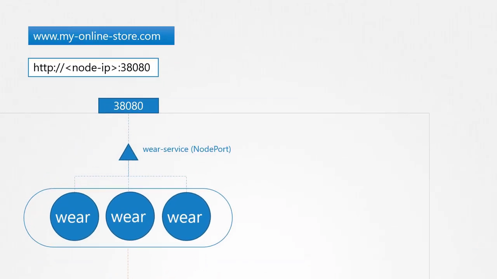
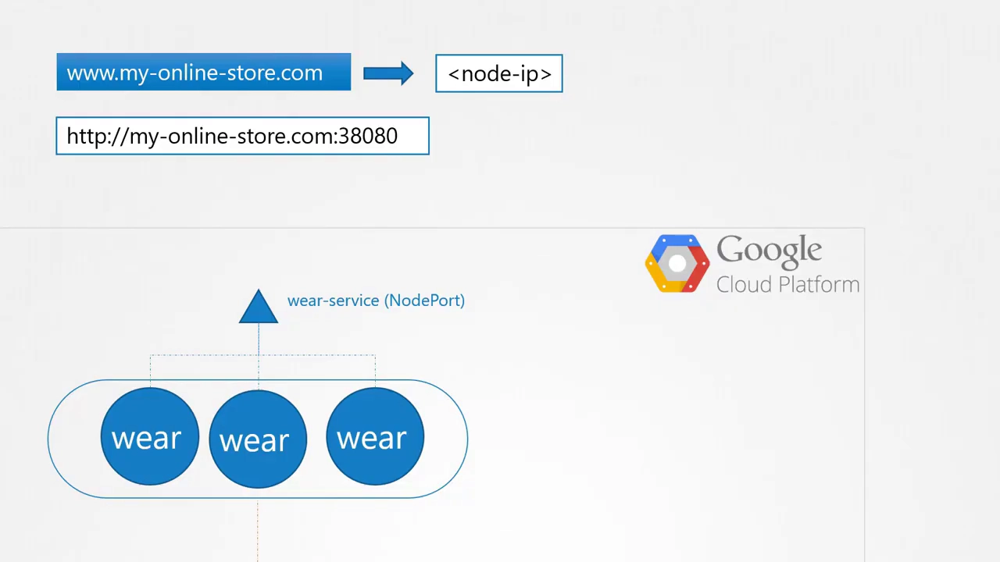
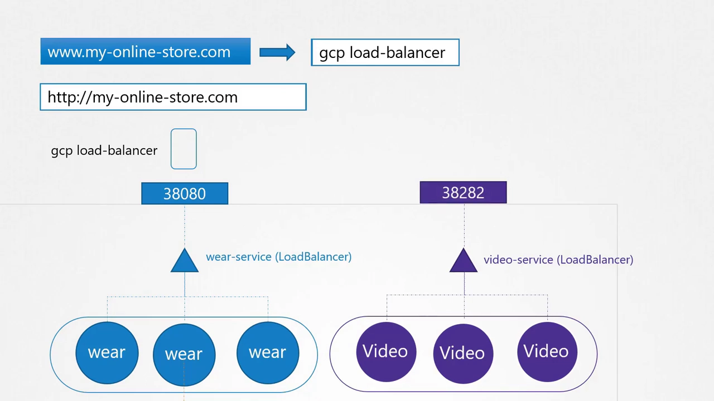
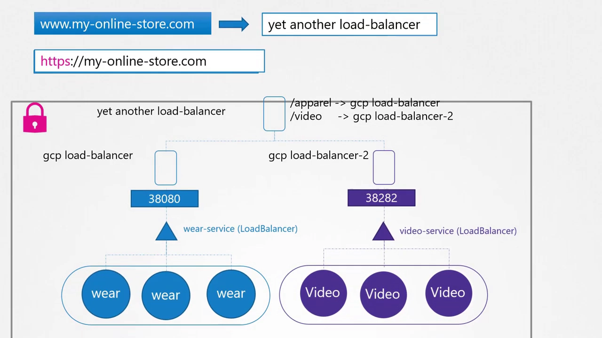
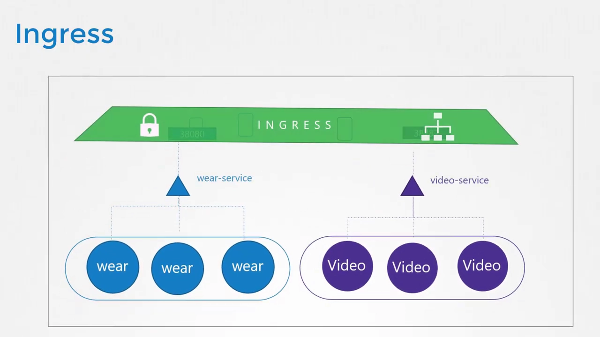
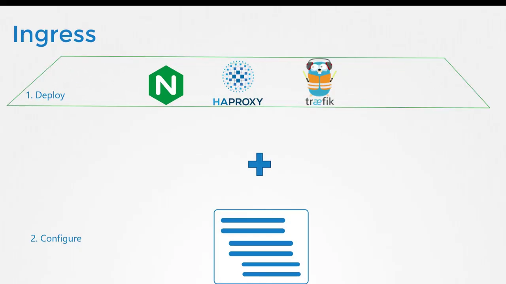
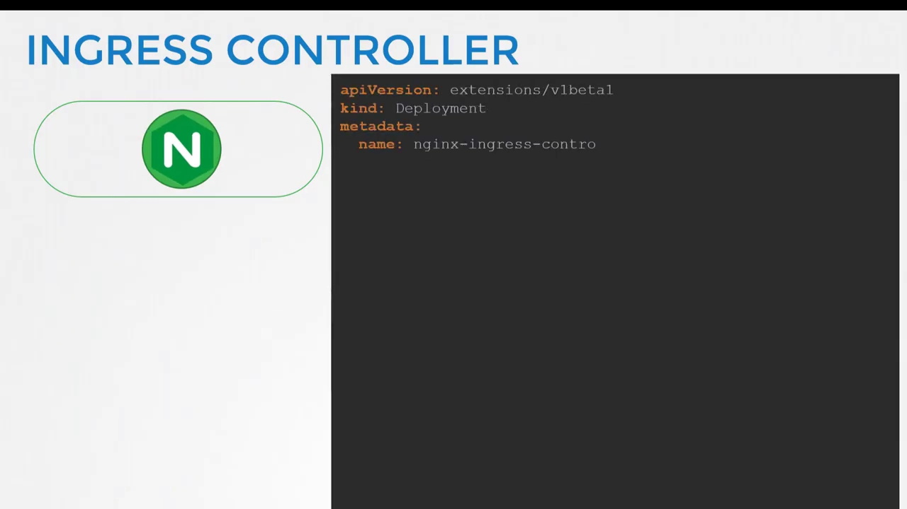
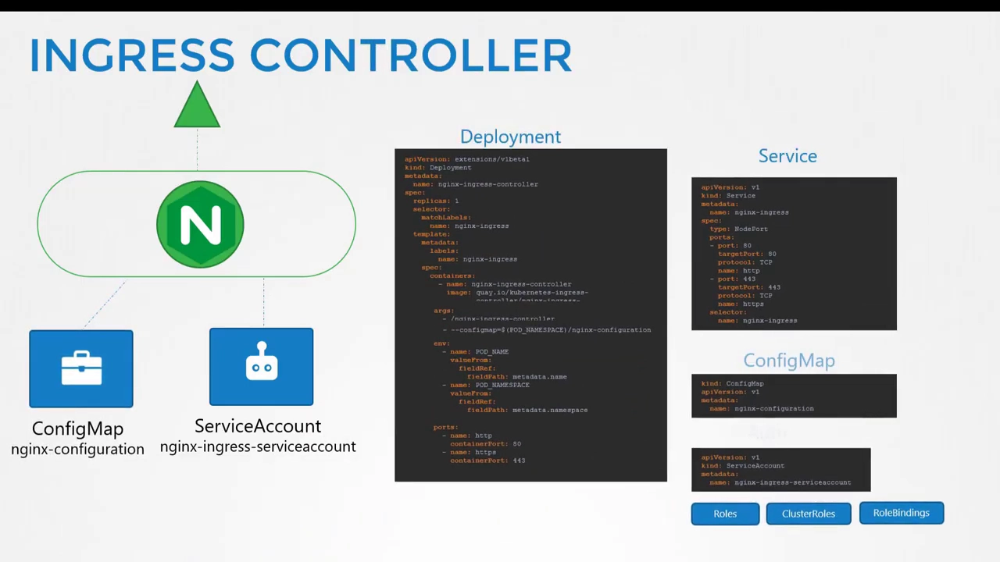
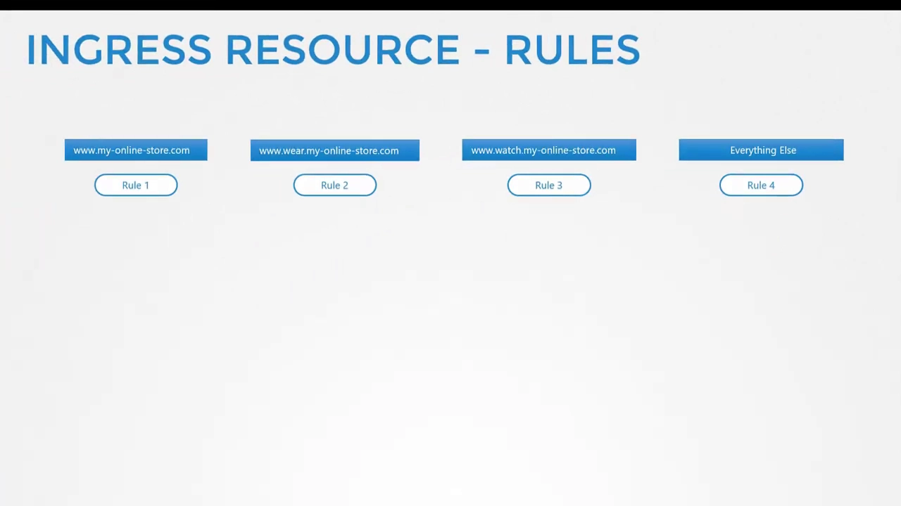
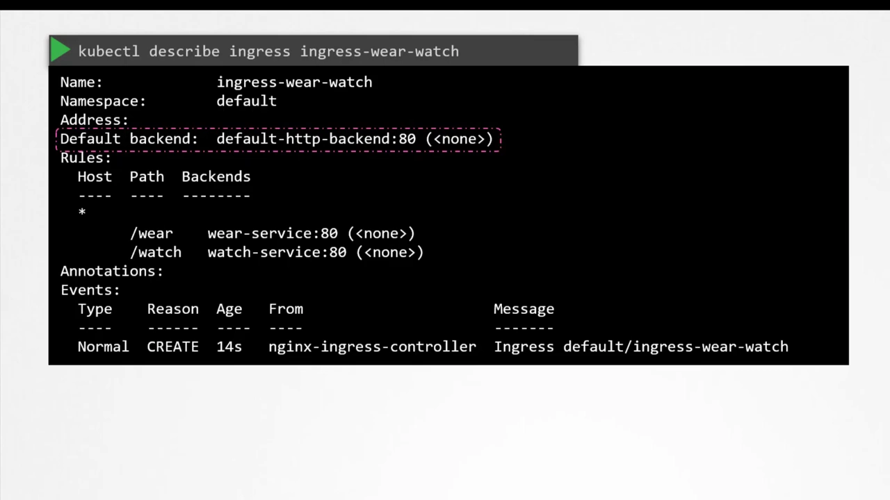

# Ingress 为什么存在：从 NodePort、LoadBalancer 一路推到七层入口

> 视频来源：[Kubernetes Ingress Explained Completely For Beginners](https://www.youtube.com/watch?v=GhZi4DxaxxE)（YouTube，Kubernetes 认证课程，时长约 22 分钟）。
>
> 这支视频不讲「怎么敲命令」，而是**用一个网店应用不断长大的故事**，一步步推出 Ingress 为什么非有不可：先暴露成 NodePort，再到云上的 LoadBalancer，服务一多发现负载均衡器越配越多、SSL 无处安放，最后才引出 Ingress。看完你会理解 Ingress 的定位、它和 Ingress Controller 的分工，以及 `spec` 里 `rules`/`backend` 的组织方式。文稿左栏为英文自动字幕，本文已翻译并重写为中文。

## 本讲要解决的核心问题（SCQA）

**背景（S）**：你在 Kubernetes 上部署了一个网店应用。它是个 Deployment 里的 Pod，配了一个 `ClusterIP` 类型的 Service（叫 `mysql-service`）让它访问数据库。要让**外部**能访问，你又建了一个 `NodePort` 类型的 Service。

**冲突（C）**：一开始这能跑通——用户用 `http://任意节点IP:38080` 就能打开应用；流量涨了就加 Pod 副本，Service 负责在副本间分流。但**面向生产的应用远不止「分流」这么简单**：你不想让用户记 IP、记端口，于是加 DNS、加一层代理服务器；上了公有云，又为每个服务各配一个网络负载均衡器——**服务越多，负载均衡器越多，云账单越贵，防火墙规则、SSL 证书还得一处一处配**。这些配置散落在应用、负载均衡器、代理服务器三个层面，随着规模增长越来越难管。

**疑问（Q）**：能不能把「按 URL 路由、SSL、负载均衡」这些事**收拢到集群内部、用一份 Kubernetes 配置文件统一管理**？

**回答（中心思想 A）**：**这就是 Ingress 的用武之地**。Ingress 让你用一个**单一对外 URL** 暴露应用，并按 **URL 路径或域名**把流量分发给集群内不同 Service，同时实现 SSL。可以把它理解成**内建进集群的七层（layer-7）负载均衡器**，用原生 Kubernetes 资源来配置。它由**两部分**组成：你部署的那个「解决方案」叫 **Ingress Controller**（真正的负载均衡器），你写的一组规则叫 **Ingress 资源**。注意：**集群默认不带 Ingress Controller**，必须自己装。

---

## 一、先看「没有 Ingress」时，事情是怎么一步步变复杂的

### 1.1 起点：NodePort 就能对外服务

应用部署好后，为了对外可用，你建了一个 `NodePort` 类型的 Service，它在集群节点上分配了一个高位端口——例子里是 **38080**。用户于是能用 `http://<任意节点IP>:38080` 访问应用。流量上涨时，加副本、由 Service 在 Pod 之间分流即可。[【跳转到 00:38】](https://www.youtube.com/watch?v=GhZi4DxaxxE&t=38)[【跳转到 01:03】](https://www.youtube.com/watch?v=GhZi4DxaxxE&t=63)

### 1.2 生产化第一步：加 DNS、加代理

但生产级应用不止「分流」这么简单。比如，**用户每次都要输 IP 很烦**——于是你配置 DNS，把域名指向节点 IP。用户现在能用 `my-online-store.com:38080` 访问了。可**你还不想让用户记端口号**，而 Service 的 NodePort **只能分配大于 30000 的高位端口**。于是你在 DNS 和集群之间又插了一层——一台**代理服务器**，把 80 端口的请求代理到节点上的 38080。DNS 指向这台服务器后，用户只要访问 `my-online-store.com` 就行。[【跳转到 01:11】](https://www.youtube.com/watch?v=GhZi4DxaxxE&t=111)[【跳转到 01:52】](https://www.youtube.com/watch?v=GhZi4DxaxxE&t=152)

### 1.3 上公有云：改用 LoadBalancer

如果应用托管在公有云（如 Google Cloud Platform），就不用 `NodePort` 了，可以直接把 Service 设成 **`LoadBalancer` 类型**。Kubernetes 会照旧为 Service 分配一个高位端口，**此外还会向 GCP 发请求，让它为该服务自动创建一个网络负载均衡器**——这个 LB 有一个外部 IP，把 DNS 指向它，用户就能用 `my-online-store.com` 访问。[【跳转到 01:82】](https://www.youtube.com/watch?v=GhZi4DxaxxE&t=182)[【跳转到 02:07】](https://www.youtube.com/watch?v=GhZi4DxaxxE&t=207)

### 1.4 业务增长：负载均衡器越配越多

公司业务变好，**多了新的服务**——比如一个视频流媒体服务。你希望用户通过 `my-online-store.com/watch` 访问新服务，通过 `my-online-store.com/wear` 访问老应用。视频应用跟原来那个毫无关系，但为了共用集群资源，你把它作为**另一个 Deployment** 部署进同一个集群，并建一个 `video-service`（`LoadBalancer` 类型）——Kubernetes 又为它分配端口、又在云上配了**一个新的网络负载均衡器**。[【跳转到 02:47】](https://www.youtube.com/watch?v=GhZi4DxaxxE&t=247)[【跳转到 02:67】](https://www.youtube.com/watch?v=GhZi4DxaxxE&t=267)

问题接踵而来：

- **每个负载均衡器都要付费**，负载均衡器一多，云账单会很难看；
- 要**按用户输入的 URL 在不同负载均衡器之间分流**，你得再引入一个代理或负载均衡器；[【跳转到 03:17】](https://www.youtube.com/watch?v=GhZi4DxaxxE&t=317)
- **每加一个新服务，就要重新配置这个负载均衡器**；
- 最后你还得**为应用启用 SSL**（让用户走 HTTPS）。SSL 可以配在三个层面——**应用自身、负载均衡器、代理服务器**——但你不希望让开发者在各自的应用里各写一套（写法不统一、还增加负担），而是想**在一个地方集中配置、维护成本最低**。[【跳转到 03:42】](https://www.youtube.com/watch?v=GhZi4DxaxxE&t=342)

所有这些配置越来越多，**应用规模一大就极难管理**：要牵涉不同团队、每个新服务都要配防火墙规则、每个服务都要新建云负载均衡器，既繁琐又昂贵。[【跳转到 03:67】](https://www.youtube.com/watch?v=GhZi4DxaxxE&t=367)

---

## 二、Ingress 登场：把入口收拢成一份配置

**如果这些都能在 Kubernetes 集群内管理，且配置只是「又一份和应用部署文件放在一起的 Kubernetes 定义文件」**，那该多好？——这正是 Ingress 要做的事。[【跳转到 03:90】](https://www.youtube.com/watch?v=GhZi4DxaxxE&t=390)

**Ingress 的核心能力**：让用户通过**一个对外可访问的 URL** 访问应用，你可以配置它**按 URL 路径**把流量路由到集群内不同 Service，同时**实现 SSL**。把它想象成**内建进集群的七层负载均衡器**，用原生 Kubernetes 资源来配置——就像你熟悉的其他对象一样。[【跳转到 04:03】](https://www.youtube.com/watch?v=GhZi4DxaxxE&t=403)

但要记住一个前提：**即使有了 Ingress，你仍需把它暴露出去**（发布成 NodePort，或用云原生负载均衡器）才能从集群外访问——**不过这只是「一次性」的配置**。此后所有的负载均衡、SSL、按 URL 路由，都在 Ingress Controller 上完成。[【跳转到 04:24】](https://www.youtube.com/watch?v=GhZi4DxaxxE&t=424)

### 2.1 它是怎么实现的：解决方案 + 规则

**没有 Ingress 时你怎么做？** 你会用 NGINX、HAProxy、Traefik 这类反向代理/负载均衡方案，把它们部署到集群里，再配置 URL 路由、SSL 证书等。**Ingress 的实现方式其实一样**：[【跳转到 04:81】](https://www.youtube.com/watch?v=GhZi4DxaxxE&t=481)

1. 先部署一个受支持的**解决方案**；
2. 再写一组**规则**来配置 Ingress。

**你部署的那个解决方案 = Ingress Controller；你写的那组规则 = Ingress 资源**。Ingress 资源用定义文件创建，就像之前创建 Pod、Deployment、Service 那样。[【跳转到 05:06】](https://www.youtube.com/watch?v=GhZi4DxaxxE&t=506)

> **关键提醒**：**Kubernetes 集群默认不带 Ingress Controller**。如果你照本课程的演示搭集群，里面并没有内置控制器——所以你只写 Ingress 资源、指望它自动生效，是**不会生效的**。[【跳转到 05:31】](https://www.youtube.com/watch?v=GhZi4DxaxxE&t=531)

### 2.2 可选的 Ingress Controller

既然必须自己部署，那部署什么？可选的方案有：**GCE**（Google 的七层 HTTP 负载均衡器）、**NGINX**、**Contour**、**HAProxy**、**Traefik**、**Istio**。其中 **GCE 和 NGINX 由 Kubernetes 项目支持与维护**，本视频以 NGINX 为例。[【跳转到 05:56】](https://www.youtube.com/watch?v=GhZi4DxaxxE&t=556)

一个容易误解的点：**Ingress Controller 不只是「一个负载均衡器或 NGINX 服务器」**——负载均衡只是它的一部分。它内建了**额外的智能**：持续**监视集群中的 Ingress 资源变化**，并据此**动态配置底层的 NGINX 服务器**。[【跳转到 05:97】](https://www.youtube.com/watch?v=GhZi4DxaxxE&t=597)

---
EOF
echo done## 三、部署一个 NGINX Ingress Controller

NGINX 控制器就是作为**又一个 Deployment** 部署进 Kubernetes 的。先从一个名为 `nginx-ingress-controller` 的 Deployment 定义文件开始，1 个副本，加一个简单的 Pod 模板。[【跳转到 06:22】](https://www.youtube.com/watch?v=GhZi4DxaxxE&t=622)

- **镜像**用的是 `nginx-ingress-controller` 的某个版本。这是一份**专门的 NGINX 构建**，专为在 Kubernetes 里当 Ingress Controller 用，因此镜像内部有自己的要求；NGINX 程序放在 `/nginx-ingress-controller`，必须把它作为**启动命令**传入。
- **配置数据与镜像解耦**：NGINX 有一堆配置项（日志路径、keepalive 阈值、SSL 设置、session timeout 等）。为了不把它们写死在镜像里，要创建一个 **ConfigMap** 并传入。这个 ConfigMap **一开始可以是空的**，但建了它以后，将来改配置只需往 ConfigMap 里加，而不用去动 NGINX 配置文件。[【跳转到 06:72】](https://www.youtube.com/watch?v=GhZi4DxaxxE&t=672)
- **两个环境变量**：分别携带 Pod 的名字和被部署到的命名空间，NGINX 服务需要它们来从 Pod 内读取配置数据。
- **端口**：Ingress Controller 使用的端口是 **80 和 443**。[【跳转到 07:14】](https://www.youtube.com/watch?v=GhZi4DxaxxE&t=714)
- **Service**：还需要一个 **NodePort 类型的 Service** 把控制器暴露到外部，用 `nginx-ingress` 标签选择器把 Service 关联到 Deployment。[【跳转到 07:24】](https://www.youtube.com/watch?v=GhZi4DxaxxE&t=724)
- **ServiceAccount**：前面说过控制器要「监视集群里的 Ingress 资源并配置 NGINX」，要做到这点，它需要一个**带正确权限的 ServiceAccount**（配好 roles 和 role bindings）。[【跳转到 07:51】](https://www.youtube.com/watch?v=GhZi4DxaxxE&t=751)

**一句话总结一个最简单的 Ingress Controller 由什么构成**：一个 **Deployment**（跑 NGINX Ingress 镜像）+ 一个 **Service**（把它暴露出去）+ 一个 **ConfigMap**（喂给 NGINX 配置数据）+ 一个 **ServiceAccount**（带访问这些对象的权限）。凑齐这四样，Ingress Controller 就绪。[【跳转到 07:66】](https://www.youtube.com/watch?v=GhZi4DxaxxE&t=766)

---

## 四、Ingress 资源：一组作用在控制器上的规则

**Ingress 资源是「一组作用在 Ingress Controller 上的规则和配置」**。你可以配置规则实现：[【跳转到 07:82】](https://www.youtube.com/watch?v=GhZi4DxaxxE&t=782)

- **把所有进来的流量都转给单一应用**；或
- **按 URL 路由到不同应用**：访问 `.../wear` 路由到某个应用，访问 `/watch` 路由到视频应用；
- 或**按域名本身路由**：访问 `wear.my-online-store.com` 去 wear 应用，否则去视频应用。

### 4.1 单后端：最简单的一种

Ingress 资源同样用 Kubernetes 定义文件创建（例子里叫 `ingress-wear-demo`）。和任何对象一样，有 `apiVersion`、`kind`、`metadata`、`spec`。[【跳转到 08:37】](https://www.youtube.com/watch?v=GhZi4DxaxxE&t=837)

- `kind` 是 `Ingress`，名字叫 `ingress-wear`，`spec` 下面是 **`backend`**。
- **流量永远被路由到 Service，而不是直接到 Pod**。如果只有**单一后端**，其实不需要任何 `rules`，直接写后端的 `service name` 和 `port` 即可。
- 用 `kubectl create` 创建、`kubectl get ingress` 查看，这个 Ingress 就会把**所有进来的流量直接送往 wear service**。[【跳转到 09:11】](https://www.youtube.com/watch?v=GhZi4DxaxxE&t=911)

> **关于 `apiVersion`**：录制时 Ingress 的 `apiVersion` 是 `extensions/v1beta1`，但**它随 Kubernetes 版本演进会变化**。所以部署 Ingress 时，务必查阅对应版本的 Kubernetes 文档，确认正确的 `apiVersion`。[【跳转到 08:62】](https://www.youtube.com/watch?v=GhZi4DxaxxE&t=862)

### 4.2 用 rules 按域名与路径分流

**当你需要按不同条件路由时才用 `rules`**。例如，**为每个域名/主机名建一条规则**：用户用 `my-online-store.com` 来访问走「规则一」，用 `wear.my-online-store.com` 来访问走「规则二」，用 `watch.my-online-store.com` 走「规则三」，剩下的走「规则四」。[【跳转到 09:36】](https://www.youtube.com/watch?v=GhZi4DxaxxE&t=936)

顺带一提：**给集群配多个域名，只需加多条都指向同一个 Ingress Controller Service 的 DNS 记录**即可。[【跳转到 09:53】](https://www.youtube.com/watch?v=GhZi4DxaxxE&t=953)

**在每条规则内部，还可以处理不同的路径**。例如规则一里：`/wear` 路径 → clothes 应用，`/watch` 路径 → 视频流应用，前两者之外的第三个路径 → 404 页面。规则二（`wear.my-online-store.com`）里可以再按路径分：默认进 shopping，访问 `exchange` 或 `support` 则去不同的后端服务。规则三（`watch.my-online-store.com`）里还能加 `movies`、`tv` 等路径，其余走默认 404。[【跳转到 10:11】](https://www.youtube.com/watch?v=GhZi4DxaxxE&t=1011)[【跳转到 10:44】](https://www.youtube.com/watch?v=GhZi4DxaxxE&t=1044)

**记住这个层次**：**最外层是「每个 host/域名的规则（rules）」，每条规则内部是「按 URL 的不同路径（paths）」**。

### 4.3 写进 YAML：一个按 URL 分流的例子

需求：处理所有发往 `my-online-store.com` 的流量，**按 URL 路径**路由。因为只涉及单个域名，所以**只需要一条规则**。[【跳转到 10:71】](https://www.youtube.com/watch?v=GhZi4DxaxxE&t=1071)

- `spec.rules` 下是一个 **HTTP 规则**，其中 `paths` 是**数组**——每个 URL 一个 path；
- 每个 path 下的 `backend` 写 `service name` 和 `service port`。第一条 path 用之前那个后端，第二条 path 指向 watch service，把 `/watch` 的流量送去 watch service；
- `kubectl create` 创建后，用 `kubectl describe ingress` 查看更多细节，会看到规则下的两个后端 URL 及它们指向的 Service。

### 4.4 别忘了 default backend

用 `kubectl describe ingress` 时，你可能注意到输出里有个 **`default backend`**。它是干嘛的？**如果用户访问的 URL 不匹配任何规则，就会被导向这个「默认后端」**——例子里它叫 `default-http-backend`，所以**记得在应用里部署这样一个服务**。[【跳转到 11:54】](https://www.youtube.com/watch?v=GhZi4DxaxxE&t=1154)

比如用户访问 `my-online-store.com/listen` 或 `/eat`，而你没有音频流或外卖服务，就可以用默认后端服务给他显示一个 404 not found 页面。[【跳转到 11:77】](https://www.youtube.com/watch?v=GhZi4DxaxxE&t=1177)

### 4.5 第三种玩法：按域名（host）分流

最后一种配置方式是用**域名/主机名**分流。既然有两个域名，就**建两条规则，每个域名一条**。这里用到 **`host` 字段**：每条规则里的 `host` 会和请求 URL 里的域名做匹配，从而路由到对应后端。[【跳转到 12:05】](https://www.youtube.com/watch?v=GhZi4DxaxxE&t=1205)

注意这种情况下，每条规则里**只有一个后端 path 就够了**——来自该域名的所有流量都会送往对应后端，不管 URL 路径是什么（当然你仍可在每条规则里配多个 path）。

**两种分流的对比**：[【跳转到 12:30】](https://www.youtube.com/watch?v=GhZi4DxaxxE&t=1230)

| 分流方式 | 规则数（rules） | 每条规则里的 path 数 |
| --- | --- | --- |
| **按 URL 路径**（`/wear`、`/watch`） | 1 条 | 2 个 |
| **按主机名**（`wear.…`、`watch.…`） | 2 条 | 各 1 个 |

---

## 小结

- **Ingress 的定位**：内建在集群里的**七层负载均衡器**，用一个对外 URL 暴露应用，按 **URL 路径或域名**路由到不同 Service，并顺带实现 SSL。
- **它解决的痛点**：NodePort 要记 IP 和端口；LoadBalancer 一个服务配一个、越配越贵；SSL 与路由配置散落各处、难以统一。
- **两个组成部分**：**Ingress Controller**（你部署的解决方案，如 NGINX，负责真正的转发，并监视 Ingress 资源动态配置 NGINX）+ **Ingress 资源**（你写的一组规则）。
- **集群默认没有 Ingress Controller**，必须自己装；常见的还有 GCE、Contour、HAProxy、Traefik、Istio。
- **一个最简单的控制器** = Deployment + Service + ConfigMap + ServiceAccount 四件套。
- **Ingress 资源的结构**：单后端直接写 `backend`；多条件才用 `rules`——外层按 `host`（域名），内层按 `paths`（路径）。
- **两个易忽略点**：`apiVersion` 随版本变化，要查文档；`default backend` 用于兜底不匹配的请求，需单独部署。

## 关键术语速查

| 术语 | 一句话解释 |
| --- | --- |
| Ingress | 用一份配置把「按 URL/域名路由 + SSL」收拢进集群的七层入口抽象 |
| Ingress Controller | 真正转发流量的组件（如 NGINX），监视 Ingress 资源并动态配置底层服务器 |
| Ingress 资源 | 一组作用在 Ingress Controller 上的规则，用 YAML 定义 |
| NodePort | 四层 Service 类型，在节点高位端口暴露服务，用户需带 IP 与端口访问 |
| LoadBalancer | 四层 Service 类型，向云厂商申请网络负载均衡器，一个 Service 一个，按量收费 |
| ConfigMap | 存放 NGINX 配置数据，让配置与控制器镜像解耦，改配置不必动镜像 |
| ServiceAccount | 给 Ingress Controller 访问集群对象所需的身份与权限（roles/role bindings） |
| `host` 字段 | rules 里用来匹配请求域名，实现按主机名分流 |
| `paths` 数组 | 一条规则内按 URL 路径分流，每个 path 有自己的 backend |
| default backend | 请求不匹配任何规则时的兜底后端，常用于展示 404 页面 |
