# K8s 正式退役 Ingress NGINX：Gateway API 用「三层角色」接手流量路由

> 视频来源：[K8s正式退役Ingress NGINX——Gateway API接管流量路由的3层设计](https://www.bilibili.com/video/BV1NyQ8BxELg/)（B 站，up 主「DeeparchWorks」，时长约 9 分钟）。
>
> 这支视频从「2026 年 3 月 Ingress NGINX 控制器退休」讲起，先说清退役最核心的原因不是功能不够、而是**没人维护**，再顺势点破 Ingress 的**注解地狱**，然后用「机场航站楼」的类比引出 Gateway API 的**三层角色模型**（GatewayClass / Gateway / HTTPRoute），最后给出渐进式迁移路线与数据面选型建议。下文机制、命令与输出都来自该视频的图-字幕稿，可逐帧核对。

## 本讲要解决的核心问题（SCQA）

**背景（S）**：过去近 10 年，绝大多数 Kubernetes 集群都用 **Ingress NGINX 控制器**来把集群里的服务暴露给外部——它是集群「流量入口」的事实标准。[【跳转到 00:00】](https://www.bilibili.com/video/BV1NyQ8BxELg/?t=0)

**冲突（C）**：2026 年 3 月，Kubernetes 官方宣布 **Ingress NGINX 控制器正式退役**——不再有安全补丁，不再有版本更新。与此同时，Ingress 这套 API 本身也暴露出一个结构性问题：所有扩展能力都得塞进 `annotations` 里，这些注解没有类型校验、又是 NGINX 专属的，换个控制器就全部作废。[【跳转到 00:00】](https://www.bilibili.com/video/BV1NyQ8BxELg/?t=0) [【跳转到 00:25】](https://www.bilibili.com/video/BV1NyQ8BxELg/?t=25)

**疑问（Q）**：一个用了 10 年的组件，为什么要退役？退役之后，集群的南北向流量入口该交给谁？新的方案凭什么比 Ingress 更好？

**回答（中心思想 A）**：**交给 Gateway API**。Ingress NGINX 退役的根本原因是「没人维护」；而 Gateway API 不是给 Ingress 打补丁，而是从第一性原理重新设计了流量路由的 API 层——它用**三层角色模型**（GatewayClass / Gateway / HTTPRoute）取代了「注解地狱」，把「用哪个控制器」「入口怎么开」「流量怎么走」三件事拆给三个角色、三种资源，各自独立、RBAC 天然对齐。[【跳转到 08:04】](https://www.bilibili.com/video/BV1NyQ8BxELg/?t=484)

---

## 一、为什么要退役一个用了 10 年的组件

### 1.1 直接原因：没人维护了

说出来可能不信，最核心的原因**不是功能不够，而是没人维护了**。SIG Network 和安全响应委员会已经穷尽了寻找维护者的努力，为了用户安全，不得不做出退役决定。没有维护者，意味着下一个漏洞爆出来的时候，没有人会给你打补丁——如果你的集群还在用它，从现在起每一天都在「裸奔」。[【跳转到 00:00】](https://www.bilibili.com/video/BV1NyQ8BxELg/?t=0) [【跳转到 00:25】](https://www.bilibili.com/video/BV1NyQ8BxELg/?t=25)

### 1.2 深层原因：注解地狱

要理解为什么「维护」这么难，得看看 Ingress 的真实面貌。一个典型的 Ingress 资源长这样：`apiVersion`、`kind`、`metadata`、`spec` 都很简单，`spec` 里无非是「哪个 host、哪个 path、转发到哪个 service」。[【跳转到 00:25】](https://www.bilibili.com/video/BV1NyQ8BxELg/?t=25)

问题出在 `annotations` 部分——重写、SSL 跳转、CORS、限流、请求体大小、鉴权 URL……**全堆在注解里**：

```yaml
apiVersion: networking.k8s.io/v1
kind: Ingress
metadata:
  annotations:
    nginx.ingress.kubernetes.io/rewrite-target: /$1      # [ARCH] 控制器特有注解
    nginx.ingress.kubernetes.io/ssl-redirect: "true"
    nginx.ingress.kubernetes.io/cors-allow-origin: "*"
    nginx.ingress.kubernetes.io/limit-rps: "100"
    nginx.ingress.kubernetes.io/proxy-body-size: "50m"
    nginx.ingress.kubernetes.io/auth-url: "https://auth.example.com"
    # [ARCH] 换成 Traefik？所有注解全部作废！
```

这就是社区所说的**「注解地狱」**，它有三个要命的地方：[【跳转到 00:50】](https://www.bilibili.com/video/BV1NyQ8BxELg/?t=50)

1. **没有类型校验**：注解就是一堆字符串，写错了不会在创建时报错，**运行时才炸**。
2. **全是 NGINX 专属**：这些注解只为 NGINX 控制器设计，换成 Traefik 或 HAProxy，**每一条都要重写**。
3. **没有角色边界**：注解和 `spec` 挤在同一个资源里，谁都能改，权限切不开。

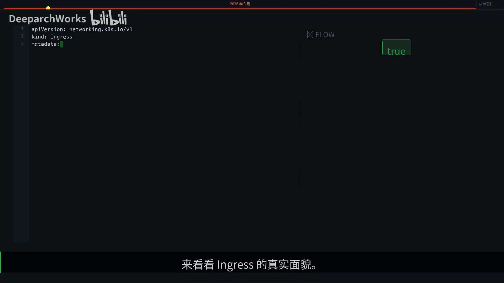

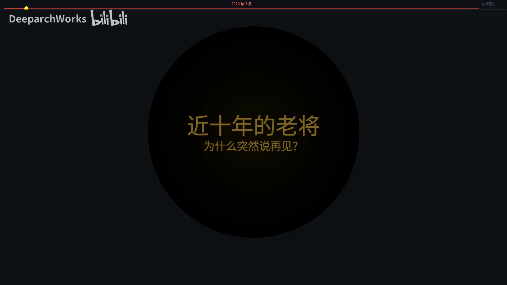

### 1.3 一个类比：单柜台机场 → 分层航站楼

为了建立直觉，视频用了一个生活场景：想象一个**老旧的机场，只有一个柜台处理所有旅客**，所有规则都写在贴满柜台的便签上——VIP 通道、行李超重、转机指引……便签越来越多，还会互相矛盾。这就是 Ingress 的现状：一个扁平资源，什么都往上贴。[【跳转到 01:15】](https://www.bilibili.com/video/BV1NyQ8BxELg/?t=75)

新航站楼怎么设计？**民航局定标准，航空公司建航站楼，值机柜台按航线分流**——三层各管各的，井然有序。Gateway API 就是这个「新航站楼」：把一个大柜台，拆成各司其职的三层。[【跳转到 01:15】](https://www.bilibili.com/video/BV1NyQ8BxELg/?t=75)

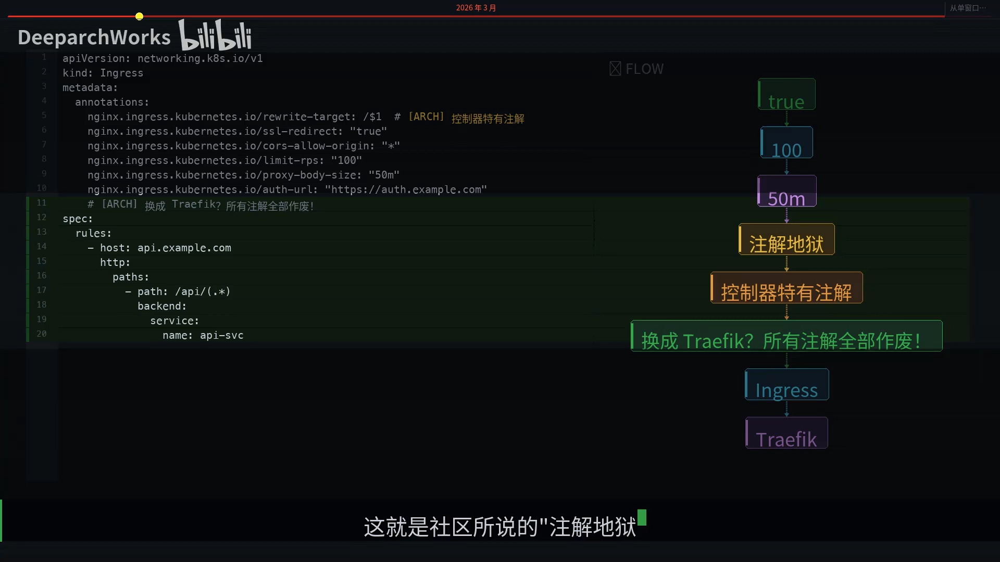

---

## 二、Gateway API 的三层角色模型

Gateway API 最核心的设计，就是**三层角色模型**。从顶层到底层依次是：[【跳转到 02:09】](https://www.bilibili.com/video/BV1NyQ8BxELg/?t=129)

- **最顶层 `GatewayClass`**：集群管理员的地盘，一个集群通常就一两个，用来定义**用哪个控制器**；
- **中间层 `Gateway`**：基础设施团队管理，配置**监听端口、TLS 证书、跨命名空间授权**；
- **最底层 `HTTPRoute`**：业务开发操心，负责**路径匹配、流量切分、header 改写**。

三层各司其职，**RBAC 天然对齐**——谁负责哪一层，就给谁那一层的权限，不用再把一个大资源切开。[【跳转到 02:09】](https://www.bilibili.com/video/BV1NyQ8BxELg/?t=129)

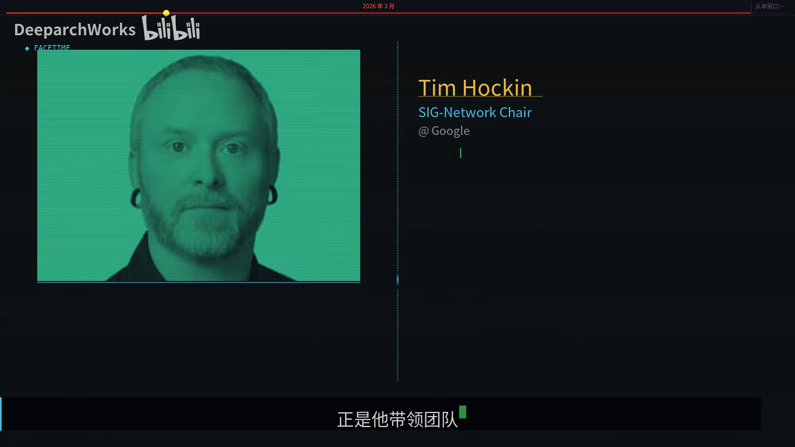

### 2.1 GatewayClass：集群管理员定义「用哪个控制器」

第一层 `GatewayClass` 是**集群级别**的资源，整个集群可能就一两个。它最关键的字段是 `controllerName`，用来告诉 Kubernetes「我用 Envoy 当数据面」。这就像民航局规定：这个机场的航空公司必须满足某某运营标准。[【跳转到 02:34】](https://www.bilibili.com/video/BV1NyQ8BxELg/?t=154)

它还有一个 `parametersRef` 字段，可以指向控制器专属的配置，比如 NGINX 的全局超时、连接池大小等——把「控制器级别的全局参数」收拢到这里，而不是散落在每条路由上。[【跳转到 02:34】](https://www.bilibili.com/video/BV1NyQ8BxELg/?t=154)

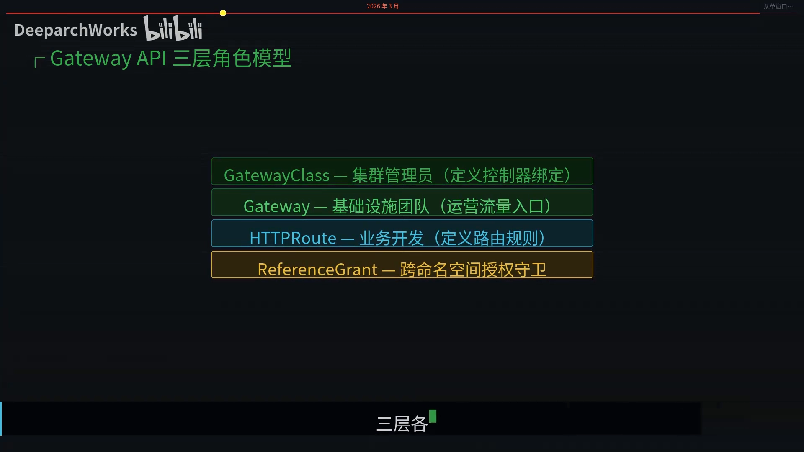

### 2.2 Gateway：基础设施团队定义「入口怎么开」

第二层 `Gateway` 是**基础设施团队**的阵地。它的 `listeners` 字段里配着端口、协议、TLS 证书——也就是「这个入口对外长什么样」。[【跳转到 02:59】](https://www.bilibili.com/video/BV1NyQ8BxELg/?t=179)

最精妙的是 `allowedRoutes`：它用 **label selector** 控制**哪些命名空间的路由可以绑定到这个 Gateway**。相当于航空公司说：只有贴了准入标签的航线，才能在我的航站楼值机。业务团队想接入，只需要给自己的 namespace 打一个标签即可，**不需要碰 Gateway 资源本身**。[【跳转到 02:59】](https://www.bilibili.com/video/BV1NyQ8BxELg/?t=179)

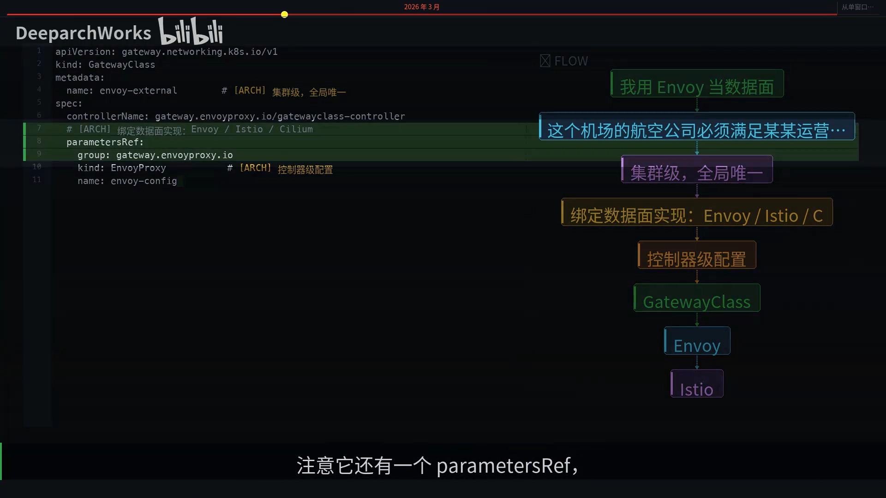

### 2.3 HTTPRoute：业务开发定义「流量怎么走」

第三层 `HTTPRoute` 才是业务开发日常打交道的资源，它有三个亮点：[【跳转到 03:24】](https://www.bilibili.com/video/BV1NyQ8BxELg/?t=204)

1. **`parentRefs` 支持跨命名空间引用 Gateway**——业务团队不需要碰基础设施配置，就能把自己的路由挂到别人管着的入口上；
2. **`filters` 是类型化的**——比如 `RequestHeaderModifier` 有明确的 schema，**写错了直接报校验错误**，不会像 annotation 那样悄悄失败；
3. **`backendRefs` 原生支持权重路由**——`90:10` 的金丝雀发布不需要任何额外工具。

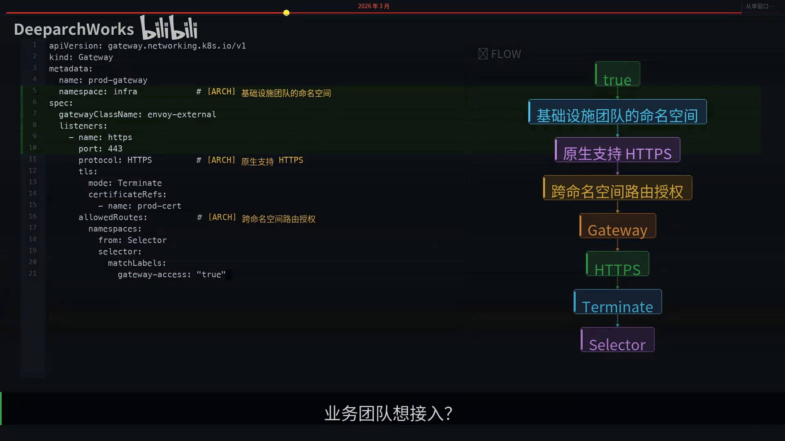

### 2.4 三层 vs 一层的对比

把 Ingress 和 Gateway API 摆在一起，差异一目了然：[【跳转到 04:33】](https://www.bilibili.com/video/BV1NyQ8BxELg/?t=273)

| 维度 | Ingress（老模式） | Gateway API |
| --- | --- | --- |
| 资源结构 | 扁平，一个资源包办 | 三层分离（GatewayClass / Gateway / HTTPRoute） |
| 扩展方式 | 注解，无类型校验 | 类型化 CRD，可校验 |
| 协议支持 | 仅 HTTP/HTTPS | 多协议（HTTP/gRPC/TCP/UDP…） |
| 角色隔离 | 无（同一资源谁都能改） | 天然对齐（三层三类资源） |
| 跨命名空间 | 不支持 | 用 `ReferenceGrant` 显式授权 |

最打动人的是**跨命名空间**这一项：Ingress 从来不支持跨命名空间——路由和入口必须在同一个 namespace，这在大型组织里简直是噩梦。Gateway API 用 **`ReferenceGrant`** 优雅地解决了这个问题——它是 Gateway API 技术负责人 **Rob Scott** 的手笔，没有它，三层分离就是空谈，因为 HTTPRoute 必须能**安全地**引用其他命名空间的 Gateway 和后端。[【跳转到 04:08】](https://www.bilibili.com/video/BV1NyQ8BxELg/?t=248) [【跳转到 04:33】](https://www.bilibili.com/video/BV1NyQ8BxELg/?t=273)

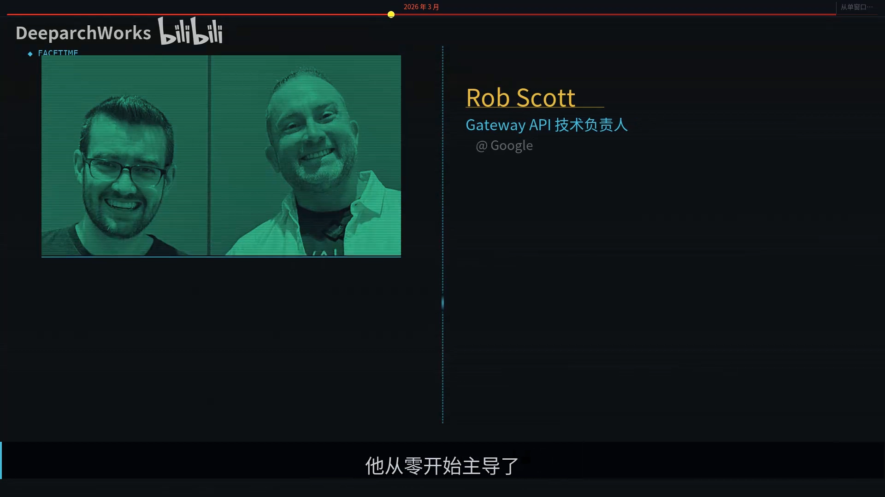

> **小知识**：视频里还致敬了三位关键人物——**Tim Hockin**（Google 首席软件工程师、SIG Network 掌门人，带领团队把 Gateway API 从提案推到 GA）、**Rob Scott**（Gateway API 技术负责人，设计了 `ReferenceGrant` 等跨命名空间机制）、以及 **Kelsey Hightower**（他虽非直接开发者，却用无数演讲传播了 K8s 的设计哲学：「好的 API 应该让简单的事情保持简单，让复杂的事情成为可能」）。[【跳转到 07:28】](https://www.bilibili.com/video/BV1NyQ8BxELg/?t=448)

---

## 三、一个请求如何穿越三层

跟着一个真实的 HTTPS 请求，看它怎么穿过 Gateway API 的三层：[【跳转到 04:58】](https://www.bilibili.com/video/BV1NyQ8BxELg/?t=298)

1. 客户端发起 **HTTPS 请求**，DNS 解析到 **Gateway 的负载均衡 IP**；
2. Gateway 的 **443 listener 接收连接、终止 TLS**；
3. 检查**有没有 HTTPRoute 绑定到这个 listener**——这一步就是**跨命名空间授权**在发挥作用；
4. 匹配到路由规则后，**filter 链依次执行**；
5. 最后**按权重选择后端 Pod**，返回结果。

整个过程，三层资源**各干各的活、互不越界**：GatewayClass 决定了用哪个控制器，Gateway 提供了入口和证书，HTTPRoute 决定了匹配与转发。[【跳转到 04:58】](https://www.bilibili.com/video/BV1NyQ8BxELg/?t=298)

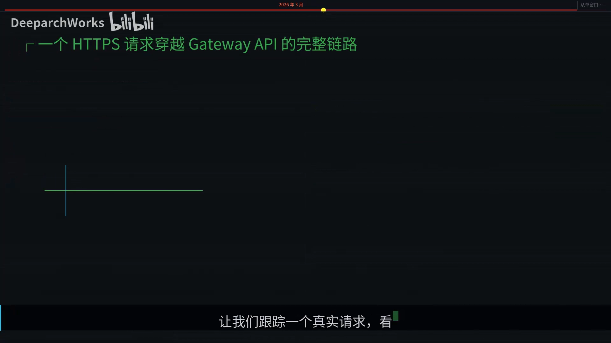

---

## 四、从 Ingress 迁移到 Gateway API

迁移听起来很吓人，但 SIG Network 没有让你从零开始。

### 4.1 ingress2gateway：把注解自动翻译过来

2026 年 3 月同步发布的 **`ingress2gateway` 1.0** 支持 **30 多种常用注解的自动转换**——之前的版本只支持三种，这次直接翻了十倍。它还引入了**插件化架构**，不同厂商可以写自己的 `emitter` 来处理特殊注解。当然，每个公司总有些自定义配置要手动处理，但至少 **80% 的工作量被自动化了**。[【跳转到 05:23】](https://www.bilibili.com/video/BV1NyQ8BxELg/?t=323) [【跳转到 05:48】](https://www.bilibili.com/video/BV1NyQ8BxELg/?t=348)

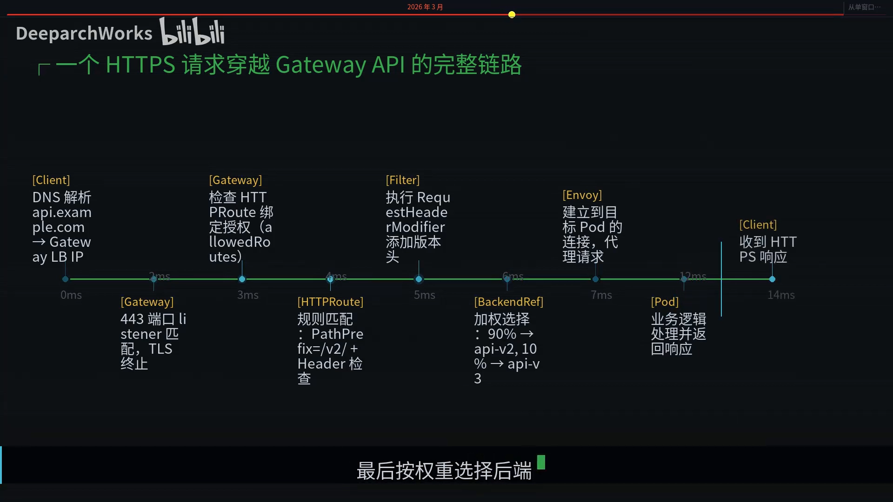

### 4.2 三段式渐进迁移

迁移不是一步到位的，视频给出**三个阶段**：[【跳转到 05:48】](https://www.bilibili.com/video/BV1NyQ8BxELg/?t=348)

- **第一阶段（现状）**：所有流量走 Ingress NGINX；
- **第二阶段（双跑并行）**：部署新的 Gateway 控制器，让新服务走 Gateway，老服务暂时不动；
- **第三阶段（切换清理）**：用 `ingress2gateway` 批量转换剩余的 Ingress 资源，把 DNS 切换到新的 Gateway IP，最后清理旧资源。

**关键原则是渐进式迁移，永远不要一步切完。**[【跳转到 05:48】](https://www.bilibili.com/video/BV1NyQ8BxELg/?t=348)

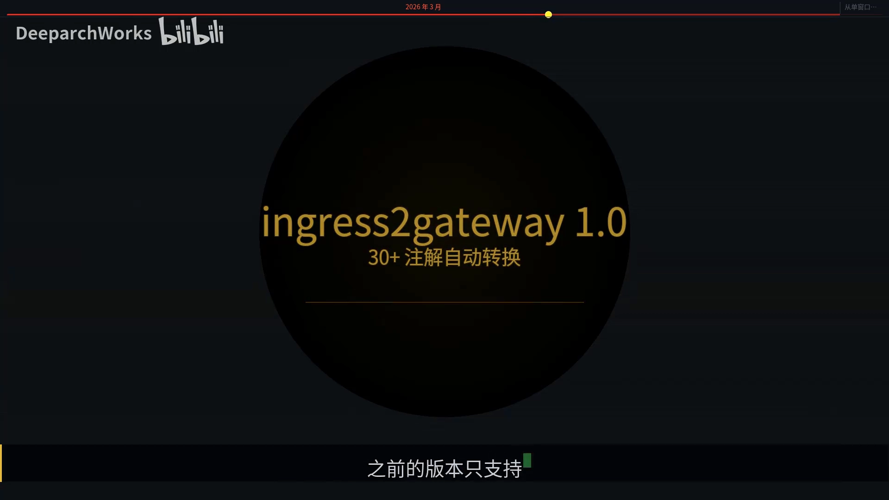

### 4.3 不迁移的合规风险

如果你还在犹豫要不要迁移，看看合规风险：**SOC 2、PCI DSS、ISO 27001、HIPAA** 这些审计框架，都会把 **EOL（停止维护）软件**标记为「**自动发现项**」，特别是当这个组件处于 **L7 数据路径**上、直接处理用户请求流量的时候，审计机构不会放过你。**部分组织已经因此被阻止了生产部署。**[【跳转到 06:13】](https://www.bilibili.com/video/BV1NyQ8BxELg/?t=373)

相比之下，Gateway API 有 **170 多个贡献者**持续维护，而且因为是标准 API，即使某个实现出了问题，你还可以**切换到其他实现**。[【跳转到 06:38】](https://www.bilibili.com/video/BV1NyQ8BxELg/?t=398)

### 4.4 数据面怎么选

选哪个数据面，是迁移中最关键的决策。视频给了一张「按场景选型」的清单：[【跳转到 07:03】](https://www.bilibili.com/video/BV1NyQ8BxELg/?t=423)

- **从零开始** → **Envoy Gateway**：最纯粹的 Gateway API 原生实现；
- **已跑 Istio 服务网格** → 直接用 **Istio** 的 Gateway API 支持；
- **追求极致性能** → **Cilium**：用 eBPF 在内核层加速，吞吐量惊人；
- **需要丰富的 API 管理功能** → **Kong**：插件生态无人能敌；
- **中小规模集群、追求简单** → **Traefik** 依然是好选择。

**没有银弹，根据你的场景选。**[【跳转到 07:03】](https://www.bilibili.com/video/BV1NyQ8BxELg/?t=423)

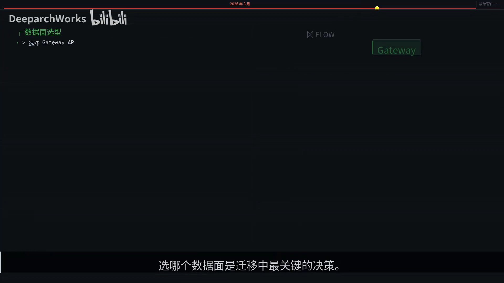

---

## 小结

- **Ingress NGINX 退役的根本原因是缺乏维护者**，而非功能不够；没有维护者，漏洞就没人打补丁。[【跳转到 08:29】](https://www.bilibili.com/video/BV1NyQ8BxELg/?t=509)
- **Ingress 的结构性缺陷是「注解地狱」**：注解无类型校验、控制器专属、无法按角色隔离。
- **Gateway API 用三层模型取代注解地狱**：`GatewayClass` 定义控制器、`Gateway` 管理入口、`HTTPRoute` 定义路由。[【跳转到 08:29】](https://www.bilibili.com/video/BV1NyQ8BxELg/?t=509)
- **`ReferenceGrant` 让跨命名空间安全引用成为可能**，补上了 Ingress 最大的组织能力短板。
- **`ingress2gateway` 1.0 支持 30+ 注解的自动转换**，让迁移不再是噩梦。
- **渐进式迁移、永远不要一步切完**：现状 → 双跑并行 → 批量转换与清理。
- 从单窗口机场到三层分管航站楼，从注解地狱到类型化 CRD，Kubernetes 的网络层正在经历一次**深刻的范式转换**。[【跳转到 08:41】](https://www.bilibili.com/video/BV1NyQ8BxELg/?t=521)

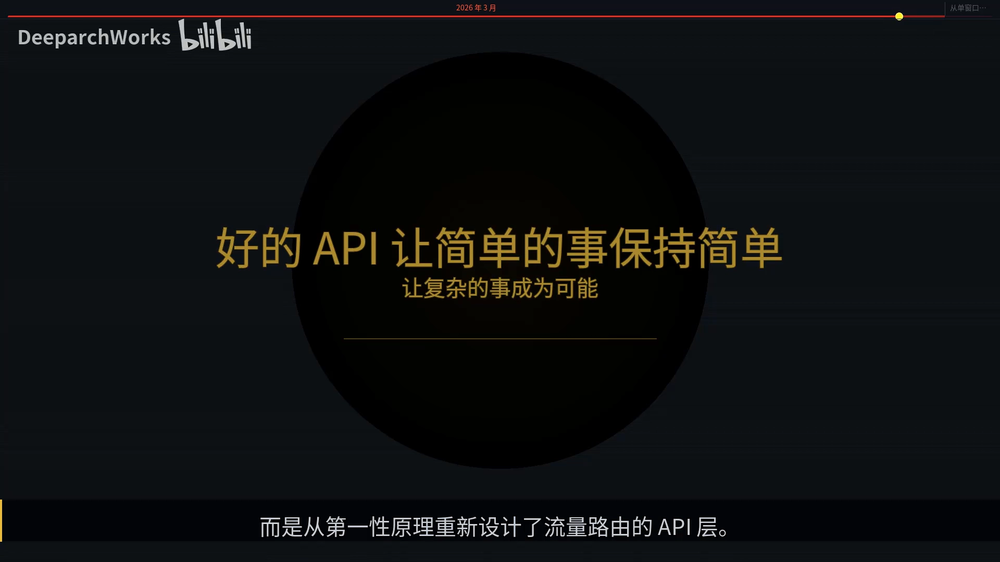

## 关键术语速查

| 术语 | 一句话解释 |
| --- | --- |
| Ingress NGINX | 陪伴社区近 10 年的 Ingress 控制器，2026 年 3 月官方宣布退役 |
| EOL | End of Life，停止维护；审计框架会把它标记为「自动发现项」 |
| 注解地狱 | Ingress 用 `annotations` 扩展功能导致的问题：无类型校验、控制器专属、无法做角色隔离 |
| GatewayClass | 集群级资源，用 `controllerName` 指定用哪个网关控制器（数据面） |
| Gateway | 命名空间级资源，用 `listeners` 声明入口的端口/协议/TLS，用 `allowedRoutes` 控制哪些路由可绑定 |
| HTTPRoute | 业务开发最常用的路由资源，含 `parentRefs`、类型化 `filters`、支持权重路由的 `backendRefs` |
| ReferenceGrant | 跨命名空间引用的显式授权机制，让 HTTPRoute 能安全地引用别的命名空间的 Gateway/后端 |
| ingress2gateway | 官方的迁移工具，1.0 版支持 30+ 注解自动转换为 Gateway API 资源 |
| 数据面 | 真正处理流量的代理，如 Envoy Gateway、Istio、Cilium、Kong、Traefik |
