# 为什么 Kubernetes 要发明 Gateway API：从 Ingress 的两个硬伤讲起

> 视频来源：[You will never forget Kubernetes Gateway API after watching this](https://www.youtube.com/watch?v=EG27AzlHolU)（YouTube，up 主「Abhishek」，时长约 53 分钟，含完整动手演示）。
>
> 这支视频的讲法很值得借鉴：**先问「为什么」**——为什么 Kubernetes 已经有 Ingress，还要迁到 Gateway API？沿着 Ingress 的**两个硬伤**讲清楚 Gateway API 的由来，然后在本地用 `kind` 起一个集群、装上 **Envoy Gateway**，一步步演示基础路由、URL 重写、流量拆分与权重路由。下文机制、命令与输出都来自该视频的图-字幕稿，可逐帧核对。

## 本讲要解决的核心问题（SCQA）

**背景（S）**：Kubernetes 最早是一个容器编排引擎，它解决了**东西向流量**（集群内服务之间通信）的问题——因为有集群内网络，服务间通信从来不是难题。于是许多公司把它当成部署平台，把登录、产品、支付等微服务都放了上去。[【跳转到 01:20】](https://www.youtube.com/watch?v=EG27AzlHolU&t=80)

**冲突（C）**：真正棘手的是**南北向流量**——如何让**外部用户**访问集群里的 Pod（比如用登录服务创建账号）。而 Kubernetes **到今天都没有原生的负载均衡器组件**，它和 API 控制器、调度器、etcd 一样，唯独不含负载均衡器。这是它必须解决的问题。[【跳转到 02:35】](https://www.youtube.com/watch?v=EG27AzlHolU&t=155)

**疑问（Q）**：Kubernetes 用 **Ingress** 解决了南北向流量，可为什么几年后大家纷纷要迁到 **Gateway API**？Ingress 到底有什么缺陷？

**回答（中心思想 A）**：因为 **Ingress 有两个硬伤**——**一是范围太窄**（规范只能声明「暴露哪个服务、通过哪个路径」，速率限制、WAF、金丝雀发布、URL 重写等生产级能力全得靠控制器专属的注解，导致「注解爆炸」）；**二是没有角色隔离**（平台工程师和开发工程师共用一个资源、互相干扰）。**Gateway API 并非解决另一个问题，它解决的是同一个南北向流量问题，只是拆成三个资源（GatewayClass / Gateway / HTTPRoute）、分别对应三个角色，把这两个硬伤一并治好。**[【跳转到 15:19】](https://www.youtube.com/watch?v=EG27AzlHolU&t=919) [【跳转到 19:56】](https://www.youtube.com/watch?v=EG27AzlHolU&t=1196)

---

## 一、问题的起点：Kubernetes 不会做「南北向流量」

### 1.1 东西向没问题，南北向是挑战

Kubernetes 天然解决了**东西向流量**：登录服务、产品服务、支付服务之间互相调用，因为有集群内网络，从来不是问题。[【跳转到 01:20】](https://www.youtube.com/watch?v=EG27AzlHolU&t=80)

但 Kubernetes 面临的主要挑战是**南北向流量**：如何让外部用户访问 Kubernetes 里的 Pod。例如，外部用户如何使用平台的登录服务来创建账号——这是非常重要的工作流：**如果没有外部用户访问登录微服务，部署在 Kubernetes 上的平台就毫无用处**。[【跳转到 01:45】](https://www.youtube.com/watch?v=EG27AzlHolU&t=105)

问题在于——**Kubernetes 到今天都没有原生的负载均衡器组件**。就像它有 API 控制器、调度器、etcd 一样，它没有负载均衡器组件（视频认为这是 Kubernetes 的有意之举）。总之，Kubernetes 必须解决这个问题。[【跳转到 02:10】](https://www.youtube.com/watch?v=EG27AzlHolU&t=130)

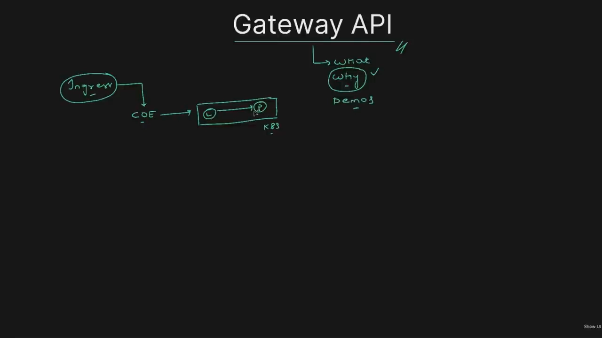

### 1.2 Ingress 是怎么被发明出来的

于是 Kubernetes 说：「引入一个叫 **Ingress** 的概念。」互联网上有多家做负载均衡的公司——NGINX、HAProxy，甚至 AWS 这样的云服务商——它们都有非常流行的负载均衡器。Kubernetes 对这些公司说：**「如果你想用 Kubernetes 支持负载均衡，就应该开发一个 Ingress 控制器。」**[【跳转到 02:35】](https://www.youtube.com/watch?v=EG27AzlHolU&t=155) [【跳转到 03:00】](https://www.youtube.com/watch?v=EG27AzlHolU&t=180)

一旦这些公司有了 Ingress 控制器，流程就很简单：[【跳转到 03:50】](https://www.youtube.com/watch?v=EG27AzlHolU&t=230)

1. 平台工程师 / 集群管理员把 **Ingress 控制器**部署到集群中（这是一次性活动，而且是集群范围的）；
2. DevOps 工程师想公开哪个服务（比如登录微服务），就创建一个 **Ingress 资源**，在里面提供该服务的配置和访问路径；
3. Ingress 控制器**监视这个 Ingress 资源**，并根据配置**创建一个负载均衡器**；
4. 负载均衡器面向公众，外部用户与它通信，它再把请求路由到 Kubernetes 中的相关服务。

在当时这简直是灵丹妙药——Kubernetes 同时解决了东西向和南北向流量。[【跳转到 04:42】](https://www.youtube.com/watch?v=EG27AzlHolU&t=282)

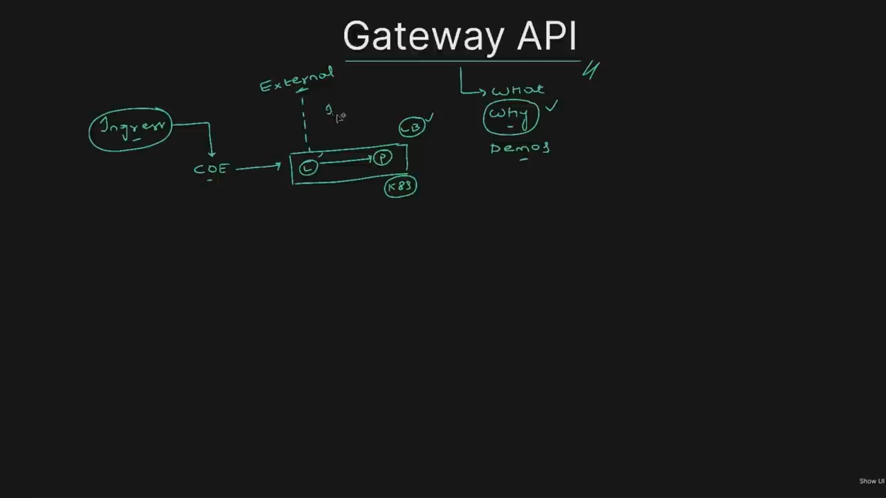

---

## 二、Ingress 的两个硬伤

用了几年后，用户意识到 Ingress 存在**重大缺陷**。视频重点讲两个。

### 2.1 硬伤一：范围太窄，扩展只能靠注解

**Ingress 规范里其实只能提到两件事**：第一，应该暴露给负载均衡器的服务；第二，最终用户访问服务的路径。用一句话说，Ingress 只能告诉负载均衡器：「**仅当用户通过路径 `/login` 访问时，才允许把对登录微服务的请求放行。**」[【跳转到 06:00】](https://www.youtube.com/watch?v=EG27AzlHolU&t=360)


但在当今世界，仅仅用负载均衡器暴露服务是不够的：人们需要**速率限制、Web 应用防火墙（WAF）、HTTP 重定向、金丝雀部署，甚至防止拒绝服务攻击（DDoS）、URL 重写**——这些对生产级工作负载已成为必需品。但 **Ingress 规范并不支持这些功能**。[【跳转到 06:50】](https://www.youtube.com/watch?v=EG27AzlHolU&t=410)

**问题出在规范上，而不是负载均衡器上**——如今任何一款负载均衡器都支持 WAF 之类的基本功能，都能与 WAF 集成。于是 NGINX、ALB、Traefik 等所有 Ingress 控制器都开始**支持注解**来解决规范的局限。这看起来解决了问题，**实际上却增加了复杂性**：[【跳转到 09:20】](https://www.youtube.com/watch?v=EG27AzlHolU&t=560)

- **注解数量呈指数级增长**：去看任意 Ingress 控制器文档，注解大约有 **30 到 40 条**，文档还在不断变化；ALB 是一套、NGINX 又不同、Traefik 还不一样。[【跳转到 10:14】](https://www.youtube.com/watch?v=EG27AzlHolU&t=614)
- **文件失去可读性**：本来应该很简单的 Ingress 资源，为了加 WAF，注解会复杂到**要一直往右滚动才能看完**；而且注解里是 **JSON 格式**的数据，只是其中一条，想象 20 条会怎样。[【跳转到 12:07】](https://www.youtube.com/watch?v=EG27AzlHolU&t=727)
- **学习曲线陡峭**：这还只是 ALB 控制器的注解，明天要迁移到别的控制器，注解就全变了。

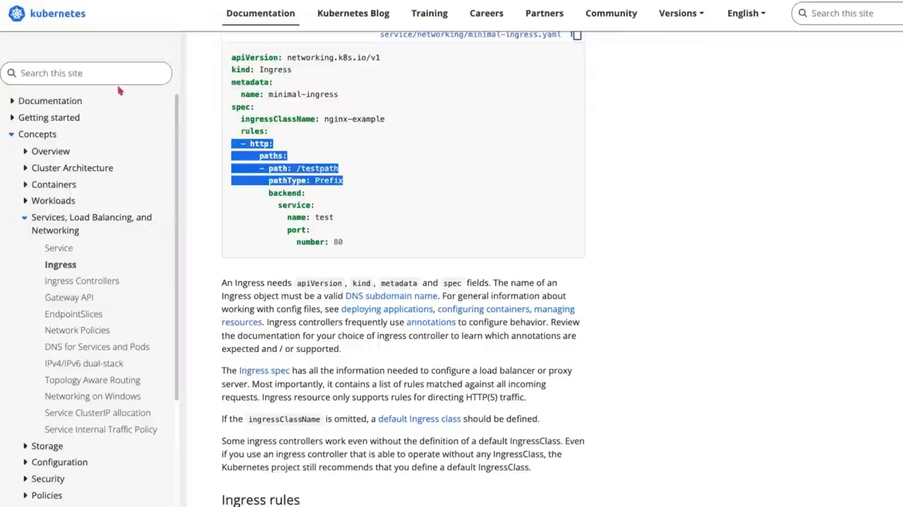

> 视频说得很到位：**注解只是一个部分解决方案，看起来更像临时方案。**

### 2.2 硬伤二：没有角色隔离

第二个缺陷并非所有公司都会遇到，但对**同时拥有平台工程师和 DevOps 工程师**的组织很典型：两者都在**更新同一个 Ingress 文件**。[【跳转到 13:22】](https://www.youtube.com/watch?v=EG27AzlHolU&t=802)

具体说，**Ingress 类名（`ingressClassName`）由平台工程师维护**（他们负责安装控制器、定义类名），**其余字段由 DevOps 工程师维护**。于是**访问权限没有清晰的划分**——DevOps 工程师有可能修改 Ingress 类名，从而打乱平台工程师预期的配置，**互相干扰**。[【跳转到 14:29】](https://www.youtube.com/watch?v=EG27AzlHolU&t=869)

**各公司的诉求是：把访问权限明确划分开。** 做法本应是把 Ingress 拆成两部分——「类名」单独成一个资源、「其余部分」成另一个资源。但 Kubernetes 没有这么做，因为那会造成**重大的破坏性变更**。[【跳转到 14:54】](https://www.youtube.com/watch?v=EG27AzlHolU&t=894)

正因为这两个长期存在的诉求，Kubernetes 才决定：「这些都是悬而未决的问题，很多人都在提，那我们就推出 **Gateway API**。」[【跳转到 15:19】](https://www.youtube.com/watch?v=EG27AzlHolU&t=919)

---

## 三、Gateway API 如何对症下药

### 3.1 把一个问题拆成三个资源

Kubernetes 社区做的第一件事，就是**不再把入口配置作为单一资源提供，而是拆成三个不同的资源**：`GatewayClass`、`Gateway`、`HTTPRoute`。[【跳转到 16:34】](https://www.youtube.com/watch?v=EG27AzlHolU&t=994)

这里还有一个额外优势：这三个都是**自定义资源（CRD）**。以前 Ingress 是**原生资源**，而现在 Gateway API 资源是 CRD，**开源社区更新和维护这些 CRD 非常容易**。[【跳转到 16:56】](https://www.youtube.com/watch?v=EG27AzlHolU&t=1016)

```
平台工程师/集群管理员 ──▶ GatewayClass（安装网关控制器时创建）
                                   ▲ 绑定
DevOps/应用管理员 ─────────▶ Gateway（指定用哪个 GatewayClass）
                                   ▲ 绑定
DevOps/应用管理员 ─────────▶ HTTPRoute（后端服务配置 + 各种负载均衡功能）
```

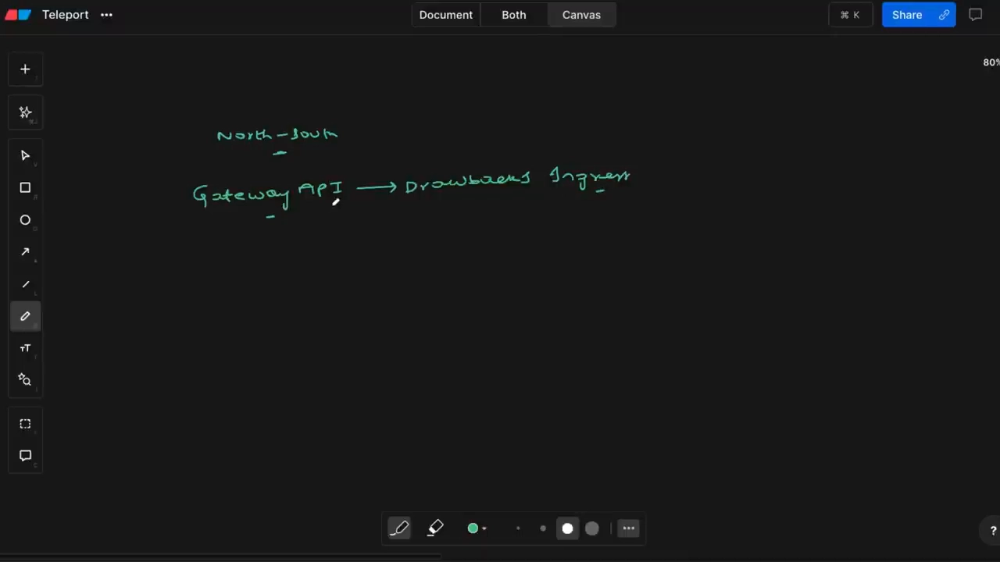

### 3.2 三个资源分别解决什么

- **`GatewayClass`**：由**集群管理员**定义。每当平台工程师创建一个**网关控制器**（类似创建 Ingress 控制器，这次可以是 NGINX 网关控制器或 Traefik 网关控制器），安装这个控制器时就会创建一个 `GatewayClass`。[【跳转到 17:26】](https://www.youtube.com/watch?v=EG27AzlHolU&t=1046)
- **`Gateway`** 和 **`HTTPRoute`**：由 **DevOps 工程师 / 应用管理员**创建。`Gateway` 定义**要使用哪个 `GatewayClass`**；`HTTPRoute` 定义**后端服务配置**，也就是应该通过哪个端口、哪个路径访问服务。[【跳转到 17:51】](https://www.youtube.com/watch?v=EG27AzlHolU&t=1071)

**它怎么解决两个硬伤？**[【跳转到 19:31】](https://www.youtube.com/watch?v=EG27AzlHolU&t=1171)

- 对第一个硬伤：**`HTTPRoute` 现在完全能实现生产级功能**——Web 应用防火墙、HTTP 重定向、流量拆分、金丝雀部署等等。比如想实现基于权重的部署，**无需复杂注解，只需加一个 `weight` 字段**（`weight` 是 8 和 2，就表示 80% 流量流向一个服务、20% 流向另一个），**所有复杂注解被一个单独字段取代**。
- 对第二个硬伤：**两者之间界限分明**——`GatewayClass` 由集群管理员维护，`Gateway` 和 `HTTPRoute` 由 DevOps 工程师维护，社区要求的**明确隔离**也满足了。

一句话总结：**Gateway API 不是凭空出现，它解决的是 Ingress 之前解决的同一个问题（南北向流量），只是通过解决 Ingress 的缺点来做这件事。**[【跳转到 19:56】](https://www.youtube.com/watch?v=EG27AzlHolU&t=1196)

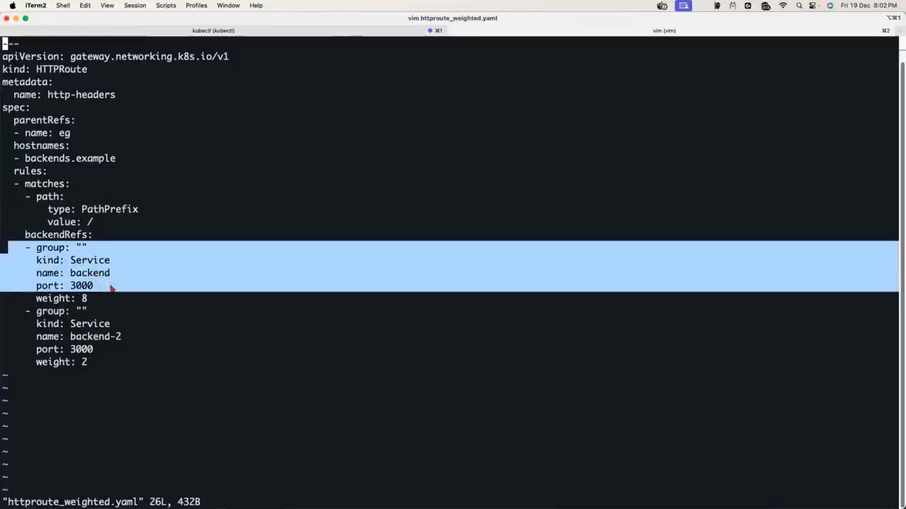

---

## 四、动手：用 kind + Envoy Gateway 走一遍完整流程

视频用作者准备的 GitHub 仓库（目录按 `00`、`01`、`02`… 顺序组织）做了完整演示。环境用 **Envoy Gateway** 而不是 NGINX 网关控制器，因为 **Envoy Gateway 更稳定、对初学者更友好**，学习 Gateway API 概念时建议从 Envoy 开始。[【跳转到 21:29】](https://www.youtube.com/watch?v=EG27AzlHolU&t=1289)

### 4.1 第一步：建集群、装 CRD 与控制器

**集群管理员先建集群**，这里用 `kind`：[【跳转到 21:04】](https://www.youtube.com/watch?v=EG27AzlHolU&t=1264)

```bash
kind create cluster --name gw-demo-cluster   # 也可以用 Minikube、MicroK8s 等本地发行版
```

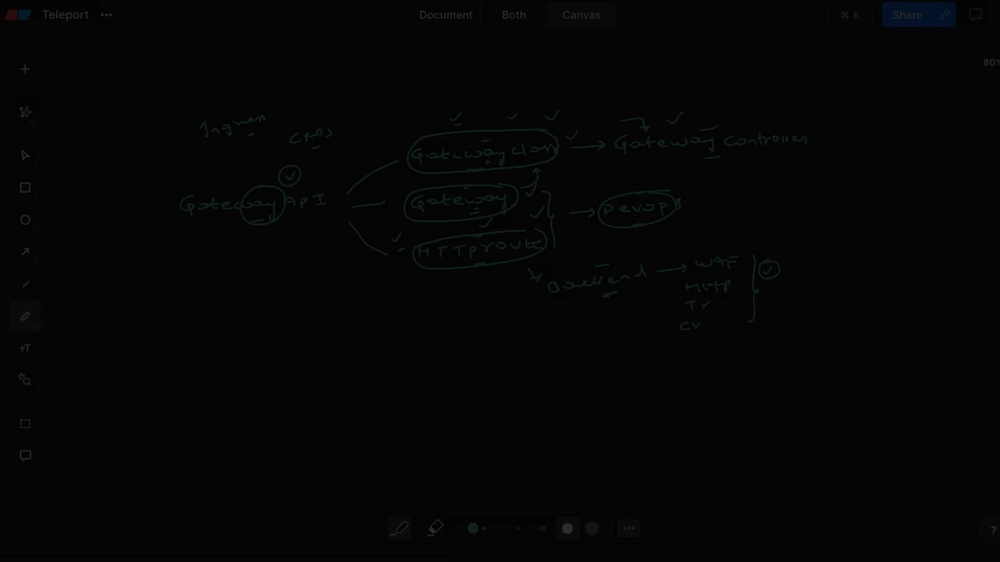

**安装 Gateway API CRD 和 Envoy Gateway 控制器**：进入 `00-install`，里面 README 里有一条 **Helm 命令**就能完成所有事。拆解这条命令：它先创建一个叫 **`envoy-gateway-system`** 的命名空间，在里面安装 chart；chart 里包含 **Gateway API CRD** 以及 **Envoy Gateway 相关的 Deployment 和 Service**。[【跳转到 22:41】](https://www.youtube.com/watch?v=EG27AzlHolU&t=1361)

验证：`kubectl get pods -n envoy-gateway-system` 能看到控制器——它就像 Ingress 控制器，**Ingress 控制器通常等待 Ingress 资源，而 Gateway 控制器则等待 Gateway 以及 HTTPRoute 资源**。此时它没有任何资源，只是等待。再看 CRD：`kubectl get crd -A`，能看到 `GatewayClass` 甚至 `HTTPRoute` 的 CRD 都已创建。[【跳转到 24:37】](https://www.youtube.com/watch?v=EG27AzlHolU&t=1477)

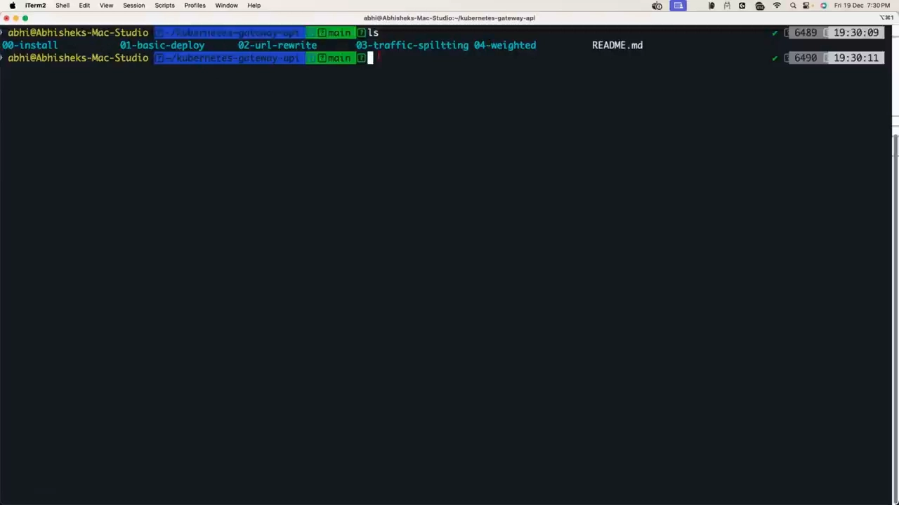

### 4.2 第二步：部署一个应用

在创建 Gateway / HTTPRoute 之前，得先有一个应用。`01-basic-deploy` 里有 `serviceaccount.yaml`、`deployment.yaml`、`service.yaml` 三个文件：[【跳转到 25:26】](https://www.youtube.com/watch?v=EG27AzlHolU&t=1526)

```bash
kubectl apply -f serviceaccount.yaml   # 通常建议创建并使用自己的 ServiceAccount
kubectl apply -f deployment.yaml
kubectl apply -f service.yaml         # ClusterIP，仅在集群内部 3000 端口暴露应用
```

- 为什么需要 ServiceAccount？如果不用，Deployment 会使用命名空间的默认 ServiceAccount，但通常建议创建并显式使用。[【跳转到 25:26】](https://www.youtube.com/watch?v=EG27AzlHolU&t=1526)
- 演示用的应用是一个 **ping-pong 应用**：任何人向它发请求，它都会**返回请求详情**（方法、header、命名空间、Pod 等）。在本地集群里，可以 `docker exec`（kind）或 `minikube ssh` 进到集群里，用 `curl` 直接访问该 Service 的 ClusterIP:3000 来验证。[【跳转到 28:45】](https://www.youtube.com/watch?v=EG27AzlHolU&t=1725)

### 4.3 第三步：用 GatewayClass / Gateway / HTTPRoute 暴露应用

要暴露应用，需要 **`gatewayclass.yaml`、`gateway.yaml`、`httproute.yaml` 三个文件**（用 Ingress 时你只需要一个 `ingress.yaml`）。[【跳转到 29:10】](https://www.youtube.com/watch?v=EG27AzlHolU&t=1750)

```bash
kubectl apply -f gateway/gatewayclass.yaml
kubectl apply -f gateway/gateway.yaml
kubectl apply -f gateway/httproute.yaml
```

各文件在讲什么：[【跳转到 31:29】](https://www.youtube.com/watch?v=EG27AzlHolU&t=1889)

- **`gatewayclass.yaml`**：只是说「任何使用这个 `GatewayClass` 的人，都间接使用了 **Envoy 代理 Gateway**」。在很多公司里这项工作由平台工程师完成（创建 Envoy Gateway 时顺带创建）。[【跳转到 30:00】](https://www.youtube.com/watch?v=EG27AzlHolU&t=1800)
- **`gateway.yaml`**：必须提供 **`gatewayClassName`**（决定由哪个控制器读取这个资源，类似 Ingress 里的 `ingressClassName`），并给 **listener** 提供信息——比如「即将创建的负载均衡器应该监听 80 端口」。[【跳转到 31:01】](https://www.youtube.com/watch?v=EG27AzlHolU&t=1861)
- **`httproute.yaml`（最重要）**：这里提供**后端配置**——`backendRef` 是一个 Service（名 `backend-service`、端口 `3000`），并声明「只有当用户使用主机名 `www.example.com` 时，才接受请求」。[【跳转到 31:59】](https://www.youtube.com/watch?v=EG27AzlHolU&t=1919)

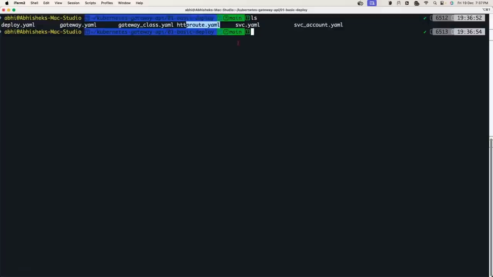

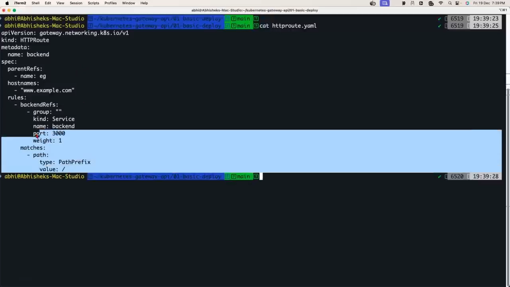

创建后，**Envoy 默认为我们创建了负载均衡器**——确切地说是一个**代理/反向代理**；如果用的是 ALB 之类，它才会创建外部负载均衡器。`kubectl get svc` 会看到这个代理的 Service（类型 LoadBalancer）。因为集群不支持 LoadBalancer，视频用 **`kubectl port-forward`** 把它暴露到本地，再用 `curl -v -H "Host: www.example.com" http://localhost:9090` 验证：响应里明确指出请求走了负载均衡器/反向代理 → HTTPRoute → 后端 Pod。[【跳转到 36:42】](https://www.youtube.com/watch?v=EG27AzlHolU&t=2202)

---

## 五、进阶演示：URL 重写、流量拆分与权重路由

### 5.1 URL 重写

**URL 重写**是一种高级功能：请求发给负载均衡器时是 `/origin/get/path`，但负载均衡器把请求转发到 `/origin/replace/path`——**应用端点发生变化时**，可以在负载均衡器里做重写，避免最终用户遇到问题。[【跳转到 37:49】](https://www.youtube.com/watch?v=EG27AzlHolU&t=2269)

关键点：**你不需要改应用，也不需要改 Gateway 里的任何设置，只要改 `HTTPRoute`**。在 `rules` 里加一个 filter：「如果有人发送 `/get` 请求，就把请求改成 `/replace`」。作者也坦言——**这些字段没人记得住，只需查官方文档**。[【跳转到 39:25】](https://www.youtube.com/watch?v=EG27AzlHolU&t=2365)

```bash
kubectl apply -f rewrite-httproute.yaml
curl -L --verbose -H "Host: backend.rewrite.example" http://localhost:1990/get/origin/path/extra
# 结果：请求 /get/origin/path/extra 已被改成 /replace/origin/path/extra，HTTP 200
```

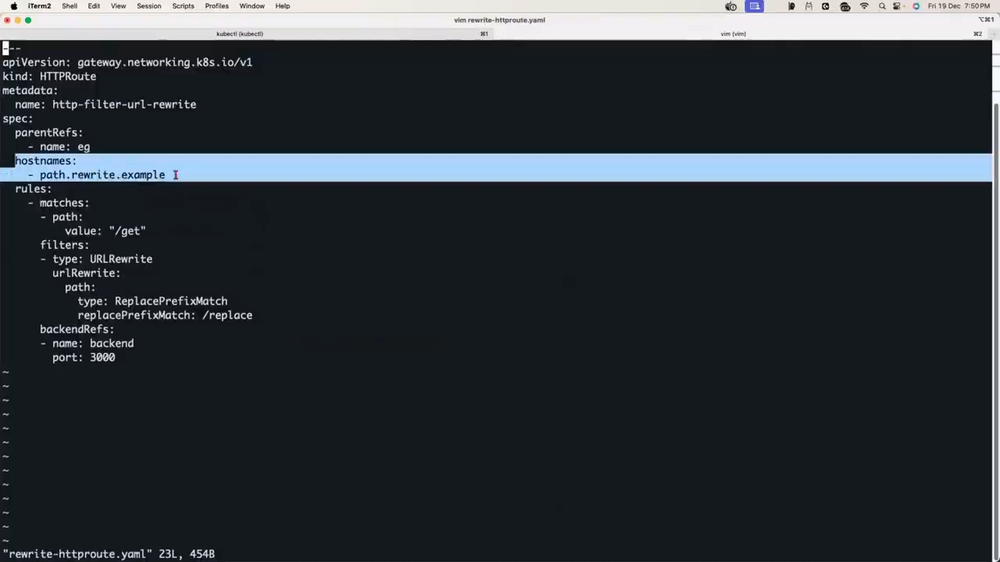

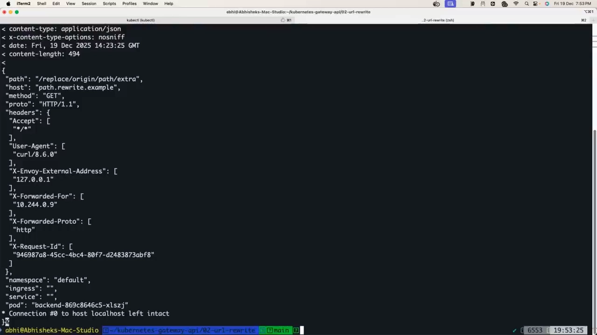

> 视频还解释了一个疑问：为什么演示总要手动传主机名？因为**我们没有把负载均衡器的 DNS 名称与这个主机关联起来**；实际使用时不用手动传，因为负载均衡器会与 `backend.amazon.com` 这样的 DNS 名称绑定。[【跳转到 41:52】](https://www.youtube.com/watch?v=EG27AzlHolU&t=2512)

### 5.2 流量拆分

**流量拆分**用于版本发布：把 **50% 流量导向旧版本、50% 导向新版本**，等你确信之后再去掉这一步、把 100% 导向新版本。[【跳转到 43:32】](https://www.youtube.com/watch?v=EG27AzlHolU&t=2612)

做法：先部署**第二个版本**的后端（同样的 `serviceaccount.yaml`/`deploy.yaml`/`service.yaml`），**无需对 Gateway 做任何更改**（Gateway 只创建一次），只需再次修改 `HTTPRoute`——在 `backendRefs` 里从「一个 `backend` 服务」改成「`service-one` 和 `service-two` 两个服务」。[【跳转到 45:42】](https://www.youtube.com/watch?v=EG27AzlHolU&t=2742)

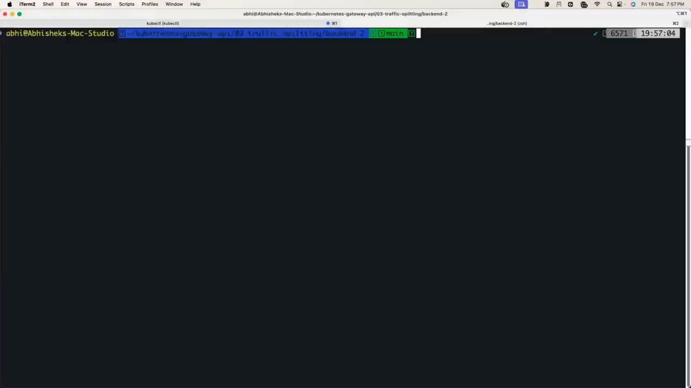

```bash
kubectl apply -f httproute-traffic-split.yaml
curl -H "Host: backends.example" http://localhost:9090/
# 反复请求：有时到后端一，有时到后端二
```

**重要区别**：这**不是轮询**——轮询是一个请求发到后端一、下一个发到后端二；而流量拆分是**总体上 50% 流向一边、50% 流向另一边**（取 100 个请求的平均来看）。[【跳转到 47:46】](https://www.youtube.com/watch?v=EG27AzlHolU&t=2866)

### 5.3 基于权重的负载均衡（金丝雀）

想实现 **80% 发到后端一、20% 发到后端二**，这就是**基于权重的负载均衡**，和金丝雀部署模型**概念几乎一样**。[【跳转到 48:11】](https://www.youtube.com/watch?v=EG27AzlHolU&t=2891)

做法与流量拆分**只差一个字段**：在 `backendRefs` 里给 `service-one` 加 `weight: 8`、给 `service-two` 加 `weight: 2`（即 80/20）。对比两个文件：**流量拆分文件缺少 `weight` 字段，而加权版里有 `weight` 字段**——这就是两者的区别。[【跳转到 50:06】](https://www.youtube.com/watch?v=EG27AzlHolU&t=3006)

```bash
kubectl apply -f httproute-weighted-weight.yaml
curl -H "Host: backends.example" http://localhost:9090/
# 目标：总体上 80% 到后端一、20% 到后端二
```

**关键提醒**：不要用「10 次里应有 2 次到后端二」去验证——**应该取更大的样本**（如 100 次里 80/20），因为在小的样本里比例会抖动。[【跳转到 51:32】](https://www.youtube.com/watch?v=EG27AzlHolU&t=3092)

> 视频在结尾给了很实在的建议：这个概念**本身确实有点复杂**，不是因为你是新手，而是因为要**从 Ingress 的世界过渡过来**；看完要**马上动手练习**，否则一周内就会忘光——这也是作者准备示例仓库的原因。[【跳转到 52:52】](https://www.youtube.com/watch?v=EG27AzlHolU&t=3172)

---

## 小结

- **Kubernetes 没有原生负载均衡器**，它用 **Ingress** 让各家自行实现南北向流量入口。[【跳转到 02:35】](https://www.youtube.com/watch?v=EG27AzlHolU&t=155)
- **Ingress 硬伤一：规范太窄**——只能声明「服务 + 路径」，生产级能力全靠控制器专属注解，导致注解爆炸、文件不可读、学习曲线陡。[【跳转到 12:57】](https://www.youtube.com/watch?v=EG27AzlHolU&t=777)
- **Ingress 硬伤二：没有角色隔离**——平台工程师与 DevOps 工程师共用一个资源、可能互相干扰。[【跳转到 14:54】](https://www.youtube.com/watch?v=EG27AzlHolU&t=894)
- **Gateway API 把入口拆成三个 CRD**：`GatewayClass`（管理员）、`Gateway` + `HTTPRoute`（开发），一次治好两个硬伤。[【跳转到 19:56】](https://www.youtube.com/watch?v=EG27AzlHolU&t=1196)
- **生产级能力变成原生字段**：金丝雀/权重路由只需一个 `weight`，不必再堆注解。[【跳转到 19:31】](https://www.youtube.com/watch?v=EG27AzlHolU&t=1171)
- **动手路径**：`kind` 建集群 → Helm 装 CRD + Envoy Gateway → 部署应用 → 写 `gatewayclass`/`gateway`/`httproute` 暴露应用 → 只改 `HTTPRoute` 就能做 URL 重写、流量拆分、权重路由。[【跳转到 33:12】](https://www.youtube.com/watch?v=EG27AzlHolU&t=1992)

## 关键术语速查

| 术语 | 一句话解释 |
| --- | --- |
| 东西向 / 南北向流量 | 前者是集群内服务互访，后者是外部用户访问集群内服务 |
| Ingress | Kubernetes 的传统入口方案：控制器 + Ingress 资源，规范只支持「服务 + 路径」 |
| 注解爆炸 | Ingress 靠控制器专属注解扩展功能，导致注解多、可读性差、换控制器即失效 |
| GatewayClass | 集群级 CRD，安装网关控制器时创建，代表「用哪个网关控制器」 |
| Gateway | 声明用哪个 GatewayClass、监听什么端口/协议的入口资源 |
| HTTPRoute | 定义后端服务配置与负载均衡能力（hostname、路径、weight 等）的 CRD |
| 流量拆分 | 按比例把流量分给两个后端（不带 weight 时默认 50/50），不是轮询 |
| 权重路由 / 金丝雀 | 在 backendRefs 里给每个后端加 weight（如 8:2 ≈ 80/20），即金丝雀部署 |
| Envoy Gateway | 一个 Gateway API 实现，安装 CRD 后由它提供数据面代理，适合入门 |
