# Gateway API 全面解析：从设计理念到 Envoy / NGINX / Traefik 实战

> 视频来源：[【谐云课堂第二十三期】Gateway API全面解析](https://www.bilibili.com/video/BV1vYTHzREBQ/)（B 站，up 主「谐云」，时长约 46 分钟）。
>
> 这是一支「从概念到动手」的系统课：先讲清 Gateway API 是什么、相比 Ingress 补了什么，再拆解它**面向角色的三种基本资源**（GatewayClass / Gateway / Route），然后用**同一个实验环境**分别装 Envoy、NGINX、Traefik 三个控制器，逐个演示 TLS、跨命名空间授权，以及 hostname/path/查询参数/请求头/权重分流/重定向/重写/请求镜像等常用功能。下文机制、命令与输出都来自该视频的图-字幕稿，可逐帧核对。

## 本讲要解决的核心问题（SCQA）

**背景（S）**：Ingress API 是 Kubernetes 里管理「外部流量如何进入集群」的传统方式，它提供了基于 `host` 和 `path` 的基础 HTTP 路由，以及一些 TLS 基础功能。[【跳转到 00:20】](https://www.bilibili.com/video/BV1vYTHzREBQ/?t=20)

**冲突（C）**：Ingress 的**路由能力非常有限**——只认 host 和 path。要实现其它扩展功能，就得依赖各第三方控制器厂商编写自己的 **注解**；而用户一旦想更换底层网关，就要**重写所有注解**，学习成本和迁移成本都很大。[【跳转到 00:45】](https://www.bilibili.com/video/BV1vYTHzREBQ/?t=45)

**疑问（Q）**：有没有一套**标准化、可扩展、换网关不用重写配置**的 API，来接管集群流量入口？

**回答（中心思想 A）**：**有，就是 Gateway API**。它在实现 Ingress 全部基础能力之上，扩展支持 TCP / UDP / GRPC 等协议、提供更细粒度的匹配规则（按请求头、查询参数分类，原生权重分流），并用 **policy attachment** 做类型化扩展。最关键的是它采用**面向角色的设计**：把配置拆成 `GatewayClass` / `Gateway` / `Route` 三种资源，实现**基础设施层与应用层权限的解耦**——换底层网关时只需改一个 `gatewayClassName`，路由规则一行都不用动。[【跳转到 01:35】](https://www.bilibili.com/video/BV1vYTHzREBQ/?t=95)

---

## 一、Gateway API 是什么，为什么能替代 Ingress

**Gateway API 是 Kubernetes 中用于管理集群网络流量入口的一个标准化 API 集合**，对标正在使用的 Ingress API，它的目标就是要**替代 Ingress**。[【跳转到 00:10】](https://www.bilibili.com/video/BV1vYTHzREBQ/?t=10)

### 1.1 Ingress 的能力边界与两个痛点

Ingress API 只提供最基本的定义，比如 HTTP 那种路由规则能力，但它的路由功能**非常有限**：只基于 host 和 path 这种简单规则来路由，再加一些 TLS 的基础功能。[【跳转到 00:45】](https://www.bilibili.com/video/BV1vYTHzREBQ/?t=45)

[【跳转到 00:00】](https://www.bilibili.com/video/BV1vYTHzREBQ/?t=0) 由此产生两个痛点：

1. **扩展靠注解**：要实现别的扩展功能，就得依赖各第三方控制器厂商编写自己的注解；
2. **换网关成本高**：如果用户想更换底层网关，就需要重写所有注解，学习成本和迁移成本都比较大。[【跳转到 01:10】](https://www.bilibili.com/video/BV1vYTHzREBQ/?t=70)

### 1.2 Gateway API 补了什么

相比 Ingress，Gateway API 做了三件事：[【跳转到 00:95】](https://www.bilibili.com/video/BV1vYTHzREBQ/?t=95)

- **实现 Ingress 的所有基础功能**，并扩展支持 **TCP、UDP、GRPC** 等协议；
- 提供**更细粒度的规则**：可以按**请求头**分类、按 **query params（查询参数）**分类，并**原生提供权重分流**——这些在 Ingress 里都要靠注解才能实现；
- 用**面向角色的设计**，明确分离基础设施层和应用层权限，降低学习和迁移成本。[【跳转到 02:50】](https://www.bilibili.com/video/BV1vYTHzREBQ/?t=170)

### 1.3 扩展机制：policy attachment

Gateway API 的扩展能力来自一种叫 **policy attachment** 的机制：允许各个控制器**在不修改 Gateway API 本身的情况下**，创建自己的自定义资源，把它关联到 Gateway 或 HTTPRoute 等资源上，实现对流量的自定义处理。[【跳转到 02:25】](https://www.bilibili.com/video/BV1vYTHzREBQ/?t=145)

> 后面要讲的 `BackendTLSPolicy` 就是一个典型的 policy attachment 资源。

---

## 二、三种基本资源与面向角色的设计

Gateway API 的设计核心是**面向角色设计**——把资源对象分离，实现配置上的解耦。它的三种主要基本资源分别是 **GatewayClass、Gateway 以及 Route**。[【跳转到 03:15】](https://www.bilibili.com/video/BV1vYTHzREBQ/?t=195)

### 2.1 GatewayClass：关联第三方控制器

`GatewayClass` 是一个**集群级别**的资源，用来定义网关的类型。它主要通过 `controllerName` 字段，去关联一个第三方网关控制器。下面是最简单的 YAML：[【跳转到 03:15】](https://www.bilibili.com/video/BV1vYTHzREBQ/?t=195)

```yaml
apiVersion: gateway.networking.k8s.io/v1
kind: GatewayClass
metadata:
  name: my-gateway-class
spec:
  controllerName: gateway.envoyproxy.io/gatewayclass-controller
```

一般我们安装第三方网关控制器（比如 Envoy Gateway）时，**如果它支持 Gateway API，通常会自动把 GatewayClass 装上**，不需要人工创建。不过视频作者调研了 Envoy、NGINX、Traefik 三家后发现：**Envoy 没有支持自动创建**，还是需要人工通过 YAML 创建。[【跳转到 03:40】](https://www.bilibili.com/video/BV1vYTHzREBQ/?t=220) [【跳转到 04:05】](https://www.bilibili.com/video/BV1vYTHzREBQ/?t=245)

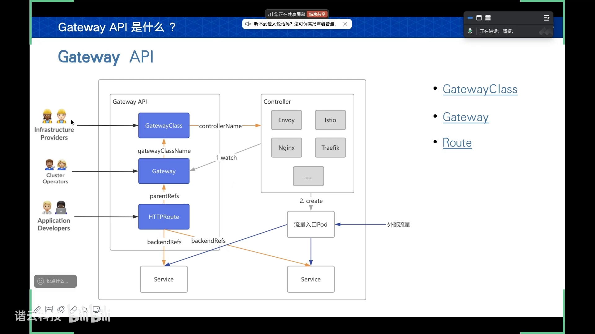

### 2.2 Gateway：声明流量入口的期望状态

`Gateway` 是一个**命名空间级别**的资源，主要用来**声明流量入口的期望状态**：通过 `listeners` 字段设置一个或多个监听器，并对刚进来的流量做**初始过滤**（监听哪个端口、初始化过滤哪些域名），从而把网关实例化；再通过 `gatewayClassName` 去绑定刚刚创建的 `GatewayClass`，把它们关联起来。[【跳转到 04:30】](https://www.bilibili.com/video/BV1vYTHzREBQ/?t=270)

```yaml
apiVersion: gateway.networking.k8s.io/v1
kind: Gateway
metadata:
  name: my-gateway
spec:
  gatewayClassName: my-gateway-class     # 绑定到上面的 GatewayClass
  listeners:
    - name: http
      protocol: HTTP
      port: 80
```

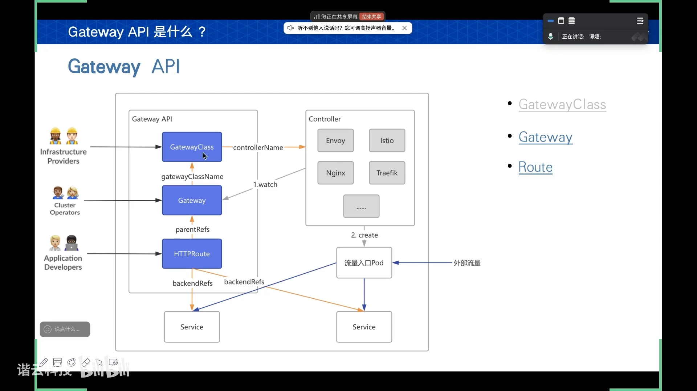

### 2.3 Route：定义具体的流量路由规则

`Route` 是我们**开发中最具体、最常用**的资源，用来定义具体的流量路由规则。它通过 `parentRefs` 去绑定 `Gateway`，再决定到达 Gateway 的请求如何按路由规则转发到后端服务。[【跳转到 05:20】](https://www.bilibili.com/video/BV1vYTHzREBQ/?t=320)

Route 目前分两档：[【跳转到 05:45】](https://www.bilibili.com/video/BV1vYTHzREBQ/?t=345)

- **可稳定使用的版本**：`HTTPRoute`、`GRPCRoute`；
- **还属于测试阶段的版本**：`TCPRoute`、`UDPRoute`、`TLSRoute`。

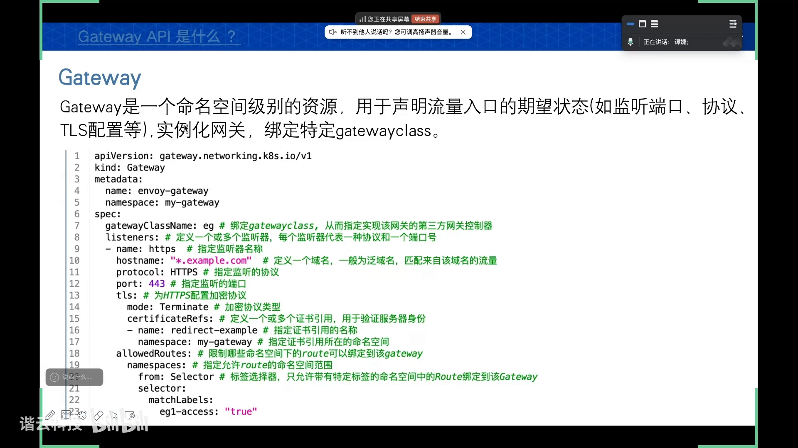

### 2.4 角色分工与「换网关不动路由」

三种基本资源对应三种角色：[【跳转到 06:35】](https://www.bilibili.com/video/BV1vYTHzREBQ/?t=395)

| 资源 | 负责角色 | 管什么 |
| --- | --- | --- |
| GatewayClass | 基础设施供应商 | 提供实际使用的第三方控制器 |
| Gateway | 集群工程师 | 监听哪个端口、初始化过滤哪些域名 |
| HTTPRoute | 应用开发者 | 只需学 HTTPRoute 的 YAML 字段，就能编路由规则 |

**这正是解耦的关键**：应用开发者只想学 `HTTPRoute` 就能写出适合自己业务的路由规则；如果他想更换底层第三方控制器，**只需更换 Gateway 里绑定的 `gatewayClassName`**，让它绑定另一个第三方，就能实现底层网关切换，**不需要修改复杂的路由规则**。这比 Ingress「换个控制器还要重写注解」方便得多。[【跳转到 07:00】](https://www.bilibili.com/video/BV1vYTHzREBQ/?t=420) [【跳转到 07:25】](https://www.bilibili.com/video/BV1vYTHzREBQ/?t=445)

---

## 三、工作原理：控制器、Gateway 与数据面 Pod

### 3.1 一张图看懂控制面 / 数据面

Gateway API 的工作原理可以按三步理解：[【跳转到 07:50】](https://www.bilibili.com/video/BV1vYTHzREBQ/?t=470) [【跳转到 08:15】](https://www.bilibili.com/video/BV1vYTHzREBQ/?t=495)

1. **先安装第三方控制器**：它的**控制平面 Pod** 就建立在集群中；
2. **再创建 Gateway**：在里面定义要监听的端口、协议等信息，控制器会根据这些配置**动态创建一个数据面 Pod**，作为流量入口；
3. **外部流量从这个数据面 Pod 进来**，再去查找对应的 HTTPRoute（TCP/UDP 那些 Route 也行），按路由规则把流量转发到具体的后端服务。

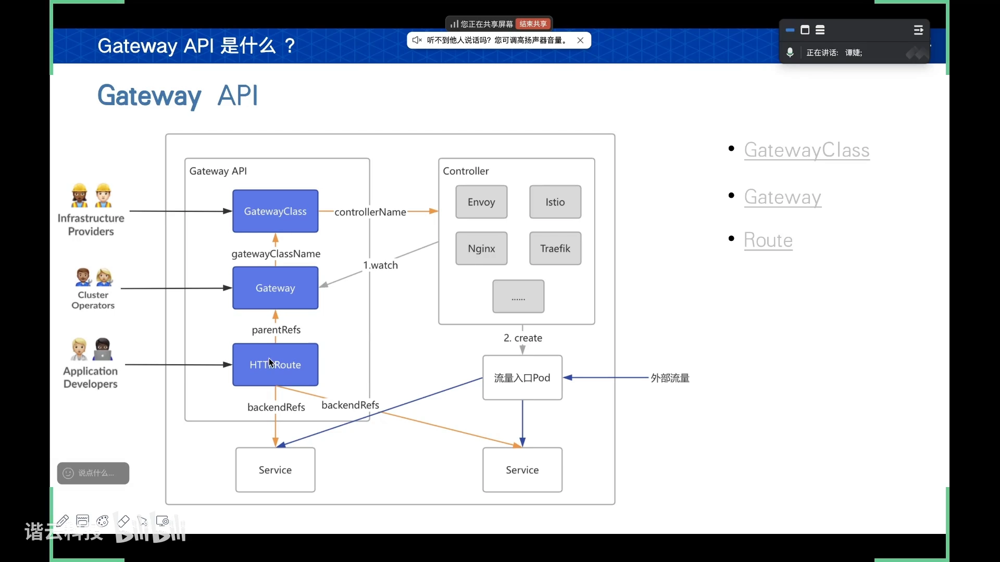

但**各家在此处的实现略有不同**：**Envoy** 会创建一个独立的**流量入口 Pod**来转发；而 **NGINX 和 Traefik 的数据面 Pod 其实就是它们的控制面自己**，不会再另外创建 Pod。[【跳转到 08:40】](https://www.bilibili.com/video/BV1vYTHzREBQ/?t=520)

### 3.2 版本与资源成熟度

从版本与资源的关系看：[【跳转到 09:30】](https://www.bilibili.com/video/BV1vYTHzREBQ/?t=570)

- **稳定版**：至少支持 `GatewayClass`、`Gateway`、`HTTPRoute` 三个主要资源，再加上最近纳入的 `GRPCRoute`；
- **Beta 版**：还有 `ReferenceGrant`（后面要讲的跨命名空间引用授权）；
- **更往下**：都还在测试中（如 `TCPRoute`、`UDPRoute`、`TLSRoute` 等）。

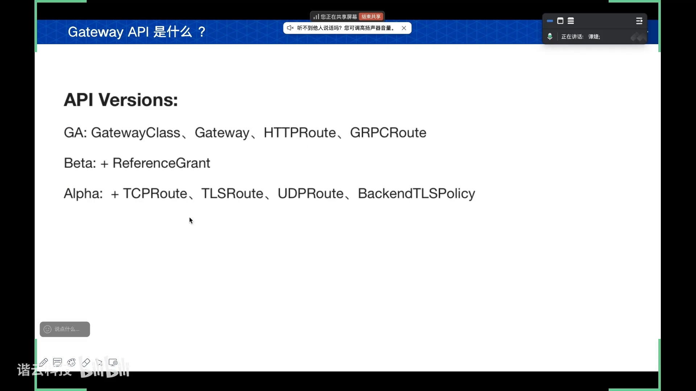

---

## 四、部署与三大控制器对比

### 4.1 公共前置：先装 CRD

无论用哪个第三方控制器，**都要先安装 Gateway API 自己的自定义资源（CRD）**。视频里安装的是**标准版本**，装完之后就会有相应的 CRD 资源。[【跳转到 10:24】](https://www.bilibili.com/video/BV1vYTHzREBQ/?t=624)

调研发现，三家控制器对一些基本功能的适配情况如下：**NGINX** 对 `TLSRoute` 和 `BackendTLSPolicy` 的支持属于**实验版本**，所以 NGINX 另提供了一个自己的实验版本来支持它；**Envoy 和 Traefik 支持得比较全面**。[【跳转到 10:54】](https://www.bilibili.com/video/BV1vYTHzREBQ/?t=654)

### 4.2 Envoy Gateway：多实例、需手动建 GatewayClass

- **通过 Helm 安装**；安装时**并没有提供 GatewayClass 的注册**，需要手动通过 YAML 配置。[【跳转到 11:19】](https://www.bilibili.com/video/BV1vYTHzREBQ/?t=679)
- 安装完控制器后配置 Gateway：**控制面 Pod 已经产生**，创建 Gateway 时它会**动态创建一个数据平面 Pod**作为流量入口。Envoy 是**多实例控制器**，一个 Gateway 资源对应一个数据面 Pod。[【跳转到 11:50】](https://www.bilibili.com/video/BV1vYTHzREBQ/?t=710)
- 可以创建**多个 Gateway**（比如 `envoy-gateway`、`envoy-gateway-2`），命名规则是「envoy + 命名空间 + Gateway 实际名字」。这样安装多个 Gateway 后，就能把 Service 端口一一区分开来，**避免端口冲突**。[【跳转到 12:15】](https://www.bilibili.com/video/BV1vYTHzREBQ/?t=735)
- **LoadBalancer 与 Programmed 状态**：配置好 Gateway 后，Envoy Gateway 会默认建一个 **LoadBalancer 类型**的 Service。如果测试环境没有负载均衡器，无法分配外部地址，`address` 会为空、`Programmed` 状态为 `false`（`Programmed` 的含义是控制器能否把配置应用到数据平面）。但这**不影响后面的通信**——没有外部均衡器，可以走下一层的 **NodePort** 完成流量通信。[【跳转到 13:35】](https://www.bilibili.com/video/BV1vYTHzREBQ/?t=815)
- **externalTrafficPolicy 陷阱**：Envoy 创建的 Service 默认 `externalTrafficPolicy` 是 **Local**，导致只有流量发到运行了数据面 Pod 的节点才能成功响应；发到没有数据面 Pod 的节点会被丢弃。可以用 `kubectl patch` 把它改成 **Cluster**，保证流量路由到所有节点。[【跳转到 14:14】](https://www.bilibili.com/video/BV1vYTHzREBQ/?t=854) [【跳转到 14:39】](https://www.bilibili.com/video/BV1vYTHzREBQ/?t=879)

### 4.3 NGINX Gateway：单实例、控制器即数据面

- 用 YAML 安装；**NGINX 默认会帮我们创建 GatewayClass**，默认名为 `nginx`。[【跳转到 15:04】](https://www.bilibili.com/video/BV1vYTHzREBQ/?t=904)
- NGINX 是**单实例控制器**，**不支持像 Envoy 那样创建多个 Gateway 资源**；它的**控制器本身就是数据平面**，直接由控制器自己的 Pod 充当流量入口。[【跳转到 15:29】](https://www.bilibili.com/video/BV1vYTHzREBQ/?t=929)
- 默认 Service 的 `externalTrafficPolicy` 也是 **Local**，同样要设为 **Cluster**。[【跳转到 15:54】](https://www.bilibili.com/video/BV1vYTHzREBQ/?t=954)

### 4.4 Traefik：支持多 Gateway、端口需匹配

- 跟 NGINX 差不多，也会**自动配置 GatewayClass**，但它**支持创建多个 Gateway**。[【跳转到 16:12】](https://www.bilibili.com/video/BV1vYTHzREBQ/?t=972)
- 有个要求：**Gateway 配置的监听端口，必须与它安装下来的 Deployment 中 Pod 的端口匹配**，否则端口监听不到。
- 多个 Gateway 的监听端口**重合也没关系**：它们最后会把所有 Gateway 的 HTTPRoute 规则**合并到同一个路由表**，由**一个数据平面 Pod 统一管理**。[【跳转到 16:37】](https://www.bilibili.com/video/BV1vYTHzREBQ/?t=997)
- 它的 Service 中 `externalTrafficPolicy` 默认就是 **Cluster**，无需再设置。[【跳转到 17:02】](https://www.bilibili.com/video/BV1vYTHzREBQ/?t=1022)

---

## 五、TLS：下游与上游两段加密

Gateway API 的 TLS 配置分为**下游 TLS** 和**上游 TLS** 两段：[【跳转到 17:25】](https://www.bilibili.com/video/BV1vYTHzREBQ/?t=1045)

- **下游 TLS**：客户端到网关之间的加密通信。在 **Gateway `spec.listeners` 的 `tls` 字段**中配置——设置加密协议类型，再指定需要的证书。[【跳转到 17:50】](https://www.bilibili.com/video/BV1vYTHzREBQ/?t=1070)
- 加密协议类型有 **Terminate** 和 **Passthrough** 两种。[【跳转到 18:15】](https://www.bilibili.com/video/BV1vYTHzREBQ/?t=1095)
- **上游 TLS**：网关到后端服务的通信。用 **`BackendTLSPolicy`** 配置——它本身就是上面提到的 **policy attachment** 机制下的一个自定义资源（属于 NGINX 的实验特性之一）。[【跳转到 18:40】](https://www.bilibili.com/video/BV1vYTHzREBQ/?t=1120)

```yaml
# 下游 TLS（片段）：在 Gateway 的 listener 上终止 TLS
listeners:
  - name: https
    protocol: HTTPS
    port: 443
    tls:
      mode: Terminate
      certificateRefs:
        - name: my-cert

# 上游 TLS（片段）：用 BackendTLSPolicy 让路由显式地用指定 CA 去连后端
apiVersion: gateway.networking.k8s.io/v1alpha3
kind: BackendTLSPolicy
spec:
  targetRefs:
    - kind: Service
      name: backend
  validation: { ... }        # 用 targetRefs + validation 字段做分配
```

`BackendTLSPolicy` 里可以涉及**目标引用**以及**有效期**：只要给那些 Service 配一个这样的 policy，就能决定集群中的 Service 都**显式地使用我们的 CA 证书**，从而完成网关跟后端服务的 TLS 配置；除了显式 CA 证书，也可以用系统证书来配置。其它 policy attachment 自定义资源的实现方式，大概也是利用 **`targetRefs`** 和 **`validation`** 这两个字段来做详细分配。[【跳转到 19:30】](https://www.bilibili.com/video/BV1vYTHzREBQ/?t=1170)

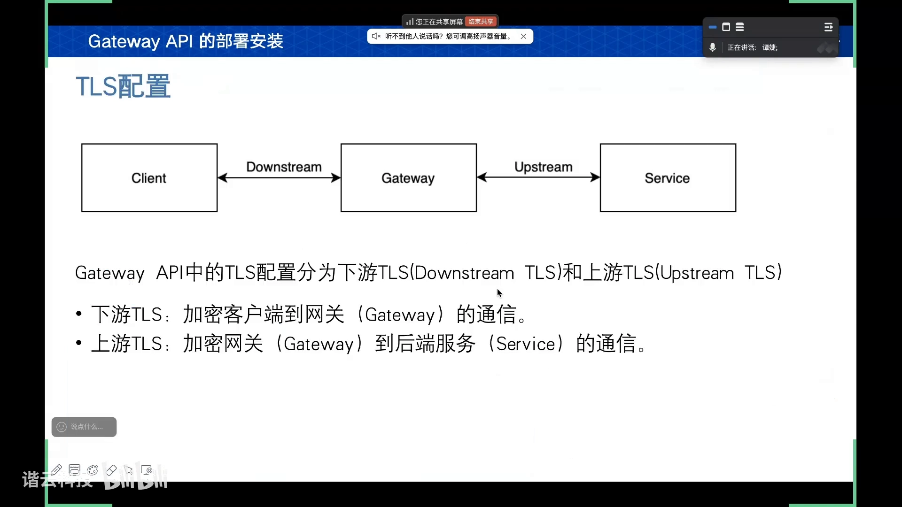

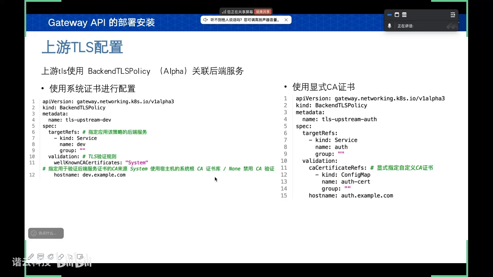

---

## 六、跨命名空间：allowedRoutes 与 ReferenceGrant

Gateway API **默认要求同一个命名空间才能互相调用**，但想跨命名空间也有办法。[【跳转到 19:55】](https://www.bilibili.com/video/BV1vYTHzREBQ/?t=1195)

### 6.1 Gateway 侧：allowedRoutes

想让**网关和路由在两个不同命名空间**，可以在 **Gateway 中使用 `allowedRoutes` 字段**，限制哪些路由能附加到网关上：[【跳转到 20:20】](https://www.bilibili.com/video/BV1vYTHzREBQ/?t=1220)

- `Same`（默认）：只允许**同命名空间**的路由附加上来；
- `All`：允许**全部命名空间**；
- `Selector`：**标签选择器**，只允许带特定标签的命名空间下的 Route 绑定到这个 Gateway。

### 6.2 Route 侧：双向绑定

Gateway 和 Route 之间要实现**双向绑定**：Gateway 里只是对 Route 做了筛选；要让两者成功绑定，**Route 这边同样需要在 `parentRefs` 下显式标注所引用的网关在哪个命名空间**。[【跳转到 21:10】](https://www.bilibili.com/video/BV1vYTHzREBQ/?t=1270)

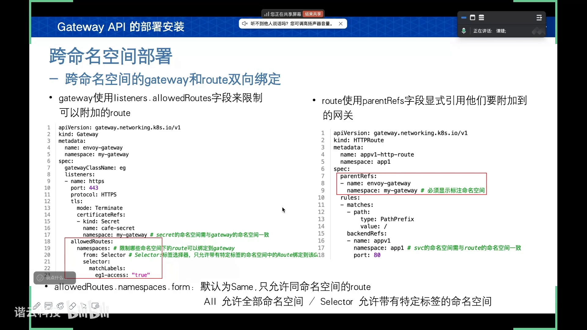

### 6.3 其它跨命名空间引用：ReferenceGrant

其它情况下，如果想从命名空间外部引用一个对象，**必须在该对象所在的命名空间内创建一个 `ReferenceGrant` 资源**，显式允许该引用，否则跨命名空间引用就会失效。[【跳转到 21:35】](https://www.bilibili.com/video/BV1vYTHzREBQ/?t=1295)

典型场景有两个：[【跳转到 22:25】](https://www.bilibili.com/video/BV1vYTHzREBQ/?t=1345)

- **Route ↔ Secret**：下游 TLS 的证书是通过 Route 的 TLS 字段配置的，若证书和 Route 不在同一个命名空间，就要引用 `ReferenceGrant`；
- **Route ↔ 后端 Service**：默认要求后端 Service 跟 Route 在同命名空间，设置引用授权后就能跨命名空间联动。

`ReferenceGrant` 主要由**两个列表**组成：[【跳转到 22:50】](https://www.bilibili.com/video/BV1vYTHzREBQ/?t=1370)

- **`from`**：我有哪些资源要来引用**我这个命名空间**下的东西；
- **`to`**：`ReferenceGrant` 所在命名空间下、**能被 `from` 引用的那些资源**。

举一个具体例子：Gateway 要监听 443 走 HTTPS，需要用到证书 `my-secret`，但证书在 `my-secret` 命名空间、Gateway 在 `my-gateway` 命名空间，属于**跨命名空间**。此时就要在**被引用的资源所在命名空间**（即 secret 所在命名空间）定义一个 `ReferenceGrant`，在 `from` 列表里把 `my-gateway` 命名空间下的 Gateway 资源都写进去——表示「`my-gateway` 下的 Gateway 可以使用我 `my-secret` 下的 Secret」。[【跳转到 23:15】](https://www.bilibili.com/video/BV1vYTHzREBQ/?t=1395) [【跳转到 23:40】](https://www.bilibili.com/video/BV1vYTHzREBQ/?t=1420)

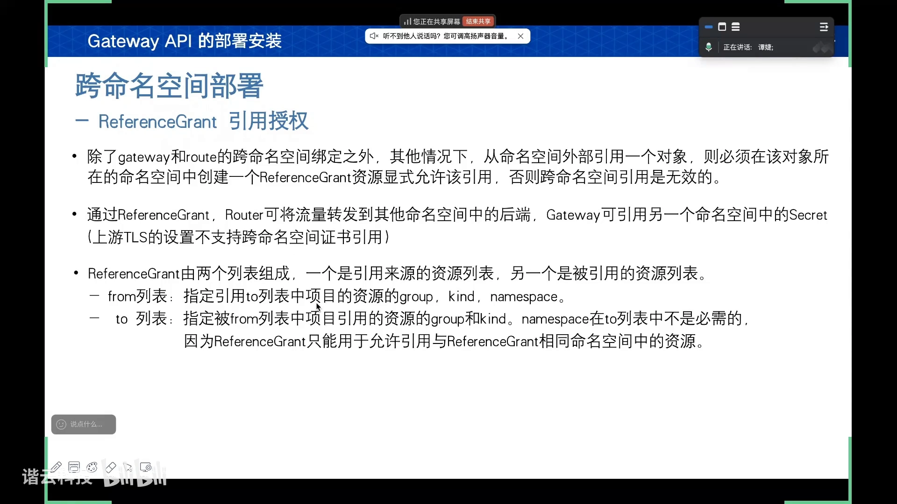

> **重要区分**：对于 Gateway ↔ Secret 这种互相引用，`ReferenceGrant` **只是一个声明、只是逻辑层面的权限**，它打破了第一层逻辑壁垒，但**并没有涉及底层 RBAC 那种物理上的显式授权**。要真正读取另一个命名空间的 Secret，还需要通过 **Role + RoleBinding** 做显式授权。而 **Route ↔ Service** 之间就不需要这么复杂，因为它们没有 Secret 那种授权难题。[【跳转到 24:05】](https://www.bilibili.com/video/BV1vYTHzREBQ/?t=1445) [【跳转到 25:16】](https://www.bilibili.com/video/BV1vYTHzREBQ/?t=1516)

---

## 七、HTTPRoute 的常用功能实战

视频搭建的实验环境：同时装了 **Envoy、NGINX、Traefik** 三个控制器（Envoy 端口映射 80→30684、443→32347，多实例；NGINX 单实例；Traefik 统一），并配了 DNS 方便用域名访问；后端 `app-v1` 是 NGINX、`app-v2` 是 Tomcat，另有一个 echo 服务做请求头回显。后面所有功能都在这套环境里逐个验证、并对比三个控制器的适配情况。[【跳转到 25:36】](https://www.bilibili.com/video/BV1vYTHzREBQ/?t=1536) [【跳转到 26:51】](https://www.bilibili.com/video/BV1vYTHzREBQ/?t=1611)

### 7.1 hostname 与 path 路由

`HTTPRoute` 最基础的能力，就是通过 **hostname 和 path** 对 HTTP 协议进行路由：[【跳转到 27:04】](https://www.bilibili.com/video/BV1vYTHzREBQ/?t=1624)

- **hostname**：在 **Gateway 中做初步筛选**（流量进来先过 Gateway 这一步）——一般用**泛域名**做过滤，但**只能写域名，不能写具体的 IP 地址加端口**。[【跳转到 27:29】](https://www.bilibili.com/video/BV1vYTHzREBQ/?t=1649)
- **path**：只能在 **HTTPRoute** 中实现，主要在 `rules` 字段下用 `matches` 匹配。类型可以是 **`PathPrefix`（前缀匹配）**、**`Exact`（完全匹配）**，以及生产中最常用的**正则匹配**。[【跳转到 28:44】](https://www.bilibili.com/video/BV1vYTHzREBQ/?t=1724)
- 满足匹配规则后，就把流量转到后端服务（如 `app-v1` 的 80 端口）。[【跳转到 29:09】](https://www.bilibili.com/video/BV1vYTHzREBQ/?t=1749)
- **适配情况**：NGINX 主要不太支持正则表达式那种类型。[【跳转到 31:03】](https://www.bilibili.com/video/BV1vYTHzREBQ/?t=1863)

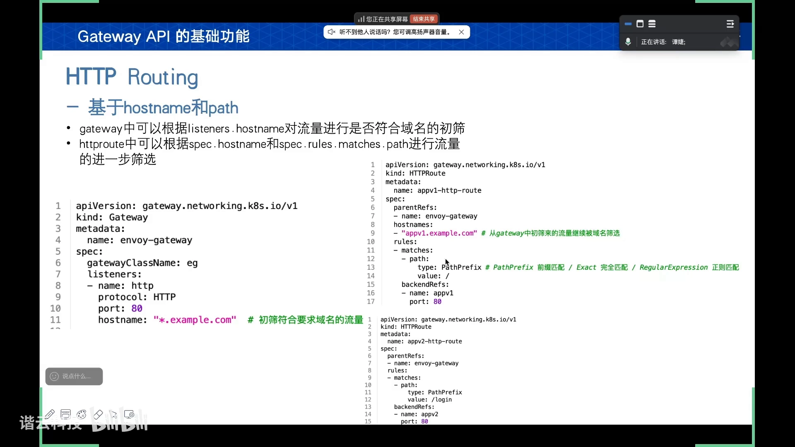

### 7.2 按查询参数 / 请求头 / 权重分流

除了 hostname 和 path，还能**基于查询参数**筛选流量：把 `matches` 下的 `path` 改成 **`queryParams`**，类型同样有 `Exact` 和正则。若满足 `queryParams`，流量导到 `app-v2`；**若这条规则不满足 matches，该规则就作废**，会来到下面的**默认路由**（没有任何匹配约束，只要不符合上面的规则就走它）。[【跳转到 29:41】](https://www.bilibili.com/video/BV1vYTHzREBQ/?t=1781) [【跳转到 30:27】](https://www.bilibili.com/video/BV1vYTHzREBQ/?t=1827)

**基于请求头分组分流**：把 `path`、`queryParams` 换成 **`headers`** 字段，类型也是 `Exact` 和正则；若想基于 cookie，把 `name` 改成 cookie 即可。测试结果：请求头是 `appv2` 时进入 `app-v2`（Tomcat），否则进入 `app-v1`（NGINX）。适配情况同上，NGINX 也不支持这种正则类型。[【跳转到 31:21】](https://www.bilibili.com/video/BV1vYTHzREBQ/?t=1881) [【跳转到 32:11】](https://www.bilibili.com/video/BV1vYTHzREBQ/?t=1931)

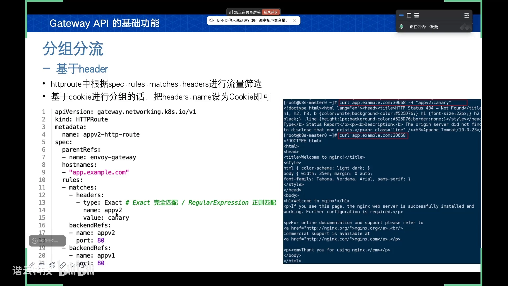

**基于权重分流**：在后端转发的字段中增加一个 **`weight`** 字段，比如把权重比配成 50 和 50（实际上 `50:50` 不写默认也是这样，默认就是平分关系）。**基于权重的分流，三个控制器全部适配。**[【跳转到 32:46】](https://www.bilibili.com/video/BV1vYTHzREBQ/?t=1966) [【跳转到 33:11】](https://www.bilibili.com/video/BV1vYTHzREBQ/?t=1991)

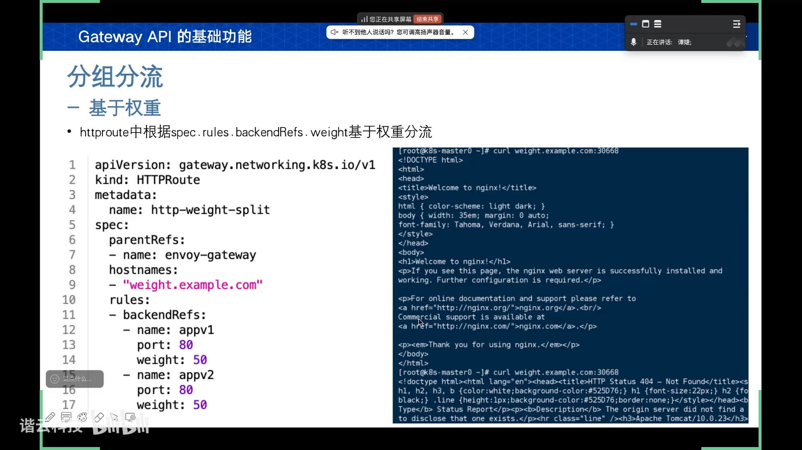

### 7.3 重定向与重写

改的是 `spec.rules.filters.type` 字段，可被设为 **`RequestRedirect`（重定向）** 和 **`URLRewrite`（重写）**，**这两个类型互不兼容**。注意：`path`、查询参数、`header` 等是在 `matches` 里做筛选，可以放在一起；但 `filters` 里的**重定向和重写不能同时出现在 Route 的规则中**。[【跳转到 34:07】](https://www.bilibili.com/video/BV1vYTHzREBQ/?t=2047)

两者的本质区别：[【跳转到 35:02】](https://www.bilibili.com/video/BV1vYTHzREBQ/?t=2102)

- **重定向（RequestRedirect）**：把客户端请求重定向到**另一个地址**，新地址**对客户端可见**（浏览器导航栏 URL 会改变）。典型用途：**HTTP 强制跳转 HTTPS、旧域名跳新域名、路径重定向与标准化**。
- **重写（URLRewrite）**：在内部转发请求时修改请求里的 host 或路径，**客户端无感知**（导航栏 URL 不变）。典型用途：**在反向代理中隐藏后端的真实地址**。

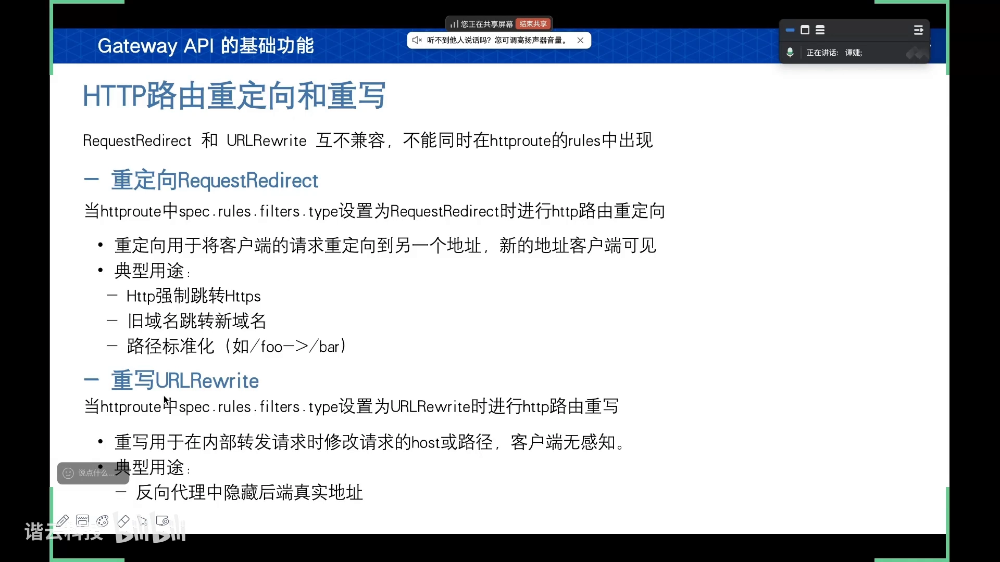

**HTTP 重定向到 HTTPS 的例子**：通过 HTTPRoute 的 `spec.rules.filters` 把类型设为 `RequestRedirect`。重定向到 HTTPS 时端口对应 443，这时要想到之前 Service 的端口映射——比如用 Envoy Gateway，就要**显式标明它把 443 映射到了哪个端口**；它**无法自动判断**你 443 的映射端口并跳转过去，不标最后转的还是 8080。实测：请求 `30668`（映射的 80 端口）→ 一次永久重定向到 `32347`（443 端口）→ 经域名到新的 HTTPRoute → 后端 `app-v1`。三个控制器也都能实现。[【跳转到 36:22】](https://www.bilibili.com/video/BV1vYTHzREBQ/?t=2182) [【跳转到 37:06】](https://www.bilibili.com/video/BV1vYTHzREBQ/?t=2226)

**路径重定向**：仍用 `RequestRedirect`，但参数是 `path`，类型有 **`ReplaceFullPath`（整个路径替换）** 和 **`ReplacePrefixMatch`（仅替换前面 matches 匹配的那部分）**。例子里访问 `app-v1/123` 仍匹配上 `matches`，用整个路径替换，最终重定向时把 `app-v1` 及其后面所有 URL 都替换掉、变成 `app-v2`，再导向 Tomcat 后端。适配情况都适配，但 **NGINX 需要显式指定重定向的端口**。[【跳转到 38:16】](https://www.bilibili.com/video/BV1vYTHzREBQ/?t=2296) [【跳转到 38:37】](https://www.bilibili.com/video/BV1vYTHzREBQ/?t=2317)

**域名重定向**：加一个 `hostname` 字段即可——**不只是 NGINX，Envoy、Traefik 三个都需要把重定向之后的端口显式标明**，不注明的话转发会失败。[【跳转到 38:45】](https://www.bilibili.com/video/BV1vYTHzREBQ/?t=2325) [【跳转到 39:10】](https://www.bilibili.com/video/BV1vYTHzREBQ/?t=2350)

**重写（URLRewrite）**：把 `filters` 的 type 变成 `URLRewrite`。原本收到的是 `rewrite.example.com`，通过重写改写为 `appv1.example.com`——用 curl 看命令时显示的**收到的请求头还是 `rewrite.example.com`**（客户端无感知），但去访问流量入口 Pod、检查访问日志，会发现**后端实际收到的确实是 `appv1.example.com`**。还展示了替换部分路径：原路径 `/comm/123` 只替换匹配的那个部分，最后路径变成 `/new/123`，后面的 `123` 保留。适配情况三个都能适配。[【跳转到 39:31】](https://www.bilibili.com/video/BV1vYTHzREBQ/?t=2371) [【跳转到 40:46】](https://www.bilibili.com/video/BV1vYTHzREBQ/?t=2446)

### 7.4 请求头修改与请求镜像

**请求头 / 响应头修改**：把 `filters` 的 type 改为 **`RequestHeaderModifier`** 或 **`ResponseHeaderModifier`**，可以**添加、修改、删除字段**。如果是修改字段而原请求中没有对应的 `name`，它会直接加上去。三个控制器也都适配。[【跳转到 41:23】](https://www.bilibili.com/video/BV1vYTHzREBQ/?t=2483) [【跳转到 41:56】](https://www.bilibili.com/video/BV1vYTHzREBQ/?t=2516)

**请求镜像（`HTTPRequestMirror`）**：可以把符合要求的流量**同时发送给两个后端服务**——一个是正常的**主后端**，一个是在 `filters` 里把类型设为 `RequestMirror` 的**镜像后端**。主后端处理并返回响应；**镜像后端只是接收副本、不会把响应返回回去**。它比较适合**在版本更新时，对即将上线的版本做流量测试**——镜像后端接收跟原版本相同的流量但不响应，因此不会干扰还没被替换下来的版本。**不过这个功能目前只有 Envoy Gateway 会适配。**[【跳转到 42:01】](https://www.bilibili.com/video/BV1vYTHzREBQ/?t=2521) [【跳转到 42:51】](https://www.bilibili.com/video/BV1vYTHzREBQ/?t=2571)

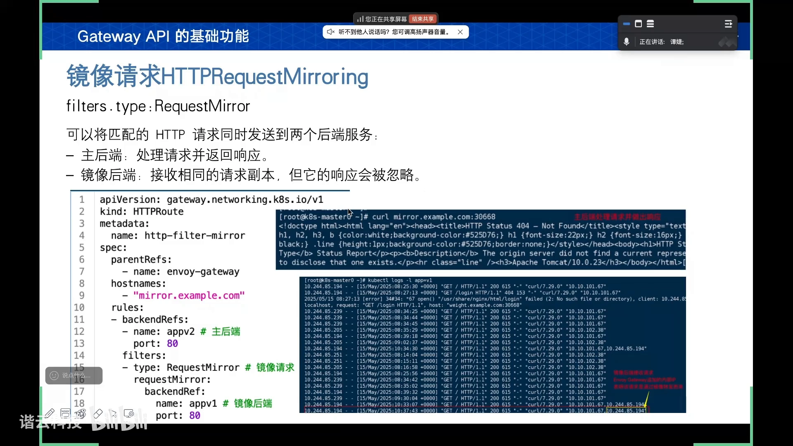

---

## 八、TCPRoute / UDPRoute / GRPCRoute

除了 HTTPRoute，还有 **TCPRoute、UDPRoute 以及 GRPCRoute**，它们都属于**测试版本**。[【跳转到 43:02】](https://www.bilibili.com/video/BV1vYTHzREBQ/?t=2582)

- **TCPRoute / UDPRoute**（类型差不多）：相比 HTTPRoute，它接收的是 TCP 流量，但 `rules` 配置中**只有转发的后端服务，不能做 matches 那种筛选或更高级的过滤**——流量进来必然匹配到这个后端服务。想把不同的 TCP 路由区分开来，通常**一条路由绑定网关上的一个端口**以避免冲突；这需要在 **Gateway 中声明绑定的路由类型是 TCPRoute**，然后在 TCPRoute 的引用中声明**所选 Gateway 的 `sectionName`（对应其监听端口的 name）**，才能绑定到某个端口。[【跳转到 43:52】](https://www.bilibili.com/video/BV1vYTHzREBQ/?t=2632) [【跳转到 44:42】](https://www.bilibili.com/video/BV1vYTHzREBQ/?t=2682)
- **GRPCRoute**：跟 HTTPRoute 非常像，也有 `matches`、过滤器以及那些规则字段。不同之处是它的 `matches` **只支持 `method` 和 `headers`**，**不支持 path 和查询参数**；`filters` 中**不支持重定向和重写**，只支持「添加请求头」这几个类型。[【跳转到 45:07】](https://www.bilibili.com/video/BV1vYTHzREBQ/?t=2707)

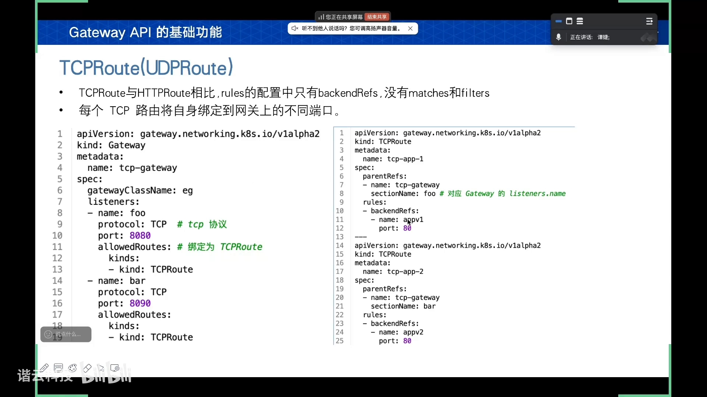

---

## 小结

- **Gateway API 是管理集群流量入口的标准化 API 集合**，目标是替代 Ingress；它补齐了 TCP/UDP/GRPC 协议、细粒度匹配与原生权重分流。[【跳转到 00:10】](https://www.bilibili.com/video/BV1vYTHzREBQ/?t=10)
- **三种基本资源对应三种角色**：`GatewayClass`（基础设施供应商，定义控制器）、`Gateway`（集群工程师，声明入口）、`Route`（应用开发者，定义路由），实现配置解耦，换网关只改一个字段。[【跳转到 06:35】](https://www.bilibili.com/video/BV1vYTHzREBQ/?t=395)
- **工作原理**：装控制器（控制面）→ 建 Gateway → 控制器按 Gateway 动态创建**数据面 Pod** → 外部流量进来查 Route 再转发；Envoy 另建入口 Pod，NGINX/Traefik 控制器即数据面。[【跳转到 08:15】](https://www.bilibili.com/video/BV1vYTHzREBQ/?t=495)
- **TLS 分两段**：下游 TLS 配在 Gateway 的 `listeners.tls`（Terminate/Passthrough）；上游 TLS 用 `BackendTLSPolicy`（policy attachment）。[【跳转到 17:25】](https://www.bilibili.com/video/BV1vYTHzREBQ/?t=1045)
- **跨命名空间**：Gateway 侧用 `allowedRoutes`，Route 侧用 `parentRefs` 双向绑定；其它跨命名空间引用要建 `ReferenceGrant`（from/to），且它只是逻辑授权，Gateway↔Secret 仍需 RBAC。[【跳转到 24:05】](https://www.bilibili.com/video/BV1vYTHzREBQ/?t=1445)
- **HTTPRoute 功能**：hostname/path/查询参数/请求头/cookie 匹配、权重分流、重定向与重写、请求头修改、请求镜像；适配度因控制器而异（如 NGINX 正则较弱、请求镜像仅 Envoy）。[【跳转到 42:51】](https://www.bilibili.com/video/BV1vYTHzREBQ/?t=2571)
- **TCP/UDP/GRPC Route 仍在测试阶段**，但相比 Ingress，Gateway API 已经非常强大。[【跳转到 45:39】](https://www.bilibili.com/video/BV1vYTHzREBQ/?t=2739)

## 关键术语速查

| 术语 | 一句话解释 |
| --- | --- |
| Gateway API | Kubernetes 管理集群流量入口的标准化 API 集合，目标替代 Ingress |
| GatewayClass | 集群级资源，用 `controllerName` 关联第三方网关控制器（数据面） |
| Gateway | 命名空间级资源，用 `listeners` 声明入口的端口/协议/TLS，用 `gatewayClassName` 绑定 GatewayClass |
| Route / HTTPRoute | 定义流量如何转发到后端的资源，用 `parentRefs` 绑定 Gateway |
| policy attachment | Gateway API 的扩展机制，允许控制器把自己的自定义资源挂到 Gateway/Route 上 |
| 下游 TLS / 上游 TLS | 前者是客户端到网关的加密（配在 listener.tls），后者是网关到后端的加密（用 BackendTLSPolicy） |
| BackendTLSPolicy | 上游 TLS 的策略资源，用 `targetRefs` + `validation` 让 Service 显式使用指定 CA |
| allowedRoutes | Gateway 字段，控制哪些命名空间的 Route 能绑定上来（Same/All/Selector） |
| ReferenceGrant | 跨命名空间引用的显式授权资源，含 `from`（谁来引用）和 `to`（哪些资源可被引用） |
| RequestRedirect / URLRewrite | filters 的两种互斥类型：重定向（客户端可见新地址）与重写（内部改写、客户端无感知） |
| HTTPRequestMirror | 请求镜像：主后端正常响应，镜像后端只收副本不响应，仅 Envoy Gateway 适配 |
| sectionName | Route 引用 Gateway 时用来指定绑定到哪个监听端口的字段 |
