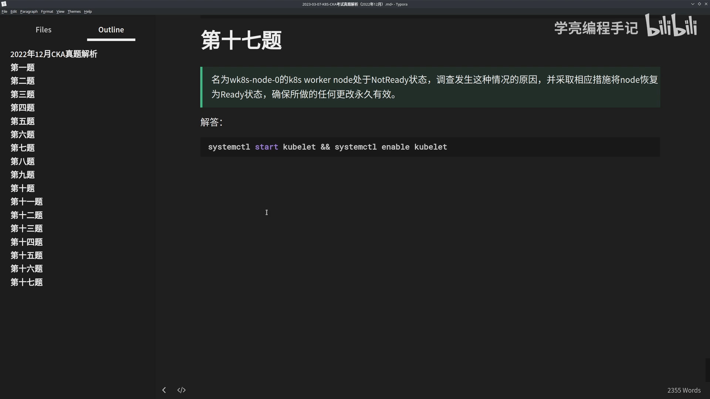
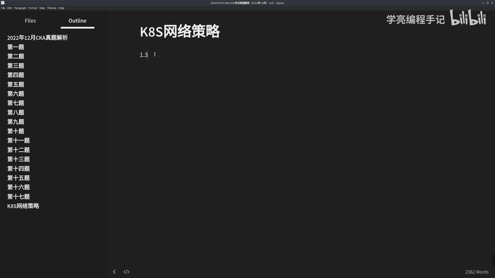
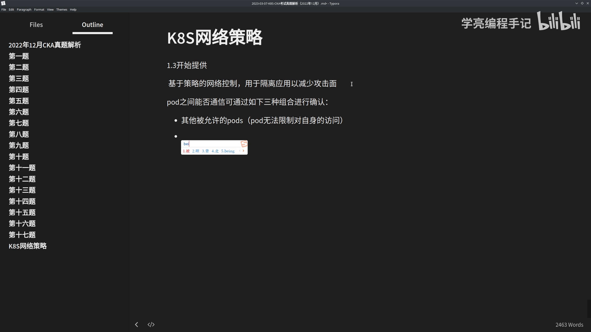
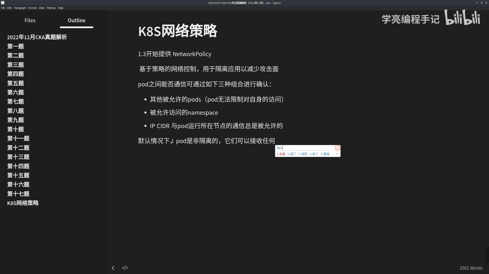
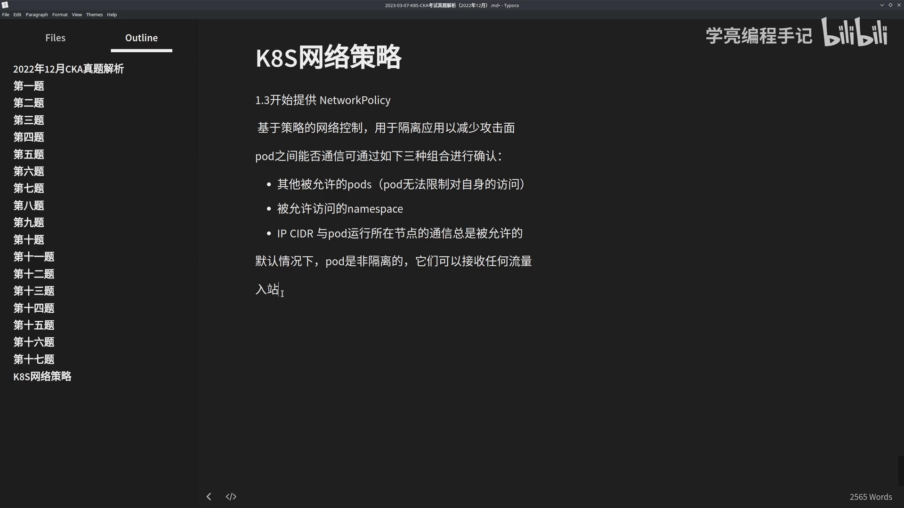
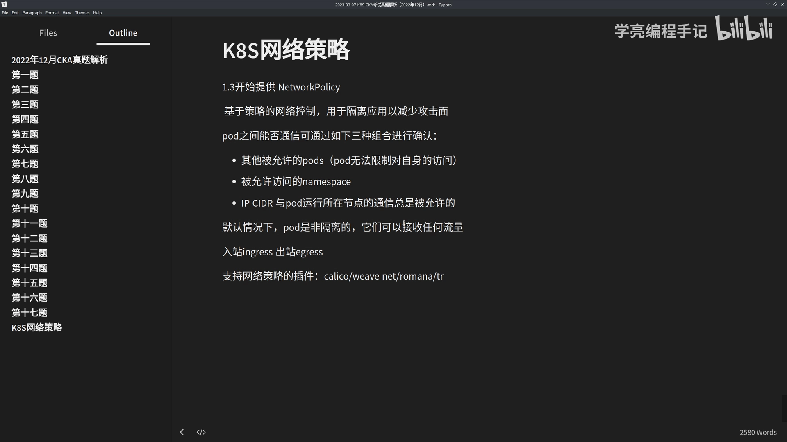
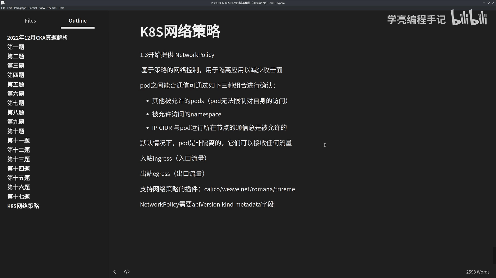
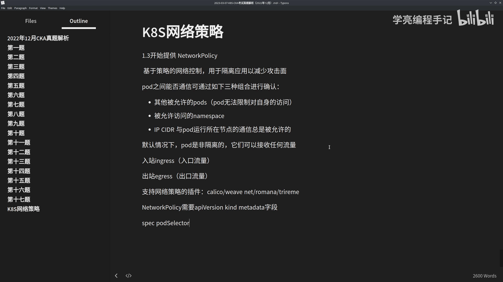

# NetworkPolicy 基本介绍：pod 间通信与对象结构

> 视频来源：[【K8S教程】网络策略 NetworkPolicy 基本介绍](https://www.bilibili.com/video/BV1k24y1g7v6/)（Bilibili，学亮编程手记）｜时长 9:35
>
> 视频是 CKA 真题（第五题）的补充讲解，围绕"NetworkPolicy 的基本认知"展开：它从哪个版本引入、pod 之间怎么判断能否通信、默认是不是隔离、对象长什么样。本文基于该视频的图-字幕文稿整理，可逐帧核对；已订正自动字幕的明显错拼：`pose/pd`→**pod**、`name space`→**namespace**、`english`→**ingress**、`陆战`→**egress**、`并记`→**并集**、`pd selector/pod etter`→**podSelector**、`ip cdr`→**IP CIDR**。

## 本讲要解决的核心问题（SCQA）

**背景**：Kubernetes 里 pod 之间默认可以随意通信。为了"隔离应用、减少攻击面"，Kubernetes 从 **1.3 版本**起提供了 NetworkPolicy（网络策略）。

**冲突**：但"网络策略"这四个字很容易让人按传统防火墙去理解——"默认拦截、放行才通"。而 Kubernetes 恰恰相反：**默认不隔离，被选中才隔离**。不了解这个默认，就很容易把策略写成"看起来对、实际不生效"。

**疑问**：pod 之间到底怎么判断"能不能通"？什么时候进入隔离状态？多条策略会不会互相冲突？NetworkPolicy 这个对象又长什么样？

**回答（中心思想）**：**NetworkPolicy 是一组"访问策略的集合"：默认全通，pod 一旦被策略选中就进入隔离状态、只放行策略允许的连接；多条策略之间不冲突、取并集；它同样是一个标准 K8s 对象，用 podSelector 决定"对谁生效"。** [【跳转到 00:00】](https://www.bilibili.com/video/BV1k24y1g7v6/?t=0)



## 一、NetworkPolicy 是什么：1.3 起就有的"基于策略的网络控制"

NetworkPolicy 是 Kubernetes 从 **1.3** 版本开始提供的**基于策略的网络控制**，用途是**隔离应用、减少攻击面**——把"哪些流量能进入或离开某个 pod"写成声明式的策略。[【跳转到 01:15】](https://www.bilibili.com/video/BV1k24y1g7v6/?t=75) [【跳转到 03:20】](https://www.bilibili.com/video/BV1k24y1g7v6/?t=200)

一句话概括：它是一组**访问策略的集合**，可以用**标签选择器**来设定"哪些流量可以进入或离开这个 pod"。[【跳转到 03:45】](https://www.bilibili.com/video/BV1k24y1g7v6/?t=225)



## 二、pod 之间能不能通？三种组合 + 一条"总是允许"

视频给出的判断依据：pod 之间能否通信，可通过**如下三种组合**进行确认：[【跳转到 02:55】](https://www.bilibili.com/video/BV1k24y1g7v6/?t=175)

1. **其他被允许的 pods**——注意"pod 无法限制对自身的访问"；
2. **被允许访问的 namespace**；
3. **IP CIDR**。

此外还有一条"总是被允许"的特例：**与 pod 运行所在节点的通信，总是被允许的**。



## 三、默认非隔离 → 被选中才隔离

这是最容易被误解的一点：[【跳转到 04:10】](https://www.bilibili.com/video/BV1k24y1g7v6/?t=250) [【跳转到 05:00】](https://www.bilibili.com/video/BV1k24y1g7v6/?t=300)

- **默认情况下，pod 是非隔离的**，它们可以接收任何流量——就相当于传统虚拟机那种"防火墙被禁用"的状态：只要网络是通的，任何流量都能访问它；
- **当 pod 被某一种 NetworkPolicy 选中时，才进入隔离状态**：一旦这个命名空间里有 NetworkPolicy 选中了特定的 pod，该 pod 就会**拒绝该策略不允许的连接**；
- 而命名空间下**其他未被 NetworkPolicy 选中的 pod，继续接收所有流量**。



## 四、不冲突的"并集"：多个策略选中同一个 pod 会怎样

NetworkPolicy 之间**不会冲突**：如果**任何一个或多个策略**选中了一个 pod，那么这个 pod 就**受限于这些策略入站（ingress）与出站（egress）规则的并集**。[【跳转到 05:25】](https://www.bilibili.com/video/BV1k24y1g7v6/?t=325) [【跳转到 05:50】](https://www.bilibili.com/video/BV1k24y1g7v6/?t=350)

换句话说，策略只有"叠加放行"的效果，没有互相覆盖、也没有直接"拒绝"的效果——这一点决定了很多"以为配了拒绝、其实只是没写"的现象。



## 五、谁来执行：CNI 插件必须"支持 NetworkPolicy"

策略要真正生效，**网络插件必须支持 NetworkPolicy**。视频列举的支持者包括：**Calico、Weave Net、Romana、Trireme** 等。[【跳转到 06:15】](https://www.bilibili.com/video/BV1k24y1g7v6/?t=375)

记住：NetworkPolicy 本身只是"声明"，真正在数据面干活的是 CNI 插件——若 CNI 不支持，策略能提交成功却毫无效果（详见同系列《5.3.3 CNI 对网络策略的实现》）。



## 六、对象结构：它也是一个"标准 K8s 对象"

跟其他 K8s 资源一样，**NetworkPolicy 也是一个对象**，需要提供 `apiVersion`、`kind`、`metadata` 这些字段；其中 `spec` 包含"在这个命名空间下定义该网络策略所需要的全部信息"。[【跳转到 07:55】](https://www.bilibili.com/video/BV1k24y1g7v6/?t=475) [【跳转到 08:20】](https://www.bilibili.com/video/BV1k24y1g7v6/?t=500)

而 `spec` 里最核心的是 **podSelector**：**每个 NetworkPolicy 都包含一个 podSelector，用来选择"该策略适用于哪些 pod"**。

- 例如：选择带有 `role=db` 这类标签的 pod；
- **如果 podSelector 为空（`{}`），则选中该命名空间下的所有 pod。**[【跳转到 08:45】](https://www.bilibili.com/video/BV1k24y1g7v6/?t=525)

```yaml
apiVersion: networking.k8s.io/v1
kind: NetworkPolicy
metadata:
  name: allow-frontend-to-mysql
  namespace: back-end
spec:
  podSelector:
    matchLabels:
      role: db            # 对带 role=db 标签的 pod 生效；为空则选中本命名空间全部 pod
  # ... ingress / egress 规则
```





## 小结

- NetworkPolicy 是 **1.3 起**提供的**基于策略的网络控制**，用于隔离应用、减少攻击面。
- pod 是否可通信看三种组合：**被允许的 pod、被允许的 namespace、IP CIDR**；与所在节点的通信**总是允许**。
- **默认不隔离**；被策略**选中才隔离**，未选中的 pod 继续全通。
- 多条策略**不冲突**，受限于其入站/出站规则的**并集**。
- 需要 **CNI 插件支持**才能真正落地（如 Calico、Weave Net、Romana、Trireme）。
- 它也是**标准 K8s 对象**：`apiVersion/kind/metadata/spec`，核心是 **podSelector**（为空则选中全部 pod）。

## 关键术语速查

| 术语 | 一句话解释 |
| --- | --- |
| NetworkPolicy | Kubernetes 基于策略的网络控制对象，用于隔离应用、减少攻击面 |
| 非隔离（默认） | 未被任何策略选中的 pod 默认接收所有流量 |
| podSelector | 选择"该策略对哪些 pod 生效"；为空表示选中本命名空间所有 pod |
| ingress / egress | 入站（入口流量）/ 出站（出口流量）规则 |
| 并集语义 | 多个策略同时选中一个 pod 时，该 pod 受限于所有策略规则的并集 |
| IP CIDR | 策略中可用 IP 网段表达来源/目的地 |
| CNI 支持 | 只有支持 NetworkPolicy 的 CNI 插件（如 Calico/Weave Net/Romana/Trireme）才能执行策略 |
