# NetworkPolicy 模型：默认全通的四层身份网络

> 视频来源：[架构师微课程第 62 期·Kubernetes 网络策略 NetworkPolicy：默认全通的四层身份网络](https://www.bilibili.com/video/BV1iYxG6bEpk/)（Bilibili，TeddyFang丶）｜时长 7:41
>
> 这期视频不纠缠单个字段怎么写，而是把 NetworkPolicy 的**模型**讲透：它为什么存在、和传统防火墙的本质区别在哪、Kubernetes 里"谁立法、谁执法"。本文基于该视频的图-字幕文稿整理，可逐帧核对；已订正自动字幕的明显错拼：`cuber nice`→**Kubernetes**、`扁平王`→**扁平网**、`pd/PAD`→**Pod**、`Celium`→**Cilium**、`English`→**Ingress**、"指法插件"→**执法插件**。

## 本讲要解决的核心问题（SCQA）

**背景**：Kubernetes 集群的网络**默认是全通的**——任意 Pod 都能直接连上任意 Pod，跨命名空间、直达生产库。为了隔离，我们用 **NetworkPolicy（网络策略）** 给它加一层"Pod 级的四层防火墙"。

**冲突**：但很多人一上手就把它当传统防火墙——以为它是"挂在机器上、跟 IP 走"的规则。而在 Pod 的 IP 会异变、跨节点漂移的集群里，这套心智模型会直接失效：规则跟不上 IP，安全组只能管到节点为止。

**疑问**：NetworkPolicy 究竟是一个什么样的"模型"？它凭什么识别"谁"？为什么写了"拒绝"却不生效？为什么策略明明提交成功、却一点都不拦？

**回答（中心思想）**：**NetworkPolicy 的治理对象是"身份"而不是"IP"——规则挂在标签上、跟着 Pod 的身份走；而 Kubernetes 本身只"立法"（提供 API 契约），真正"执法"的是 CNI 插件。** 抓住这两点，它的三条语义、选择器的 AND/OR 陷阱、以及"配了却不生效"的坑，都能自己推出来。[【跳转到 00:00】](https://www.bilibili.com/video/BV1iYxG6bEpk/?t=0)

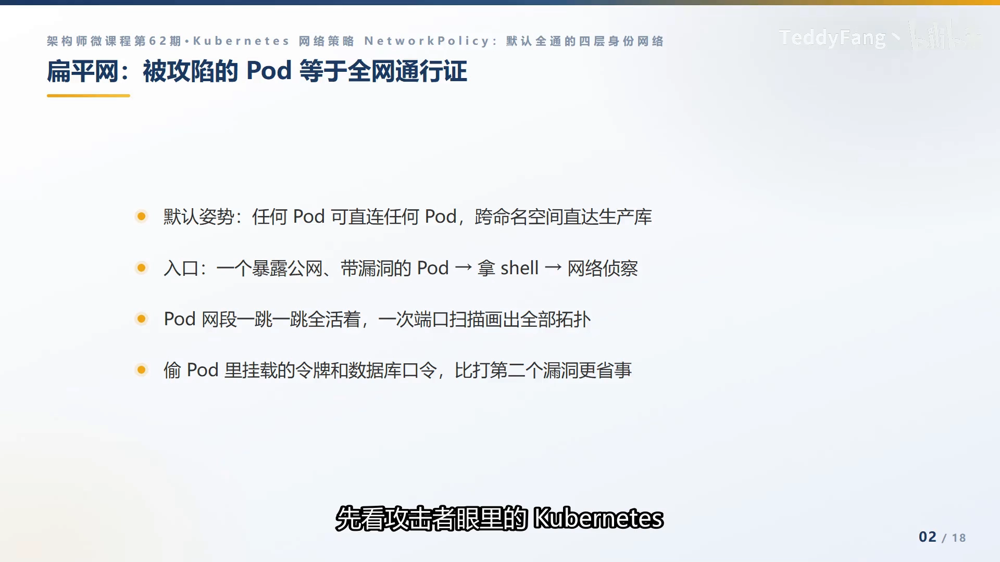

## 一、扁平网是默认姿势：为什么集群必须先补上网络这堂课

Kubernetes 的网络是**扁平**的：Pod 之间一跳直达，没有传统机房那种防火墙和网段隔离。这既是它的便利，也是它最危险的地方。

视频用"攻击者视角"给出一个几乎千篇一律的剧本：入口是一个暴露公网、带漏洞的 Pod；拿到 shell 后先做侦查；再偷 Pod 里挂载的令牌和口令。而在扁平网里，侦查的性价比高得离谱——**一次端口扫描就能画出全部服务拓扑**，数据库、缓存、消息队列全部直达，连第二个漏洞都不用找。

扁平网是怎么来的？传统机房靠防火墙和网段隔离；上了 Kubernetes 之后 **Pod 的 IP 会异变、跨节点漂移**，基于 IP 的防火墙规则跟不上。于是安全组退化成"只管节点"，节点内所有 Pod 共享一张网，环境之间"只剩下命名空间名字的差别"。所以事故复盘时最常听到的一句话是——[【跳转到 01:15】](https://www.bilibili.com/video/BV1iYxG6bEpk/?t=75)

> "那个被攻陷的 Pod，本不该有能力访问数据库。"

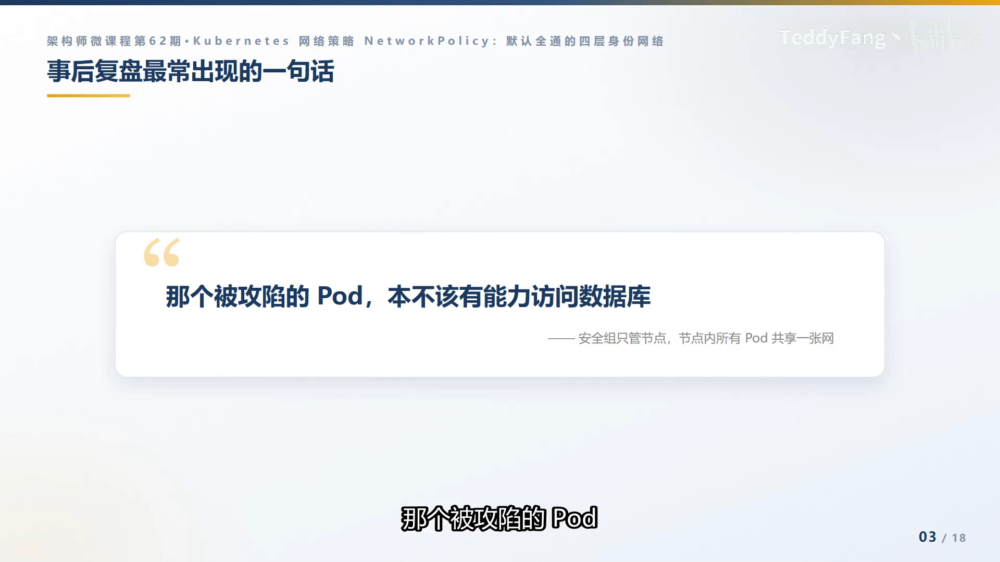

## 二、三条语义规则：NetworkPolicy 的"拒绝"永远来自"没写"

要把 NetworkPolicy 用对，先把它的**语义**压缩成三条：

1. **没有被任何策略选中的 Pod → 全部允许**（默认全通）；
2. **一旦被选中**，选定的方向（进或出）就切换到**白名单模式**：**没写的，全部拒绝**；
3. **多条策略是"并集（求 OR）"**，只有"允许"，没有"拒绝"。

由此得到最反直觉、也最重要的一句话：**你写的第一条策略，"拒绝"永远来自"没写"。** 这直接决定了审计方式——想知道一个 Pod 真实的"放行面"，不能只读一条策略，而要**把它命中的所有策略摊开求并集**。[【跳转到 01:40】](https://www.bilibili.com/video/BV1iYxG6bEpk/?t=100)

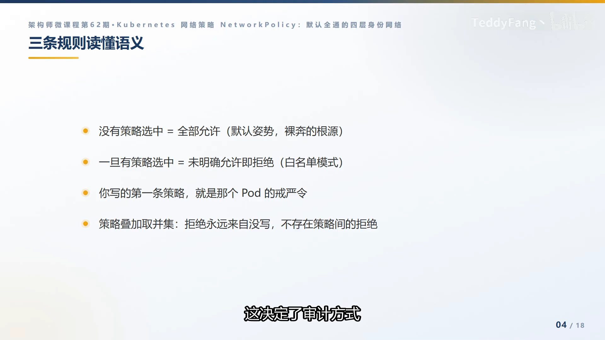

## 三、身份而不是 IP：它为什么比传统防火墙更适合容器

和安全组一对比，NetworkPolicy 的价值就一目了然：[【跳转到 02:05】](https://www.bilibili.com/video/BV1iYxG6bEpk/?t=125)

| 维度 | 传统安全组 | NetworkPolicy |
| --- | --- | --- |
| 规则挂在哪 | 机器上，跟 IP 走 | 标签上，跟身份走 |
| Pod 换 IP | 规则失真 | 策略自动跟随 |
| 治理对象 | 异变的 IP | 稳定的身份 |

一句话：**网络策略把治理对象从"异变的 IP"换成了"稳定的身份"**，这是它比传统防火墙更适合容器网络的根本原因。Pod 重建、漂移、IP 换掉，只要标签不变，策略就自动跟随。

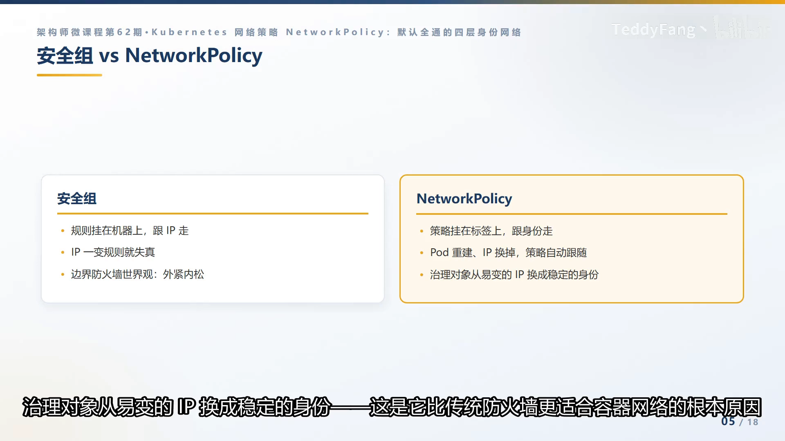

## 四、选择器与"AND 陷阱"：规则的"谁"该怎么写

规则的"谁"（who）用**选择器**表达，常用的有两种：

- **podSelector**：选本命名空间里带某标签的 Pod；
- **namespaceSelector**：按命名空间标签跨空间选人。

**最大的坑在入口规则的 `from` 来源列表**：[【跳转到 02:14】](https://www.bilibili.com/video/BV1iYxG6bEpk/?t=134)

- 列表里**每个元素是一个"来源块"**；
- **两个选择器写在同一个块里 = "并且"（AND）**；
- **各自成块 = "或者"（OR）**；
- **缩进差一格，语义就天差地别。**

另外，命名空间从 **1.22** 起会自动带上名字标签，这是跨空间选人的常用手段，也是这条规则里最容易写错的地方。

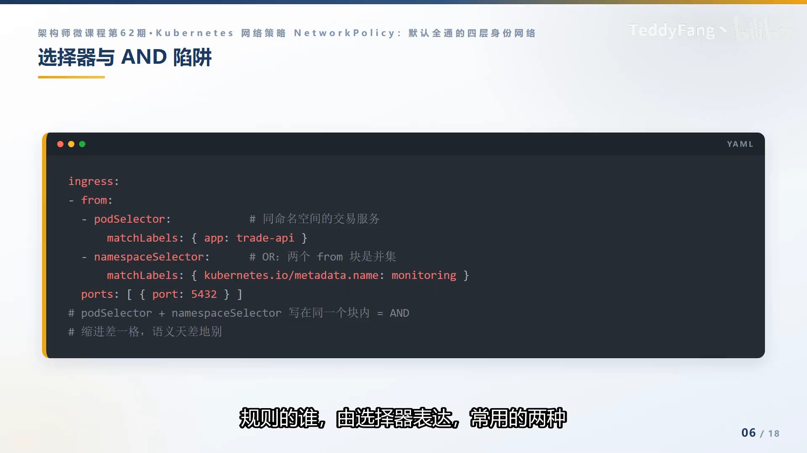

```yaml
ingress:
  - from:
      - podSelector:                     # 来源块 A
          matchLabels: { app: trade-api }
        namespaceSelector:               # 与上面写在同块 = AND
          matchLabels: { name: monitoring }
      - namespaceSelector:               # 另一个来源块 = OR
          matchLabels: { name: monitoring }
    ports:
      - protocol: TCP
        port: 5432
```

## 五、只立法、不执法：NetworkPolicy 是 API 契约，CNI 才是执法者

这是"配了却不生效"的根因：[【跳转到 02:51】](https://www.bilibili.com/video/BV1iYxG6bEpk/?t=171)

- **NetworkPolicy 只是 API 契约**——Kubernetes 自己**没有数据面**，策略由 **CNI 插件落地执行**；
- 如果 CNI 不支持：**每条策略都能提交成功、都能查到，但数据面毫无变化，而且零报错**；
- 经典翻车现场是 **flannel**（纯联通型 CNI，默认不"执法"），不少托管集群同样如此——你就带着"假安全感"去面对审计和执法引擎。

两种代表性的执行引擎：

| 执行引擎 | 代表 | 工作方式 |
| --- | --- | --- |
| iptables | Calico | 把策略翻译成 iptables 规则，Pod 的 IP 收进内核哈希集合，规则数可控 |
| eBPF | Cilium | 相同标签的 Pod 拿到"数字身份"，策略变成内核里的一次查表 |

所以，**一条 CNI 是否"执法"，是选型的一票否决项。** [【跳转到 03:21】](https://www.bilibili.com/video/BV1iYxG6bEpk/?t=201)

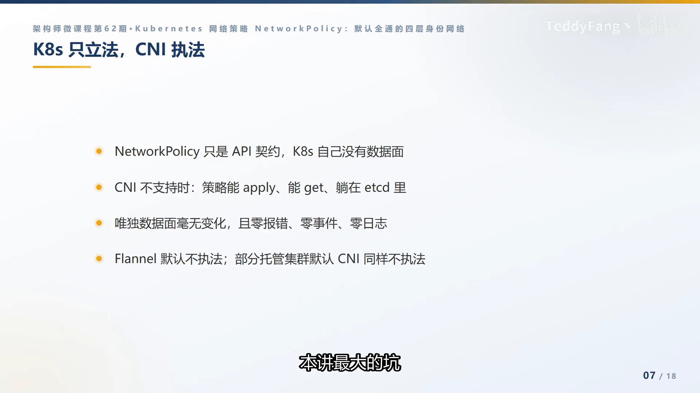

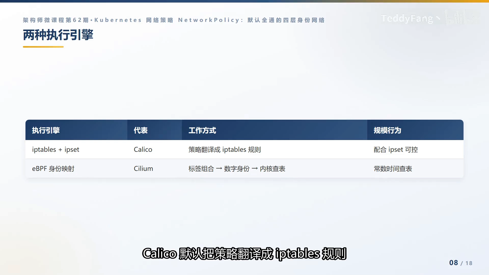

## 六、落地三件套：先关灯，再开灯

真正的落地从"三件套"开始，口诀是**先关灯，再开灯**：[【跳转到 03:46】](https://www.bilibili.com/video/BV1iYxG6bEpk/?t=226)

1. **第一件（关灯）**：选中全部 Pod、进出双向、**不给任何规则** = 默认全拒绝；
2. **第二件（开灯）**：放行 **DNS 的 53 端口出站**——第一个"死"的往往就是域名解析，这是新手村第一坑；
3. **第三件（开灯）**：放行 **API server 的 6443**。

这三件套由平台**随命名空间自动注入**，租户改不动。

```yaml
kind: NetworkPolicy
metadata: { name: default-deny-all, namespace: pay }
spec:
  podSelector: {}          # 空 = 选中本命名空间全部 Pod
  policyTypes: [Egress, Ingress]
  egress:
    - ports:               # 放行 DNS 53
        - { protocol: UDP, port: 53 }
        - { protocol: TCP, port: 53 }
    - ports:               # 放行 API server 6443
        - { protocol: TCP, port: 6443 }
```

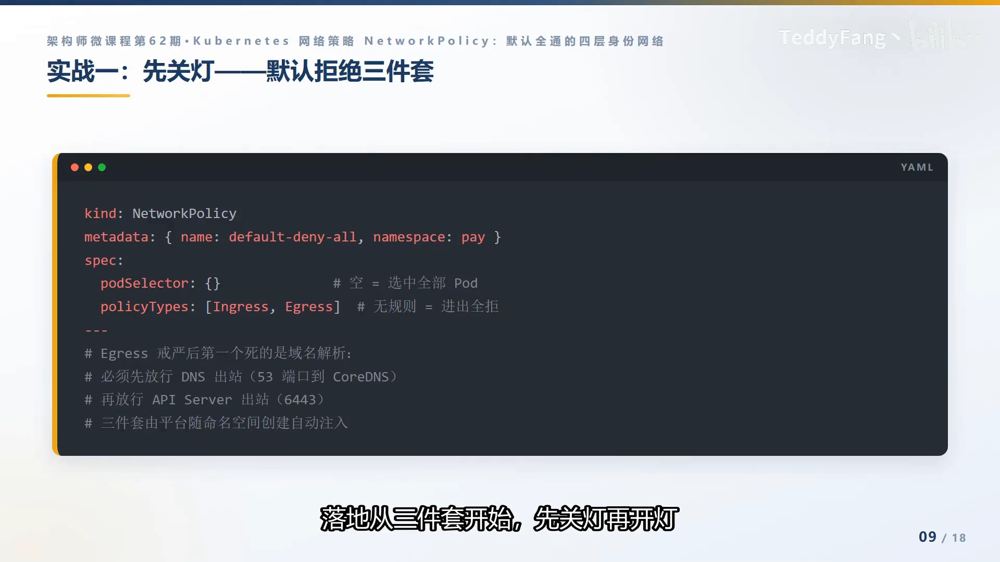

## 七、应用白名单与验证：kubectl 只证明"存在"，不证明"生效"

**第二段，应用白名单。** 以"支付数据库的门禁"为例：入口方向只接受交易服务的 **5432** 端口访问，再加上监控命名空间的采集端口，并写明协议。迁移期有一条实践纪律：**先开全量放行（宁多勿漏），再按观测到的真实流量逐条收紧**——上线第一天就用白名单掐断链路，团队对策略的信任就没了。**收紧的节奏按周计，别按天计。**[【跳转到 04:16】](https://www.bilibili.com/video/BV1iYxG6bEpk/?t=256)

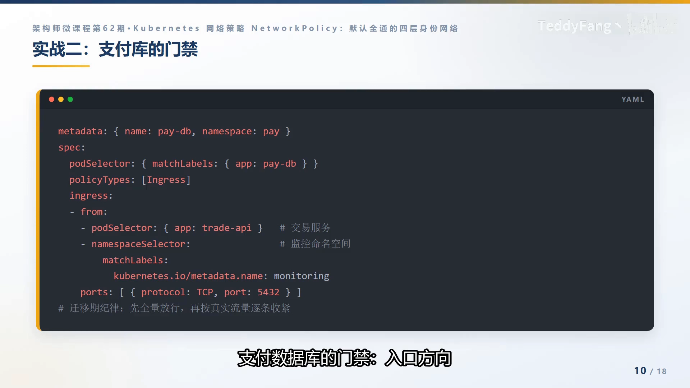

**第三段，验证。** 三步走：[【跳转到 04:40】](https://www.bilibili.com/video/BV1iYxG6bEpk/?t=280)

1. **确认 CNI 真在执法**：查 `kube-system` 里是不是执法插件；
2. **起调试 Pod 实测联通矩阵**：该通的要通、该断的要断；
3. **解决冷启动**：用 eBPF 工具录制两周真实流量，自动生成最小放行策略。

记住一句话：**`kubectl` 只能证明策略"存在"，证明不了"生效"。**

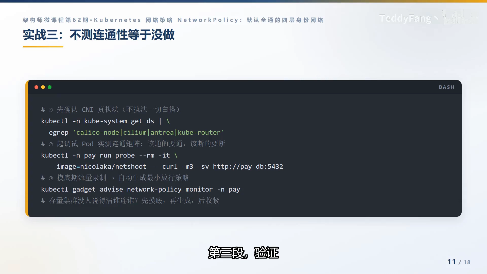

## 八、三条军规与治理分层

**三条军规**（最容易被忽略的盲区）：[【跳转到 05:10】](https://www.bilibili.com/video/BV1iYxG6bEpk/?t=310)

1. **只做入口不做出口 = 半吊子**：入口白名单、出口全开的被攻陷 Pod，照样能侦察、外传；
2. **hostNetwork 的 Pod 不受策略管辖**：共享节点网络栈的要单独治理；
3. **四层有边界**：原生策略只认 IP 和端口，看不见方法和域名，L7 交给 CNI 扩展或 Service Mesh 互补。

**治理分层：谁管什么。** [【跳转到 05:35】](https://www.bilibili.com/video/BV1iYxG6bEpk/?t=335)

| 层 | 谁负责 | 做法 |
| --- | --- | --- |
| 应用层 | 业务团队 | 按服务依赖提交白名单，随应用进 Git |
| 命名空间层 | 平台 | 三件套基线，平台自动注入，租户改不动 |
| 集群层 | 管理员 | 保护 kube-system——演进方向是 ANP（AdminNetworkPolicy，尚在 alpha） |

叠加语义还会带来一个现实困境：**放行是三层并集，上层想收紧却做不到**——"只有并集、'收紧'不行"，要压过租户只能靠管理员级的网络策略（ANP），社区还在做，**先跟踪，别进生产**。

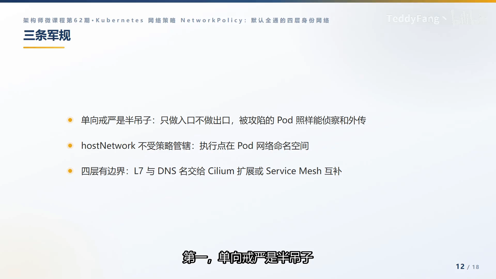

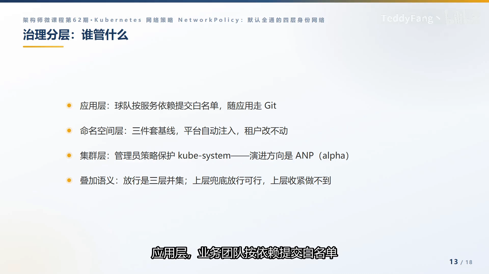

## 小结

- **默认是"全通"不是"全拒"**：扁平网是默认姿势，一个被攻陷的 Pod 等于全网通行证。
- **三条语义**：没被选中→全允许；被选中→该方向进入白名单、没写即拒；多策略→并集（OR）。
- **身份而非 IP**：规则挂标签、跟身份走，这是它优于传统防火墙的根本。
- **选择器陷阱**：`from` 列表里同块是 AND、分块是 OR，缩进差一格语义天差地别。
- **只立法、不执法**：NetworkPolicy 是 API 契约，不执法的 CNI 会让策略静默失效。
- **先关灯再开灯**：三件套基线 + 先全量放行、再逐条收紧。
- **不测连通性等于没做**：`kubectl` 只证明存在，不证明生效。
- **三条军规**：单向防护是半吊子；hostNetwork 不受管；四层有边界，L7 找 Mesh。

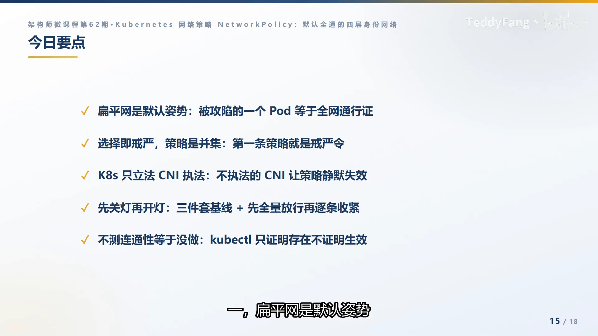

## 关键术语速查

| 术语 | 一句话解释 |
| --- | --- |
| NetworkPolicy | Kubernetes 的 Pod 级四层防火墙，按标签选中 Pod 并放行/拒绝其进出流量 |
| 扁平网 | 集群内 Pod 之间一跳直达、默认全通的网络模型 |
| podSelector / namespaceSelector | 选"本命名空间里带某标签的 Pod" / "按标签跨命名空间选人" |
| ingress / egress | 入站（谁来访问我）/ 出站（我能去访问谁），两个方向完全独立 |
| 白名单模式 | 被策略选中的方向只放行规则里写明的，其余一律拒绝 |
| 并集（OR）语义 | 多条 NetworkPolicy 之间只有"允许"的叠加，没有"拒绝" |
| CNI 执法 | NetworkPolicy 只是 API 契约，实际拦截由 CNI 插件在数据面执行 |
| 三件套 | 默认拒绝 + 放行 DNS(53) + 放行 API server(6443) 的命名空间基线 |
| ANP | AdminNetworkPolicy，管理员级网络策略，用于集群层"压过"租户策略 |
