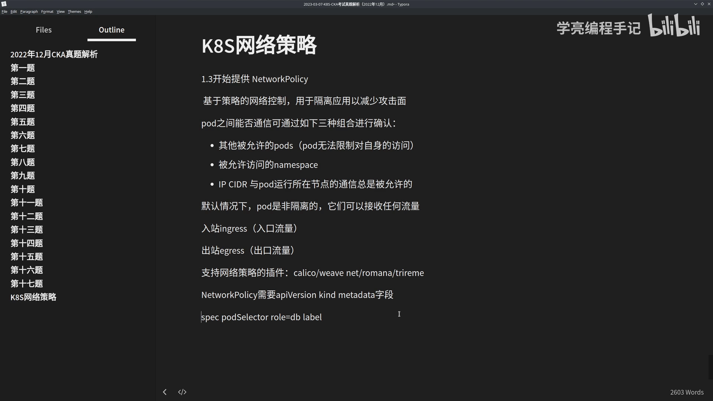
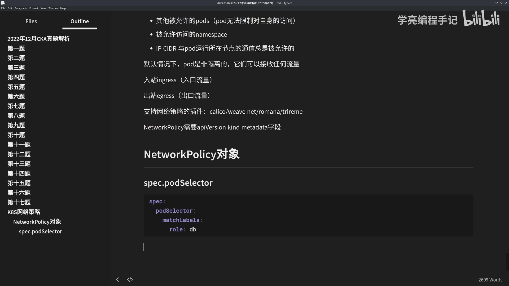
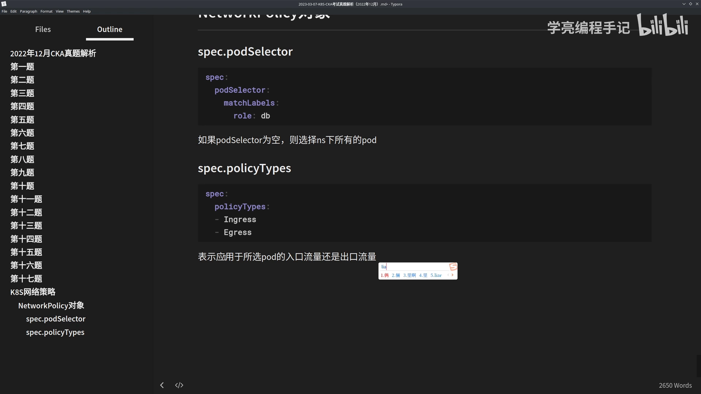
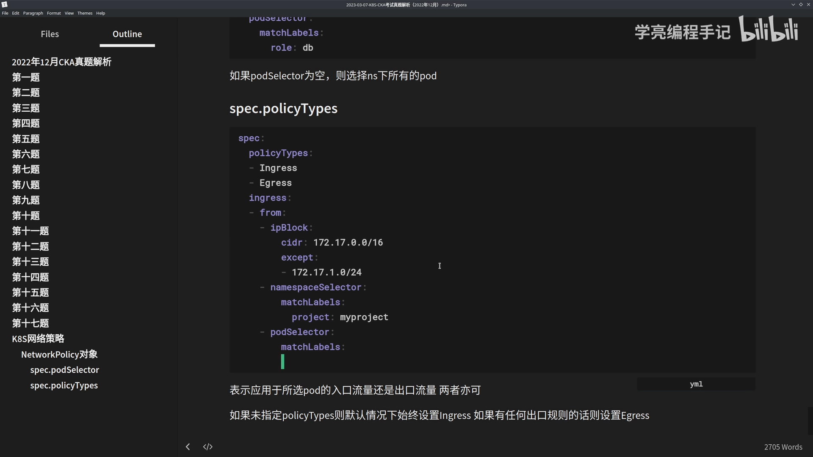
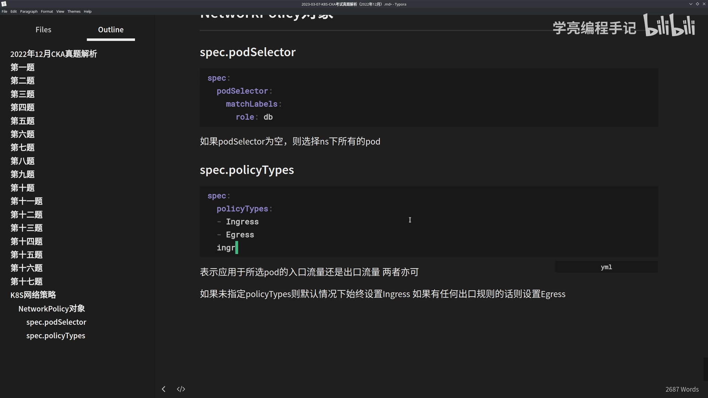
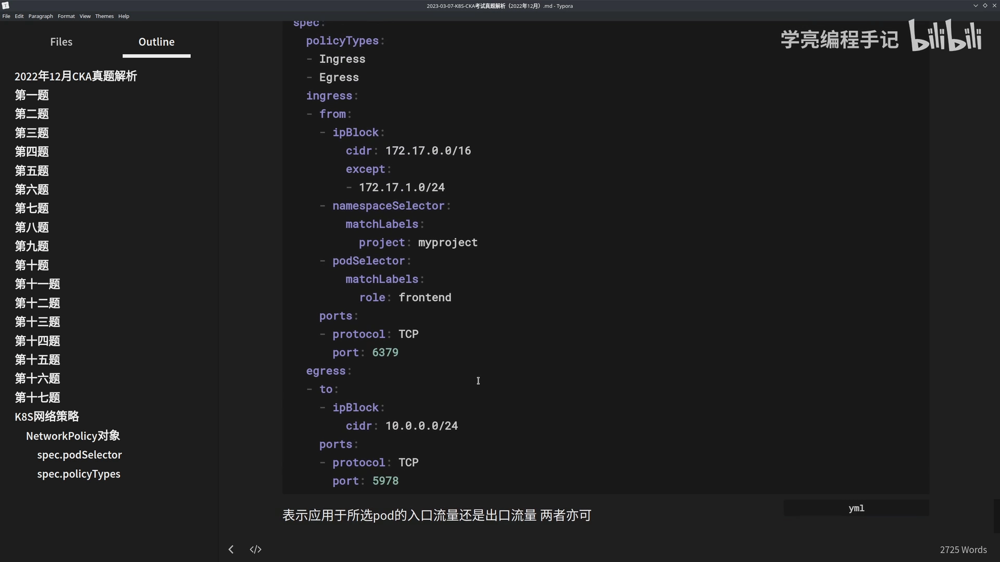
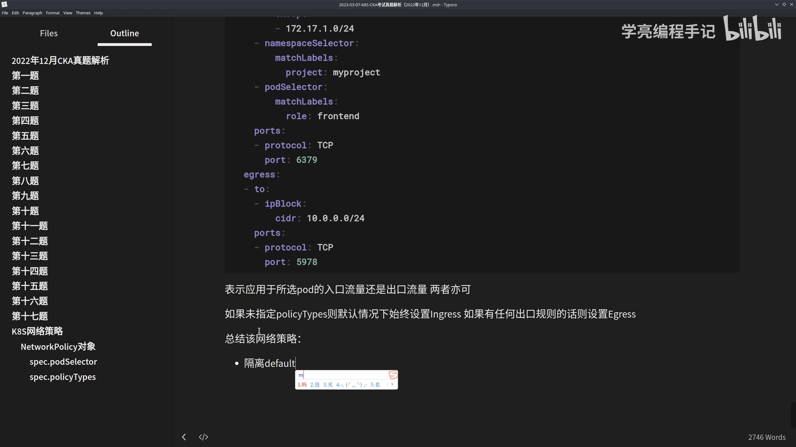
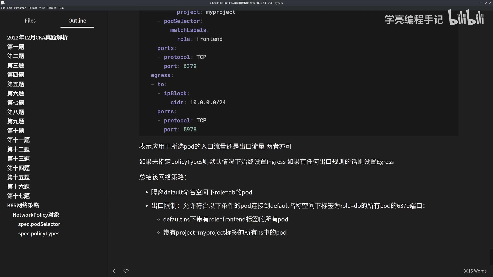

# NetworkPolicy 对象详解：podSelector 与 policyTypes

> 视频来源：[【K8S教程】NetworkPolicy 对象详解：podSelector 和 policyTypes 示例](https://www.bilibili.com/video/BV1CT411a7mz/)（Bilibili）｜时长 18:18
>
> 上一节讲了 NetworkPolicy 的**语义**（四条基础规则），这一节落到**对象本身**：把官方示例逐字段拆开，讲清 `podSelector` 选谁、`policyTypes` 管哪个方向、`ingress`／`egress` 的规则怎么读。文稿已对自动字幕的明显错拼做订正：`pd 是 neta`／`net 这个`→**podSelector**、`english`／`伊格斯`→**Ingress**、`egress`／`伊格斯`→**Egress**、`policy tab`／`pc app`→**policyTypes**、`lamespaceselector`／`nemesis selector`→**namespaceSelector**、`ipvlog`／`ip block`→**ipBlock**、`bend`→**backend**。

## 本讲要解决的核心问题（SCQA）

**背景**：一条 NetworkPolicy 的 YAML 里有 `podSelector`、`policyTypes`、`ingress`、`egress` 好几个字段，初学者第一次看到「这么多字段、这么多网段」，很容易不知道每个字段到底在表达什么。

**冲突**：这些字段不是随便堆的，它们回答的是三个不同的问题——**这条策略作用在哪些 Pod 上？管入口还是出口？具体放行谁访问谁、哪些端口？** 分不清这三个问题，就会写出“看起来对、实际不生效”的策略。

**疑问**：`podSelector` 为空是什么意思？不写 `policyTypes` 会怎样？`ingress.from` 里 `ipBlock`、`namespaceSelector`、`podSelector` 三种写法有什么区别？`except` 又是什么？

**回答（中心思想）**：**一条 NetworkPolicy 可以拆成“选谁（`podSelector`）— 管哪个方向（`policyTypes`）— 放行什么（`ingress`／`egress` 的 `from`/`to` 与 `ports`）”三段来看。** 把官方示例按这三段读一遍，所有字段都会各归其位。[【跳转到 00:00】](https://www.bilibili.com/video/BV1CT411a7mz/?t=0)



---

## 一、先看 podSelector：这条策略“选中”谁

### 1.1 按标签匹配 Pod

`podSelector` 的作用是**根据标签去匹配 Pod**。比如下面这个 Pod 打上了标签 `role=db`，那么当策略里写：

```yaml
spec:
  podSelector:
    matchLabels:
      role: db
```

它就会“选中”这个 Pod——**这条策略是写给它的**。当然，前面还有一层命名空间（namespace）：策略只作用于**所处命名空间下、带有该标签**的那些 Pod。[【跳转到 00:50】](https://www.bilibili.com/video/BV1CT411a7mz/?t=50)



> **为什么需要它**：NetworkPolicy 是 Namespace 级别的对象，但它并不作用于整个命名空间，而是通过 `podSelector` 精确圈定“我这个策略只保护这几类 Pod”。

### 1.2 空 podSelector 的含义

如果 `podSelector` **为空**（写成 `podSelector: {}`），那就**选择该命名空间下的所有 Pod**。[【跳转到 01:00】](https://www.bilibili.com/video/BV1CT411a7mz/?t=100)

这是一个非常实用、也容易被忽略的写法：当你想对整个命名空间做“默认隔离”时，用一个空选择器就能一次性选中全部 Pod。



---

## 二、再看 policyTypes：这条策略“管哪个方向”

### 2.1 Ingress / Egress 可单选可多选

`policyTypes` 是一个**类型字段**，取值可以是 `Ingress`、`Egress`，或者**两者都有**。它表示：**给定的这条策略，是应用于所选 Pod 的入口流量、出口流量，还是两者都管。**[【跳转到 02:00】](https://www.bilibili.com/video/BV1CT411a7mz/?t=200)

```yaml
spec:
  policyTypes:
  - Ingress
  - Egress
```

### 2.2 不写 policyTypes 时的默认行为

如果**未指定** `policyTypes`，那么：

- **默认情况下始终设置为 `Ingress`**；
- 并且，**如果这条网络策略里包含任何出口（egress）规则，则会自动设置上 `Egress`**。[【跳转到 02:50】](https://www.bilibili.com/video/BV1CT411a7mz/?t=250)

换句话说，**入口是“默认管”，出口是“写了才管”**——这和上一节“Ingress 与 Egress 相互独立、只配 Ingress 时出口仍全通”的语义正好对上。



---

## 三、Ingress 规则：`from` + `ports` 的白名单

### 3.1 一条规则 = 同时匹配 from 和 ports

`ingress` 是**每个网络策略可以包含的一个白名单列表**，列表里的**每一条规则都允许“同时匹配 `from` 和 `ports`”这两个部分的流量**。[【跳转到 03:50】](https://www.bilibili.com/video/BV1CT411a7mz/?t=350)

也就是说，一条 Ingress 规则由两部分共同约束：**“谁”（`from`）** 和 **“哪个端口”（`ports`）**，二者同时满足才放行。

### 3.2 from 的三种写法：ipBlock / namespaceSelector / podSelector

看官方示例里的 `ingress`：

```yaml
  ingress:
  - from:
    - ipBlock:
        cidr: 172.17.0.0/16
        except:
        - 172.17.1.0/24
    - namespaceSelector:
        matchLabels:
          project: myproject
    - podSelector:
        matchLabels:
          role: frontend
    ports:
    - protocol: TCP
      port: 6379
```

`from` 里的来源可以用**三种方式**指定，分别对应三种维度：[【跳转到 10:25】](https://www.bilibili.com/video/BV1CT411a7mz/?t=625)

1. **`ipBlock`**——按 **IP 段**匹配（机器/网络维度）；
2. **`namespaceSelector`**——按**命名空间标签**匹配（比如所有打了 `project=myproject` 的命名空间）；
3. **`podSelector`**——按**Pod 标签**匹配（比如所有 `role=frontend` 的 Pod）。

它们写在同一个 `from` 列表里，彼此之间是 **OR** 关系（命中任意一种来源即可）。例如上面这段综合起来就是：**允许来自 `172.17.0.0/16` 这个 IP 段、或 `project=myproject` 命名空间、或 `role=frontend` 这些 Pod 的流量，访问本 Pod 的 6379 端口**（`protocol: TCP`）。

### 3.3 ipBlock 与 except：允许一个大网段，再挖掉一小块

`ipBlock` 用 `cidr` 指定允许的网段，还可以用 **`except`** 再**排除**其中的子网段。示例里：

- `cidr: 172.17.0.0/16`——允许整个 `172.17.0.0/16`；
- `except: - 172.17.1.0/24`——但把 `172.17.1.0/24` 挖掉。

这正是“**允许一大片、单独排除一小块**”的写法，常用于放行某个网段、但屏蔽其中特定的一段。



---

## 四、Egress 规则：`to` + `ports` 的白名单

`egress` 与 `ingress` 结构对称：它是**每个网络策略可以包含的一个 Egress 规则白名单列表，每条规则都允许匹配 `to` 和 `ports` 这两个部分的流量**。[【跳转到 11:15】](https://www.bilibili.com/video/BV1CT411a7mz/?t=675)

示例里的 `egress` 只包含一条规则：

```yaml
  egress:
  - to:
    - ipBlock:
        cidr: 10.0.0.0/24
    ports:
    - protocol: TCP
      port: 5978
```

它表示：**允许本 Pod 的流量发往 `10.0.0.0/24` 这个目的网段的 `5978` 端口（TCP）。** 和 `from` 一样，`to` 也可以用 `ipBlock`／`namespaceSelector`／`podSelector` 来指定目的地。

---

## 五、把整条策略读一遍：一个完整的官方示例

### 5.1 逐字段解读

把前面的片段拼起来，就是一条完整的策略。它的含义可以概括为：[【跳转到 12:30】](https://www.bilibili.com/video/BV1CT411a7mz/?t=750)

- **选中对象**：`default` 命名空间下带 `role=db` 的 Pod（即“隔离 default 命名空间下的 role=db 这组 Pod”）；
- **管的方向**：`policyTypes: [Ingress, Egress]`，入口、出口都管；
- **入口限制**：只允许符合 `from` 条件的来源（IP 段 / `project=myproject` 命名空间 / `role=frontend` Pod）访问，端口 `6379`；
- **出口限制**：只允许访问 `10.0.0.0/24` 的 `5978` 端口。





### 5.2 地址范围怎么算：`172.17.0.0/16` 到底覆盖多大

视频最后顺带把 `ipBlock` 的地址范围算了一遍：[【跳转到 15:00】](https://www.bilibili.com/video/BV1CT411a7mz/?t=900)

- `cidr: 172.17.0.0/16` 的**前缀长度是 16**，意味着前 16 位固定，后 16 位可变；
- 因此它的地址范围是 `172.17.0.0` ～ `172.17.255.255`；
- 再 `except` 掉 `172.17.1.0/24`（`172.17.1.0` ～ `172.17.1.255`）——即**除了 `172.17.1.0/24` 之外的整个 `172.17.0.0/16` 都允许**。



理解这一点，才能一眼看出 `except` 到底“挖掉”了什么，避免把放行范围写错。

---

## 小结

- **一条 NetworkPolicy 拆成三段读**：`podSelector`（选谁）→ `policyTypes`（管哪个方向）→ `ingress`／`egress`（放行什么）。
- **`podSelector`**：按标签匹配 Pod；**为空则选中该命名空间下所有 Pod**。
- **`policyTypes`**：可单选 `Ingress`／`Egress`，也可同时；**不写则默认 `Ingress`，有 egress 规则才补上 `Egress`**。
- **`ingress`**：白名单列表，**每条规则同时匹配 `from` 和 `ports`**；`from` 支持 `ipBlock`（IP 段）、`namespaceSelector`（命名空间标签）、`podSelector`（Pod 标签）三种来源。
- **`egress`**：结构与 `ingress` 对称，**每条规则同时匹配 `to` 和 `ports`**。
- **`ipBlock`**：用 `cidr` 指定网段、`except` 排除子网段；`/16` 覆盖 `172.17.0.0`～`172.17.255.255`。

## 关键术语速查

| 术语 | 一句话解释 |
| --- | --- |
| podSelector | 选择这条策略作用的 Pod；按标签匹配，为空则选中命名空间下所有 Pod |
| policyTypes | 声明策略管入口（`Ingress`）还是出口（`Egress`）；不写默认 `Ingress` |
| ingress | 入方向白名单列表，每条规则同时匹配 `from` 与 `ports` |
| egress | 出方向白名单列表，每条规则同时匹配 `to` 与 `ports` |
| ipBlock | 按 IP 段指定来源/目的地；`cidr` 指定网段，`except` 排除其中子网段 |
| namespaceSelector | 按命名空间标签匹配来源/目的地 |
| podSelector（from/to 内） | 按 Pod 标签匹配来源/目的地 |
| from / to | `ingress` 用 `from` 描述来源，`egress` 用 `to` 描述目的地 |
