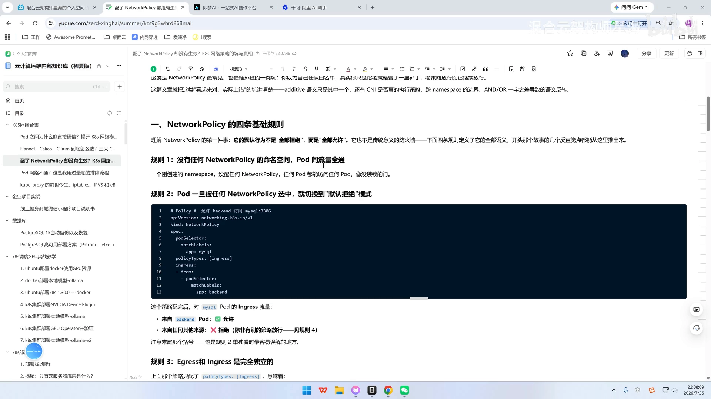
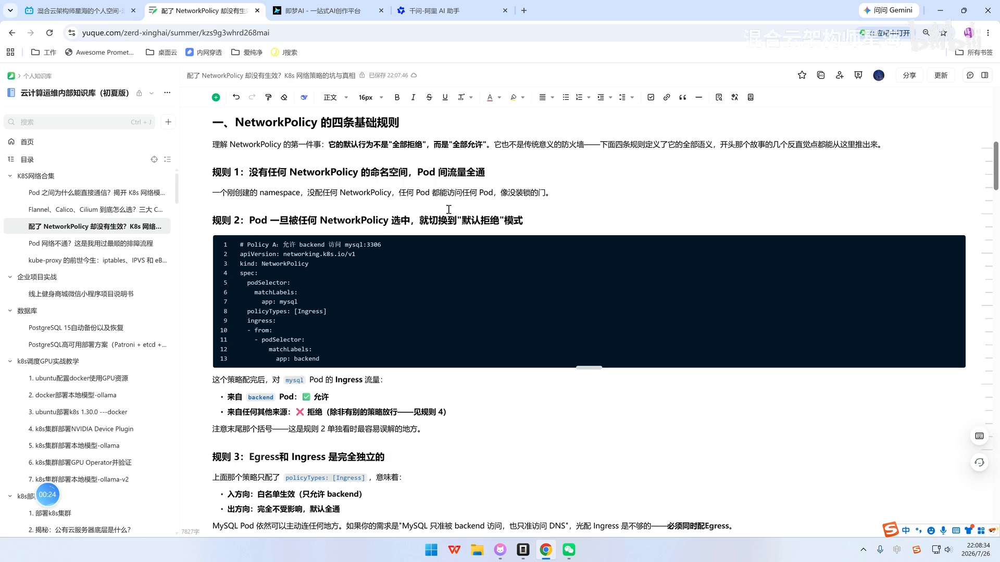
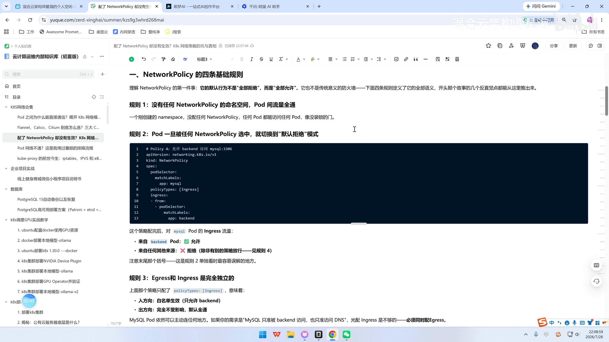
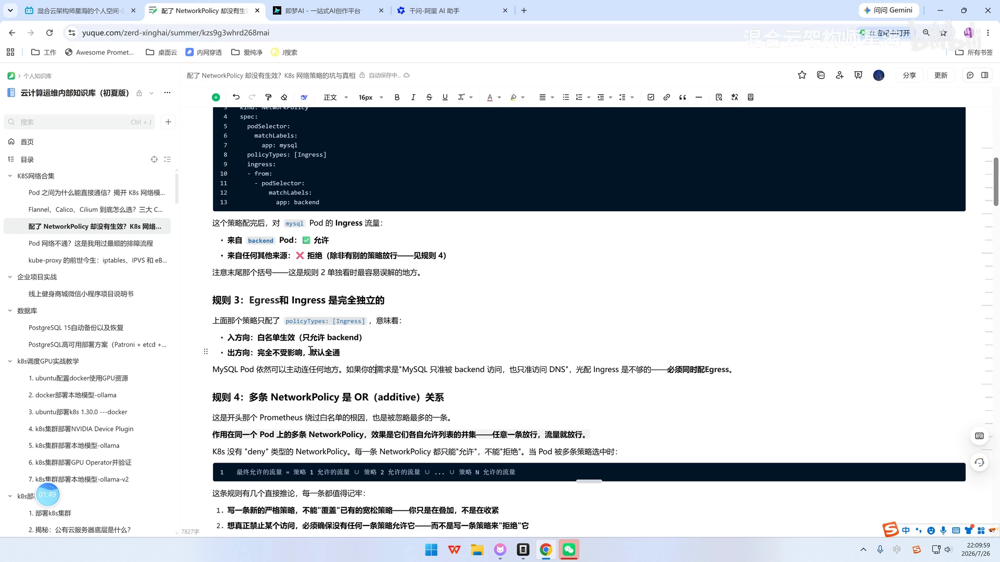
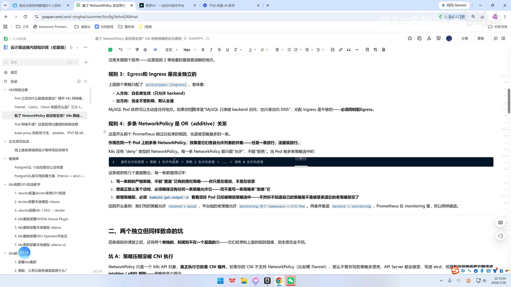
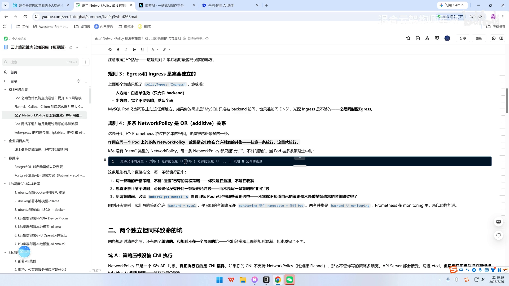
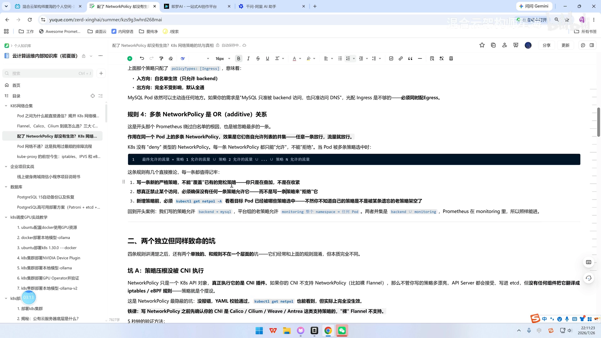
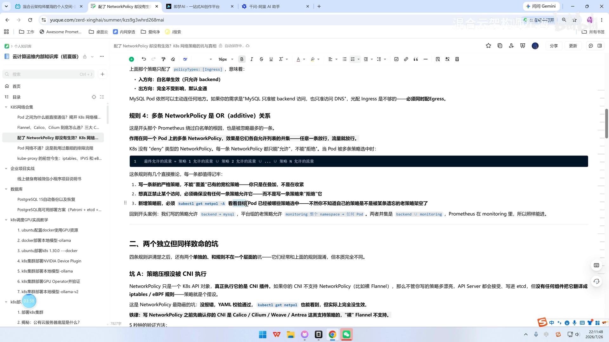

# NetworkPolicy 的四条基础规则：默认放行、默认隔离与叠加语义

> 视频来源：[NetworkPolicy 的四条基础规则](https://www.bilibili.com/video/BV1tLGu6TENx/)（Bilibili，星海《K8s 网络策略的坑与真相》）｜时长 4:30
>
> 这一节不教你怎么敲 `kubectl`，而是**把 NetworkPolicy 的全部语义浓缩成四条规则**——理解了它们，实战里绝大多数“策略配了却不生效 / 配了却被人绕过”的坑都能自己推出来。文稿已对自动字幕的明显错拼做订正：`netablepolicy`／`netbox 或 Y`／`workworkpolicy`→**NetworkPolicy**、`ENGLISH`→**Ingress**、`nameservice`／`namespace space`→**namespace**、`车队`→**策略**、`方形`→**放行**、`cooligetnetpop 杠 A`→**`kubectl get networkpolicy -A`**、`DENN`→**deny**、`bend`→**backend**。

## 本讲要解决的核心问题（SCQA）

**背景**：Kubernetes 集群里的网络**默认是全通的**——同一个集群里，任何 Pod 都能访问任何 Pod。为了保证安全，我们用 **NetworkPolicy（网络策略）** 作为“Pod 级的四层防火墙”，只放行明确允许的流量。

**冲突**：但很多人对 NetworkPolicy 有一个根深蒂固的误解，以为它跟传统防火墙一样——**“默认拒绝，配了规则才放行”**。于是有人写下一条“只允许 backend 访问 MySQL”的策略，以为万事大吉，结果监控系统（Prometheus）照样能连到数据库。策略没错，错的是对语义的理解。

**疑问**：NetworkPolicy 到底是“默认允许”还是“默认拒绝”？它什么时候切换到“拒绝”？多条策略叠加时以谁为准？为什么写了“拒绝”却不生效？

**回答（中心思想）**：**NetworkPolicy 的默认行为不是“全部拒绝”，而是“全部允许”；它也不是传统意义的防火墙。** 下面四条规则定义了它的全部语义——①没有 NetworkPolicy 时全通；②Pod 一旦被任何策略选中，就对该方向切换到“默认拒绝”；③Ingress 与 Egress 完全独立；④多条策略是 **OR（叠加）** 关系，只有“允许”没有“拒绝”。开头那个 Prometheus 绕过白名单的故事，反直觉点全都能从这四条推出来。[【跳转到 00:00】](https://www.bilibili.com/video/BV1tLGu6TENx/?t=0)



---

## 一、四条规则定义了 NetworkPolicy 的全部语义

NetworkPolicy 的语义并不复杂，关键是把下面四条一次性记牢。它们环环相扣，放到一起才是一套完整的模型。

### 1.1 规则一：没有任何 NetworkPolicy 的命名空间，Pod 间流量全通

一个**刚创建、还没配置任何 NetworkPolicy 的 namespace**，任意 Pod 都能访问任意 Pod，就像一扇**没装锁的门**。[【跳转到 00:25】](https://www.bilibili.com/video/BV1tLGu6TENx/?t=25)

也就是说，**新建的 namespace 默认是“全部可以访问”**。这一点必须先记住，因为它和大多数人的直觉相反——NetworkPolicy 不是“默认关门”，而是“默认开门，你主动去锁”。



### 1.2 规则二：Pod 一旦被任何 NetworkPolicy 选中，就切换到“默认拒绝”

在一个原本**没有**任何 NetworkPolicy 的 namespace 里，**一旦创建了 NetworkPolicy**，被它选中的 Pod 就切到了“默认拒绝”模式：**只有你显式允许的来源可以访问，其他来源一律默认拒绝**。[【跳转到 00:50】](https://www.bilibili.com/video/BV1tLGu6TENx/?t=50)

关键在“**被选中**”三个字：是“策略选中了这个 Pod”这件事，触发了“默认拒绝”。看一个官方风格的例子——这条 `Policy A` 放行 backend 访问 `mysql:3306`：

```yaml
# Policy A: 允许 backend 访问 mysql:3306
apiVersion: networking.k8s.io/v1
kind: NetworkPolicy
metadata:
  name: allow-backend-to-mysql
spec:
  podSelector:
    matchLabels:
      app: mysql
  policyTypes: [Ingress]
  ingress:
  - from:
    - podSelector:
        matchLabels:
          app: backend
```

策略生效后，对 `mysql` Pod 的 Ingress 流量而言：**来自 backend Pod 的流量 ✅ 允许；来自任何其他来源的流量 ❌ 拒绝**。



> 注意末尾那句“来自任何其他来源拒绝”后面的定语——**除非有别的策略放行（见规则四）**。这是单看规则二时最容易误解的地方：这里的“拒绝”并不是一条真正的拒绝规则，而是“没被允许 = 拒绝”。

### 1.3 规则三：Egress 与 Ingress 完全独立

这一点估计很多人不知道：**Egress（出方向）和 Ingress（入方向）是完全独立的两个开关。**[【跳转到 01:15】](https://www.bilibili.com/video/BV1tLGu6TENx/?t=75)

上面那条策略只配置了 `policyTypes: [Ingress]`，意味着：

- **入方向**：白名单生效，只允许 backend 访问；
- **出方向**：**完全不受影响，默认全通**——这个 MySQL Pod 依然可以主动连到任何地方。[【跳转到 01:25】](https://www.bilibili.com/video/BV1tLGu6TENx/?t=85)

![规则三：只配了 policyTypes: [Ingress] 时，入方向白名单生效、出方向仍默认全通](assets/NetworkPolicy 的四条基础规则/00085.webp)

因此，如果你的需求是“**MySQL 只被 backend 访问，且 MySQL 只允许访问 DNS**”，那么**光配一个 Ingress 是不够的，必须同时配 Egress**。这也是很多“我以为锁死了，其实只锁了一半”问题的根源。[【跳转到 01:50】](https://www.bilibili.com/video/BV1tLGu6TENx/?t=110)



### 1.4 规则四：多条 NetworkPolicy 是 OR（叠加）关系

**作用在同一个 Pod 上的多条 NetworkPolicy，效果是它们各自允许列表的并集——任意一条放行，流量就放行。** 这也正是开头那个 Prometheus 绕过白名单的根因，同时是被忽略最多的一条。[【跳转到 02:13】](https://www.bilibili.com/video/BV1tLGu6TENx/?t=133)

**K8s 没有 “deny” 类型的 NetworkPolicy，每一条都只能“允许”，不能“拒绝”。** 当 Pod 被多条策略选中时：

```
最终允许的流量 = 策略 1 允许的流量 ∪ 策略 2 允许的流量 ∪ … ∪ 策略 N 允许的流量
```



---

## 二、从规则四推出的三条实操铁律

规则四看起来只是一句“并集”，但它有几个**直接推论**，每一条都值得记牢。[【跳转到 02:50】](https://www.bilibili.com/video/BV1tLGu6TENx/?t=170)



### 2.1 严格策略“盖不住”宽松策略

**写一条新的严格策略，不能“覆盖”已有的宽松策略——你只是在叠加，不是在收紧。** 换句话说，你写一条再严格的策略，只要环境里还存在一条宽松策略，它就被那条宽松策略“放开”了，严格策略就白写了。

### 2.2 想真正“禁止”某个访问，只有一种办法

**必须确保没有任何一条策略允许它**，而不是靠写一条策略去“拒绝”它。因为前面已经讲过——NetworkPolicy 全都是**显式允许**的，没被允许的默认才被拒。

### 2.3 新增策略前，先 `kubectl get networkpolicy -A`

这是个动作层面的铁律：**新增策略前必须先执行 `kubectl get networkpolicy -A`**，看一下目标 Pod 已经被哪些策略选中，否则你根本不知道自己的策略会不会被某条**早已被遗忘的老策略**架空。[【跳转到 03:14】](https://www.bilibili.com/video/BV1tLGu6TENx/?t=194)



---

## 三、一个真实案例：Prometheus 为什么绕过了白名单

回到开头的案例，把四条规则串起来看就一目了然：[【跳转到 03:39】](https://www.bilibili.com/video/BV1tLGu6TENx/?t=219)

- 我们写的策略：允许 **backend → mysql**；
- 平台组半年前留下的老策略：允许 **monitoring 整个 namespace → 任何 Pod**；
- 两者的**并集**是 `{backend} ∪ {monitoring}`，而 **Prometheus 就在 monitoring 里面**。

所以，尽管我们“只允许 backend”，Prometheus 依然被那条老策略放行了，照样能访问数据库。这不是我们的策略写错了，而是**忽略了规则四的叠加语义**。



---

## 小结

- **NetworkPolicy 的默认行为是“全部允许”，不是“全部拒绝”**；它是叠加式白名单，不是传统防火墙。
- **规则一**：没有 NetworkPolicy 的命名空间，Pod 之间流量全通。
- **规则二**：Pod 一旦被任何 NetworkPolicy 选中，就对该方向切换到“默认拒绝”（未被允许即拒绝）。
- **规则三**：Ingress 与 Egress 完全独立；只配 Ingress，出方向仍默认全通，必要时两者都要配。
- **规则四**：多条策略是 **OR 并集**；K8s 没有 deny 类型的 NetworkPolicy，只能允许不能拒绝。
- **推论**：严格策略盖不住宽松策略；想禁止只能靠“没有任何策略允许”；新增策略前先 `kubectl get networkpolicy -A` 查清楚。
- **实操建议**：面对“策略没生效/被绕过”，先把这四条在脑子里过一遍，多数坑不需要看代码就能定位。

## 关键术语速查

| 术语 | 一句话解释 |
| --- | --- |
| NetworkPolicy | K8s 的 Pod 级四层（IP + 端口）防火墙规则对象，用白名单方式控制 Pod 的进出口流量 |
| namespace | 命名空间；新建且未配置任何 NetworkPolicy 时，内部 Pod 之间流量默认全通 |
| Ingress | 入方向规则，控制“谁能访问我” |
| Egress | 出方向规则，控制“我能访问谁”；与 Ingress 相互独立 |
| policyTypes | 声明这条策略作用于入方向还是出方向（`Ingress`／`Egress`，可同时） |
| podSelector | 策略的选择器，用来“选中”它作用的 Pod；被选中即进入默认拒绝 |
| additive／OR 叠加 | 多条 NetworkPolicy 同时作用于一个 Pod 时，按“并集”放行，任一条允许即允许 |
| deny | K8s 没有这个策略类型；NetworkPolicy 只能显式允许，不能显式拒绝 |
