# Calico 策略引擎：一条 NetworkPolicy 怎么被算出来

> 视频来源：[14·Calico 策略引擎：一条 NetworkPolicy 怎么被算出来｜Calico 源码深读](https://www.bilibili.com/video/BV134h26FEgh/)（Bilibili，隔岸的灯塔_《Calico 源码深读》第三季）｜时长 12:34
>
> 本讲回答一个问题：**NetworkPolicy 只是 API 对象，真正把它变成内核里生效规则的是 CNI 插件**。这里以 **Calico** 为例，把"一条策略从 API 对象到内核链"的完整流水线拆开。文稿已对自动字幕的明显错拼做订正：`ITOS`/`ETLES`/`UTABLES`→**iptables**、`tr`/`tear`/`TIR`→**tier（层级）**、`CUBATIS`/`KUBATIS`→**Kubernetes**、`cooper amy`→**kube-admin**、`cooper baseline`→**kube-baseline**、`care`/`CICO`/`CACO`→**Calico**、`KELLYP`/`KLPO`→**KUBE-* / CALI-*** 链前缀、`列名`/`列规则`→**链名 / 链规则**、`叫验影锁死`→**由校验锁死**。

## 本讲要解决的核心问题（SCQA）

**背景**：Kubernetes 用 **NetworkPolicy（网络策略）** 声明"谁能和我的 Pod 说话"。但它只是一个 API 对象，集群本身并不会替你实现它——真正把它落到每台节点、变成内核里生效的防火墙规则的，是 **CNI 插件**（这里是 Calico）。

**冲突**：很多人的直觉是"CNI 就是把 NetworkPolicy **直接翻译**成 iptables 规则"。可一旦你问出这些问题，直觉就崩了——为什么同一份策略在有些节点生效、有些节点没有？多条策略谁先谁后？为什么不是所有策略都被下发到每台机器？

**疑问**：**一条 NetworkPolicy 从 API 对象到内核里的链，中间到底被谁算过、被谁排过序？**

**回答（中心思想）**：**Calico 不是"翻译器"，而是一条完整的流水线**。策略先被拆成**选择器**，拿去和**本机端点**做**活性匹配**，只留下真正作用在这台机器上的那些；然后按 **tier（层级）和 order（顺序）** 排好序；最后才交给数据面，渲染成以 `KUBE-*` / `CALI-*` 打头的链。围绕这条流水线，本期分四步走：**① 前提与分叉**（K8s 原生 NetworkPolicy 有哪些表达缺口）、**② 核心机制**（策略模型、选择器、策略活性）、**③ 完整流程**（对象→内核的十跳与包判决顺序）、**④ 取舍与数字**。[【跳转到 00:05】](https://www.bilibili.com/video/BV134h26FEgh/?t=5)

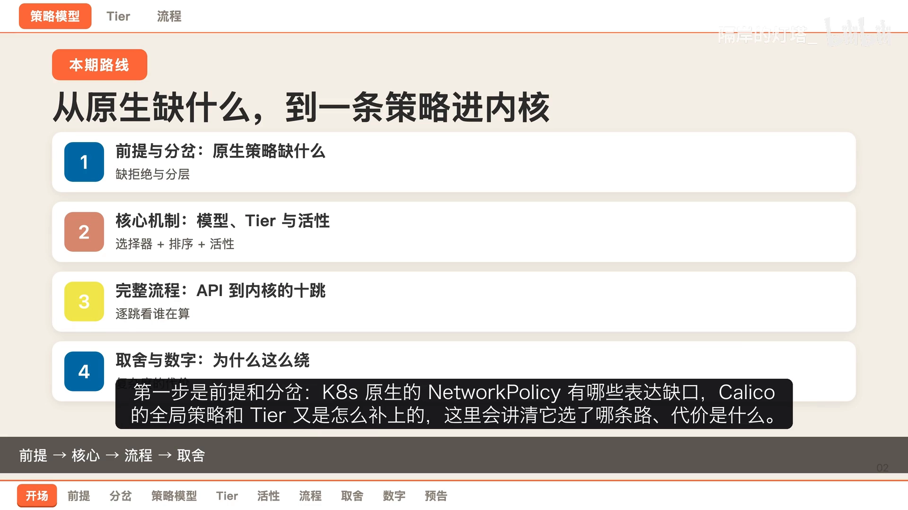

---

## 一、前提：K8s 原生 NetworkPolicy 缺了哪四块

### 1.1 四个表达缺口

要理解 Calico 为什么这么设计，先看 K8s 原生 NetworkPolicy 表达不了什么。节目把它归纳为四个"口子"：

1. **它是命名空间级的**：一条策略只作用于**被它选中的 Pod**。像"跨命名空间覆盖所有工作负载"这种需求，原生就写不出来。
2. **规则只有"放行"语义**：拒绝是靠"没被放行"**间接表达**的，规则本身**不可排序**、也**没有显式拒绝**。
3. **没有"分层委派"的概念**：集群级策略、租户隔离、分级授权都表达不了。
4. **管不到主机侧**：主机端点策略、免跟踪（notrack）转发路径、主机端点这些，原生一概不管。

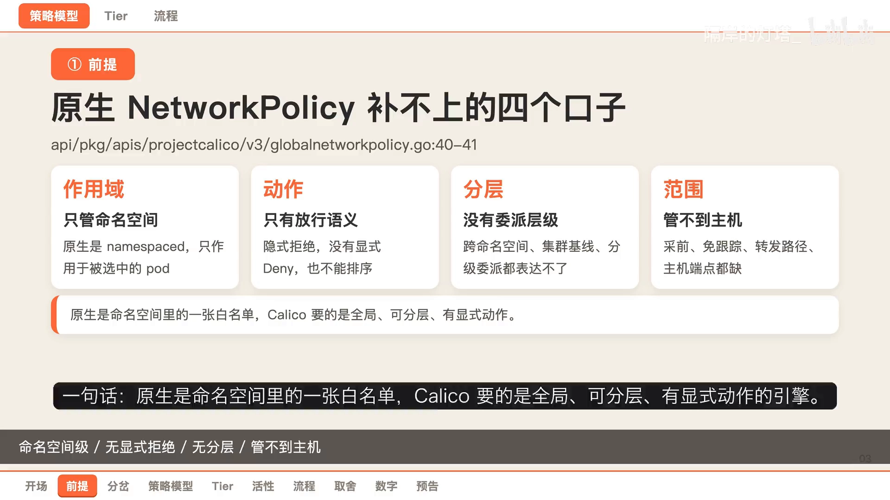

### 1.2 两条路线对比

Calico 的补法是**全局策略 + Tier**，可以把两条路线并排看：

| | K8s 原生 NetworkPolicy | Calico 全局策略 + Tier |
| --- | --- | --- |
| 作用域 | 命名空间级，只作用于被选中的 Pod | 集群级、非命名空间，一次覆盖所有命名空间 |
| 动作 | 只有"放行"，拒绝靠间接表达 | 显式的**四个动作值** |
| 排序 | 规则不可排序 | 多个 tier 按 **order** 依次应用 |
| 分层 | 无 tier 概念 | Tier 是一等公民，每层有自己的默认动作 |
| 匹配 | 无服务账号 / ICMP / HTTP 等匹配 | 服务账号选择器、逐规则 IP 版本、ICMP 匹配齐备 |

**差别不在功能多少，而在设计取向**：原生把策略当成"一张命名空间内的白名单"；Calico 把它当成"一台有层次、可委派的全局引擎"。代价也随之而来——**概念更多、排序更复杂**。[【跳转到 02:20】](https://www.bilibili.com/video/BV134h26FEgh/?t=140)

### 1.3 源码定位：算策略看 Felix，定义模型看 API

节目把源码范围框在两处：
- **策略侧在 Felix 目录**：策略渲染 `policy.go`（1101 行，把一条策略渲染成链规则）、规则定义（637 行，定义链名前缀和三个关键标记）、活性计算（566 行，判断哪些策略在本机是"活"的）、排序（445 行，tier 与策略的排序）、配对（309 行，做配对和过滤）。
- **模型侧在 API 目录**：层级定义（114 行，定义 tier 的类型/订单/默认动作）、全局策略（178 行）、匹配公共（282 行，动作枚举与匹配规则）；另有一份在 `libcalico-go` 里写死的内置名字文件（内置 tier 名和兜底逻辑）。

一句话：**算策略看 Felix，定义模型看 API**。[【跳转到 03:11】](https://www.bilibili.com/video/BV134h26FEgh/?t=191)

---

## 二、策略模型：Tier、Profile 与三条硬约定

Calico 的策略模型有三条**硬约定**，是后面一切排序和判决的根。[【跳转到 03:54】](https://www.bilibili.com/video/BV134h26FEgh/?t=234)

### 2.1 Tier 是"全局作用域的容器"

Tier 自带两个字段：**order（决定应用顺序）**、**default action（默认动作，只能是 Pass 跳过 或 Deny 拒绝）**。源码注释明写：**它不是命名空间的**。

### 2.2 每条策略都归属某个 Tier

全局策略和命名空间策略都带 `tier` 字段，**默认值就是 `default`**；源码里的兜底函数会把空值填成 `default`，所以**永远不会出现"没有层级"的策略**。

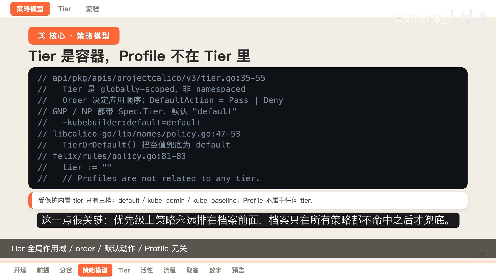

### 2.3 Profile 不属于任何 Tier，只在最后兜底

渲染函数里**直接把 Profile 的 tier 指空**。也就是说 Profile 与任何 tier 都无关；**优先级上，策略永远排在 Profile 前面**，Profile 只在"所有策略都不命中"之后才兜底。

### 2.4 三档受保护的内置 Tier（订单被校验硬锁）

这个版本里**受保护的内置 tier 只有三档**（没有叫 `security` 的那一档）：

| Tier | order | 默认动作 | 用途 |
| --- | --- | --- | --- |
| `kube-admin` | `1000` | 必须 **Pass（跳过）** | 平台管理类策略，排最前 |
| `default` | `1,000,000`（100 万） | 必须 **Deny（拒绝）** | 常规租户策略 |
| `kube-baseline` | `10,000,000`（1000 万） | 必须 **Pass（跳过）** | 集群基线，放最后兜底 |

**这三个订单值不是"建议"，而是被自定义资源（CRD）的校验锁死的**——写错值会被直接拒绝；`kube-admin` 和 `kube-baseline` 的默认动作必须是 Pass、`default` 必须是 Deny，也都写在校验里。

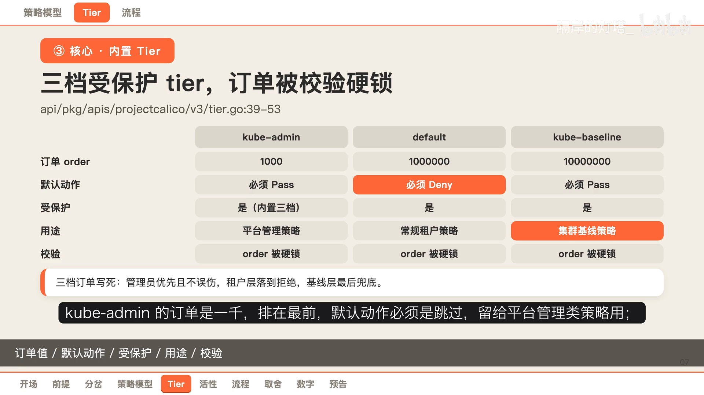

这套设计的用意很清楚：**管理员级策略必须优先且不误伤租户层；租户层"结束即落到拒绝"；基线层放在最后做兜底**。[【跳转到 05:10】](https://www.bilibili.com/video/BV134h26FEgh/?t=310)

---

## 三、匹配语义：两层选择器，各管一段

Calico 的匹配核心是**两层选择器**，一定要分清。[【跳转到 05:10】](https://www.bilibili.com/video/BV134h26FEgh/?t=310)

- **第一层：策略自己的选择器**。它决定"这条策略作用在本机的**哪些端点**上"，由**活性计算器**用标签索引去匹配。
- **第二层：规则里 source / destination 的选择器**（网段、端口）。它决定"**对端是谁**"，由**规则扫描器**先抽出来，再落成 **IP 集合**。

**为什么要分开？** 因为第一层回答的是"**策略活不活**"，第二层回答的是"**包能不能过**"——两者的**数据结构和更新频率完全不同**。

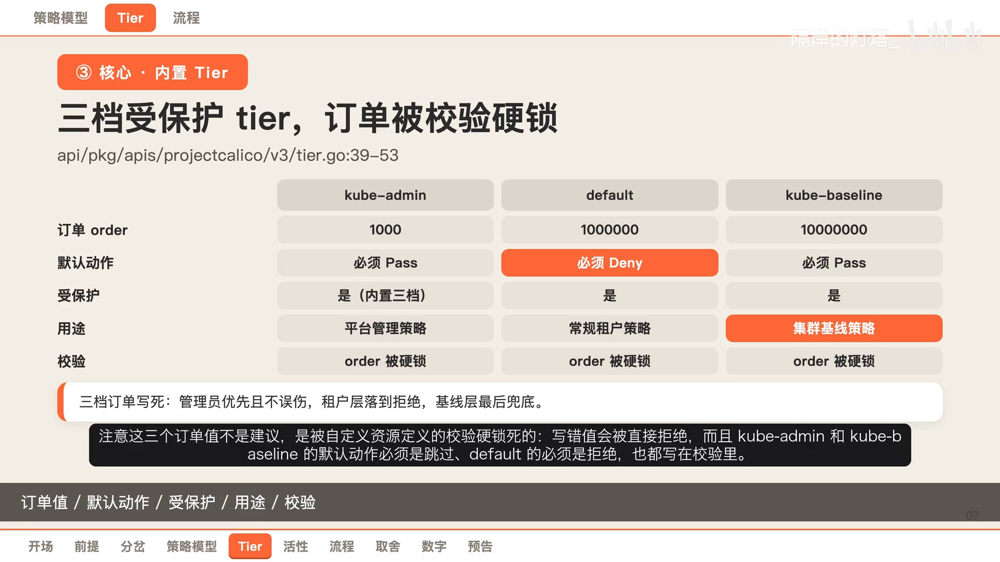

再补三个容易搞错的细节：
1. **取反有两套语义**：写在选择器里的取反是"集合差"；管控端点写成**单独字段**的取反，是"整体取反"。
2. **命名空间和服务账号是"伪标签"**：它们分别带前缀，参与匹配时要一起算。
3. **端口匹配必须显式带协议**；**ICMP 要匹配就得先带上"类型"**。

---

## 四、策略活性：为什么不是所有策略都下发

### 4.1 活性计算器只算本机

**策略活性**回答的就是这个问题：为什么不是所有策略都被下发？**活性计算器只做一件事**——拿到全部策略和**本机端点**，算出本机真正生效的那些。它**只看策略自己的选择器**，规则里的选择器一律忽略（那是扫描器的活）。[【跳转到 06:16】](https://www.bilibili.com/video/BV134h26FEgh/?t=376)

### 4.2 数据结构上的取舍

- 策略结构很**稀疏**，直接存非常浪费内存，于是用**压缩映射**存；
- Profile 之间常常一模一样，就先**去重再存**；
- 匹配引擎是一棵**可继承的标签索引**。

### 4.3 一个兜底技巧

带"**假设每个节点都需要**"这类性能提示的策略，会用一个**假端点**假装被匹配，从而**确保它永远被下发**。

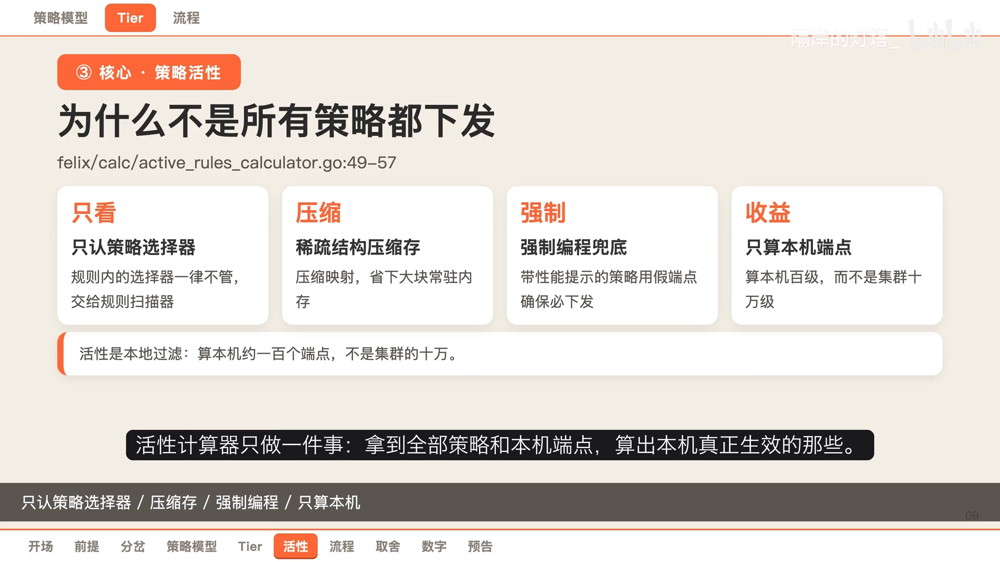

### 4.4 收益

好处是**只算本机大约 100 个端点，而不是集群的 10 万个**——这正是"策略活性"存在的意义。

---

## 五、完整流程：从 API 对象到内核链的十跳

### 5.1 七个关键段

一条全局策略从被创建，到最终变成内核里的链，节目把"十跳"浓缩成七段：[【跳转到 07:05】](https://www.bilibili.com/video/BV134h26FEgh/?t=425)

1. **用户创建全局策略**：它是集群级、`tier` 默认是 `default`；
2. **更新处理器**：把对象从新版转成内部版本，顺便把命名空间选择器和服务账号选择器**合并进主选择器**（各加前缀）；
3. **同步器**：把键值对下发到 Felix；
4. **活性计算器**：判断这条策略在本机**活不活**——用继承标签索引和本机端点匹配，命中就通知监听者；**真正决定"算不算"的就是这一跳**；
5. **解析器**：建立策略与端点的双向索引；
6. **排序器**：按 tier 和 order 把待更新的策略排好；
7. **事件排序器**：把结果分类下发数据面，渲染成链，最后**原子地写进内核**。

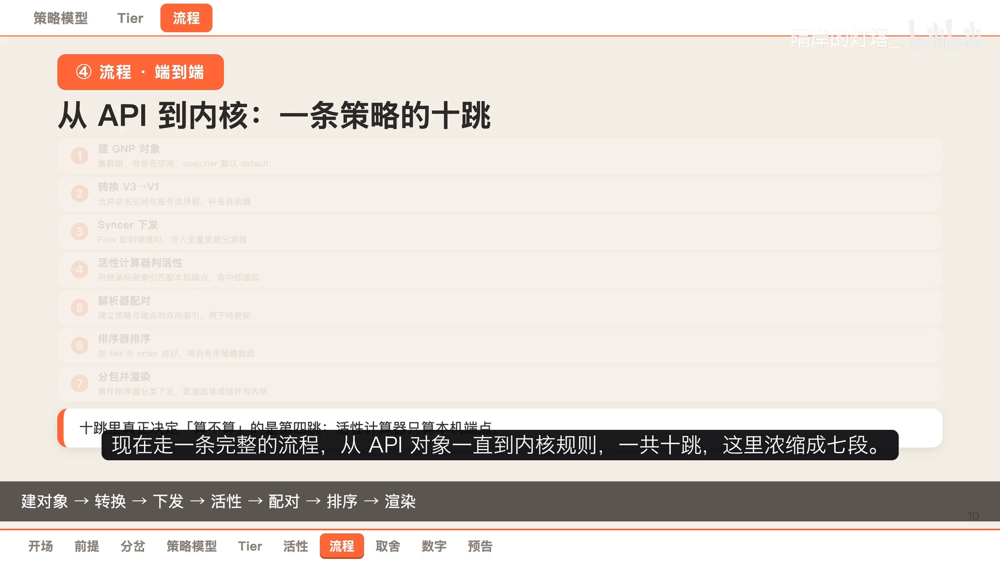

### 5.2 内核侧：一个包在端点链里怎么被裁决

包进入端点链后，**判决顺序是死的**：[【跳转到 07:58】](https://www.bilibili.com/video/BV134h26FEgh/?t=478)

1. 包进端点链，先过**管理/下线的首位**（限速、连接跟踪）；
2. **失败保护链最先跳转**——它是"急停白名单"，一旦命中就**绕开后面所有策略**；
3. 清掉"放行"和"跳过"两个标记，开始**逐层裁决**；
4. 进入第一个 tier：**先清一次跳过标记**，再按 order 依次跳该层里的策略链；策略内部命中就给出结论；
5. 一个 tier 走完还没结论 → 看这层的**默认动作**：不是 Pass 就按它丢弃（"本层结束、没有策略放行就丢弃"）；
6. 所有 tier 都不管用，才轮到 **Profile 循环**；
7. Profile 也没命中 → **丢弃**。

一句话记牢收尾顺序：**失败保护 → tier → 档案(Profile) → 丢弃**。[【跳转到 08:23】](https://www.bilibili.com/video/BV134h26FEgh/?t=503)

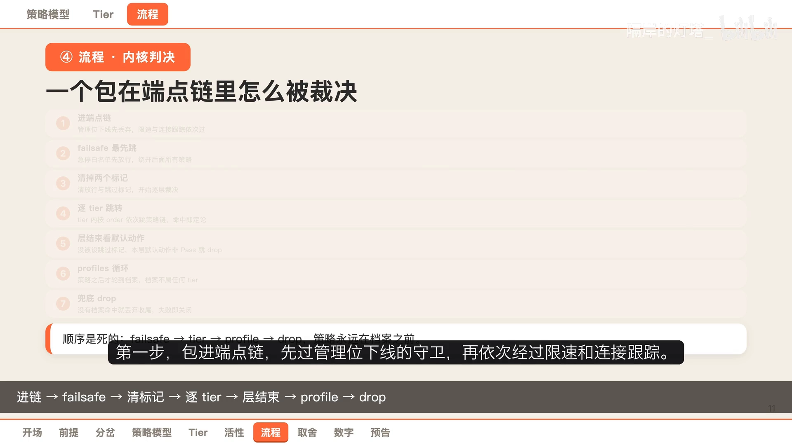

---

## 六、渲染：一条策略怎么变成内核规则

### 6.1 一条策略 → 两条链

**一条策略对应两条链**：一条负责**入项（ingress）**，一条负责**出项（egress）**。[【跳转到 08:44】](https://www.bilibili.com/video/BV134h26FEgh/?t=524)

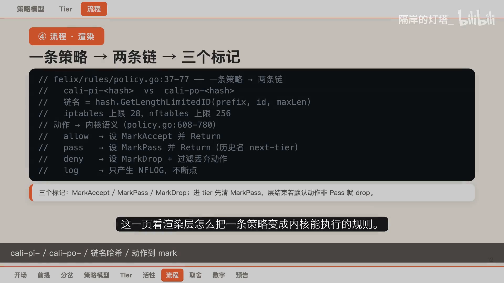

### 6.2 链名 = 前缀 + 长度受限的哈希值

链名是"**前缀 + 一个长度受限的哈希值**"，长度上限在 **iptables 里是 28**、在 **nftables 里是 256**。

### 6.3 三个标记把分层串起来

动作到内核语义的映射一共**四个**：

| Calico 动作 | 内核语义 |
| --- | --- |
| 放行（Allow） | 设置**放行标记**，然后返回 |
| 跳过（Pass） | 设置**跳过标记**，然后返回（历史上叫"下一层"动作） |
| 拒绝（Deny） | 设置**丢弃标记**，并加上"过滤丢弃"动作 |
| 记录（Log） | 只产生日志，不断点 |

最关键的机制是**三个标记：放行 / 跳过 / 丢弃**。**进入一个 tier 时会先清掉跳过标记，每跳一条策略链之前也清一次**——这样策略一旦设置了某个标记，就代表它**给出了定论**。[【跳转到 09:19】](https://www.bilibili.com/video/BV134h26FEgh/?t=559)

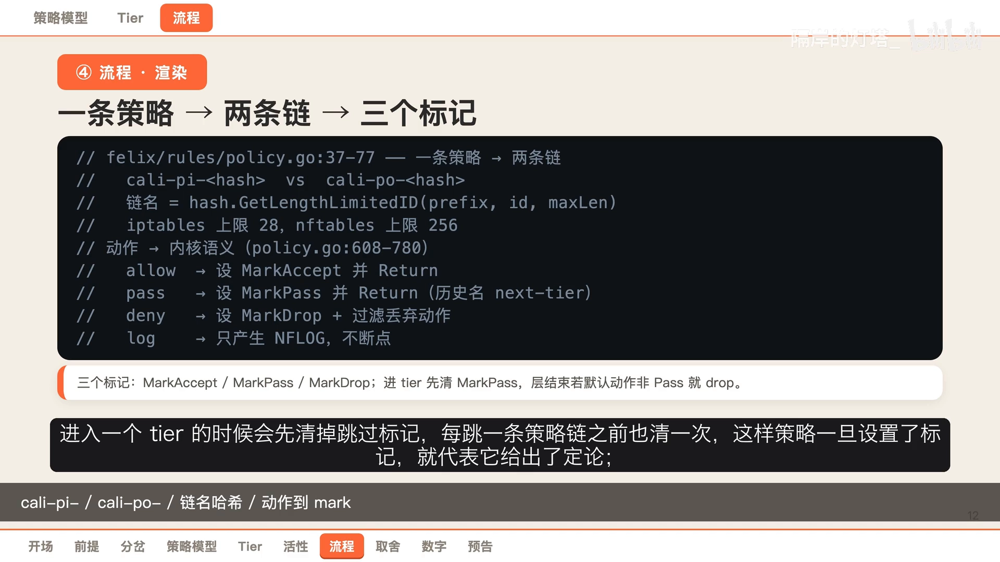

---

## 七、取舍、边界与硬数字

### 7.1 四件事（都是设计文档里明写的）

1. **失败即关闭**：适应规则缺失的依赖，**绝不能让端点或策略意外放开，宁可关掉**。
2. **不做缓冲**：策略、端点、档案都是安全关键的，**永远不给他们做缓冲**——要么给替代值，要么把不一致直接透传给数据面，绝不"压着补发"。
3. **tier 结束即拒绝**：默认层的默认动作是拒绝，进了 default 层又没被任何策略放行或跳过，**等价于被拒**。
4. **小心双重循环**：评审要求开局就检查"有没有两两相乘的操作"。历史上修过一个排序被放大 **200 倍**的旧账——100 个端点 × 200 条策略，本该排 100 次，结果排了 2 万次。**复杂度不是意外，是为安全付的税**。[【跳转到 09:58】](https://www.bilibili.com/video/BV134h26FEgh/?t=598)

### 7.2 六条边界（避开配置与升级的坑）

1. 预演 tier 的 staged 策略**只用于审计和预演，绝不下发内核**；
2. Profile 不与任何 tier 关联，只有策略全部不命中才轮到它，全落空才丢弃；
3. 策略"没有规层"时，排序器会**告警并归入 default**，不会静默丢掉；
4. 选择器解析失败**直接 panic**——宁可崩掉也不放行，这是安全取向；
5. 受保护的内置 tier **只有三档**（这个版本没有 `security` 档）；
6. tier 的订单值被 CRD 校验硬锁，三档默认动作也被锁（管理员/基线必须 Pass，默认层必须 Deny）。

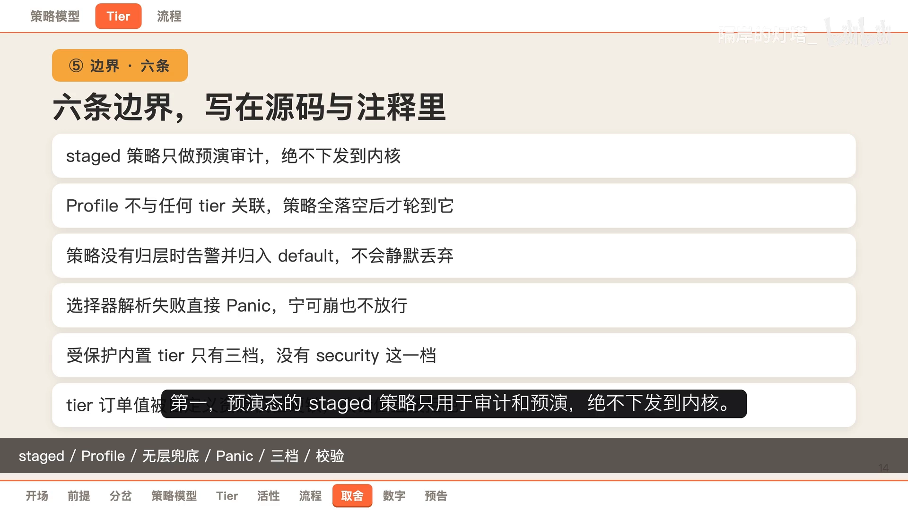

### 7.3 一组硬数字

- 代码：策略渲染 1101 行、活性计算 566 行、规则定义 637 行、排序 445 行、解析 309 行、匹配公共 282 行、全局策略 178 行、命名空间策略 161 行、层级 114 行、档案 75 行；
- 机制：规则动作 4 个、受保护内置 tier 3 档、排序用**两棵 B 树**；
- 订单：三档分别是 `1000 / 100 万 / 1000 万`，策略默认订单是 **+∞**（即在本层里最后应用）；
- 链名长度上限：iptables **28**、nftables **256**；
- 设计目标负载：**10 万+ 端点、2000+ 策略、每秒上千次端点更新**。

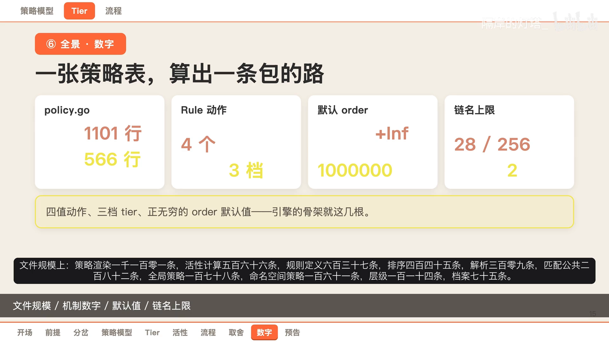

---

## 小结

- **NetworkPolicy 只是 API 对象**，把它变成内核规则的是 CNI；Calico 的做法是一条**流水线**，不是"直接翻译"。
- **原生缺口**：命名空间级、只有放行、无分层、管不到主机侧 → Calico 用**全局策略 + 四个显式动作 + Tier** 补上。
- **Tier 是全局容器**，每条策略都归属某个 tier（默认 `default`），Profile 不属于任何 tier 且永远最后兜底。
- **三档受保护内置 tier**：`kube-admin`(1000)/`default`(100 万)/`kube-baseline`(1000 万)，订单与默认动作被 CRD 校验**硬锁**。
- **两层选择器**：一层决定"策略活不活"，一层决定"包能不能过"。
- **策略活性**：只算本机约 100 个端点（而非集群 10 万），只留真正生效的策略。
- **判决顺序是死的**：失败保护 → tier → 档案 → 丢弃；**三个标记**（放行/跳过/丢弃）把分层串起来。

## 关键术语速查

| 术语 | 一句话解释 |
| --- | --- |
| NetworkPolicy | K8s 声明 Pod 级四层访问规则的 API 对象；真正实现它的是 CNI |
| Tier（层级） | Calico 的全局作用域容器，带 order 和 default action，用来做平台/租户/基线分层 |
| order | tier 的应用顺序；三档内置为 1000 / 100 万 / 1000 万 |
| default action | 一个 tier 走完仍无结论时的动作，只能是 Pass 或 Deny |
| Profile | 不属于任何 tier、只在所有策略不命中后兜底的旧式规则集合 |
| 策略活性（activity） | 判断某策略是否作用于"本机端点"的过程；只算本机、只留生效的 |
| 两层选择器 | 策略自己的选择器（活不活）+ 规则里的对端选择器（能不能过） |
| 三个标记 | 放行 / 跳过 / 丢弃；进入 tier 与每条策略链前都会重置"跳过" |
| 失败保护链 | 内核里的"急停白名单"，命中即绕开后续所有策略 |
