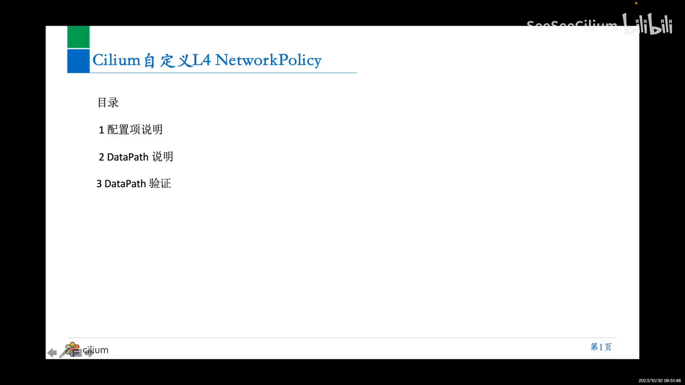
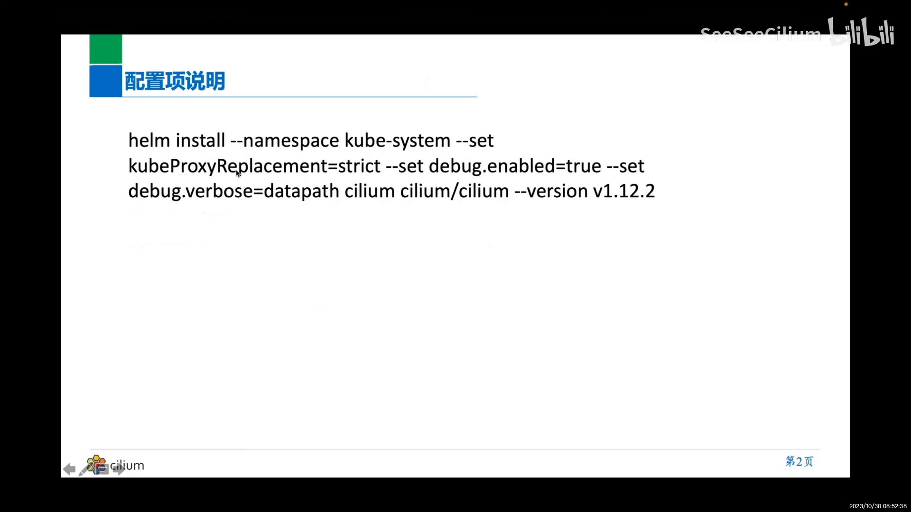
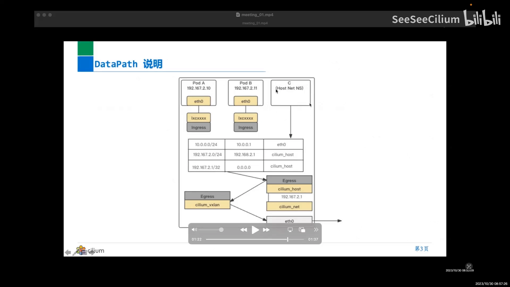
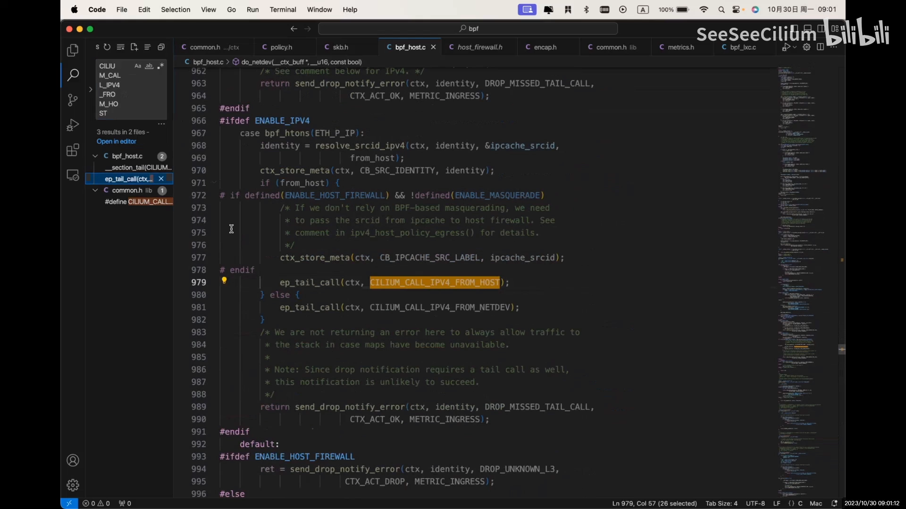
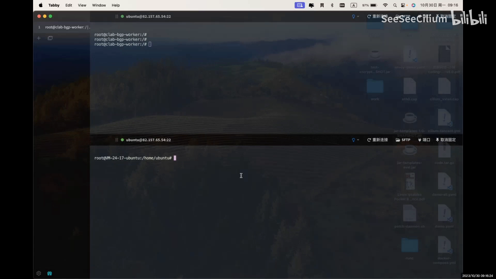

# Cilium 的 L4 NetworkPolicy 实现原理：eBPF 数据路径与 hook

> 视频来源：[2.Cilium 自定义L4 NetworkPolicy-原理篇](https://www.bilibili.com/video/BV1UM411D7ta/)（Bilibili，SeeSeeCilium《Cilium 自定义 L4 NetworkPolicy》源码分析系列·第 2 讲）｜时长 14:42
>
> 文稿已对自动字幕的明显错拼做订正：`slim`/`CLIMF`/`cm`/`cnm`→**Cilium**、`库博 proxy poem`/`kubeProxyReplacement`→**kube-proxy replacement（严格模式）**、`sim host`/`cn m host`→**cilium_host**、`slim vx line`/`cm x3`→**cilium_vxlan**、`come v cha`→**cilium_vxlan**、`ha 希`→**哈希**。本讲是**源码走读**（屏幕共享为主），因此配图以"数据路径拓扑图 + 关键源码/抓包画面"为主。

## 本讲要解决的核心问题（SCQA）

**背景**：**Cilium** 是一类"用 eBPF 实现网络与安全"的 CNI 插件。它不用 kube-proxy，也不靠 iptables，而是把策略编译成 **eBPF 程序**，挂在内核的网络 hook 上执行。上一讲演示了"从一个节点的 host 网络命名空间，访问另一个节点上的 Pod"这件事，本讲接着把这条**数据路径**讲清楚。

**冲突**：Cilium 的 L4 NetworkPolicy 到底在**哪里**、**以什么形式**被执行？打开代码，你会看到一堆 `if` 分支、协议判断、以及"这里不用看"的旁路逻辑——如果不先把**数据路径**（包从宿主机出发、经过 cilium_host、被 eBPF 处理、再重定向到 cilium_vxlan、最后从 eth0 发出）理顺，源码就只是天书。

**疑问**：**同一个节点上的一个包，从 host 网络命名空间出发去访问对端 Pod 时，究竟走过哪些设备、在哪个 hook 上被 eBPF 处理、又是怎么被重定向出去的？**

**回答（中心思想）**：**Cilium 的 L4 策略执行点，是挂在 host 侧网络设备（如 cilium_host）上的 eBPF hook**。一个从 host 网络命名空间发出的包，路径是：**route table → cilium_host → 触发 `from-host` eBPF 程序 → 重定向到 cilium_vxlan → 经 eth0 发出**；在重定向之前，eBPF 程序还会**提前把 VXLAN 的 VNI 和对端 remote IP 参数摆好**。本讲对应三件事：**① 配置项说明 ② 数据路径（DataPath）说明 ③ 抓包验证 DataPath**。[【跳转到 00:00】](https://www.bilibili.com/video/BV1UM411D7ta/?t=0)



---

## 一、配置项：把 kube-proxy 换成 eBPF（strict 模式）

本讲实验环境的安装命令（Helm）是：

```bash
helm install --namespace kube-system \
  --set kubeProxyReplacement=strict \
  --set debug.enabled=true \
  --set debug.verbose=bpfapath \
  cilium/cilium --version 1.12.2
```

配置项**其实主要就设置了一个地方**：把 **kube-proxy replacement** 设为 **`strict`（严格模式）**——也就是**彻底让 Cilium 用 eBPF 替代 kube-proxy**，而不再依赖 kube-proxy/iptables。其余的是常规调试开关（`debug.enabled`、`debug.verbose=bpfapath`）。

此外还涉及 **direct routing（直接路由）** 的开启：`direct routing` 是否打开，直接决定了数据路径是"走本机路由直接转发"还是"走隧道封装"——这正是后面要看 DataPath 的原因。[【跳转到 00:25】](https://www.bilibili.com/video/BV1UM411D7ta/?t=25)



> **为什么这一步重要**：`kubeProxyReplacement=strict` 意味着 Service 负载均衡、连接跟踪这些原本由 kube-proxy（iptables/IPVS）干的活，全都改由 eBPF 程序在内核里完成。**L4 策略与 L4 负载均衡，共用同一套 eBPF hook**。

---

## 二、数据路径（DataPath）：从 host 网络命名空间到 eth0

上一讲演示的场景是：**从 host 网络命名空间**（下图中节点 C，Host Net NS）**访问另一个节点上的 Pod**。本讲只分析"流量怎么从本机出去"这一段（对端节点如何接收不在本讲范围）。[【跳转到 01:21】](https://www.bilibili.com/video/BV1UM411D7ta/?t=81)

一个包从 host 网络命名空间出发，依次经过：

1. **route table**：按路由表把流量**定位到 cilium_host 网络设备**（例：访问 `10.0.1.0` 网段时，经 `cilium_host` 发出）；
2. **cilium_host**：在这里命中挂着的 eBPF hook（`from-host`）；
3. **重定向到 cilium_vxlan**：eBPF 程序把包**重定向**到 `cilium_vxlan` 设备；
4. **eth0**：最终经物理网卡 `eth0` 把包发出去。



图中的关键设备与路由：

| 路由项 | 下一跳 | 设备 |
| --- | --- | --- |
| `10.0.0.0/24` | `10.0.0.1` | `eth0` |
| `192.167.2.0/24` | `192.168.2.1` | `cilium_host` |
| `192.167.2.1/32` | `0.0.0.0` | `cilium_host` |

也就是说：**Pod 的流量（192.167.2.0/24）由 cilium_host 承接**，节点自身地址（192.167.2.1/32）也挂在 cilium_host 上——所以 **cilium_host 天然就是"策略与转发的执行点"**。[【跳转到 02:36】](https://www.bilibili.com/video/BV1UM411D7ta/?t=156)

---

## 三、eBPF hook：`from-host` 程序里做了什么

在 cilium_host 上，对应的 eBPF hook 是 **`from-host`**（"从主机侧出发"）。打开这段源码，可以按顺序看到它做的事：[【跳转到 04:00】](https://www.bilibili.com/video/BV1UM411D7ta/?t=240)

1. **处理 `netdev`**（包从哪个设备进来）；
2. **判断是否启用了 host firewall**（本实验未启用，直接跳过相应分支）；
3. 一个 **`if` 判断**：传入参数默认为 `true`，因此走对应分支；
4. **跳过统计相关**的逻辑（与本讲主题无关）；
5. **按协议分支**：判断是 IPv4 还是 IPv6（本实验是 **IPv4**），进入 IPv4 的处理路径；
6. 进入**真正处理业务的主逻辑**——包括若干"是否已启用"的判断与旁路（未启用则跳过）；
7. 最终走到**重定向（redirect）**逻辑。



> **理解要点**：这段程序里有大量 `if ... 跳过`，正是因为 eBPF 程序要同时适配**多种模式**（是否开 host firewall、IPv4/IPv6、是否 VXLAN、是否 direct routing……）。读源码时，先确认"当前实验开了哪些开关"，就能把无关分支整体跳过——这也是讲者反复说"这里不用看"的原因。

---

## 四、跳转前"摆好"的参数：VXLAN 的 VNI 与 remote IP

重定向的目标设备由**一个变量**决定：它是"**work 路径之下**"的 `ifindex`（网卡索引），在源码第 421 行附近定义。本实验用的是 VXLAN，所以这个变量就是 **`cilium_vxlan` 的 ifindex**——即**重定向到 cilium_vxlan**。[【跳转到 09:50】](https://www.bilibili.com/video/BV1UM411D7ta/?t=590)

关键细节：**在跳转之前，程序已经做了一堆 VXLAN 相关设置**，例如：
- 设置 **VNI（VXLAN Network Identifier，隧道 ID）**；
- 设置 **remote（对端）IPv4 地址**。

也就是说，在 **cilium_host 的 eBPF hook 之上**，程序已经**提前把隧道的 VNI 和 remote IP 参数设定好**，只是**还没有真正做 VXLAN 封装**——它做的只是"**参数的提前设置**"，真正的封装在后续 `cilium_vxlan` 设备上完成。[【跳转到 11:05】](https://www.bilibili.com/video/BV1UM411D7ta/?t=665)

> 这就是讲者所说的"**从 cilium_host 跳回 cilium_vxlan**"这一步的含义：**eBPF 在 host 侧 hook 上完成决策与参数准备，然后把包交给隧道设备**。

---

## 五、抓包验证 DataPath

最后一步是**抓包验证**：[【跳转到 11:44】](https://www.bilibili.com/video/BV1UM411D7ta/?t=704)

1. 进入目标节点的网络命名空间；
2. 在 **eth0**（以及 worker 0）上 **tcpdump 抓包**；
3. 对目标 Pod **访问两三次**，把包**存下来**；
4. 打开抓到的 eth0 数据包，**核对包确实是从 eth0 发出去的**（即验证上面的数据路径）。



---

## 小结

- **Cilium 用 eBPF 实现 L4 网络策略**，配置上以 `kubeProxyReplacement=strict` 彻底取代 kube-proxy/iptables。
- **数据路径**：host 网络命名空间 → `route table` 定位到 **cilium_host** → 触发 **`from-host` eBPF 程序** → **重定向到 cilium_vxlan** → 经 **eth0** 发出。
- **cilium_host 是执行点**：Pod 网段与节点自身地址都由它承接，因此策略与转发都在它的 hook 上发生。
- **eBPF 程序读起来像天书，是因为要适配多种模式**（host firewall、IPv4/IPv6、VXLAN/direct routing）；先确认实验开关，就能跳过无关分支。
- **跳转前先摆参数**：eBPF 程序在 cilium_host 上先设好 **VXLAN 的 VNI 与 remote IP**，真正的封装交给 cilium_vxlan。
- **验证手段是抓包**：在 eth0 上 tcpdump，核对包确实沿这条路径发出。
- 与上一讲（[Calico 策略引擎](Calico 策略引擎：一条 NetworkPolicy 怎么被算出来.md)）对照：**Calico 走"策略 → iptables 链"**，**Cilium 走"策略 → eBPF 程序挂 hook"**——同是 CNI 实现 NetworkPolicy，两条技术路线的分水岭就在这里。

## 关键术语速查

| 术语 | 一句话解释 |
| --- | --- |
| cilium_host | 承载 Pod 网段与节点地址的虚拟设备，是 host 侧 eBPF 策略/转发的执行点 |
| cilium_vxlan | VXLAN 隧道设备，负责把包封装后送出 |
| from-host（eBPF hook） | 挂在 host 侧、处理"从主机网络命名空间出发"的包的程序 |
| kubeProxyReplacement=strict | 用 eBPF 彻底替代 kube-proxy（含 Service 负载均衡、连接跟踪） |
| direct routing | 直接路由模式（相对隧道封装），影响数据路径走向 |
| VNI | VXLAN Network Identifier，隧道标识；由 eBPF 在重定向前预先设置 |
| tcpdump 抓包 | 验证数据路径的常用手段：在 eth0 上抓包核对包的走向 |
