# Hubble parser：把一段字节变成一条可读的 Flow——eBPF 网络可观测数据是怎么炼成的

> 视频来源：[29·Hubble parser：把字节变成 Flow｜Cilium 源码深读（第五季）](https://www.bilibili.com/video/BV1hPJR6oEdg/)（Bilibili，UP 主「隔岸的灯塔_」）｜时长 14:35
>
> 这是 Cilium 源码深读第五季的第二期。上一期讲的是 Hubble 的整条管道（事件从哪来、怎么走），这一期把管道中间最关键的一跳——**parser**——单独拆开：它是如何把从 eBPF 数据面捞上来的一段**原始字节**，翻译成一条**人能读懂、可检索的 Flow（网络流记录）**的。文稿已对自动字幕的明显错拼做订正：`CELIUM`→**Cilium**、`七票`→**七跳**、`go pack`→**gopacket**、`POE/PO/PELO`→**payload**、`SC 解码器`→**socket 解码器**、`SAKI`→**socket**、`瑞起来`→**看起来**、`脱敏/打码`保留原义、`曹魏下标`→**槽位下标**、`文件结束`→**EOF**。

## 本讲要解决的核心问题（SCQA）

**背景**：Cilium 是 Kubernetes 里以 eBPF 为底座的网络/安全/可观测组件。它有一套叫 **Hubble** 的观测系统：你在 `hubble observe` 或 Hubble UI 里看到的每一条「谁在什么时间、从哪个 Pod、发往哪个服务、成功还是被拒」的记录，本质上都来自 eBPF 数据面捞上来的**一堆原始字节**。

**冲突**：原始字节只是二进制——一个 CPU 号加一段内核 perf 缓冲里的字节数组。它本身没有任何「可读」的东西：没有 Pod 名、没有服务名、没有五元组、甚至不知道那一段字节到底是不是一个网络包。**从「字节」到「可读记录」之间，缺了翻译这一环。**

**疑问**：parser 到底要从这些字节里抠出什么？它怎么知道该用哪种解码方式？一个可能带隧道封装、还可能和当前集群状态对不上的数据包，怎么被稳定地解成一条字段完整的 Flow？

**回答（中心思想）**：**parser 只做一件事——把一段字节变成一个结构化的 Flow；但为了做得又快又稳，它把这件事拆成了四个互不并列的岔路口，并用三条设计原则兜住不确定性**：① 一个字节定分支（`Payload` 事件看第一个字节，三层四层是兜底主干，七层和 socket 是两个特殊入口，debug 是旁路）；② **身份冲突时听数据面的**（事件产生那一刻的身份才是策略判定用的，用户态缓存只负责补名字）；③ 名字全靠 **getter**（parser 不认识任何 Kubernetes 对象，五个接口决定了你能看到多少信息）。最后，解码结果要写进一个**单写多读的无锁环形缓冲**——它宁可丢数据，也不给错位的数据。

---

## 一、parser 的输入：一个「信封」加三件货物

parser 的函数签名非常朴素：**输入一个 `monitor event`，输出一个 `event`**。[【跳转到 01:20】](https://www.bilibili.com/video/BV1hPJR6oEdg/?t=80)

这个 `monitor event` 像一个**信封**，里面有四个字段：`UUID`、时间戳、节点名，以及最重要的 `payload`。[【跳转到 01:25】](https://www.bilibili.com/video/BV1hPJR6oEdg/?t=85) 而 `payload` 只可能是三种：

| payload 类型 | 是什么 | 特点 |
| --- | --- | --- |
| **Payload 事件** | 内核 perf 缓冲里的一段原始字节数组，外加一个 CPU 号 | 第一个字节就是事件类型，需要真正「解包」 |
| **Agent 事件** | agent 自己产生的东西，比如 Nginx 的访问日志 | 进来的时候**已经是 Go 结构体**，不用解包 |
| **Lost 事件** | 一本账：来源丢了多少条、第一条和最后一条的时间 | 不用解码，直接翻译成消息 |

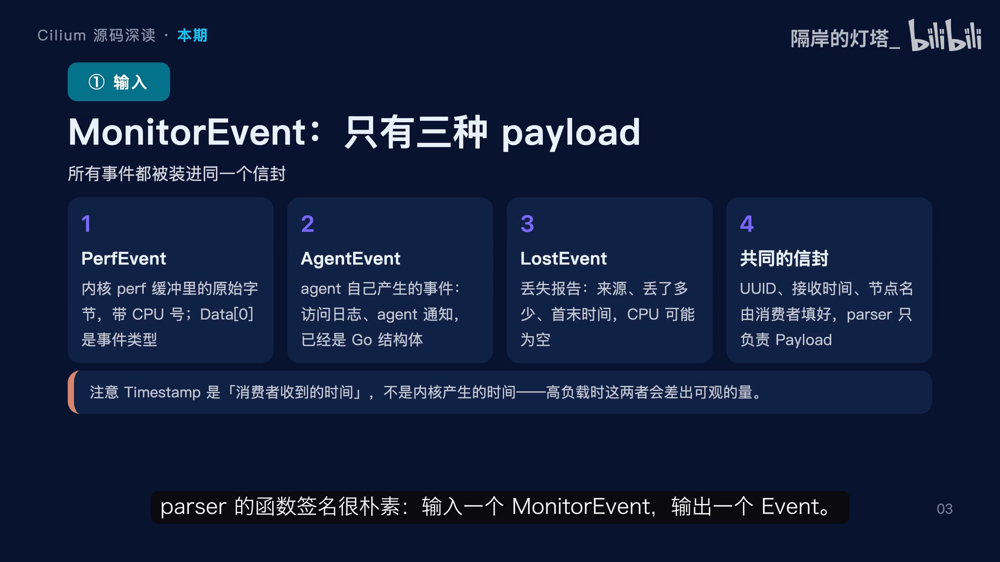

这里有一个**容易被忽略的细节**：信封上的时间戳是**消费者收到事件的时间**，不是**内核产生事件的时间**。系统繁忙时，这两个时间能差出几十甚至上百毫秒。所以做时序分析时，**别把它当精确的抓包时间**。[【跳转到 01:50】](https://www.bilibili.com/video/BV1hPJR6oEdg/?t=110)

---

## 二、一个字节定分支：四个解码器其实是一个主干加三个旁路

parser 的分派逻辑非常干净：**先看 payload 的具体类型 → 再看第一个字节**。[【跳转到 02:13】](https://www.bilibili.com/video/BV1hPJR6oEdg/?t=133)

- 如果是 **Payload 事件**，就看它的第一个字节：
  - 调试消息 → 交给 **debug 解码器**；
  - socket 层事件 → 交给 **socket 解码器**；
  - **其余全部** → 交给 **三层四层解码器**（注意这里是 `default` 兜底，因为内核事件类型有几十种，不可能一一列出）。
- 如果是 **Agent 事件**，再看它的类型：访问日志 → 交给**七层解码器**，产出的 Flow 类型标为 `L7`；agent 通知 → 直接翻译成 protobuf，**不产生 Flow**。
- 如果是 **Lost 事件** → 根本不用解码，直接翻译成对应的消息。

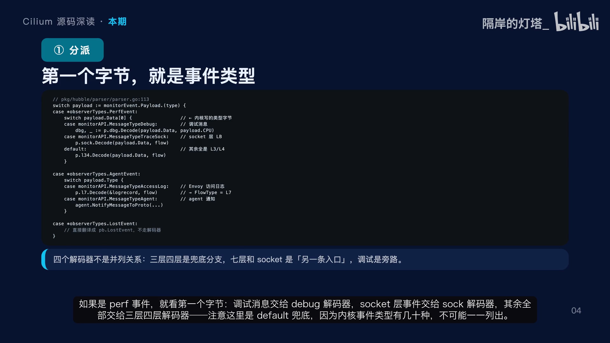

这个结构说明：**四个解码器不是并列的四个分支，而是「一个兜底主干 + 两个特殊入口 + 一个旁路」**。[【跳转到 02:43】](https://www.bilibili.com/video/BV1hPJR6oEdg/?t=163) 理解这一点很重要，因为你在 Hubble 里看到的**绝大多数记录，走的都是三层四层那条兜底路径**。

---

## 三、三层四层解码的八步

既然三层四层是主干，就把它的解码拆成八步。[【跳转到 03:06】](https://www.bilibili.com/video/BV1hPJR6oEdg/?t=186)

1. **读类型字节选分支**；
2. **解对应的事件头**——丢包、trace、策略判定、抓包四种结构各不相同，但它们都有共同字段，比如源/目的、identity、verdict、观察点；
3. **定位原始包**——事件头后面才是真正的数据包，偏移量**由事件头自己给出**（因为不同事件头长度不一样）；
4. **用 gopacket 逐层解**以太网、IP、TCP 或 UDP，解除五元组，同时填好每一层的细节（比如 TCP 标志）；
5. **处理隧道**——如果事件标记了封装，就要再解一层 VXLAN 或 Geneve，把**内层**五元组取出来，外层信息寄到 `tunnel` 字段，然后把外层字段清掉；
6. **查身份**——这里有个优先级问题（第四节单独讲）；
7. **解析端点**——拿身份和 IP 去查缓存，补 Pod 名、命名空间、标签；
8. **下结论**——填 verdict、丢包原因、流量方向、服务名。

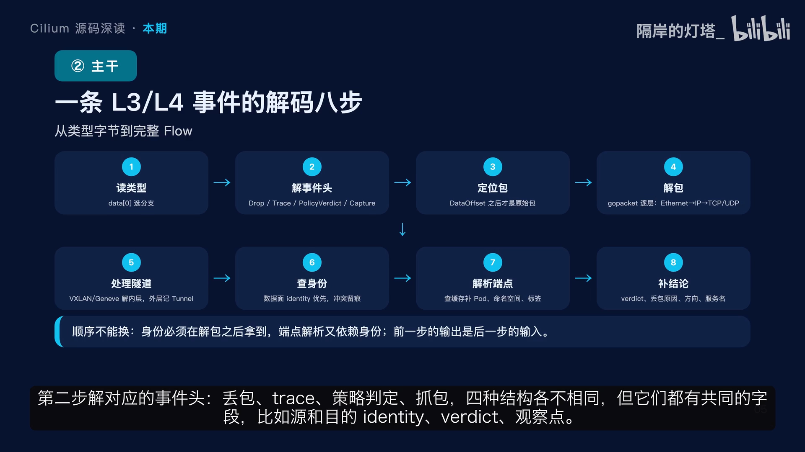

**这个顺序不能换，因为后一步依赖前一步的产物。** 其中第 5 步的隧道处理尤其容易踩坑：如果不把外层清掉，**一条流会同时显示内外两层地址，看起来会误导**。[【跳转到 03:31】](https://www.bilibili.com/video/BV1hPJR6oEdg/?t=211)

再看解包这一段，它分了**三种情况**：不是三层设备就走**二层解析器**（从以太网开始解）；三层设备且是 IPv6 就用 **IPv6 解析器**，否则用 **IPv4**。为什么要分？因为 **Cilium 的 host 这类三层设备上没有以太网头，直接从 IP 开始**——用错解析器，第一步就失败了。[【跳转到 04:13】](https://www.bilibili.com/video/BV1hPJR6oEdg/?t=253)

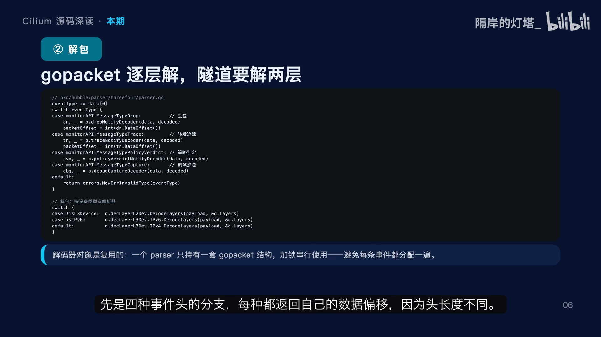

还有一个值得说的**工程细节**：这些 gopacket 的解析器和层结构是**复用**的——整个 parser 只持有一套，用一把锁串行使用。因为解码发生在**单个 goroutine** 里，没有并发压力；而复用能避免每条事件都分配一堆对象。**Hubble 每秒要处理几万条事件，这个分配开销不能忽略。** 这也解释了一个设计取舍：想横向扩展解码能力，**只能多开进程，不能简单加 goroutine**。[【跳转到 04:38】](https://www.bilibili.com/video/BV1hPJR6oEdg/?t=278)

---

## 四、身份对不上，听谁的？

第 6 步「查身份」有一个很微妙的难题。[【跳转到 05:00】](https://www.bilibili.com/video/BV1hPJR6oEdg/?t=300)

内核事件里带的是**事件产生那一刻的 identity 编号**；而 parser 查的是**用户态缓存**，也就是**现在的状态**。这两者**可能对不上**：事件在队列里排了几毫秒，这期间 Pod 可能被重建、identity 变了。

- **听谁的？** Cilium 的选择是——**保留数据面看到的那个**，因为那才是**策略判定时真正用的身份**。
- 一条原则：**观测数据必须忠实于「当时发生了什么」，而不是「现在应该是什么」。**
- **代价**：名字可能查不到，或者查到一个已经过时的名字。

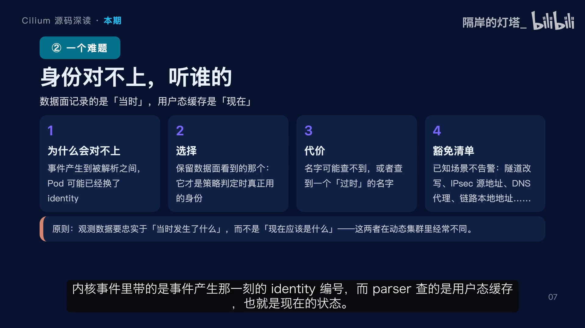

代码里还专门维护了一份**豁免清单**（known-inconsistency list）：隧道封装时原 identity 会被改成远程节点 IP；IPsec 加密包的源地址会变成 Cilium host；DNS 代理会让源地址变成主机而身份还是原 Pod；链路本地地址根本不在 eBPF 里……**这些已知的不一致不告警，否则日志会被刷爆**。这份清单本身，就是一份很好的「Cilium 数据面会改写什么」的速查表。[【跳转到 05:30】](https://www.bilibili.com/video/BV1hPJR6oEdg/?t=330)

---

## 五、名字从哪来：五个 getter

第 7 步「解析端点」靠的是一组接口，叫 **getter**。这里的设计非常克制：**parser 自己不认识任何 Kubernetes 对象，它只问接口。**[【跳转到 05:55】](https://www.bilibili.com/video/BV1hPJR6oEdg/?t=355)

| getter | 回答的问题 |
| --- | --- |
| **Endpoint getter** | 这个 IP 是不是本地端点？序号多少？ |
| **Identity getter** | 这个编号对应哪些标签？ |
| **IP getter** | 这个 IP 属于哪个 Pod 或哪个节点？ |
| **Service getter** | 这个地址和端口是不是某个服务的后端或前端？ |
| **DNS getter** | 这个 IP 历史上被哪些域名解析过？ |

全部是**接口而不是具体实现**，好处很直接：**parser 不依赖 Kubernetes 客户端**，可以脱离集群做单元测试，甚至可以拿一堆构造数据做模糊测试——你在这个目录里能看到 fuzz 测试，就是这套解耦换来的。

反过来，这也意味着：**Hubble 能补出多少名字，完全取决于这些 getter 背后缓存里有什么。缓存没有的就只能显示 IP。**[【跳转到 06:45】](https://www.bilibili.com/video/BV1hPJR6oEdg/?t=405)

---

## 六、另一条入口：七层解码（翻译、补名、脱敏）

现在换一条入口，看**七层解码器**。它的输入**不是原始字节**，而是**访问日志记录**——这些记录已经是结构化的，所以七层解码器的工作不是解包，而是**翻译、补名字、脱敏**。[【跳转到 06:51】](https://www.bilibili.com/video/BV1hPJR6oEdg/?t=411)

1. **只读，绝不修改**这条记录——因为它可能被其他消费者共享，比如日志导出器；
2. 把记录里的源和目的端点转成 endpoint，再用 IP getter 和 endpoint getter **补上命名空间、Pod、UUID**；如果这个 IP 是本地端点，本地缓存里的信息更全，会覆盖一次；
3. 类型标为 `L7`；
4. verdict 直接翻译，再根据记录里是 **HTTP 还是 DNS** 走不同的翻译函数。

这里**没有 gopacket，也没有五元组解包**——因为代理在产生日志的时候就已经知道这些了。两个入口的差别，本质上**是谁先理解了流量**：**三层四层是内核理解了一半，七层是代理完全理解了。**[【跳转到 07:41】](https://www.bilibili.com/video/BV1hPJR6oEdg/?t=461)

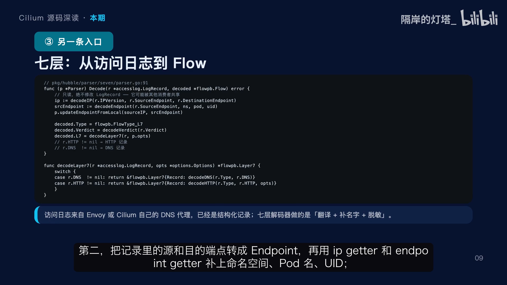

---

## 七、脱敏：哪些东西不该被看见

可观测性最容易越界的地方，就是**请求内容**：URL 里可能带 token，请求头里可能带 cookie，响应里可能有用户信息。[【跳转到 07:50】](https://www.bilibili.com/video/BV1hPJR6oEdg/?t=470)

- **默认行为**三件事：URL 里的 user info 部分打码；query 参数保留；请求头**不**脱敏。
- 如果显式打开 `redact` 开关、**又没配任何名单**，那么**所有请求头值**都会变成 `hubble_redacted`；
- 如果配了**白名单**：只有白名单里的头原样保留，其余打码；
- 如果配的是**黑名单**：黑名单里的打码，其余保留。

**这两种模式的语义是反的，配置时千万别想当然。**[【跳转到 08:20】](https://www.bilibili.com/video/BV1hPJR6oEdg/?t=500)

还有一个关键点：**脱敏发生在解码阶段，不是存储阶段。** 也就是说，**ring 里存的已经是打码后的数据**，后续的导出、Relay、UI 都不可能再拿到原文。这个位置选得很对——**越早打码，泄露面越小。**

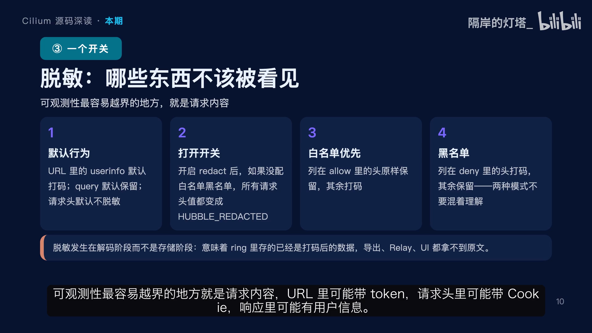

---

## 八、DNS：请求和响应，字段不一样

DNS 是个特例，值得单独看。[【跳转到 08:42】](https://www.bilibili.com/video/BV1hPJR6oEdg/?t=522) 访问日志里，**DNS 请求和 DNS 响应是两条独立的记录**，字段也不一样：

- **请求记录**：只有「问题」——查询名、查询类型、观察来源；
- **响应记录**：才有「答案」——解析出的 IP 列表、TTL、name 链、返回码，以及问题部分的副本。

为什么不合并成一条？因为在代理的位置上，**请求和响应本来就是两个时刻**，中间可能隔了几百毫秒，甚至响应根本没回来。所以 Hubble 里你会看到两条 DNS 记录：一条方向是请求，一条方向是响应，要靠**查询名和五元组**把它们对上。

这个设计直接影响排查方式：查「**这个域名解析成了什么**」你要看**响应记录**；查「**谁在什么时候问了什么**」要看**请求记录**。另外注意「观察来源」——它告诉你这条记录是**代理看到的**，还是从**数据面旁路**看到的，可信度和覆盖面都不一样。[【跳转到 09:32】](https://www.bilibili.com/video/BV1hPJR6oEdg/?t=572)

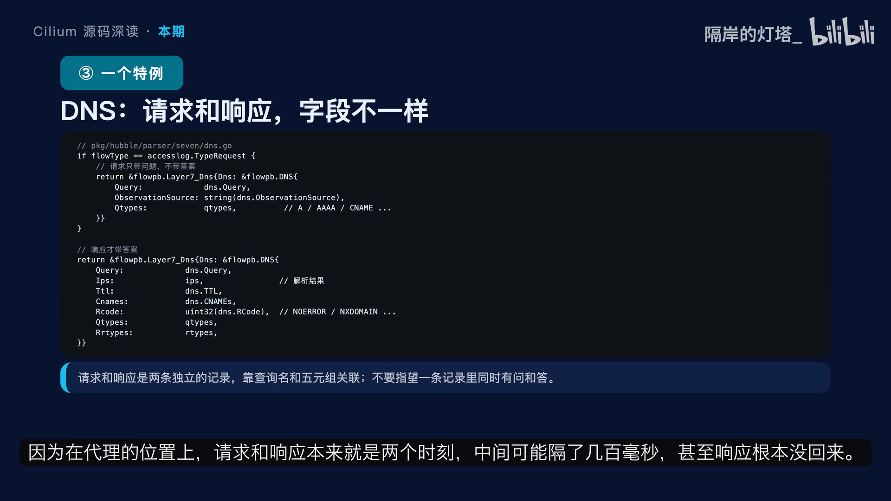

---

## 九、两条旁路：socket 与 debug

另外两条旁路简单过一下。[【跳转到 09:57】](https://www.bilibili.com/video/BV1hPJR6oEdg/?t=597)

- **socket 解码器**：处理的是 **socket 层负载均衡在 connect 时产生的事件**。它和三层四层最大的区别是类型标为 `socket`，而且多了一个 `control group ID`——因为 socket 事件里**没有完整的网络包**，只有 socket 关联的 control group，要靠它反查后端。它回答的问题是：**这个连接被重定向到了哪个后端？** 在排查服务负载均衡时非常有用。
- **debug 解码器**：处理的是 `cilium monitor` 加 debug 参数看到的内容。它**根本不是网络流**，而是数据面的**调试打印**，带文件名和行号——排查「**这个包为什么在这一行被丢掉**」时，它比任何 Flow 都直接。

两者有一个共同点：**都不产生真正的流量记录，因为它们手里没有完整的包。** 但它们回答的是不同的问题：**一个回答「连到哪」，一个回答「死在哪一行」。**

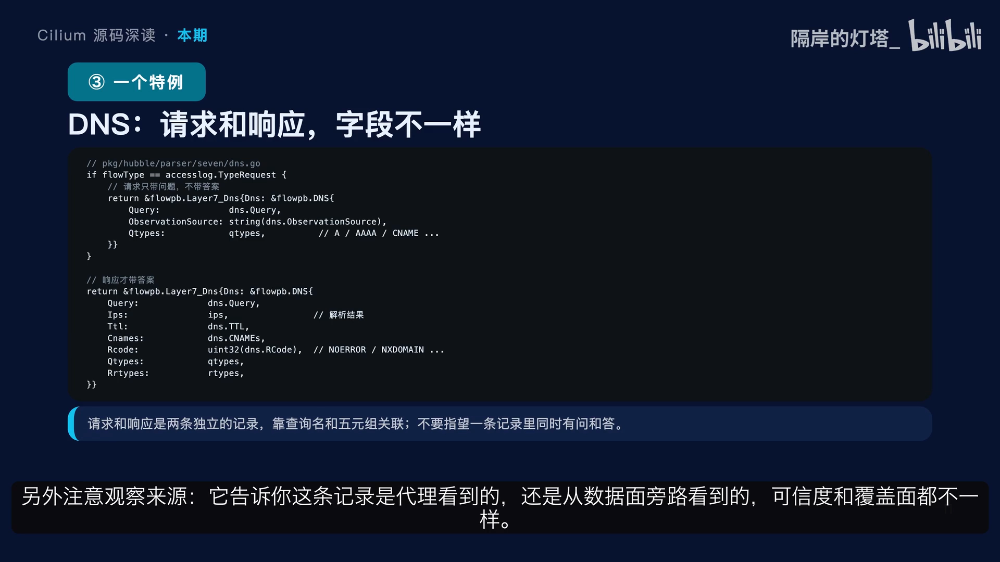

---

## 十、环形缓冲：单写多读的无锁协议

解码完的结果，要写进一个**环形缓冲**（ring buffer）。上一期只讲了容量，这一期讲**它凭什么敢让一个写者和任意多个读者同时跑**。[【跳转到 10:22】](https://www.bilibili.com/video/BV1hPJR6oEdg/?t=622)

### 10.1 写：先占位，再写尾，最后唤醒

整个过程四步：[【跳转到 10:47】](https://www.bilibili.com/video/BV1hPJR6oEdg/?t=647)

1. **写指针原子自增**，先把位置占下来；
2. 位置**按位与上掩码**，得到真实槽位——**这就是容量必须是 2 的幂的原因**，省掉了取模；
3. 把事件**原子地写进这个槽**；
4. 如果有人在等新事件，就**关闭通知 channel 唤醒他们**。

注意：这四步里，**锁只保护通知 channel，不保护数据槽**；数据槽用原子操作，所以读者读的时候**永远不会被写者挡住**，写者也不会等读者。还有一个细节：**先占位再写槽**，意味着在极短的窗口里，写指针已经前进了但槽还没写；如果读者恰好读到这个位置，会看到空槽——代码里对此有明确的处理：**把空槽当成「正在被覆盖」，返回丢失事件，而不是返回空指针崩溃**。**这就是无锁设计要付的代价，必须承认中间状态存在。**[【跳转到 11:12】](https://www.bilibili.com/video/BV1hPJR6oEdg/?t=672)

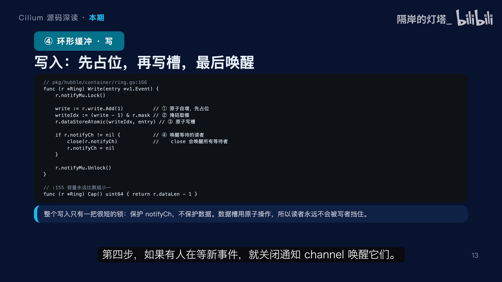

### 10.2 读：四种情况，两种结果

读的逻辑看着复杂，其实就是**四种情况**。先算三个东西：**槽位下标、最后写入位置、以及读者和写者各自在第几圈。**[【跳转到 11:25】](https://www.bilibili.com/video/BV1hPJR6oEdg/?t=685)

1. **同一圈，且读者下标在写指针之前** → 数据有效，直接返回；
2. **读者还在上一圈、下标在写指针之后** → 也有效（对应缓冲区刚绕回来的那一刻）；但这里多一个判断：如果槽里是空的，说明还没写到这里，**按即将被覆盖处理，返回丢失事件**；
3. **读者超前**（读到了写者前面）→ 暂时没有新数据，**返回文件结束（EOF）**；
4. **其余情况**（读者被写者套圈了）→ 数据已经没了，**返回一条合成的丢失事件**。

所以**读取只有两种结果**：要么给你一条**真事件**，要么给你一条「**你落后了**」的通知，**永远不会给你一条错位的数据**。这就是 `sequence` 存在的意义——**同一个下标每转一圈就是另一条数据**，光看下标根本分不清。[【跳转到 11:55】](https://www.bilibili.com/video/BV1hPJR6oEdg/?t=715)

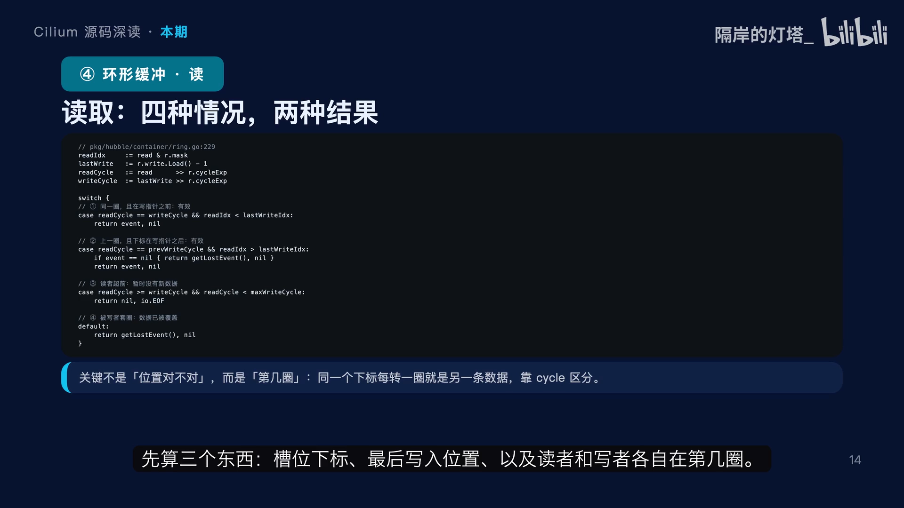

### 10.3 并发模型：单写多读

把它总结成一个模型：[【跳转到 12:20】](https://www.bilibili.com/video/BV1hPJR6oEdg/?t=740)

- **只有一个写者**（就是 observer 的主循环，它天然是串行的，**所以不需要写锁**）；
- **读者可以有任意多个**，每个读者持有自己的位置，读自己的，**互不干扰**，也不影响写者；
- 读者怎么知道有新数据？它**睡在自己的通知 channel 上**，写者写完一次把这个 channel **关掉**，所有等待者被唤醒。这里用「关闭」而不是「发送」，是因为**关闭会唤醒所有等待者，而发送只能唤醒一个**。

失败模式也很清楚：**读得慢只会丢自己的数据**（因为写者会覆盖它还没读的位置），它**不会拖慢别的读者，更不会拖慢写入**。这是一个很典型的取舍：**放弃「每条事件都送到」的严格保证，换来写入永不阻塞、读者互不影响。** 对观测系统来说，**这个取舍是对的——观测数据晚一点、少一点可以接受，拖慢转发绝对不行。**[【跳转到 12:45】](https://www.bilibili.com/video/BV1hPJR6oEdg/?t=765)

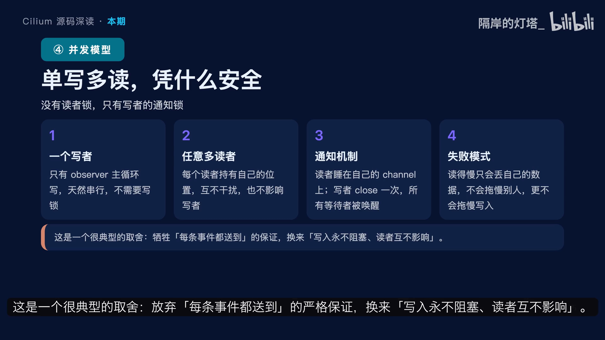

---

## 小结

这一期把 parser 拆开，要记住四件事：[【跳转到 13:10】](https://www.bilibili.com/video/BV1hPJR6oEdg/?t=790)

1. **一个字节定分支**：`Payload` 事件看第一个字节，三层四层是兜底路径，七层和 socket 是另外两个入口，调试是旁路；
2. **身份听数据面的**：冲突时保留事件产生那一刻的 identity，因为那才是策略判定用的，用户态缓存只负责补名字；
3. **名字全靠 getter**：parser 不认识任何 Kubernetes 对象，五个接口决定了你能看到多少信息；
4. **环形协议靠 sequence**：单写多读，读者无锁，落后就合成丢失事件，绝不给你错位数据。

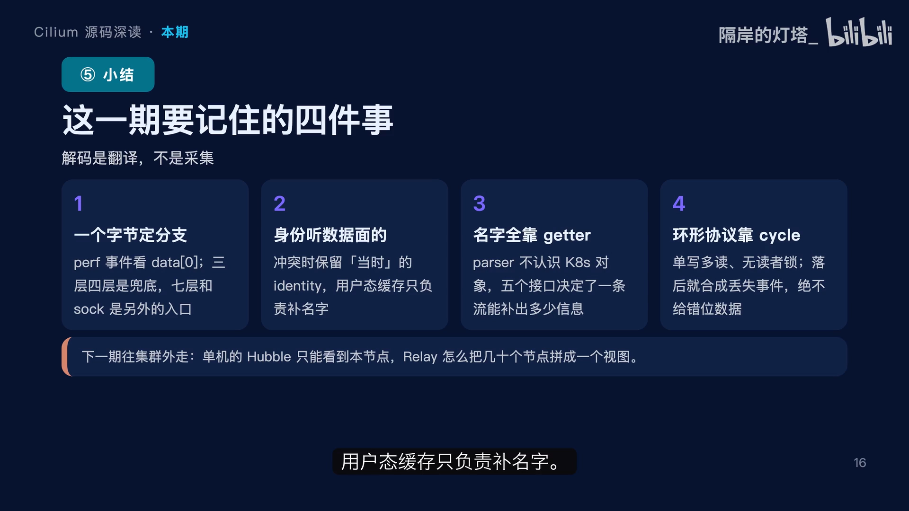

把这一期和上一期连起来看，**Hubble 的单机部分就完整了**——事件怎么来、怎么翻译、怎么存、怎么读。**但单个节点只能看到自己。** 下一期往集群外走，看 Relay 怎么把几十个节点的流拼成一个视图。[【跳转到 13:35】](https://www.bilibili.com/video/BV1hPJR6oEdg/?t=815)

## 关键术语速查

| 术语 | 一句话解释 |
| --- | --- |
| **Flow** | Hubble 里的一条网络流记录：谁、在什么时候、从哪到哪、结果如何 |
| **parser** | 把一段原始字节/访问日志翻译成结构化 Flow 的组件 |
| **monitor event** | parser 的输入「信封」：UUID、时间戳、节点名、payload |
| **Payload 事件** | 内核 perf 缓冲里的原始字节数组 + CPU 号，第一个字节是事件类型 |
| **gopacket** | Go 的网络协议解析库，用来逐层解以太网/IP/TCP |
| **identity** | Cilium 给端点分配的身份编号，策略判定的依据 |
| **getter** | parser 查询「名字/身份/服务」的接口，隔离了对 Kubernetes 客户端的依赖 |
| **脱敏（redact）** | 在解码阶段就对 URL/请求头中的敏感信息打码 |
| **环形缓冲（ring buffer）** | 单写多读的无锁缓冲，容量是 2 的幂，靠 sequence 区分绕圈后的新旧数据 |
| **sequence** | 每条事件递增的序号，用来区分「同一个槽位下标、不同一圈」的数据 |
