# Hubble Relay：多节点怎么拼成一张图——eBPF 集群网络可观测的聚合层

> 视频来源：[30·Hubble Relay：多节点怎么拼成一张图｜Cilium 源码深读（第五季）](https://www.bilibili.com/video/BV1gbJd68EZB/)（Bilibili，UP 主「隔岸的灯塔_」）｜时长 12:57
>
> 这是 Cilium 源码深读第五季的第三期。前两期讲的是**单机 Hubble**：事件怎么来、怎么翻译、怎么存进一个 4095 个位置的环形缓冲。这一期回答一个更上层的问题：**一个集群有几十上百个节点，你在 UI 上看到的是整个集群的流——这些流不可能存在某一个 agent 里，到底是把谁把它们拼起来的？** 答案就是 **Relay**。文稿已对自动字幕的明显错拼做订正：`CELIUM`→**Cilium**、`RELLY/ray/really`→**Relay**、`G2PC`→**gRPC**、`携程`→**协程（goroutine）**、`air group`→**errgroup**、`统计/state`保留、`去众/去种/驱虫`→**去重**、`片服务`→**peer 服务**、`get flose`→**GetFlows**、`get notes`→**GetNodes**、`药膏可用`→**要高可用**。

## 本讲要解决的核心问题（SCQA）

**背景**：Hubble 是 Cilium（以 eBPF 为底座的 K8s 网络组件）自带的可观测系统。每个节点上跑一个 **cilium-agent**，它通过 eBPF 数据面把本节点的网络事件解码成 Flow，存进本节点的环形缓冲。

**冲突**：可观测的数据是**按节点**产生的，但人要看的是**整个集群**。一个 agent 只认识自己的节点——它无法回答「整个集群现在有哪些流」。而客户端也不可能直连几十个 agent。

**疑问**：中间这个聚合层要怎么设计？它怎么发现集群里有哪些节点？怎么和它们保持连接？一次查询怎么变成几十条并发流？几十条流乱序回来，又怎么排成一条时间线？它能保证什么、不能保证什么？

**回答（中心思想）**：**Relay 是一条「查询时的聚合管道」——它只做三件事：发现节点、把查询扇出、把结果合并排序；它不采集、不存储。** 为了在分布式环境下稳定工作，它贯彻了三条态度：**① 失败就跳过、不拖垮整次查询；② 部分失败必须让用户看得见（宁可少给数据，也绝不悄悄少给）；③ 排序只是近似——一分钱一分货，它的准确性由两个数字（队列长度 100、窗口一秒）决定。**

---

## 一、为什么需要 Relay：单机 Hubble 的三堵墙

先讲为什么需要 Relay。**单机 Hubble 有三堵墙，而且都不是实现问题，是「位置」决定的。**[【跳转到 01:17】](https://www.bilibili.com/video/BV1gbJd68EZB/?t=77)

1. **视野墙**：每个 agent 只处理本节点的包。一条**跨节点**的会话，会在两个节点各留下一半记录，**谁都不知道全貌**；
2. **容量墙**：环形缓冲只有 4095 条。节点流量一大，**能回看的时间窗口可能只有几百毫秒**；
3. **连接墙**：客户端不可能直连几十个 agent——地址会变、证书要管、节点上下线要处理，不能让每个客户端自己做。[【跳转到 01:47】](https://www.bilibili.com/video/BV1gbJd68EZB/?t=107)

还有一个更根本的问题：**整个集群现在有哪些流？** 这个问题**任何一个 agent 都回答不了**。所以必须有一个聚合层。

---

## 二、Relay 的定位与五个部件

**Relay 的定位就三件事：发现有哪些节点、把查询派发给他们、把结果合并排序。它不采集、不存储，这也是它相对轻的原因。**[【跳转到 02:12】](https://www.bilibili.com/video/BV1gbJd68EZB/?t=132)

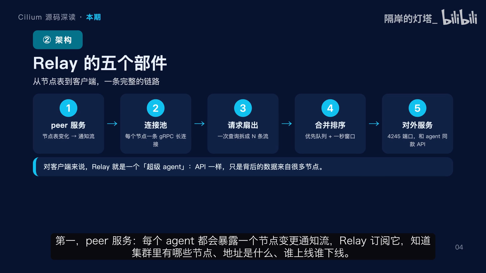

它由**五个部件**组成：

| 部件 | 职责 |
| --- | --- |
| **① Peer 服务** | 每个 agent 暴露一个节点变更通知流，Relay 订阅它，知道有哪些节点、地址是什么、谁上线谁下线 |
| **② 连接池** | 给每个节点维护一条 gRPC 长连接，带健康检查和重连退避 |
| **③ 请求扇出** | 客户端发来一次查询，Relay 复制成 N 份并发发给所有可用节点 |
| **④ 合并排序** | 几十条流同时往回吐数据，用优先队列 + 一秒窗口排成一条时间线 |
| **⑤ 对外服务** | 在 4245 端口上提供**和 agent 完全一样的 API** |

**第五点里「同款 API」的设计很关键**：对客户端来说，Relay 就是一个「超级 agent」——接口一样、过滤条件一样，只是背后的数据来自很多节点。这让 `hubble observe` 和 UI **不用区分自己连的是谁**。[【跳转到 02:37】](https://www.bilibili.com/video/BV1gbJd68EZB/?t=157)

---

## 三、发现：Peer 服务与节点表变更通知

每个 agent 内部有一个 **Peer 服务**，它的数据源是 **state 里的节点表**。[【跳转到 03:02】](https://www.bilibili.com/video/BV1gbJd68EZB/?t=182)

客户端一连上来，**先拿一份完整的初始快照，然后订阅后续变化**。这里有两个细节：[【跳转到 03:07】](https://www.bilibili.com/video/BV1gbJd68EZB/?t=187)

- **50 毫秒的节流**：节点表可能因为一次滚动更新瞬间变几十次，没必要一条条推，**合并成一批**更划算；
- **通知类型有三种**：新增、更新、删除。更新时做了**去重**——如果节点名和地址都没变就不发通知；如果**名字变了但地址没变**，就按「删除 + 新增」处理，因为对消费者来说这就是**两个不同的 peer 身份**。[【跳转到 03:32】](https://www.bilibili.com/video/BV1gbJd68EZB/?t=212)

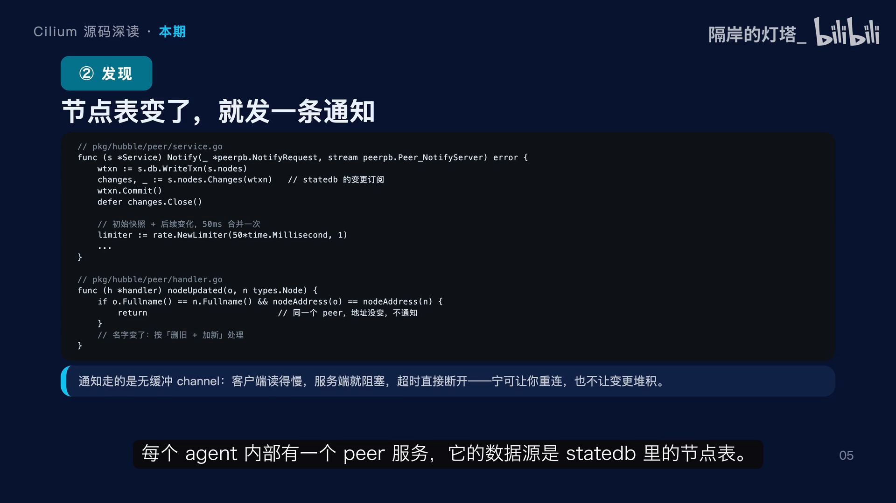

还有一个**很硬的约束**：通知 channel 是**无缓冲**的。客户端读得慢，服务端就会阻塞，超时就**断开连接**。这个设计很果断：**宁可让你重连一次，也不让变更在内存里堆着。**

---

## 四、连接：连接池，每条连接都有状态

Relay 维护一张表，key 是**节点名**，value 里除了连接本身，还有**尝试次数、下次重试时间、TLS 配置**。[【跳转到 03:52】](https://www.bilibili.com/video/BV1gbJd68EZB/?t=232)

- **每个节点一条 gRPC 长连接**，不是每次查询新建；
- **健康检查五秒一次**，判断标准很直接：连接状态是 `TRANSIENT_FAILURE` 或 `SHUTDOWN` 就当不可用，查询时跳过；
- **失败重连走指数退避**，默认 30 秒一轮，避免节点刚挂时被反复冲击；
- **TLS 是每条连接单独配的**，因为证书和 server name 要**跟着 peer 走**。[【跳转到 04:22】](https://www.bilibili.com/video/BV1gbJd68EZB/?t=262)

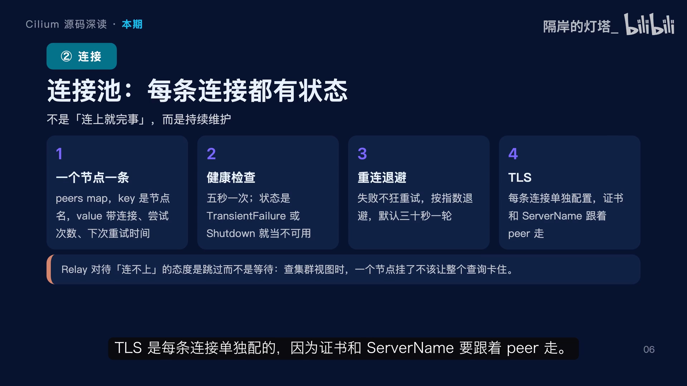

这里体现了一个很重要的态度：**Relay 对待「连不上」是跳过而不是等待。** 查集群视图时，一个节点挂了不该让整个查询卡住，**大不了这次少一个节点的数据**；同时通过**节点状态事件**告诉客户端这个节点不可用。这比让用户等 30 秒超时体验好得多，**也比静默少数据诚实**。

---

## 五、扇出：一次查询变成 N 条并发流

核心的扇出逻辑，分六步：[【跳转到 04:47】](https://www.bilibili.com/video/BV1gbJd68EZB/?t=287)

1. **客户端发来请求**，带着过滤条件、是否 follow、要多少条；
2. **列出所有 peer**，不可用的直接跳过，同时记下**在线和离线两份名单**；
3. **给每个可用节点起一个协程**，用 `errgroup` 管理，共享同一个取消信号；
4. **每个协程向对应节点发起同样的 `GetFlows` 请求**，流式接收，把结果写进**同一个 channel**；
5. **错误聚合**——某个节点报错，不是整个查询失败，而是把错误包装成一条「节点错误事件」，十秒内相同的错误消息会合并成一条；
6. **合并排序**后发给客户端。

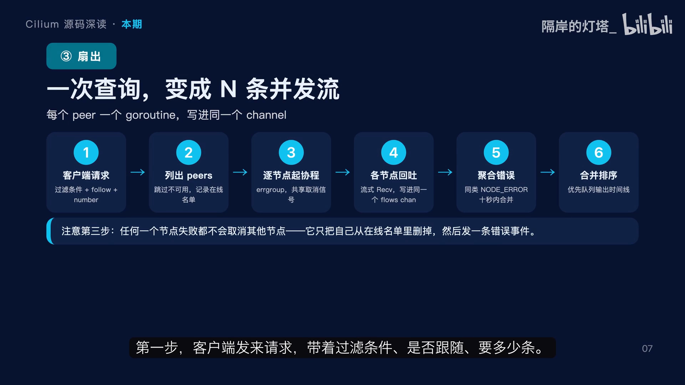

**这里最值得注意的是第 3 步的语义：任何一个节点失败都不会取消其他节点，它只把自己从在线名单里删掉。** 因为集群视图的价值就在于**尽可能全**——一个节点挂了，你更应该看到**其余节点的数据**，外加一条「这个节点出问题了」的明确提示。[【跳转到 05:12】](https://www.bilibili.com/video/BV1gbJd68EZB/?t=312)

### 5.1 一个刻意为之的细节：错误变成数据，而不是控制流

看这段收集逻辑，有两个关键点：[【跳转到 05:37】](https://www.bilibili.com/video/BV1gbJd68EZB/?t=337)

- 第一，`connectingNodes` 这个集合在 follow 模式下，Relay 每两秒会重新列一次 peer。如果某个节点**已经在拉了**，就不要再起一个协程，否则同一个节点的数据会**重复**——所以它先检查再跳过；
- 第二，**协程永远返回 `nil`**。注意看：就算 `RetrieveFlows from peer` 报错，它也**只是把节点从在线集合里删掉、发一条错误事件，然后返回 `nil`**。

这意味着 `errgroup` **永远不会因为这个协程而取消整个 group**。这个细节非常关键：**如果这里返回错误，`errgroup` 的 context 会被取消，所有其他节点的拉流也会被中断——一个坏节点就能让整个集群查询失败。** 所以这里的「吞掉错误」不是偷懒，是**刻意的隔离设计**：**错误必须变成数据，而不是变成控制流。**[【跳转到 06:27】](https://www.bilibili.com/video/BV1gbJd68EZB/?t=387)

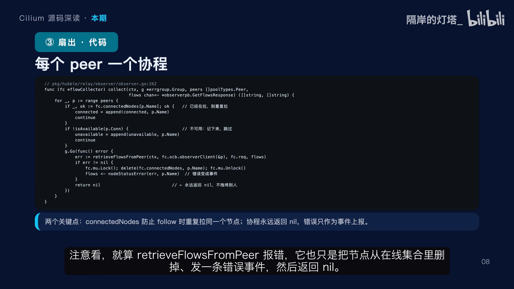

---

## 六、排序：优先队列 + 一秒排水窗

排序这段代码不长，但**每个数字都有含义**。优先队列是一个**按时间戳排序的最小堆**，长度**默认 100**。[【跳转到 06:32】](https://www.bilibili.com/video/BV1gbJd68EZB/?t=392)

- **事件进来时**：如果队列已满，先把堆顶（最旧的那条）弹出去发走，然后压入新的；
- **定时器分支**：如果一秒内没有新事件，就把队列里比「当前时间减一秒」更旧的全部排出去。

**这一秒就是排序窗口**，它的作用是给跨节点的事件一个「**等待迟到者**」的机会——节点 A 的事件可能比节点 B 晚到几百毫秒，只要还在窗口内，就能被排到正确的位置。[【跳转到 07:02】](https://www.bilibili.com/video/BV1gbJd68EZB/?t=422)

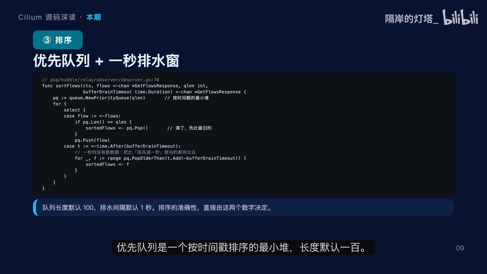

所以**排序准不准，直接由两个数字决定：队列长度和窗口长度**。

- 队列太短，堆一满就往外吐，晚到的事件插不进去；
- 窗口太短，网络抖动一下顺序就乱了。

这两个默认值（**100 条、一秒**）就是在这个权衡里选的。代价是：**客户端看到的最后一条事件，最多会延迟一秒。**

---

## 七、为什么做不到完美排序

Relay **做不到完美排序**，有四个原因：[【跳转到 07:27】](https://www.bilibili.com/video/BV1gbJd68EZB/?t=447)

1. **时钟偏差**：每个节点用自己的时钟，就算都跑 NTP，几毫秒到几十毫秒的误差很正常，两个节点的事件时间戳谁先谁后本身就不可靠；
2. **到达乱序**：不同连接、不同网络路径，先产生的事件完全可能后到；
3. **窗口有限**：超过一秒才到的迟到者只能被排到后面，**已经发出去的事件不可能收回来重排**；
4. **上游是有损的**：Ring 已经丢过事件，Relay 排的只是它收到的那些。[【跳转到 07:52】](https://www.bilibili.com/video/BV1gbJd68EZB/?t=472)

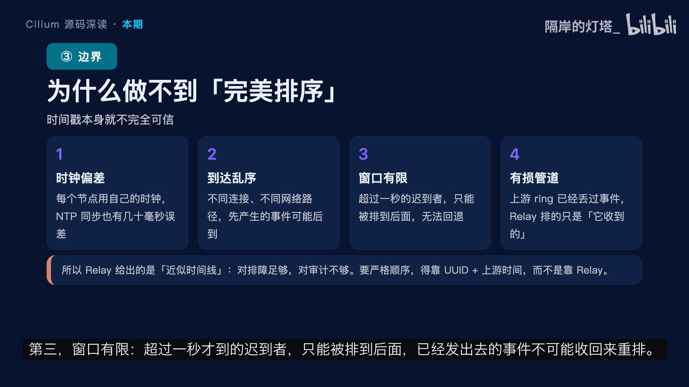

所以 Relay 给出的是**近似时间线**：**对排查足够，对审计不够。** 如果你要严格的因果顺序，得靠别的东西，比如同一个会话里的 UUID 和方向标记，或者干脆回原节点看单节点的原始记录。

**理解这一点很重要，否则你会拿一个近似排序的结果去做「谁先谁后」的定论，那是会出错的。**[【跳转到 08:17】](https://www.bilibili.com/video/BV1gbJd68EZB/?t=497)

---

## 八、部分失败必须让用户看得见

还有两个通知机制值得单独讲。[【跳转到 08:24】](https://www.bilibili.com/video/BV1gbJd68EZB/?t=504)

- **左边：错误聚合。** 某个节点报错时，Relay 不让整个查询失败，而是把错误包装成一条「节点错误事件」，**十秒窗口内相同的错误消息会合并成一条**，合并时把新的节点名追加进去。为什么要合并？滚动更新的时候，几十个节点可能同时报同样的连接错误，**不合并就是几百条一模一样的消息，把真正有用的信息淹掉**。
- **右边：节点状态。** 查询一开始，Relay 就**先发一份在线名单、再发一份离线名单**，客户端因此知道**这次结果覆盖了哪些节点**；另外 `GetNodes` 接口还能拿到每个节点的**版本、运行时长、缓冲容量和引用条数**。[【跳转到 08:54】](https://www.bilibili.com/video/BV1gbJd68EZB/?t=534)

这两个机制解决的是同一个问题：**分布式的部分失败必须让用户看得见——少给数据不可怕，悄悄少给才可怕。**

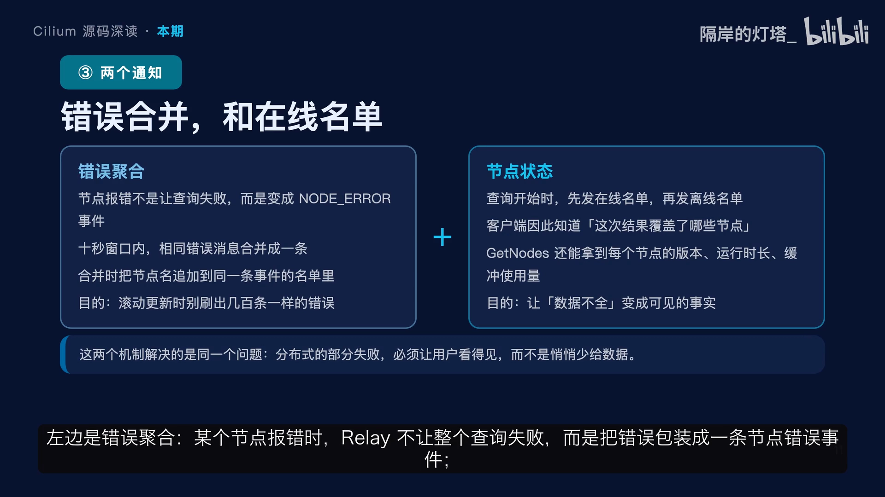

### 8.1 follow 模式：peer 列表是「活」的

**普通查询是一次性的快照**——列出节点、拉完、结束。但 **follow 是持续跟随**，期间可能有**新节点上线**，所以 Relay 起了一个循环，**每两秒重新列一次 peer**，把还没拉过的节点补进来；已经在拉的节点由 `connectedNodes` 去重，不会重复。**节点下线时不用特殊处理**，它那条流会自然中断，连接池把它标记为不可用，下一轮收集就会跳过。[【跳转到 09:45】](https://www.bilibili.com/video/BV1gbJd68EZB/?t=585)

这个两秒的间隔是个权衡：太短会增加 peer 服务的压力，太长会让新节点的数据出现明显空窗。**两秒基本能保证滚动更新时新 Pod 在半分钟内就能被看到。** 注意这里**没有删除逻辑**——已经发出去的历史数据不可能撤回，Relay 能做的是让后续的数据尽量完整。

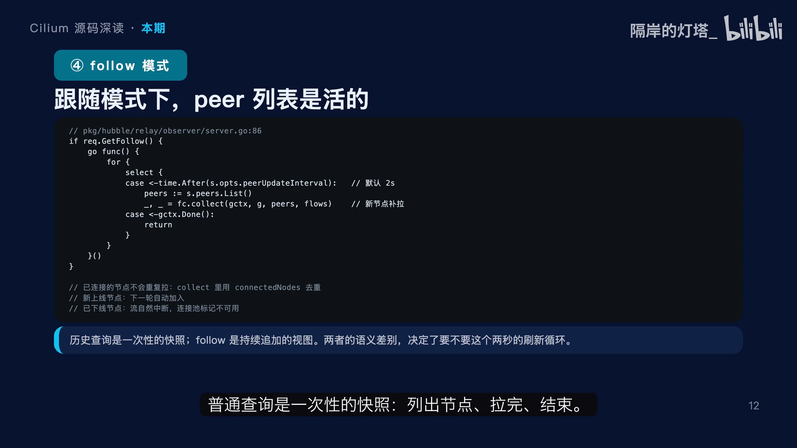

---

## 九、边界：Relay 不存数据，所以它很轻

**Relay 不存数据，所以它很轻，但「轻」也划定了能力边界。**[【跳转到 10:02】](https://www.bilibili.com/video/BV1gbJd68EZB/?t=602)

1. **没有本地环形缓冲**：它读的是各节点 Ring 里**现有**的数据，节点 Ring 转一圈覆盖了，Relay 也拿不回来；
2. **没有跨节点去重**：同一条会话在两端的节点各有一条记录，Relay 不会把它们合并成一条，你得靠 **UUID、方向、五元组**自己关联；
3. **没有持久化**：Relay 进程重启，什么都不会留下；
4. **它确实有内存缓冲**，但只有排序用的优先队列，长度 100，满了就往外吐，**不是存储**。[【跳转到 10:32】](https://www.bilibili.com/video/BV1gbJd68EZB/?t=632)

所以准确的定位是：**Relay 是一条「查询时的聚合管道」，不是时序数据库。** 要做长期审计、要跨天对比，得用 **Flow Log Exporter** 把流导出到对象存储或日志系统。**这个边界想清楚了，你就不会指望用 Relay 去回答「上周三下午发生了什么」。**

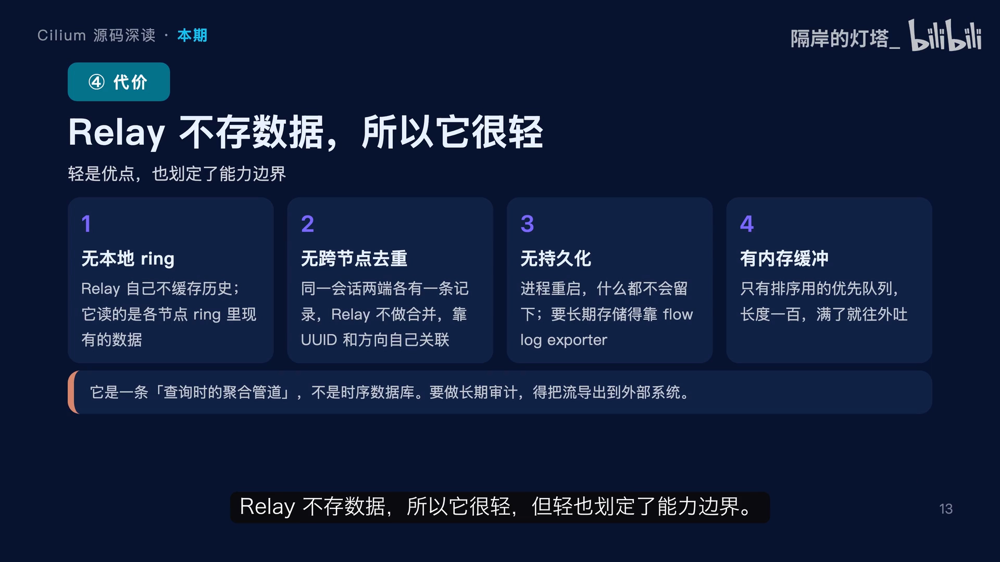

---

## 十、什么时候直连 agent，什么时候走 Relay

| | **直连 agent** | **走 Relay** |
| --- | --- | --- |
| **视图** | 只看单节点 | 整个集群一个视图 |
| **延迟** | 最低，不受一秒排序窗影响 | 排序带来**最多一秒延迟** |
| **适合** | 节点级排障、抓单机细节 | 集群级排障、UI、跨节点关联 |
| **代价** | 得能访问节点上的 unix socket 或 4244 端口；节点挂了就没数据 | 可能**少节点**（失败的节点被跳过） |

[【跳转到 11:01】](https://www.bilibili.com/video/BV1gbJd68EZB/?t=661) 实践里**两个都要**：UI 和日常排查走 Relay；**怀疑某个节点有问题、或者需要精确顺序时直连它**，避免排序窗把细节抹平。

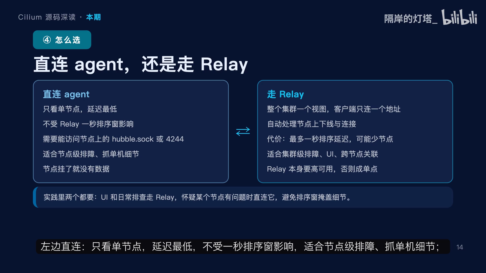

还有一个**运维要点**：**Relay 本身要高可用，通常跑两个副本**，否则它就成了整个可观测链路的**单点**——这一点经常被忽略，直到某天 Relay 挂了，所有人突然「看不见」网络了。[【跳转到 11:26】](https://www.bilibili.com/video/BV1gbJd68EZB/?t=686)

---

## 小结

这一期把 Relay 讲完，要记住四件事：[【跳转到 11:46】](https://www.bilibili.com/video/BV1gbJd68EZB/?t=706)

1. **发现靠 Peer 服务**：state 的节点表变化变成通知流，新增/更新/删除都有明确语义，名字和地址都没变就不通知；
2. **扇出靠连接池**：每个节点一条长连接，健康检查和退避重连，**失败就跳过并上报，绝不拖垮整次查询**；
3. **排序靠两个数字**：优先队列 100 条、排水窗口一秒——这两个值决定了**排序准确性**和**客户端延迟**；
4. **边界要认清**：不存历史、不跨节点去重、不持久化，长期审计得靠 Flow Log 导出。

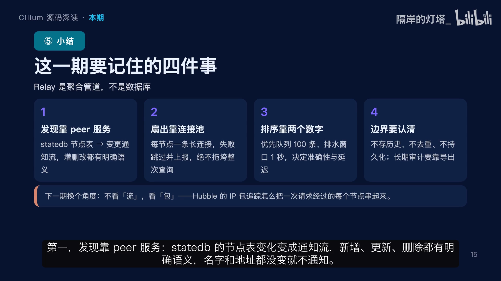

下一期换个角度：前面看的都是「流」，下期看「包」——Hubble 的 **IP 包追踪**，怎么把一次请求经过的每个节点、每一跳串起来。[【跳转到 12:16】](https://www.bilibili.com/video/BV1gbJd68EZB/?t=736)

## 关键术语速查

| 术语 | 一句话解释 |
| --- | --- |
| **Relay** | Hubble 的集群聚合层：发现节点、扇出查询、合并排序；不采集、不存储 |
| **Peer 服务** | 每个 agent 暴露的节点变更通知流，Relay 订阅它来发现节点 |
| **节点表（state）** | agent 内部维护的「集群有哪些节点」的数据源 |
| **请求扇出（fan-out）** | 把一次查询复制成 N 份，并发发给所有可用节点 |
| **errgroup** | Go 里管理一组协程并共享取消信号的工具 |
| **优先队列 + 一秒排水窗** | 用最小堆按时间戳排序，窗口一秒，给迟到事件一个归位机会 |
| **Flow Log Exporter** | 把 Flow 导出到对象存储/日志系统的组件，用于长期审计 |
