# 存储类 StorageClass：把「手动建 PV」变成「按需造 PV」

> 视频来源：[存储类-StorageClass](https://www.bilibili.com/video/BV1TWrVYFEsJ/)（Bilibili，UP：莲城的老李）｜时长约 25 分钟
>
> 本讲承接上一期的 PV/PVC，回答「既然手动建 PV 这么繁琐，能不能让 PV 自动出现」。视频从**两种供应模式**讲起，先把 **CSI driver NFS** 装好，再定义 **StorageClass**，然后用三个实验把动态供给走通：**PVC 指定存储类自动出 PV → 设为默认存储类后 PVC 免写存储类名 → StatefulSet 连 PVC 一起自动创建**。本文基于该视频的图-字幕文稿整理，可逐帧核对；自动字幕口头、片段化处已通顺化，订正了明显口误。

## 本讲要解决的核心问题（SCQA）

**背景**：前面讲的是**静态模式**——用 YAML 手动创建 PVC，之后再去绑定一个已经存在的 PV。[【跳转到 00:00】](https://www.bilibili.com/video/BV1TWrVYFEsJ/?t=0)

**冲突**：静态模式的主导权在**供应端**。Pod 通过 PVC 提出存储需求时，**服务器上必须已经存在符合条件的 PV**；没有可绑定的 PV，**Pod 就跑不起来**——供应的有无决定了 Pod 能否运行。[【跳转到 00:25】](https://www.bilibili.com/video/BV1TWrVYFEsJ/?t=25)

**疑问**：能不能反过来，让存储**按需求现造**？

**回答（中心思想）**：这就是**动态供应模式**——**PV 不再由管理员手动创建，而是由 StorageClass 自动供应**。可以把 **StorageClass 看成「生产 PV 对象的一个工厂」**（或者说 PV 的模板）：PVC 一来，它就照模板把 PV 造出来。[【跳转到 00:50】](https://www.bilibili.com/video/BV1TWrVYFEsJ/?t=50)

> 静态模式也不是没用：当**存储计划明确、有详细存储清单**时，手动模式依然有它的用武之地。[【跳转到 00:50】](https://www.bilibili.com/video/BV1TWrVYFEsJ/?t=50)


## 一、两种供应模式：静态 vs 动态

| 模式 | PV 谁来建 | 特点 |
| --- | --- | --- |
| **静态模式** | 管理员**手动**写 YAML 创建 | 供应端主导；无可用 PV 则 Pod 无法运行 |
| **动态模式** | **StorageClass 自动供应** | PVC 提出需求即现造 PV，管理员不必预先备货 |

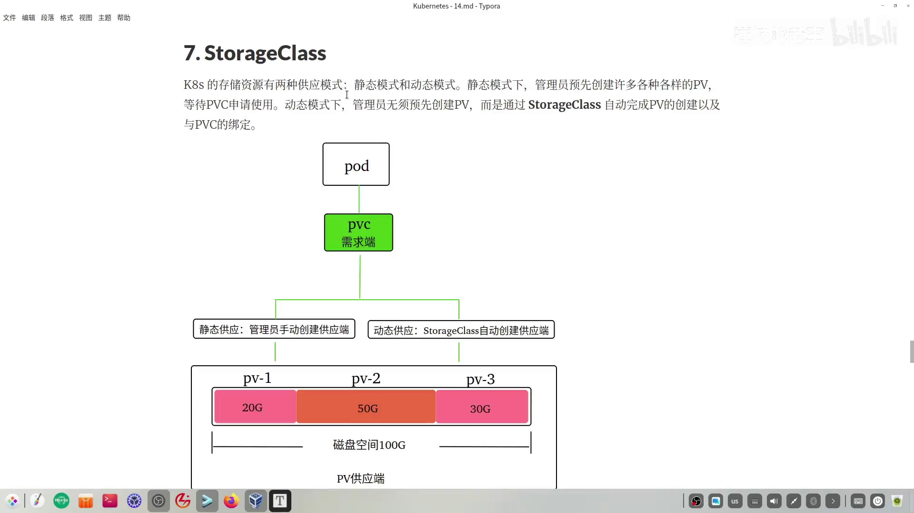

## 二、StorageClass 是什么：PV 的模板

**StorageClass，中文「存储类」，缩写 SC。**[【跳转到 01:13】](https://www.bilibili.com/video/BV1TWrVYFEsJ/?t=73)

- 它是**集群级别的资源，不支持命名空间**。[【跳转到 01:18】](https://www.bilibili.com/video/BV1TWrVYFEsJ/?t=78)
- 它与 PV 的关系，**好比面向对象里「类」和「对象」的关系**——**StorageClass 定义 PV 的创建规范，相当于 PV 的模板**。[【跳转到 01:18】](https://www.bilibili.com/video/BV1TWrVYFEsJ/?t=78)

作为模板，它至少有三块规格：[【跳转到 01:18】](https://www.bilibili.com/video/BV1TWrVYFEsJ/?t=78) [【跳转到 01:43】](https://www.bilibili.com/video/BV1TWrVYFEsJ/?t=103)

1. **存储参数**：以后端 NFS 为例，这里配置 **NFS 服务器地址**和**共享目录路径**；
2. **制备器（provisioner）**：**真正用于生产 PV 对象的那个组件**——这是 StorageClass 里最关键的部分；
3. **回收策略**：与 PV 一样，需要指明 **Retain（保留）** 或 **Delete（删除）**。

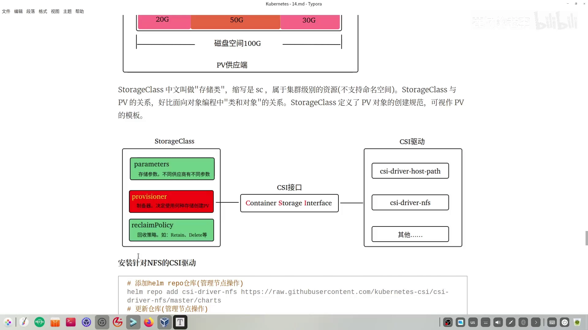

用面向对象的类比再看一眼这张关系：**StorageClass 是「类」，PV 是它 new 出来的「对象」。**[【跳转到 01:18】](https://www.bilibili.com/video/BV1TWrVYFEsJ/?t=78)


## 三、制备器背后：CSI 接口与驱动安装

制备器**怎么造 PV**？要先把它的上下游搞清楚。[【跳转到 02:08】](https://www.bilibili.com/video/BV1TWrVYFEsJ/?t=128)

- 后端存储可以是**不同供应商**的方案，供应商提供各自的 **CSI 驱动**供集群安装：用 NFS 就有 **CSI driver NFS**，用 hostPath 也有对应的 driver。[【跳转到 02:33】](https://www.bilibili.com/video/BV1TWrVYFEsJ/?t=153)
- 为了能和不同驱动对接，K8S 提出了 **CSI 接口**（**Container Storage Interface，容器存储接口**）：**驱动只要符合这个接口，就能被集成进 K8S**——和当年讲容器运行时是同一套思路。[【跳转到 02:58】](https://www.bilibili.com/video/BV1TWrVYFEsJ/?t=178)
- 于是链条是：**制备器通过 CSI 接口去调对应驱动，驱动帮我们创建 PV 对象。**[【跳转到 02:58】](https://www.bilibili.com/video/BV1TWrVYFEsJ/?t=178)


### 实操：装 CSI driver NFS

本讲用 **Helm** 安装驱动（Helm 基本操作在那个系列的第三集讲过）。视频里已提前在管理节点完成：**添加 Helm 仓库 → 拉取项目**，当前目录下就有了 `CSI` 目录，其中是 `csi-driver-nfs` 文件夹。[【跳转到 03:23】](https://www.bilibili.com/video/BV1TWrVYFEsJ/?t=203) [【跳转到 04:01】](https://www.bilibili.com/video/BV1TWrVYFEsJ/?t=241)

驱动目录里的 **`values` 文件**可以理解为安装时用的资源清单，要改的主要是**镜像地址**：[【跳转到 04:18】](https://www.bilibili.com/video/BV1TWrVYFEsJ/?t=258)

- 默认镜像地址在国内**拉不下来**，视频里**改成了阿里云等国内镜像地址**（涉及多个镜像）；
- **镜像版本也做了调整**：项目默认是 **4.9**，但阿里云镜像站下不到 4.9，于是**统一改成 4.6**。

改好后的 `values` 文件用**覆盖替换**的方式放进 `csi-driver-nfs` 目录，替换掉原始文件。[【跳转到 05:04】](https://www.bilibili.com/video/BV1TWrVYFEsJ/?t=304)

**预热镜像**：视频建议提前 `docker pull` 把镜像拉到本地并打成 tar 包（已在各节点备好一个 `image-4.6.0` 的 tar 包），然后在**每个节点**上 `docker load -i` 载入。[【跳转到 05:59】](https://www.bilibili.com/video/BV1TWrVYFEsJ/?t=359) [【跳转到 06:46】](https://www.bilibili.com/video/BV1TWrVYFEsJ/?t=406)

载入完成后在 master 与 node1、node2 上分别按统一前缀**筛选查看镜像**，确认都到位（视频里一开始说七个，数完发现是**六个**）。[【跳转到 07:11】](https://www.bilibili.com/video/BV1TWrVYFEsJ/?t=431) [【跳转到 07:29】](https://www.bilibili.com/video/BV1TWrVYFEsJ/?t=449)

最后**只需在 master 节点**执行安装：进入 `CSI` 目录、确认驱动包在位后执行安装命令。执行成功后会给出查看结果的提示，视频自己也写了一条命令**查看相关 Pod**——能看到 **controller 的 Pod** 和**三个 node Pod** 都是 `Running`，安装即成功。[【跳转到 07:51】](https://www.bilibili.com/video/BV1TWrVYFEsJ/?t=471) [【跳转到 08:23】](https://www.bilibili.com/video/BV1TWrVYFEsJ/?t=503)

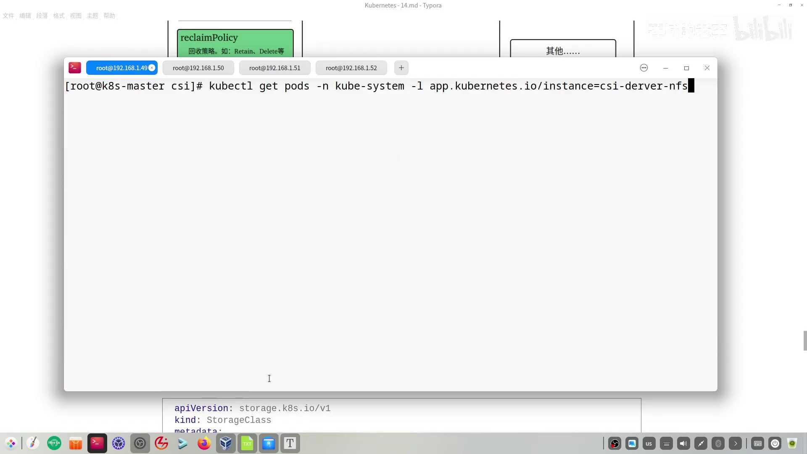

## 四、StorageClass 的六个配置块

StorageClass 样本文件的结构：`apiVersion` 是 **`storage.k8s.io/v1`**，`kind` 是 **`StorageClass`**（注意大写）；`metadata` 里**只定义 `name`，不定义 namespace**（它不支持命名空间）。本讲定义的名字是 **`nfs-csi`**——**这个名字后面要引用，先记住它**。[【跳转到 08:39】](https://www.bilibili.com/video/BV1TWrVYFEsJ/?t=519)

整个样本分成六块：[【跳转到 08:39】](https://www.bilibili.com/video/BV1TWrVYFEsJ/?t=519)

| # | 配置块 | 要点 |
| --- | --- | --- |
| 1 | **provisioner** | 指定制备器对应的**驱动名**；**不能自己随意起名**，必须与 `values` 文件里的 `driver.name` **保持一致** |
| 2 | **存储参数** | NFS 方案下就是**服务器地址** + **共享目录** |
| 3 | **回收策略** | 静态模式有三种、其中一种已废除，现常用 `Delete` 与 `Retain`；**默认是 `Delete`，但 NFS 不支持 `Delete`，所以只能设为 `Retain`** |
| 4 | **卷绑定模式** | `Immediate` / `WaitForFirstConsumer`（见下） |
| 5 | **挂载选项** | `hard`、`nfsvers`、`nolock`（见下） |
| 6 | **是否允许动态扩容** | **默认 `false`**；本讲的 NFS 方案不支持动态扩容，实验里不写这一项 |

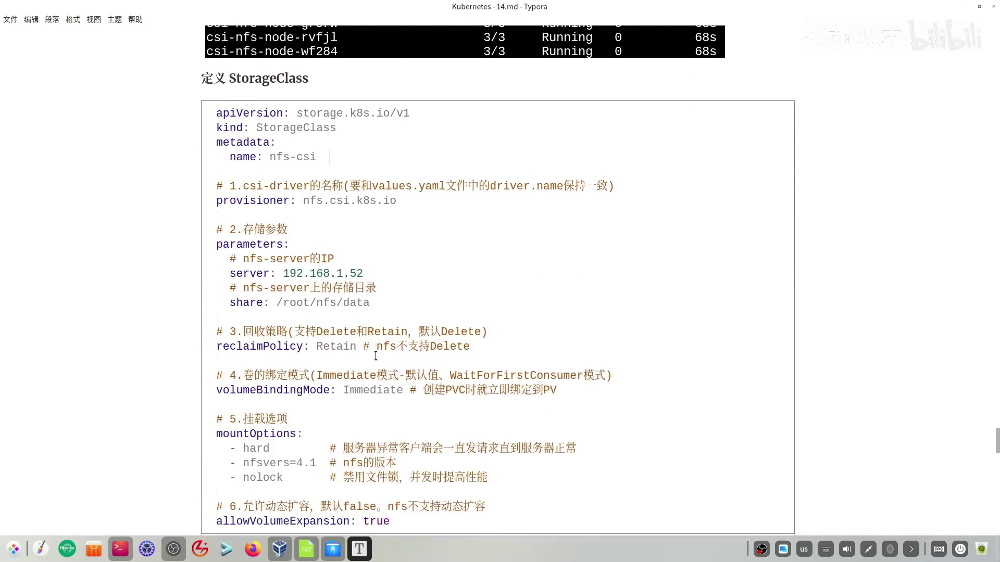

### 卷绑定模式（volumeBindingMode）

这就是上一期 6.1.4 里那个「延迟绑定」的真身。[【跳转到 09:54】](https://www.bilibili.com/video/BV1TWrVYFEsJ/?t=594) [【跳转到 10:19】](https://www.bilibili.com/video/BV1TWrVYFEsJ/?t=619)

- **`Immediate`**：**创建 PVC 时立即绑定到 PV**（也就是 StorageClass 这个工厂**马上造一个 PV 供 PVC 绑定**），**不管 Pod 有没有用到**——相当于**事先准备好**；
- **`WaitForFirstConsumer`**：**等有 Pod 通过 PVC 申请时才绑定并创建 PV**。

视频用程序员熟悉的说法打了个比方：这两种模式很像**延迟加载**——后者「用时再绑定、再创建」，前者「提前加载好」。**本讲实验选的是 `Immediate`。** [【跳转到 10:44】](https://www.bilibili.com/video/BV1TWrVYFEsJ/?t=644)


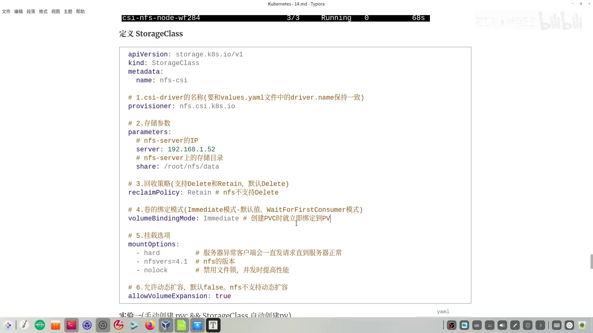

### 挂载选项（mountOptions）

- **`hard`**：服务器异常时，客户端**会一直发请求直到服务器恢复正常**；
- **`nfsvers`**：指定 NFS 版本（有 3 和 4），这里 NFS 服务器用的是 **4**；
- **`nolock`**：**禁用文件锁**，禁用后在**并发场景下能提高性能**。


把笔记筛选后得到最小可用的 `sc.yaml`，写入 `yaml` 目录并 `apply`。`kubectl get sc` 能读回它的**名字、驱动、回收策略、卷绑定模式**以及**是否支持扩容**（没写，**默认就不支持**）。[【跳转到 11:59】](https://www.bilibili.com/video/BV1TWrVYFEsJ/?t=719) [【跳转到 12:24】](https://www.bilibili.com/video/BV1TWrVYFEsJ/?t=744)

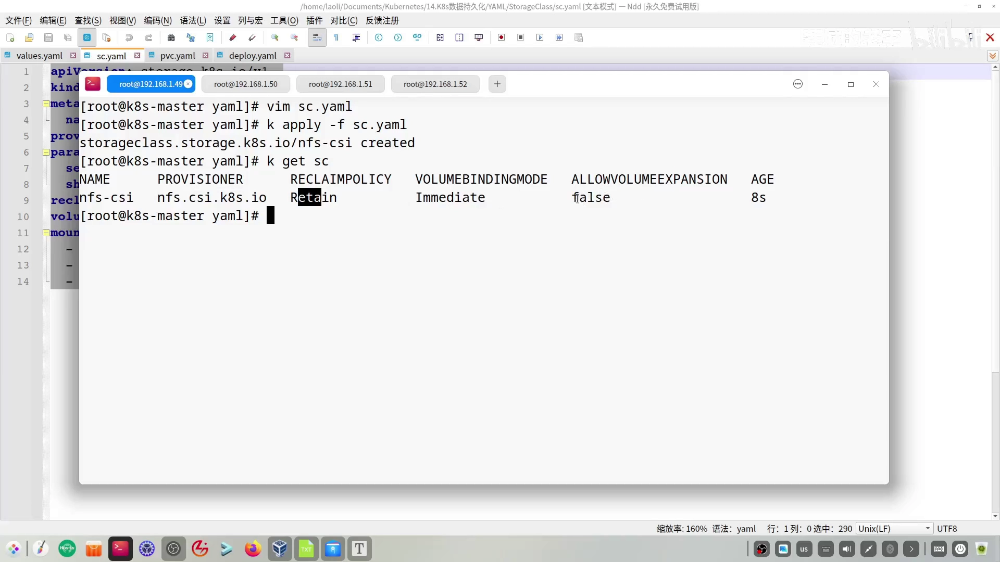

## 五、实验一：PVC 指定存储类，PV 自动出现

**实验目的**：手动创建 PVC 代理 Pod 提出需求，而 **PV 不再手动创建，由 StorageClass 自动创建**。重点搞清楚 **PVC 如何与 StorageClass 关联**。[【跳转到 12:55】](https://www.bilibili.com/video/BV1TWrVYFEsJ/?t=775)

PVC 声明里：名字 `nfs-pvc`，命名空间 `default`，`spec` 请求 **500 Mi**，访问模式是**多节点只读挂载**。关键是**通过 `spec.storageClassName` 关联到刚才建好的存储类**（名字就是集群里那个）。[【跳转到 13:20】](https://www.bilibili.com/video/BV1TWrVYFEsJ/?t=800) [【跳转到 13:45】](https://www.bilibili.com/video/BV1TWrVYFEsJ/?t=825)

写成 `pvc.yaml` 并 `apply` 后查看 PVC 和 PV：**PVC `nfs-pvc` 处于 `Bound`（已绑定）**，下面那个 **PV 也是 `Bound`**——**这个 PV 就是 StorageClass 帮我们动态创建出来的**。因为是 `Immediate` 模式，**创建 PVC 的那一刻就已经绑定好了**。[【跳转到 14:10】](https://www.bilibili.com/video/BV1TWrVYFEsJ/?t=850) [【跳转到 14:30】](https://www.bilibili.com/video/BV1TWrVYFEsJ/?t=870)

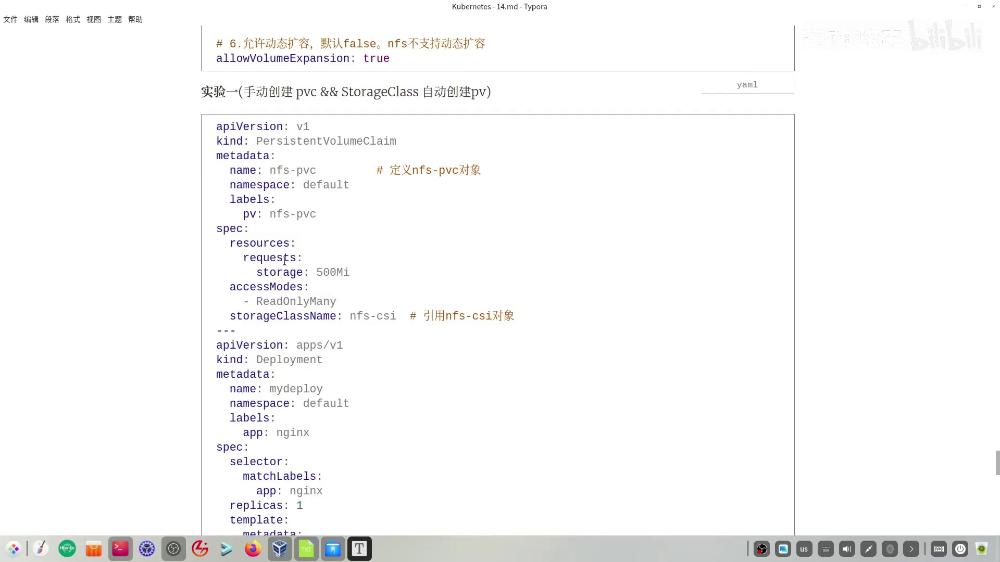

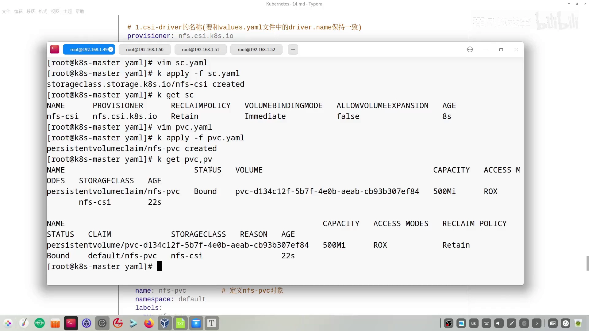

剩下的就明朗了：**再声明 Pod，让 Pod 通过 PVC 申请空间**。这里用 Deployment + Nginx 容器，重点还是数据卷部分——Pod 模板里声明卷名（`vol-pvc`），容器里引用同一个名字，并**引用前面创建的 `nfs-pvc`**。[【跳转到 14:55】](https://www.bilibili.com/video/BV1TWrVYFEsJ/?t=895) [【跳转到 15:00】](https://www.bilibili.com/video/BV1TWrVYFEsJ/?t=900)

`apply` 后 Pod 起来，回到 NFS 服务器的 `nfs-data` 共享目录，能看到**为这个 Pod 自动生成的一个子目录**。往里 `echo` 写一个以 `pvc` 开头的文件，再从 master 节点 `curl` 这个 Pod 的 IP——**数据已经在了**。整个过程**没有手动创建 PV**，PV 由 StorageClass 自动完成。[【跳转到 15:37】](https://www.bilibili.com/video/BV1TWrVYFEsJ/?t=937) [【跳转到 16:02】](https://www.bilibili.com/video/BV1TWrVYFEsJ/?t=962) [【跳转到 16:27】](https://www.bilibili.com/video/BV1TWrVYFEsJ/?t=987)

## 六、简化一：设为默认 StorageClass，PVC 不用再写存储类名

动态供 PV 已经省了管理员的事，但整个过程（Pod、PVC、StorageClass 都要建）还是繁琐。视频从三个对象入手做简化，第一刀砍在 **PVC 与 StorageClass 的关联**上。[【跳转到 16:52】](https://www.bilibili.com/video/BV1TWrVYFEsJ/?t=1012) [【跳转到 16:57】](https://www.bilibili.com/video/BV1TWrVYFEsJ/?t=1017)

**做法**：把一个 StorageClass **设为集群默认**，之后创建 PVC 就**不必再指定 `storageClassName`**。[【跳转到 17:22】](https://www.bilibili.com/video/BV1TWrVYFEsJ/?t=1042)

**怎么设**：在 StorageClass 的 `metadata` 里、**在名字下方加一条注解**，key 是固定的，**value 是 `"true"`（注意要用双引号括起来）**。[【跳转到 17:22】](https://www.bilibili.com/video/BV1TWrVYFEsJ/?t=1042)

```yaml
metadata:
  name: nfs-csi
  annotations:
    storageclass.kubernetes.io/is-default-class: "true"
```

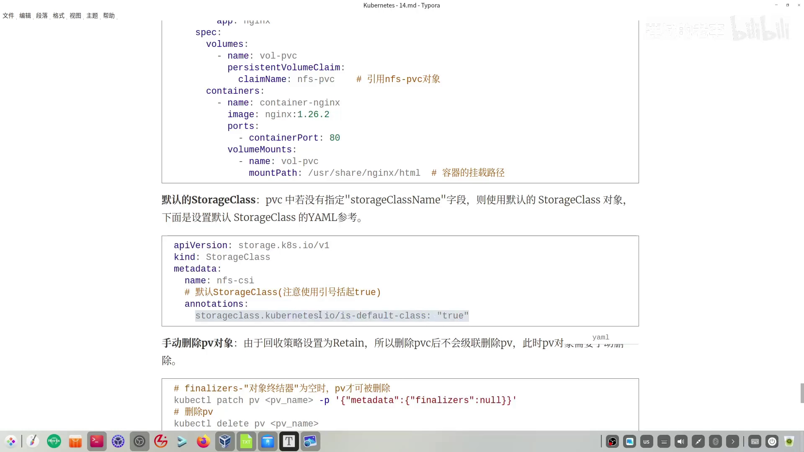

**验证**：编辑 `sc` 文件加入注解，同时把 PVC 里跟 StorageClass 绑定的那行**注释掉**，然后**把上一次实验的对象清干净重做一遍**：先删 Pod、再删 PVC，接着删 PV，最后删 SC。[【跳转到 17:47】](https://www.bilibili.com/video/BV1TWrVYFEsJ/?t=1067) [【跳转到 18:12】](https://www.bilibili.com/video/BV1TWrVYFEsJ/?t=1092) [【跳转到 18:37】](https://www.bilibili.com/video/BV1TWrVYFEsJ/?t=1117)

> **注意动态 PV 删除的特殊之处**：动态创建的 PV 和静态 PV 一样，**失去与 PVC 的绑定后会进入 `Released`**；但删它得**手动**做两件事：① 用 **`kubectl patch` 把对象里的 `finalizer`（终结器）置空**；② 再 `kubectl delete pv <名字>`。删完 `kubectl get pv` 就干净了。[【跳转到 18:37】](https://www.bilibili.com/video/BV1TWrVYFEsJ/?t=1117) [【跳转到 19:02】](https://www.bilibili.com/video/BV1TWrVYFEsJ/?t=1142)

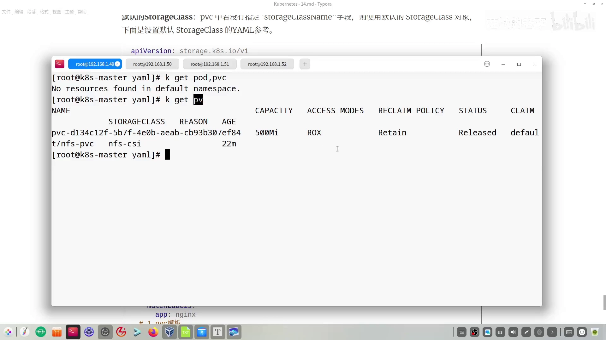

环境回到初始状态后依次重建：先建 SC（`get sc` 能看到它**带了 `default` 标记**，表示这是集群默认的 StorageClass），再建 PVC，直接查看就能看到**动态生成的 PV**；最后用 Deployment 把 Pod 建起来。[【跳转到 19:27】](https://www.bilibili.com/video/BV1TWrVYFEsJ/?t=1167) [【跳转到 19:52】](https://www.bilibili.com/video/BV1TWrVYFEsJ/?t=1192)

Pod `Running` 后 `curl` 它**没有数据**——因为它绑到的是 NFS 上一个**空的子目录**（还经历了一次「看错了子目录、换回第一个子目录」的小插曲）。把内容写进对应子目录的 `index.html` 再 `curl`，结果就正常出现了。[【跳转到 20:17】](https://www.bilibili.com/video/BV1TWrVYFEsJ/?t=1217) [【跳转到 20:42】](https://www.bilibili.com/video/BV1TWrVYFEsJ/?t=1242) [【跳转到 21:07】](https://www.bilibili.com/video/BV1TWrVYFEsJ/?t=1267)

**结论**：设定集群默认的 StorageClass 后，**手动创建的 PVC 不用再指定关联的存储类了。**[【跳转到 21:07】](https://www.bilibili.com/video/BV1TWrVYFEsJ/?t=1267)

## 七、简化二：StatefulSet 连 PVC 一起自动创建

还能再简化吗？可以——**定义 Pod 时把 PVC 的定义一起写好**，创建 Pod 的过程中**顺带把 PVC 也创建出来**，不必再手动建 PVC。[【跳转到 21:32】](https://www.bilibili.com/video/BV1TWrVYFEsJ/?t=1292) [【跳转到 21:42】](https://www.bilibili.com/video/BV1TWrVYFEsJ/?t=1302)

> **前提要记住**：控制器里讲了那么多，**只有 StatefulSet 支持这种 PVC 的自动创建。**[【跳转到 21:42】](https://www.bilibili.com/video/BV1TWrVYFEsJ/?t=1302)

编码分两块看：[【跳转到 22:06】](https://www.bilibili.com/video/BV1TWrVYFEsJ/?t=1326)

1. **PVC 模板部分**：用 **`volumeClaimTemplates`**，里面定义 `metadata`（PVC 名字）、存储空间大小、访问模式——和前面一样；**关键是里面引用的存储类名字**（若集群已有默认存储类，**这一项也可以省略**）。
2. **Pod 如何关联上面的 PVC**：**直接通过 PVC 对象的名字关联**——在 **`volumeMounts` 里直接写 PVC 的名字**，再加容器挂载路径。**这一点与前面的引用方式不同，需要特别注意。**

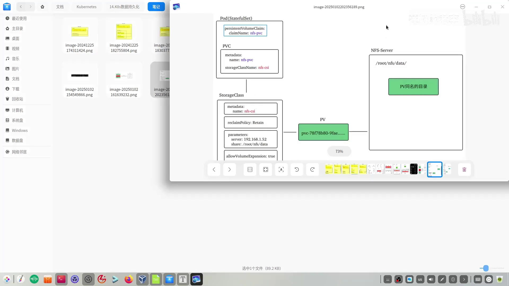

写一份 StatefulSet 样本并 `apply`，然后依次查看 Pod、PVC、PV（`get all wide`）。可以看到：**Pod 由 StatefulSet 控制器创建**；**PVC 是这一次新建的**；**PV 也是按时间新动态创建出来的**。到 NFS 服务器的 `data` 目录下，**同样生成了对应的子目录**。往里 `echo` 写一个 `hello` 文件，再回到 master 节点 `curl` 刚建的那个 Pod——**结果正常展示**。[【跳转到 23:26】](https://www.bilibili.com/video/BV1TWrVYFEsJ/?t=1406) [【跳转到 23:33】](https://www.bilibili.com/video/BV1TWrVYFEsJ/?t=1413) [【跳转到 23:58】](https://www.bilibili.com/video/BV1TWrVYFEsJ/?t=1438) [【跳转到 24:03】](https://www.bilibili.com/video/BV1TWrVYFEsJ/?t=1443) [【跳转到 24:28】](https://www.bilibili.com/video/BV1TWrVYFEsJ/?t=1468)

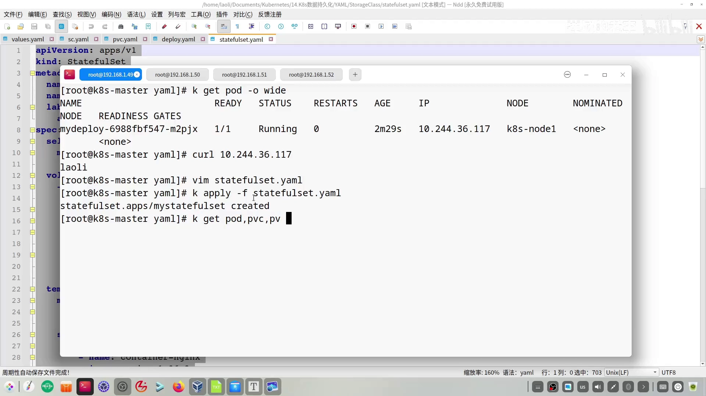

## 小结：三处「名字」串起整条链路

一句话总结本讲：**StorageClass 是生产 PV 的工厂**；PVC 通过 `storageClassName` 找到工厂，工厂按模板造出 PV 并完成绑定；**把 StorageClass 设为默认，PVC 就能免写存储类名**；**只有 StatefulSet 能用 `volumeClaimTemplates` 把 PVC 一起造出来**。[【跳转到 25:15】](https://www.bilibili.com/video/BV1TWrVYFEsJ/?t=1515)

要串起来，关键是这几处**名字/字段对齐**：

| 环节 | 名字 / 字段 | 被谁引用 |
| --- | --- | --- |
| `values` 文件的 `driver.name` | 驱动名 | StorageClass 的 `provisioner` 必须与它一致 |
| StorageClass | `metadata.name`（如 `nfs-csi`） | PVC 的 `storageClassName`；设为默认后可省略 |
| StorageClass 注解 | `storageclass.kubernetes.io/is-default-class: "true"` | 使该 SC 成为集群默认 |
| PVC | `metadata.name`（如 `nfs-pvc`） | Pod 的 `volumes.claimName`（或 StatefulSet 的 `volumeMounts`） |

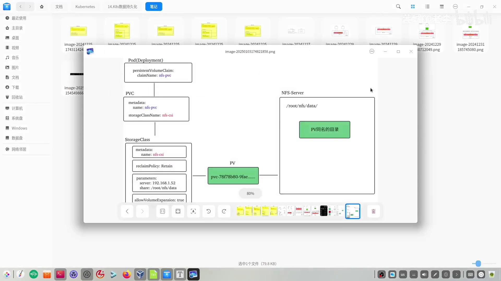

一路看下来，StorageClass 解决的正是上一讲结尾留下的那个疑问：**供应端不再需要管理员手动备货**。至此 PV、PVC 与 StorageClass 这条链路就打通了。[【跳转到 25:15】](https://www.bilibili.com/video/BV1TWrVYFEsJ/?t=1515)
