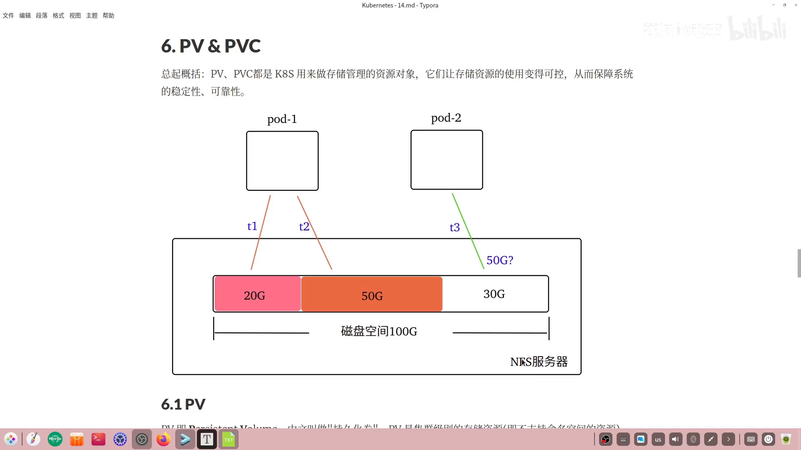
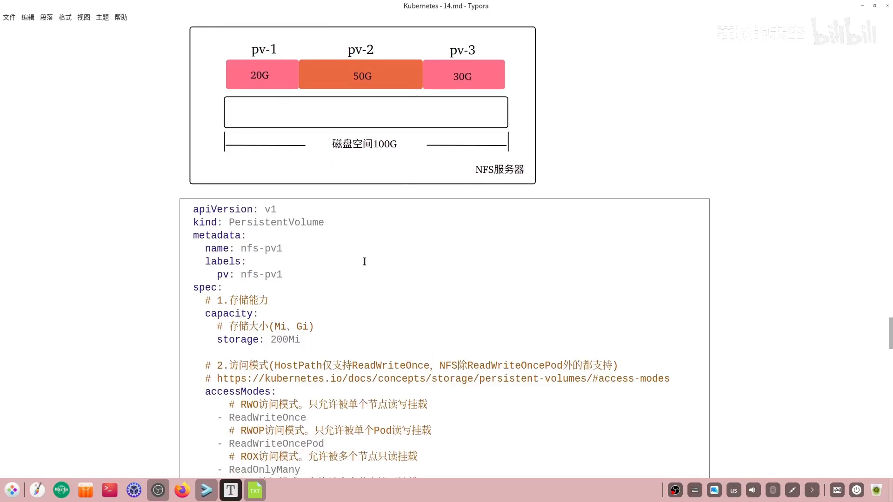
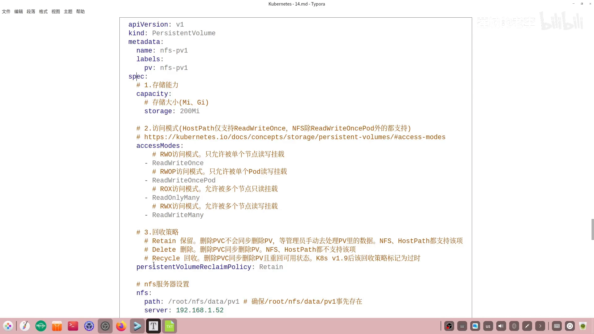
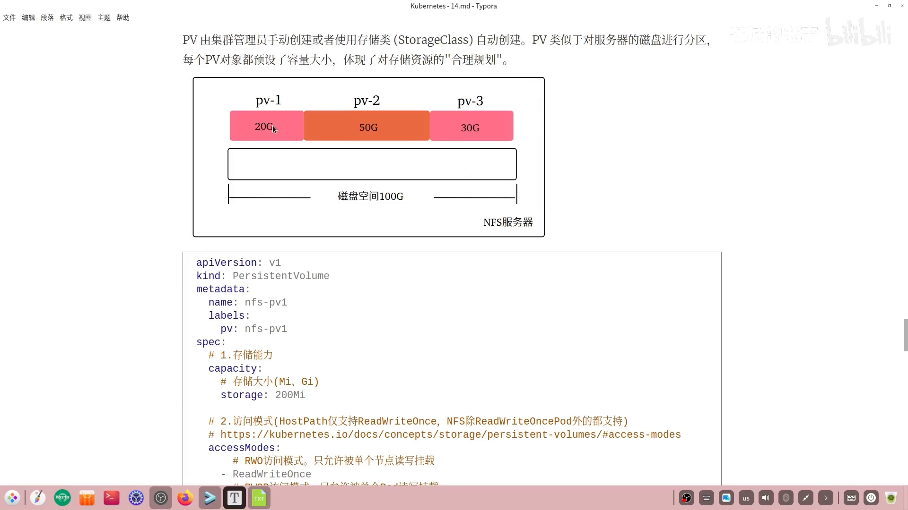
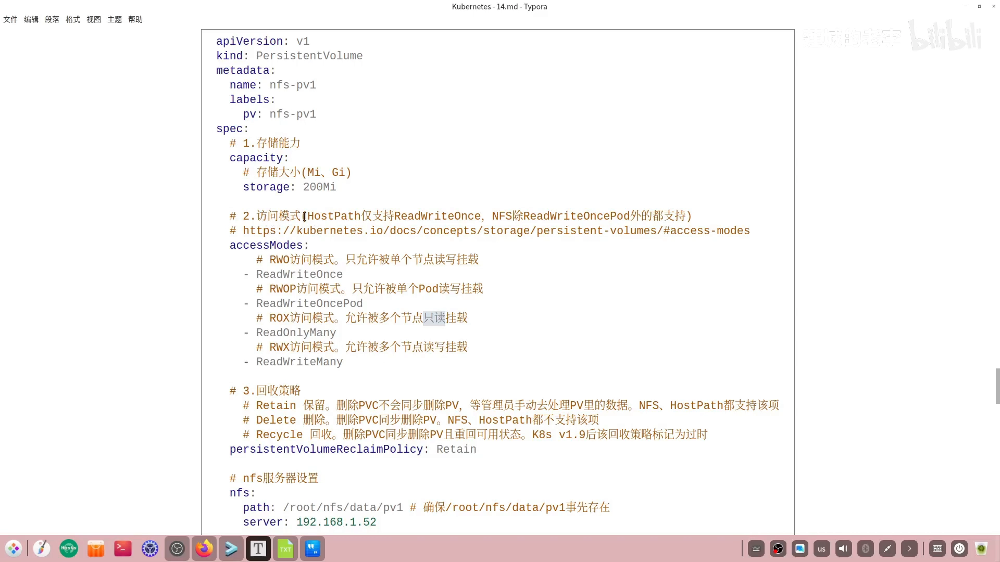
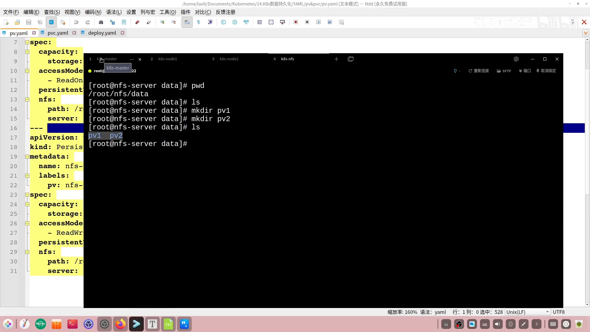
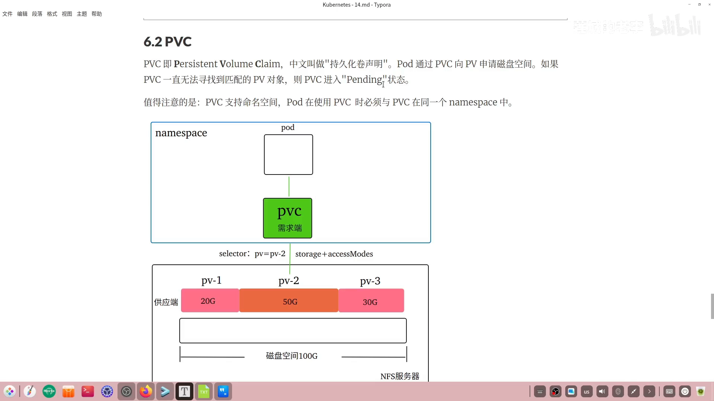
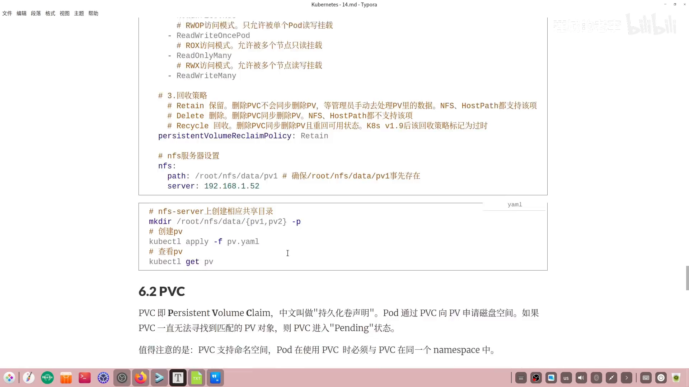
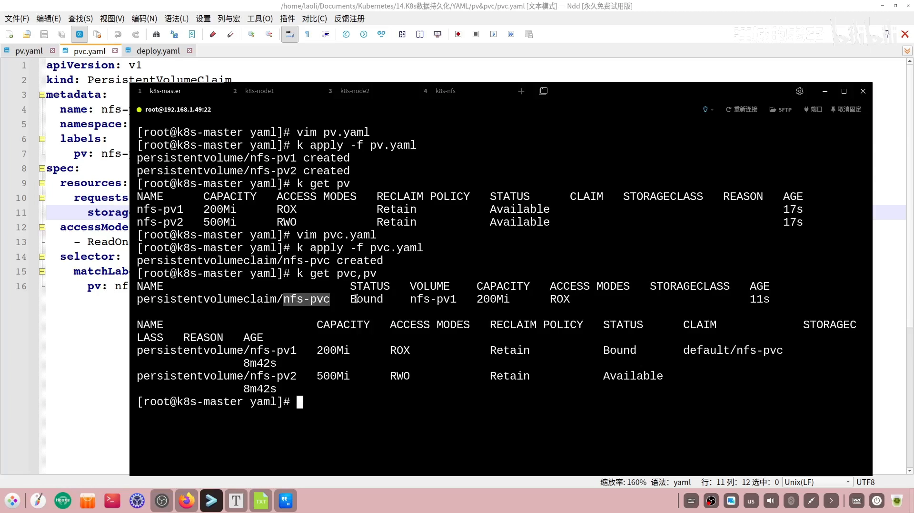

# 持久卷 PV 与 PVC：给 NFS 裸共享加一层「可控的存储抽象」

> 视频来源：[持久卷Pv和Pvc](https://www.bilibili.com/video/BV1u46nY7EA2/)（Bilibili，UP：莲城的老李）｜时长约 19 分钟
>
> 本讲是 NFS 存储那一期的续集：先把「直接让 Pod 挂 NFS」的隐患摊开，再引入 **PV（持久卷）** 与 **PVC（持久卷声明）** 这一对资源对象，然后用「建两个 PV → 建 PVC 绑定 → 删 PVC 看回收 → Pod 挂 PVC 验证数据共享」四个环节把三者串起来。本文基于该视频的图-字幕文稿整理，可逐帧核对；自动字幕口头、片段化处已通顺化，订正了明显口误。

## 本讲要解决的核心问题（SCQA）

**背景**：在上一期的 NFS 方案里，Pod 直接挂载 NFS 服务器上的共享目录，存储就这么用起来了。[【跳转到 00:00】](https://www.bilibili.com/video/BV1u46nY7EA2/?t=0)

**冲突**：NFS **不限制 Pod 能写多少数据**。视频给了一张很直观的图：NFS 服务器总共 100 G，第一个 Pod 分两次写进去 70 G，第二个 Pod 再来写 50 G 时就只剩 30 G 可用——**NFS 服务器直接崩掉**；它一崩，上面托管过数据的 Pod 全都受影响，应用跟着不可用。[【跳转到 00:25】](https://www.bilibili.com/video/BV1u46nY7EA2/?t=25) [【跳转到 00:50】](https://www.bilibili.com/video/BV1u46nY7EA2/?t=50)

**疑问**：能不能在 Pod 和真实存储之间加一层「中间层」，让每个使用者只能拿到自己那份配额？

**回答（中心思想）**：K8S 给出的中间层就是 **PV + PVC**。**PV 是集群管理员划出来的「存储资源」，PVC 是 Pod 提出的「存储需求」**；Pod 不再直接摸存储，而是通过 PVC 去申请、由 K8S 把 PV 配给它——存储资源的使用因此变得**可控**，系统的稳定与可靠才有保障。[【跳转到 00:00】](https://www.bilibili.com/video/BV1u46nY7EA2/?t=0)

## 一、为什么直接用 NFS 不是最优解

把上面那张图读透就够了：**总容量固定，而没有任何一方为使用者划边界**。[【跳转到 00:25】](https://www.bilibili.com/video/BV1u46nY7EA2/?t=25)

- 第一个 Pod 先写了 70 G（分两次）；
- 第二个 Pod 需要写 50 G，但只剩 30 G → **写爆**；
- NFS 服务器崩溃 → 之前在上面的 Pod 数据访问全部受影响。

结论：直接用 NFS 这种存储方案，对 K8S 集群来说**并不是最优选择**，需要在中间加入一层抽象。[【跳转到 00:50】](https://www.bilibili.com/video/BV1u46nY7EA2/?t=50)

## 二、PV 是什么：集群级别的「磁盘分区」

**PV = PersistentVolume，中文「持久化卷」**，取自两个英文单词的首字母。[【跳转到 01:15】](https://www.bilibili.com/video/BV1u46nY7EA2/?t=75)

两个要点：

- **PV 是集群级别的资源，不支持命名空间**——`kubectl explain` 里能看到它的 API 版本是 `v1`、且没有 namespace 维度。[【跳转到 01:15】](https://www.bilibili.com/video/BV1u46nY7EA2/?t=75) [【跳转到 01:29】](https://www.bilibili.com/video/BV1u46nY7EA2/?t=89)
- **PV 由谁创建**：集群管理员**手动创建**（静态模式），或者由**存储类 StorageClass 自动创建**（动态模式）。本讲只讲管理员手动创建。[【跳转到 01:39】](https://www.bilibili.com/video/BV1u46nY7EA2/?t=99)

它解决前面的问题，靠的是一个类比——**PV 很像给服务器磁盘做分区**。一块磁盘使用前通常要划成多个分区，目的是把数据**隔离开**：一块分区快满了，另一块不受影响。[【跳转到 01:39】](https://www.bilibili.com/video/BV1u46nY7EA2/?t=99) [【跳转到 02:04】](https://www.bilibili.com/video/BV1u46nY7EA2/?t=124)

按这个思路，NFS 服务器上 100 G 的空间可以用三个 PV 对象划成三份；Pod 请求哪个 PV，就**只拿到对应那份大小**（比如请求 PV-1 就得到 20 G），不会再无休止地占用整台服务器的存储。**PV 的设置体现的就是对存储资源的合理规划。**[【跳转到 02:04】](https://www.bilibili.com/video/BV1u46nY7EA2/?t=124)

## 三、PV 的 YAML：三个关键面

PV 的样本文件里，前面是 `apiVersion`、`kind`、`metadata`，**重点看 `spec`**。[【跳转到 02:29】](https://www.bilibili.com/video/BV1u46nY7EA2/?t=149)

`spec` 可以拆成三块看：[【跳转到 02:54】](https://www.bilibili.com/video/BV1u46nY7EA2/?t=174)

1. **存储能力**：用 `storage` 字段定义这个 PV 多大，单位有 **Mi（兆字节）** 和 **Gi（吉字节）**；
2. **访问模式**：PV 支持哪种挂载方式（下一节展开）；
3. **回收策略**：与它绑定的 PVC 被删除时，这个 PV 怎么办。

还有一块是 **NFS 服务器侧的后端配置**：里面有一个 `path`，它是 NFS 服务器上的一个目录路径，**这条路径必须事先存在，否则 PV 对象创建会失败**。[【跳转到 06:14】](https://www.bilibili.com/video/BV1u46nY7EA2/?t=374)

### 访问模式（accessModes）四种

访问模式与具体存储方案的支持情况有关。视频里现场翻了官方文档里的那张「支持/不支持」对照表：比如 `hostPath` **只支持** `ReadWriteOnce`；而常用的 **NFS** 除了 `ReadWriteOncePod` 之外**其余都支持**。[【跳转到 03:19】](https://www.bilibili.com/video/BV1u46nY7EA2/?t=199) [【跳转到 04:09】](https://www.bilibili.com/video/BV1u46nY7EA2/?t=249)

具体有四种：[【跳转到 04:09】](https://www.bilibili.com/video/BV1u46nY7EA2/?t=249) [【跳转到 04:34】](https://www.bilibili.com/video/BV1u46nY7EA2/?t=274)

| 访问模式 | 简写 | 含义 |
| --- | --- | --- |
| ReadWriteOnce | RWO | 允许被**单个节点**读写挂载 |
| ReadWriteOncePod | RWOP | 只允许被**单个 Pod** 读写挂载 |
| ReadOnlyMany | ROX | 允许被**多个节点只读**挂载（注意是只读） |
| ReadWriteMany | RWX | 多路读写，允许被**多个节点读写**挂载 |

> 视频在这里特意留了一个悬念：访问模式**看起来**像是在限制访问者的读写权限，「其实它具备另外的作用」，放到最后再解释。[【跳转到 02:54】](https://www.bilibili.com/video/BV1u46nY7EA2/?t=174) 这个悬念在第八节揭晓。

### 回收策略（persistentVolumeReclaimPolicy）三种

回收策略回答的是：**与 PV 关联的 PVC 被删除时，PV 会不会被一起删除。**[【跳转到 04:59】](https://www.bilibili.com/video/BV1u46nY7EA2/?t=299)

- **Retain（保留）**：删除 PVC **不会**同步删除 PV，好处是**保住了 PV 里的数据**；之后等管理员手动处理完数据，再决定要不要删这个 PV。**NFS、hostPath 都支持**这种策略。[【跳转到 04:59】](https://www.bilibili.com/video/BV1u46nY7EA2/?t=299) [【跳转到 05:24】](https://www.bilibili.com/video/BV1u46nY7EA2/?t=324)
- **Delete（删除）**：删 PVC 的同时**连带删除**关联的 PV。**NFS 和 hostPath 不支持**。[【跳转到 05:24】](https://www.bilibili.com/video/BV1u46nY7EA2/?t=324)
- **Recycle（回收）**：删 PVC 时同步删 PV，并让这个 PV **重新回到可用状态**，好被其他 PVC 绑定。**该策略已被标记为过时，不建议使用。**[【跳转到 05:49】](https://www.bilibili.com/video/BV1u46nY7EA2/?t=349)

> 所以本讲演示以 **Retain** 为主。[【跳转到 05:49】](https://www.bilibili.com/video/BV1u46nY7EA2/?t=349)

## 四、动手：先造目录，再建两个 PV

实验环境是四个节点：前三个节点组成 K8S 集群，另有一个单独的节点 `K8S-NFS`。[【跳转到 06:29】](https://www.bilibili.com/video/BV1u46nY7EA2/?t=389)

关键顺序是**先有目录、后有 PV**：当前路径 `/root/nfs/data` 下还没有 `PV1` 目录，需要 `mkdir` 建出 `PV1`、`PV2` 两个共享目录，**目录就绪后**才开始创建 PV 对象。[【跳转到 06:41】](https://www.bilibili.com/video/BV1u46nY7EA2/?t=401) [【跳转到 06:46】](https://www.bilibili.com/video/BV1u46nY7EA2/?t=406)

接着写 `pv.yaml` 并 `apply`。与笔记中的样本相比，这次建的是**两个 PV（PV1、PV2）**，区别就在 NFS 上**关联的子目录不同**：PV1 对应 `PV1` 子目录，PV2 对应 `PV2` 子目录。[【跳转到 07:06】](https://www.bilibili.com/video/BV1u46nY7EA2/?t=426) [【跳转到 07:28】](https://www.bilibili.com/video/BV1u46nY7EA2/?t=448)

创建成功后 `kubectl get pv` 可以看到两个对象都已经存在，读一下每一列：[【跳转到 07:28】](https://www.bilibili.com/video/BV1u46nY7EA2/?t=448) [【跳转到 07:53】](https://www.bilibili.com/video/BV1u46nY7EA2/?t=473)

- **存储能力**：PV1 是 200 Mi，PV2 是 500 Mi；
- **访问模式**、**回收策略**各占一列；
- **状态**：目前是 `Available`，表示它处于**可用**状态。

## 五、PVC 是什么：需求端来提申请

**PVC = PersistentVolumeClaim，中文「持久化卷声明」。Pod 通过 PVC 向 PV 申请磁盘空间。**[【跳转到 08:05】](https://www.bilibili.com/video/BV1u46nY7EA2/?t=485)

- 如果 PVC **一直找不到匹配的 PV**，它就会停在 **`Pending`（悬决）** 状态；一旦匹配上，就从该状态脱离出来。[【跳转到 08:05】](https://www.bilibili.com/video/BV1u46nY7EA2/?t=485)
- 与 PV 不同，**PVC 支持命名空间**——**Pod 使用 PVC 时必须与 PVC 在同一个命名空间**。[【跳转到 08:30】](https://www.bilibili.com/video/BV1u46nY7EA2/?t=510)

视频用一张图讲清了 Pod → PVC → PV 的关系：**PVC 是需求端，PV 是供应端。**[【跳转到 08:30】](https://www.bilibili.com/video/BV1u46nY7EA2/?t=510)

**PVC** 也是 Pod 申请存储时必须经过的一个对象（`PersistentVolumeClaim`）。[【跳转到 08:05】](https://www.bilibili.com/video/BV1u46nY7EA2/?t=485)

### PVC 寻找 PV 的三个条件

PVC 绑定 PV 时，**三个条件都要满足**：[【跳转到 08:30】](https://www.bilibili.com/video/BV1u46nY7EA2/?t=510) [【跳转到 08:55】](https://www.bilibili.com/video/BV1u46nY7EA2/?t=535) [【跳转到 09:20】](https://www.bilibili.com/video/BV1u46nY7EA2/?t=560)

| 条件 | 说明 |
| --- | --- |
| **标签（label）** | 例如 PVC 里写 `pv=pv-2`，就会去找带这个标签的 PV |
| **存储能力（storage）** | PVC 声明的容量**小于或等于**目标 PV 的容量才能绑；否则绑不上 |
| **访问模式** | PVC 的访问模式要**与 PV 一致**才能绑定 |

创建 PVC 的样本里，重点就是**怎么把这三个条件写出来**：容量需求（单位同样是 Mi / Gi）、访问模式、以及匹配用的标签。[【跳转到 09:45】](https://www.bilibili.com/video/BV1u46nY7EA2/?t=585)

### 观察一次成功的绑定

把 PVC 样本写成文件、`apply` 之后再一条命令同时查看 PVC 和 PV：[【跳转到 10:19】](https://www.bilibili.com/video/BV1u46nY7EA2/?t=619)

- **PVC 的状态变成 `Bound`（已绑定）**，可用存储资源是 **200 Mi**，访问模式是**多节点只读挂载**；
- 两个 PV 里，符合条件的那一个**状态也变成 `Bound`**；
- 另一个 PV 还没找到合适的 PVC，**仍旧是 `Available`**。

## 六、删一次 PVC：看 Retain 怎么表现

把刚才的 PVC 删掉（`kubectl delete`），再重新查看 PV：**[【跳转到 11:09】](https://www.bilibili.com/video/BV1u46nY7EA2/?t=669)**

- 之前与它关联的 PV 变成 **`Released`（释放）** 状态，**它里面的数据并没有被删除**；
- 这时管理员可以回到 NFS 服务器，对 PV1 文件夹里的数据**手动处理**（备份、转移等），处理完再删除 PV1 对象。

**这里补上了一个重要的绑定规则**：处于 `Released` 状态的 PV **不能与任何 PVC 绑定**。视频现场验证：再把 PVC 创建一遍、或者新建一个 PVC，`kubectl get pvc/pv` 会看到 **PVC 停在 `Pending`**——也就是**没匹配到可以绑定的 PV**。所以绑定条件除了前面那三个，**PV 的状态也要合适**。[【跳转到 11:09】](https://www.bilibili.com/video/BV1u46nY7EA2/?t=669)

## 七、Pod 里怎么用 PVC，并验证数据共享

Pod 里用 PVC 分两部分写：[【跳转到 11:09】](https://www.bilibili.com/video/BV1u46nY7EA2/?t=669)

1. **声明卷**：`volumes` 里声明一个卷（视频里叫 `vol-pvc`），卷类型选 **PVC**，再用 **`claimName`** 指定 PVC 对象的名字；
2. **挂载进容器**：`containers` 里引用**同一个卷名**，并给出容器的挂载路径——因为示例容器是 Nginx，挂到了 Nginx 的 `html` 目录。

演示用的是 **Deployment**，创建**三个副本**的 Pod，Pod 模板里的卷与挂载配置和笔记一致。[【跳转到 11:09】](https://www.bilibili.com/video/BV1u46nY7EA2/?t=669)

> **现场踩坑**：`apply` 后 Pod 起不来。回头看 PVC/PV 才发现，之前做实验时那个 **PVC 已经处于 `Pending`**，还没有绑上 PV。处理办法是**删掉旧 PV 重新创建**（`kubectl delete -f pv.yaml` 后重新 `apply`），PVC 与 PV 随即双双变为已绑定，三个 Pod 也进入 `Running`。[【跳转到 11:09】](https://www.bilibili.com/video/BV1u46nY7EA2/?t=669)

**数据共享验证**：回到 NFS 服务器进入 `PV1` 子目录（它就是这些 Pod 实际挂载的路径），`echo` 写入内容 `IMPV1` 到文件里。由于是在 **NFS 共享目录**里建的文件，它会**同步到三个 Pod**；依次 `curl` 三个 Pod 的 IP，都能取到内容——**三个 Pod 的数据实现了共享**。[【跳转到 11:09】](https://www.bilibili.com/video/BV1u46nY7EA2/?t=669)

## 八、揭晓悬念：accessModes 不是权限控制

上一节我们说 Pod 里的数据是共享的，而 PV1 当时设的访问模式是**多节点只读**。按字面理解，多个节点的 Pod 应该都**不能改**数据。视频现场做了反向验证：[【跳转到 11:09】](https://www.bilibili.com/video/BV1u46nY7EA2/?t=669)

1. `kubectl exec -it <pod> -- sh` 进入 node1 上的 Pod，进到挂载的 `html` 目录；
2. 用 `echo` 把文件内容**覆盖改写**成「老李」→ **修改居然成功了**；
3. 退出后再 `curl` 这个 Pod，内容已变；再 `curl` 另一个节点上的 Pod，**也被改了**；
4. 回到 NFS 服务器看那个 `index` 文件，内容同样变了。

所以「只读」在这里**并没有起到写保护的作用**。视频引用了官方原文来解释：**「一旦装载了存储卷，访问模式不会强制进行写保护；即使访问模式被指定为 `ReadWriteOnce`、`ReadOnlyMany` 或 `ReadWriteMany`，它们也不会对卷进行任何限制。」**[【跳转到 11:09】](https://www.bilibili.com/video/BV1u46nY7EA2/?t=669)

由此得出 `accessModes` 的**真实作用只有两个**：

1. 作为**绑定 PV 的一个条件**；
2. 决定**用多个节点还是单个节点去挂载**。

> 这正是第三节点留的那个悬念的答案：**别把 `accessModes` 当权限控制用。**[【跳转到 02:54】](https://www.bilibili.com/video/BV1u46nY7EA2/?t=174)

## 小结：PV/PVC 打通了，但手动建 PV 太繁琐

回到开头那张示意图：一个 Pod 要申请存储空间，我们得**先建 PVC、再建 PV、还要把三者关联关系打通**——整个过程确实繁琐。[【跳转到 11:09】](https://www.bilibili.com/video/BV1u46nY7EA2/?t=669)

有没有更优的方案？有的：**让 PV 不再由管理员手动创建，而是在供应端改为「动态供给」**——这就是下一讲的 **存储类（StorageClass）** 要解决的问题。[【跳转到 11:09】](https://www.bilibili.com/video/BV1u46nY7EA2/?t=669)

一张表回顾本讲的关键对象：

| 对象 | 角色 | 是否支持命名空间 | 由谁创建 |
| --- | --- | --- | --- |
| PV | 存储资源的**供应端** | 否（集群级） | 管理员手动创建，或 StorageClass 动态创建 |
| PVC | 存储需求的**需求端** | 是 | 用户 / 控制器 |
| Pod | 使用者 | 是 | 用户 / 控制器（通过 `claimName` 引用 PVC） |
