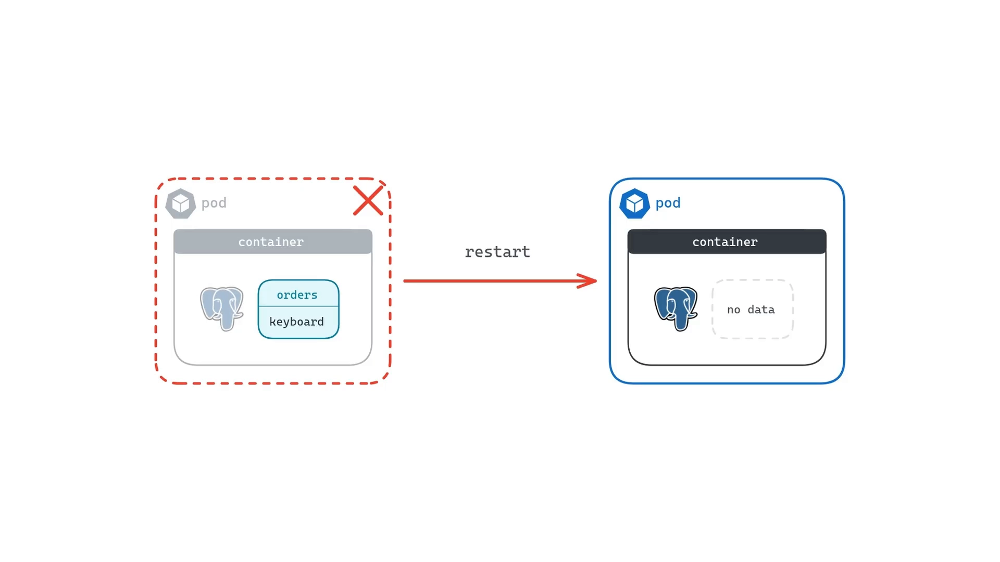
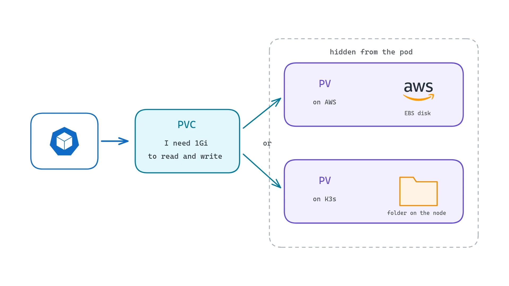
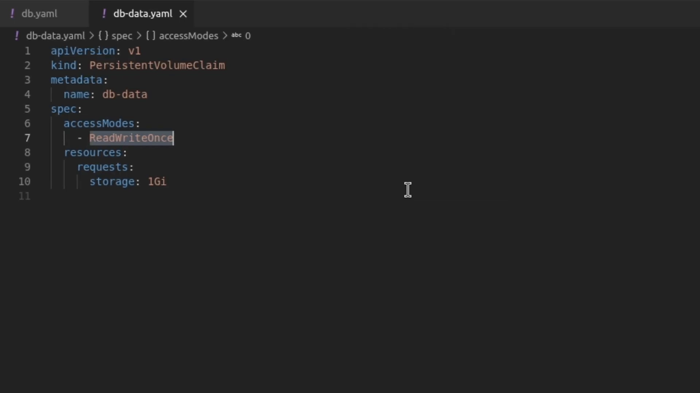
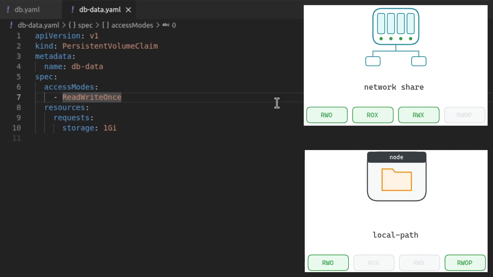
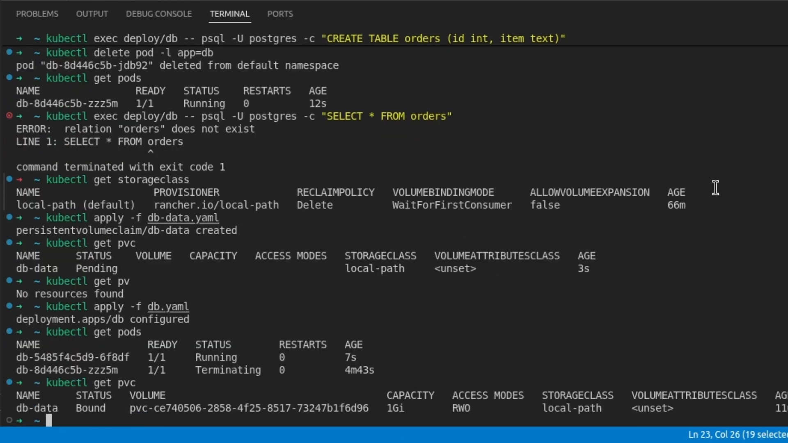
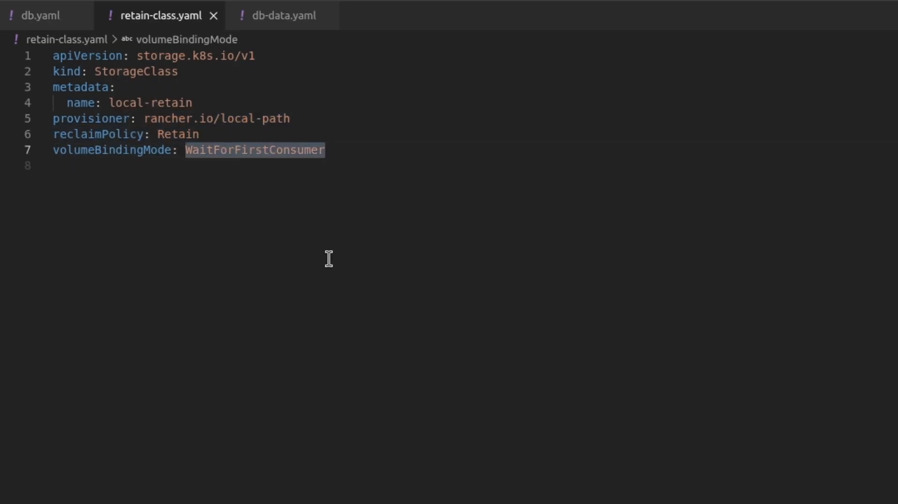
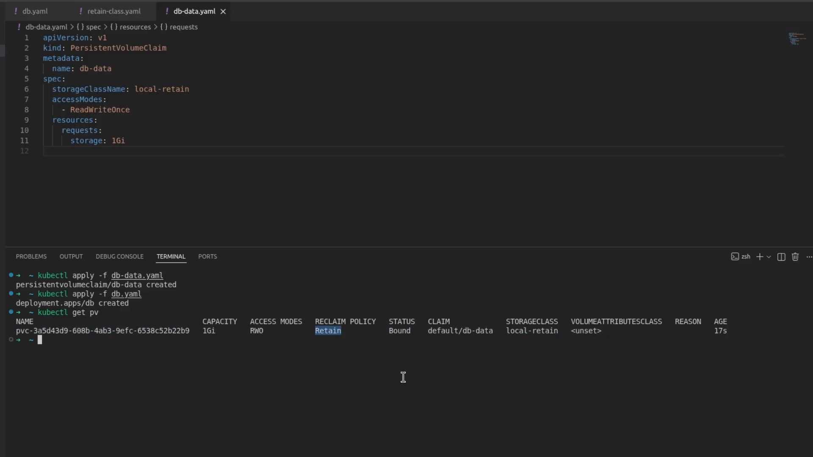

# 持久化存储实战：ReadWriteOnce 与回收策略

> 视频来源：[Kubernetes persistent storage: PersistentVolume, PVC, StorageClass and reclaim policy](https://www.youtube.com/watch?v=4H3k1uLwuCI)（YouTube，Prepare-sh）｜时长约 13 分钟
>
> 这条视频以「先让数据库丢一次数据，再一步步救回来」的方式，把 PV、PVC、StorageClass 串成一条实测链路，重点落在两处：**访问模式为什么选 ReadWriteOnce**、**回收策略 Delete 与 Retain 的差别到底体现在哪**。本文基于该视频的图-字幕文稿整理，可逐帧核对；已订正自动字幕的明显错拼：`cubectl`→**kubectl**、`Postgress`→**Postgres**、`psqquill`→**psql**、`PBC`→**PVC**、`readr once`→**ReadWriteOnce**、`dbdata.yaml`→**db-data.yaml**。

## 本讲要解决的核心问题（SCQA）

**背景**：Pod 的文件系统是临时的——Pod 一消失，它写下的东西就跟着没了。对 Web 服务器无所谓（重新拉镜像即可），但对数据库是致命的。

**冲突**：于是我们给数据库挂上持久卷，数据确实熬过了 Pod 重启。可真正的坑在后面：**当你不再需要这块卷、把 PVC 删掉时，底层的数据到底会怎样？** 视频直接把两种结局演给你看——一种数据**随删除一起蒸发**，另一种则**被保留下来**。

**疑问**：访问模式（这里是 ReadWriteOnce）究竟限制了什么？为什么 PVC 创建后先是 `Pending`、什么都不建？回收策略 Delete 和 Retain 的差别，在 `kubectl` 的输出里长什么样？

**回答（中心思想）**：**访问模式对你声明的这块存储规定了「谁能同时用」，而回收策略决定了 PVC 删除后「底层存储与数据留不留」；一个集群里同时提供 Delete 和 Retain 两种 StorageClass 完全正常，选哪个，就是选「误删时数据还能不能救回来」。** [【跳转到 00:00】](https://www.youtube.com/watch?v=4H3k1uLwuCI&t=0)



## 一、三个对象，各司其职

视频先把 Kubernetes 持久化存储的三个对象讲清：

- **PV（PersistentVolume，持久卷）**：Kubernetes 用来记录**一块真实存储**的对象。存储本身在 Kubernetes 之外——可以是云盘、网络共享文件夹，或节点上的一个目录。PV 记录「这块存储在哪、有多大」，被 Pod 使用时由 Kubernetes 挂进容器。
- **PVC（PersistentVolumeClaim，持久卷声明）**：对存储的**请求**。应用声明「我要多少空间、想怎么用」，Kubernetes 去找一个匹配的 PV，把两者绑定。**Pod 只看得见 claim，看不见背后的存储**——所以同一份 claim 在任何集群上都能工作。
- **StorageClass（存储类）**：当一份新的 claim 进来时，由它**自动创建一个 PV**，这个过程叫**动态供给（dynamic provisioning）**。



## 二、先复现问题：没有存储，数据会丢

演示的第一步很直观：用一个 **`db.yaml`** 部署一个单副本的 Postgres（密码先写在 env 里，生产环境应来自 Secret），此时**文件里没有任何存储配置**，数据就留在容器里。建一张 `orders` 表、写入数据后，用 `kubectl delete pod` 按 `app=db` 标签把 Pod 删掉——Deployment 立刻补一个新 Pod，但再查表，Postgres 报 **`relation "orders" does not exist`**：新 Pod 从镜像里拿到了一个全新的空文件系统，刚才的数据没了。

这一步确立了全文的动机：**要活过 Pod 重建的，必须放到 Pod 之外的持久卷上。**

## 三、访问模式：数据库选 ReadWriteOnce

接下来给数据库配存储。先看集群现有的存储类：

```bash
kubectl get storageclass
```

集群里有一个默认的 `local-path`，它的 provisioner 会把卷作成**节点本地磁盘上的一个文件夹**。输出里有两列值得盯住：**Reclaim policy 是 `Delete`**（结尾会回来讲），**Volume binding mode 是 `WaitForFirstConsumer`**（马上会看到它的作用）。

（提示：托管云上默认存储类会把数据放到云盘——Google Cloud 上叫 standard RWO、Azure 上叫 managed CSI、AWS 上要先装 EBS driver。但**无论后端是什么，我们接下来写的 claim 完全一样**——这正是 PVC 这层的意义。）

然后是 claim 本身 **`db-data.yaml`**，在 `accessModes` 下我们请求 **`ReadWriteOnce`**：[【跳转到 05:03】](https://www.youtube.com/watch?v=4H3k1uLwuCI&t=303)

```yaml
kind: PersistentVolumeClaim
metadata:
  name: db-data
spec:
  accessModes:
    - ReadWriteOnce
  resources:
    requests:
      storage: 1Gi
```



**ReadWriteOnce 的含义**：**只有一个节点**能同时以读写方式使用这个卷。**同一节点上的多个 Pod 可以共享它，但另一个节点上的 Pod 不能同时使用。** 对一个以单 Pod 运行的数据库来说，这就够了，而且**几乎每块盘都支持它**。

视频还把四种访问模式一并列全了：

| 模式 | 含义 |
| --- | --- |
| **ReadWriteOnce** | 单个节点可读写（我们这次用的） |
| **ReadOnlyMany** | 多个节点可挂载，但只能读 |
| **ReadWriteMany** | 多个节点同时读写，需要共享存储（网络文件系统） |
| **ReadWriteOncePod** | 最严格：全集群只有一个 Pod 能用，即便其他 Pod 在同一节点上 |

**关键：你能用哪些模式，取决于数据实际存在哪。** 网络共享能被多个节点同时使用，所以能提供 ReadWriteMany；而**我们的 `local-path` 把数据放在单个节点的文件夹里，所以它只支持 ReadWriteOnce / ReadWriteOncePod**。[【跳转到 06:08】](https://www.youtube.com/watch?v=4H3k1uLwuCI&t=368)



## 四、WaitForFirstConsumer：为什么 PVC 建好却一直 Pending

`db-data.yaml` 里**没有写 storageClass**——当 claim 不指定存储类时，Kubernetes 就用默认的 `local-path`。`kubectl apply` 之后 `kubectl get pvc` 显示这份 claim **状态是 `Pending`、没有 volume**。

这不是出错，而是**前面看到的 `WaitForFirstConsumer` 绑定模式在起作用**：存储类**一直等到真正有 Pod 使用这份 claim**，才知道 Pod 落在哪个节点，然后**在该节点上**创建卷。用 `kubectl get pv` 验证，此刻确实什么都没有。

于是我们把数据库接到 claim 上：在 `db.yaml` 里加两处——一个 **pod 级的 `volumes`**（说明这块存储来自 `db-data` 这份 PVC）、一个 **container 级的 `volumeMounts`**（把卷挂到 Postgres 存放数据库的目录）。两处用**同一个名字 `data`** 关联起来。再次 apply 后：

- `kubectl get pvc`：claim 变成 **`Bound`**，volume 名以 `pvc-` 开头，容量 1 GB，**access modes 一列显示 `RWO`**（ReadWriteOnce 的缩写）；
- `kubectl get pv`：冒出来一个 PV——**没人手动创建它**，是因为我们把 PVC 挂进 Pod，**存储类才自动创建并绑定**了它，这就是动态供给；PV 的 **reclaim policy 是 `delete`**，继承自存储类。



再跑一遍真正的测试：建表、`insert` 插一条数据、`kubectl delete pod` 删 Pod，新 Pod 起来后再 `select`——**数据还在**。因为它现在活在卷上，而不是 Pod 里。

## 五、回收策略实测（一）：Delete——删了 claim，数据一起没

到了「不再需要这块卷」的时候，回收策略就登场了：**它决定 Kubernetes 在 claim 被删除后如何处置 PV。** [【跳转到 09:43】](https://www.youtube.com/watch?v=4H3k1uLwuCI&t=583)

先删 Deployment，再删 claim：

```bash
kubectl delete deployment db
kubectl delete pvc db-data
kubectl get pv   # No resources found
```

**卷没了，上面的数据也没了**——这就是 **Delete 策略**：删掉 claim，Kubernetes 连底层存储一起删。对测试数据很方便，但对真实数据库**一条误删命令就意味着数据永久丢失**。

## 六、回收策略实测（二）：Retain——删了 claim，数据留下来

对重要的数据，还有第二种策略 **Retain**。回收策略来自 StorageClass，所以视频干脆自己造一个类 **`retain-class.yaml`**：kind 还是 `StorageClass`，名字叫 `local-retain`，**provisioner 和绑定模式都与 `local-path` 一致，唯一区别是 `reclaimPolicy: Retain`**。

`kubectl apply` 之后 `kubectl get sc` 里就有两个类了：默认的 `local-path`，和新的 `local-retain`。[【跳转到 10:58】](https://www.youtube.com/watch?v=4H3k1uLwuCI&t=658)



再把 claim 指到这个新类：在 `db-data.yaml` 的 spec 下加 `storageClassName: local-retain`，重新 apply。`kubectl get pv` 显示新卷的 **reclaim policy 变成了 `retain`**。

然后做同样的清理——删 Deployment、删 PVC——再看 `kubectl get pv`：

**这次卷还在，状态是 `Released`。** 意思是 claim 已经没了，**但卷和上面的数据被保留了下来**。而且 Kubernetes **不会自动把它交给新的 claim**（因为上面还有别人的数据），它会一直停在 `Released`，**直到管理员决定怎么处理：复用，还是手动删除。**[【跳转到 11:48】](https://www.youtube.com/watch?v=4H3k1uLwuCI&t=708)



## 小结

- 一句话把三者串起来：**PV 是存储本身，PVC 是对它的请求（含大小与访问模式），StorageClass 在 claim 需要时按需创建 PV。**
- **访问模式**（本例 ReadWriteOnce）规定「谁能同时使用这块卷」；**能用哪些模式由底层存储决定**（本地目录只支持 RWO/RWOP，网络共享才能 RWX）。
- **`WaitForFirstConsumer`** 让卷等到 Pod 真正使用 claim 时才创建，从而把卷放到 Pod 所在的节点。
- **回收策略**决定 claim 删除后的结局：**Delete 连数据一起删；Retain 保留数据、PV 停在 `Released` 等人工处理。**
- 落地的决策只有一句：**跑数据库之前先问自己——如果有人误删了这份 claim，我承受得起数据丢失吗？承受不起，就用 reclaimPolicy 为 `retain` 的存储类。**

## 关键术语速查

| 术语 | 一句话解释 |
| --- | --- |
| PV | 一块真实存储的 Kubernetes 对象，记录位置与容量 |
| PVC | 对存储的请求，Pod 只认它、不直接认 PV |
| StorageClass | 声明用哪个 provisioner、以什么回收策略按需创建 PV |
| accessModes / ReadWriteOnce | 访问模式；RWO 表示单节点可读写、该节点多 Pod 可共享 |
| WaitForFirstConsumer | 卷绑定模式：等 Pod 使用 claim 时才在对应节点创建卷 |
| reclaimPolicy: Delete | 删 claim 即删底层存储与数据 |
| reclaimPolicy: Retain | 删 claim 后保留底层存储与数据，PV 停在 Released 待人工处理 |
| Released | PV 的一种状态：claim 已删除，卷仍被保留、不可被新 claim 直接使用 |
