# 访问模式与回收策略：PV 上的两组关键参数

> 视频来源：[Kubernetes Storage Deep Dive | PV, PVC & StorageClass | Access Modes & Reclaim Policies](https://www.youtube.com/watch?v=1raZQbRPP6g)（YouTube，happy code）｜时长约 36 分钟
>
> 本视频用一块白板把「访问模式」和「回收策略」这两组最容易被误解的参数画清楚，并交代了它们在 PV 生命周期、静态/动态供给整条链路里的位置。本文基于该视频的图-字幕文稿整理，可逐帧核对；已订正自动字幕的明显错拼：`engine X`→**Nginx**、`5 GI`→**5 Gi**、`K8S get PV`→**`kubectl get pv`**、`WS EBS`→**AWS EBS**、`wait for first customer`→**WaitForFirstConsumer**。

## 本讲要解决的核心问题（SCQA）

**背景**：Kubernetes 里做持久化存储，靠两个对象配合：**PV（PersistentVolume，持久卷，代表真正的存储）** 和 **PVC（PersistentVolumeClaim，持久卷声明，代表应用发出的存储请求）**。很多人已经会照文档写 YAML、能把 PV 和 PVC 创建出来。

**冲突**：可一到面试或线上排障就卡壳——PVC 一直 `Pending` 绑不上、刚删掉的 PVC 让 PV 卡在 `Released` 用不了、数据库的盘居然连同数据一起消失了。这些坑的根子，几乎都不在「会不会写 YAML」，而在 PV 上两组最容易被误解的参数：**访问模式（accessModes）** 与 **回收策略（reclaimPolicy）**。

**疑问**：这两组参数分别决定什么？它们怎么影响 PVC 和 PV 能不能绑定成功？PVC 被删除之后，底层的存储与数据到底还在不在？

**回答（中心思想）**：**访问模式决定「谁能、在什么粒度上、同时读写这块存储」，它是 PVC 与 PV 能不能绑定的硬条件之一；回收策略决定「PVC 删除后，底层存储与数据是被销毁还是被保留」，它通常由 StorageClass 继承而来。** 而 PV 的一生可以串成 `Available → Bound → Released → Failed` 一条链——线上绝大多数存储故障，都能落回这两组参数加上这条生命周期链。[【跳转到 00:00】](https://www.youtube.com/watch?v=1raZQbRPP6g&t=0)

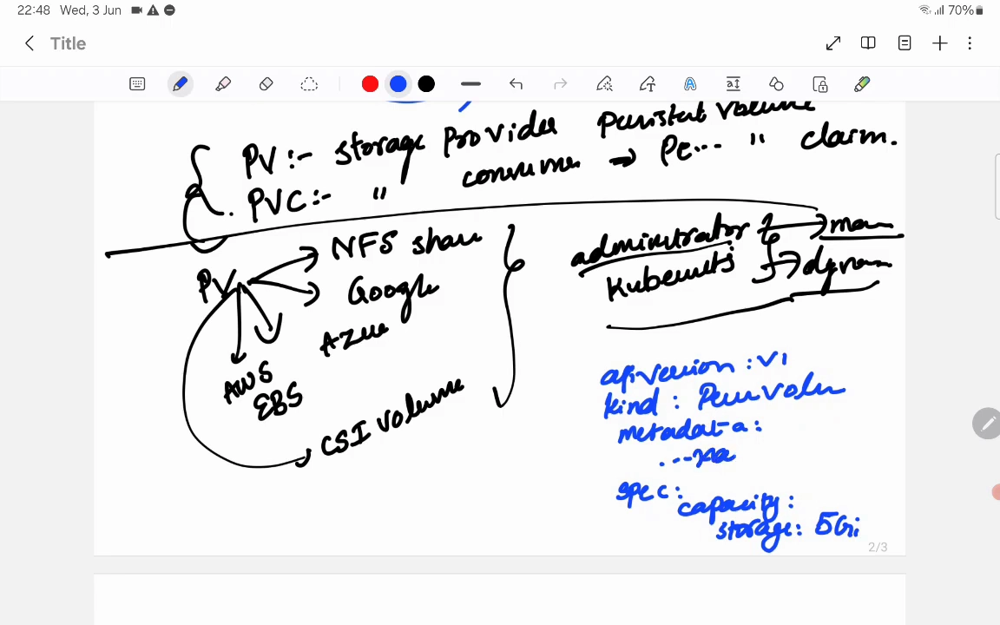

## 一、先建立地图：PV 是「存储本身」，PVC 是「申请」，二者靠匹配绑定

要理解访问模式和回收策略，先得把 PV / PVC 的分层说清楚。

- **PV 是存储提供方（provider）**。它代表一块真实存在的存储：可以是 NFS 网络文件系统、Google Persistent Disk、Azure Disk、AWS EBS 卷，也可以是 CSI 卷等。PV 由**管理员手动创建**，或由 **Kubernetes 动态创建**。
- **PVC 是存储消费方（consumer）**，本质是一份「存储请求」：我要多大容量、想怎么用。应用不直接碰 PV，只声明自己需要一块 PVC。

视频用一个很贴切的类比串起这条关系：**PV 像一整栋公寓，PVC 像租下其中一个房间。** 你不能直接住进「公寓」，只能先申请（claim）一套房；同样，任何资源都不能直接使用 PV，必须先通过 PVC 去申请，再由 Kubernetes 把 PVC **绑定（bind）** 到某个匹配的 PV 上。[【跳转到 09:17】](https://www.youtube.com/watch?v=1raZQbRPP6g&t=557)

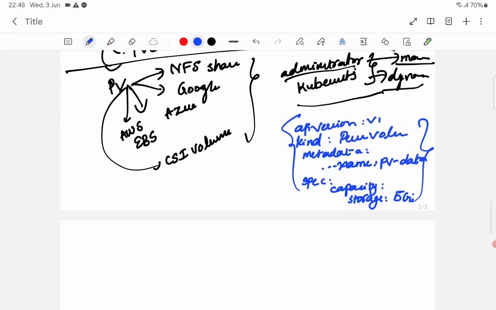

**绑定要成功，必须同时满足三个条件：**

1. **容量够**：PVC 请求的容量必须 **≤** PV 提供的容量。PV 只有 5 Gi，你却申请 10 Gi——绑不上。
2. **访问模式匹配**：PVC 声明的 accessModes 必须与 PV 的 accessModes 一致，否则绑不上。
3. **存储类匹配**：PVC 指定的 StorageClass 要与 PV 的 storageClass 一致。

只要有一条不满足，PVC 就会一直停在 `Pending`。而**「访问模式不匹配」正是线上 PV/PVC 问题里最常见的一种**——这条伏笔我们先按下，第二节展开。[【跳转到 16:24】](https://www.youtube.com/watch?v=1raZQbRPP6g&t=984)

## 二、访问模式：一句话就是「谁能同时读、谁能在哪写」

**访问模式（accessModes）规定了一块存储可以被挂载的方式。** 视频特别强调：这是**整个存储话题里最容易被误解的一环**。它的 YAML 写法很短，但要真正用对，得把每种模式的适用场景和背后的限制记清楚。[【跳转到 11:13】](https://www.youtube.com/watch?v=1raZQbRPP6g&t=673)

视频用「节点 + 读写箭头」的示意图逐一把四种模式画了出来：

| 模式 | 含义 | 典型存储 |
| --- | --- | --- |
| **ReadWriteOnce（RWO）** | 只能被**单个节点**以读写方式挂载（同一节点上的多个 Pod 可共享） | AWS EBS、Azure Disk、Google Persistent Disk 等主流云盘 |
| **ReadOnlyMany（ROX）** | 可被**多个节点**同时挂载，但**只能读、不能写** | 只读共享的文件存储 |
| **ReadWriteMany（RWX）** | 可被**多个节点**同时读写 | NFS、AWS EFS 等网络文件系统 |
| **ReadWriteOncePod（RWOP）** | 全集群**只有一个 Pod** 能用（连同一节点上的其他 Pod 也不行） | 最严格，适合绝不能并发访问的场景 |

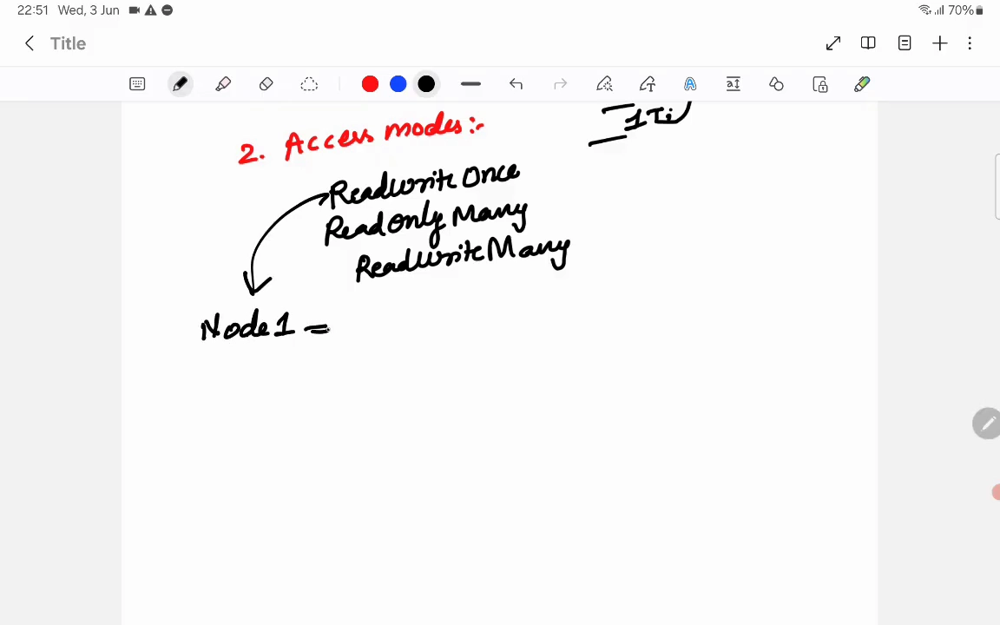

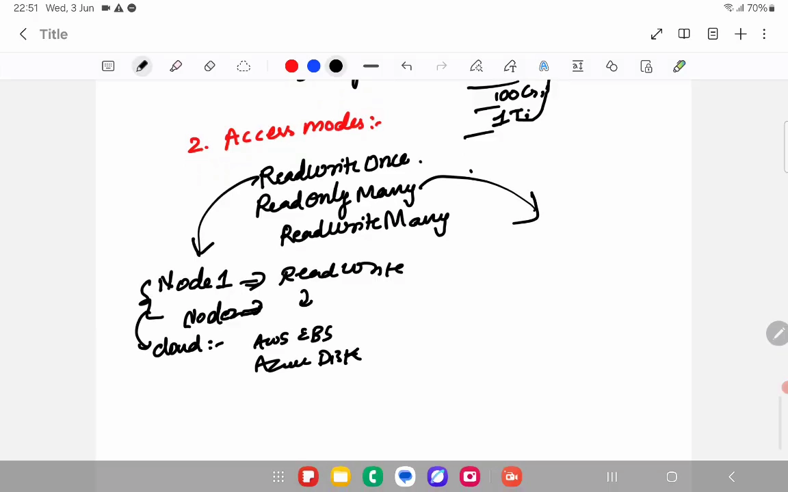

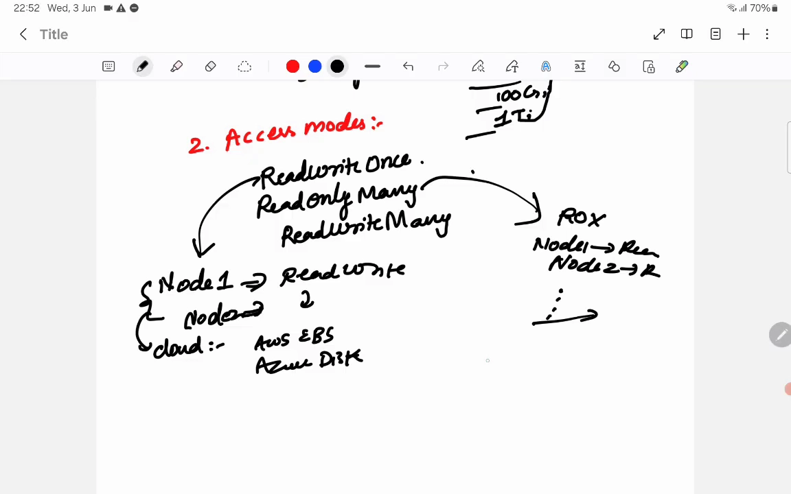

**关键结论：PV 能提供哪些访问模式，不取决于 Kubernetes，而取决于底层存储本身的能力。** 一块挂在本机上的云盘天然只能 RWO；只有像 NFS/EFS 这种真正的网络共享存储，才可能提供 RWX。所以「我需要多节点同时读写」这个需求，最终是在**选存储后端**时就决定了的，不是改个 YAML 字段就能变出来的。

也正因如此，访问模式成了绑定的硬门槛：**PV 声明的是 RWO，PVC 却请求 RWX，绑定必然失败。** 这类「模式/存储类/容量三类不匹配」是生产事故的常客。[【跳转到 31:39】](https://www.youtube.com/watch?v=1raZQbRPP6g&t=1899)

## 三、回收策略：PVC 删掉之后，底层存储留不留

如果说访问模式解决的是「用的时候怎么用」，那么**回收策略（reclaimPolicy）解决的就是「不用了怎么办」**：当一个 PVC 被删除后，Kubernetes 该怎么处置它背后那块 PV 和上面的数据。视频给出三种策略：[【跳转到 20:34】](https://www.youtube.com/watch?v=1raZQbRPP6g&t=1234)

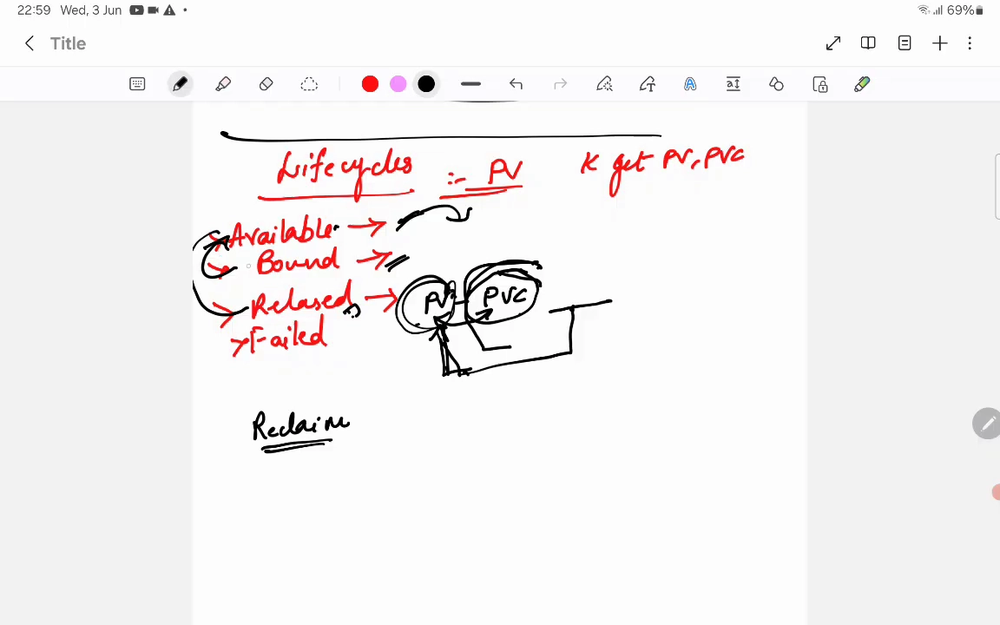

### 3.1 Retain（保留）：数据留着，等管理员确认

保留策略下，删除 PVC 之后，PV 会进入 **`Released`（已释放）** 状态，并且 PV 的 YAML 里仍留有指向旧 PVC 的引用信息（`claimRef`、即视频里反复说的「cache/记录」）。**处于 Released 的 PV 不能被新的 PVC 直接用**，也不会自动回到 `Available`。

要让这块 PV 重新可用，管理员必须手动把 PV YAML 里指向旧 PVC 的那段引用删掉，PV 才会回到 `Available` 状态。视频解释了这套「多一道手续」的设计意图：**在 Released 这段窗口期内，管理员可以从容地把旧数据备份走**——这正是数据库这类场景该选的策略。[【跳转到 21:24】](https://www.youtube.com/watch?v=1raZQbRPP6g&t=1284)

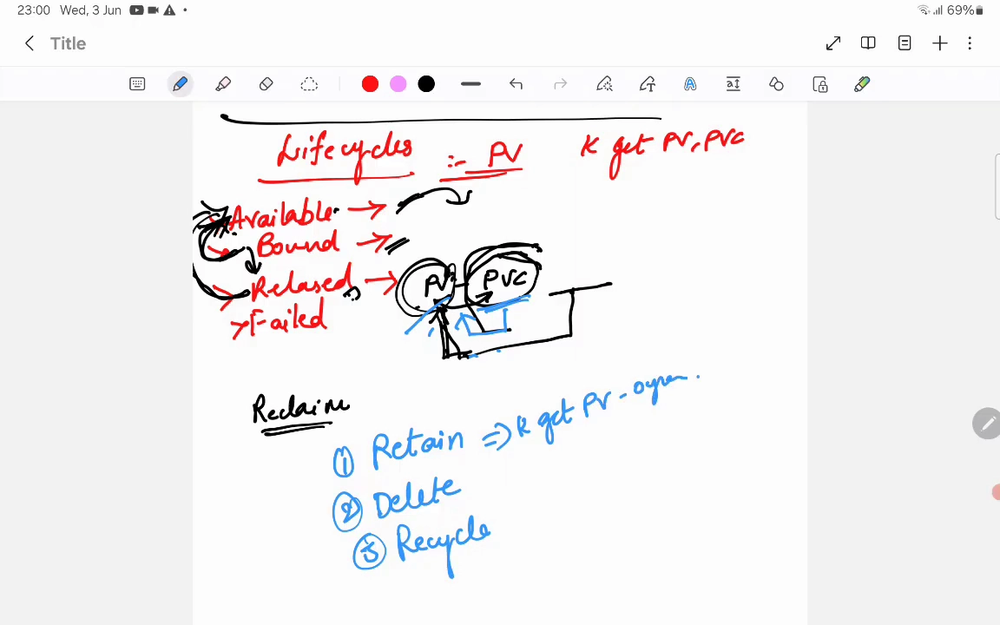

### 3.2 Delete（删除）：连底层存储一起销毁

删除策略下，删除 PVC 会让动态创建的 PV 与**底层存储一并被删除**，PV 不会留下 Released 这一站。它适合测试数据这类「本就不需要备份」的场景。[【跳转到 22:39】](https://www.youtube.com/watch?v=1raZQbRPP6g&t=1359)

### 3.3 Recycle（回收）：历史产物，已基本废弃

回收策略会把卷擦除后归还为可用状态。**它历史上被支持，但如今已很少使用、基本被弃用**，属于了解即可的一种策略。

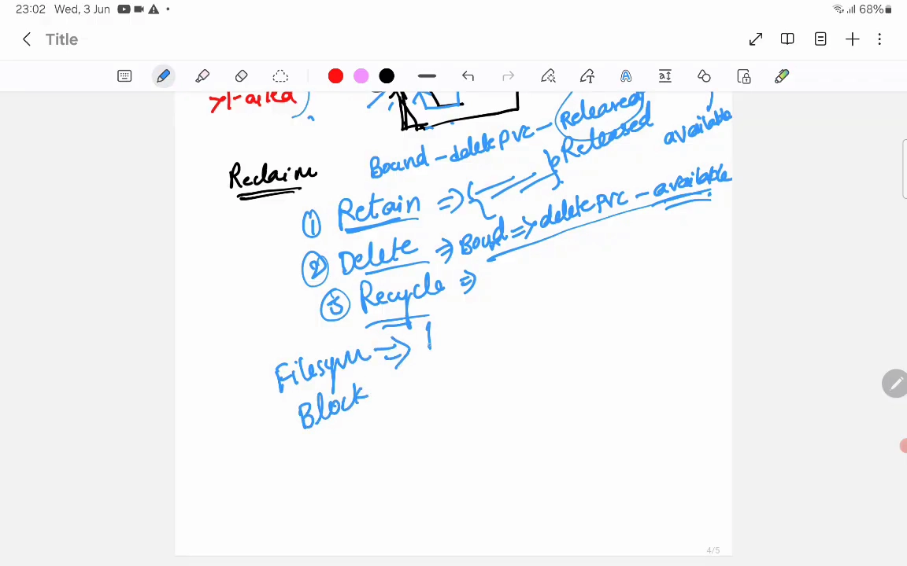

> **重要提醒**：回收策略往往不是写死在 PV 上，而是**由 StorageClass 的 `reclaimPolicy` 决定，并在动态供给创建 PV 时被继承**。这就是为什么「换一个 StorageClass」有时就能改变「数据删不删」的行为——第四节实战里会亲眼看到这一点。

## 四、顺手把一个「选存储」的参数也搞懂：volumeMode（文件系统 vs 块）

在讲生命周期的路上，视频还顺带讲了一个同属 PV 规格、却常被忽略的参数 **volumeMode**——它决定存储以什么形态交给应用：[【跳转到 23:29】](https://www.youtube.com/watch?v=1raZQbRPP6g&t=1409)

- **Filesystem（文件系统，默认）**：把存储以**目录**的形式挂进容器，应用看到的是文件和文件夹。绝大多数工作负载用它。
- **Block（块设备）**：把存储以**裸块设备**的形式暴露，应用自己管理这个块设备，常见于**数据库和高性能工作负载**。

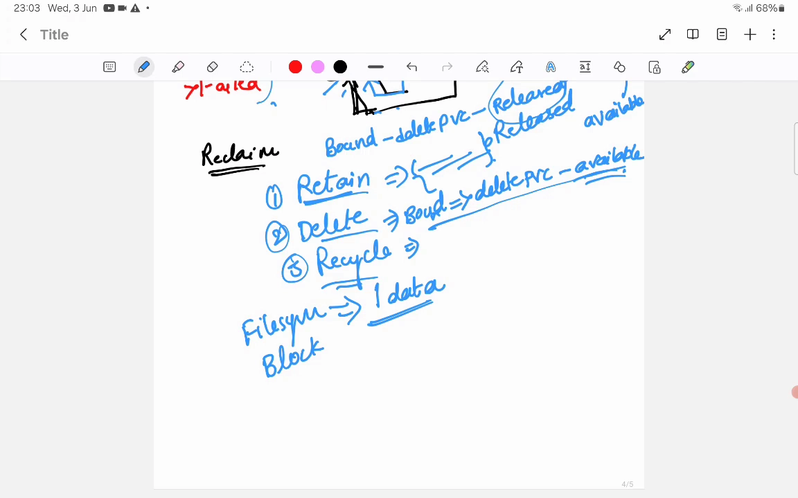

视频还顺势点了 **hostPath**：它把节点上的某个本地目录映射进 Pod，属于**节点绑定**的存储——**一旦 Pod 漂移到别的节点，这块存储就可能「消失」**，因为不同节点上的本地目录并不相同。

## 五、PV 的生命周期：Available → Bound → Released → Failed

把上面的参数串起来，就是 PV 的一生。视频把它归纳为四个状态：[【跳转到 17:39】](https://www.youtube.com/watch?v=1raZQbRPP6g&t=1059)

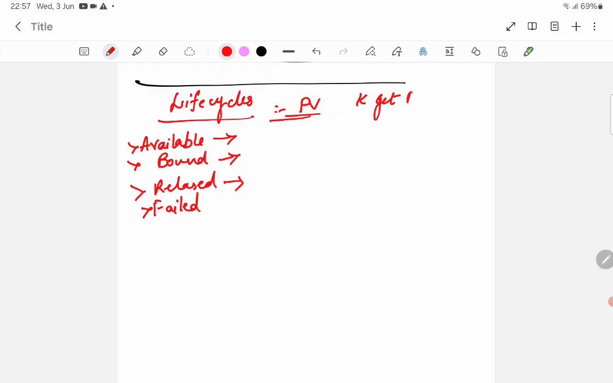

1. **Available（可用）**：PV 已创建，但还没被任何 PVC 绑定。
2. **Bound（已绑定）**：PVC 请求容量、访问模式等匹配成功后，绑定到该 PV，并**预留**了这块存储；此时 PVC 才能被 Pod 的 YAML 使用。
3. **Released（已释放）**：绑定的 PVC 被删除后进入。**为什么不能直接回到 Available？** 因为 PV 上还残留着旧 PVC 的引用信息，出于「留给管理员备份/确认」的考虑，它先停在 Released，手动清理引用后才回到可用（这正是 Retain 的舞台）。
4. **Failed（失败）**：回收过程出错时的状态。

> 一句话记忆：**`Available` 是没人要、`Bound` 是被认领、`Released` 是「前任走了但记录还在」、`Failed` 是回收没成功。**

## 六、放回真实数据流：从一份 PVC 到一块云盘

最后，视频把静态/动态供给和这条生命周期放到一起，画出了生产环境的完整链路：[【跳转到 25:59】](https://www.youtube.com/watch?v=1raZQbRPP6g&t=1559)

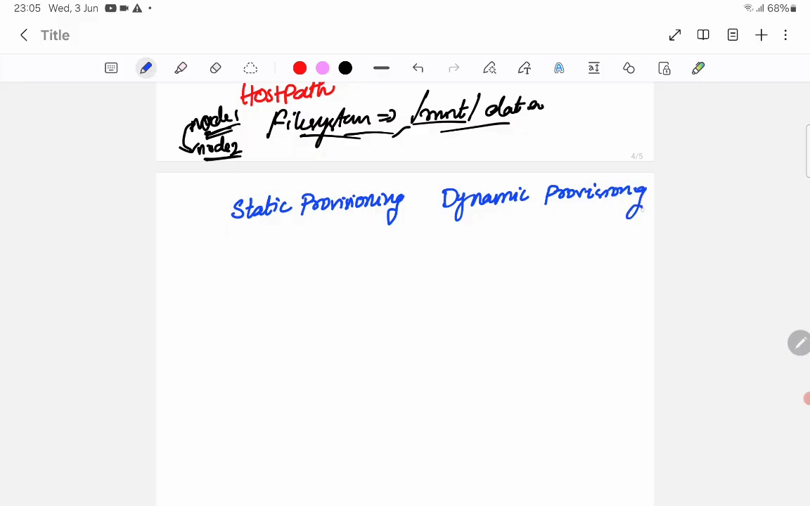

- **静态供给（static provisioning）**：管理员**预先**把存储和 PV 准备好（声明「就这么大一块」），之后应用再写 PVC 去认领。这就是前面讲的 PV 的常规用法。
- **动态供给（dynamic provisioning）**：应用**只写一份 PVC**，背后的 **StorageClass** 就自动创建出 PV。StorageClass 里会指定 **provisioner（真正干活的提供方，如 AWS/Azure/GCP）** 和各种 **parameters**（如 `type: gp3`、IOPS 等性能参数），还有 **volumeBindingMode**。

关于 **volumeBindingMode**，视频解释了两种取值的差别：

- **Immediate**：一创建 PVC，卷就立刻创建；
- **WaitForFirstConsumer**：创建 PVC 时**先不创建卷**，直到有 Pod 真正要用这份 PVC，才根据 Pod 落在哪个节点/可用区去创建卷——**这在云环境中能保证存储落在正确的可用区，非常关键**。

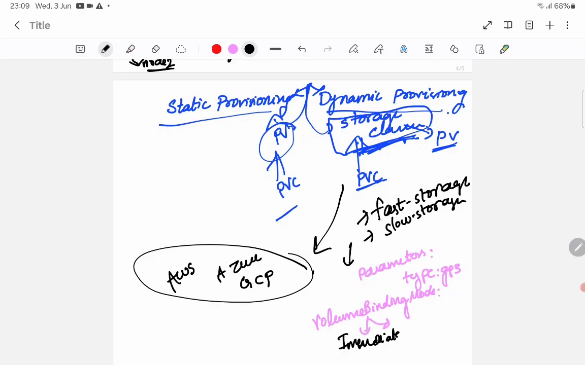

**完整的动态供给链路是这样一条链：**

> **应用 Pod 用 PVC → PVC 找 StorageClass → StorageClass 让 provisioner（AWS/Azure/GCP…）动态创建 PV（比如 EBS、EFS、GCP PD）→ 挂回 Pod。**

**这条链上任意一层断掉，都会表现为存储故障**——理解它，是排障的关键。视频最后把「绑定失败」的常见原因盘点了一遍，方便对照排查：

- **访问模式不匹配**：PV 给 RWO，PVC 要 RWX；
- **存储类不匹配**：PV 用 standard，PVC 要 premium；
- **容量不匹配**：PVC 请求的超过 PV 能提供的；
- **PVC 删了、PV 卡在 Released**：需要管理员手动清理 PV 上的 claim 引用来解除。

## 小结

- **访问模式管「怎么用」**：RWO / ROX / RWX / RWOP 决定谁能同时在什么粒度上读写；能用哪些模式取决于**底层存储本身**；它是 PVC↔PV **绑定的硬条件**之一。
- **回收策略管「不用了怎么办」**：**Retain** 保留数据、PV 停在 Released 等人工确认（数据库该选它）；**Delete** 连底层存储一起销毁；**Recycle** 已废弃。它通常**由 StorageClass 继承**而来。
- **PV 生命周期**：`Available → Bound → Released → Failed`，几乎所有存储问题都能落在这条链上。
- **volumeMode** 决定存储以**文件系统目录**还是**裸块设备**交给应用；**hostPath** 是节点绑定、Pod 漂移会丢数据。
- **动态供给链路**：Pod → PVC → StorageClass → provisioner → 云盘；任一层断裂都会出问题，「访问模式/存储类/容量」三类不匹配是最常见的绑定失败原因。

## 关键术语速查

| 术语 | 一句话解释 |
| --- | --- |
| PV（PersistentVolume） | 集群里的一块真实持久存储，由管理员或 Kubernetes 动态创建 |
| PVC（PersistentVolumeClaim） | 应用发出的存储请求，声明容量与访问模式，需与 PV 绑定 |
| accessModes | 访问模式，规定存储能被怎么挂载，是绑定硬条件 |
| ReadWriteOnce（RWO） | 只允许单个节点读写（同一节点多 Pod 可共享） |
| ReadOnlyMany（ROX） | 允许多个节点只读挂载 |
| ReadWriteMany（RWX） | 允许多个节点同时读写，需共享存储（NFS/EFS） |
| ReadWriteOncePod（RWOP） | 全集群仅一个 Pod 可用的最严格模式 |
| reclaimPolicy | 回收策略，PVC 删除后如何处置 PV 与底层存储（Retain/Delete/Recycle） |
| Available / Bound / Released / Failed | PV 的四个生命周期状态 |
| volumeMode | 存储交给应用的形态：Filesystem（目录）或 Block（裸块设备） |
| StorageClass | 存储类，定义动态供给的 provisioner、参数与回收策略 |
| WaitForFirstConsumer | 卷绑定模式：等 Pod 真正使用 PVC 时才创建卷 |
