# 存储分布调度：WaitForFirstConsumer 与拓扑分布约束

> 视频来源：[Optimizing Storage Assignment via Pod Scheduling Under Disturbance Factors — Kenji Morimoto（Cybozu），KubeCon NA 2020](https://www.youtube.com/watch?v=P5wQmyby8GI)（YouTube，CNCF）｜时长约 22 分钟
>
> 这是一份来自一线的工程复盘：Cybozu 要把 2000+ 台裸机上的本地磁盘交给 Kubernetes 上的 Ceph 用，于是把「把盘分均匀」翻译成了「把 Pod 调度均匀」；方案在生产环境的扰动下出现了意料之外的结果，他们读 kube-scheduler 源码找到原因，再按版本分别调参解决。本文基于该视频的图-字幕文稿整理，可逐帧核对：实测截图来自讲者的演示环境，调度器参数与版本对应关系均按原文记录。

## 本讲要解决的核心问题（SCQA）

**背景**：Kubernetes 用 `PersistentVolume`（PV，一块真实存储）与 `PersistentVolumeClaim`（PVC，一份存储申请）表达存储；而把 Pod 放到哪个节点上，是 kube-scheduler 的工作。在 on-prem 集群里用 Rook 部署 Ceph 时，**每一块本地盘就是一个 OSD**（Object Storage Device，Ceph 里负责存数据的存储单元），而 Rook 有一种模式正是「把申请到的 PV 配置成 OSD」——于是「把一个本地盘分配给 Ceph」这件事，在 Kubernetes 里就变成了「让一个 OSD Pod 的 PVC 绑到某个节点上的 PV」。

**冲突**：Kubernetes 本身**不关心存储该怎么分配**，它只调度 Pod；而现实中的磁盘分布并不均匀——某台服务器有坏盘、某些盘已被别的用途占用、某个机架的健康服务器比别的机架少。Cybozu 用 `volumeBindingMode: WaitForFirstConsumer` 加上 Pod 拓扑分布约束（PodTopologySpread）把 OSD Pod 撒匀，看起来已经解决了问题；但在真实扰动下出现了意外：**明明约束是可满足的，新 Pod 却全部挤到了两台空闲节点上，skew 直接冲到 3**。

**疑问**：为什么「看起来可满足」的拓扑约束没有生效？怎么才能让调度器真正优先照顾拓扑分布？

**回答（中心思想）**：因为 `whenUnsatisfiable: ScheduleAnyway` 下，**拓扑分布约束并不是硬约束，而只是打分因素之一**——「抹平 CPU 使用率」这类打分项的优先级压过了它。解法不是改约束写法，而是**按 Kubernetes 版本调调度器的权重**：1.17 把全局调度策略里 `EvenPodsSpreadPriority` 的权重从 1 调到 500；1.18 改用调度 profile，让这份权重只作用于存储管理 Pod；1.19 因为默认参数变化，改成**禁用 `NodeResourcesBalancedAllocation`**。

## 一、问题从哪里来：把 2000+ 台服务器的磁盘「均匀发下去」

讲者 Kenji Morimoto 来自日本的 IT 公司 Cybozu，做了八年基础设施工程师，负责的云服务跑在 **2000 多台服务器**上。他们原有的管理工具是一堆命令式脚本，手工运维负担很重，因此正在用 Kubernetes 和云原生技术重建基础设施。

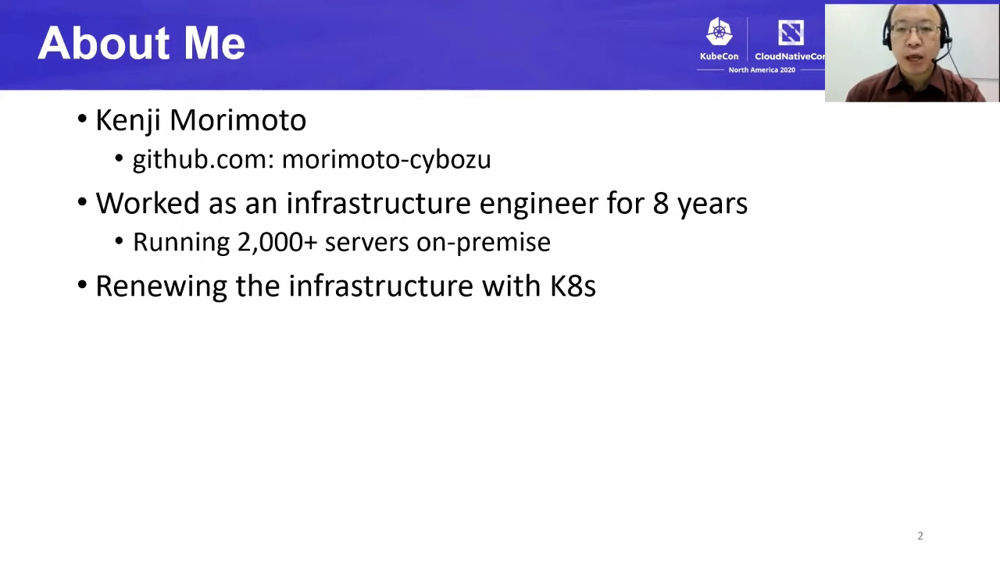

他们的目标不是「会装 Rook」，而是：**在 on-prem 服务器上部署一套分布式存储系统**。

- 什么是分布式存储系统？它把集群里各节点的本地存储设备组织起来，给用户提供一份统一的存储资源。以 Ceph 为例，管理员用本地盘定义出一块块 OSD，Ceph 再把这些 OSD 聚合成存储资源。
- 为什么需要 Kubernetes 帮忙？因为「管理底层磁盘」本身极其繁琐。Rook 支持**通过 PVC 配置 OSD**：Rook 把申请到的 PV 配置成 Ceph 的 OSD，Ceph 再把它们组成统一存储资源。

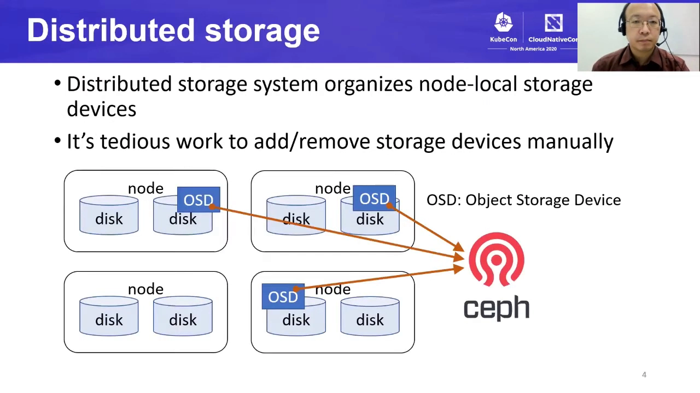

于是挑战被讲者精确定义为：**把本地磁盘对应的 PV，通过 PVC 均匀地分配出去**。Ceph 负责在故障域之间复制数据、保证健壮性；而「把本地盘分匀」本来却是管理员的活儿。

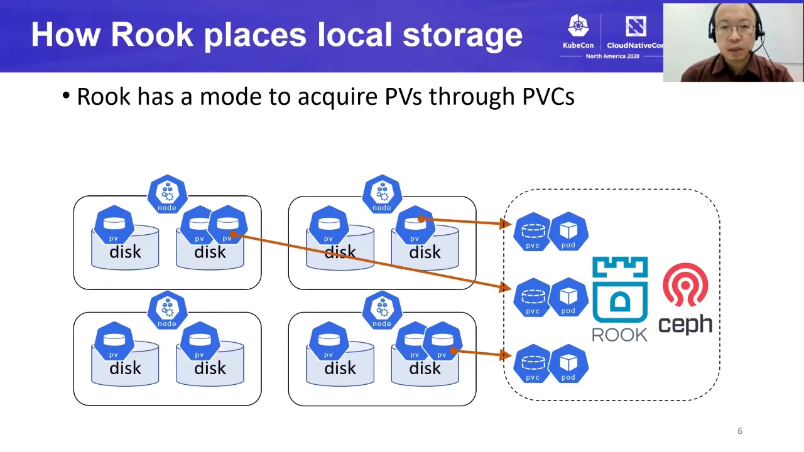

如果所有磁盘、所有服务器、所有机架都均匀可用，分配当然容易。**真实世界不是这样**：服务器可能坏盘，服务器上的某些盘可能已经被别的用途占用，某个机架的可用服务器可能比别的机架少——所以「按真实可用情况把本地盘分匀」是个难题。

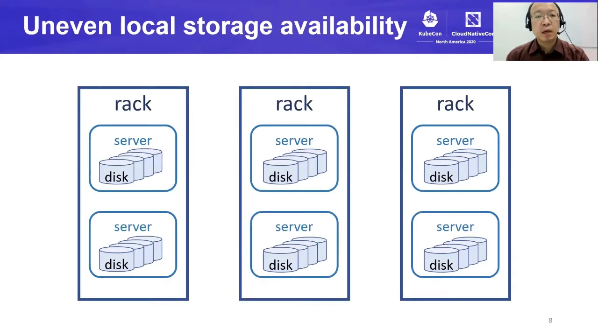

## 二、两块拼图：PV/PVC 负责存储，kube-scheduler 负责落点

Kubernetes 的存储体系可以一句话概括：**存储以 PV 的形式暴露**（本地盘、集群内网络存储、云存储都行），**Pod 通过 PVC 声明自己要什么**（StorageClass 名字、资源请求、选择器等等），Kubernetes 为 PVC 找到或创建一个匹配的 PV，把两者绑定（bind）。演示环境里那块 `local` 类型、100Gi 的卷，正是这样与一个声明了 StorageClass 与容量的 PVC 绑定起来的。

但讲者马上指出关键落差：**Kubernetes 并不直接调度存储设备**。相比之下，它在**调度 Pod** 上给了一整套丰富的特性：

- 资源需求（resources）；
- 节点选择器（node selectors）；
- Pod 亲和与反亲和（affinity / anti-affinity）；
- 污点与容忍（taints and tolerations）。

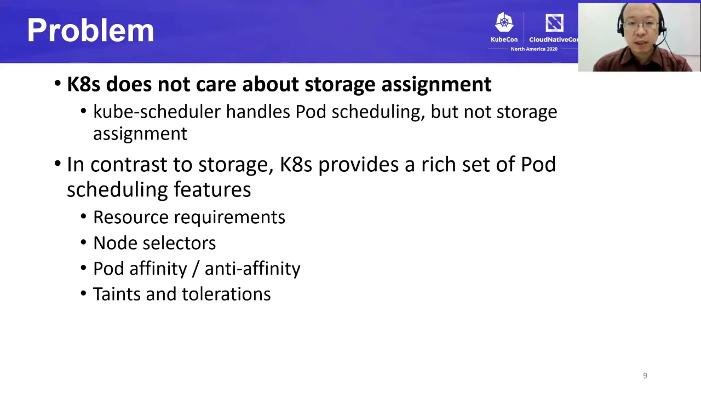

## 三、核心技巧：用 WaitForFirstConsumer 把「发盘」翻译成「调度 Pod」

### 3.1 volumeBindingMode 决定「什么时候绑定」，而绑定时机会变成调度约束

`volumeBindingMode` 有两个取值，讲者用两张图对比它们：

- **Immediate（默认）**：PVC 一被创建，Kubernetes 立刻找/建一个匹配的 PV 并绑定。**而这个绑定会成为 kube-scheduler 调度该 Pod 时的拓扑约束**——因为演示中的 PV 是节点本地的，消费者 Pod 就被钉在那块盘所在的节点上。问题在于：**我们无法控制 PVC 与 PV 的匹配是否均匀**。
- **WaitForFirstConsumer**：**PVC 要等到「使用它的 Pod 被调度」时才绑定**。绑定 PV 时有一条硬性约束：这个 PV 必须能从该节点访问到（本地盘当然只属于一个节点）。于是「调度 Pod」就等于「调度 PV」——**我们可以用 Pod 调度的手段来控制本地盘的落点**。 [【跳转到 06:40】](https://www.youtube.com/watch?v=P5wQmyby8GI&t=400)

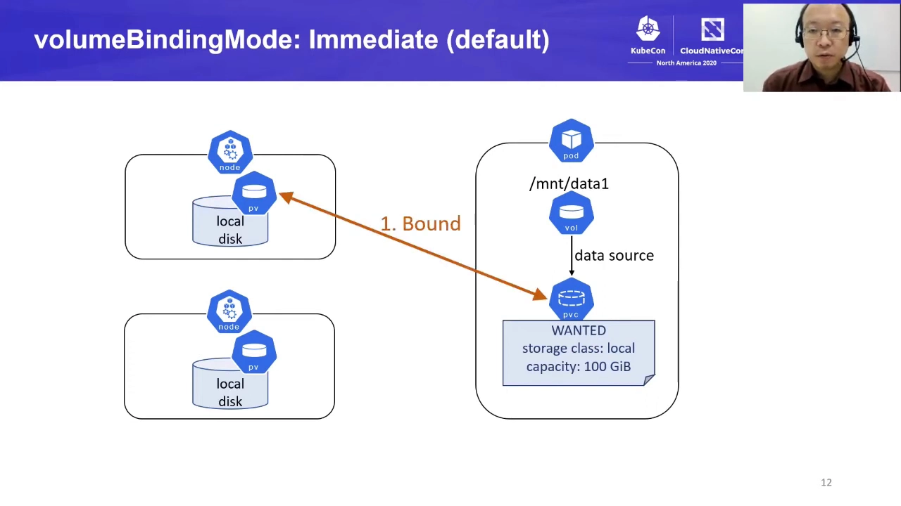

这就是本讲的基本思路：在 StorageClass 里写 `volumeBindingMode: WaitForFirstConsumer`，把**「存储分配问题」翻译成「Pod 调度问题」**，从而借用 Kubernetes 那套成熟的调度能力。原始挑战是「把本地盘的 PV 均匀分配给 PVC」，翻译过来就是「**把持有 PVC 的 Pod 均匀分布出去**」。

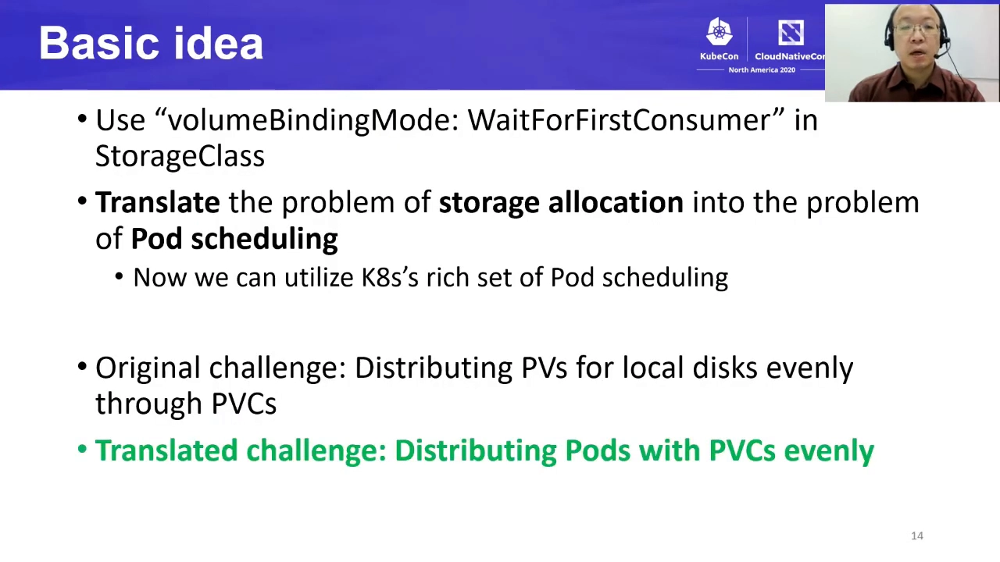

### 3.2 用什么调度手段？anti-affinity 不够，拓扑分布约束才行

要把 Pod 撒匀，第一个想到的是**反亲和（anti-affinity）**。讲者指出它的局限：反亲和只能表达「节点之间有没有 Pod 重叠」，**无法处理「一个节点上有多个 Pod/多个 PV」的情况**——它区分不出一个节点上是一个、两个还是五个 Pod，而我们要的恰恰是「每个节点可以放多块盘」。

更合适的工具是 **Pod 拓扑分布约束（Pod Topology Spread Constraints）**：1.16 引入 alpha，1.18 变 beta，1.19 稳定。它**基于偏斜度（skew）计算调度得分**，因此可以给「各域之间 Pod 数量差多少」设一个上限。它由几个参数描述：

- `maxSkew`：允许的不均匀程度；
- `topologyKey`：按什么粒度分组（节点、机架、可用区……）；
- `whenUnsatisfiable`：约束无法满足时的行为；
- `labelSelector`：选出目标 Pod。

讲者用 Kubernetes 官方博客那张图说明打分逻辑：zone1 有 2 个 Pod、zone2 有 1 个，skew 为 1；新 Pod 若放进 zone1，skew 变成 3、违反约束；放进 zone2 则 skew 变成 0、满足约束——于是新 Pod 应该落到 zone2。**这样就能得到均匀的 Pod 分布。**

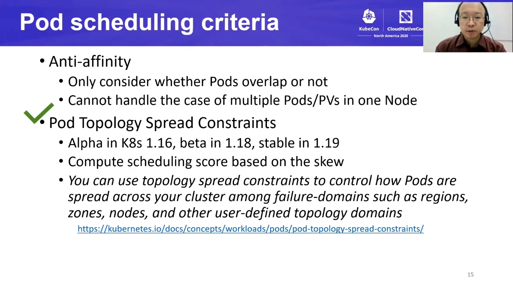
MDEOF

## 四、真实扰动暴露的意外：约束「可满足」，Pod 却挤在一起

### 4.1 先要接受：真实世界里「绝对均匀」并不可取

讲者用一个六台服务器、每台四块盘、其中 3a 只有一块健康盘的例子说明为什么不能追求严格的均匀：

- 阶段一：给六块盘各分配一个 Pod，每节点一个；
- 阶段二：再给五块盘各分配一个 Pod——**3a 已经没有可用盘了**；
- 阶段三：无论选哪台服务器都违反约束，**分配就卡住了**。

但这不是我们想要的：我们希望**尽可能多地把盘用起来**。于是要放松约束，用的参数就是 `whenUnsatisfiable`：

- `DoNotSchedule`（默认）：约束无法满足时，**kube-scheduler 就不调度这个 Pod**；
- `ScheduleAnyway`：约束无法满足时**仍然调度**，只是**优先把 Pod 放到能让 skew 最小的节点上**。

讲者说，如果 `ScheduleAnyway` 真如文档所说，那它对 Cybozu 就是最优解——既不会因为磁盘分布不均而限制资源使用。

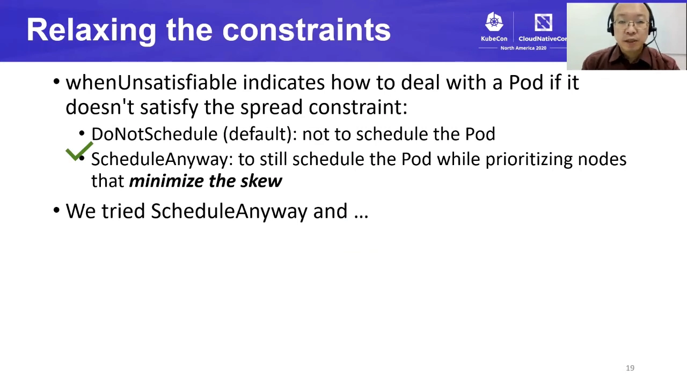

### 4.2 期望与实际：调度器并不把约束当约束

讲者描述了他们的预期，以及实测看到的相反结果：

- 集群里已有一批**红色标注的计算 Pod**在跑（它们不占满所有节点，本次场景里 4 个节点被使用、另外 2 个完全空闲），它们占用了不少 CPU（比如 60），但**还有足够余量**放新 Pod；
- 现在要再放 6 个「存储管理 Pod」，每个消耗 5% CPU，约束是**所有节点之间 skew ≤ 1**（注意：这个约束**不适用于**已有的计算 Pod，它只用来把存储管理 Pod 撒匀）；
- **期望**：因为约束是可满足的，6 个 Pod 应该均匀分布、skew 为 0；
- **实际**：**新 Pod 全部被放到了那两台空闲节点上，最大 skew 达到 3**——即使看起来约束完全可满足。 [【跳转到 15:29】](https://www.youtube.com/watch?v=P5wQmyby8GI&t=929)

讲者去读了 kube-scheduler 的源码，给出了根因：他们以为代码里会有「如果满足约束就怎样、如果不满足就怎样」两个分支；但**真实行为是——无论约束是否可满足，调度器都不把约束条件当作真正的约束，而是把它当成打分因素的一部分**。结果就是：**抹平 CPU 资源使用**这件事拿到了更高的优先级，即使分布约束是可满足的。已有的计算 Pod 就这样挡住了均匀分布。

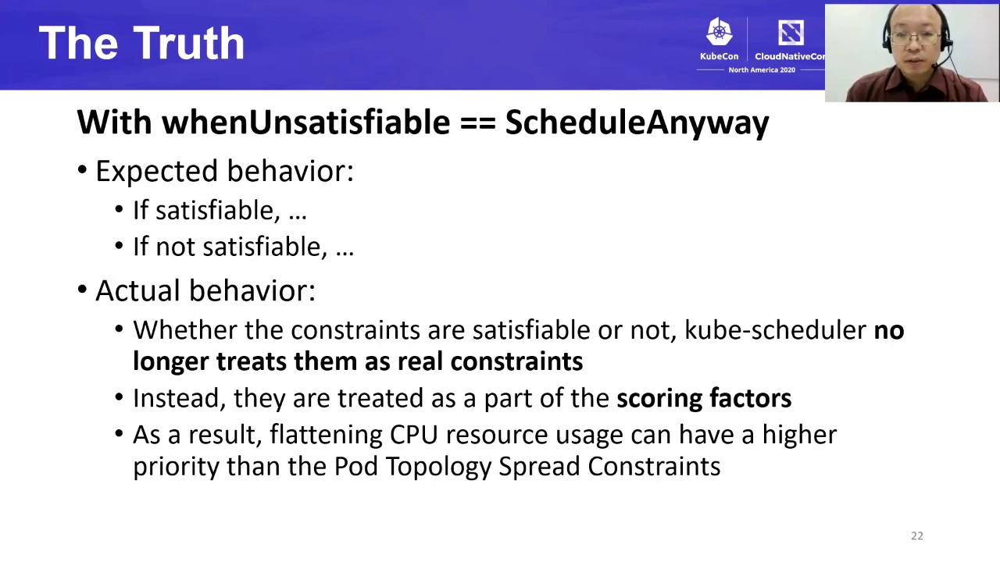

## 五、解法：按版本调 kube-scheduler，把拓扑分布的权重调上去

既然这是打分权重的问题，就要调权重。讲者强调，**kube-scheduler 演进很快，不同版本要用不同的调参方式**：

- **Kubernetes 1.17：调整调度策略（scheduling policy）**。那里有一个叫 `EvenPodsSpreadPriority` 的权重参数，**默认值是 1**，他们把它**提高到 500**。 [【跳转到 16:54】](https://www.youtube.com/watch?v=P5wQmyby8GI&t=1014)注意：调度策略是**全局配置**，所以这个改动必须非常小心。
- **Kubernetes 1.18：用调度 profile**。1.18 引入了 scheduler profile，一个 kube-scheduler 可以同时服务多套 profile，于是可以**新建一个 profile，只作用于存储管理 Pod**——在 profile 里把 `PodTopologySpread` 的权重设为 500。
- **Kubernetes 1.19：禁用 `NodeResourcesBalancedAllocation`**。1.19 的默认参数又有微调，对他们来说**把 `NodeResourcesBalancedAllocation` 关掉**是更合适的做法（正是这个打分项在「抹平 CPU 使用率」，从而压过了拓扑分布）。

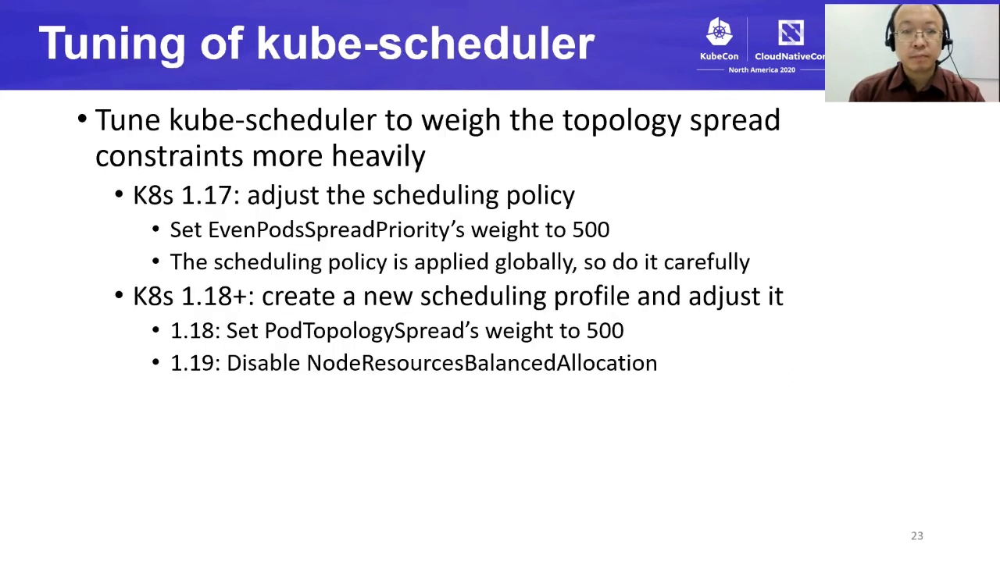

## 六、演示：同样 4 个节点、2 个计算 Pod、5 个 OSD

讲者准备了两套环境对照——一套用默认调度器，一套用调优后的调度器。演示场景是：

- 4 个节点；
- 2 个计算 Pod 在运行，占用一部分 CPU；
- 一套已经部署好的 Rook/Ceph（Rook operator、Ceph manager、monitor 等一堆 Pod），其中 **5 个 OSD Pod** 对应**申请了 5 个持久卷**（5 个 Pod、5 个 PVC）；
- 唯一的问题：这 5 个 OSD Pod 分布均匀吗？

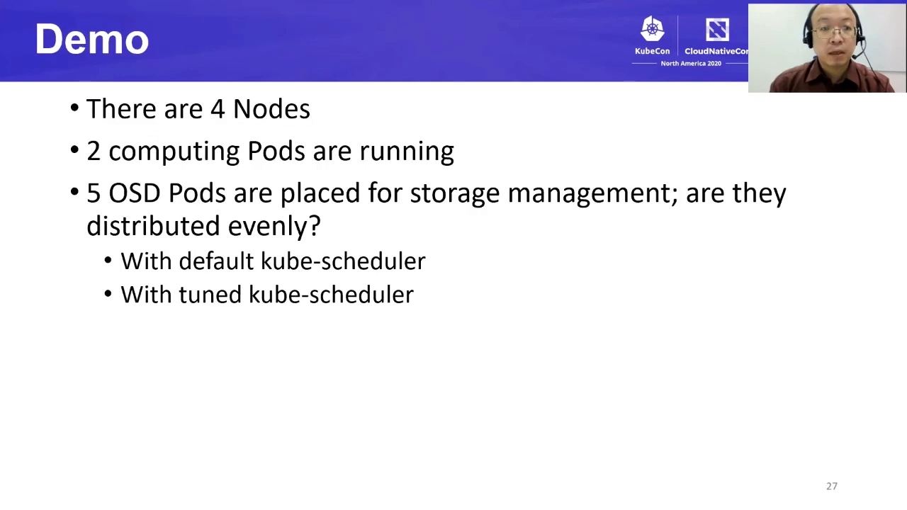

**默认调度器的环境**：5 个 OSD Pod **只落在 3 个节点上**，尽管有 4 个节点可用。看起来它们是**刻意避开与计算 Pod 共存**——因为 kube-scheduler 把「抹平 CPU 使用」的优先级放得更高，而这**对分布式存储系统来说并不可取**（存储 Pod 本该按盘数量在节点间撒匀）。 [【跳转到 20:33】](https://www.youtube.com/watch?v=P5wQmyby8GI&t=1233)

**调优后的环境**：5 个 OSD Pod **均匀地落在 4 个节点上**，其中一部分与计算 Pod 共存。**这正是讲者想要的结果。** [【跳转到 21:08】](https://www.youtube.com/watch?v=P5wQmyby8GI&t=1268)

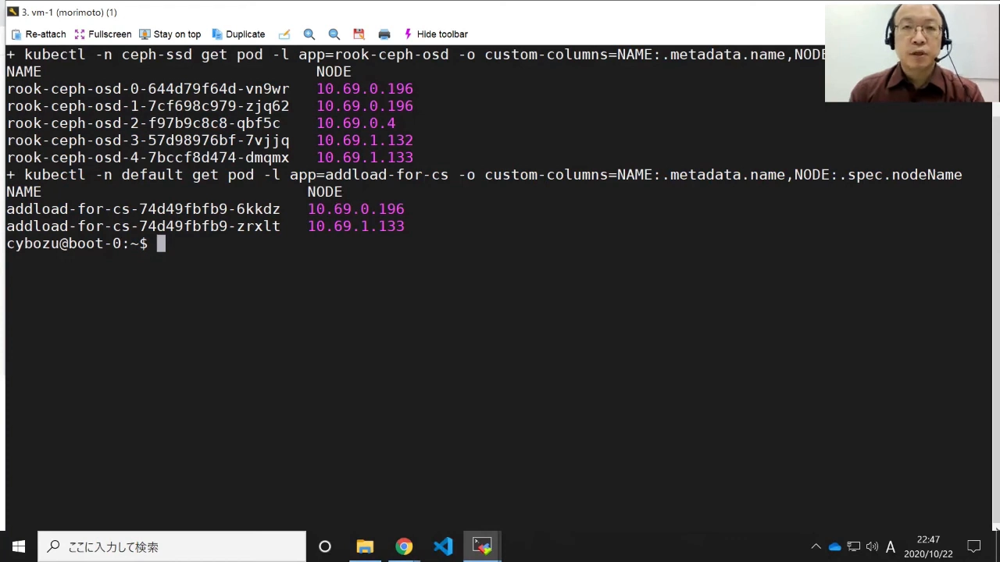

## 七、总结与可复用的结论

讲者的收尾把整套方法压缩成三句话：

1. 在 on-prem 集群上用 Rook/Ceph 部署分布式存储时，**把「本地存储分布」的问题翻译成「Pod 调度」的问题**——手段是在 StorageClass 里使用 `WaitForFirstConsumer` 这个 volume binding mode；
2. 在 Pod 调度这一侧，用 **Pod 拓扑分布约束**获得更好的分布效果；
3. 为了应对 kube-scheduler 的打分机制，**按版本调参**让它优先照顾这些约束（1.17 的全局权重、1.18 的 profile、1.19 关闭 CPU 均衡打分）。

他们对 Rook/Ceph 的这套配置**已经开源在 GitHub 上**，可以直接看。

> **与上一讲的呼应**：本讲用到的 `WaitForFirstConsumer`，正是本地持久卷项目当年（见另一篇博客《本地持久卷：延迟绑定与拓扑感知》）提出的「延迟绑定 + 由调度器决定绑哪个 PV」思路的最终落地形态。也就是说：**卷的拓扑约束与 Pod 的调度约束必须一起算**，这既是本地盘能用的前提，也是本节「拓扑感知与调度约束」的核心。

## 小结

- **问题的翻译**：Kubernetes 不调度存储、只调度 Pod；因此「把本地盘均匀分配给 Ceph 的 OSD」可以翻译成「把 OSD Pod 按拓扑撒匀」。
- **绑定时机是关键**：`Immediate`（默认）先绑卷，绑定结果变成 Pod 的硬性拓扑约束，无法控制均匀；`WaitForFirstConsumer` 等 Pod 进入调度才绑卷——**调度 Pod 就等于调度 PV**。
- **调度手段要选对**：反亲和只能判断节点间有无重叠，不能限制「一个节点几个」；`PodTopologySpread` 按 skew 打分，才能给每个域的 Pod 数量设上限（`maxSkew`、`topologyKey`、`whenUnsatisfiable`、`labelSelector`）。
- **均匀不能太严格**：磁盘可用性本来就不均，`DoNotSchedule` 会让第 7 块盘分不出去；用 `ScheduleAnyway` 松弛，代价是它**不是硬约束**。
- **意外与根因**：`ScheduleAnyway` 下调度器把约束当打分因子，`NodeResourcesBalancedAllocation`（抹平 CPU）压过了拓扑分布，于是 Pod 全挤到空闲节点、skew 达 3。
- **解法是按版本调权重**：1.17 把 `EvenPodsSpreadPriority` 权重 1→500（全局策略，慎用）；1.18 用调度 profile 把 `PodTopologySpread` 设为 500（只作用于存储 Pod）；1.19 禁用 `NodeResourcesBalancedAllocation`。
- **实测验证**：默认调度器下 5 个 OSD 只落在 3 个节点且刻意避开计算 Pod；调优后均匀落在 4 个节点并与计算 Pod 共存。

## 关键术语速查

| 术语 | 一句话解释 |
| --- | --- |
| PV / PVC | PV 是一块真实持久存储（本地盘、网络盘、云盘），PVC 是应用发出的存储申请；Kubernetes 为二者做匹配绑定 |
| `volumeBindingMode` | StorageClass 的参数，决定 PVC 何时与 PV 绑定：`Immediate` 立即绑定，`WaitForFirstConsumer` 等第一个消费者 Pod 被调度时才绑定 |
| WaitForFirstConsumer | 延迟绑定模式；本地盘场景下让「调度 Pod」等价于「调度 PV」，从而把存储分配交给调度器 |
| OSD | Object Storage Device，Ceph 里由一块本地盘（PV）承担的存储单元；Rook 支持通过 PVC 申请 PV 来创建 OSD |
| Pod Topology Spread Constraints | 按 skew 打分控制 Pod 在各拓扑域（节点/机架/可用区）分布的约束，参数有 `maxSkew`、`topologyKey`、`whenUnsatisfiable`、`labelSelector` |
| skew（偏斜） | 某个拓扑域与最小值之间的 Pod 数量差；`maxSkew` 就是允许的最大差值 |
| `whenUnsatisfiable` | 约束无法满足时的行为：`DoNotSchedule`（默认，不调度）或 `ScheduleAnyway`（仍调度，但优先让 skew 最小） |
| `EvenPodsSpreadPriority` | 1.17 之前在调度策略里配置拓扑分布权重的参数，默认权重为 1 |
| scheduling profile | 1.18 引入的机制，让一个 kube-scheduler 按不同 profile 为不同 Pod 打不同的分 |
| `NodeResourcesBalancedAllocation` | 让资源使用率更均衡的打分插件；它会「抹平 CPU」，在本例中正是压过拓扑分布的那个因素 |
