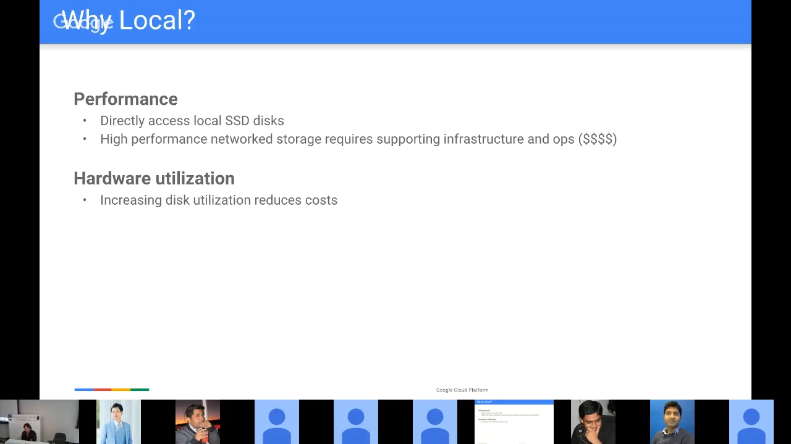
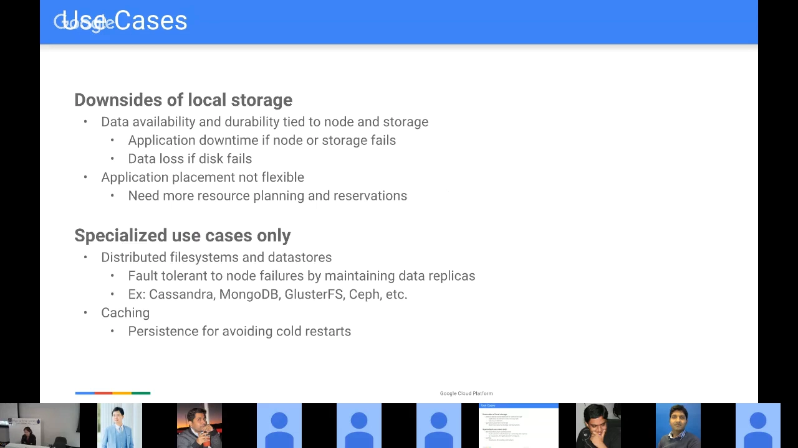
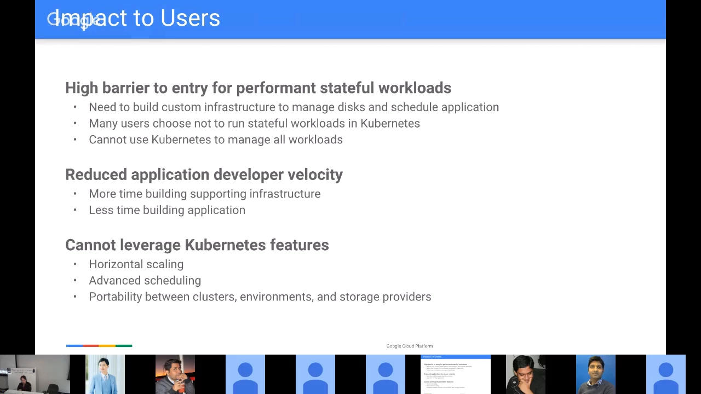
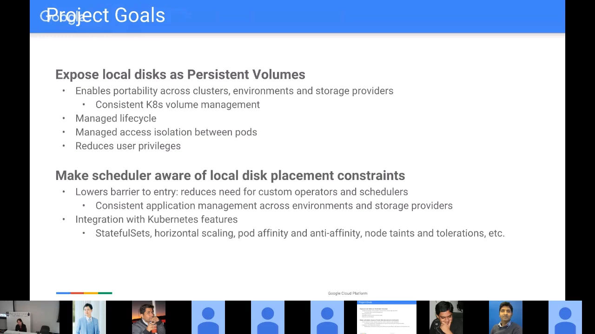
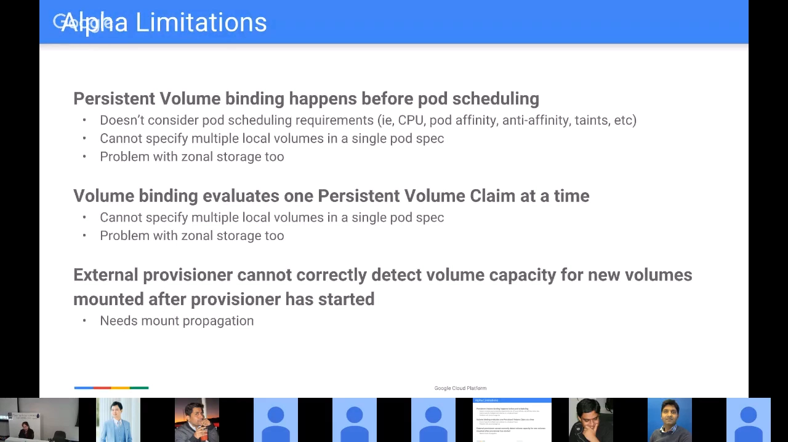
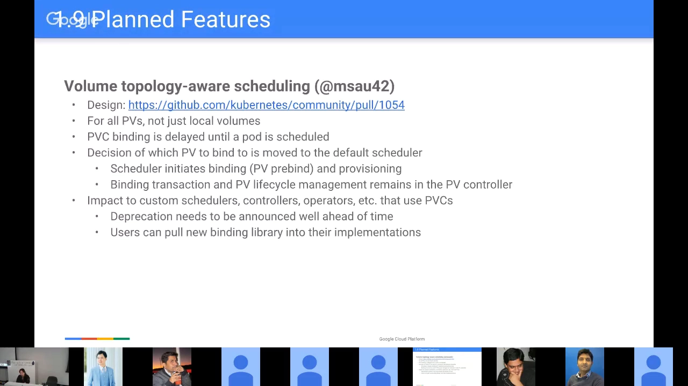
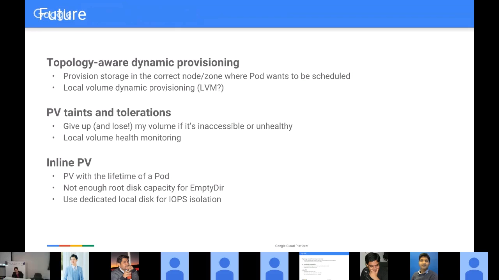

# 本地持久卷：把本地磁盘做成受拓扑约束的 PV

> 视频来源：[Local Persistent Storage Update — Michelle Au（Google），Kubernetes SIG Storage F2F，2017-10-16](https://www.youtube.com/watch?v=MBtx5jFUF0c)（YouTube，Kubernetes Storage SIG）｜时长约 64 分钟
>
> 这是本地持久卷（local persistent volume）项目的一手汇报：讲者既是 SIG Storage 的参与者，也是这套机制的作者。她把「为什么非要用本地盘 → 2017 年卡在哪 → 1.7/1.8 的 alpha 实现 → 1.9 要做的裸块、安全加固、拓扑感知调度 → 更远的未来」一条线讲完，中间穿插了大量现场问答。本文基于该视频的图-字幕文稿整理，可逐帧核对；文稿里的现场问答（原始字幕记为 `[Q]` / `[A]`）已按语义归并到对应段落，一处含混的发言（30:37 附近）保持中性表述不做推断。

## 本讲要解决的核心问题（SCQA）

**背景**：在 Kubernetes 上跑有状态应用时，本地磁盘（尤其是本地 SSD）是最想用的一类存储——它性能最好、又不用为网络存储另建一整套基础设施。但在 2017 年，想在 Kubernetes 里用本地盘，只有 `hostPath` 这一条路。

**冲突**：`hostPath` 带来两个致命问题。一是**调度器根本不知道本地磁盘的位置约束**：调度器的默认假设是「你的工作负载可以落在任何节点上」，它不知道你声明的那块盘只长在某一台机器上；二是 `hostPath` 自身难用——卷的生命周期没人管、多个 Pod 可以写同一个路径、权限过大（Pod 能指定系统上任意路径）、spec 到别的集群就不可移植。结果是用户被迫自建调度器、自定义 Operator 或自研管理方案，门槛很高，很多人干脆**不把有状态应用搬上 Kubernetes**，也就顺带失去了水平扩展、高级调度与可移植性。

**疑问**：能不能让本地磁盘变成一个「像云盘一样」的对象？又怎么让调度器知道「这块盘在 node1 上，所以用它的 Pod 只能去 node1」？

**回答（中心思想）**：这个项目用两条腿走路。第一条腿是**把本地磁盘暴露成 PV**——用 local volume 插件 + PV 的 node affinity + 静态 provisioner，把「一块本地盘」变成有托管生命周期、有隔离、可移植的持久卷；第二条腿是**让调度器感知本地盘的位置约束**——把「选哪块盘」这个决定从 PV 控制器**推迟到调度器**（延迟绑定 + pre-binding），让卷的拓扑约束和 Pod 的 CPU、亲和性、污点等约束**一起**参与计算。第二条腿就是后来 Kubernetes 里 `volumeBindingMode: WaitForFirstConsumer` 与 VolumeScheduling 机制的原型，也是本节「拓扑感知与调度约束」的起点。

## 一、为什么想用本地盘：性能与成本，以及它自带的三重代价

本地盘的价值有两个来源。**性能**：直接访问宿主机上的本地 SSD，而高性能网络存储需要大量配套基础设施，还要花钱。**硬件利用率**：数据中心里躺着的那些盘，要被用到极限才能摊薄成本。[【跳转到 01:02】](https://www.youtube.com/watch?v=MBtx5jFUF0c&t=62)

但本地盘也有代价，讲者把它讲得很直白：数据的**可用性与持久性绑定在节点和盘上**——节点或存储故障会让应用停摆，盘坏了可能直接丢数据；因此**应用放置不再灵活**，必须提前规划、把资源预留到具体节点上。

正因如此，本地盘**不是 Kubernetes 里的通用存储方案**，只适合两类用途：

- **分布式文件系统与数据存储**：这类应用天生对节点故障容错——副本本来就在多个节点上，能处理节点宕机、磁盘损坏，并从剩余副本重建数据。例子包括 MariaDB、MongoDB 集群、Ceph、GlusterFS 等等。
- **大缓存**：可以接受丢本地数据，但尽量别丢——冷启动时把数据重新灌进缓存的性能代价很大，还会影响可用性。

## 二、2017 年的两个卡点：调度器不认识本地盘，hostPath 又太难用

讲者把当时的问题归纳成两条。

**卡点一：调度器对本地存储的节点约束一无所知。** 今天的调度器假设你的负载可以调度到任何节点上；它不知道「你指定了这块本地盘，所以 Pod 实际上只能去某一个节点」。于是用户只能自己写调度逻辑。

**卡点二：唯一可用的 `hostPath` 有四个毛病。**

1. **生命周期无人管理**：Kubernetes 既不会创建也不会删除 `hostPath` 卷，建与清都由用户自己负责；
2. **路径容易冲突**：因为路径是写在 Pod 里的，两个 Pod 可以指定同一个或互相冲突的路径，没有任何机制阻止一个 Pod 干扰另一个；
3. **权限过大**：Pod 可以指定系统上的任意路径，可能破坏系统数据，甚至访问别人的卷——于是很多管理员索性**整体禁用 `hostPath`**；如果集群里恰好只有 `hostPath` 能满足某个应用，用户就彻底没辙了；
4. **不可移植**：spec 里必须写明「跑在哪个节点、数据在节点的哪个路径」，换一个环境就得改一遍，很难写出可以分享的通用 spec。 [【跳转到 03:57】](https://www.youtube.com/watch?v=MBtx5jFUF0c&t=237)

这些问题的下游影响被讲者逐条摊开：为了绕开它们，人们要自建调度器、自定义 Operator 和自研管理方案，**有状态工作负载的准入门槛被抬得很高**；开发效率被拖慢（时间花在搭基础设施而不是写应用上）；最要命的是，这些工作负载**用不上 Kubernetes 的水平扩展、高级调度与可移植性**——用户只能把它们放到 Kubernetes 之外当独立服务来管，也就无法用一套控制面统一部署和扩缩所有应用。

## 三、项目目标：让本地磁盘成为「一等公民」

项目有两条明确的目标，讲者把它们放在同一页里——因为它们是配套的。

**目标一：把本地磁盘暴露为 PV。** 一旦本地盘能用 `PersistentVolume` / `PersistentVolumeClaim` 这套抽象表达，收益立刻出现：

- **可移植**：spec 可以跨集群、跨环境搬；也能通过 StorageClass 在不同存储提供方之间切换（先拿远端盘开发，想要更高性能时换成本地盘）；
- **托管生命周期**：PV 有明确定义的生命周期；
- **Pod 之间的隔离**：一个 claim 只能绑定一个卷，所以「把每块盘做成一个 PV」就天然避免了多个 Pod 抢同一块本地盘；
- **权限收敛**：`hostPath` 的问题是 Pod 能指定任意路径；而 PV **只能由有管理员权限的人创建**，所以「哪些盘可用」由管理员决定，而不是由 Pod 决定。

**目标二：让调度器感知本地磁盘的放置约束。**解决了这一条，应用就不必再自写调度器去找「盘在哪个节点」，而且能**把卷的拓扑约束与 Kubernetes 其它调度能力叠在一起用**：StatefulSet 的扩缩、Pod 亲和与反亲和、污点与容忍，全部同时参与决策。 [【跳转到 07:42】](https://www.youtube.com/watch?v=MBtx5jFUF0c&t=462)

现场问答补充了几个容易误解的细节：

- **粒度可以比一块盘更小**：实现并不强制「必须是一整块盘或整个分区」，管理员可以决定是专用整盘、整个分区，还是文件系统里的一个共享目录；不过对高性能数据库、数据存储这类场景，为了性能有保障，通常会选择**专用盘**。
- **当时还没有通用的拓扑模型**：现场有人问「能不能让某块存储只映射到指定的一批工作节点」。讲者的回答是：当时**只有硬编码的 zone 标签**可用——PV 自带标签时，会把可用节点限制到具有相同标签的节点。更通用的拓扑机制（让用户自己定义「一个存储的可用区段」）被列为 **1.9 要设计的东西**，并且会在当季放出设计文档。

## 四、1.7 / 1.8 已经落地了什么：四个零件组成的 alpha 实现

讲者把已经实现的部分拆成四块。

**（1）一个新的 local volume 插件。** 它只能作为 PV 使用；alpha 阶段**只支持 filesystem 类型的卷**，也就是说本地存储**必须事先格式化好文件系统**，可以是一个挂载点，也可以是一个共享目录。

**（2）PV 的 node affinity + 配套的调度器谓词（predicate）。** 它相当于「卷对象上的 nodeSelector」：你可以写成「这个 PV 选择 `kubernetes.io/hostname` 等于 node1 的节点」。调度器读到 node affinity 后，把候选节点收敛到你指定的集合；对本地盘来说，这个集合通常只剩一个节点——于是「这块本地盘只能在 node1 上用」。

讲者当场点出了这个设计的边界：**它只看已经绑定好的 PV**，处理不了「PVC 还没绑定」的初始情况——那时还不知道哪些节点上有可用卷。而 PV 上的这段亲和信息**需要管理员来填**。现场有人追问「做自身复制的数据存储，它的副本逻辑对 Kubernetes 是不透明的，怎么把信息传递进来」：答案是——你在创建 PV 时说清「这个卷可以从节点 A、B、C 访问」，Pod 里的 PVC 绑定到这个 PV，调度器再顺着 claim 解引用到卷，推导出可以调度的节点集合。

**（3）管理本地卷的 external static provisioner。** 它当时还不是动态供给器；它作为 **DaemonSet 运行**，负责磁盘数据与生命周期：发现在节点上的本地卷并**自动为它们创建 PV**；当用户销毁卷或 claim 后，清理磁盘数据并重新建好以备再用。 [【跳转到 21:27】](https://www.youtube.com/watch?v=MBtx5jFUF0c&t=1287)

**（4）e2e 测试。** 覆盖正反两类用例，测试目录型与挂载型两种本地卷、同时挂载、背靠背（back-to-back）挂载，以及整个生命周期。

讲者还描绘了这个方向最让她兴奋的一点：**分布式数据管理平台其实长得都一样**——十节点的 Cassandra、十节点的 HDFS、十节点的 Gluster，都是「十个节点、每个节点各有一块本地盘」。这套机制一旦接上 **StatefulSet 的 `volumeClaimTemplate` + StorageClass**（给每块盘配同一个 StorageClass），就能变成「声明要一个 10 节点的集群」，系统自己去 StorageClass 对应的 PV 池里挑本地卷，调度器保证这些 Pod 只落在有盘的节点上；扩缩容和故障转移也都跟着自动化（配合污点与容忍，节点下线时还能避免网络复制风暴）。讲者也提醒这里有「潘多拉魔盒」式的问题，例如节点被移出集群时，这个亲和关系该怎么处理。

## 五、alpha 版本的三个硬伤：绑定发生在调度之前

这一节是全场的技术核心。讲者把 alpha 实现跑不通的场景列了三条，前两条**不只影响本地卷，也影响所有按拓扑分布的卷（比如云盘）**。

1. **PV 绑定发生在 Pod 被调度之前。** 绑定的时候，调度器还没看过这个 Pod，所以**完全无法考虑 Pod 的调度要求**——需要多少 CPU/内存、有没有亲和/反亲和、有没有污点，一律被忽略。结果就是：系统可能把一个 claim 绑到某个节点上的卷，而你的 Pod 根本调度不到那个节点。 [【跳转到 23:32】](https://www.youtube.com/watch?v=MBtx5jFUF0c&t=1412)
2. **绑定一次只评估一个 PVC，彼此之间没有协同。** 如果一个 Pod 声明了多个 claim，这些 claim 之间毫无关联，完全可能**分别绑到不同节点上的卷**，从而让 Pod 变得无法调度。（同样是 zone 级存储的老问题：两个卷被供给到了不同可用区，Pod 就调度不上去了。）
3. **本地卷特有的问题：没有 mount propagation。** provisioner 启动之后，用户新挂载的卷它探测不到，也就看不到新出现的卷容量。讲者认为，有了 mount propagation 之后这条不难修。

## 六、1.9 打算做什么：裸块、安全加固，以及把绑定决策搬进调度器

讲者把 1.9 的计划列为三块，最后一块是重头戏。

### 6.1 裸块（raw block）本地卷

由一位同事负责。要点是让**块设备与文件系统能在同一个挂载目录下被发现**（用符号链接把块设备暴露到文件系统所在的发现路径）。真正麻烦的是**清理**：清文件系统只要 `rm -rf`，很快；而块设备要反复写大量数据，所以实现了一个**离线、异步的卷删除流程**，还要加锁——防止用户没耐心，在卷还在清理时就把 PV 拿去用。清理方法按 StorageClass 可配置，因为磁盘硬件不同、清理要求也不同，无法只选一种：

- 开箱即用的最简单方案是「在块设备上新建一个文件系统，抹掉旧文件系统签名」；
- 管理员也可以换成重复覆写、shred 之类的自定义脚本；
- 有听众从 Cinder 的经验出发提醒：这类擦除如果 LVM 用得不小心，会周期性把系统搞挂，因此一定要控制资源占用、显式地限流；
- 有人建议用 LVM 精简置备（thin provisioning）绕过擦除——讲者的回应是：精简置备确实能在重新分配块时覆盖旧数据，但块总会被耗尽，而且这种「按需分配」的语义本身也要考虑；
- 也有厂商用「加密后丢密钥」的方式实现即时擦除，但讲者说这需要密钥管理服务（setup 时安装密钥、之后才能启用 PV），当时没有合适的密钥管理器，所以先把基础而通用的方案做好，并把擦除做成可配置。

另一个重要语义：**这些清理方法只在回收策略为 `Delete` 时触发**；如果设置成 `Retain`，就完全不触发，需要管理员按自己的流程手工清理。

### 6.2 本地 provisioner 的安全加固

原来的设计有个隐患：**几乎每个节点上的 Pod 都有修改 PV 的权限**，相当于把这份信任交给了「不可信的节点」。新的设计改成集中式：

- 一个**中心 master** 统一做所有 PV 交互；
- 每个节点上跑 worker（DaemonSet），只负责探测本地卷目录，把「有新卷了 / 底层有变化」上报给 master；
- **发现与删除都由 master 主动为对应节点创建 job** 去执行，worker 只做汇报与执行，不再自己改 PV。

### 6.3 卷拓扑感知调度（volume topology-aware scheduling）：把绑定决策交给调度器

这是 1.9 计划里最重要的一项，也正是本节「拓扑感知与调度约束」的主题。它要解决的就是第五节的两个通病：**绑定之前不知道 Pod 的要求、一次只看一个 PVC**。讲者特别强调，他们要做的是**对所有 PV 都通用的方案，而不是只给本地卷打补丁**，同时要能接上「任意拓扑」（不必为本地约束、zone 约束分别写死逻辑）。 [【跳转到 38:07】](https://www.youtube.com/watch?v=MBtx5jFUF0c&t=2287)

基本设计是：

1. **把 claim 的绑定推迟到 Pod 进入调度器之后**；
2. **由调度器来决定绑哪个 PV**——也就是把决策权从 PV 控制器搬到调度器；
3. 调度器做决定后，**按 PV 的 pre-binding 流程发起绑定**：把 PVC 的 `claimRef` 字段指向该 Pod 的 claim，剩下的绑定事务**仍由 PV 控制器完成**（当一个卷的 selector 里已经指定了 claim，PV 控制器就会去完成绑定）；
4. **PV 控制器继续负责 PV 生命周期的其余部分**：claim 被删除时释放卷，以及 Pod 还在运行时出现绑定问题时做修复。

讲者把影响也交代得很清楚，这一段现场讨论相当激烈：

- **会影响所有用到 PVC 的自定义调度器、控制器、Operator**——它们的绑定决策逻辑要跟着改。因此在弃用旧行为之前需要提前大规模公告。有人问「真的有很多人用自定义调度器吗」，讲者的回答是「确实存在，只是不清楚有多普遍」。
- **动态供给也要跟着延迟**：动态创建卷同样推迟到「有 Pod 需要被调度」时，由调度器触发。由此引出一个被现场点破的隐藏假设：今天的动态供给**不在容器启动的关键路径上**——有人习惯先创建一批 PVC，过两天存储就绪后再启动容器，容器启动是很快的。改成延迟绑定后，这个假设不再成立，**供给协议本身要改**。
- **与 CSI 的关系**：现场有人认为 CSI 的供给/删除、挂载/卸载本来就是相互独立的控制器，硬要挂进主调度器可能挂不上，供给协议需要改造；讲者承认这块得再想。
- **生效范围**：短期内这套行为只作用于 alpha 特性开关，但**这个特性适用于所有类型的 PV**，所以现场有人评价「这会是很大的破坏性变更」。
- **绕开调度器怎么办**：设计上还有一个洞——Pod spec 里可以直接写 `nodeName`，DaemonSet 也会绕过调度器；这些情况下 PVC 就不会再被绑定。与调度器团队讨论后，讲者认为修这个洞在调度器里可能要做不少工作，因此**不排除 1.9 只能交出一个原型**。
- **社区为什么还是值得做**：现场有听众说，对 on-prem 集群和 on-prem 本地存储来说，能真实地把工作负载落到「那块真实的本地盘」上非常重要，这个变更虽然破坏性大但是值得；讲者也强调，多可用区集群里「卷被供给到错误 zone，Pod 就调度不上去」的问题会一并被解决——问题的本质不是 PV 在哪，而是**PVC 绑到了哪一个 PV**。而随着亲和/反亲和这类非平凡策略越来越多，做 PVC→PV 绑定时把它们全部忽略，已经越来越说不过去。
- 有人担心「静态供给的用户本来就在认真做容量规划，这个变更的收益有多大」，讲者的回答是：我们关心的是**那些为存储做了规划、但没有为 CPU 等其它资源做规划的用户**，核心还是「你得把应用规模算对」；而如果要求为每个节点手写一份 pod spec，节点一增删就要维护上千份 spec，这就完全失去了接进 StatefulSet 自动扩缩的意义。
- 关于「复用一个已经供给好的卷」：**仍然沿用同一个 PVC**——调度器看 Pod 时读出它的 PVC，解引用到 PV，再取 PV 上的 node affinity 来判断可用节点。claim 本身的生命周期没变：Pod 删了 claim 还在，需要显式删除。
- 现场主持人还补充了当时的工程现实：调度器那一侧同时在动大手术（例如为解决优先级饥饿问题引入堆结构），「很多车都在这个路口开」，所以这项变更宁可慢一点、也不想做错；他甚至预计 **CSI 可能比它先落地**。（从后来的历史看，正是 `VolumeScheduling` 这条线把延迟绑定带进了 Kubernetes，并最终以 `volumeBindingMode: WaitForFirstConsumer` 的形式与 CSI 一起成为主流。）

### 6.4 1.9 计划一览

## 七、更远的未来：拓扑感知供给、PV 的污点与容忍、Inline PV

在 1.9 之后，讲者列了三个方向，并强调**它们都不只服务本地存储，而是适用于所有卷类型**：

- **拓扑感知的动态供给**：让供给器知道「要在哪个节点或哪个 zone 建卷」，这要在 Pod 被调度之后才能确定——它是延迟绑定设计的自然延伸。
- **PV 的污点与容忍**：本地盘有个固有尴尬——Pod 一旦用了某块盘，就永远被绑定在那个节点上；节点一死，Pod 就再也调度不出去。而项目瞄准的正是「应该能容忍节点故障」的分布式存储系统，所以它们需要一个办法：**放弃自己的卷、换到新节点的新盘上重新调度，再从副本重建数据**。 [【跳转到 58:32】](https://www.youtube.com/watch?v=MBtx5jFUF0c&t=3512)
- **Inline PV**：把 PV 的生命周期绑到 Pod 的生命周期，用于临时存储。动机很实际——**节点的 root disk 往往不够大**，你希望用一块专用盘来做临时数据；如果本机没有足够容量，也可以换成云上的卷。

收尾时讲者给出了 alpha 实现的文档入口、可直接用的 StatefulSet 示例，以及跟踪所有工作项的表格链接，并再次邀请社区对这份设计多提反馈——因为它「还会变很多」。

## 小结

- **本地盘只适合专门场景**：分布式文件系统/数据存储、以及大缓存；它有性能与成本优势，但可用性绑定在节点与盘上，放置不灵活。
- **2017 年的两个卡点**：调度器不认识本地盘的节点约束；`hostPath` 生命周期无人管、路径可冲突、权限过大、spec 不可移植——后果是用户自建调度器，或干脆不上 Kubernetes。
- **alpha 实现的四个零件**：local volume 插件（仅 PV、仅 filesystem）、PV node affinity + 调度器谓词（相当于卷上的 nodeSelector，但只管已绑定的 PV）、external static provisioner（DaemonSet 发现本地盘并创建 PV）、e2e 测试。
- **alpha 的三个硬伤**：绑定先于调度（无法考虑 Pod 要求）、一次只评估一个 PVC（多 claim 可能跨节点）、provisioner 探测不到启动后新挂载的卷（缺 mount propagation）。
- **1.9 的主线是「把绑定决策搬进调度器」**：延迟绑定 + pre-binding（写 `claimRef`）+ PV 控制器完成绑定与生命周期管理；它同时解决本地卷与 zonal 卷的问题，代价是要改动态供给协议、影响所有自定义调度器/控制器，且要提前公告弃用。
- **裸块与安全加固也在 1.9 里**：块设备清理难，所以做异步离线删除 + 锁 + 可配置清理方法（仅 `Delete` 回收策略触发）；provisioner 从「每个节点都能改 PV」改为「中心 master + 节点 worker」。
- **未来方向**：拓扑感知动态供给、PV 污点与容忍（节点死了能放弃卷、换节点重建）、Inline PV（用专用盘做临时存储）。

## 关键术语速查

| 术语 | 一句话解释 |
| --- | --- |
| local volume 插件 | 把节点上的一块本地盘（或分区、目录）暴露成 PV 的卷插件，alpha 阶段只支持已格式化的文件系统卷 |
| PV node affinity | 写在 PV 上的「这个卷可以从哪些节点访问」的约束，相当于卷对象上的 nodeSelector |
| scheduler predicate | 调度器用来筛掉不合适节点的判断逻辑；这里用它读 PV 的 node affinity，把候选节点收敛到有盘的那些节点 |
| pre-binding / `claimRef` | 绑定前先把 PVC 的 `claimRef` 指向某个 PV，等于「预留」；PV 控制器看到 selector 里已有 claim 就完成绑定 |
| Pending / Bound | PVC 未绑定时的状态与已绑定到 PV 的状态；延迟绑定意味着 PVC 会先停在未绑定状态，等第一个用到它的 Pod 被调度 |
| external static provisioner | 跑成 DaemonSet 的外部组件：发现节点上的本地卷并自动创建 PV，删除 claim 后清理并回收磁盘 |
| mount propagation | 让容器/进程能看见「之后才挂载进来」的挂载点的机制；缺了它，provisioner 探测不到启动后新挂的卷 |
| reclaim policy（Retain / Delete） | 卷的回收策略；本地卷的自动清理只在 `Delete` 时触发，`Retain` 时需人工处理 |
| volume topology-aware scheduling | 延迟 PVC 绑定、由调度器决定绑哪个 PV 的设计，即后来 `WaitForFirstConsumer` 与 VolumeScheduling 的原型 |
| raw block volume | 不以文件系统、而以裸块设备形式挂进容器的卷；清理需要覆写数据，因此要异步删除与加锁 |
