# Kubernetes CSI 架构剖析：控制面与节点面如何把存储接进集群

> 视频来源：[K8s CSI 剖析（phoa-ldnn）](https://www.bilibili.com/video/BV1ne411y7ML/)（Bilibili）｜时长约 58 分钟
>
> 本视频按「CSI 演进 → 流程架构 → 运作机制 → 规范使用」四个章节，把 CSI 的组件分工、sidecar 容器、插件注册与通信机制、一次挂载的完整流转讲了一遍。本文基于该视频的图-字幕文稿整理，可逐帧核对；已订正自动字幕的明显错拼：`084 的转管理`→**K8S 的卷（volume）管理**、`horse pass`→**hostPath**、`MPADIR`/`emptyDir`→**emptyDir**、`NNFS`/`SFYNFS`→**NFS**、`flex wo/弗莱说`→**FlexVolume**、`glass fs`→**GlusterFS**、`js map`→**tmpfs**、`母亲/母鸡`→**宿主机**、`node driver registr/REGISTRONG`→**node-driver-registrar**、`LEX`→**liveness（健康检查）**、`provider/teacher/RESER/snap shooter`→**external-provisioner / external-attacher / external-resizer / external-snapshotter**、`intro`→**in-tree**、`turn a teacher/ctc`→**controller 侧组件**。

## 本讲要解决的核心问题（SCQA）

**背景**：Kubernetes 自己并不实现存储。它只负责编排，真正的存储盘来自 Ceph、GlusterFS、以及各家云的云盘。集群里有一个对象叫 **CSI（Container Storage Interface，容器存储接口）**——它是一份「存储插件该长什么样」的规范，让任何存储系统都能在不动 Kubernetes 主干代码的前提下接入进来。

**冲突**：绝大多数人只会「装好 CSI 驱动、照着文档写 StorageClass」，却说不出这套东西内部到底是怎么跑起来的：为什么 CSI 要分成两个插件？它周围的那些 provisioner、attacher、registrar 容器到底是谁？kubelet 又是怎么找到一个存储插件的？——这些恰是「会操作」与「懂机制」的分水岭。

**疑问**：CSI 规定了哪些东西？它的组件在控制面和节点面各自做什么？一块盘从 PVC 下发到挂进容器，中间到底发生了什么？

**回答（中心思想）**：**CSI 的本质，是把「存储供应」和「存储挂载」这两类操作，用一份统一规范拆成控制面插件和节点面插件两半**。控制面负责「把盘造出来、把盘的信息记进 PV」，节点面负责「把盘格式化并挂进容器」；两者之间通过 **VolumeAttachment** 和 **unix socket 上的 gRPC** 协作。一遍下来，一块盘要经历**两次 publish、三次 mount**。[【跳转到 00:00】](https://www.bilibili.com/video/BV1ne411y7ML/?t=0)

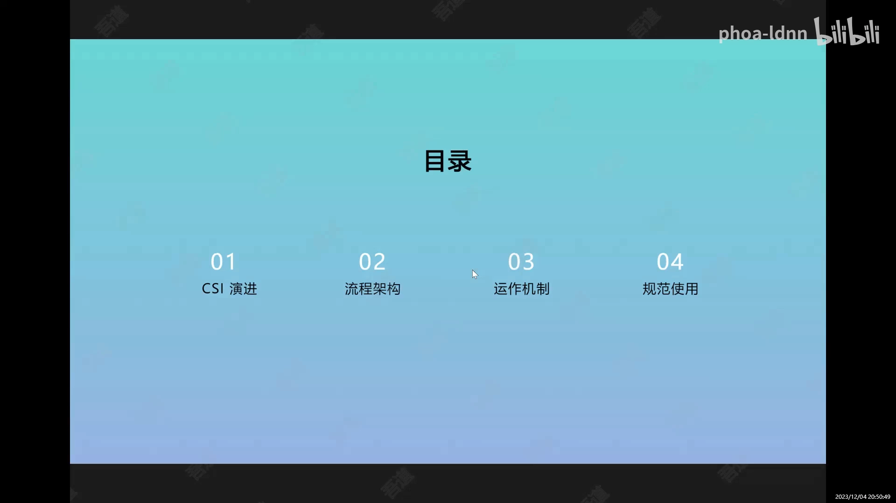

## 一、先看地图：从 in-tree 到 CSI，K8s 是怎么一路把存储解耦的

要讲清 CSI 为什么长成现在这样，得先看它之前的几代方案，以及每一代留下了什么坑。

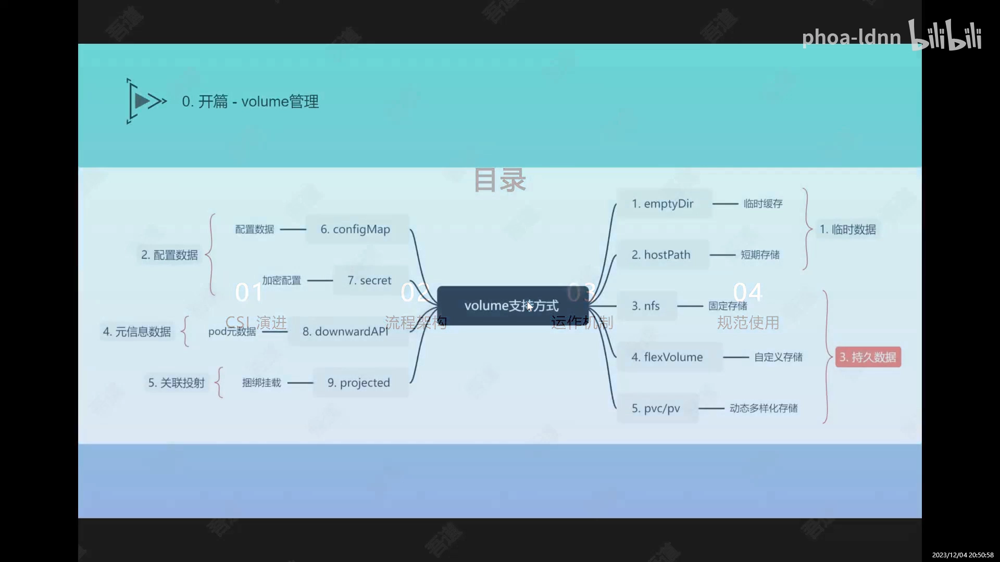

K8S 的卷大致分四类用途（视频开篇即按这四类铺开）：

- **临时数据**：`emptyDir`（临时缓存，生命周期与 Pod 绑定）、`hostPath`（映射到宿主机某个目录，只能短期使用）、`NFS`（网络文件系统，能存大量数据、存得久，但稳定性、容灾与分布式读写性能偏弱）。
- **持久数据**：`PV` / `PVC`，也就是本视频重点。
- **配置数据**：`configMap`、`secret`（可加密，用来放密码等敏感信息）。
- **元数据**：`downwardAPI`（把 Pod 的 IP、所在节点、镜像等信息以文件形式挂进容器）、`projected`（把 configMap、secret、serviceAccountToken 等捆绑投射到同一个目录）。

单机时代，容器要挂存储基本是「手动干活」：早期用虚拟机给容器挂一块虚拟盘再做格式化；单独用 Docker 时靠 `docker run -v` 把容器目录映射到宿主机目录；或者直接挂一个 NFS 路径。这种方式在大规模生产环境里非常吃力——每台宿主机都要单独管映射、管目录清理、管 NFS 的容量和权限，效率极低。[【跳转到 00:39】](https://www.bilibili.com/video/BV1ne411y7ML/?t=39)

于是 K8S 引入了**插件**。这段演进可以分成三代，每一代都解决了上一代的痛点，又暴露出新的痛点：

**第一代：in-tree（树内）插件。** 把所有存储插件的代码、开发、发版都放进 K8S **主干代码**里，跟 K8S 一起发版。好处是能支持更多存储系统；坏处是**耦合太重**——插件作者想修个 bug、加个功能，都得等 K8S 发大版本，用户也只能跟着大版本一起升级。[【跳转到 10:59】](https://www.bilibili.com/video/BV1ne411y7ML/?t=659)

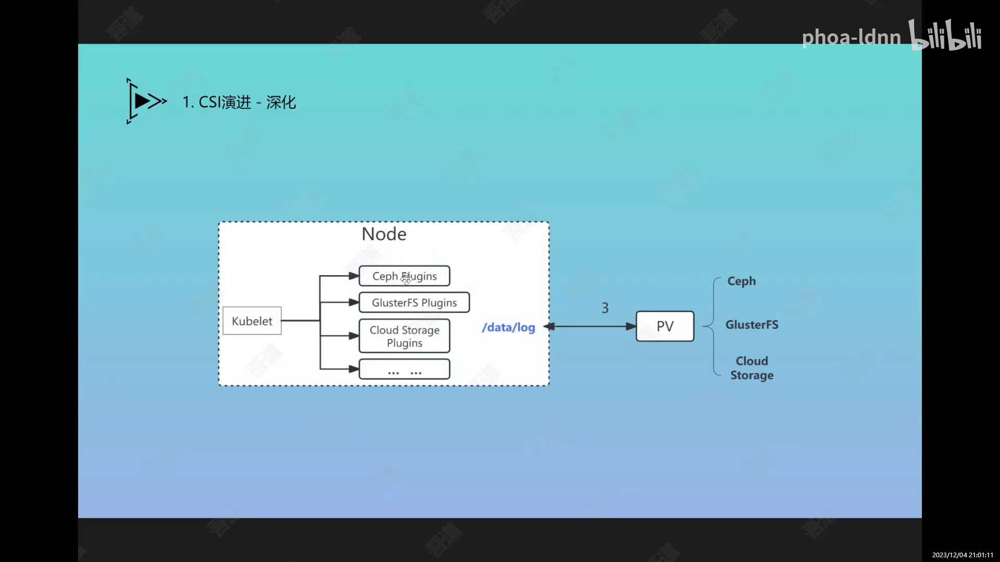

**第二代：FlexVolume。** 大约在 K8S 1.9 出现。它在 K8S 与插件之间加了一层**通用接口代理**：K8S 调 FlexVolume 接口，FlexVolume 再根据「插件注册信息 + PV 里的配置」找到对应的插件可执行文件去干活。这样插件就可以 **out-of-tree**（树外）单独发布、单独迭代了。[【跳转到 13:04】](https://www.bilibili.com/video/BV1ne411y7ML/?t=784)

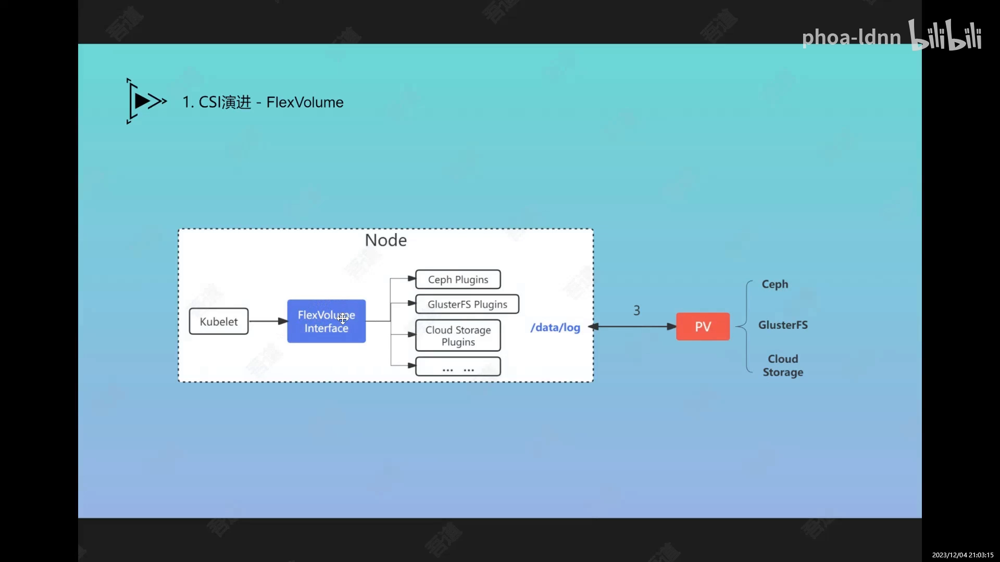

但 FlexVolume 仍有短板：插件的**分发和升级没有自动化**（得人工在每台机器上放可执行文件），而且**PV 必须提前手工创建**，没法在要用的时候动态申请——有状态服务要做动态扩缩容时就卡住了。

**第三代：CSI。** 正是冲着上面这些短板来的：既要插件能独立迭代，又要能自动分发到每个节点，还要支持动态创建存储盘。CSI 把插件明确拆成**控制面（Controller）与节点面（Node）两半**，并用一份规范把接口固定下来。[【跳转到 16:24】](https://www.bilibili.com/video/BV1ne411y7ML/?t=984)

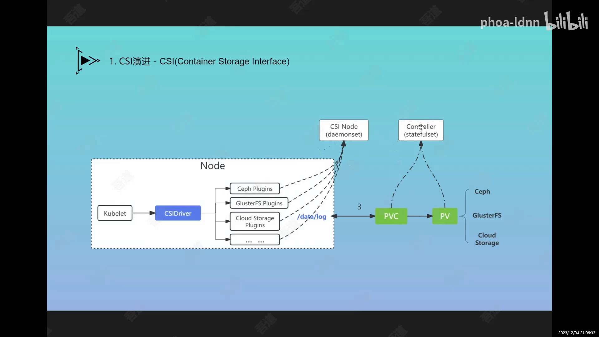

## 二、CSI 的两半：控制面插件与节点面插件

**CSI 的模式分成两块：一块是 CTRL 端（控制面），一块是 node 端（节点面）。** 这两半的部署形态和职责都不同，这是理解整个 CSI 的钥匙。[【跳转到 16:39】](https://www.bilibili.com/video/BV1ne411y7ML/?t=999)

- **控制面插件**：通常以 **StatefulSet** 部署（也允许 Deployment，由存储开发商自己决定，一般只需要一到两个副本）。它负责**存储供应系统的管理**——创建存储盘、回收存储盘，拿到存储系统返回的**唯一存储 ID**，把它记进 PV 的关联信息里，再通过 PVC 对外提供，并管理 PV/PVC 的状态与整个生命周期。
- **节点面插件**：以 **DaemonSet** 部署，跑在**每个节点**上。它负责两件事——**把插件注册到该节点**，以及**提供挂载能力**：通过 unix socket 暴露接口，当 kubelet 要创建容器、挂盘时，就通过对应的 CSI driver 调它来完成获取存储盘信息、把盘挂载到指定路径等操作。此外，节点面与控制面之间还有一条 **gRPC 连接**，主要用于健康检查。

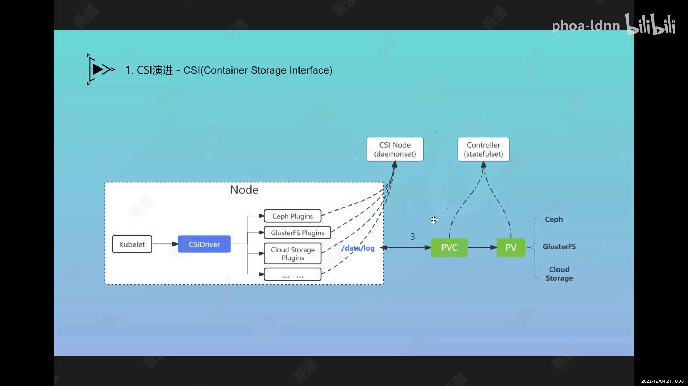

### 2.1 每一半都由「外置标准组件 + 自己实现的驱动」拼成

看 CSI 的架构模块图，会发现组件明确分成两栏：

- **外置组件（External Component）**：这是 CSI 规范要求的**通用标配**，基本不会有太大代码或接口改动。包括 `liveness-probe`（健康检查）、`external-provisioner`、`external-attacher`、`external-resizer`、`external-snapshotter`，以及 `node-driver-registrar`。
- **自定义组件（Custom Component）**：这才是**存储开发商自己实现**的部分，包括 `controller service`（与后端分布式存储系统打交道，做创建盘、回收盘、设置容量、设置快照等）和 `node service`（做挂载、格式化等）。

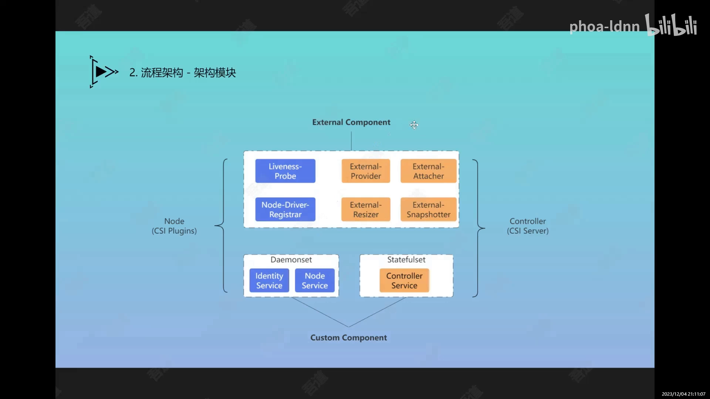

后面还会反复用到的四个 controller 侧 sidecar，各自管一件事：

| sidecar | 监听什么 | 调用驱动的哪个接口 | 干什么 |
| --- | --- | --- | --- |
| **external-provisioner** | PVC | `CreateVolume` | 动态创建存储盘，并创建对应的 PV |
| **external-attacher** | VolumeAttachment | `ControllerPublishVolume` / `ControllerUnpublishVolume` | 把盘 attach / detach 到节点 |
| **external-resizer** | PVC | `ControllerExpandVolume` | 扩容 |
| **external-snapshotter** | VolumeSnapshot 等 CRD | 快照相关接口 | 创建 / 删除 / 列出快照 |

## 三、控制面剖析：从 PVC 到「盘已就绪」

先看控制面侧的一条链路。当用户创建 PV/PVC（比如通过 Deployment 创建 workload 时动态生成 PVC，或用 template 里的 PVC），`external-provisioner` 监听到资源创建，就会调用 `control service`，让后端分布式存储系统（例如 Ceph）**分配一块存储盘**，并拿到该盘的唯一 ID。接着 `external-attacher` 把存储信息、前置校验、配置都管理好，写进 PV，并把 PV/PVC 置为**绑定**状态，随后通知节点面：**「供应侧已完全准备好，可以挂载了。」** 这就是第一次 publish（发布）。[【跳转到 25:32】](https://www.bilibili.com/video/BV1ne411y7ML/?t=1532)

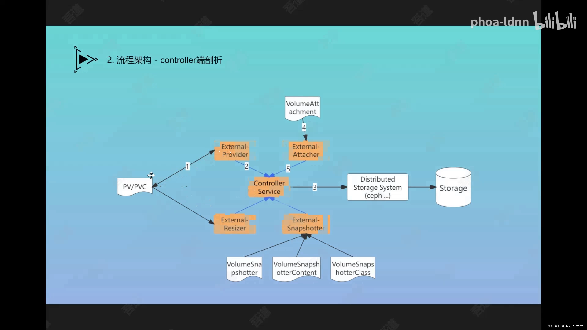

这里还有两条**额外的控制面流程**：`external-resizer` 做 PV/PVC 的**扩容**；`external-snapshotter` 做**快照**——它依赖一些自定义的 CRD 资源，如 `VolumeSnapshot`、`VolumeSnapshotContent`、`VolumeSnapshotClass`，可以针对 Ceph 之类的存储系统定期或按容量做快照，把数据阶段性差异化保存下来，便于及时恢复。快照平时用得不一定多，但在**高级别数据保障场景**下需求会比较多。

## 四、节点面剖析：注册、unix socket 与健康检查

再看节点面。部署时，node 插件以 DaemonSet 方式在每个节点上跑起来，它首先通过 **`node-driver-registrar`** 向 kubelet 注册：

1. registrar 在某个目录下**生成一个 unix socket 文件**；
2. kubelet 检测到该目录下有新文件，就知道这里出现了新插件；
3. kubelet 从 socket 询问这个插件提供**哪些能力**（健康检查、挂载、卸载、扩容、格式化、快照等）；
4. 拿到能力清单和 socket 路径后，后续创建容器、挂盘时，kubelet 就通过这个 socket 调 `node service` 做挂载、格式化等操作。

节点面与控制面之间还有一条 gRPC 连接，主要做健康检查。**关键路径**要记牢：插件的 unix socket 一般放在 `/var/lib/kubelet/plugins`（或 `/var/lib/kubelet/csi-plugins`）下，而**注册 socket 在 `/var/lib/kubelet/plugins_registry`** 下。至于 in-tree 时代或 FlexVolume 的可执行文件路径，因为 **K8S 1.23 之后 FlexVolume 也被淘汰、in-tree 早已淘汰**，现在几乎不用关注了。[【跳转到 45:03】](https://www.bilibili.com/video/BV1ne411y7ML/?t=2703)

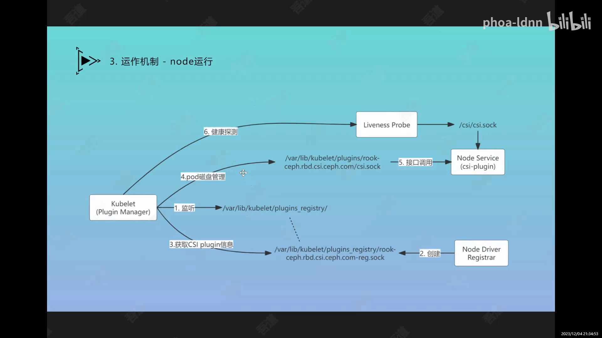

## 五、一次挂载的完整流转：两次 publish、三次 mount

把两侧合起来看，**「部署模块 → PVC/PV 的动态创建 → 记录发布 → Pod 创建时挂载」** 这条链路就完整了。[【跳转到 33:59】](https://www.bilibili.com/video/BV1ne411y7ML/?t=2039)

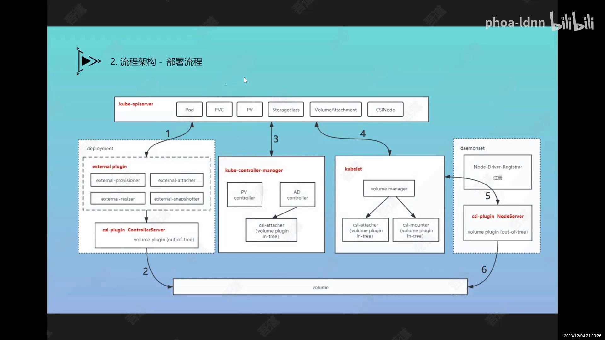

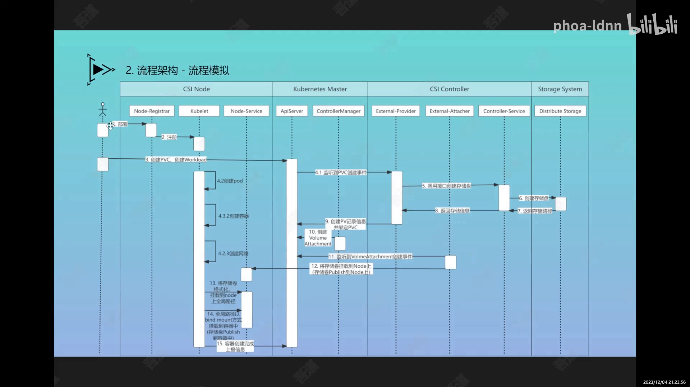

1. **部署**：把 CSI 的核心模块（control server 端 + node server 端）部署进集群。
2. **创建**：PVC 下发后，控制面在后端存储系统创建一块存储盘，把盘的 ID 和路径信息记录进 PV 相关信息。
3. **发布（第一次 publish）**：由 control server 侧触发，告诉 node service 可以做挂载了。
4. **挂载（节点面执行）**：Pod 被调度到某个节点后由 kubelet 创建，挂盘时调 CSI driver —— 若是块存储，先**格式化**，再 **mount 到全局路径（global path）**。
5. **映射（第二次 publish）**：以 **BindMount** 方式把全局路径再挂进容器的目标目录，容器就能读写这块盘了。

视频里把这一段讲得很形象：**三次 mount**。第一次，把一块块设备挂到宿主机上，「像把硬盘插到电脑上、通上电」；第二次，格式化之后把它挂到一个传输路径上（在宿主机上能看到了）；第三次，用 BindMount 把它从宿主机路径映射到容器里（在 Pod 里也能看到了）。所以整条链是**两次 publish**：第一次是「存储盘发布到 node」，第二次是「存储盘发布到容器」。[【跳转到 47:48】](https://www.bilibili.com/video/BV1ne411y7ML/?t=2868)

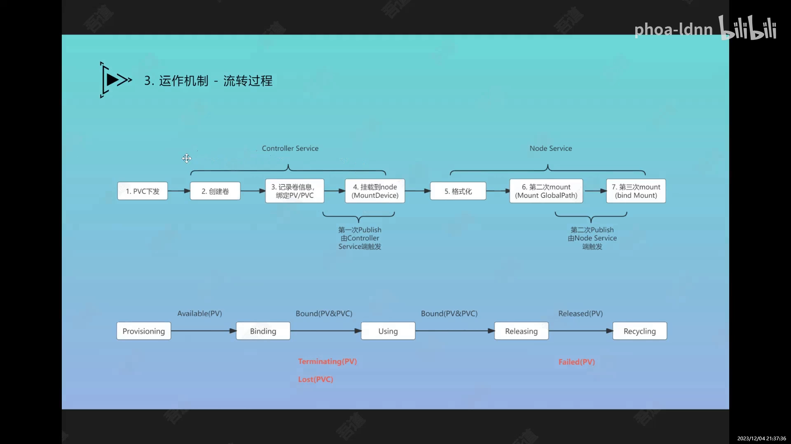

**存储卷的生命周期状态**也顺带串起来了：卷从 `Provisioning` → `Bound` → `In Use` → `Released` → 回收；对应的 PV 状态则是 `Available` → `Bound` → `Released`，异常时还有 `Failed`（释放失败）与 `Lost`（底层盘被误删）等红色状态——线上排障时，先看这个状态落在链上哪一环，往往就有方向了。

## 六、接口规范：控制器与节点各提供哪些方法

CSI 是一份**接口规范**，它把操作明确定义成两个服务上的方法。[【跳转到 39:16】](https://www.bilibili.com/video/BV1ne411y7ML/?t=2356)

**Controller 服务**的接口大致分几类：

- **卷操作**：`CreateVolume`（创建卷）、`DeleteVolume`（删除卷）、`ListVolumes`（列出卷）、`ValidateVolumeCapabilities`（校验卷能力，比如是否支持多节点挂载、是否支持多节点同时读写）；
- **获取卷信息**：容量、路径、读写状态等；
- **挂载管理**：`ControllerPublishVolume` / `ControllerUnpublishVolume` —— 前置准备（创建、记录、状态管理）完成后再写给 node 端；
- **容量管理**：获取存储系统容量、扩容；
- **快照管理**：创建 / 删除 / 列出快照；
- **基础能力**：`GetCapability` —— 声明这个 control service 支持哪些特性（是否支持获取容量、是否支持快照等）。

这些接口主要是给 **provisioner、attacher** 这类 sidecar 使用的。

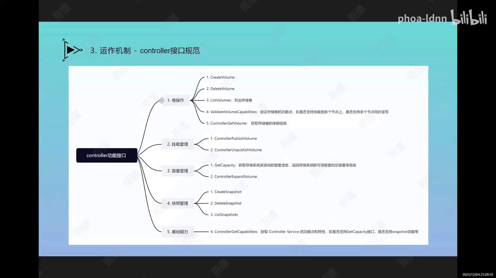

**Node 服务**的接口则聚焦在节点上的动作：

- **中间操作**：`NodeStageVolume` / `NodeUnstageVolume` —— 针对块设备做映射、格式化，并挂到全局路径；
- **挂载管理**：`NodePublishVolume` / `NodeUnpublishVolume` —— 挂载完成后通知 kubelet，让 PV/PVC 进入「使用中」状态；
- **容量管理与快照管理**：扩容、快照等。

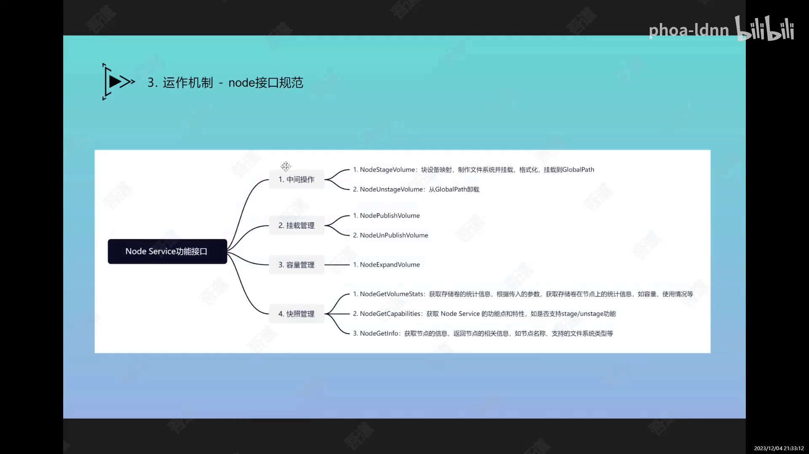

> 顺带一提：控制面的几个 sidecar（provisioner / attacher / resizer / snapshotter）都是**通过 API Server 监听资源事件，再用 RPC 调用 control service**。比如 provisioner 监听到 PVC 创建，就用 RPC 调 `CreateVolume`；这就是「控制器模式」在存储侧的又一次落地。

## 七、规范使用：读写模式、回收策略与卷类型

最后是日常最常打交道的三组「使用规范」。[【跳转到 52:07】](https://www.bilibili.com/video/BV1ne411y7ML/?t=3127)

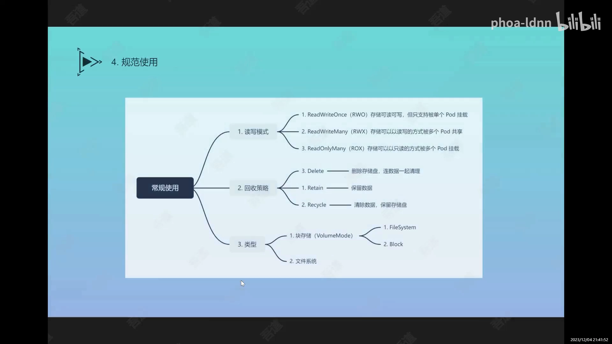

**读写模式（access modes）**：

- **RWO（ReadWriteOnce）**：可读可写，但**只支持被单个 Pod 挂载**。像 Ceph RBD 这样的块存储，因为要格式化、要重新挂载，通常只能是单挂。
- **RWX（ReadWriteMany）**：可读可写，且可被**多个 Pod 共享挂载**。像 CephFS 这种本身就是文件系统格式的存储、以及 NFS 都属此类。
- **ROX（ReadOnlyMany）**：以**只读**方式被多个 Pod 挂载，用得较少。

**回收策略（reclaim policy）**：

- **Retain**：workload 删除后**数据仍保留**在后端——这才是「持久存储」的含义；
- **Recycle**：清除数据、但保留存储盘，盘可以下次重新被挂载；
- **Delete**：连盘带数据一起删除，后端存储空间被回收。

**卷类型**：一类是**块存储**（裸块，需要格式化成 ext3/ext4/XFS 等文件系统后使用），另一类是**文件系统存储**（后端本来就有文件系统格式，如 CephFS，可直接使用）。

## 小结

- **CSI 的出现是一场「解耦」**：in-tree 把插件焊进 K8S 主干（耦合重、发版慢）→ FlexVolume 用接口代理把插件拆出去（仍无自动化）→ CSI 用一份规范统一了插件形态，并支持动态创建与自动分发。
- **CSI 分成控制面与节点面两半**：控制面（StatefulSet）管「造盘、记账、管生命周期」，节点面（DaemonSet）管「注册、挂载、格式化」。
- **每一半都由「外置标准 sidecar + 自研驱动」拼成**：provisioner / attacher / resizer / snapshotter / liveness / registrar 是标配，controller service / node service 是存储商自己写的。
- **注册靠 socket 文件**：node-driver-registrar 在 `/var/lib/kubelet/plugins_registry` 生成 socket，kubelet 据此发现插件，再经插件的 unix socket 调用。
- **一次挂载是「两次 publish、三次 mount」**：发布到 node（NodeStageVolume）→ 发布到容器（NodePublishVolume）；第一次挂载块设备、第二次格式化挂到全局路径、第三次 BindMount 进容器。
- **状态机是排障地图**：卷 `Provisioning → Bound → In Use → Released → Recycling`，PV `Available → Bound → Released`，异常落 `Failed` / `Lost`。
- **使用规范三件事**：读写模式（RWO / RWX / ROX）、回收策略（Retain / Recycle / Delete）、卷类型（块 / 文件系统）。

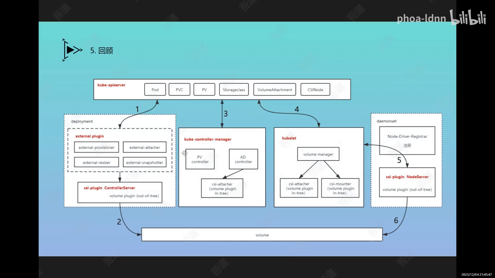

## 关键术语速查

| 术语 | 一句话解释 |
| --- | --- |
| **CSI** | Container Storage Interface，容器存储接口，一份让任意存储系统接入 K8S 的规范 |
| **in-tree / out-of-tree** | 树内 / 树外：插件代码是否长在 K8S 主干代码里 |
| **FlexVolume** | CSI 之前的过渡方案，用一层接口代理把插件拆出主干，但无自动化分发 |
| **控制面插件（Controller）** | 一般以 StatefulSet 部署，负责创建/回收存储盘、写 PV、管生命周期 |
| **节点面插件（Node）** | 以 DaemonSet 部署在每个节点，负责注册与挂载 |
| **external-provisioner** | sidecar，监听 PVC，调 `CreateVolume` 创建盘与 PV |
| **external-attacher** | sidecar，监听 VolumeAttachment，调 `ControllerPublishVolume` 把盘 attach 到节点 |
| **node-driver-registrar** | 在节点上生成 socket，把插件注册给 kubelet |
| **liveness-probe** | 健康检查 sidecar，探测 control server 是否正常 |
| **VolumeAttachment** | 描述「某块卷是否挂到某节点」的对象，attacher 据此驱动 attach/detach |
| **NodeStageVolume / NodePublishVolume** | 节点侧中间操作 / 挂载管理：前者格式化并挂到全局路径，后者 BindMount 进容器 |
| **RWO / RWX / ROX** | 读写模式：单 Pod 读写 / 多 Pod 读写 / 多 Pod 只读 |
| **Retain / Recycle / Delete** | 回收策略：保留数据 / 清数据留盘 / 连盘带数据删除 |
