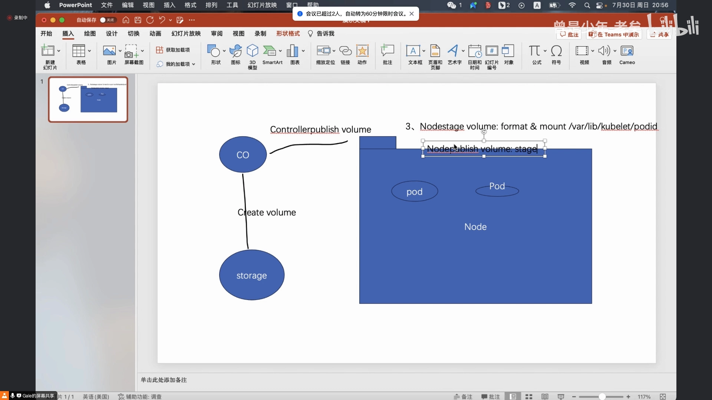
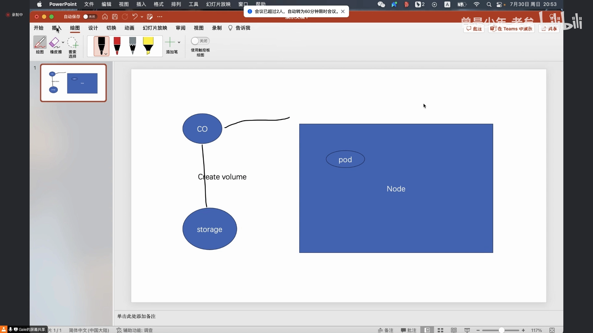
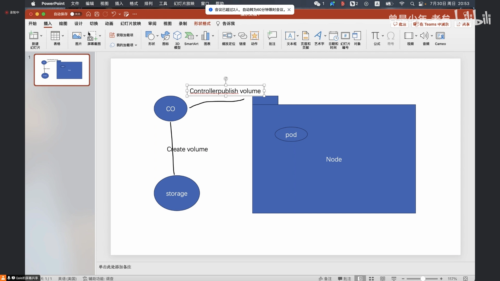
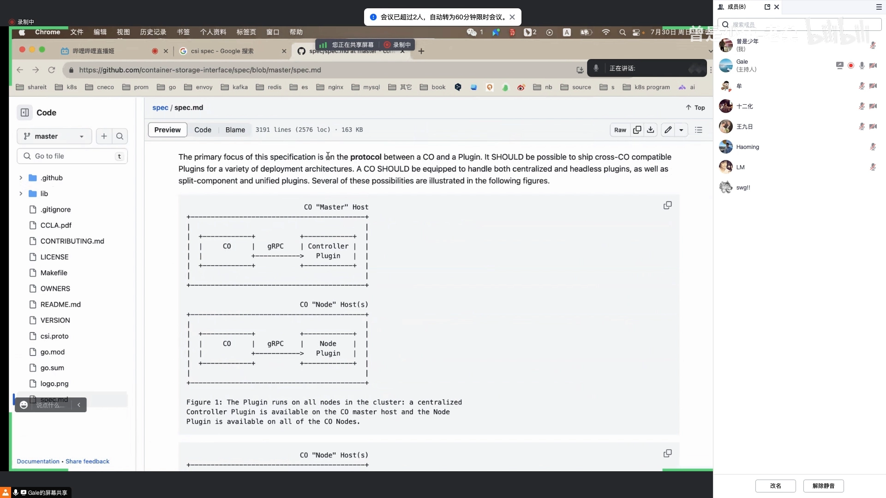
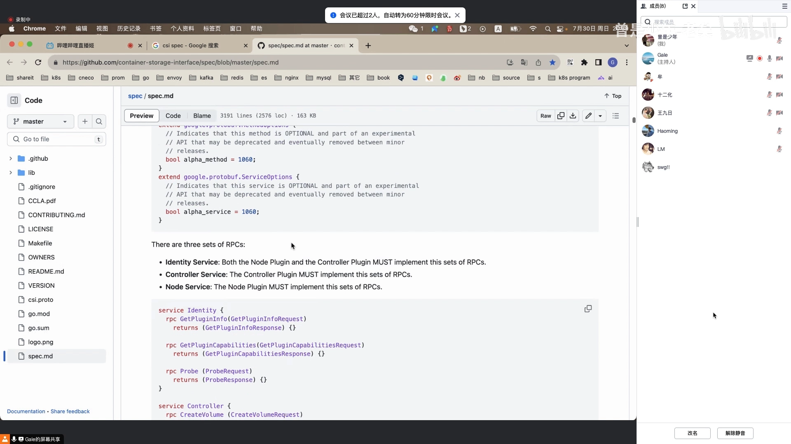
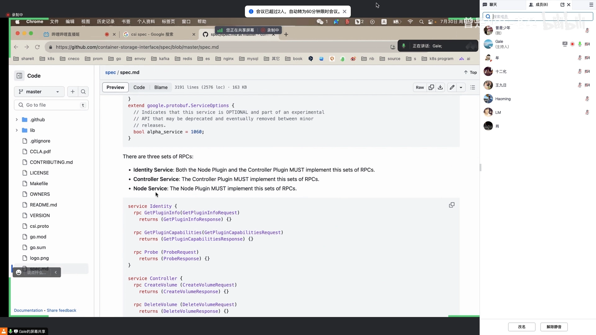
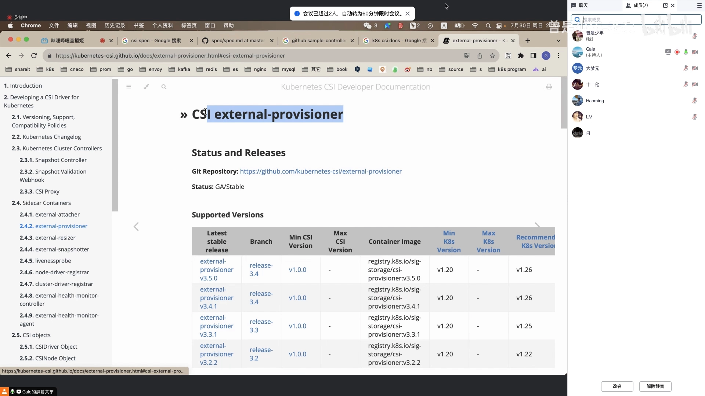
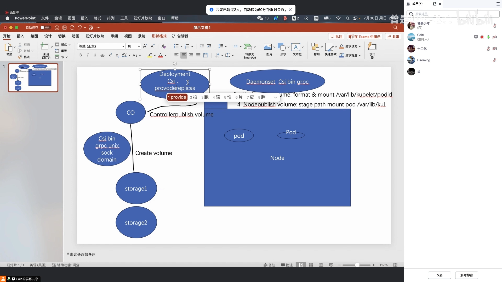
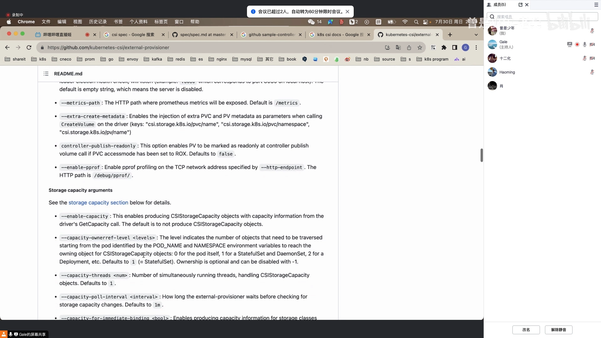

# 容器存储接口（CSI）上篇：三个 gRPC 服务与三个 sidecar 容器

> 视频来源：[容器存储插件 CSI（上）（phoa-ldnn）](https://www.bilibili.com/video/BV1VV411G7U6/)（Bilibili）｜时长约 39 分钟
>
> 这是「kubernetes 源码刨析专题」里讲 CSI 的上篇。讲者没有停留在「怎么用」，而是直接把 CSI 规范拆开：一次卷操作要经过哪些方法、为什么要把它们拆成三个 gRPC 服务、插件本体和那些 provisioner / attacher / registrar 容器到底是什么关系。本文基于该视频的图-字幕文稿整理，可逐帧核对；已订正自动字幕的明显错拼：`co/SM`→**CO（Container Orchestrator）/ Swarm**、`on node on public`→**NodeUnpublishVolume**、`control publish 高流`→**ControllerPublishVolume**、`node stage86`→**NodeStageVolume**、`endeity service/INDETTCINDEITY`→**Identity Service**、`control3VC/node3VC`→**Controller / Node Service**、`jr tpc/DRPC/对 PC`→**gRPC**、`unit locket/unit so`→**unix socket**、`scar卡分/scr content`→**sidecar**、`csi provide provider`→**csi-provisioner**、`Value more touch touch ment`→**VolumeAttachment**、`CPLIGHT/CBLIGHT/COLLI`→**kubelet**、`KPL`→**K8S / kubelet**。

## 本讲要解决的核心问题（SCQA）

**背景**：用 CSI 驱动做持久化存储的人很多，但多数人对它的印象还停留在「装个 helm chart、写个 StorageClass」。而 CSI 其实是一份**独立于 Kubernetes 的规范**——它定义的是一套「容器编排器和存储系统之间怎么对话」的接口。

**冲突**：正因为规范是独立的，很多人第一次翻开 CSI 文档时会被绕晕：为什么同一个存储要部署成两个插件？`CreateVolume`、`ControllerPublishVolume`、`NodeStageVolume`、`NodePublishVolume` 这一长串方法各是哪一步？旁边那些 `csi-provisioner`、`external-attacher`、`node-driver-registrar` 又是在替谁干活？

**疑问**：CSI 到底规定了什么？这些方法为什么被归到三个 gRPC 服务里？插件本体和这些 sidecar 容器是怎么配合、又怎么和 Kubernetes 联动的？

**回答（中心思想）**：**CSI 把一个存储插件切成「控制面」和「节点面」两部分，并把它们的方法收进三个 gRPC 服务：Identity 负责身份，Controller 负责「造盘、附加到节点」，Node 负责「在节点上格式化、挂进容器」。** 插件本体是一个实现了这三个服务的二进制；`csi-provisioner`、`external-attacher`、`node-driver-registrar` 则是替 Kubernetes 去调用这个二进制的 sidecar 容器。[【跳转到 00:00】](https://www.bilibili.com/video/BV1VV411G7U6/?t=0)

## 一、CSI 是什么：让任意存储接进任意编排器

CSI 定义的就是**容器存储接口**。它的对话双方是：

- 一侧是 **CO（Container Orchestrator，容器编排器）**——注意，**CO 不一定是 K8S**，也可能是 Swarm 或其他编排器，因为 CSI 的定位就是通用的。
- 另一侧是**存储系统**，可能是企业自研的分布式存储，也可能是云厂商的云盘。

容器本质是一个运行在某个 node 上的进程，所以「给容器创建存储」这件事天然横跨两台机器：编排器要去调存储系统**创建一块持久化存储盘**，再想办法把这块盘**接到容器所运行的那个节点、那个容器里**。[【跳转到 00:00】](https://www.bilibili.com/video/BV1VV411G7U6/?t=0)

这就引出了 CSI 规范里最核心的**一串方法**，它们描述了一块盘从无到有、再从有到被容器用起来的全过程：

| 方法 | 作用 |
| --- | --- |
| **CreateVolume** | 让存储系统创建一块盘，返回盘的信息 |
| **ControllerPublishVolume** | 把创建好的盘**附加（attach）到目标节点**上——这一步属于控制中心 |
| **NodeStageVolume** | 把盘**格式化**，并 mount 到一个**暂存（staging）目录**——这一步在节点上做 |
| **NodePublishVolume** | 把暂存目录里的内容 **mount 到容器真正要用的目录** |
| **NodeUnpublishVolume / NodeUnstageVolume** | 上面两步的反向操作：从容器目录卸载、从暂存目录卸载 |
| **ControllerUnpublishVolume / DeleteVolume** | 把盘从节点上 detach、销毁这块盘 |

### 1.1 为什么「暂存」这一步必须存在

一个细节值得单独说：**为什么有 NodeStageVolume 之后还要有 NodePublishVolume？**

因为一块盘在同一个节点上**可能被多个 Pod 共用**。同一块盘没法直接挂到每个容器上，所以 CSI 拆成两步：先把盘格式化并挂到一个**节点级的暂存目录**（NodeStageVolume），之后再把这个目录分别映射到各个容器的目标目录（NodePublishVolume）。[【跳转到 04:57】](https://www.bilibili.com/video/BV1VV411G7U6/?t=297)

删除时也是对称的：NodeUnpublishVolume 把容器目录卸载、NodeUnstageVolume 把暂存目录卸载、ControllerUnpublishVolume 把盘从节点 detach、DeleteVolume 销毁盘。

## 二、为什么归成三个 gRPC 服务：Identity / Controller / Node

CSI 规范把这几个操作，**收进了三个 gRPC 服务**——因为 K8S 与外部系统交互走的是 gRPC。[【跳转到 08:21】](https://www.bilibili.com/video/BV1VV411G7U6/?t=501)

- **Identity Service（身份服务）**：给这个存储系统做「身份认证」——它叫什么、有什么功能。因为同一个 K8S 里可能同时对接多个外部存储（存储系统一、二、三），需要能区分。[【跳转到 09:39】](https://www.bilibili.com/video/BV1VV411G7U6/?t=579)
- **Controller Service（控制器服务）**：承载需要在**控制中心**完成的那些方法，比如 `CreateVolume`、`ControllerPublishVolume`——它们不需要在节点上执行。
- **Node Service（节点服务）**：承载必须在**具体节点上**完成的方法，比如格式化、`NodeStageVolume`、`NodePublishVolume`。它**不包含**那两个控制中心的方法。

为什么要把「哪些方法属于控制中心」讲清楚？因为**判断一个操作该放在哪，看的不是它重不重要，而是它要不要登到节点上敲 Linux 命令**。创建盘、把盘 attach 到节点，都是控制中心干的；而「在节点上格式化一块盘」「把盘 mount 到某个目录」，传统上是要 SSH 到那台机器上执行的，所以必须由节点上的插件来做。Node 服务里**没有** ControllerPublishVolume 这类方法，正是这个道理。[【跳转到 09:39】](https://www.bilibili.com/video/BV1VV411G7U6/?t=579)

## 三、插件本体：一个二进制，把三个服务全实现

写 CSI 插件时，通常会把它实现成一个 **Go 二进制文件**（在 Go 里，每个 gRPC 服务就是一个接口，接口里有要实现的方法）。虽然插件分控制面和节点面，但**一般会把三个服务要实现的全部方法都实现在同一个二进制里**——部署时再决定这个二进制扮演哪一面的角色。[【跳转到 10:00】](https://www.bilibili.com/video/BV1VV411G7U6/?t=600)

于是就有了 CSI 规范里那张经典的**部署图**：

- **Controller 插件**：部署成一个 **Deployment**（一个或两个副本即可），容器里跑这个 CSI 二进制的 gRPC 服务。因为它只是控制服务，可以跑在 master 上，也可以跑在 node 上。
- **Node 插件**：部署成一个 **DaemonSet**，跑在**所有节点**上。

规范里其实画了**三种部署方式**：

1. 常规：Controller 插件在一处、Node 插件在每个节点；
2. Controller 插件也放在节点上跑；
3. **只部署 Node 插件**——在一些特定情况下（比如根本不需要外部云盘、节点本机就有很多磁盘），只需要本地处理这台机器上的磁盘，不需要调外部接口创建盘，那就连 Controller 服务都可以不要。

### 3.1 规范还定义了错误码和环境变量

规范不只管「成功路径」：每个方法**可能产生错误**（比如参数不对、云盘创建失败）。所以 CSI 也定义了 **RPC 错误码**——容器编排系统传了不合法参数，`CreateVolume` 就该返回「参数验证错误（InvalidArgument）」；如果是内部错误，则返回对应的 gRPC 错误码。

此外还有一个关键的环境变量问题：**我们写好的 CSI 插件是一个 gRPC 服务，容器编排系统怎么去调它？** 一般程序会监听在一个 socket 上（TCP/UDP 或本地 unix socket），而 **CSI 规范规定，容器编排系统通过 unix socket 来调这个 gRPC 服务**，并把 socket 路径**通过环境变量**告诉插件。[【跳转到 18:26】](https://www.bilibili.com/video/BV1VV411G7U6/?t=1106)

## 四、它怎么和 K8S 联动：控制器模式 + 三个 sidecar

讲到这里，CSI 还只是一份「和 K8S 无关」的规范。真正把它接进 K8S 的，是**控制器模式**和几个 **sidecar 容器**。

K8S 的 API Server 只负责定义资源清单，客户端用 client-go（informer 做 list-watch）去监听资源变化；官方还提供了更高层的封装 `controller-runtime` 和 `kubebuilder`。所以「创建盘」这件事在 K8S 里的落地方式就是：**写几个控制器，去监听 K8S 资源，然后在自己的处理逻辑里调用 CSI 插件的方法**。这些控制器就是 sidecar 容器，它们不集成在 kubelet 里，代码在 GitHub 上由官方维护。[【跳转到 23:57】](https://www.bilibili.com/video/BV1VV411G7U6/?t=1437)

### 4.1 csi-provisioner：监听 PVC，调 CreateVolume

`csi-provisioner`（CSI provisioner）本质上就是一个 **K8S 客户端**，它 list-watch K8S 里的 **PVC** 等资源，然后在自己的 sync handler 里调用**插件写好的 `CreateVolume` 方法**。

调用时会带上创建盘所需的参数：需要多大的盘、什么类型的盘；如果用的是云盘，还会带上**可用区（AZ）**——因为云盘要指定在北京一区还是二区，这个信息会作为参数传给 `CreateVolume`。方法返回一个 response 后，provisioner 会**创建一个 PV 对象**，把返回的 **volume UUID** 以及它属于哪个可用区（topology 域）写进 PV 里。[【跳转到 23:57】](https://www.bilibili.com/video/BV1VV411G7U6/?t=1437)

### 4.2 external-attacher 与 VolumeAttachment：把盘 attach 到节点

第二个 sidecar 是 `external-attacher`（外部 attach），它的工作方式和 provisioner 类似，但监听的是 K8S 里一种叫 **VolumeAttachment** 的资源。它在 sync handler 里调用插件的 **`ControllerPublishVolume`** 方法——把创建好的盘**挂载到那台节点上**。[【跳转到 31:53】](https://www.bilibili.com/video/BV1VV411G7U6/?t=1913)

这里有一条很容易被忽略的机制：

- **VolumeAttachment 对象里有一个字段，表示这块卷是否已经挂到目标节点上**，初始为 `false`。attacher 只有在它为 `false` 时才会执行挂载；挂载成功后把它置为 `true`。
- VolumeAttachment 对应的**控制器同时存在于 kube-controller-manager 和 kubelet 里**，默认都启用。它的作用是：当某个 Pod 被调度到一个节点上时，去 list 该节点上的所有 Pod，检查它们是否用到了 PV；如果发现 node 的 status 里期望「某块盘应挂到此节点」但实际还没挂，就**创建出一个 VolumeAttachment 对象**。

于是流程闭环了：**Pod 调度 → 控制器发现需要挂盘 → 创建 VolumeAttachment → external-attacher 监听到 → 调 ControllerPublishVolume 完成 attach**。

### 4.3 node-driver-registrar：让 kubelet 认识这个插件

第三个关键容器是 **node-driver-registrar**。kubelet 本身支持插件机制：插件把监听的 unix socket **共享到宿主机**上的一个目录（kubelet 识别的目录），kubelet 就知道「这个节点上存在这个插件」，并把它注册进来。之后 kubelet 创建容器时，就会调用 CSI 二进制实现的方法去干活。[【跳转到 36:00】](https://www.bilibili.com/video/BV1VV411G7U6/?t=2160)

## 五、合起来看：一个 Deployment + 一个 DaemonSet

把上面的组件落到部署上，就是**一个 Deployment 里放三个容器**：

- **插件本体**（自己写的 CSI 二进制，监听 unix socket）；
- **provisioner 容器**（调 CreateVolume）；
- **attacher 容器**（调 ControllerPublishVolume）。

后两者属于**控制平面**，不需要在节点上做操作，所以它们就是 **sidecar 容器**——它们调用的是插件暴露的同一个 CSI unix socket。[【跳转到 38:00】](https://www.bilibili.com/video/BV1VV411G7U6/?t=2280)

而节点侧用 DaemonSet 部署时，除了部署**插件本体**（监听 unix socket），还要部署 **node-driver-registrar**——它也通过 unix socket 通信，负责把插件注册给 kubelet。最终，就是 **kubelet 调用插件的 CSI 接口**。

> 视频最后还点了一个特性：调用 `CreateVolume` 时，K8S 会把**创建好的 PVC 名字、PVC 所在的命名空间、以及 PV 的名字**作为 `extension`（额外元数据）参数一起传进来，供需要用到这些信息的驱动使用。

## 小结

- **CSI 是独立于 K8S 的规范**：对话双方是 CO（容器编排器，不一定是 K8S）与存储系统。
- **一次卷操作是一条方法链**：`CreateVolume → ControllerPublishVolume → NodeStageVolume → NodePublishVolume`，删除时反向。
- **拆成三个 gRPC 服务**：Identity（身份）、Controller（控制中心的方法）、Node（节点上的方法）；判据是「要不要登到节点上执行」。
- **插件本体是一个二进制**：三个服务的方法全部实现进去，部署时以 Deployment（控制面）或 DaemonSet（节点面）扮演不同角色。
- **和 K8S 联动靠 sidecar**：`csi-provisioner`（监听 PVC → CreateVolume → 建 PV）、`external-attacher`（监听 VolumeAttachment → ControllerPublishVolume）、`node-driver-registrar`（把插件注册给 kubelet）。
- **VolumeAttachment 是枢纽**：Pod 调度后由控制器创建它，attacher 据此完成 attach，并用一个布尔字段标记是否已挂载。
- **规范还管两件「杂事」**：RPC 错误码，以及通过环境变量传递的 unix socket 路径。

## 关键术语速查

| 术语 | 一句话解释 |
| --- | --- |
| **CSI** | Container Storage Interface，独立于 K8S 的容器存储接口规范 |
| **CO** | Container Orchestrator，容器编排器，不一定是 K8S |
| **Identity Service** | CSI 三个 gRPC 服务之一，负责插件身份与能力声明 |
| **Controller Service** | 承载控制中心侧方法（CreateVolume、ControllerPublishVolume 等） |
| **Node Service** | 承载节点侧方法（格式化、NodeStageVolume、NodePublishVolume 等） |
| **NodeStageVolume** | 在节点上格式化块设备并挂到节点级暂存目录 |
| **NodePublishVolume** | 把暂存目录映射到容器真正使用的目录 |
| **csi-provisioner** | sidecar，list-watch PVC，调 CreateVolume 创建盘并生成 PV |
| **external-attacher** | sidecar，list-watch VolumeAttachment，调 ControllerPublishVolume 把盘 attach 到节点 |
| **VolumeAttachment** | 描述「卷是否挂到某节点」的对象，是 attach 流程的枢纽 |
| **node-driver-registrar** | sidecar，把插件的 unix socket 注册给 kubelet |
| **sidecar** | 与插件本体同部署、替 K8S 去调用插件的辅助容器 |
