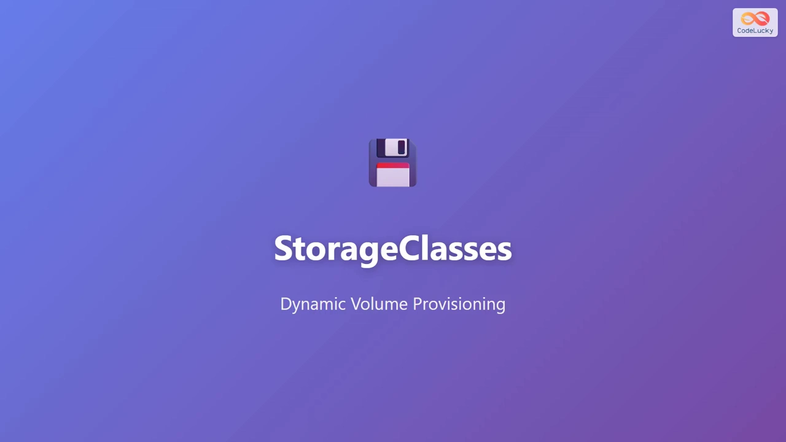
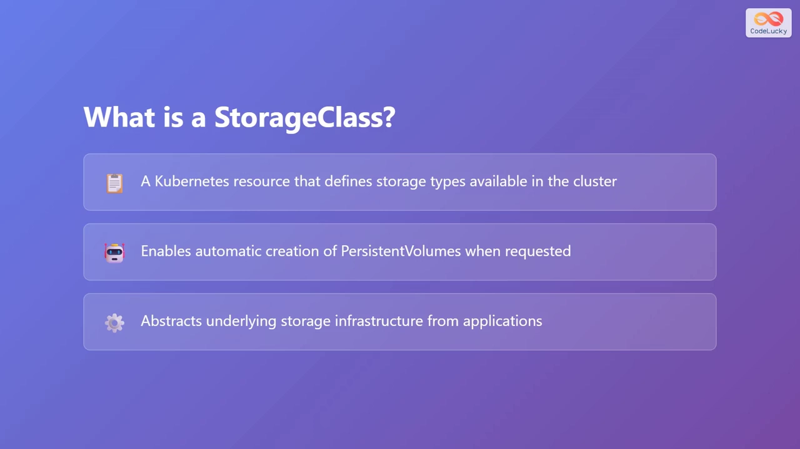
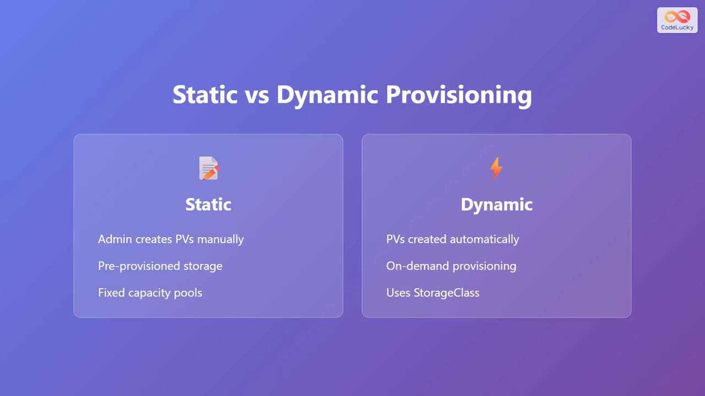
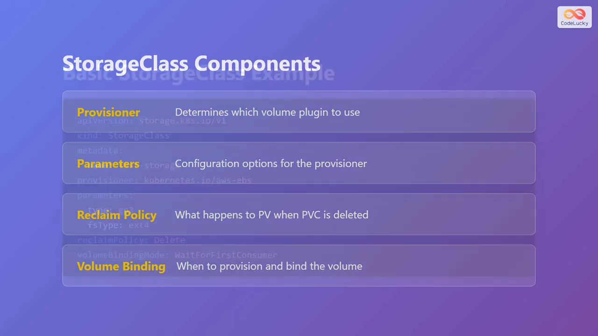
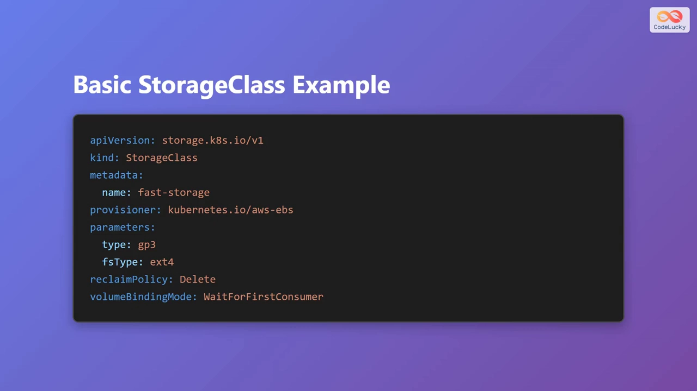
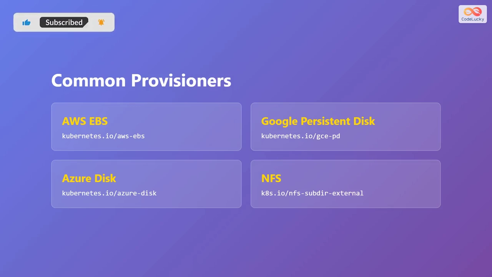
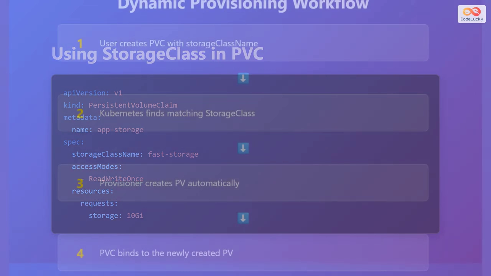

# Kubernetes StorageClass 动态卷供给详解：静态预置与按需供给

> 视频来源：[Kubernetes Storage Classes Explained | Dynamic Volume Provisioning](https://www.youtube.com/watch?v=14OeWzPd2HY)（YouTube）｜时长约 5 分钟
>
> 本视频用一张 StorageClass 的 YAML 和一条四步工作流，把「为什么需要 StorageClass、它由哪四块组成、PVC 如何触发动态供给」讲得很直白。本文基于该视频的图-字幕文稿整理，可逐帧核对。

## 本讲要解决的核心问题（SCQA）

**背景**：Kubernetes 的持久化存储绕不开两种对象——**PV（PersistentVolume，持久卷）** 是「一块真实的存储」，**PVC（PersistentVolumeClaim，持久卷声明）** 是「我想要一块存储」。应用只写 PVC，由集群把它和一块 PV 绑定起来。[【跳转到 00:26】](https://www.youtube.com/watch?v=14OeWzPd2HY&t=26)

**冲突**：如果每来一个 PVC 都要管理员**事先手工**建好一块对应的 PV，那么当 PVC 有成千上万个时，管理员就得建成千上万块 PV——这既低效，也几乎不可能维护。[【跳转到 00:46】](https://www.youtube.com/watch?v=14OeWzPd2HY&t=46)

**疑问**：能不能让 PV **按需自动生成**，管理员只描述「要什么样的存储」，剩下的交给集群？

**回答（中心思想）**：**StorageClass 就是「PV 的模板」**。它把「用哪个存储插件（provisioner）、用什么参数、怎么回收、什么时候绑定」写成一份可复用的声明；PVC 只要指明要用的 StorageClass，Kubernetes 就会据此**动态地创建出对应的 PV** 并完成绑定，全程无需人工预建。[【跳转到 04:07】](https://www.youtube.com/watch?v=14OeWzPd2HY&t=247)



## 一、StorageClass 是什么：一层把「应用」和「存储实现」隔开的抽象

StorageClass 是 Kubernetes 里的一种资源，用来描述**集群中有哪些类型的存储可选**。你可以把它想成一份「模板」：它说明「我想要的是哪一类存储」，而不关心底层到底是 AWS、GCP 还是自建的机房。[【跳转到 00:26】](https://www.youtube.com/watch?v=14OeWzPd2HY&t=26)

这层抽象的价值在于**解耦**：应用不需要知道底层存储基础设施的细节——不论是 Amazon Web Services、Google Cloud，还是本地机房——它只在 PVC 里说一句「我用哪个 StorageClass」就够了。[【跳转到 00:46】](https://www.youtube.com/watch?v=14OeWzPd2HY&t=46)

## 二、静态预置 vs 动态供给

这是理解 StorageClass 的关键一步：

- **静态预置（static provisioning）**：集群管理员**提前**手工创建好一块块 PV（相当于预先备好一批固定容量的存储池），有 Pod 需要时再去绑定。存储是「先建后用」的。
- **动态供给（dynamic provisioning）**：PV **按需**自动创建——有 PVC 来了才现造。它靠的正是 StorageClass 来描述「这块卷该怎么造」，省掉了全部人工开销，也灵活得多。[【跳转到 01:06】](https://www.youtube.com/watch?v=14OeWzPd2HY&t=66)



## 三、StorageClass 的四个核心组成部分

每一个 StorageClass 都由四块内容构成，视频里逐一做了拆解：[【跳转到 01:26】](https://www.youtube.com/watch?v=14OeWzPd2HY&t=86)

| 组成 | 字段 | 作用 |
| --- | --- | --- |
| **供应商 / 存储插件** | `provisioner` | 用哪个卷插件来造这块存储 |
| **参数** | `parameters` | 给该 provisioner 的配置项，如磁盘类型、性能特征 |
| **回收策略** | `reclaimPolicy` | 当它关联的 PVC 被删除时，这块 PV 该怎么办 |
| **绑定模式** | `volumeBindingMode` | 卷**何时**被供给、并绑定到声明上 |



## 四、一个 StorageClass 长什么样

视频给了一份可直接照抄的例子：[【跳转到 02:06】](https://www.youtube.com/watch?v=14OeWzPd2HY&t=126)



```yaml
apiVersion: storage.k8s.io/v1
kind: StorageClass
metadata:
  name: fast-ssd-storage
provisioner: kubernetes.io/aws-ebs   # 指定用 Amazon EBS
parameters:
  type: gp3                          # 卷类型
  fsType: ext4                       # 文件系统类型
reclaimPolicy: Delete                # PVC 删除后，PV 一并删除
volumeBindingMode: WaitForFirstConsumer  # 等到真的有 Pod 用这块存储时再供给并绑定
```

要点对应前面四块：`provisioner` 告诉 Kubernetes 去用 **Amazon EBS（Elastic Block Store）**；`parameters` 里指定卷类型 `gp3`、文件系统 `ext4`；`reclaimPolicy: Delete` 表示不用了就删掉；`volumeBindingMode: WaitForFirstConsumer` 表示**延迟供给**——直到某个 Pod 真正需要这块存储时才创建。[【跳转到 02:30】](https://www.youtube.com/watch?v=14OeWzPd2HY&t=150)

## 五、常见 provisioner 对照表

不同的云厂商和存储系统各有自己的 provisioner，各带各的参数与能力：[【跳转到 02:54】](https://www.youtube.com/watch?v=14OeWzPd2HY&t=174)

| 存储 | provisioner |
| --- | --- |
| AWS Elastic Block Store | `kubernetes.io/aws-ebs` |
| Google Cloud Persistent Disk | `kubernetes.io/gce-pd` |
| Azure Disk | `kubernetes.io/azure-disk` |
| 网络文件系统（NFS） | `k8s.io/nfs-subdir-external-provisioner` |



## 六、PVC 如何声明「我要用哪个 StorageClass」

用法很简单：在 PVC 里用 `storageClassName` 指定 StorageClass 的名字即可。[【跳转到 03:29】](https://www.youtube.com/watch?v=14OeWzPd2HY&t=209)



```yaml
apiVersion: v1
kind: PersistentVolumeClaim
metadata:
  name: my-claim
spec:
  storageClassName: fast-ssd-storage   # 与前面创建的 StorageClass 名字一致
  accessModes:
    - ReadWriteOnce                    # 只能被单个节点以读写方式挂载
  resources:
    requests:
      storage: 10Gi                    # 申请 10GB
```

这里的 `storageClassName` 正是前面创建的那个 StorageClass。**当这个 PVC 被创建时，Kubernetes 就会用指定的 StorageClass 自动供给出一块新的 PV。**[【跳转到 03:49】](https://www.youtube.com/watch?v=14OeWzPd2HY&t=229)

## 七、动态供给的四步工作流

把上面的零件串起来，整条链路只有四步，而且**全程自动、无需人工干预**：[【跳转到 04:07】](https://www.youtube.com/watch?v=14OeWzPd2HY&t=247)

1. **用户创建 PVC**，并指定 `storageClassName`；
2. **Kubernetes 查找匹配的 StorageClass**（按名字匹配声明里给出的那个）；
3. **StorageClass 中定义的 provisioner 自动创建一块新的 PV**，并带上所要求的各项特征；
4. **PVC 绑定到这块新建的 PV**，存储随即可以交给 Pod 使用。



## 小结

一句话记住本讲的中心思想：**StorageClass 是 PV 的模板，PVC 是触发它的一张订单。** 你只描述「要什么样的存储」，Kubernetes 就找对应的 provisioner 把 PV 按需造出来——这就是所谓「动态卷供给」，也是现代 Kubernetes 里 PV/PVC 能规模化使用的基础。
