# 动态存储类 StorageClass 动态供给实战：从 NFS Provisioner 到 PVC 自动绑定

> 视频来源：[简单懂点 K8S 的存储——动态存储类 StorageClass 动态供给实战](https://www.bilibili.com/video/BV1nu411N7N7/)（Bilibili）｜时长约 31 分钟
>
> 本视频承接上一讲的 PVC，从零把「装一个 NFS Provisioner → 建 StorageClass → 建 PVC 自动出 PV → 建 Pod 挂载并验证数据同步」完整走了一遍，是理解**动态供给到底谁在干活**的一手实操。本文基于该视频的图-字幕文稿整理，可逐帧核对；自动字幕口头、片段化处已通顺化，并订正了明显口误（如把 ServiceAccount 的授权写作「权柄」→**授权（RBAC）**）。

## 本讲要解决的核心问题（SCQA）

**背景**：上一讲我们学会了 **PVC**。用的是「静态供给」——先手工建好 PV，再让 PVC 和 PV **一对一绑定**。[【跳转到 00:00】](https://www.bilibili.com/video/BV1nu411N7N7/?t=0)

**冲突**：这种模式在建 **PVC 成千上万**时就不堪重负了——管理员得跟着建几千几万个 PV，**成本极高**，几乎没法维护。[【跳转到 00:00】](https://www.bilibili.com/video/BV1nu411N7N7/?t=0)

**疑问**：能不能让 PV **自动创建**，管理员只交代「要什么样的存储」，PVC 一来就现造一块？

**回答（中心思想）**：Kubernetes 提供了 **StorageClass（存储类）** 这个自动创建 PV 的机制——**它就是「创建 PV 的模板」**。要跑通它，实战上是一条 **「先装一个 provisioner（供应商）→ 再建 StorageClass → 再建 PVC 让它动态出 PV → 最后用 Pod 挂上去」** 的流水线，而且**前后几处名字必须严格对上**。[【跳转到 00:25】](https://www.bilibili.com/video/BV1nu411N7N7/?t=25)

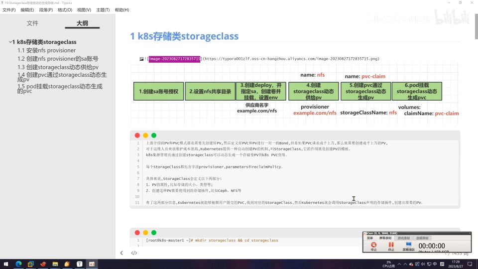

## 一、StorageClass 里都有什么：核心是 provisioner

StorageClass 相当于「PV 的模板」：集群管理员创建好 StorageClass，就能**动态生成 PV 供 PVC 使用**。[【跳转到 00:25】](https://www.bilibili.com/video/BV1nu411N7N7/?t=25)

它最关键的一块叫 **provisioner（存储供应商）**，里面主要说明两件事：[【跳转到 00:50】](https://www.bilibili.com/video/BV1nu411N7N7/?t=50)

- **PV 的属性**：比如存储空间大小、存储类型；
- **PV 要用的存储插件**：比如 Ceph、NFS——本讲用的是 **NFS**。

有了这两样，Kubernetes 就能**根据用户提交的 PVC 找到对应的存储类，再调用存储类里的插件去创建需要的 PV**。

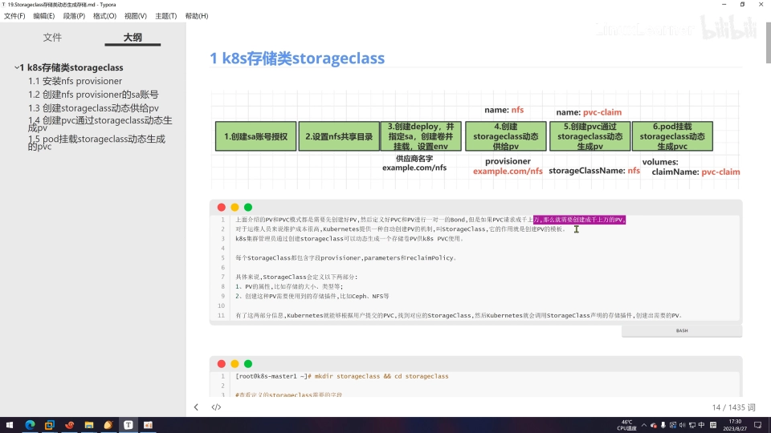

## 二、先把整条流水线记住：四步走

在动手之前，先看视频里那张「创建 SC 的流程」总览图，它把后面的每一步都串了起来。[【跳转到 01:20】](https://www.bilibili.com/video/BV1nu411N7N7/?t=80)

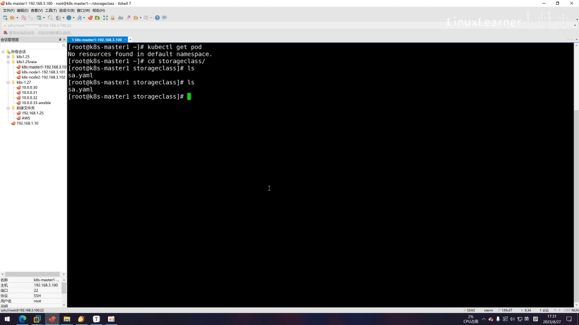

结合视频结尾的复盘，整条链路是这样的：[【跳转到 22:37】](https://www.bilibili.com/video/BV1nu411N7N7/?t=1357)

1. **创建 provisioner（供应商）**——先给它一个**服务账号（SA）**并**授权**；再部署一个 **Deployment** 把它跑起来；并准备好 **NFS 共享目录**；
2. **创建 StorageClass**——在它的 `provisioner` 字段里写上第 1 步那个供应商的名字；
3. **创建 PVC**——在 PVC 里指定 `storageClassName`，于是 PV 被**动态划分**出来并绑定；
4. **创建 Pod**——把动态生成的那个 PVC **挂载**进容器，验证数据能进能出。

下面按顺序拆开。

## 三、第一步：给 NFS Provisioner 准备 ServiceAccount 与授权

「供应商」在官网其实有一个标准的 NFS provisioner，视频里把它**转成了自己云上的镜像**好直接使用。[【跳转到 01:39】](https://www.bilibili.com/video/BV1nu411N7N7/?t=99)

先创建一个 **ServiceAccount（SA）**。它的字段是 `apiVersion`、`kind: ServiceAccount` 和 `metadata`（含 `name`），这里命名为 `nfs-provisioner`：[【跳转到 02:19】](https://www.bilibili.com/video/BV1nu411N7N7/?t=139)

```yaml
apiVersion: v1
kind: ServiceAccount
metadata:
  name: nfs-provisioner
```

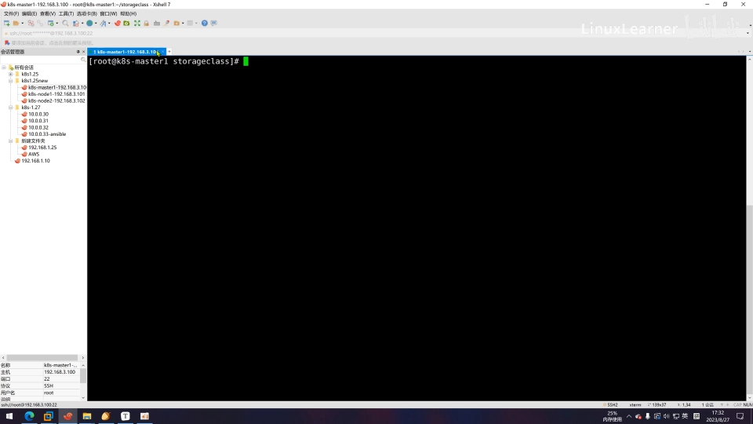

> **SA 是什么？** ServiceAccount（服务账号）是为了方便 **Pod 里的进程去调用 Kubernetes API 或其他 Web 服务**而设计的。指定了 SA 之后，Pod 就拥有了该账号的权限。[【跳转到 03:06】](https://www.bilibili.com/video/BV1nu411N7N7/?t=186)

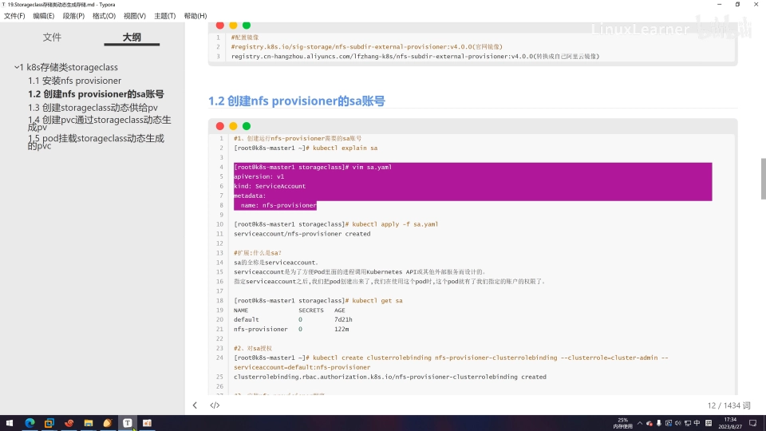

建好之后要给它**授权**。这里用 `clusterrolebinding` 把某个 `ClusterRole` 绑给这个 SA（`--serviceaccount` 指向 NFS provisioner 的名字）。视频里因为之前实验已建过，所以先 `delete` 再用 `apply` 重新创建了一遍：[【跳转到 04:11】](https://www.bilibili.com/video/BV1nu411N7N7/?t=251)

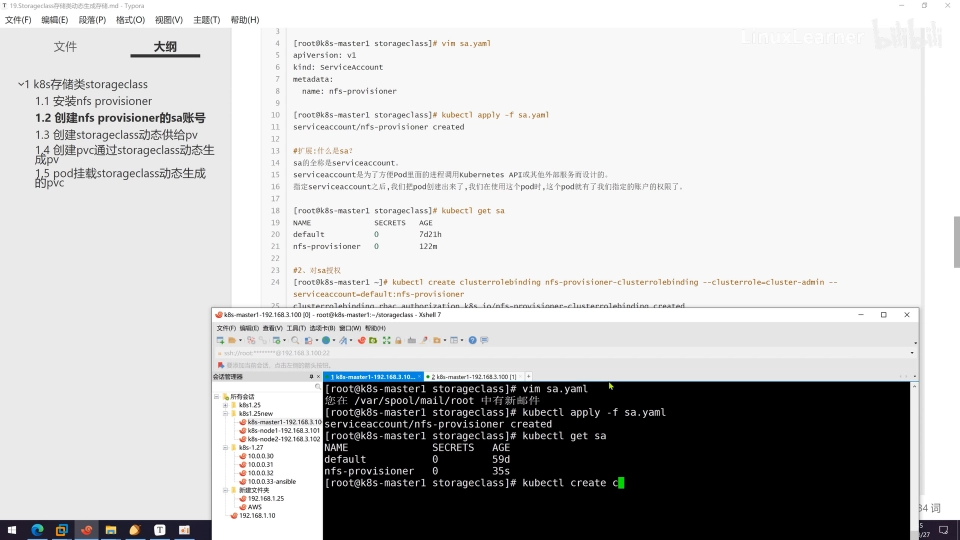

## 四、前置：准备好 NFS Server 的共享目录

本讲在 K8s master 上装了 **NFS Server**（承上一讲）。要共享的是 `/data` 目录下的 `provisioner` 目录。[【跳转到 04:55】](https://www.bilibili.com/video/BV1nu411N7N7/?t=295)

- 编辑 `/etc/exports`，给共享目录加上「不限制网段、读写同步」之类的参数；
- 用 **`exportfs -arv`** 让共享配置**立即生效**，并确认目录已被共享出去。[【跳转到 05:27】](https://www.bilibili.com/video/BV1nu411N7N7/?t=327)

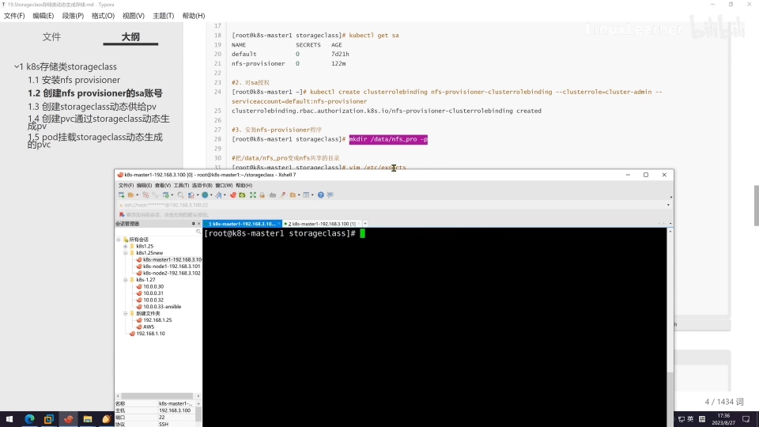

## 五、第二步：部署 NFS Provisioner（Deployment）

共享目录就绪后，来创建 provisioner 的 **Deployment**（本质上就是跑一个 Pod）。[【跳转到 05:36】](https://www.bilibili.com/video/BV1nu411N7N7/?t=336)

Deployment 的标准结构是 `apiVersion: apps/v1`、`kind: Deployment`，下分 `metadata` 与 `spec`。视频逐字段走了一遍：[【跳转到 06:13】](https://www.bilibili.com/video/BV1nu411N7N7/?t=373)

- `metadata.name`: `nfs-provisioner`；namespace 用默认；
- `spec.replicas: 1`；`spec.selector` 与模板里的标签 **`app: nfs-provisioner`** 匹配；
- `template` 下再分 `metadata`（labels）和 `spec`；
- `spec.containers` 里的容器也起名 `nfs-provisioner`，`imagePullPolicy: IfNotPresent`，镜像用第 1 步转好的那个。

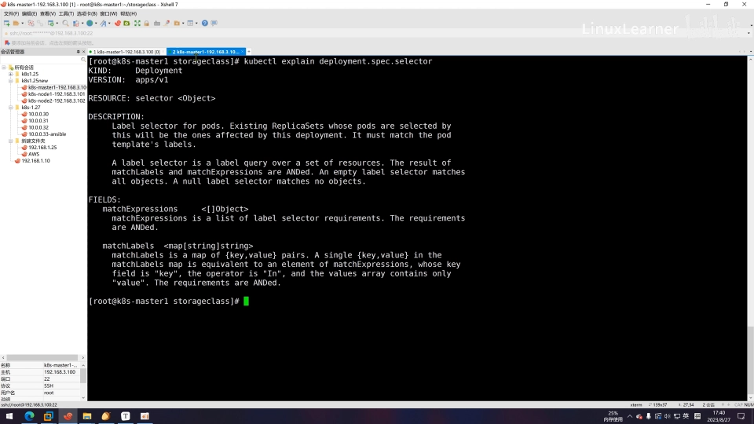

接下来两处是**动态供给的命门**：

**① 挂载 NFS 卷。** 在 `spec.volumes`（与 `containers` 同级）里声明一个 `nfs` 卷，`server` 是 NFS 服务器地址（视频里为 `192.168.3.100`），`path` 是共享路径（`/data` 下的 nfs-provisioner 共享目录）：[【跳转到 10:05】](https://www.bilibili.com/video/BV1nu411N7N7/?t=605)

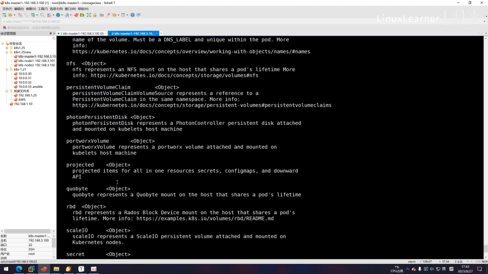

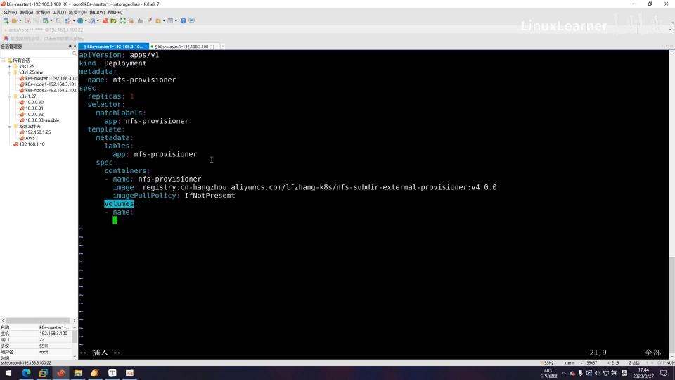

**② 定义环境变量。** 在 `containers` 下的 `env` 里定义供应商的名字等信息，其中 **`PROVISIONER_NAME`**（视频里为 `example.com/nfs`）、NFS 服务器地址、共享路径这几项是必须的：[【跳转到 11:47】](https://www.bilibili.com/video/BV1nu411N7N7/?t=707)

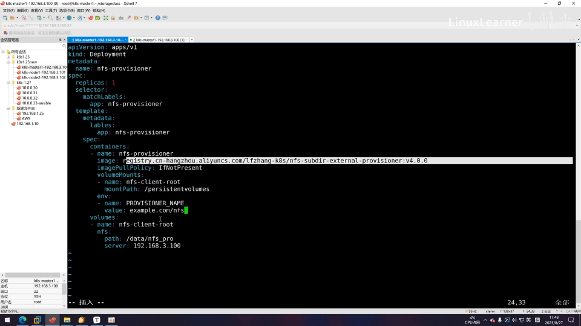

> 注意：`PROVISIONER_NAME` 这个值**后面创建 StorageClass 时要用到**，务必记牢并保持一致。[【跳转到 15:31】](https://www.bilibili.com/video/BV1nu411N7N7/?t=931)

## 六、第三步：创建 StorageClass

provisioner 跑起来后，创建 StorageClass。它属于 `storage.k8s.io/v1`，`kind: StorageClass`，关键字段有 `metadata`、`provisioner`、`reclaimPolicy` 等：[【跳转到 14:42】](https://www.bilibili.com/video/BV1nu411N7N7/?t=882)

```yaml
apiVersion: storage.k8s.io/v1
kind: StorageClass
metadata:
  name: nfs
provisioner: example.com/nfs   # 必须与 Deployment 里 PROVISIONER_NAME 一致！
reclaimPolicy: Delete
allowVolumeExpansion: true
```

创建后 `get storageclass` 可以看到：名字是 `nfs`，`provisioner` 是 `example.com/nfs`，回收策略为 `delete`，并允许扩容（`allowVolumeExpansion`）。[【跳转到 16:20】](https://www.bilibili.com/video/BV1nu411N7N7/?t=980)

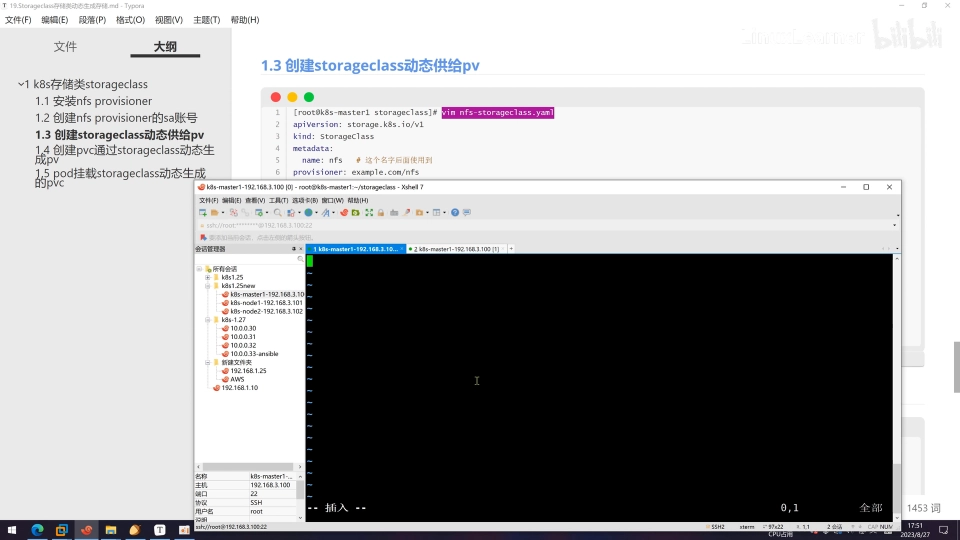

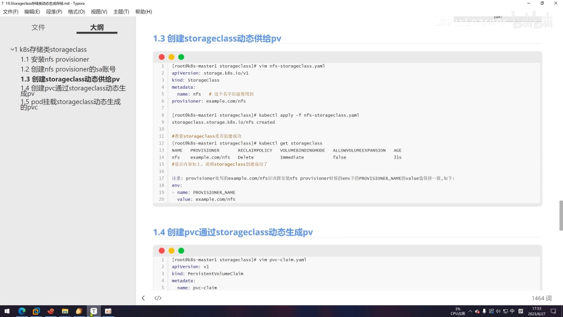

> **最容易踩的坑**：这里的 `provisioner` 就是第一步 Deployment 里那个 provisioner 的名字，**必须与 Deployment 里的环境变量保持一致**，否则供给会失败。[【跳转到 16:44】](https://www.bilibili.com/video/BV1nu411N7N7/?t=1004)

## 七、第四步：创建 PVC，看 PV 被动态生成

现在建一个 PVC，通过 StorageClass **动态生成 PV**——注意，**这次不用先建 PV 了**。[【跳转到 17:18】](https://www.bilibili.com/video/BV1nu411N7N7/?t=1038)

PVC 是 `apiVersion: v1`、`kind: PersistentVolumeClaim`，`spec` 里主要写：访问模式（这里用 **`ReadWriteMany`**，即多路读写）、`resources.requests.storage`（申请容量，这里 1Gi）、以及 **`storageClassName: nfs`**（就是上面建的存储类名字）。[【跳转到 18:10】](https://www.bilibili.com/video/BV1nu411N7N7/?t=1090)

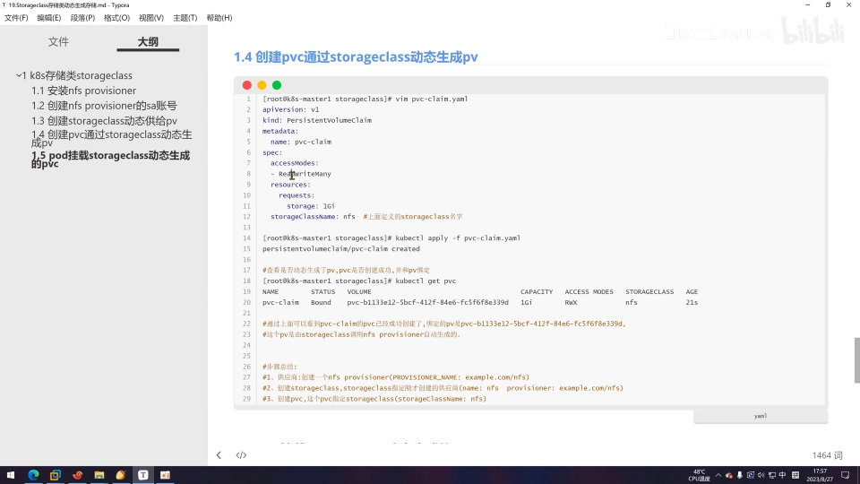

```yaml
apiVersion: v1
kind: PersistentVolumeClaim
metadata:
  name: pvc-nfs
spec:
  accessModes:
    - ReadWriteMany
  storageClassName: nfs          # 指向刚建的 StorageClass
  resources:
    requests:
      storage: 1Gi
```

**遇到 PVC 一直 Pending 怎么办？** 视频这里就卡了一次，报错说「没有权限」——原因是**创建 Deployment 时没有指定 SA 账号**。在 Deployment 的 `spec.serviceAccount`（`serviceAccountName`）补上 `nfs-provisioner` 再重新执行，PVC 随即就绑定了。[【跳转到 20:23】](https://www.bilibili.com/video/BV1nu411N7N7/?t=1223)

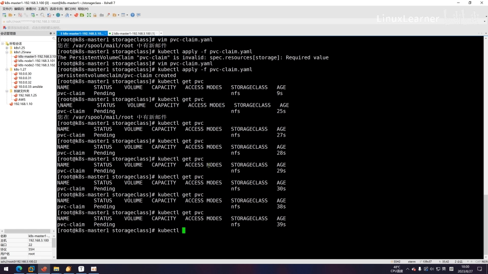

绑定后 `get pvc` 可以看到：PVC 已绑定，背后的 PV 名字是 `pvc-<一串 ID>`，访问模式 `RWX`，存储类 `nfs`，容量 1Gi。[【跳转到 22:00】](https://www.bilibili.com/video/BV1nu411N7N7/?t=1320)

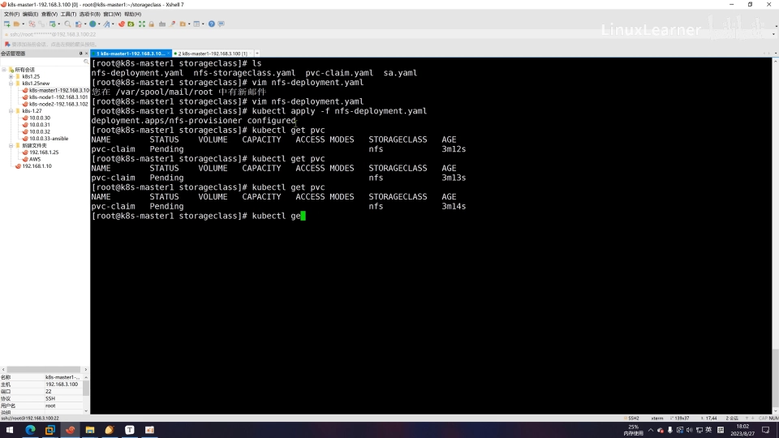

## 八、第五步：Pod 挂载 PVC，验证数据双向同步

最后建一个 Pod 把这块动态生成的 PVC 挂进容器。Pod 是 `apiVersion: v1`、`kind: Pod`：`restartPolicy: Never`，容器用 `nginx` 镜像并暴露 80 端口：[【跳转到 23:36】](https://www.bilibili.com/video/BV1nu411N7N7/?t=1416)

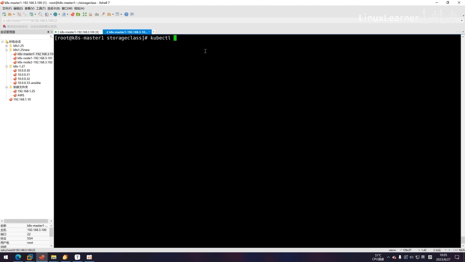

挂载同样用 `volumeMounts`：`name` 指向声明的卷（这里用的就是 PVC `pvc-nfs`），`mountPath` 挂到 `/usr/share/nginx/html`。[【跳转到 25:28】](https://www.bilibili.com/video/BV1nu411N7N7/?t=1528)

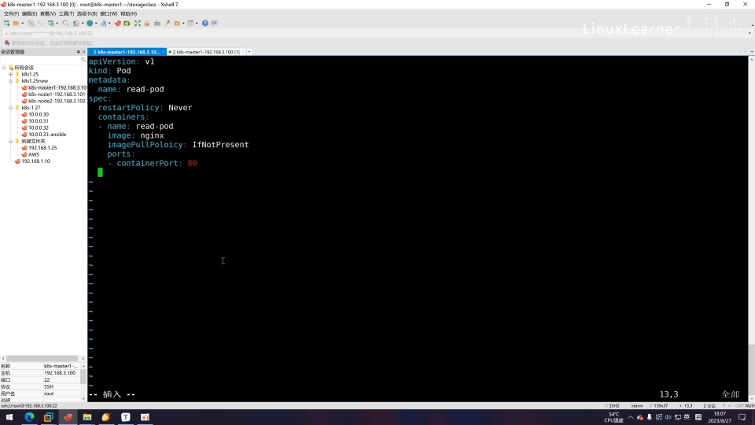

Pod 起来后进容器验证：在挂载路径下写文件，回头到 **NFS 共享目录**里能看到它自动生成了一个（按 `pvc-名称_命名空间_卷名` 拼出来的）目录，且**容器内的写入会同步到 NFS，NFS 上的改动也会同步回容器**——数据确实落到了动态生成的卷上。[【跳转到 28:29】](https://www.bilibili.com/video/BV1nu411N7N7/?t=1709)

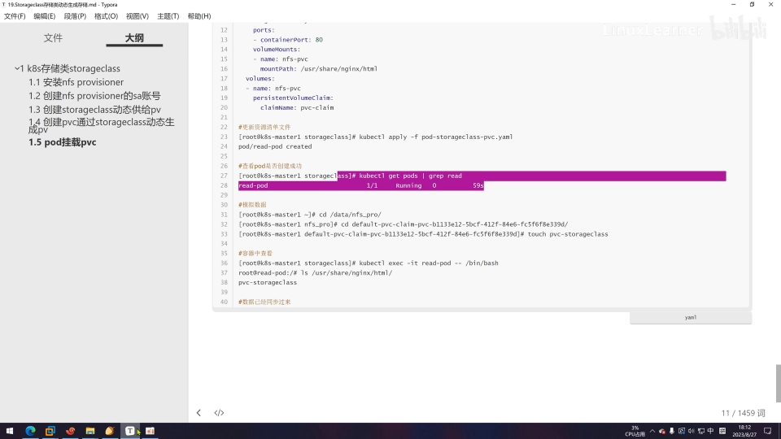

## 九、踩坑清单（视频里真实踩到的）

- **PVC 一直 Pending**：Deployment 忘了指定 `serviceAccountName`，导致 provisioner 无权限，回头补上即可；
- **StorageClass 的 `provisioner` 名字与 Deployment 的 `PROVISIONER_NAME` 不一致**：供给会失败，两处务必同名；
- **YAML 拼写/字段错误**：视频里先后遇到 `storage` 拼错、镜像名多写一个字母、label 写错等，`kubectl apply` 会直接报错，逐行核对即可。

## 小结：动态供给就是「三段名字对齐」

一句话总结本讲：**先创建一个 provisioner 供应商 → 再创建一个 StorageClass → 再创建一个 PVC，通过 PVC 里的存储类把 PV 划出来**；最后 Pod 挂载这个动态生成的 PVC 即可。[【跳转到 22:37】](https://www.bilibili.com/video/BV1nu411N7N7/?t=1357)

要串起来，关键是**三处名字对齐**：

| 环节 | 名字 | 谁引用它 |
| --- | --- | --- |
| Deployment 的环境变量 | `PROVISIONER_NAME: example.com/nfs` | 被 StorageClass 的 `provisioner` 引用 |
| StorageClass | `metadata.name: nfs` | 被 PVC 的 `storageClassName` 引用 |
| PVC | `metadata.name: pvc-nfs` | 被 Pod 的 `volumeMounts` 挂载 |

理清这条「供应商 → 存储类 → 声明 → 挂载」的链子，StorageClass 动态供给就不再神秘了。
