# Kubernetes 卷克隆：让新卷「出生时就带着记忆」，靠的是一个指针

## 本讲要解决的核心问题（SCQA）

**背景**：在 Kubernetes 里申请一块新卷，默认拿到的是**一块空白盘**——普通制备出来的卷，内容都是空的。

**冲突**：可有时你要的新盘**不该是空的**：数据已经在另一块卷里了。比如一台数据库，schema 和 rows 都躺在 `pvc-1` 上；这时给你一块"同样 5Gi 的空白盘"，它不是兄弟，而是**一个失忆症患者**。你若只是事后 copy 一遍文件，那得到的是一个**流程（procedure）**，而不是一个**被制备出来的身份**。

**疑问**：能不能让**新卷在出生的一瞬间就记住旧卷的内容**？Kubernetes 要怎么在下发请求时表达"这块新卷从那块旧卷复制而来"？复制完之后，克隆和源又是什么关系——会一直同步吗？

**回答（中心思想）**：**CSI 卷克隆**的做法是：**在"目标 PVC"的 `spec` 里加一个 `dataSource` 指针，指向同一命名空间里一个已存在的源 PVC**；这样**后端在制备时执行一次"精确复制"，而不是清空**。而**"精确相同"只在出生的那一刻**；**当克隆变为 available 之后，它就是一块独立的标准卷**——可被消费、可再被克隆、可被快照、可被删除，**再也不与源有任何联结**。围绕这条主线，还有一串"闸门"约束：**只支持 CSI、只支持动态制备、驱动必须实现克隆、源与目标必须同命名空间、源必须 bound/available/not in use、卷模式必须匹配、容量必须等大或更大**。

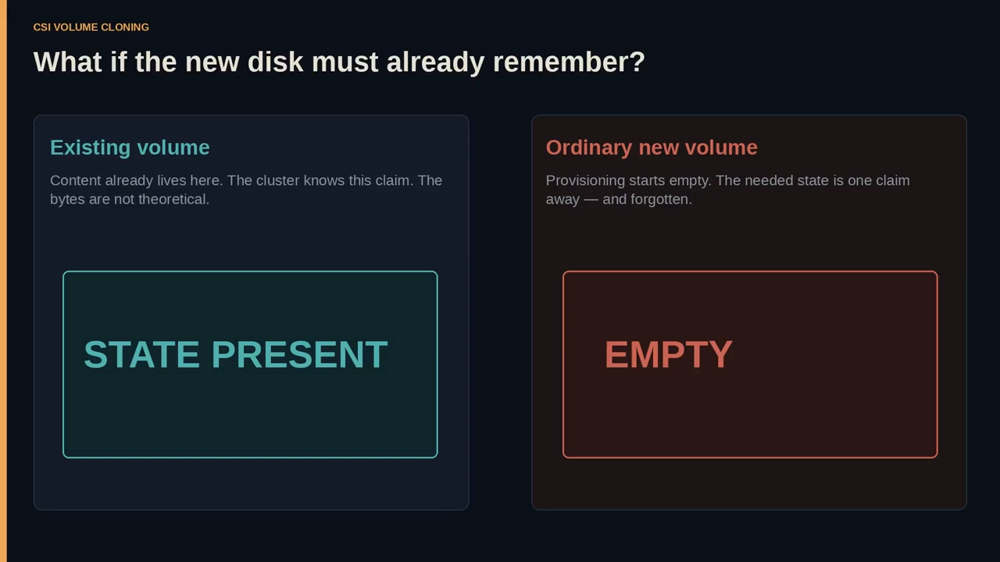

[【跳转到 00:00】](https://www.youtube.com/watch?v=oKEJ1knGa_Q&t=0)

---

## 一、克隆不是镜像：出生时精确相同，之后各自独立

### 1.1 "克隆"到底指什么

视频对"克隆"给了三句话的定义 [【跳转到 00:50】](https://www.youtube.com/watch?v=oKEJ1knGa_Q&t=50)：

- **Duplicate（副本）**：意味着后端被要求**产生一份精确的内容副本**，而**不是**一块"同样大小的新空白盘"。
- **Kubernetes Volume（Kubernetes 卷）**：指 PVC 背后的那个东西——**集群已经知道如何挂载、如何挂attach 的存储对象**。
- **Consumed like any standard volume（像普通卷一样被消费）**：意思是**应用在运行时并不会拿到什么"特殊的克隆 API"**，它们只是用了一个 Claim。

> 还有一句很关键的话：**克隆不是 live mirror（活动镜像）**。它是**一块已存在卷的副本**；一旦存在，它就像任何标准卷一样被消费。[【跳转到 01:15】](https://www.youtube.com/watch?v=oKEJ1knGa_Q&t=75)

### 1.2 空白路径 vs 克隆路径

把两条路并排看 [【跳转到 02:05】](https://www.youtube.com/watch?v=oKEJ1knGa_Q&t=125)：

| | 普通制备 | 克隆 |
| --- | --- | --- |
| 对象 | 一个 PVC（大小、访问模式、storageClass） | 一个 PVC（大小、访问模式、storageClass） |
| 后端动作 | 创建存储，**内容是空的** | 后端被指示创建**精确的副本** |
| 结果 | 一块空白卷 | 一块"已经记得"的卷 |

**这是整个机械对比：同一种对象，不同的出生方式。**

> 视频里的类比很直白：**空白路径**在你"没有东西要保存"时是诚实的；**克隆路径**在"空着就是撒谎"时才是诚实的。

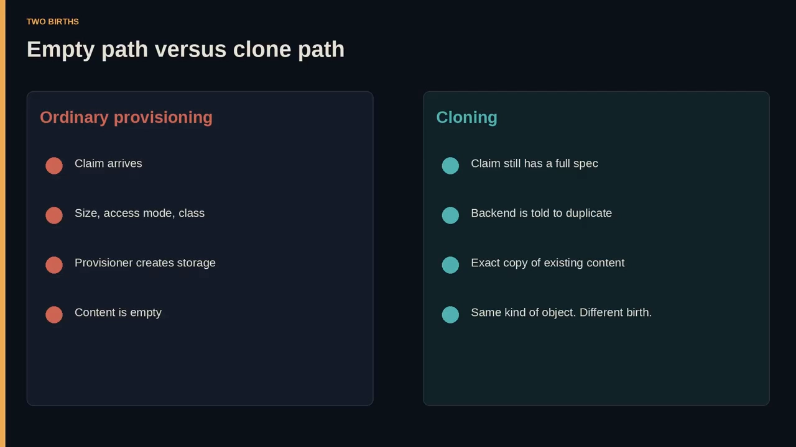

### 1.3 关键前提：复制必须在"制备时"被请求

**仅仅"能复制内容"是不够的**，除非 Kubernetes 能在**制备时**干净地请求这份复制。Kubernetes 给这个能力起的名字叫 **VolumePVCDataSource** [【跳转到 02:55】](https://www.youtube.com/watch?v=oKEJ1knGa_Q&t=175)：

- **Volume**：被复制的东西是**卷内容**；
- **PVC**：你指向的"把手"是一个 **PersistentVolumeClaim**；
- **DataSource**：新 Claim **不发明自己的字节**，它**指名这些字节从哪来**。

**你不用提交单独的"克隆对象"，也不用挂一个神秘的 sidecar**——你**创建一个新 PVC，把一个已存在的 PVC 放进它的 dataSource 里**。这就是那个"API 时刻"。[【跳转到 03:20】](https://www.youtube.com/watch?v=oKEJ1knGa_Q&t=200)

---

## 二、请求克隆的方式：一个指针，而不是一个新对象

### 2.1 dataSource 是一条"出生指令"

**VolumePVCDataSource 的思想就是：一个 Claim 可以从另一个 Claim 出生。**

- 承载这个思想的字段是 **`dataSource`**；
- 它的 **kind 是 PersistentVolumeClaim，name 就是源 Claim**；
- **目标对象其余部分仍然是一个普通的 spec**（访问模式、storageClass、请求容量）。

> **克隆不是一种新的 Kind。它是一张新的"出生证明"，父母写在 `dataSource` 里。** [【跳转到 03:45】](https://www.youtube.com/watch?v=oKEJ1knGa_Q&t=225)

### 2.2 这个指针**是**什么，**不是**什么

- 在目标 PVC 的 `spec` 下，加一个 `dataSource` 对象：**`kind: PersistentVolumeClaim`，`name` 是已存在的 Claim**（例子里是 `pvc-1`）。
- **没有额外的动词，没有 `clone: true` 之类的开关**——**dataSource 的存在本身就是那个请求**。
- **这里没有"实时同步"字段，也没有"保持链接"选项。**

> **dataSource 是一条出生指令，不是一纸婚约。** 目标说的是"**当我创建卷时，从那个 Claim 复制内容**"；**此后该字段是历史，而不是拴绳。** 如果你事后读 `dataSource` 并脑补出一个镜像，你就误读了文档：**这个指针是给制备用的；独立发生在可用之后。** [【跳转到 04:35】](https://www.youtube.com/watch?v=oKEJ1knGa_Q&t=275)

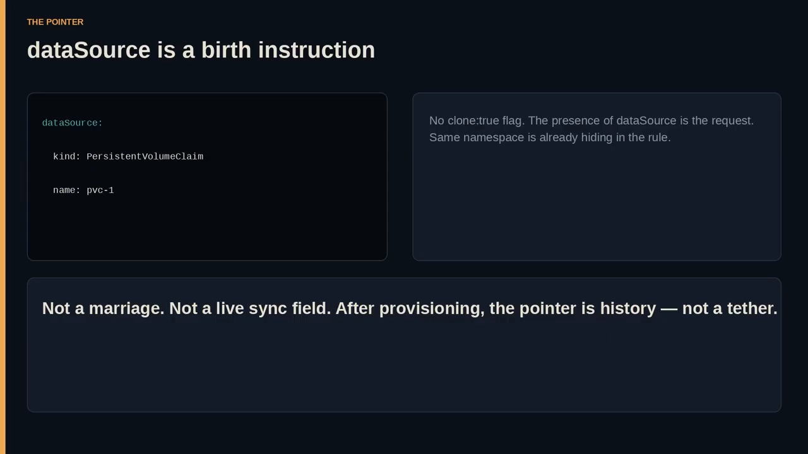

### 2.3 逐字段看这份 YAML

```yaml
apiVersion: v1
kind: PersistentVolumeClaim
metadata:
  name: clone-of-pvc-1
  namespace: my-ns
spec:
  accessModes:
    - ReadWriteOnce
  storageClassName: cloning
  resources:
    requests:
      storage: 5Gi
  dataSource:
    kind: PersistentVolumeClaim
    name: pvc-1
```

[【跳转到 05:00】](https://www.youtube.com/watch?v=oKEJ1knGa_Q&t=300)

把每一对名字读清楚 [【跳转到 06:15】](https://www.youtube.com/watch?v=oKEJ1knGa_Q&t=615)：

- **目标名** `clone-of-pvc-1` vs **源名** `pvc-1`；
- **目标命名空间** `my-ns`——**源必须live在这里**；
- **`storageClassName: cloning`** 是**目标的** class，**它本身并不是什么"克隆引擎"**；
- **`5Gi`** 是新 Claim 的**请求容量**；
- **`ReadWriteOnce`** 是**这个克隆可以被怎样挂载**；
- **每一个普通字段仍然必需**——`dataSource` 只是那个"改变出生方式"的例外。

> **把 YAML 读成一个故事，而不是一张清单**：`my-ns` 里的一个用户想要一个新 Claim，他**不想要空的**，于是给新 Claim 起名 `clone-of-pvc-1` 好让人看出意图；他选了 `storage:` 类 `cloning`（**必须是其 provisioner 真能克隆的 class**）；请求 `5Gi`；设为 `ReadWriteOnce`；然后**把 `dataSource` 指向 `pvc-1`**。[【跳转到 06:45】](https://www.youtube.com/watch?v=oKEJ1knGa_Q&t=645)

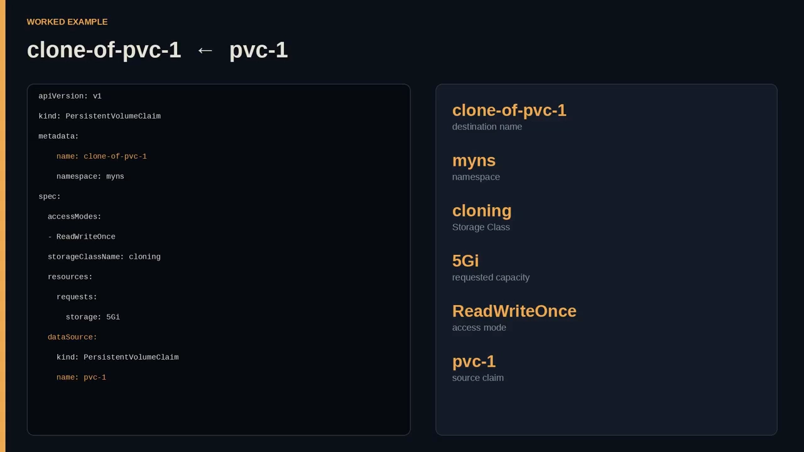

### 2.4 结果是"新对象"，不是"改名的旧卷"

文档承诺：**结果是一个名为 `clone-of-pvc-1` 的新 PVC，其内容与指定的源 `pvc-1` 相同** [【跳转到 05:50】](https://www.youtube.com/watch?v=oKEJ1knGa_Q&t=550)。把这句话拆成**四个事实**：

1. **一个新 PVC**；
2. **名为 `clone-of-pvc-1`**；
3. **内容精确相同**；
4. **源是 `pvc-1`**。

> **如果你把它们压缩成"`clone-of-pvc-1` 只是个昵称"，你就丢掉了对象身份。Kubernetes 并不给旧卷起别名；它创建了另一个 Claim。** 之后挂载 `clone-of-pvc-1` 的应用，**不是在挂载"穿了马甲的 `pvc-1`"，而是在挂载一份副本**——**这正是"独立"之所以可能的原因**。[【跳转到 08:25】](https://www.youtube.com/watch?v=oKEJ1knGa_Q&t=825)

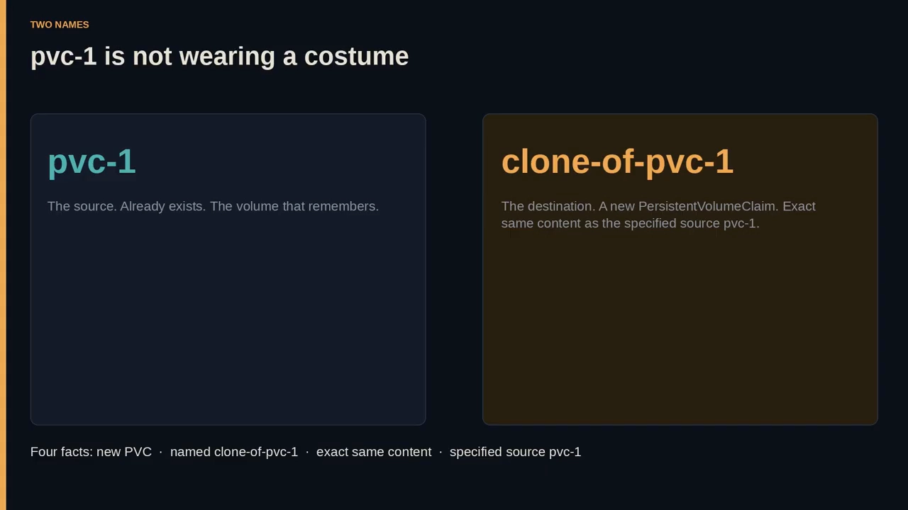

---

## 三、复制发生在存储层：同一条准入路径，不同的存储动词

**控制面做的事情和平时一样**：仍然是动态 provisioner 干活，控制面仍然绑定一个 PersistentVolume。**真正的差别"在页面上很小、在后端很大"**：**加上 `dataSource`，就等于告诉 CSI 驱动：不要铸造空洞。** [【跳转到 13:50】](https://www.youtube.com/watch?v=oKEJ1knGa_Q&t=830)

想象存储系统收到这次 create 调用 [【跳转到 14:15】](https://www.youtube.com/watch?v=oKEJ1knGa_Q&t=855)：

- **没有 `dataSource`**：它分配一块**空白 extent**；
- **有 `dataSource`**：它**从 `pvc-1` 背后的那块卷复制着分配**。

> **Kubernetes 并不是在用户空间里重写文件来定义这个特性——后端创建那份精确副本。这就是为什么驱动必须实现克隆：API 只能"指"，只有驱动能在存储层"复制"。**

用一句话概括这一拍：**同样的准入路径，不同的存储动词——`empty create` 对 `duplicate create`。集群的用户看到的是一份 Claim，驱动看到的是一块"父卷"。** [【跳转到 14:40】](https://www.youtube.com/watch?v=oKEJ1knGa_Q&t=880)

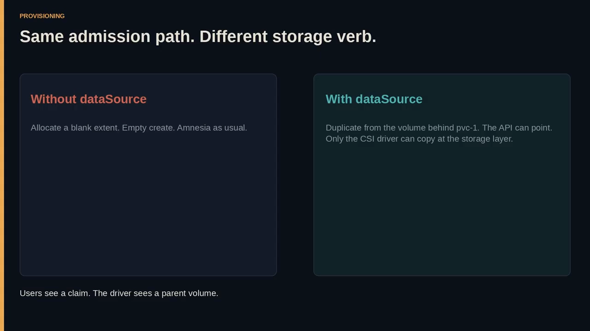

---

## 四、第一道与第二道闸门：只支持 CSI、只支持动态制备

### 4.1 闸门一：克隆只对 CSI 驱动可用

**CSI 指 Container Storage Interface**——Kubernetes 用来让存储厂商接入的**插件契约**。**在这个 CSI 世界之外的 in-tree 卷类型，不是这一页的受众**：**如果你这块卷不是 CSI 卷，这个克隆请求就不是可用的工具。** [【跳转到 14:40】](https://www.youtube.com/watch?v=oKEJ1knGa_Q&t=880)

> 空白路径在很多老路径上依然能用——"空白盘"是个老把戏；而**"制备时精确复制"是一项 CSI 时代的把戏**。**`dataSource` 这个紧凑指针，只要没有任何 CSI 驱动在听，就毫无用处。**

所以一个谨慎的运维者要问的第一个问题**不是 YAML 漂不漂亮，而是：这块卷到底是不是 CSI 卷？** [【跳转到 15:30】](https://www.youtube.com/watch?v=oKEJ1knGa_Q&t=930)

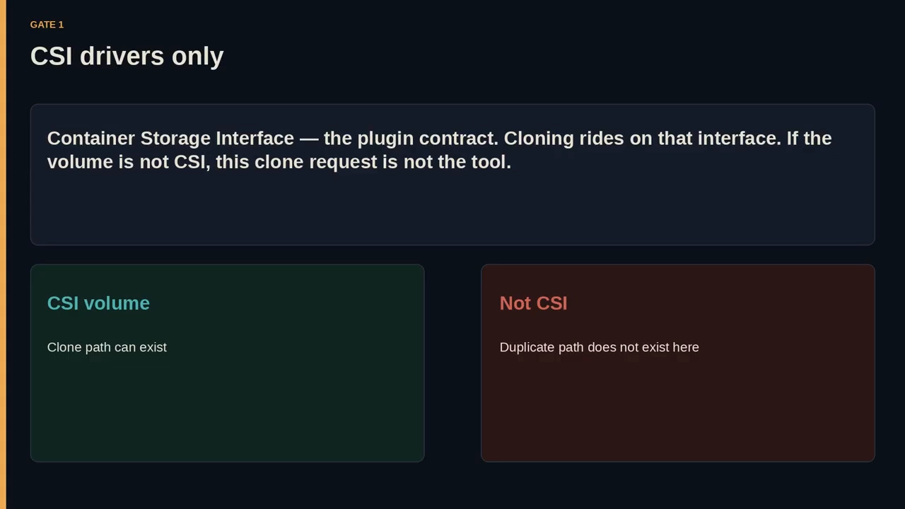

### 4.2 闸门二：只支持动态 provisioner

**克隆只受动态 provisioner 支持。** 动态 provisioner 会**响应 PVC 来创建 PersistentVolume**。**由管理员预先创建好、之后只是被绑定的静态卷，不是这条路** [【跳转到 15:55】](https://www.youtube.com/watch?v=oKEJ1knGa_Q&t=955)：

> **克隆和制备是"同一个动作"**：克隆是一块带复制内容的新卷，而"创建这块新卷"就是制备。**你不应该把这两个动作拆开**——**你不该把克隆落到一块"已经存在的空卷"上。** 在这个 API 里，**你请求一个新的 Claim 带一个 `dataSource`，由动态 provisioner 加 CSI 驱动产出那份副本。**

**空白卷可以是静态的，也可以是动态的；而克隆坚持"动态出生"** [【跳转到 16:20】](https://www.youtube.com/watch?v=oKEJ1knGa_Q&t=980)。

### 4.3 闸门三：具体驱动可能根本没实现克隆

**即使身处 CSI、即使有动态 provisioner，那个具体 CSI 驱动也可能实现、也可能不实现克隆。** [【跳转到 17:10】](https://www.youtube.com/watch?v=oKEJ1knGa_Q&t=1030)

> **API 是控制面能表达的"承诺"；驱动是存储厂商可能"婉拒"的承诺。** Kubernetes 能接受一个带 `dataSource` 的 PVC，**后端仍然可以说不**。

现实后果 [【跳转到 17:35】](https://www.youtube.com/watch?v=oKEJ1knGa_Q&t=1055)：空白卷因为"什么都不做"而实现广泛；**精确克隆在存储层是额外的工作**（快照、复制、空间高效副本、全量副本——文档并不规定实现技巧，只要求"驱动必须实现克隆"）。于是**两个集群可以展示同样的 YAML、却得到不同的结果**：一个驱动的克隆 class 成功，另一个驱动的 class 让 Claim 停在 Pending 或 Failed。

> 于是这个特性的**未解边界**是一个很实际的问题：**到底哪些 CSI 驱动真正实现了这个能力？** [【跳转到 18:00】](https://www.youtube.com/watch?v=oKEJ1knGa_Q&t=1080)

---

## 五、同命名空间是"硬墙"

**源与目标 PVC 必须在同一个命名空间。** `dataSource.name` **不是集群范围的搜索，而是"邻居查找"** [【跳转到 18:00】](https://www.youtube.com/watch?v=oKEJ1knGa_Q&t=1080)：

- 如果 `pvc-1` 在另一个命名空间，那么 `my-ns` 里的 `clone-of-pvc-1` **不能把它当作父**；
- **请求会在"围栏"处直接死掉**。

**为什么围得这么紧？** 因为 **Claim 本来就是命名空间对象**：**一个命名空间对象指着另一个命名空间对象，就该留在"同一个家庭"里；跨命名空间那会是另一个产品。** [【跳转到 18:50】](https://www.youtube.com/watch?v=oKEJ1knGa_Q&t=1130)

> 想象真实集群里的团队：一个共享命名空间里的"黄金镜像卷"，按这条规则**不能**成为隔壁命名空间一个 Claim 的 dataSource。**`my-ns` 既是舞台，也是牢笼。复制可以精确，触达却不能很长。** [【跳转到 19:15】](https://www.youtube.com/watch?v=oKEJ1knGa_Q&t=1155)


---

## 六、源必须「bound · available · not in use」

文档对源的要求是三个词 [【跳转到 19:15】](https://www.youtube.com/watch?v=oKEJ1knGa_Q&t=1155)：

- **Bound**：它**已经拥有一个 PV**。**你没法克隆一个还在 Pending、还在"梦见存储"的 Claim**；
- **Available / not in use**：源当**没有被以一种会阻碍克隆的方式占用**。

> **别把"not in use"理解成文件系统冻结内部机制**——文档只是把它陈述为故事的要求。**把它当成一道安全锁：你不能把 `dataSource` 指向一个"忙到该特性拒绝"的 Claim。** [【跳转到 19:40】](https://www.youtube.com/watch?v=oKEJ1knGa_Q&t=1160)

**空白竞争者从不需要父卷闲着**，因为它**没有父卷**；**克隆竞争者则需要原件足够安静，好被复制** [【跳转到 20:05】](https://www.youtube.com/watch?v=oKEJ1knGa_Q&t=1205)：

- `pvc-1` 若 **unbound**，就**没有东西可复制**；
- 若它**处于被禁止的"in use"**，**克隆也不会被提供**。

> **三个形容词：bound、available、not in use。差一个，YAML 就只是文学作品。**

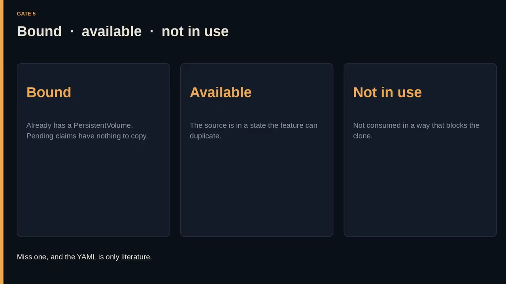

---

## 七、容量与卷模式：不能缩，必须同模式

### 7.1 容量：必须指定，且 ≥ 源

**克隆的容量是个"法律边界"。** `spec.resources.requests.storage` **必须指定**，而且**指定的值必须等于或大于源卷的容量** [【跳转到 11:20】](https://www.youtube.com/watch?v=oKEJ1knGa_Q&t=680)：

- **目标不能说一个更小的数、然后指望多出来的字节自己消失**；
- 若 `pvc-1` 已经是 `5Gi`，那么 **`5Gi` 是下限，不是建议**；
- 若源比 `5Gi` 大，这个例子**就会违反容量规则**。

> **允许"更大"是工程常识**：你可以请求一块比原卷更宽敞的卷，**但你不能请求更小的**。**字段要写，不能省**——克隆仍然是一个 PVC，而 Claim 必须声明它要多少存储。[【跳转到 11:45】](https://www.youtube.com/watch?v=oKEJ1knGa_Q&t=705)

**为什么"更小"被禁止？** 视频用打包行李箱作比 [【跳转到 26:18】](https://www.youtube.com/watch?v=oKEJ1knGa_Q&t=1578)：

> **你可以把同样的衣服装进一个等大的箱子或更大的箱子，但你不能把它们装进一个更小的箱子、还管这叫同一趟旅行。**

**"必须指定" + "必须等大或更大"——两个 must，字段路径写全，这样没人会去找什么"克隆专用容量键"：根本没有 `cloneSize`，有的只是"被拿来和源比较的普通存储请求"。** [【跳转到 26:43】](https://www.youtube.com/watch?v=oKEJ1knGa_Q&t=1603)

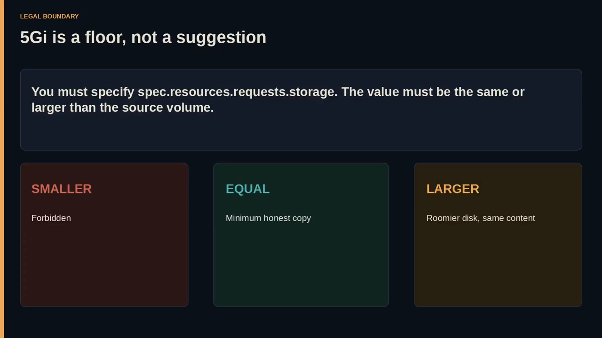

### 7.2 卷模式必须匹配（包括 block）

克隆**不只适用于文件系统**。**同一套卷模式规则包含 block** [【跳转到 21:45】](https://www.youtube.com/watch?v=oKEJ1knGa_Q&t=1305)：

- **一个 raw device（裸设备）卷可以是源，也可以是目标，但它们必须匹配**；
- **数据库、自定义文件系统、任何"要磁盘而不是格式化目录"的东西，只要驱动支持克隆，就都在受众之列**；
- 若 `clone-of-pvc-1` 请求 `block` 而 `pvc-1` 是 `filesystem`，**该请求不应成功**。

> 视频的镜头很形象：**两个同形状的插座，`dataSource` 的插头只能插进匹配的那个——block 对 block，filesystem 对 filesystem。** [【跳转到 22:35】](https://www.youtube.com/watch?v=oKEJ1knGa_Q&t=1355)

**注意**：例子里**没有**关于卷模式的额外 YAML，通常意味着走了**默认的 filesystem**；**但一旦你把模式设成 block，这条约束照样成立。** [【跳转到 22:10】](https://www.youtube.com/watch?v=oKEJ1knGa_Q&t=1330)

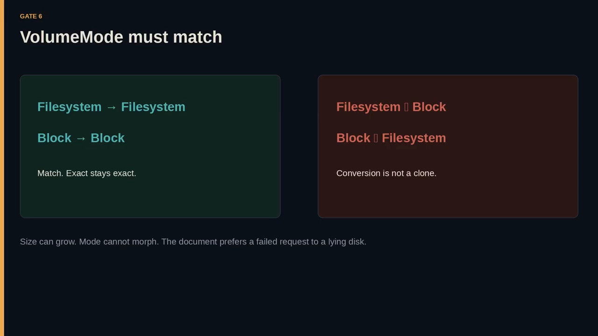

### 7.3 访问模式是"写出来的"，不是"继承来的"

例子里的 `ReadWriteOnce` 意味着**单个节点可以挂载这块卷** [【跳到 12:10】](https://www.youtube.com/watch?v=oKEJ1knGa_Q&t=730)。要点在于：

> **克隆不会靠"沉默"从源那里继承一个神秘访问模式——你要自己写目标的访问模式。克隆改变的是"内容如何出生"，它并不抹掉 Claim spec 的其余部分：你仍然决定新卷怎么被挂载、用哪个 storageClass、请求多大。`dataSource` 只回答一件事——制备时这些字节从哪来。** [【跳转到 13:00】](https://www.youtube.com/watch?v=oKEJ1knGa_Q&t=780)

**如果你以为克隆会自动复制 `pvc-1` 的整个 spec，那这份 YAML 应该更短——它并不短。** `clone-of-pvc-1` 被完整地写明，然后为"内容"而指向 `pvc-1`。

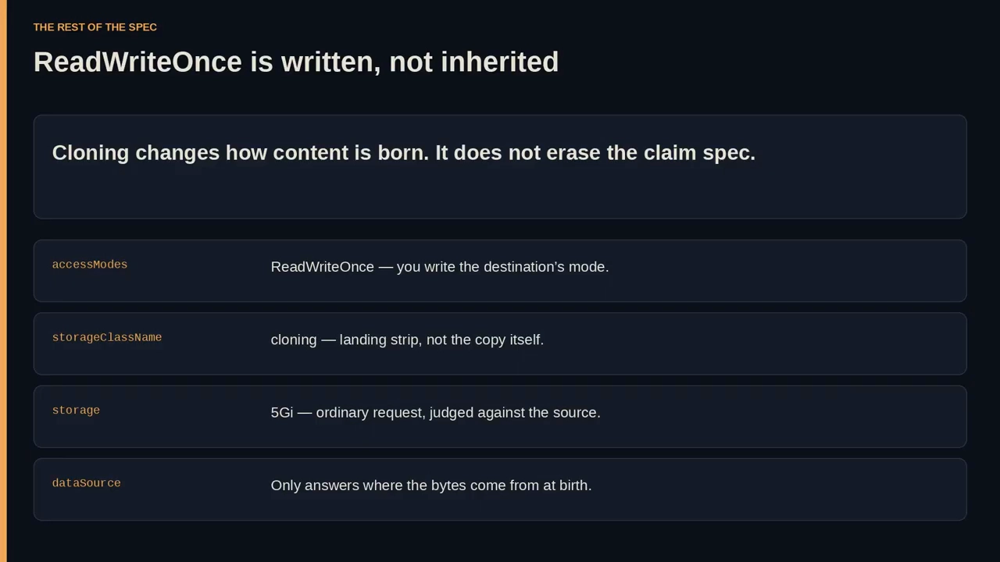

---

## 八、class 可以不同，但必须"能克隆"；默认类不是万能钥匙

### 8.1 命名空间、卷模式、容量 must —— class **may**

把约束列成一张表最清楚 [【跳转到 13:55】](https://www.youtube.com/watch?v=oKEJ1knGa_Q&t=835)：

| 维度 | 要求 |
| --- | --- |
| **Namespace** | **必须匹配** |
| **VolumeMode** | **必须匹配** |
| **Capacity** | **等大或更大** |
| **StorageClass** | **可以不同** |

> **"可以不同"是这一堆匹配规则之后，一份令人意外的善意** [【跳转到 23:00】](https://www.youtube.com/watch?v=oKEJ1knGa_Q&t=1380)：**目标可以落在和源不同的存储类上**。也许你从"生产盘用的 class"克隆到"副本盘用的 class"。**文档不臆造这些动机，它只是允许这种差异。**

**但"允许"不等于"有能力"**：**目标 class 仍然需要一个实现了克隆的 CSI 驱动 + 动态 provisioner。改 class 并不是绕过 CSI 的漏洞，而是选择一条着陆跑道。** 如果这个 class 不能克隆，故事就到此为止；如果能，副本就可能活在与 `pvc-1` **不同的底层存储**上——**在独立之后，这种差异就变得很平常：两块卷、可能两个 class、没有链接。** [【跳转到 23:25】](https://www.youtube.com/watch?v=oKEJ1knGa_Q&t=1405)

### 8.2 可以省略 storageClassName 走默认类，但……

**你可以省略 `storageClassName` 而使用默认 storageClass**（例子里没有省，它写了 `cloning`），这条规则仍然重要 [【跳转到 23:50】](https://www.youtube.com/watch?v=oKEJ1knGa_Q&t=1430)：

> **省略一个字段 ≠ 省略一项要求。默认 class 仍是一个 class：仍必须是 CSI、仍必须是动态的、仍必须实现克隆；源仍必须 bound/available/not in use、同命名空间、卷模式匹配、容量达标。默认只关乎"命名"，它不是万能钥匙。若集群的默认 class 不能克隆，省掉名字正是你"悄悄失败"的方式——YAML 看着更简单，后端毫无变化。** [【跳转到 24:40】](https://www.youtube.com/watch?v=oKEJ1knGa_Q&t=1480)

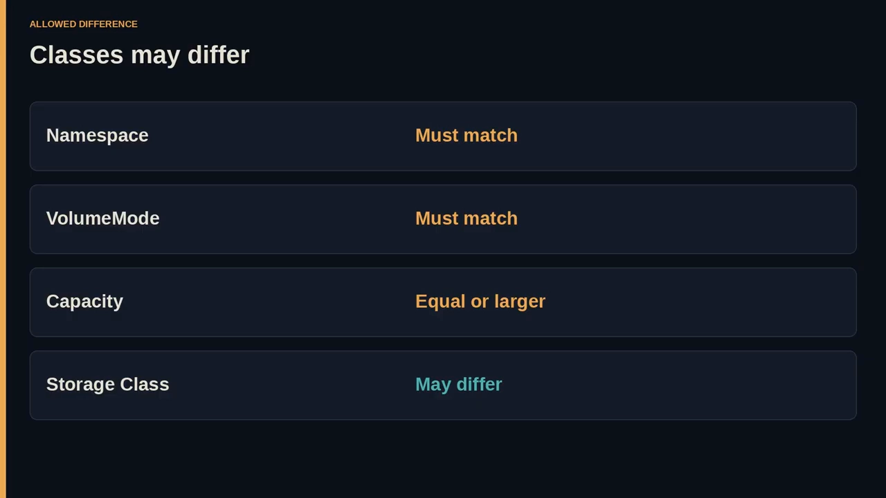

---

## 九、可用之后：「普通生活」与「独立对象」

### 9.1 可用（available）是"制备"与"生活"之间的闸门

**使用从新 PVC available 开始** [【跳转到 28:46】](https://www.youtube.com/watch?v=oKEJ1knGa_Q&t=1726)：

- **在克隆可用之前，它只是一个"在途请求"**；
- **一旦可用，被克隆的 PVC 就"像其他 PVC 一样"被消费——没有克隆金额、没有特殊的 volume plugin**；
- **Pod 引用 `clone-of-pvc-1`，就像引用任何 Claim 一样。**

> **这是面向用户的胜利**：**开发者不需要学一套"克隆运行时"；他们只学一次"克隆的出生"，然后就忘了它。** Claim 就是 Claim：`ReadWriteOnce` 照样适用、storageClass 的属性照样适用、卷模式照样适用——**唯一非凡的事实是历史性的：这些字节最初是从 `pvc-1` 复制来的。从应用视角看，历史是不可见的：卷就是卷。** [【跳转到 29:11】](https://www.youtube.com/watch?v=oKEJ1knGa_Q&t=1751)

**视频在这里特意不夸大魔法**：**魔法在后端那次复制；使用是"刻意的普通"。普通才是重点——如果使用是特殊的，独立就会更难；特殊的对象会被缠住，普通的对象才能离开。** [【跳转到 29:36】](https://www.youtube.com/watch?v=oKEJ1knGa_Q&t=1776)

### 9.2 独立对象：四个动词，无需向父母请示

**在此时还应当预期：新创建的 PVC 是一个独立对象。** "应当预期"在规范口吻里是个强词——**Kubernetes 要你把独立当成设计，而不是一个令人愉快的意外** [【跳转到 30:01】](https://www.youtube.com/watch?v=oKEJ1knGa_Q&t=1801)。

**文档给出了一份独立性清单** [【跳转到 31:16】](https://www.youtube.com/watch?v=oKEJ1knGa_Q&t=1876)：

> **新创建的 PVC 可以被独立地、且无需考虑其原始 dataSource PVC 地——消费（Consumed）、克隆（Cloned）、快照（Snapshotted）、或删除（Deleted）。**

- **Consumed**：挂载它、用它；
- **Cloned**：它可以**自己成为源**；
- **Snapshotted**：它可以**作为自己的一块卷进入快照流程**；
- **Deleted**：它**可以消失，而不用向 `pvc-1` 请示**。

> **"无需考虑其原始 dataSource PVC"这一句，就是法律上的独立**：你不用跟父母核对，你不必为了让子卷存在而让父卷活着。**克隆还能被再克隆**——这很重要：一份副本可以再当另一份副本的源，只要驱动仍实现克隆、所有约束再次满足。

### 9.3 源与克隆"没有任何方式的联结"

文档更进一步 [【跳转到 32:06】](https://www.youtube.com/watch?v=oKEJ1knGa_Q&t=1926)：

> **这也意味着源与新建的克隆没有任何方式的联结。它也可以被修改或删除，而不影响新建的克隆。**

> **"没有任何方式的联结""修改或删除都不影响克隆"——这两句杀死了镜像神话。** 克隆存在后，如果你往 `pvc-1` 里写新数据，`clone-of-pvc-1` **不会**收到这些数据；如果你删掉 `pvc-1`，`clone-of-pvc-1` **仍然存在**。

用**"两本同稿印出的书"**作比 [【跳转到 30:51】](https://www.youtube.com/watch?v=oKEJ1knGa_Q&t=1851)：

> **改动一本书里的一页，不会改动另一本；烧掉一本书，也不会烧掉另一本。原稿时刻就是"制备"；那之后只剩两本印好的、彼此独立、没有持续链接的副本。**

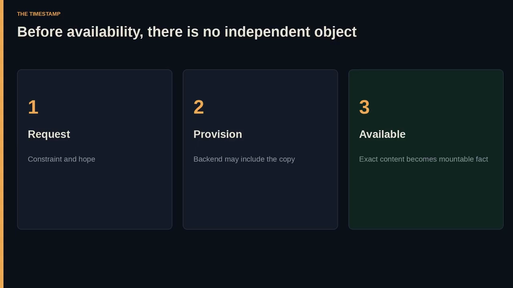

**所以任何诚实的图上都不该画一条"活线"连接两块卷。图应当画出：一次复制事件，然后是一次切割。切割之后，从克隆出发的箭头指向 consume / clone / snapshot / delete，从源出发的箭头走向它自己的命运，两条路径不再交叉。** [【跳转到 32:56】](https://www.youtube.com/watch?v=oKEJ1knGa_Q&t=1976)

---

## 十、请求 → 制备 → 可用：此前并没有独立对象

**整个序列是一个动作** [【跳转到 34:36】](https://www.youtube.com/watch?v=oKEJ1knGa_Q&t=2076)：

1. **在 `pvc-1` 存在之前**：它已 bound 且有内容；一个传统新卷会是空的——**所需的状态已经在源上了**。
2. **API 时刻**：`my-ns` 里一个名为 `clone-of-pvc-1` 的新 PVC，设置 `dataSource.kind=PersistentVolumeClaim`、`name=pvc-1`、`storageClass=cloning`、`5Gi`、`ReadWriteOnce`。
3. **制备**：动态 CSI provisioner 创建**一份精确副本，而不是一块空白盘**。
4. **之后**：两个对象，**没有实时同步**；克隆可以被独立消费、克隆、快照或删除；源可以被修改或删除而不影响克隆。

> **"可用"在结构上是有分量的**：在可用之前，你**还没有**那个独立对象。文档提到 Claim 可能在 CSI 驱动复制期间处于 Pending——**文档没给时长、进度条或性能数字，所以我们也不编造**。我们只标记阶段变化：**request → provision → available**，然后是普通生活。**如果你在克隆可用之前就想消费它，你还不是在用克隆，你只是在等制备。** [【跳转到 33:46】](https://www.youtube.com/watch?v=oKEJ1knGa_Q&t=2026)

### 每一道闸门都可能拒绝

即使故事讲对了，**仍然可能在闸门处失败** [【跳转到 36:16】](https://www.youtube.com/watch?v=oKEJ1knGa_Q&t=2176)：

- **只能 CSI**；
- **只能动态 provisioner**；
- **这个具体驱动可能没实现克隆**；
- **源与目标必须同命名空间**；
- **源必须 bound、available、not in use**；
- **卷模式必须匹配（包括 block）**；
- **请求容量必须指定且 ≥ 源**；
- **目标 class 必须能克隆（无论叫 `cloning` 还是默认类）**。

> **差任何一个，就没有一个"可庆祝的独立对象"。这些不是快乐 YAML 周围的装饰，而是这套请求的"免疫系统"。空白竞争者问题更少，因为它什么都不复制；克隆竞争者要求很高——它要求集群做一件昂贵而精确的事。集群用"前置条件"来回答。那不是敌意，那是"精确"得以成立的方式。**
>
> **一个失败的克隆，好过一块"披着 `clone-of-pvc-1` 名字的空白卷"。名字会说谎，约束尽量不说。** [【跳转到 37:06】](https://www.youtube.com/watch?v=oKEJ1knGa_Q&t=2226)

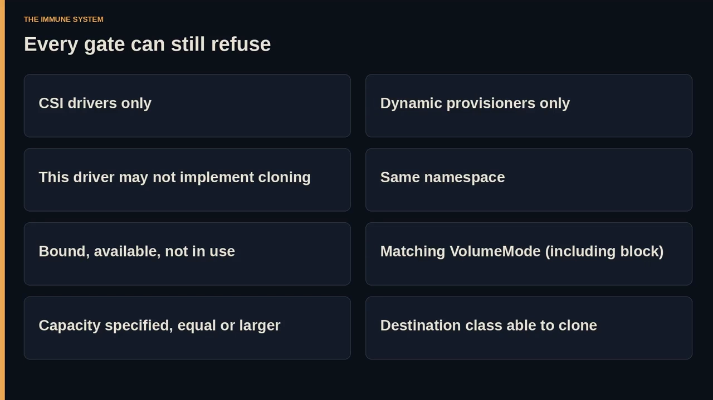

### 收尾：精确的承诺，而非魔法

**克隆让你获得的是一份"精确的承诺"，而不是魔法** [【跳到 37:31】](https://www.youtube.com/watch?v=oKEJ1knGa_Q&t=2251)：

> **它不跨命名空间复制；它不转换卷模式；它不缩小容量；没有 CSI、没有动态制备、没有真正实现了克隆的驱动，它就不工作；它也不会让源与克隆保持绑在一起。**

**这些"拒绝"正是这份承诺的形状。** 而剩下的那个实际问题是这一页不会回答的 [【跳转到 39:11】](https://www.youtube.com/watch?v=oKEJ1knGa_Q&t=2351)：

> **到底哪些 CSI 驱动真正实现了这个能力？API 已就绪，YAML 很短，复制只在"驱动守约"的地方发生。在你为自己的 class 弄清这一点之前，"克隆"这句句子，你的集群也许会说、也许不会说。**

---

## 小结

- **克隆不是镜像**：它是**一块已存在卷的副本**，**只在出生那一刻精确相同**；可用之后**各自独立**。
- **请求方式是"在目标 PVC 上加 `dataSource` 指向源 PVC"**，**没有单独的克隆对象，也没有 `clone: true` 开关**——**dataSource 是出生指令，不是实时同步。**
- **复制发生在存储层**：**同一条准入路径，不同的存储动词**（empty create vs duplicate create）；**API 只能指，只有 CSI 驱动能复制。**
- **三道能力闸门**：**只支持 CSI、只支持动态 provisioner、且该驱动可能根本没实现克隆。**
- **同命名空间是硬墙**：`dataSource.name` 是邻居查找，不是集群级检索。
- **源要求三连**：**bound、available、not in use**。
- **容量与卷模式**：**容量必须指定且 ≥ 源（不能缩）；卷模式必须匹配（含 block）。** 访问模式等其余 spec 要自己写，**不会自动继承**。
- **class 可以不同，但必须能克隆**；默认 class 同样必须 CSI/动态/实现克隆。
- **可用（available）之后是"普通生活"**：像普通卷一样被消费；**且是独立对象**——**可被消费 / 克隆 / 快照 / 删除，无需考虑原始 dataSource**；**源被改或被删都不影响克隆**。
- **阶段**：**request → provision → available**；**在可用之前并不存在独立对象**；**每一道闸门都可能拒绝**。

## 关键术语速查

| 术语 | 一句话解释 |
| --- | --- |
| CSI 卷克隆 | 在**制备时**由存储后端把一块已存在卷**精确复制**成新卷的能力；只对 CSI 驱动提供。 |
| VolumePVCDataSource | "一个 Claim 可以从另一个 Claim 出生"的能力；承载它的是目标 PVC 的 `dataSource` 字段。 |
| `dataSource` | 指向**同命名空间**里一个已存在 PVC 的指针；**一次性出生指令**，不是持续同步。 |
| 源 PVC（如 pvc-1） | 提供内容的那个已存在 Claim；必须 **bound、available、not in use**。 |
| 目标 PVC（如 clone-of-pvc-1） | 出生即带内容的新 Claim；其余 spec（访问模式/class/容量）仍需自己写。 |
| 容量规则 | `spec.resources.requests.storage` **必须指定**，且**等大或更大**于源；**不能更小**。 |
| VolumeMode | `Filesystem` 或 `Block`；**源与目标必须匹配**（block 也支持）。 |
| 同命名空间要求 | 源与目标必须在同一命名空间；**不是跨命名空间复制服务**。 |
| 动态 provisioner | 克隆**只**在动态制备时成立；静态预建的 PV 不在路径内。 |
| 独立性 | 可用后，克隆**可消费/克隆/快照/删除**，无需考虑原始 dataSource；**源被改被删都不影响它**。 |
| `available` | 克隆从"在途请求"转为"可被消费的标准卷"的分界；此前不存在独立对象。 |
