# Kubernetes 卷快照：把「冻结的一瞬」拆成请求与资源

## 本讲要解决的核心问题（SCQA）

**背景**：在 Kubernetes 里，Pod 通过 PVC（PersistentVolumeClaim，持久卷声明）拿到一块持久卷（PersistentVolume，PV），数据库的文件就活在这块卷里。卷是"活的"——查询在来、文件在改。

**冲突**：你要在跑一次高风险迁移、或者手滑删掉那个 Claim 之前，先把数据保住。可你并不想真的再复制一整块盘：多出来的容量、多出来的挂载时间、多出来的清理工作都是成本。你要的只是"在某一瞬间按一下快门，把这块卷当时的样子记下来"。

**疑问**：Kubernetes 怎么做到"不复制整卷、却能冻结一瞬"？当你说"给这个卷拍张快照"时，真正执行拍摄的到底是谁？拍完之后，"那张照片"又存放在哪里、归谁管？

**回答（中心思想）**：Kubernetes 把"快照"这件事**拆成两个对象**——**VolumeSnapshot**（用户在命名空间里发出的请求，类比 PVC）与 **VolumeSnapshotContent**（管理员面向、代表真实快照的资源，类比 PV），中间靠一条**接力链**驱动：**snapshot-controller** 把请求变成 Content，**csi-snapshotter** 这个 sidecar 再替它去调 CSI 驱动的 `CreateSnapshot`/`DeleteSnapshot`，字节始终留在存储后端，API 对象只是"标签与契约"。围绕这条主线，还有两条入口（预置 / 动态）、严格的 1:1 绑定、删除策略、卷模式与拓扑等约束。

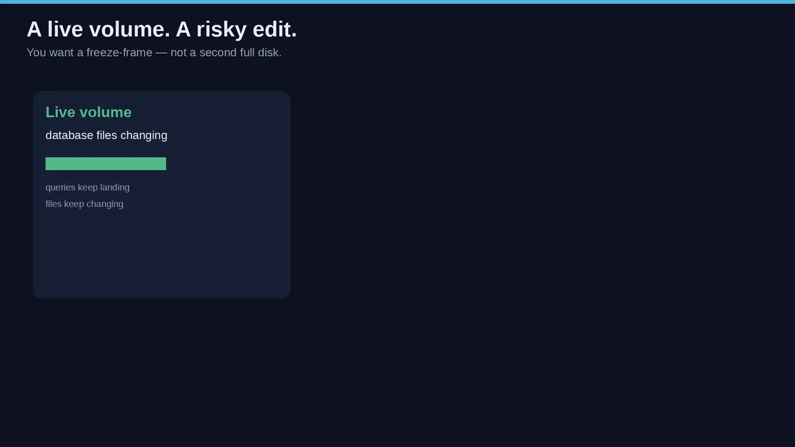

[【跳转到 00:00】](https://www.youtube.com/watch?v=jaM0-25-N6A&t=0)

---

## 一、为什么需要快照：冻结一瞬，而不是复制整卷

### 1.1 快照是"某一时刻的内容副本"，不是新卷

视频给快照下了一个很克制的定义：**快照是一种标准化方式，用来在某一个时间点复制卷的内容，而不必创建一个全新的卷** [【跳转到 00:25】](https://www.youtube.com/watch?v=jaM0-25-N6A&t=25)。

把它想成一张**贴了标签的冻结帧**：活动卷还是那块活动卷，冻结帧是它旁边的一张"命名了的时间点副本"。

- 活动卷（live volume）：文件还在变，写上继续发生。
- 冻结帧（freeze frame）：内容停留在按下快门的那一刻，原始卷照常对外服务。

### 1.2 为什么不是"每次紧张就克隆一份"

如果每次心里没底就把某个 PVC 克隆成一块新卷，你会付出三重代价：**多一份容量、多一次挂载耗时、多一轮清理** [【跳转到 00:50】](https://www.youtube.com/watch?v=jaM0-25-N6A&t=50)。

相比之下快照"在意图上更便宜"：先按原样把数据捕获下来，**需要时再从这张冻结的图里长出一块新卷**。

> 一句话记住：**克隆是"现在就复制出一块能用的新盘"，快照是"先记一下此刻，将来按需还原"。**

### 1.3 于是问题变成：Kubernetes 怎么把"记住此刻"变成一个对象？

视频接下来的思路很值得学：它把"一个用户请求 → 一个集群对象 → 存储后端上一次真实操作"这条链拆开来看。而在 Kubernetes 里，**第一步永远是同一个动作：把"用户想要的"和"集群里真实存在的"分开**。


---

## 二、设计第一招：把"请求"与"资源"分开

### 2.1 卷早就是这么干的：PVC 是请求，PV 是资源

这点你其实已经熟悉：**PVC 是请求，PV 是能满足它的资源**。快照**故意沿用同一套模式** [【跳转到 01:40】](https://www.youtube.com/watch?v=jaM0-25-N6A&t=100)：

- **VolumeSnapshot**：用户面向的请求，类比 PVC——"给这个 Claim 拍一张"。
- **VolumeSnapshotContent**：管理员面向的对象，代表集群里**真实可用的那张快照**，类比 PV。

### 2.2 为什么要拆成两个对象？

如果只有一个对象，那么一个命名空间里的用户，为了请求快照，就得**同时掌握后端那张快照的身份信息**——这并不安全，也不合理。

拆开之后：**应用所有者只管说"给这个 Claim 拍张快照"，而*真实的快照资源*由集群、snapshot-controller 和存储驱动来负责** [【跳转到 02:05】](https://www.youtube.com/watch?v=jaM0-25-N6A&t=125)。

- VolumeSnapshot 活在"用户的世界"（命名空间内）。
- VolumeSnapshotContent 活在"集群的世界"（集群级）。
- 之后两者会**一对一绑定**，和 Claim 绑定 Volume 是同一个精神：**没有绑定之前，冻结帧只是一个愿望；绑定之后，愿望有了一个能指向存储系统上那张快照的对应物。**

### 2.3 字节不在 etcd，也不在 API Server

一个常见误解是："创建 VolumeSnapshot 就会把每个字节复制进 **etcd** 或 API Server。" —— **并不是。** [【跳转到 02:55】](https://www.youtube.com/watch?v=jaM0-25-N6A&t=175)

**API 对象是标签和契约，字节留在存储后端。** 这样一来，你以后看一个集群时可以**分两个问题分别问**：有人请求了什么？实际存在的又是哪张快照？

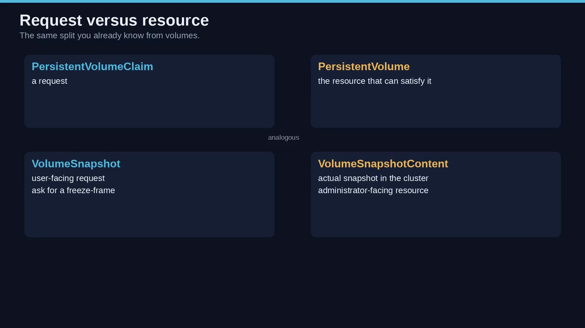

---

## 三、VolumeSnapshotClass：为什么不能复用 StorageClass

### 3.1 两个类回答两个不同的问题

快照不只是"更小的卷"，所以还有第三个对象。视频把两者的分工说得非常清楚 [【跳转到 03:20】](https://www.youtube.com/watch?v=jaM0-25-N6A&t=200)：

- **StorageClass** 回答：**这块持久卷该怎么制备？**（接在 Claim 上）
- **VolumeSnapshotClass** 回答：**这一次快照该怎么打？**（接在 VolumeSnapshot 上）

一句话：**同一块盘，不同的快照配方。**

### 3.2 为什么这些参数不能塞进 StorageClass

因为**同一个卷的不同快照，参数可能不同** [【跳转到 03:45】](https://www.youtube.com/watch?v=jaM0-25-N6A&t=225)：一张快照可能走 *crash-consistent*（崩溃一致性）路径；另一张可能带上**供应商参数**，改变保留、复制策略，或左右后端给快照命名的方式。

如果把这些旋钮挂到原来的 StorageClass 上，那么这块卷的**每一张快照都会继承同样的设置**，你就失去了"从一个 Claim 拍出两种不同冻结帧"的能力。

### 3.3 默认类与操作性好处

创建 VolumeSnapshot 时可以**指定一个 VolumeSnapshotClass**；**不指定则使用默认类（若有）**——这份"默认"的舒适感与 StorageClass 一致 [【跳转到 04:35】](https://www.youtube.com/watch?v=jaM0-25-N6A&t=275)。

它带来的操作性好处 [【跳转到 05:00】](https://www.youtube.com/watch?v=jaM0-25-N6A&t=300)：

- 应用团队**请求快照时无需把供应商 YAML 塞进每个备份 cron job**——只要管理员发布过一个 VolumeSnapshotClass。
- 管理员**改供应商参数时，不必改写每一个 VolumeSnapshot**。
- 同一个 PVC 的两张快照**可以属于不同 class**。

> 用视频的隐喻收尾：**卷是场景，快照是那一帧，class 是这一帧的"相机设置"，而不是风景本身。**

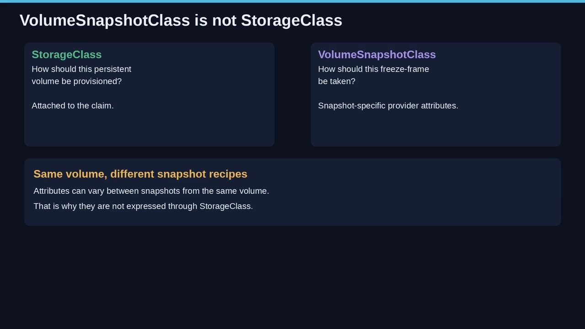

---

## 四、两个前提：它们是 CRD，而且只认 CSI

### 4.1 VolumeSnapshot / Content / Class 都是 CRD，不是核心对象

这一点会让"把每个 Kubernetes 对象都当内置物"的人意外：**VolumeSnapshot、VolumeSnapshotContent、VolumeSnapshotClass 都是自定义资源（CRD），不是核心 API 对象** [【跳转到 05:25】](https://www.youtube.com/watch?v=jaM0-25-N6A&t=325)。

### 4.2 快照支持只对 CSI 驱动开放

**快照支持只对 CSI 驱动可用**，**in-tree 卷插件不在这个故事里** [【跳转到 05:50】](https://www.youtube.com/watch?v=jaM0-25-N6A&t=350)。"CRD + CSI"这个组合不是实现注脚，它直接决定了**谁来安装什么、谁才真能冻结一块卷**。

### 4.3 两层"可选性"：谁来装什么

- **自定义资源必须先存在于集群里**，用户才谈得上创建 VolumeSnapshot。
- **CSI 驱动必须实现了快照能力**，请求才有地方去；**不是每个 CSI 驱动都实现了卷快照**，实现了的通常会用 **CSI snapshotter sidecar**。
- **你不能假设"集群里只要有 PersistentVolume 能用，每个存储类就都能产出冻结帧"。**

因此 Kubernetes 团队提供了**两部分** [【跳转到 06:15】](https://www.youtube.com/watch?v=jaM0-25-N6A&t=375)：

1. 部署进控制面的 **snapshot-controller**；
2. 与该 CSI 驱动一起部署的 sidecar 助手 **csi-snapshotter**。

**安装 CRD 与 snapshot-controller 是 Kubernetes 发行版的责任，不是每个 CSI 驱动自己该扛的。** 另外还有一个 **validating webhook**（后面讲），也遵循同样的规则——**由发行版连同 controller、CRD 一起安装** [【跳转到 06:40】](https://www.youtube.com/watch?v=jaM0-25-N6A&t=400)。

> 所以"误会"要现在杀掉：**不是"Kubernetes 总会帮你快照存储"。Kubernetes 提供的是一个标准请求；只有 CSI、且只有实现了该能力的驱动，才能兑现它。** [【跳转到 07:05】](https://www.youtube.com/watch?v=jaM0-25-N6A&t=425)

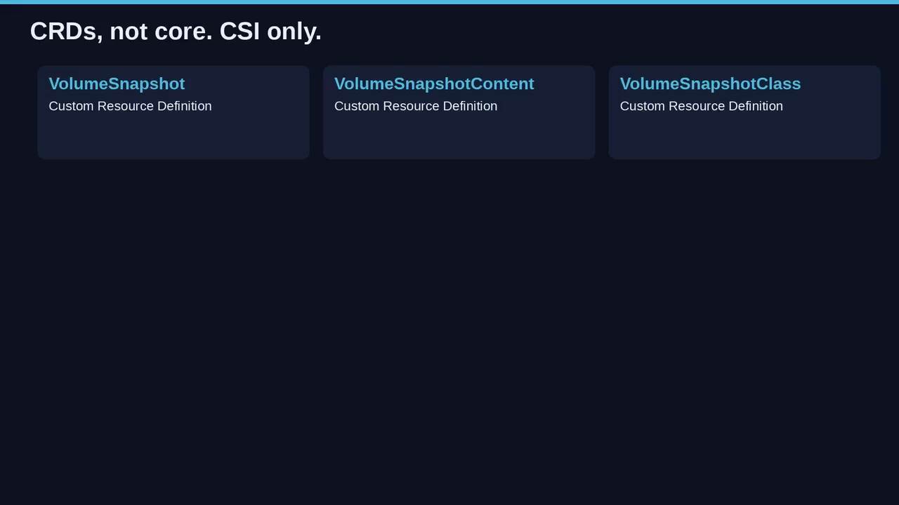

---

## 五、接力链：一个请求如何变成存储后端的一次操作

这是全片的"机制主干"。按视频的顺序，跟着一个请求走一遍：

### 5.1 用户创建 VolumeSnapshot

### 5.2 snapshot-controller 负责"控制面的一半"

它监听 VolumeSnapshot 与 VolumeSnapshotContent 对象，**负责 VolumeSnapshotContent 的创建与删除**——把请求变成 Content 对象，将来再按策略把它拆掉 [【跳转到 07:30】](https://www.youtube.com/watch?v=jaM0-25-N6A&t=450)。

### 5.3 csi-snapshotter（sidecar）负责"对外那一半"

**sidecar 接手**：它监听 VolumeSnapshotContent 对象，向 **CSI endpoint** 触发 **`CreateSnapshot`** 与 **`DeleteSnapshot`** [【跳转到 07:55】](https://www.youtube.com/watch?v=jaM0-25-N6A&t=475)。

> **Kubernetes 自己并不存储每一张快照。真正执行操作的是存储后端和 CSI 驱动。API 对象是"票据"**：`CreateSnapshot` 才是真正在供应商系统上冻结字节的调用；`DeleteSnapshot` 是释放那张冻结帧的调用。

### 5.4 validating webhook

旁边坐着一个 **validating webhook server**，对快照对象提供更严格的校验。它**应由 Kubernetes 发行版随 snapshot-controller、CRD 一起安装，而不是由 CSI 驱动装**，并且**应当在所有启用了快照能力的集群中安装** [【跳转到 08:20】](https://www.youtube.com/watch?v=jaM0-25-N6A&t=500)。

**这个职责划分很容易被搞反**：人们会以为"快照像个存储功能，所以 webhook 和 controller 应该由 CSI 驱动自带"；但**文档明确的是：驱动**（可以）**实现快照调用，发行版安装集群级机械装置** [【跳转到 08:45】](https://www.youtube.com/watch?v=jaM0-25-N6A&t=525)。

### 5.5 把这条链当成"接力"来看

> VolumeSnapshot 出现 → **controller** 创建/绑定 VolumeSnapshotContent → **snapshotter** 看到该 Content，调用 `CreateSnapshot` → 后端返回标识符 → 对象上的 **Status** 开始如实反映"这张冻结帧是否就绪"；删除时接力反向进行，**仍然经过 controller 和 snapshotter**，最后在策略要求下发出 `DeleteSnapshot`。

一旦看清这条路径，后面那些 YAML 就**不再是装饰**：**每个字段要么是对这条接力的一个请求，要么是记录后端做了什么。**

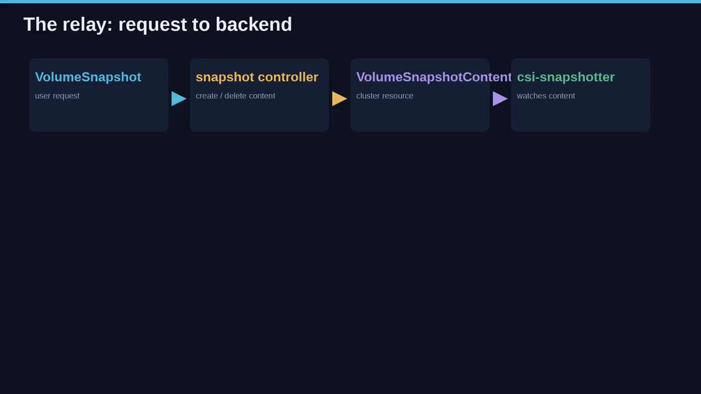

---

## 六、两条进门的路：预置（Pre-provisioned）与动态（Dynamic）

冻结帧进入集群有**两条路**，最终都落在同一对对象上，但**起点方向相反** [【跳转到 09:35】](https://www.youtube.com/watch?v=jaM0-25-N6A&t=575)。

### 6.1 预置：快照先存在于存储侧

**集群管理员已经在存储系统上有一张真实的卷快照**，于是他创建 **VolumeSnapshotContent** 对象，把那张真实快照的细节写进去。这些对象存在于 Kubernetes API 中、可供消费。**这条路里，用户并不负责去拍快照**——用户只是**消费一张已经存在的快照** [【跳转到 10:00】](https://www.youtube.com/watch?v=jaM0-25-N6A&t=600)。

### 6.2 动态：用户请求"从这个 PVC 拍一张"

相反的情形是：**你不是去用一张已存在的快照，而是请求从某个 PVC 动态地拍一张**。**VolumeSnapshotClass 指定拍摄时使用的、存储供应商专属的参数** [【跳转到 10:25】](https://www.youtube.com/watch?v=jaM0-25-N6A&t=625)。

> **一条路是"导入一张冻结帧"，另一条路是"拍摄一张冻结帧"。**

### 6.3 一个有用的判据：谁按下了快门？

- 如果**存储阵列在 Kubernetes 知道它之前就已经持有这张快照** → 你在**预置**世界，管理员必须把那张快照描述为 VolumeSnapshotContent。
- 如果**是用户指着一个 Claim、让 Kubernetes 去拍** → 你在**动态**世界，controller 会在 CSI 驱动成功后创建 Content。

**光看面向用户的 VolumeSnapshot 名字，是看不出走了哪条路的——要看 source：** 动态的 source 命名一个 **PVC**，预置的 source 命名一个 **VolumeSnapshotContent** [【跳转到 10:50】](https://www.youtube.com/watch?v=jaM0-25-N6A&t=650)。

用数据库的故事说：
- **动态** = "我迁移前，请把[这个 Claim]冻结一下"。
- **预置** = "存储团队已经冻好了，请让我的命名空间能用那张帧"。[【跳转到 11:15】](https://www.youtube.com/watch?v=jaM0-25-N6A&t=675)

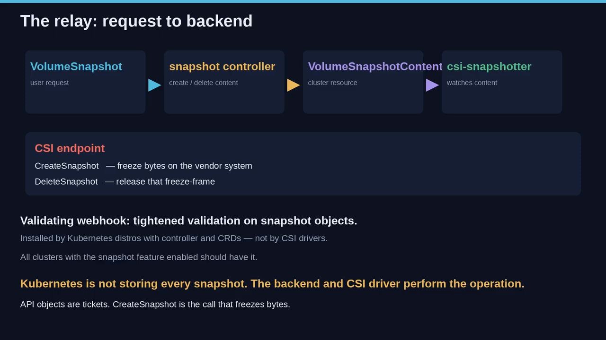

### 6.4 动态 VolumeSnapshot：三个名字做了几乎全部的事

```yaml
apiVersion: snapshot.storage.k8s.io/v1
kind: VolumeSnapshot
metadata:
  name: new-snapshot-test
spec:
  volumeSnapshotClassName: csi-hostpath-snapclass
  source:
    persistentVolumeClaimName: pvc-test
```

[【跳转到 11:40】](https://www.youtube.com/watch?v=jaM0-25-N6A&t=700)

三个名字各司其职：

- **`pvc-test`**：活动卷的 Claim，也就是"被拍照的场景"。
- **`csi-hostpath-snapclass`**：相机设置。
- **`new-snapshot-test`**：这份请求在本命名空间里的名字。

要点：

- `persistentVolumeClaimName` 对动态制备快照是**必需**的——它就是数据源 [【跳转到 12:05】](https://www.youtube.com/watch?v=jaM0-25-N6A&t=725)。
- 可以用 `volumeSnapshotClassName` 指定 class；不设则用默认类（若有）。
- **注意"缺席"的东西**：这里**没有 volume handle，也没有 snapshot handle**。用户**不需要知道后端是怎样命名磁盘的**——**这正是动态制备的意义**：指着 Claim，起个 class 名，让 controller 与 CSI 驱动去创建 Content。[【跳转到 12:30】](https://www.youtube.com/watch?v=jaM0-25-N6A&t=750)

把它读成一句人话：**"我想要一个名为 new-snapshot-test 的 VolumeSnapshot，用 csi-hostpath-snapclass 这个 class，数据来自 PVC pvc-test。"** [【跳转到 12:55】](https://www.youtube.com/watch?v=jaM0-25-N6A&t=775)

对象被接受后，snapshot-controller 就启动我们前面追过的那条接力；Content 稍后出现（往往带一个生成的名字）；Status 最终会报告冻结帧是否 ready to use。**如果你是在保护一个数据库，这就是你在迁移前 apply 的对象**——等到快照 ready，再动那个活动卷。[【跳转到 13:20】](https://www.youtube.com/watch?v=jaM0-25-N6A&t=800)

### 6.5 预置 VolumeSnapshot：源字段换成 Content 名

```yaml
apiVersion: snapshot.storage.k8s.io/v1
kind: VolumeSnapshot
metadata:
  name: test-snapshot
spec:
  source:
    volumeSnapshotContentName: test-content
```

[【跳转到 13:45】](https://www.youtube.com/watch?v=jaM0-25-N6A&t=825)

- apiVersion、kind、metadata 都还是熟悉的；**只是名字和指针换了**。
- **这里的源字段是 `volumeSnapshotContentName`，而且是这条路上必需的** [【跳转到 14:10】](https://www.youtube.com/watch?v=jaM0-25-N6A&t=850)。
- **没有 `persistentVolumeClaimName`**；**也不需要 VolumeSnapshotClass**——因为根本没有人通过 class 去拍新快照，**冻结帧早就存在了，用户是在请求绑定到它**。

> **在 `test-content` 这个 Content 对象出现之前，这个 VolumeSnapshot 会一直处于 unbound（未绑定）状态。这不是 YAML 的失败，而是生命周期的一部分**：你可以**先把请求登记好，它就等着**；等 Content 出现，controller 就能把这一对绑起来。[【跳转到 14:35】](https://www.youtube.com/watch?v=jaM0-25-N6A&t=875)

这也正是存储团队**把一张快照交给某个应用命名空间、却不要求应用去调供应商 API** 的方式：**管理员发布 Content，用户发布一个按名字指向该 Content 的 VolumeSnapshot** [【跳转到 15:00】](https://www.youtube.com/watch?v=jaM0-25-N6A&t=900)。

> **最容易犯的清单错误**就是把它俩搞混：**动态 YAML 命名一个 Claim，预置 YAML 命名一个 Content。** 记住这两句话：

- `persistentVolumeClaimName` = **去给这个 Claim 拍张新照片**。
- `volumeSnapshotContentName` = **用这张已经存在的照片**。[【跳转到 15:25】](https://www.youtube.com/watch?v=jaM0-25-N6A&t=925)

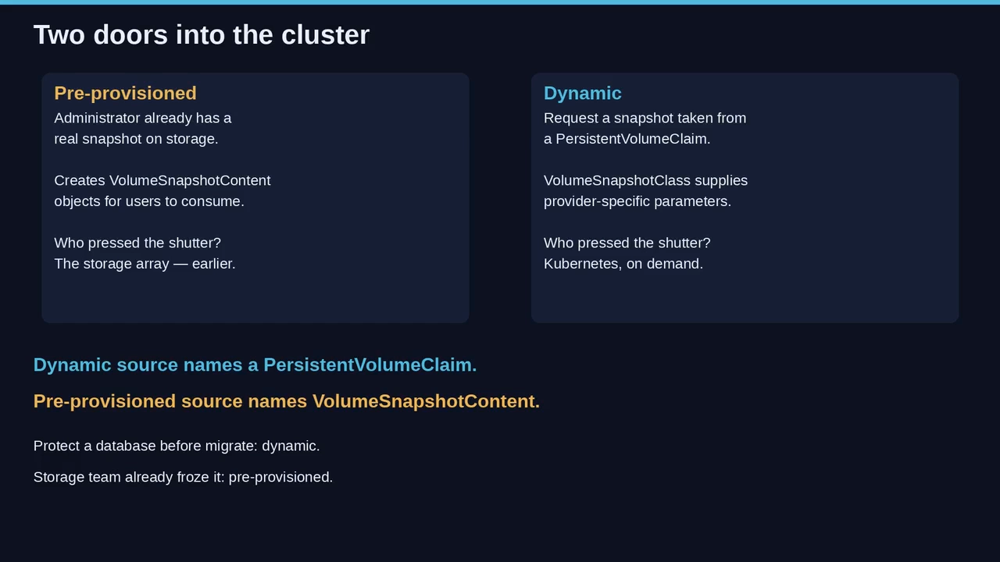

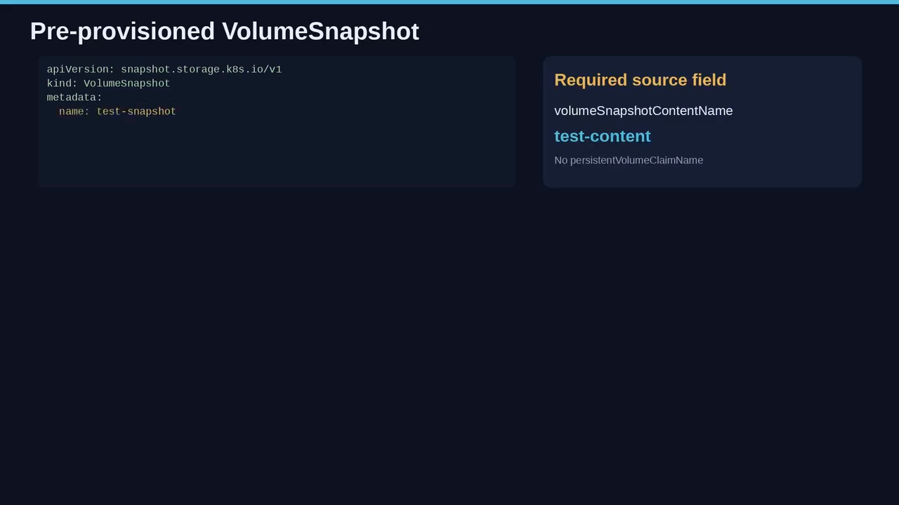

---

## 七、绑定是"一对一"：为什么不能多对一

### 7.1 每条请求恰好绑一份内容

**snapshot-controller 负责把 VolumeSnapshot 对象与一个合适的 VolumeSnapshotContent 对象绑定起来，无论预置还是动态情形都是如此** [【跳转到 15:50】](https://www.youtube.com/watch?v=jaM0-25-N6A&t=950)。

这个绑定是**一对一映射**——不是多对一，不是"一个池子"：**一条请求，一份内容**。

> 这比某些人的备份心智模型更严格：在那种模型里，一个 Claim 下可能挂好几个还原点。**但在这里，每个 VolumeSnapshot 恰好绑定一个 VolumeSnapshotContent。** [【跳转到 16:15】](https://www.youtube.com/watch?v=jaM0-25-N6A&t=975)

- **预置情形**：VolumeSnapshot 会一直 **unbound**，直到被请求的那个 Content 对象被创建出来。
- **动态情形**：用户从没命名 Content——**controller 在制备过程中创建它，然后绑定**。

### 7.2 为什么要 1:1？

因为**删除策略、ready 状态、后端身份，都需要一个唯一的所有者配对** [【跳转到 17:05】](https://www.youtube.com/watch?v=jaM0-25-N6A&t=1025)：

- 如果两个 VolumeSnapshot 能共享一个 Content，**删掉其中一个请求该算什么意思就含糊了**。
- 如果一个 VolumeSnapshot 能绑两个 Content，**还原时就不知道你要的是哪一张冻结帧**。

**controller 的职责就是建立这个配对，并拒绝任何映射模糊的世界。** 以后你 `kubectl describe` 一个 VolumeSnapshot 时，**绑定的 Content 名就是"愿望找到了资源"的证据**；在那之前（尤其是预置路径上），**unbound 是等待态，未必是 bug** [【跳转到 17:30】](https://www.youtube.com/watch?v=jaM0-25-N6A&t=1050)。

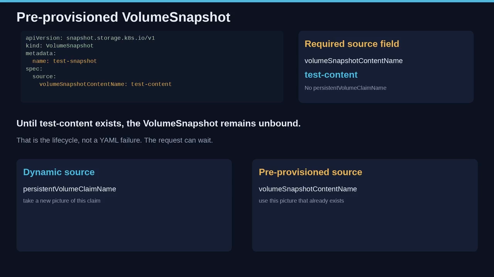

---

## 八、快门打开期间的保护：PVC 作为快照源

### 8.1 正在拍照时，源 Claim 不能被删

视频点出一个真实存在的竞态：**快门还开着的时候，源 Claim 是危险的——万一有人把它删了呢？** Kubernetes 针对这个竞态加了保护 [【跳转到 17:55】](https://www.youtube.com/watch?v=jaM0-25-N6A&t=1075)。

**"PVC 作为快照源保护"（PVC as snapshot source protection）的目的，是确保正在被拍快照的、处于使用中的 PVC API 对象，不会在这个过程中被从系统中移除——因为那可能导致数据丢失。** 当一张快照正在从某个 PVC 上拍摄时，**这个 PVC 就是'使用中'的**。

### 8.2 删除会被推迟

**如果你删除一个正被当作快照源的活动 PVC 对象，它不会立刻被移除；而是把移除推迟到快照 ready to use 或 aborted 为止** [【跳转到 18:20】](https://www.youtube.com/watch?v=jaM0-25-N6A&t=1100)。

- **readyToUse**：冻结帧可被消费的状态。
- **aborted**：这次快照尝试停止了。

两种情况下，**Claim 都只有在快照不再依赖它作为活动源之后，才被允许消失**。

### 8.3 别误读成"打过快照的 PVC 永远不能删"

**这不是规则。保护只针对"正在拍摄"的那个窗口。快照 ready 之后，原 Claim 可以按普通卷规则被删除** [【跳转到 18:45】](https://www.youtube.com/watch?v=jaM0-25-N6A&t=1125)。**冻结帧本应当活得比那个窗口更久。**

回到数据库：迁移任务启动，从 `pvc-test` 建了 Snapshot 对象；同一分钟里一个清理 controller 试图删 `pvc-test`。**没有保护的话**，Claim 可能在 `CreateSnapshot` 还在跑的时候就消失，你就丢掉了正想冻结的那份数据；**有保护**，删除会等待——**快照要么完成变 ready，要么 abort，只有到那时 Claim 的删除才继续** [【跳转到 19:10】](https://www.youtube.com/watch?v=jaM0-25-N6A&t=1150)。

> **API 在优先保护"进行中的冻结帧"，而不是"急切的删除"。这不是客气，而是系统拒绝让快照源在复制中途蒸发。**

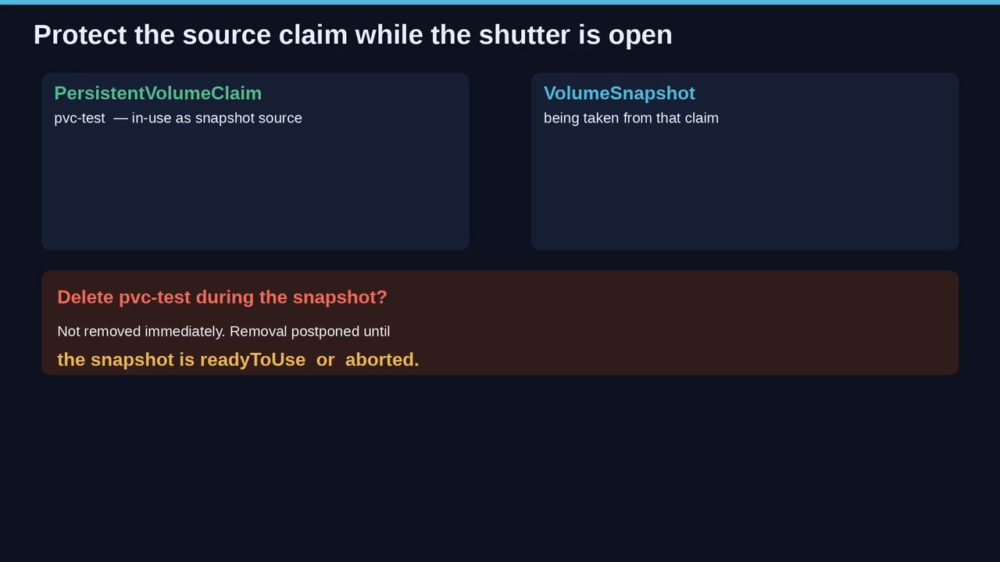

---

## 九、删除：遵循 DeletionPolicy

### 9.1 从"请求"删，而不是从供应商控制台

删除从**请求**开始：你删掉 VolumeSnapshot 对象，然后**遵循 DeletionPolicy** [【跳转到 19:35】](https://www.youtube.com/watch?v=jaM0-25-N6A&t=1175)：

- **DeletionPolicy = `Delete`**：**底层的存储快照**会连同 VolumeSnapshotContent 对象一起被删除。
- **DeletionPolicy = `Retain`**：**底层快照和 VolumeSnapshotContent 都保留**。

**这条策略决定了后端的冻结帧是消失还是留存——这一句话就是整个操作上的分叉** [【跳转到 20:00】](https://www.youtube.com/watch?v=jaM0-25-N6A&t=1200)：

- **Delete** 意味着：用户用完了这个 VolumeSnapshot，于是拆掉 Kubernetes 里的 Content，并告诉 CSI `DeleteSnapshot`。
- **Retain** 意味着：用户用完了这个命名空间里的请求，但集群和存储系统应当**保留 Content 和那张真实快照**。**Retain 是"解绑一个面向用户的对象、却不扔掉冻结帧"的方式。**

### 9.2 典型取舍

- **预置过快照的管理员常常需要 Retain**——因为后端那张快照可能仍然是**正式的备份**。
- **给测试数据库做过动态快照的团队常常想要 Delete**——**这样集群不会累积一堆"没被清账"的快照** [【跳转到 20:25】](https://www.youtube.com/watch?v=jaM0-25-N6A&t=1225)。

### 9.3 spec / status 与策略所在位置

每个 VolumeSnapshot 都含 spec 与 status：**spec 是你写的请求（source、class 名等）；status 是系统观察到的结果（绑定、错误、是否 ready to use）**。**DeletionPolicy 通常落在这一对的 Content 侧**——因为它才是代表后端快照的那个对象 [【跳转到 20:50】](https://www.youtube.com/watch?v=jaM0-25-N6A&t=1250)。

> 所以别以为"删 VolumeSnapshot 在 Kubernetes 里永远是软删、在阵列上永远是硬删"，或反过来——**都不是，它是策略。** [【跳转到 21:40】](https://www.youtube.com/watch?v=jaM0-25-N6A&t=1300)

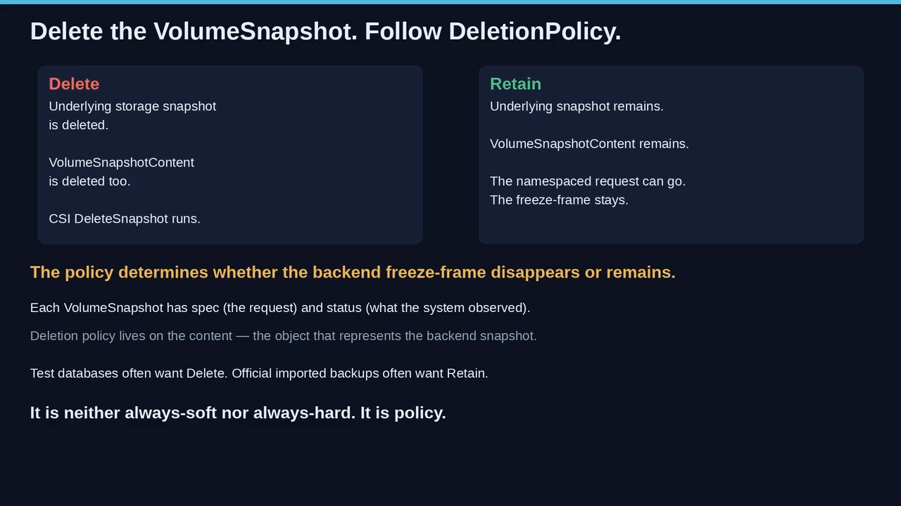

---

## 十、Content 记得什么：两个 handle、卷模式、引用

### 10.1 两个 handle，两种身份

VolumeSnapshotContent 是"冻结帧记住后端"的地方，而不只是 Kubernetes 的名字 [【跳转到 21:40】](https://www.youtube.com/watch?v=jaM0-25-N6A&t=1300)：

- **`volumeHandle`**：**存储后端上创建的卷的唯一标识符**，由 CSI 驱动在卷创建时返回。**动态制备快照时必需**，它指定快照的卷来源。**它不是 Claim 的 Kubernetes UID，而是驱动给那块活动盘起的名字。** [【跳转到 22:05】](https://www.youtube.com/watch?v=jaM0-25-N6A&t=1325)
- **`snapshotHandle`**：**存储后端上创建的卷快照的唯一标识符**。**预置快照时必需**，它指定这个 Content 所代表的、存储系统上的 CSI 快照 ID。[【跳转到 22:30】](https://www.youtube.com/watch?v=jaM0-25-N6A&t=1350)

> **两个 handle，两种身份：`volumeHandle` 说"拍的是哪块卷"，`snapshotHandle` 说"在阵列上这是哪张照片"。** [【跳转到 22:55】](https://www.youtube.com/watch?v=jaM0-25-N6A&t=1375)

### 10.2 sourceVolumeMode：快照带着"卷模式"

**`sourceVolumeMode` 是被拍快照的那块卷的模式**，取值可以是 **Filesystem** 或 **Block**。**如果不指定，Kubernetes 就把该快照的源卷模式视作 unknown。** [【跳转到 23:20】](https://www.youtube.com/watch?v=jaM0-25-N6A&t=1400)

**这里有个重要提醒**：**快照并不自动等同于一个"到处都能读的文件"。** 它是一个带有**卷身份、快照身份、卷模式**的后端对象。**如果你把它当成躺在对象存储里的一个 tar 包，那么当拓扑或卷模式挡住还原时，你会很意外。** [【跳转到 23:45】](https://www.youtube.com/watch?v=jaM0-25-N6A&t=1425)

### 10.3 volumeSnapshotRef：Content 回指请求

**`volumeSnapshotRef` 是对应的那个 VolumeSnapshot 的引用**——它回指命名空间里的请求：**name、namespace，往往还有 UID** [【跳转到 24:10】](https://www.youtube.com/watch?v=jaM0-25-N6A&t=1450)。

动态 Content 例子里：Content 名形如 `snapcontent-72d9a349-...`；driver 是 `hostpath.csi.k8s.io`；DeletionPolicy 是 `delete`；source 用 `volumeHandle`；`sourceVolumeMode` 是 Filesystem；`volumeSnapshotClassName` 是 `csi-hostpath-snapclass`；`volumeSnapshotRef` 指向 `default` 命名空间里的 `new-snapshot-test`。**注意 Content 名和 UID 共享同一串 `72d9a349-...`——那是 controller 在例子里把这一对缝到一起的方式。** [【跳转到 25:00】](https://www.youtube.com/watch?v=jaM0-25-N6A&t=1500)

预置 Content 的例子里：Content 名形如 `new-snapshot-content-test`；source 用 **`snapshotHandle`** 而不是 `volumeHandle`；仍然设 `sourceVolumeMode: Filesystem`、仍然用 `hostpath.csi.k8s.io`、`deletionPolicy: delete`，`volumeSnapshotRef` 仍指向 `default` 里的 `new-snapshot-test` [【跳转到 25:50】](https://www.youtube.com/watch?v=jaM0-25-N6A&t=1550)。

> **一条允许的弹性**：当 VolumeSnapshotContent 是作为"预置快照"被创建时，`volumeSnapshotRef` 里引用的那个 VolumeSnapshot **可能还不存在**——**这是允许的：管理员可以先发布 Content，用户稍后再创建 VolumeSnapshot。** [【跳转到 26:15】](https://www.youtube.com/watch?v=jaM0-25-N6A&t=1575)

**动态制备时由 snapshot common controller 创建 Content 对象（你一般不用手写）；预置时你确实要手写它——因为你是在导入一张阵列早已开出的快照。** `ref` 这个字符串让双对象模型保持诚实：**Content 始终知道自己是为哪个请求而生，哪怕那个请求尚未出现。**

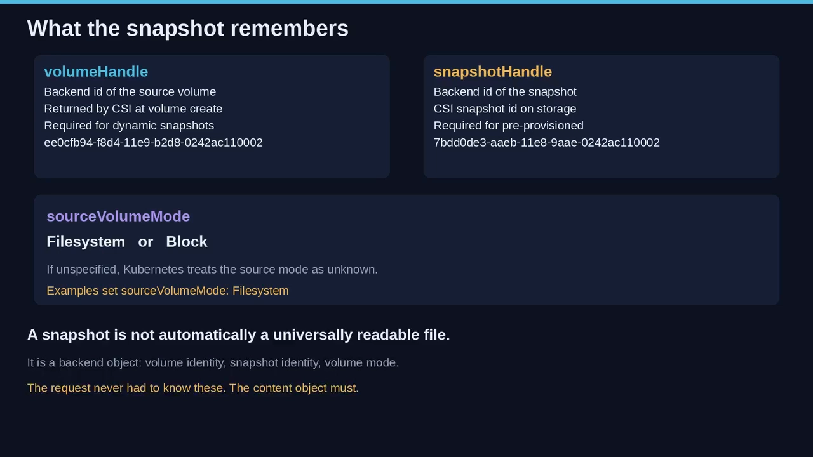

---

## 十一、卷模式转换是一"特权"

### 11.1 为什么要防

有时人们想**从一张已存在的卷快照拿到一个 PVC，但卷模式和源不同**。**Filesystem 与 Block 不是装饰性标签。** 如果集群上安装的卷快照 API **支持 `sourceVolumeMode` 字段**，那么这个 API 就**有能力防止未授权用户去转换一个卷的模式**——**这是一个安全特性**：**静默的模式转换会让某人拿一张文件系统快照去请求一个块卷（或反过来），而集群并未同意这是允许的。** [【跳转到 27:05】](https://www.youtube.com/watch?v=jaM0-25-N6A&t=1625)

### 11.2 怎么用 / 怎么查

- **检查集群是否具备该能力**：`kubectl get crd volumesnapshotcontents...`（视频里有具体命令），看 CRD 是否描述了 `sourceVolumeMode` 字段 [【跳转到 27:55】](https://www.youtube.com/watch?v=jaM0-25-N6A&t=1675)。
- **想允许转换**：给与该快照对应的 **VolumeSnapshotContent** 加上注解 **`snapshot.storage.k8s.io/allow-volume-mode-change: "true"`**。
- **预置快照**：**`spec.source.sourceVolumeMode` 需要由集群管理员填上。**

> 注解**落在 Content 上，而不是用户的 VolumeSnapshot 上**——因为"转换模式"是关于真实快照资源的一项特权；**未授权用户不该只靠编辑一个命名空间里的请求，就把 filesystem 翻成 block。** [【跳转到 29:10】](https://www.youtube.com/watch?v=jaM0-25-N6A&t=1750)

**unknown 模式是"什么都没指定"时的兜底，而 unknown 是一个糟糕的转换决策依据。** 冻结帧仍然是同样的字节，**变化的只是"Kubernetes 是否允许你把这些字节当成另一种卷来呈现"**。

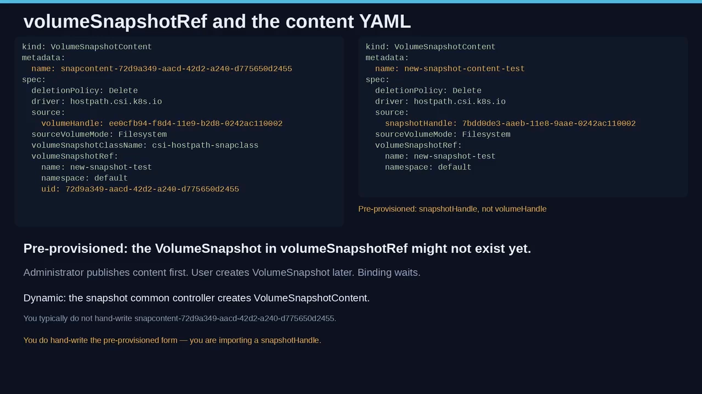

---

## 十二、拓扑：快照不是"处处可用"

**冻结帧并不总能从每个节点使用。** 在**多可用区（multi-zone）**、且存储不跨区共享的集群里，**一个区里的卷快照，只能从那个区使用**；**从快照还原出来的卷，只能创建在快照数据所在的地方** [【跳转到 29:35】](https://www.youtube.com/watch?v=jaM0-25-N6A&t=1775)。

启用**卷快照拓扑（volume snapshot topology）**特性后，这份拓扑会被**记录并遵守**：

- 集群管理员可以在 **VolumeSnapshotClass** 上设置 **`allowedTopologies`**，来**请求动态创建的快照应当能从哪些地方使用**。
- **CSI 驱动上报一张快照能从哪使用**，**csi-snapshotter** 把它记录到 **`VolumeSnapshotContent.spec.nodeAffinity`**。
- 当你**从快照制备一个卷**时，就用这份拓扑**把还原出的卷放到能访问快照数据的地方**。

跟着这条链看 [【跳转到 30:25】](https://www.youtube.com/watch?v=jaM0-25-N6A&t=1825)：

> **class 用 allowedTopologies 提问 → 驱动作答 → csi-snapshotter 把 nodeAffinity 写到 Content 上 → 还原放置遵循那份 affinity。**

这是 CSI sidecar 的一个 **alpha** 特性，用 **`VolumeSnapshotTopology`** feature gate 在 **csi-snapshotter 与 external-provisioner** 上开启。**没有它，你照样能快照；但集群可能不会把可用区限制记录成 API 对象；有了它，冻结帧就带上一张"能在哪里解冻"的地图，而解冻是显式的。** [【跳转到 30:50】](https://www.youtube.com/watch?v=jaM0-25-N6A&t=1850)

---

## 十三、还原：把新 PVC 的 dataSource 指向快照

最后回到数据库故事的最后一步：**你可以用 PVC 对象里的 `dataSource` 字段，制备一个"预装好某张快照数据"的新卷** [【跳转到 31:15】](https://www.youtube.com/watch?v=jaM0-25-N6A&t=1875)。

你冻结了 `pvc-test` → 等到快照 ready → 现在**创建一个新 Claim，让它的 `dataSource` 指向那个 VolumeSnapshot**。**Kubernetes 与 CSI 会从这张冻结帧填充新卷，同时遵守拓扑与卷模式规则。原活动卷可以继续跑，也可以已经不在了——新卷出生时就带着那一刻的数据。**

---

## 小结

- **快照 = 某一时刻的内容副本，不是第二块常驻磁盘**；它比"每次克隆"更省容量、挂载与清理成本。
- **设计核心是把请求与资源分开**：命名空间里的 **VolumeSnapshot**（≈PVC）对应集群级的 **VolumeSnapshotContent**（≈PV），**1:1 绑定**，**字节留在存储后端**，API 对象只是标签与契约。
- **VolumeSnapshotClass 携带快照专属设置**（如 crash-consistent、供应商参数），这些**不该**放进 StorageClass：同一块盘的不同快照可以配方不同。
- **它们是 CRD，且只对 CSI 驱动开放**；责任划分是：**驱动实现「快照调用」，发行版安装「CRD + snapshot-controller + csi-snapshotter + validating webhook」。**
- **接力链**：VolumeSnapshot → **snapshot-controller** 建/绑/删 Content → **csi-snapshotter** 调 CSI 的 `CreateSnapshot`/`DeleteSnapshot` → Status 反映是否 readyToUse。
- **两条入口**：**预置**（快照先在存储侧，管理员建 Content，用户用 `volumeSnapshotContentName` 消费）与**动态**（用户对 PVC 提出请求，用 `persistentVolumeClaimName`，controller 成功后建 Content）。**判据是"谁按下的快门"。**
- **保护与策略**：拍摄窗口内**源 PVC 的删除被推迟**到 readyToUse/aborted；删除时遵循 **DeletionPolicy**（`Delete` 连带删后端、`Retain` 保留后端）。
- **细节决定成败**：`volumeHandle`/`snapshotHandle` 两种身份、`sourceVolumeMode`、`volumeSnapshotRef`、**卷模式转换是受控特权**、**拓扑决定快照/还原的可用范围**。
- **还原**：把新 PVC 的 `dataSource` 指向 VolumeSnapshot 即可。

## 关键术语速查

| 术语 | 一句话解释 |
| --- | --- |
| VolumeSnapshot | 命名空间内的**用户请求**对象，类比 PVC；"给这个 Claim 拍一张"。 |
| VolumeSnapshotContent | **集群级**对象，代表存储系统上**真实的那张快照**，类比 PV。 |
| VolumeSnapshotClass | 定义**快照专属**参数（后端命名、保留、crash-consistent 等）的 CRD；回答"这次快照怎么打"。 |
| snapshot-controller | 控制面组件；监听 VS/VSC，**负责 Content 的创建、绑定与删除**。 |
| csi-snapshotter | 与 CSI 驱动同部署的 **sidecar**；监听 VSC，向 CSI 端点调用 `CreateSnapshot`/`DeleteSnapshot`。 |
| pre-provisioned（预置） | 快照**先存在**于存储侧，由管理员建 Content；用户用 `volumeSnapshotContentName` 消费。 |
| dynamic（动态） | **用户请求**从某个 PVC 动态拍快照；controller 在驱动成功后创建 Content；用 `persistentVolumeClaimName`。 |
| `volumeHandle` | 存储后端上**卷**的唯一标识；**动态**制备快照时必需。 |
| `snapshotHandle` | 存储后端上**快照**的唯一标识；**预置**快照时必需。 |
| `sourceVolumeMode` | 被快照卷的模式：`Filesystem` 或 `Block`；未设按 `unknown` 处理。 |
| `volumeSnapshotRef` | Content 回指其 VolumeSnapshot 的引用（name/namespace，常含 UID）。 |
| DeletionPolicy | `Delete`：连带删后端快照；`Retain`：保留后端快照与 Content。 |
| readyToUse | Status 中表示冻结帧**可被消费**的状态。 |
| PVC 快照源保护 | 拍摄窗口内**阻止**作为快照源的 in-use PVC 被立即删除，推迟到 readyToUse/aborted。 |
| VolumeSnapshotTopology | 记录快照可用区信息的（alpha）特性；经 `allowedTopologies` 与 `Content.spec.nodeAffinity` 落地。 |
