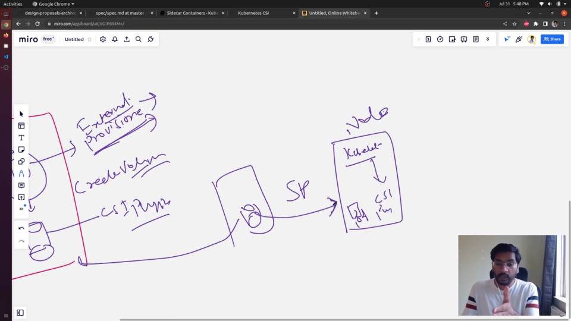
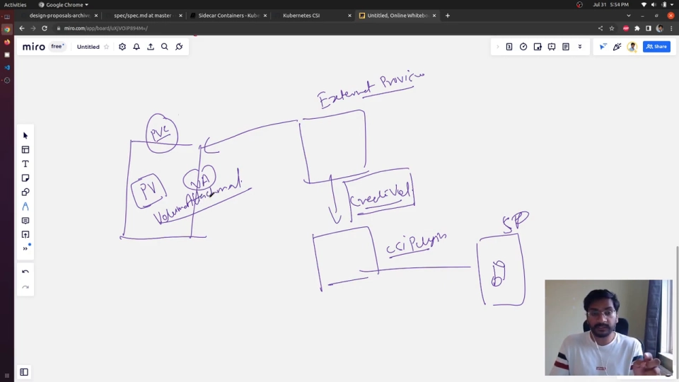
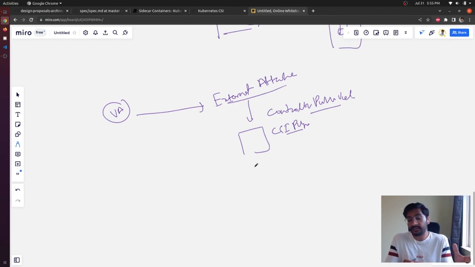
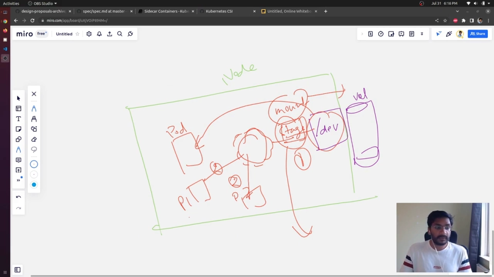

# CSI 卷的挂载与卸载：从 CreateVolume 到 NodeUnpublishVolume

> 视频来源：[How Kubernetes communicates with CSI Plugin | Writing a Kubernetes CSI plug-in from scratch -2](https://www.youtube.com/watch?v=pxYUHP5VM6g)（YouTube，Vivek Singh）｜时长约 40 分钟
>
> 本视频从 Kubernetes 一侧，把「一个 CSI 卷如何被创建、附加、挂载进 Pod，又如何被卸载、摘除、删除」的整条链路逐步画了出来。重点不是怎么用 `kubectl`，而是 **kubelet、external-provisioner、external-attacher 这些组件如何把 Kubernetes 对象翻译成 CSI 的 gRPC 调用**。本文基于该视频的图-字幕文稿整理，可逐帧核对；已订正自动字幕的明显错拼：`cubelet`/`cublet`/`tubelet`→**kubelet**、`external prisoner`/`prisoner`→**external-provisioner**、`node stays volume`→**NodeStageVolume**、`node publish volume`→**NodePublishVolume**、`controller publish volume`→**ControllerPublishVolume**、`no driver registrar`→**node-driver-registrar**。

## 本讲要解决的核心问题（SCQA）

**背景**：Kubernetes 的持久化存储，绕不开 **PV（PersistentVolume，持久卷）**、**PVC（PersistentVolumeClaim，持久卷声明）**、**StorageClass（存储类）** 这几个对象；而从 1.13 起，绝大多数动态存储都通过 **CSI（Container Storage Interface，容器存储接口）** 这个标准接入。

**冲突**：可一旦卷出问题——PVC 已 `Bound` 但 Pod 卡在 `ContainerCreating`、节点上多挂了一块盘却卸不掉、删了 PVC 云盘还在计费——只看 YAML 和 Pod 事件往往看不出是卡在**哪一步**。因为一个卷从「申请」到「能用」再到「消失」，中间要经过 **创建、附加、挂载、卸载、摘除、删除** 至少六个动作，而它们由**不同的组件**发起、调用**不同的 CSI 接口**。

**疑问**：Kubernetes 究竟是**通过哪些组件**、**按什么顺序**、调用**哪些 CSI 接口**，把一块存储挂进 Pod，又怎么把它卸载干净？

**回答（中心思想）**：整条链路本质是一句 **「四段式翻译」——Kubernetes 对象 → sidecar 控制器 → CSI RPC → 存储后端**。往「挂载」方向走：PVC 被创建后，**external-provisioner** 调 **`CreateVolume`** 造出卷并落一个 PV；接着 **attach-detach 控制器** 建出 `VolumeAttachment`，**external-attacher** 据此调 **`ControllerPublishVolume`** 把卷**附加**到节点；最后节点上的 **kubelet** 依次调 **`NodeStageVolume`**（把设备挂到一个「暂存目录」）和 **`NodePublishVolume`**（再 bind mount 进 Pod）。往「卸载」方向走，就是把上面每一个动作**逆序撤掉**：`NodeUnpublishVolume` → `NodeUnstageVolume` → `ControllerUnpublishVolume` → `DeleteVolume`。[【跳转到 14:10】](https://www.youtube.com/watch?v=pxYUHP5VM6g&t=850)

## 一、先记住一句话：Kubernetes 自己不会管存储，它只负责「翻译」

在 CSI 之前，每种存储（AWS EBS、GCE PD、Ceph……）的驱动代码都**内嵌在 Kubernetes 主仓库**里（所谓 in-tree），存储厂商要修个 bug 都得跟着 Kubernetes 发布节奏走。CSI 把这个接口抽了出来：**存储厂商按 CSI 规范写一个插件（plugin），任何支持 CSI 的编排系统都能用它**，Kubernetes 不必再认得每个厂商。[【跳转到 00:50】](https://www.youtube.com/watch?v=pxYUHP5VM6g&t=50)

于是分工变得很清楚：

- **你/集群管理员** 只写 Kubernetes 的对象（PVC、StorageClass）；
- **Kubernetes 组件** 负责观察这些对象，并决定「该调 CSI 的哪个接口了」；
- **CSI 插件** 才是真正去跟存储后端对话、动手创建/挂载卷的那个组件。

视频里反复强调的一句话是：**CSI 规范对 Kubernetes 来说是「规则手册」，它规定了「创建卷要调 `CreateVolume`」「附加卷要调 `ControllerPublishVolume`」这类约定**；Kubernetes 只要照着规范去调插件的对应方法即可。[【跳转到 04:10】](https://www.youtube.com/watch?v=pxYUHP5VM6g&t=250)

## 二、六个「旁路组件」：真正把 K8s 对象翻译成 CSI 调用的是它们

默认安装 Kubernetes，你**不会**得到这些组件——它们由社区维护、需要单独部署，通常作为 CSI 插件 Pod 里的 **sidecar（边车容器）** 与之同住一个 Pod。视频把它们逐个点了名：[【跳转到 09:35】](https://www.youtube.com/watch?v=pxYUHP5VM6g&t=575)

| 组件（sidecar） | 监听的 K8s 对象 | 翻译成的 CSI RPC | 作用 |
| --- | --- | --- | --- |
| **external-provisioner** | PersistentVolumeClaim | `CreateVolume` / `DeleteVolume` | 动态供给：按 PVC 造卷、删卷 |
| **external-attacher** | VolumeAttachment | `ControllerPublishVolume` / `ControllerUnpublishVolume` | 把卷**附加/摘除**到某节点 |
| **external-snapshotter** | VolumeSnapshot（等） | 快照相关 RPC | 打快照 |
| **external-resizer** | PVC（容量变更） | `ControllerExpandVolume` | 在线扩容 |
| **node-driver-registrar** | ——（不经 API Server） | —— | 向本节点 **kubelet** 注册 CSI 插件，让 kubelet 找得到它 |
| **livenessprobe** | —— | —— | 探测插件的健康状态 |

它们有一个**共同套路**：watch（监听）Kubernetes 资源 → 发现变化 → 把请求**翻译成对应的 CSI RPC** 去调插件。其中 **external-provisioner 和 external-attacher 是「卷生命周期」的主角**，下面整条链路基本围绕它俩展开。[【跳转到 07:55】](https://www.youtube.com/watch?v=pxYUHP5VM6g&t=475)

## 三、插件本身分成两半：controller plugin 与 node plugin

CSI 插件在实现上通常分成两组 RPC，对应两个部署形态：[【跳转到 27:34】](https://www.youtube.com/watch?v=pxYUHP5VM6g&t=1654)

- **controller plugin（控制器插件）**：实现与**存储后端 API** 打交道的 RPC（`CreateVolume`、`ControllerPublishVolume`、快照、扩容……）。它**不需要在每个节点上都跑**，所以以 **Deployment** 形式部署一份即可（内部靠 leader election 保证同一时刻只有一个实例干活）。
- **node plugin（节点插件）**：实现**把卷挂进 Pod** 的 RPC（`NodeStageVolume`、`NodePublishVolume`，以及反向的卸载）。它**必须在每个节点上都有**——因为只有节点上的 kubelet 才能在本地把设备/目录挂进容器的命名空间，所以 node plugin 以 **DaemonSet** 形式铺满所有节点。[【跳转到 30:04】](https://www.youtube.com/watch?v=pxYUHP5VM6g&t=1804)

> 小结论：**controller 部分管「云上那块盘」，node 部分管「这台机器上把盘挂到容器里」。**

另外还有一个容易被忽略、却很关键的对象：**CSINode**。节点上的 **kubelet** 会把「本节点装了哪个 CSI 驱动、驱动叫什么」等信息写进 CSINode 资源，这样**控制面（attach-detach 控制器 / external-attacher）才知道某块卷能附加到哪个节点**。[【跳转到 21:15】](https://www.youtube.com/watch?v=pxYUHP5VM6g&t=1275)

## 四、「挂载」的前半程：CreateVolume → ControllerPublish → NodeStage/NodePublish

视频用一个完整的「创建卷」例子把链路走了下来。可以把整个过程拆成**控制面三步 + 节点两步**：[【跳转到 25:25】](https://www.youtube.com/watch?v=pxYUHP5VM6g&t=1525)

**第 1 步：PVC 被创建 → PV 控制器出手。**
用户创建 PVC 后，`kube-controller-manager` 里的 **PV 控制器（persistent volume controller）** 会先看：集群里有没有现成的、满足这个 PVC 的 PV？没有的话，能不能用 in-tree 插件供给？都不行，它就**给这个 PVC 打上一个特殊 annotation**，等于对外宣告「这个声明需要外部动态供给」。[【跳转到 15:50】](https://www.youtube.com/watch?v=pxYUHP5VM6g&t=950)

**第 2 步：external-provisioner 看到 annotation → 调 `CreateVolume`。**
external-provisioner 一直在 watch PVC；一旦发现这个 annotation，就按 PVC 指定的 StorageClass 找到对应驱动，调用插件的 **`CreateVolume`** RPC。插件接到调用后，真正去**存储后端把卷造出来**；成功后再**在集群里创建一个 PV 对象**来「代表」这块真实存储。[【跳转到 17:30】](https://www.youtube.com/watch?v=pxYUHP5VM6g&t=1050)

> 注意顺序上的一个细节：**「造卷」和「造 PV 对象」是两件事**——先有后端里真实的卷，才有集群里代表它的 PV。

**第 3 步：attach-detach 控制器建 VolumeAttachment → external-attacher 调 `ControllerPublishVolume`。**
有了 PV 还不够：卷还躺在存储里，并没有接到任何节点上。这时控制面里的 **attach-detach 控制器** 会创建一个 **VolumeAttachment** 对象，记录「哪块卷、要附加到哪个节点」。**external-attacher** 监听到 VolumeAttachment，就调用插件的 **`ControllerPublishVolume`**——插件据此**把卷 attach 到指定节点**（比如接到云端，让节点上出现一块设备）。[【跳转到 19:35】](https://www.youtube.com/watch?v=pxYUHP5VM6g&t=1175)

> 「附加（attach）」是关键概念：对块存储来说，同一块盘**一般只能被附加到一个节点、出现在一个设备路径**（如 `/dev/...`）。这正是后面要引入「暂存（stage）」的原因。

**第 4 步：kubelet 调 `NodeStageVolume`——先挂到「暂存目录」。**
卷附加到节点后，会以一块**块设备**的形式出现。接下来轮到节点上的 **kubelet**。它调用 node plugin 的 **`NodeStageVolume`**，用一条类似 `mount <设备> <暂存目录>` 的命令，**把这块设备先挂到一个「暂存目录」（staging path）**，而不是直接挂进 Pod。[【跳转到 24:10】](https://www.youtube.com/watch?v=pxYUHP5VM6g&t=1450)

**第 5 步：kubelet 调 `NodePublishVolume`——再 bind mount 进 Pod。**
最后，kubelet 调用 **`NodePublishVolume`**，用 `mount --bind <暂存目录> <Pod 内的挂载点>` 的方式，**把暂存目录再 bind mount 到 Pod 的卷目录里**。到这里，Pod 才真正「看见」这个卷。[【跳转到 25:00】](https://www.youtube.com/watch?v=pxYUHP5VM6g&t=1500)

## 五、为什么要「先 stage 再 publish」？——因为块设备只能挂一次

这是全片最值得记住的一个「为什么」。视频给出的解释是：[【跳转到 36:19】](https://www.youtube.com/watch?v=pxYUHP5VM6g&t=2179)

- 一块**块设备只能被挂到一个位置**。如果直接把设备挂进 Pod A，那它就被 Pod A「占死」了，**Pod B 就没法再用同一块卷**。
- 所以 CSI 引入**中间层的暂存目录**：先把设备挂到 **staging 目录**（只挂一次），再从这个暂存目录 **bind mount** 到**每一个**需要它的 Pod（Pod A、Pod B……）。
- bind mount 可以挂多份，于是**一块卷能同时供给多个工作负载**（当然还要看访问模式是否允许——能否多写取决于存储本身）。

这也解释了 `NodeStageVolume` 与 `NodePublishVolume` 为什么是两个接口：**一个负责「设备 → 暂存目录」（每卷一次），一个负责「暂存目录 → Pod」（每 Pod 一次）**。

> **补充**：`NodeStageVolume` / `NodeUnstageVolume` 其实**不是必选的**。只有 `NodeGetCapabilities` 里声明了 `STAGE_UNSTAGE_VOLUME` 能力时，kubelet 才会走「stage → publish」两步；否则它会**直接调用 `NodePublishVolume`**。[【跳转到 37:59】](https://www.youtube.com/watch?v=pxYUHP5VM6g&t=2279)

## 六、「卸载」的后半程：把上面每一步逆序撤掉

删掉 PVC（或 Pod 结束）时，Kubernetes 会**沿着刚才的路原路返回**、逐层拆解。视频给出的对应关系是：[【跳转到 26:15】](https://www.youtube.com/watch?v=pxYUHP5VM6g&t=1575)

| 挂载方向（正向） | 卸载方向（逆向） | 由谁发起 |
| --- | --- | --- |
| `NodePublishVolume`（bind mount 进 Pod） | **`NodeUnpublishVolume`**（从 Pod 拆掉 bind mount） | kubelet |
| `NodeStageVolume`（设备 → 暂存目录） | **`NodeUnstageVolume`**（卸载暂存目录） | kubelet |
| `ControllerPublishVolume`（附加到节点） | **`ControllerUnpublishVolume`**（从节点摘除） | external-attacher |
| `CreateVolume`（造卷） | **`DeleteVolume`**（删除卷） | external-provisioner |

理解这张表，就能看懂排障时的事件顺序：**先 `Unpublish` 再 `Unstage`，先摘挂载再摘附加，最后才删卷**——任何一步失败，卷就会卡在中间态（比如设备还挂着、或 VolumeAttachment 删不掉）。[【跳转到 25:50】](https://www.youtube.com/watch?v=pxYUHP5VM6g&t=1550)

## 小结

- Kubernetes 不直接管存储，它通过一组 **sidecar 组件**（external-provisioner、external-attacher、node-driver-registrar 等）**把 K8s 对象翻译成 CSI 的 gRPC 调用**；真正的存储动作由 **CSI 插件**完成。
- CSI 插件通常分成 **controller plugin（Deployment，管云上/后端）** 与 **node plugin（DaemonSet，管节点上挂载）** 两半。
- 「挂载」正向五步：**PVC →（PV 控制器）→ external-provisioner `CreateVolume` → attach-detach 控制器建 VolumeAttachment → external-attacher `ControllerPublishVolume` → kubelet `NodeStageVolume` → `NodePublishVolume`**。
- 「卸载」是正向的**逆序**：**`NodeUnpublishVolume` → `NodeUnstageVolume` → `ControllerUnpublishVolume` → `DeleteVolume`**。
- 为什么要「先 stage 再 publish」：**块设备只能挂一次**，用暂存目录中转才能让一块卷 bind mount 给多个 Pod。
- `NodeStageVolume` 是**可选**的，取决于插件是否声明 `STAGE_UNSTAGE_VOLUME` 能力。

## 关键术语速查

| 术语 | 一句话解释 |
| --- | --- |
| **CSI** | 容器存储接口，存储厂商写一次插件、任何编排系统都能用；Kubernetes 1.13 起标配。 |
| **PV / PVC / StorageClass** | 持久卷 / 持久卷声明（请求）/ 存储类（供应策略）。PVC 是「要什么」，PV 是「实际那块存储」。 |
| **external-provisioner** | 监听 PVC，调 `CreateVolume`/`DeleteVolume` 的 sidecar，负责动态供给。 |
| **external-attacher** | 监听 VolumeAttachment，调 `ControllerPublishVolume`/`ControllerUnpublishVolume`，负责把卷附加/摘除到节点。 |
| **attach（附加）** | 把存储后端的一块卷接到某个节点，使其在该节点上表现为一块设备。 |
| **stage（暂存）** | `NodeStageVolume`：把设备挂到节点上的一个暂存目录，只挂一次。 |
| **publish（发布）** | `NodePublishVolume`：把暂存目录 bind mount 到 Pod 的卷目录，每个 Pod 一次。 |
| **VolumeAttachment** | 记录「哪块卷附加到哪个节点」的对象，由 attach-detach 控制器创建。 |
| **CSINode** | kubelet 写入的、记录节点上有哪些 CSI 驱动的对象，供控制面决策附加目标。 |
| **node-driver-registrar** | 向本节点 kubelet 注册 CSI 插件的 sidecar（不经过 API Server）。 |
