# 卷是如何挂进容器的：挂载分层、传播与只读安全

> 视频来源：[Kubernetes Volumes Deep Dive: Lifetimes, Mounts & Storage Safety](https://www.youtube.com/watch?v=HMNayaRnE_k)（YouTube，Kubernetes 存储深潜系列）｜时长约 33 分钟
>
> 本视频用一整套幻灯片，系统讲清了四件事：**卷到底是什么、它的生命周期如何划分、Kubernetes 到底"怎么把卷挂进容器"、以及挂载传播 / 只读 / 文件属主这些安全细节**。它不教你写 YAML，而是把「挂载」这一动作的语义和坑讲透。本文基于该视频的图-字幕文稿整理，可逐帧核对；已订正自动字幕的明显错拼：`empty deer`→**emptyDir**、`cublet`/`cubelet`→**kubelet**、`ice scuzzy`→**iSCSI**、`readon`→**readOnly**、`FS group`→**fsGroup**、`no exec / no dev / no suid`→**noexec / nodev / nosuid**、`P1`→**PID 1**。

## 本讲要解决的核心问题（SCQA）

**背景**：写 `volumeMounts` 已经不算难事——在 Pod 里声明一个卷、在容器里指定 `mountPath`，容器里就多出一个目录。很多人停在"能跑就行"。

**冲突**：可一到细节就出问题：卷声明对了，容器里却"读不到"；宿主上明明新挂了块盘，容器里却看不见；自以为设了只读，里面居然还能写；非 root 进程一写就 `Permission denied`。这些毛病**大多不在"会不会写 YAML"，而在「挂载」这个动作本身的语义**。[【跳转到 08:35】](https://www.youtube.com/watch?v=HMNayaRnE_k&t=515)

**疑问**：Kubernetes 到底是**怎么把一个卷挂进容器**的？挂载的**方向、层级和权限**由什么决定？为什么"挂上了"还会失败？

**回答（中心思想）**：先建立一句话直觉——**卷本质上不是一个"磁盘技术"，而是「Pod 与它各个容器之间的一个命名目录契约」**。在此之上，把「挂载」拆成三层来理解：**① 覆盖关系**（镜像先铺底，卷挂在上面，会遮住同路径的原有内容）；**② 挂载传播方向**（卷里再被挂东西时，变化进不进来、出不出去）；**③ 每个挂载点自己的旗标**（只读、是否递归只读、属主、noexec 等）。**这三层是三个独立的旋钮，拧了一个不代表拧了另一个**——这正是"挂上了却仍失败"的根源。[【跳转到 30:15】](https://www.youtube.com/watch?v=HMNayaRnE_k&t=1815)

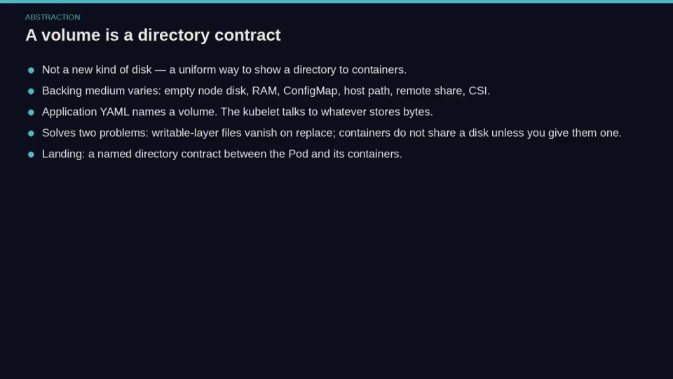

## 一、先把"生命周期"分清：三种事件，删掉三组不同的数据

卷最初要解决的是两个朴素问题：**容器一崩溃重启，写在容器里的文件就没了**；**同一个 Pod 里的两个容器，默认看不到彼此的本地磁盘**。卷就是那个"两人共享的抽屉"。[【跳转到 00:00】](https://www.youtube.com/watch?v=HMNayaRnE_k&t=0)

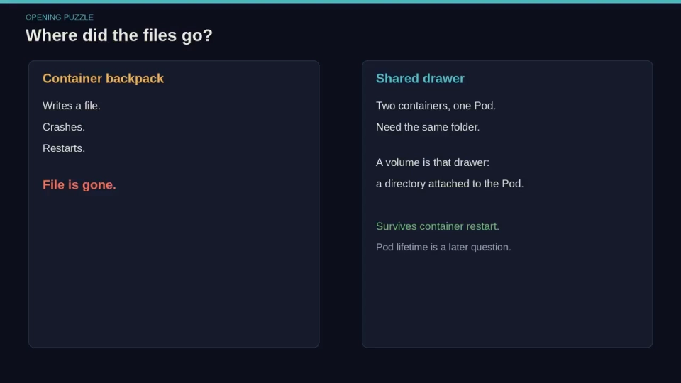

理解挂载之前，先要分清**三种"数据消失"事件**，它们各自删掉的是不同东西：[【跳转到 02:55】](https://www.youtube.com/watch?v=HMNayaRnE_k&t=175)

- **容器重启（container restart）**：容器的可写层被丢弃，但 **Pod 还在、卷还在**——所以卷里的数据**不受影响**。这也是"卷"要解决的第一个问题：容器本地的文件会随容器替换而消失。[【跳转到 00:00】](https://www.youtube.com/watch?v=HMNayaRnE_k&t=0)
- **Pod 被删除/被驱逐**：`emptyDir` 这类**临时卷**随之消失；持久卷（PVC/CSI）则**不受 Pod 生死影响**。
- **节点丢失（node gone）**：像 `emptyDir`、`hostPath`、local 这类**绑定在节点上**的卷会真正丢数据；网络/CSI 存储则通常还在。

所以，当有人说"我的文件不见了"，正确的追问是：**他指的是上面哪一种生命周期？** 卷的类型，决定的正是"哪个事件是致命的"。[【跳转到 01:40】](https://www.youtube.com/watch?v=HMNayaRnE_k&t=100)

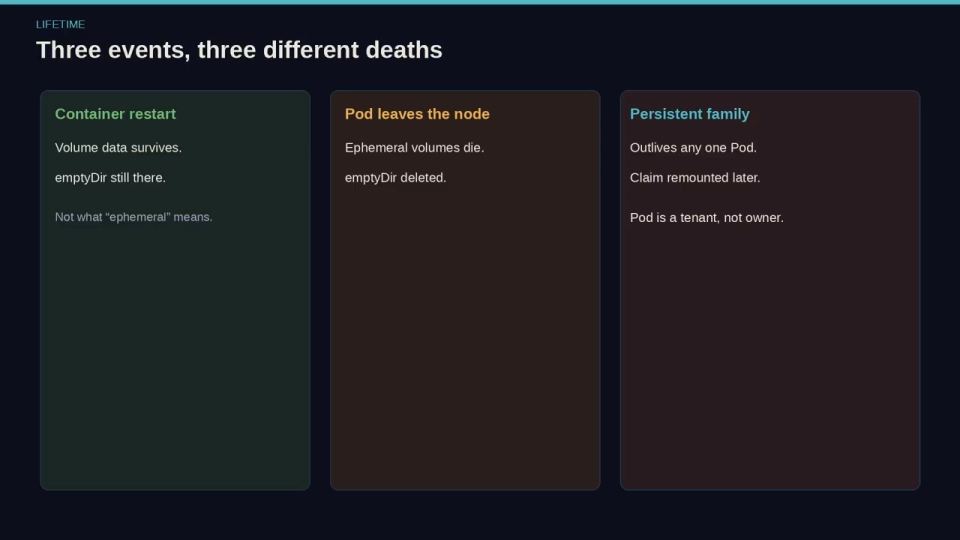

> 一个常见误解：听到"临时（ephemeral）"就以为"一崩就没"。其实**崩溃只替换容器，Pod 仍归属该节点，emptyDir 还在**；只有当 Pod 被删除、或离开该节点时，那个空目录才真的没了。

## 二、容器看到的文件系统：镜像先铺底，卷再"盖"上去

这是理解"挂载"最直观的一层。容器看到的文件系统是**叠**出来的：[【跳转到 03:20】](https://www.youtube.com/watch?v=HMNayaRnE_k&t=200)

1. **第一层是镜像**——它是根目录的初始内容；
2. **然后 Kubernetes 在指定路径上把卷挂上去**——**挂载会"遮住"镜像在该路径原有的内容**，用卷的目录替换掉它；
3. 卷是**在 Pod 上命名一次、在每个容器里各自决定挂到哪**的：同一个卷可以在容器 A 挂到 `/cache`、在容器 B 挂到 `/data`，也可以某个容器干脆不挂。[【跳转到 03:45】](https://www.youtube.com/watch?v=HMNayaRnE_k&t=225)

正因为是"卷生在 Pod 上"，**同一个 Pod 里的两个容器并不自动共享挂载**——各容器列各自的 `volumeMounts`。共享与否是**你显式声明**出来的，不是默认行为。

这也顺带解释了两个常被忽略的事实：
- **挂载点在容器进程启动前就由 kubelet 拼好了**——不是你的进程去 `mkdir`。所以 `emptyDir` 一进来"就是空的但存在"，ConfigMap 卷里的文件"一进来就已经是一个文件"，而不是你程序去写出来的。[【跳转到 04:50】](https://www.youtube.com/watch?v=HMNayaRnE_k&t=290)

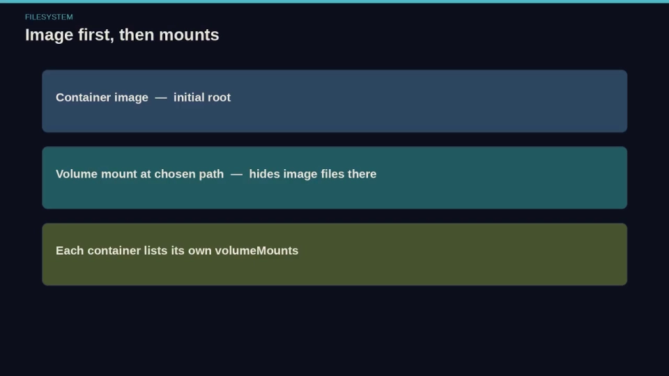

## 三、YAML 只做两件事：一张"抽屉清单" + 一个"连接键"

挂载在 YAML 里被拆成**两张清单**，用一个名字连接：[【跳转到 05:15】](https://www.youtube.com/watch?v=HMNayaRnE_k&t=315)

- **`spec.volumes`**：声明"有哪些抽屉"——给每个卷一个**名字**和**类型**（以及该类型的设置）；
- **`spec.containers[].volumeMounts`**：声明"这个抽屉在这个容器里出现在哪"——`name` + `mountPath`。

其中的关键点是：

- **`name` 是唯一的连接键，不是路径**。`volumes` 里的名字和 `volumeMounts` 里的 `name` **必须逐字符一致**，否则挂不上。
- **路径（`mountPath`）写在容器一侧**，因为两个容器完全可能希望同一个卷出现在不同位置。
- 常见的低级错误：**只在容器下写了 volume、却没在 `spec.volumes` 里声明源**——Kubernetes 不会替你凭空造出源；或者**名字对不齐**。

一个典型示例是 **ConfigMap 卷**：它把 key 变成"文件"。比如 `name: log-level` 会在挂载点下生成一个文件，程序直接读这个文件即可；它也可以挂成投影卷（projected）里的一棵树。[【跳转到 05:40】](https://www.youtube.com/watch?v=HMNayaRnE_k&t=340)

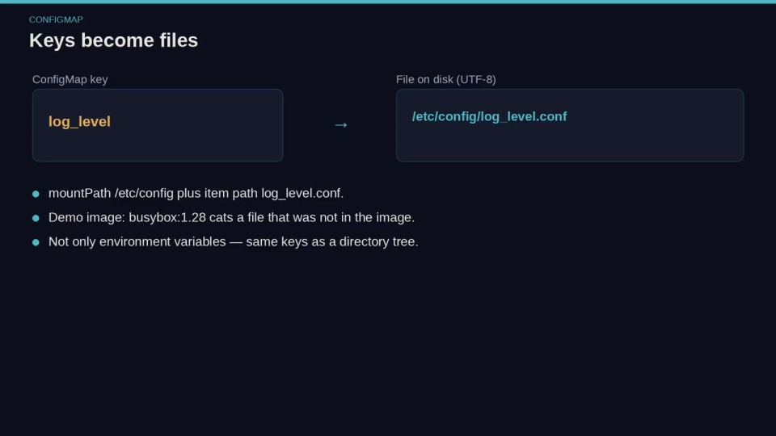

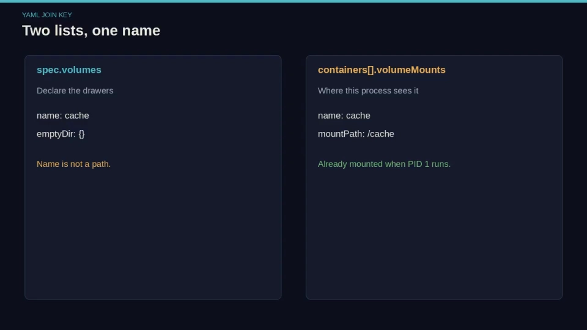

## 四、挂载传播：当"卷里又被挂了东西"，变化往哪个方向走？

挂载是可以**嵌套**的：一个卷被挂进容器之后，**宿主机**可能又在这个卷的某个子目录上挂了块盘。问题是——**容器能不能看见这个新挂载？容器自己新建的挂载会不会传回宿主机？** 这由**挂载传播（mount propagation）** 决定。视频把它讲成三种模式（括号里是对应的 Linux 挂载标记）：[【跳转到 26:30】](https://www.youtube.com/watch?v=HMNayaRnE_k&t=1590)

| 传播模式 | Linux 标记 | 含义 |
| --- | --- | --- |
| **None（默认）** | `rprivate` | 不泄漏：宿主在该目录下的新挂载，容器看不到；容器内的挂载也不会回到宿主 |
| **HostToContainer** | `rslave` | 宿主在卷下**新建的挂载会传进容器**（单向：宿主 → 容器） |
| **Bidirectional** | `rshared` | **双向**：容器内新建的挂载也会回灌到宿主机、以及其它共享该卷的 Pod |

要点有三：

- **默认就是 `None`（rprivate）**。也就是说，**宿主机把一块 U 盘 bind 到某目录，并不会自动出现在"以默认传播"挂载了父目录的 Pod 里**——这是很多人踩过的"经典意外"。[【跳转到 27:20】](https://www.youtube.com/watch?v=HMNayaRnE_k&t=1640)
- **`Bidirectional` 是危险且需要特权的**：容器可以往宿主机的挂载树上挂东西，清理起来极易出错。它只该用于**嵌套卷插件、存储辅助工具**这类场景，而不是普通 Web 应用。[【跳转到 26:55】](https://www.youtube.com/watch?v=HMNayaRnE_k&t=1615)
- 经验法则：**在你确有具体理由之前，保持 `None`。**

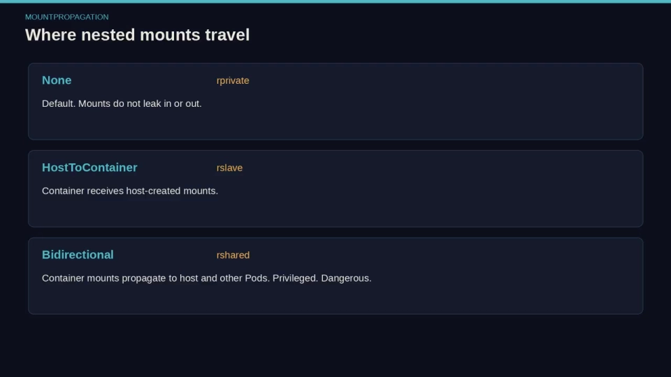

## 五、只读不是"递归封条"，属主也不等于可写

这一节是全片最"反直觉"的部分，也是最容易埋坑的地方。Kubernetes 把"能不能写"拆成了**几个彼此独立的开关**，拧一个不等于拧另一个：[【跳转到 30:15】](https://www.youtube.com/watch?v=HMNayaRnE_k&t=1815)

**1）`readOnly: true` 只管"这一个容器挂载点"，不改底层卷。**
它限制的是**当前容器的这次挂载**。同一个卷，**另一个容器仍可以以读写方式挂载**。[【跳转到 27:20】](https://www.youtube.com/watch?v=HMNayaRnE_k&t=1640)

**2）普通只读"不递归"——子挂载可能漏网。**
如果宿主机的卷里**某个子目录上还单独挂了一个 tmpfs**，那么一个**普通的只读 bind** 仍可能让那个**子挂载保持可写**。你以为整棵树冻住了，其实底下某个路径没有。要补上这个漏洞，需要 **recursiveReadOnly（递归只读）**：设为 `enabled` 时，运行时会对整个子树做**递归只读 bind**，让子挂载也不可写；`IfPossible` 则在"内核/运行时支持就做、否则回退"。[【跳转到 28:35】](https://www.youtube.com/watch?v=HMNayaRnE_k&t=1715)

> **一句话**：`readOnly` 是"这一个挂载对象上的旗标"，不是"对底下所有文件系统的递归封条"。

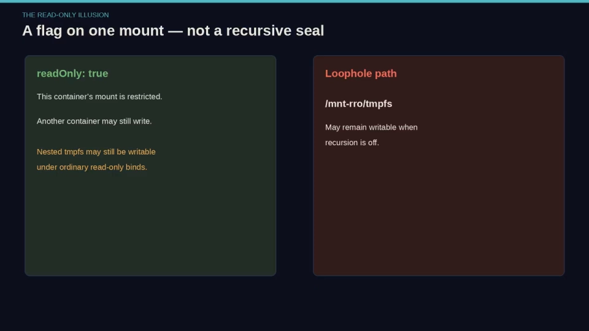

**3）"谁能写" ≠ "谁拥有"。** 文件属主是**另一回事**：
- 用 `securityContext.fsGroup` 指定一个组 ID，Kubernetes 会调整卷的属组，让**非 root 进程**也能写挂进来的盘；
- 反过来，**一个可写的挂载，如果文件属主所在组不属于你的进程，仍会表现为 `Permission denied`**。所以排"权限被拒"时，**先看 fsGroup，再去改存储类**。[【跳转到 29:50】](https://www.youtube.com/watch?v=HMNayaRnE_k&t=1790)

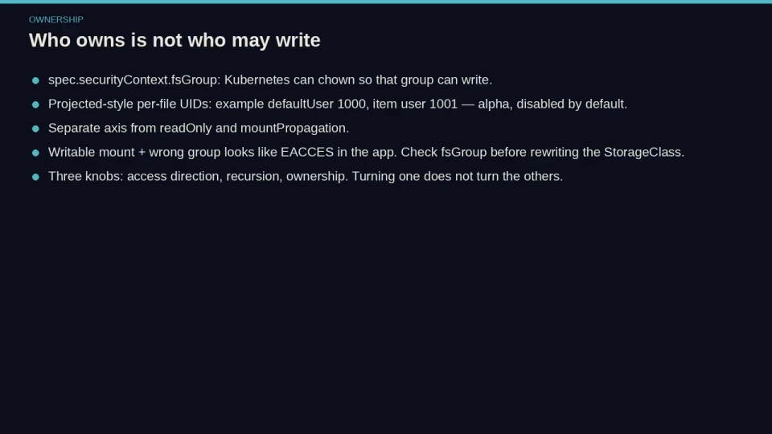

**4）bind 挂载还有三个防御性旗标：`noexec` / `nodev` / `nosuid`。**[【跳转到 30:40】](https://www.youtube.com/watch?v=HMNayaRnE_k&t=1840)

- `noexec`：不允许从这个挂载点**执行二进制**；
- `nodev`：忽略该挂载里的**设备节点**；
- `nosuid`：忽略 **set-UID** 位。

它们和 Linux 主机上的挂载旗标是同一套概念，**由容器运行时执行——所以务必确认运行时真的支持，只看 Pod YAML 不算数**。对 `hostPath` 以及"可能装着意外文件"的挂载，这些旗标是有价值的纵深防御：**一卷数据不该变成一卷可执行载荷**。[【跳转到 31:05】](https://www.youtube.com/watch?v=HMNayaRnE_k&t=1865)

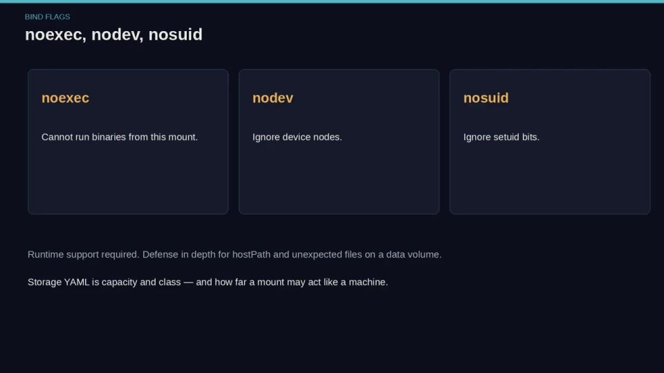

> **记住这三个旋钮是独立的**：**方向**（传播）、**递归**（是否递归只读）、**属主**（fsGroup）。它们分别控制"变化走不走""子树冻没冻""谁能写"。这也解释了为什么"卷明明挂上了，却还是 EACCES，或者相反——权限开得过大"。`emptyDir` 自己的 `mode`（目录权限位）与挂载的 `readOnly` 也是两码事：前者是**创建时的目录权限**，后者是**这次挂载可不可写**，两者会叠加。[【跳转到 08:35】](https://www.youtube.com/watch?v=HMNayaRnE_k&t=515)

## 六、挂载的"下半场"：卷怎么被卸载、数据什么时候消失

把上面的东西串起来，就能回答"卸载"环节：**卷挂在 Pod 上，而 Pod 是"租客"不是"主人"**。[【跳转到 02:30】](https://www.youtube.com/watch?v=HMNayaRnE_k&t=150)

- 当 Pod 结束（删除、被驱逐、或调度到别处），**该 Pod 的挂载会被逐个拆除**：容器先卸载卷，卷再离开命名空间；对持久卷，底层的字节仍在盘上 / CSI 后端，等待下一个 Pod 重新挂载。
- 对**临时卷**（如 `emptyDir`），Pod 一走，目录就被删除，**数据和挂载一起消失**——这正是它的设计用途："随 Pod 生、随 Pod 死的草稿纸"。用 `medium: Memory` 时它落在 tmpfs 上，并**计入写它的容器的内存限制**，写满可能触发 OOM。[【跳转到 07:20】](https://www.youtube.com/watch?v=HMNayaRnE_k&t=440)
- 排障顺序建议：先判断问题出在**"没挂上"**（YAML 名字/源缺失、卷类型不对），还是**"挂上了但不能读/写"**（只读旗标、递归只读、fsGroup 属主、传播方向、noexec 等）。**把"挂载"当成"覆盖 + 传播 + 旗标"三层来看，问题就基本能定位到具体那一层。**[【跳转到 31:30】](https://www.youtube.com/watch?v=HMNayaRnE_k&t=1890)

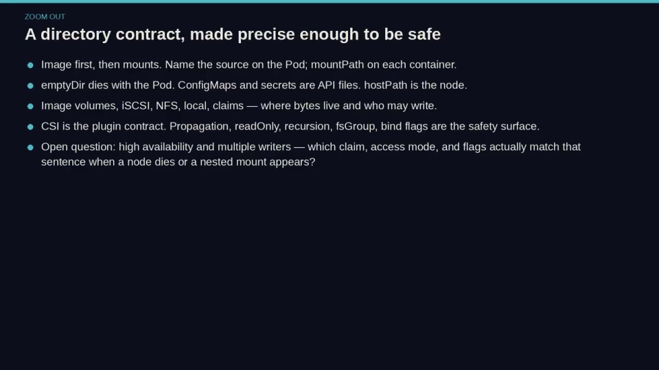

## 小结

- **卷不是磁盘技术，而是 Pod 与容器之间的"命名目录契约"**：在 Pod 上声明一次，各容器各自决定挂到哪。
- **三种生命周期**（容器重启 / Pod 消失 / 节点消失）删掉三组不同的数据；卷的类型决定哪个事件是致命的。
- **容器看到的文件系统是叠出来的**：镜像铺底，卷挂上去并**覆盖**同路径内容；挂载点在容器启动前就由 kubelet 拼好。
- YAML 只需两张清单 + 一个**必须完全一致的 `name` 连接键**；`mountPath` 写在容器一侧。
- **挂载传播**决定"卷里又被挂东西"时变化的方向：默认 `None`(rprivate)、单向 `HostToContainer`(rslave)、双向 `Bidirectional`(rshared，危险、需特权)。
- **只读不是递归封条**：`readOnly` 只管一个挂载点；子挂载要用 `recursiveReadOnly`；**属主（fsGroup）与"能否写"是另一回事**；`noexec/nodev/nosuid` 是额外的防御旗标。
- **"方向 / 递归 / 属主"是三个互相独立的旋钮**——这就是"挂上了却仍失败"的根本原因。

## 关键术语速查

| 术语 | 一句话解释 |
| --- | --- |
| **卷（Volume）** | 一个附加到 Pod、再挂进容器的目录；本质是 Pod 与容器间的"命名目录契约"。 |
| **`spec.volumes` / `volumeMounts`** | 前者声明"有哪些卷（名字+类型）"，后者声明"这个卷在某容器里挂到哪个路径"。 |
| **`name`** | 二者的连接键，必须逐字符一致；不是路径。 |
| **`mountPath`** | 卷在**某个容器内**出现的路径。 |
| **emptyDir** | 随 Pod 生、随 Pod 死的草稿目录；`medium: Memory` 时落在 tmpfs 并计入内存限制。 |
| **挂载传播（mountPropagation）** | 卷里再发生挂载时变化的走向：`None`/`HostToContainer`/`Bidirectional`。 |
| **rprivate / rslave / rshared** | 上述三种模式对应的 Linux 挂载标记。 |
| **`readOnly`** | 只限制"这一个容器这次挂载"是否可写，不改底层卷。 |
| **recursiveReadOnly** | 对子树做递归只读 bind，堵住"子挂载仍可写"的漏洞。 |
| **fsGroup** | 在 securityContext 里设组 ID，让非 root 进程也能写挂进来的卷。 |
| **noexec / nodev / nosuid** | bind 挂载上的防御旗标：禁止执行、忽略设备节点、忽略 set-UID。 |
