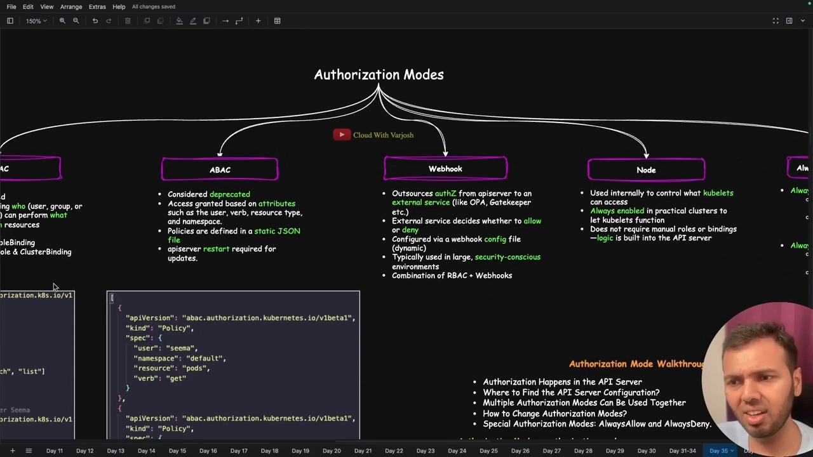
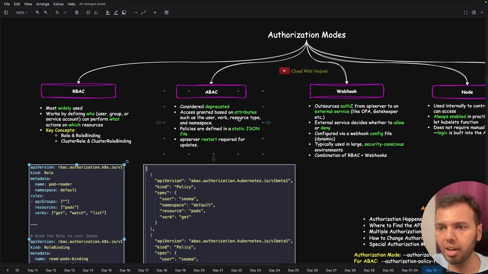
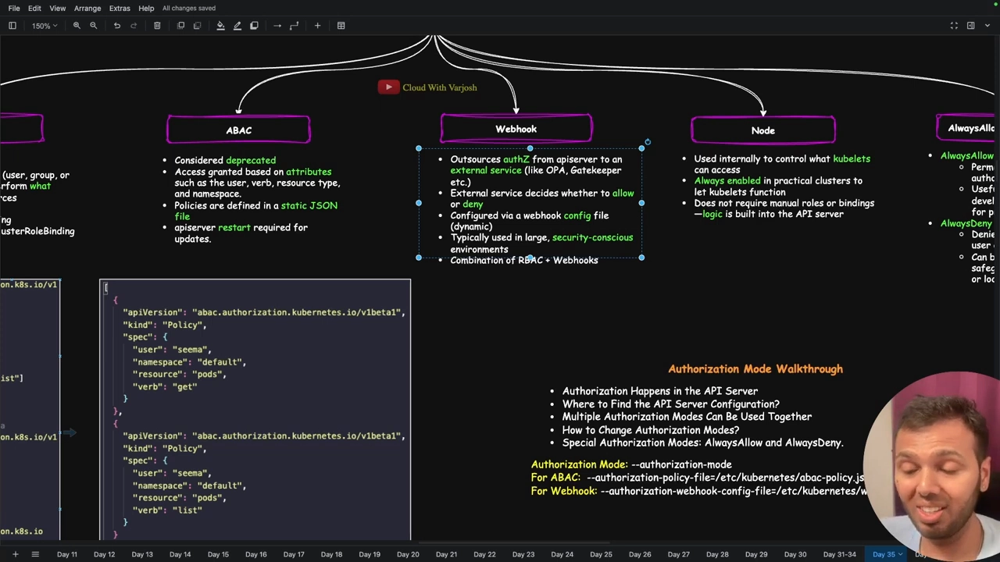
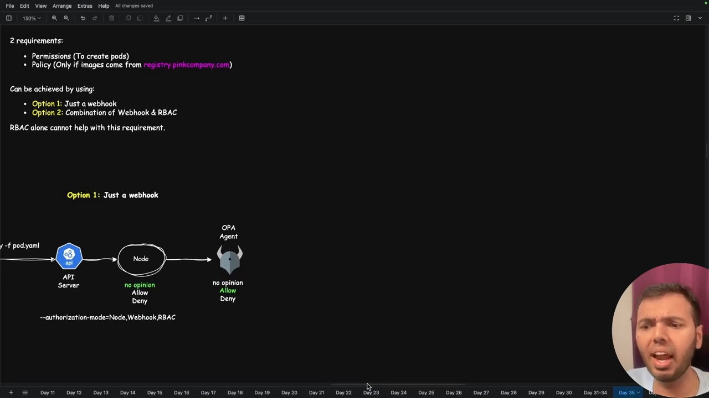
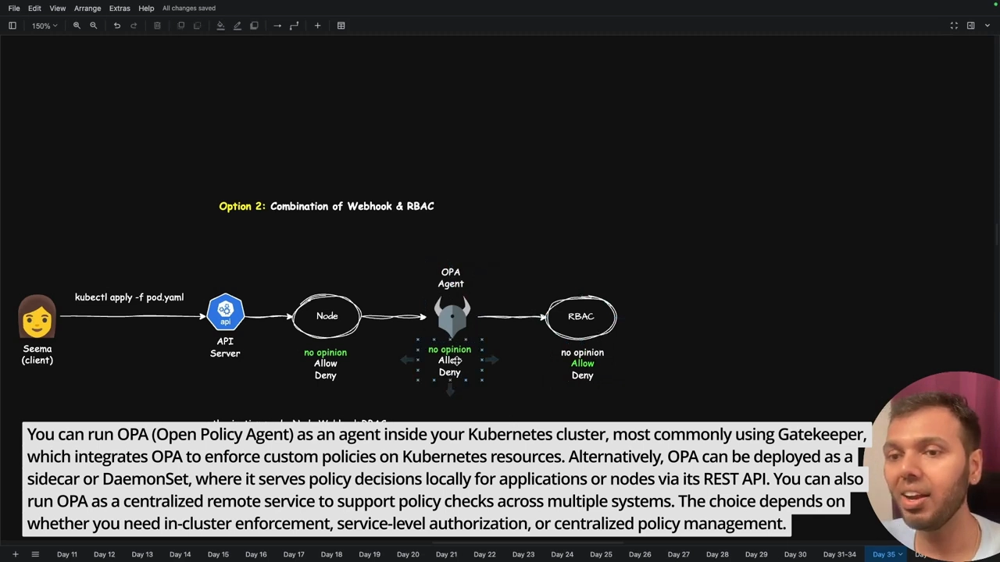

# Kubernetes 授权模式：Node、RBAC、ABAC 与 Webhook 的串联

> 视频来源：[Day 35: MASTER Kubernetes Authorization Modes & The Kubernetes API | CKA Course 2025](https://www.youtube.com/watch?v=DkKc3RCW2BE)（YouTube，Cloud With VarJosh）
>
> 文稿左栏为英文自动字幕，本文已翻译并重写为中文。全文按「Kubernetes API 与端点 → kubectl proxy → API 分组 → 授权模式（RBAC/ABAC/Webhook/Node/Always*）→ 多模式串联 → 配置位置 → 组合场景」的顺序重排。

## 本讲要解决的核心问题（SCQA）

**背景**：上一讲我们知道了请求进入 API Server 要先过**认证**（你是谁）。认证之后紧接着就是**授权**（Authorization）：决定「你能干什么」。

**冲突**：Kubernetes 提供了好几种授权模式——RBAC、ABAC、Webhook、Node，还有 AlwaysAllow / AlwaysDeny。它们**各自解决什么问题、谁在用、能不能一起用**？更绕的是，请求要先经过 `kube-apiserver` 暴露的 **Kubernetes API**，而「Kubernetes API」和「API Server」还不是一回事。

**疑问**：Kubernetes 到底有哪些授权模式？当同时启用多个模式时，一个请求会怎么被判定？又该在哪个文件里改？

**回答（中心思想）**：Kubernetes 的授权也是**可插拔**的，请求沿着**有序的授权模式列表**逐个判定，每个模式只回三种结果之一——**Allow / Deny / NoOpinion**，一旦 Allow 或 Deny 就**立即停下**，只有 **NoOpinion** 才交给下一个模式。生产环境里绝大多数集群用 **RBAC**，加上默认启用的 **Node 授权器**，「**RBAC + Webhook**」组合则在有安全策略诉求时出现。

---

## 一、先分清：Kubernetes API ≠ API Server

视频反复强调一个容易混淆的点：**API Server 是物理组件，「Kubernetes API」是逻辑概念**。[【跳转到 00:36】](https://www.youtube.com/watch?v=DkKc3RCW2BE&t=36)

- **API Server** 是集群的**中央枢纽**，但它身兼多职：认证、授权、准入控制、schema 校验等等——**托管 Kubernetes API 只是它的功能之一**。
- **Kubernetes API** 是一个**逻辑构造**，被「承载」在 API Server 之内；同时它还是个**总括（umbrella）概念**，下面挂着许多 API 端点。

这套 API 是 **RESTful** 的：遵循 REST 原则，用 HTTP 动词（GET / POST / PUT / PATCH / DELETE）操作资源（Pod、Deployment、ServiceAccount……）。你敲的 `kubectl get pods` 这类人类友好的命令，会被 **kubectl 客户端**在底层翻译成 REST 调用。[【跳转到 02:16】](https://www.youtube.com/watch?v=DkKc3RCW2BE&t=136)

比如「列出 default 命名空间里的 Pod」这条 REST 调用，就会打到 API Server；API Server 先做认证和授权，通过后再把请求转给对应的 API 端点处理。[【跳转到 03:56】](https://www.youtube.com/watch?v=DkKc3RCW2BE&t=236)

---

## 二、API 端点：哪些公开，哪些需要认证

Kubernetes API 这把「伞」下主要挂着这些端点：[【跳转到 04:46】](https://www.youtube.com/watch?v=DkKc3RCW2BE&t=286)

- `/version`：返回 **API Server 自身**的版本；
- `/healthz`、`/livez`、`/readyz`：**健康检查**端点，返回 `ok` 说明 API Server 健康（结尾那个「z」是为了和名为 `health`/`ready` 的资源区分开，避免混淆）；
- `/api` 与 `/apis`：**资源相关**的两大入口——你操作的所有对象（Deployment、DaemonSet、Job、CronJob、Role、RoleBinding……）都走这两个端点；
- `/metrics`：以 **Prometheus 格式**返回 API Server 指标（被 Datadog、New Relic 等监控工具广泛支持）；
- `/logs`：注意——它**不是**标准 API 端点。`kubectl logs` 取容器日志其实是**触发 kubelet** 里的逻辑，跟这个 `/logs` 不是一回事；`/logs` 只有在特定参数开启时才可用。

**哪些端点不用认证？** `version` 和三个健康端点**可公开访问、无需认证**；而 `/metrics` 这类端点一旦不带凭据去访问，会收到 **403 Forbidden**——也就是说它们需要某种认证。[【跳转到 08:37】](https://www.youtube.com/watch?v=DkKc3RCW2BE&t=517)

---

## 三、kubectl proxy 与 kube-proxy：名字像，别混淆

想访问需要认证的端点（如 `/metrics`）又不想手工拼证书时，可以用 `kubectl proxy`：它启动一个**本地 HTTP 代理**，你只需往 localhost 发 HTTP 请求，它**在底层用你的 kubeconfig**去跟 API Server 通信（对外那段仍是 HTTPS）。[【跳转到 12:58】](https://www.youtube.com/watch?v=DkKc3RCW2BE&t=778)

要特别记住：**`kubectl proxy` ≠ `kube-proxy`**。[【跳转到 13:48】](https://www.youtube.com/watch?v=DkKc3RCW2BE&t=828)

- `kube-proxy` 是**数据面组件**，作为 DaemonSet 运行，负责 Service 到 Pod 的网络转发；
- `kubectl proxy` 只是**本地的一个 HTTP 服务器**，方便你带凭据访问 API。

---

## 四、API 分组：core group 与 named group

Kubernetes 用**API 分组**来组织它的 API，分成两大类：[【跳转到 17:03】](https://www.youtube.com/watch?v=DkKc3RCW2BE&t=1023)

- **核心组（core group）**：挂在 `/api` 下。它**没有组名**，只有版本——所以写 `apiVersion: v1` 的资源就属于核心组（如 Pod、Service、PVC、PV、RC 等**最早期的对象**）。
- **命名组（named group）**：挂在 `/apis` 下，路径是 `/apis/<组名>/<版本>`，既有组名又有版本。例如：`apps` → Deployment、DaemonSet；`batch` → Job、CronJob；`rbac.authorization.k8s.io` → Role、RoleBinding；`storage.k8s.io` → 存储相关。

**为什么核心组不也起个组名？**——出于**向后兼容**的刻意决定：Kubernetes 最早只有核心组，那时觉得「反正就一个组，名字省了」；后来引入命名组，为了让新东西能按 batch、security、networking、storage 等清晰分类，才在命名组里加上组名。老对象则留在核心组不动。[【跳转到 22:12】](https://www.youtube.com/watch?v=DkKc3RCW2BE&t=1332)

**API 路径的通用语法**是：`/根/组/版本/namespaces/命名空间/资源类型/名字`。举两个例子：[【跳转到 22:58】](https://www.youtube.com/watch?v=DkKc3RCW2BE&t=1378)

- Pod（核心组）：`/api/v1/namespaces/default/pods/$PODNAME`（没有组名段）；
- Deployment（命名组）：`/apis/apps/v1/namespaces/default/deployments/$DEPLOYMENTNAME`（有组名段）。

---

## 五、授权：认证过了，还要决定「能干什么」

**认证（authentication）验证你是谁；授权（authorization）决定你能做什么。** 例如某人只有「create pods」权限，那他只能在集群里创建 Pod，动不了别的资源。[【跳转到 25:34】](https://www.youtube.com/watch?v=DkKc3RCW2BE&t=1534)

**谁能认证进集群？** 三类主体：**用户（users）**、**组（groups）**、**ServiceAccount**。[【跳转到 24:44】](https://www.youtube.com/watch?v=DkKc3RCW2BE&t=1484)

授权模式有以下几种，视频逐一讲解：[【跳转到 26:07】](https://www.youtube.com/watch?v=DkKc3RCW2BE&t=1567)

| 模式 | 谁在用 | 是否需要手工配置 |
| --- | --- | --- |
| **RBAC** | 绝大多数集群（视频称约 99%） | 需要 |
| **Node** | kubelet，**默认启用** | 不需要 |
| **Webhook** | 把决策外包给外部服务（OPA/Gatekeeper） | 需要 |
| **ABAC** | 几乎不在生产使用 | 需要 |
| **AlwaysAllow / AlwaysDeny** | 测试 / 完全lockdown 等极端场景 | 需要 |

---

## 六、RBAC：最常用的授权模式

RBAC 通过定义「**谁能（用户/组/ServiceAccount）对哪些资源做哪些操作**」来工作。比如「Sema 是用户，Sema 只能读取 Pod 数据」，就是这样一类规则。[【跳转到 27:32】](https://www.youtube.com/watch?v=DkKc3RCW2BE&t=1652)

它有几个核心概念：[【跳转到 29:36】](https://www.youtube.com/watch?v=DkKc3RCW2BE&t=1776)

- **Role**：在**某个命名空间内**授予权限；
- **RoleBinding**：把一个 Role（或 ClusterRole）**绑定**到用户/组/ServiceAccount；
- **ClusterRole**：**集群范围**的角色；
- **ClusterRoleBinding**：把 ClusterRole 绑定到主体。

要理解这些，先要分清**命名空间级资源**和**集群级资源**：用 `kubectl api-resources` 看，`NAMESPACED=true` 的资源属于某个命名空间（如 Pod、PVC），`false` 的则是集群级（如 Node、PersistentVolume）。[【跳转到 28:03】](https://www.youtube.com/watch?v=DkKc3RCW2BE&t=1683)

这里有个**常见误区**：很多同学以为「ClusterRole 不能用于命名空间级资源，比如不能拿 ClusterRole 去管 Deployment」——**这是错的**。ClusterRole 当然可以包含命名空间级资源（如 deployments），只是**一旦用 ClusterRole 授予权限，该用户就能在「所有命名空间」里访问这些资源**。所以「要不要用 ClusterRole」，取决于你是想只给某个命名空间、还是给全集群。[【跳转到 30:26】](https://www.youtube.com/watch?v=DkKc3RCW2BE&t=1826)

---

## 七、ABAC：属性驱动、静态 JSON、已不推荐

ABAC（Attribute-Based Access Control，基于属性的访问控制）根据**属性**判定——用户、动词（verb）、资源类型、命名空间。乍看和 Role/RoleBinding 很像（都有用户、动词、资源、命名空间），但关键差别是：**ABAC 不动态**——策略写在**静态 JSON 文件**里，直观性差、改动还要重启 API Server 才生效。[【跳转到 34:57】](https://www.youtube.com/watch?v=DkKc3RCW2BE&t=2097)

正因为不动态、不直观，视频明确说：**生产环境基本见不到 ABAC**。另外提醒一句：ABAC 配置文件里的组名 `abac.authorization.kubernetes.io` **不是**一个真正的 API 组，只是为了配置引用方便，别和命名组混淆。

---

## 八、Webhook 授权：把决策外包出去

Webhook 授权把「允许还是拒绝」的决策**外包给外部服务**：API Server 不再自己判断，而是调用一个外部服务（如 **OPA / Gatekeeper**），由它决定放行与否。它通过一个**动态的 webhook 配置文件**来配置（相比 ABAC 的静态文件更灵活）。[【跳转到 36:43】](https://www.youtube.com/watch?v=DkKc3RCW2BE&t=2203)

Webhook 的价值在于：它能承载**策略（policy）**级的判断，而不只是「有没有权限」。例如「允许创建 Pod，**但镜像必须来自 `registry.pinkco.company.com`**」——这类条件判断就适合放在 Webhook 里。因为生产环境常常既需要权限又要策略，所以常见的是「**RBAC + Webhook**」组合。

---

## 九、Node 授权器：默认存在，专管 kubelet

Node 授权器**默认就开着，你不需要手工配置**——RBAC、ABAC、Webhook 都要自己配，但 Node 不用。[【跳转到 40:33】](https://www.youtube.com/watch?v=DkKc3RCW2BE&t=2433)

它解决的问题是：kubelet 要拉取「调度到自己节点上的 Pod」的信息，再交给容器运行时去跑容器。那么——**如何保证 Worker Node 1 的 kubelet 只能读到「该调度到 Node 1」的 Pod 数据？** 答案就是 Node 授权器：它确保**每个节点的 kubelet 只能访问自己节点上的 Pod 相关数据**，逻辑直接内置在 API Server 里，**不需要手工建 Role/Binding**。

节点加入集群时其实分两步：先**认证**（bootstrap token 或客户端证书），再**授权**（靠 Node 授权器）。

---

## 十、AlwaysAllow 与 AlwaysDeny

- **AlwaysAllow**：只要认证通过，**做什么都行**。设集群时你本来就是管理员，所以别开它；只在「大团队都想随便测试」这类边角场景才可能用——视频说从没见过。[【跳转到 42:13】](https://www.youtube.com/watch?v=DkKc3RCW2BE&t=2533)
- **AlwaysDeny**：**谁都不能做任何操作**，用于「完全 lockdown」，比如系统里出现了恶意程序、你想彻底切断外部访问时。也很少见。视频还留了个思考题：一旦开了 AlwaysDeny 把所有人都挡在外面，你要怎么把它关掉？

---

## 十一、多授权模式如何串联：Allow / Deny / NoOpinion

这是本节最核心的机制。多个授权模式**可以同时启用**，请求按**有序列表**逐个判定，每个模式只回三种结果之一：**Allow、Deny、NoOpinion（无意见）**。[【跳转到 47:29】](https://www.youtube.com/watch?v=DkKc3RCW2BE&t=2849)

- 某个模式返回 **Allow** → **立即放行**，不再看后面的模式；
- 某个模式返回 **Deny** → **立即拒绝**，不再看后面的模式；
- 只有返回 **NoOpinion**，请求才会**交给下一个**模式继续判定。

以「`Node,RBAC`」为例：Sema 发起请求 → 认证 → 进入授权 → 先到 **Node**，Node 只服务 kubelet，于是回 **NoOpinion** → 请求交给 **RBAC** → RBAC 判断「Sema 能否读 Pod」，据此 Allow 或 Deny。**顺序很关键**：排在前面的模式一旦 Allow/Deny 就会截断后面的判定。

---

## 十二、在哪配置授权模式

授权发生在 API Server 里。用 **kubeadm** 建的集群（`kind` 底层也是 kubeadm）把控制面跑成**静态 Pod**，因此 API Server 的配置就在**静态 Pod 清单**里：`/etc/kubernetes/manifests/kube-apiserver.yaml`。[【跳转到 44:03】](https://www.youtube.com/watch?v=DkKc3RCW2BE&t=2643)

- 用 `docker exec` 进控制面节点（或直接看），`cat` 这份清单，找到 **`--authorization-mode`** 参数，例如 `--authorization-mode=Node,RBAC`；
- 改授权模式就是**编辑这个文件**——想加 Webhook 就在后面追加 `Webhook`，存盘后静态 Pod 会自动重启；
- 特殊模式 **AlwaysAllow / AlwaysDeny**：把这里所有模式去掉、只写 `always-allow` 或 `always-deny` 即可；
- ABAC 额外用参数指定静态 JSON（policy file）；Webhook 用参数指定 webhook 配置文件路径。

> 注意：用 **GKE / AKS / EKS** 这类托管服务时，控制面是**隐藏**的，你未必看得到这些清单，也不保证它用静态 Pod。[【跳转到 46:41】](https://www.youtube.com/watch?v=DkKc3RCW2BE&t=2801)

---

## 十三、组合场景：RBAC 与 Webhook 怎么分工

视频用两个需求把「组合」讲透：[【跳转到 51:28】](https://www.youtube.com/watch?v=DkKc3RCW2BE&t=3088)

- **需求 1（权限）**：授予「创建 Pod」的权限；
- **需求 2（策略）**：只允许创建**镜像来自 `registry.pinkco.company.com`** 的 Pod。

**方案一：只用 Webhook。** 去掉 RBAC，让 Webhook（OPA）同时负责权限和策略。可行，但生产里几乎不会**只用** Webhook，通常是组合使用。

**方案二：Node + Webhook + RBAC（组合）。** 请求判定顺序是：

1. **Node**：只服务 kubelet，对普通用户返回 **NoOpinion**；
2. **Webhook（OPA）**：检查镜像来源。镜像合规时它**故意返回 NoOpinion**（而不是 Allow！），好让判定继续往下走；
3. **RBAC**：最终判断有无「创建 Pod」权限，Return Allow 或 Deny。

这里的关键点再次出现：**如果 Webhook 在镜像合规时直接返回 Allow，判定就会停在第 2 步**，RBAC 根本没机会参与。所以第 2 步必须返回 **NoOpinion** 把判断权交给 RBAC。反过来，如果镜像不合规，Webhook 直接 **Deny**，判定当场结束。

---

## 小结

- **Kubernetes API ≠ API Server**：前者是逻辑的总括 API（RESTful，用 HTTP 动词操作资源），后者是物理的中央枢纽，托管这套 API。
- API 端点里 `/version` 与健康端点**公开**，`/api`、`/apis` 承载所有资源对象，其余（如 `/metrics`）需要认证；`kubectl proxy` 是用 kubeconfig 带凭据访问的本地代理，**别和 kube-proxy 混**。
- API 分**核心组（`/api`，无组名，老对象）**与**命名组（`/apis/<组>/<版本>`）**；路径语法为 `/根/组/版本/namespaces/ns/资源/名`。
- 授权模式：**RBAC（主流）**、**Node（默认）**、**Webhook（策略外包）**、**ABAC（静态、不推荐）**、**AlwaysAllow/AlwaysDeny（极端场景）**。
- 多模式**有序串联**：每个模式回 **Allow/Deny/NoOpinion**，**Allow 或 Deny 立即截断**，只有 **NoOpinion** 才传给下一个。
- 配置位置：kubeadm 集群在 **`/etc/kubernetes/manifests/kube-apiserver.yaml`** 的 **`--authorization-mode`**；托管服务看不到控制面。
- 生产常用 **RBAC + Webhook**：**RBAC 管权限、Webhook 管策略**，靠 **NoOpinion** 把判定接力下去。

## 关键术语速查

| 术语 | 一句话解释 |
| --- | --- |
| Kubernetes API | API Server 逻辑上托管的、RESTful 的 API 总括，含多个端点 |
| API Server | 集群中央枢纽（物理组件），负责认证、授权、准入等 |
| 端点（endpoint） | `/version`、健康端点、`/api`、`/apis`、`/metrics` 等 |
| `kubectl proxy` | 本地 HTTP 代理，用 kubeconfig 帮你带凭据访问 API；≠ kube-proxy |
| core group / named group | `/api`（老对象，无组名）与 `/apis/<组>/<版本>`（新对象） |
| Authorization（授权） | 决定「你能做什么」；可插拔、可多模式串联 |
| RBAC | 最常用授权模式；Role/RoleBinding/ClusterRole/ClusterRoleBinding |
| RoleBinding / ClusterRoleBinding | 把角色绑定到用户/组/ServiceAccount 的对象 |
| ABAC | 基于属性的授权；策略在静态 JSON，不动态，生产不用 |
| Webhook（授权） | 把授权决策外包给外部服务（如 OPA/Gatekeeper） |
| Node 授权器 | 默认启用，保证 kubelet 只能读自己节点上的 Pod 数据 |
| AlwaysAllow / AlwaysDeny | 全放行 / 全拒绝，仅极端场景使用 |
| Allow / Deny / NoOpinion | 单个授权模式的三种返回；NoOpinion 才会传给下一个模式 |
| `--authorization-mode` | API Server 上指定启用哪些授权模式（如 `Node,RBAC`） |
